# 企业域（ENT）数据库设计（v1）

| 属性 | 内容 |
|------|------|
| 文档编号 | DATA-ENT-DB-v1 |
| 版本 | v1.1.0（已分册） |
| 状态 | **v1.1 已分册** — 执行真源见 [`database-design/科技专题服务算法库/分册-企业域/科技专题服务算法库-企业域(智树)-数据库设计说明书-v1.1.md`](../database-design/科技专题服务算法库/分册-企业域/科技专题服务算法库-企业域(智树)-数据库设计说明书-v1.1.md)；DDL 见 `ddl/gkx_dwd_ent_v1.sql` + `gkx_ads_ent_v1.sql` |
| 作者 | data-agent（资深数据工程师 + 数据架构师） |
| 创建日期 | 2026-06-18 |
| 支撑基线 | `ENT-functional-design-v2.md`（v2.1.0，18 个验收点 E-20~E-37） |
| 范围 | 企业要素全链路数据库：DWD 自建明细 + ADS 应用结果 + cfg_metric 指标注册 + NebulaGraph 图谱 + 三段映射 + DQ 规则 |
| 数据真源 | `企业相关-ODS到DWD字段映射分析报告(v2).md`、`ODS源数据表结构清单(v2).md`、`要素库建表语句.sql` |
| 引擎 | MySQL 8.0（utf8mb4，DWD/ADS/cfg）+ NebulaGraph 3.x（图谱）；遵循总纲三引擎分工 |
| 关联 | `数据库设计.md`（总纲）、`data-lineage-policy.md`（D9）、`cfg_metric-ENT-seed.yaml`（49 条种子，本设计的 cfg_metric 真源） |

> **铁律声明**：本设计严格遵守 ① 字段名沿用 ODS（不擅自翻译/拼音）；② ADS 先行，Java 只读 ADS；③ 算法字段标 🔧 待 algorithm-agent；④ 图谱必须 NebulaGraph（禁 Neo4j）；⑤ 不替甲方做口径决策（歧义登记 Q010~Q018）；⑥ 全部 metric_id 可回链 ODS 真源或标算法依赖。

---

## 目录

1. [设计原则与分层](#1-设计原则与分层)
2. [库/Schema 规划与命名](#2-库schema-规划与命名)
3. [实体归一与主键策略](#3-实体归一与主键策略)
4. [DWD 自建标准明细层](#4-dwd-自建标准明细层)
5. [ADS 应用结果层](#5-ads-应用结果层)
6. [cfg_metric 指标注册（D9）](#6-cfg_metric-指标注册d9)
7. [NebulaGraph 图谱 schema](#7-nebulagraph-图谱-schema)
8. [ODS→DWD→ADS 三段映射](#8-odsdwdads-三段映射)
9. [DQ 数据质量规则](#9-dq-数据质量规则)
10. [ER 关系图](#10-er-关系图)
11. [Mock 数据规模建议](#11-mock-数据规模建议)
12. [待甲方确认开放项](#12-待甲方确认开放项)
13. [可执行 DDL 汇总](#13-可执行-ddl-汇总)

---

## 1. 设计原则与分层

### 1.1 分层链路（遵循总纲 §1 + data.mdc 铁律 4）

```text
三方「要素库」(186 张 dwd_* 表，归属 ODS 贴源层，只读)
        │  数据工厂清洗/归一/聚合
        ▼
DWD 自建标准明细层  dwd.enterprise / enterprise_*（小写前缀，字段沿用 ODS）
        │  DWS 轻聚合（行业基准/区域聚合/历年趋势）+ algorithm-agent 评分模型
        ▼
ADS 应用结果层  ent_*（直供 Java 只读 / 前端，契约面，冻结）
        │
        ├──► MySQL（RDBMS：DWD/ADS/cfg）
        └──► NebulaGraph space=gkx_enterprise（供应链/合作/母子图谱）
```

| 层 | 物理位置 | 谁写 | 谁读 | 本设计交付 |
|----|---------|------|------|-----------|
| ODS | 三方要素库（命名 `dwd_*`） | 供应方 | 数据工厂（Python） | 引用，不建 |
| DWD | `dwd.*` | Python ETL | Python / algorithm | ✅ 9 张表 DDL |
| DWS | `gkx_dwm.*` | Python + algorithm | Python | 🟦 预留（行业基准/区域聚合，本期占位） |
| ADS | `ads.ent_*` | Python | **Java 只读** + 前端 | ✅ 13 张表 DDL |
| cfg | `gkx_cfg.cfg_metric*` | data + algorithm | 全域 | ✅ DDL + 49 注册 |
| 图谱 | NebulaGraph `gkx_enterprise` | Python 灌数 | Python（Java 禁直连 nGQL） | ✅ tag/edge schema |

### 1.2 三段映射状态图例（沿用映射报告 v2 标杆）

| 图例 | 含义 |
|------|------|
| ✅ | 直接映射：ODS 有对应字段，可直接取值或简单类型/枚举转换 |
| 🔧 | 需计算/算法：有数据源但需聚合、公式推导、规则判定或算法模型（待 algorithm-agent） |
| ⚠️ | 待确认：源可用但业务口径需甲方确认（引用 Q010~Q018） |
| ❌ | 无来源：要素库中无相关数据，需额外采购或暂置空 |
| 🟦 | 系统/预留：主键、时间戳、扩展位等由系统自动填充 |

---

## 2. 库/Schema 规划与命名

MySQL 中「schema = database」。按总纲 §2.1 逻辑划分落地为以下 database：

| database | 归属层 | 写 | 读 | 内容 |
|----------|--------|----|----|------|
| `dwd` | DWD | Python | Python/algorithm | 企业标准明细 9 张（`dwd.enterprise` 等） |
| `gkx_dwm` | DWS | Python | Python | 行业基准/区域聚合/历年趋势（本期占位预留） |
| `ads` | ADS | Python | **Java 只读** | 企业应用结果 `ent_*` 13 张 |
| `gkx_cfg` | 配置 | data/运维 | 全域 | `cfg_metric` / `cfg_metric_lineage` / `cfg_degrade_switch` |
| `dim` | 维表 | Python | Python/Java | 区划维表 `dim.region`、产业链维表 `dim.industry_chain`（复用/扩展） |

> **逻辑名 = 物理名约定（PG `demo_gdf_data`，1B+2B）**：统一以 `dwd.enterprise` 引用 DWD、以 `ads.ent_*` 引用 ADS；下文 DDL 用 `dwd` / `ads` / `dim` / `gkx_cfg` schema（历史 MySQL 多库写法已收敛为同库多 schema）。

**通用列规约**（每张表）：
- 主键 `id BIGINT AUTO_INCREMENT`；业务键 `enterprise_code VARCHAR(64)`（统一社会信用代码）。
- 系统列：`create_time DATETIME DEFAULT CURRENT_TIMESTAMP`、`update_time DATETIME DEFAULT CURRENT_TIMESTAMP ON UPDATE CURRENT_TIMESTAMP`。
- 批次列（ADS）：`calc_batch_id VARCHAR(64)`（Mock 阶段前缀 `mock_`）。
- 扩展列：`ext JSON NULL`（兜底三方未预见字段，避免后续改表，总纲 §12.2）。
- 字符集：`ENGINE=InnoDB DEFAULT CHARSET=utf8mb4 COLLATE=utf8mb4_0900_ai_ci`。

---

## 3. 实体归一与主键策略

### 3.1 双源企业主数据归一（v2 首要工程难点）

企业主数据存在**双源**，需以统一社会信用代码归一：

| 来源（ODS） | 行键 | 归一键 | 口径 |
|------|------|--------|------|
| `dwd_org_reg_info`（国内机构） | `org_id` | `external_id`（统一社会信用代码） | 机构口径，含经纬度/上市状态 |
| `dwd_company_base`（量子专题工商通用） | `id` | `credit_code`（统一信用代码） | 工商口径，含企业类型三级/实缴资本 |
| `dwd_forg_base_info`（国外机构） | `org_id` | `external_id`（当地注册码） | 跨境，主键体系不同，单独处理 |

**归一规则**：`enterprise_code = COALESCE(o.external_id, c.credit_code)`，机构口径为主、工商口径补全（FULL JOIN ON external_id = credit_code），详见映射报告 §8 示例 ETL。

### 3.2 主键策略（兼容 demo + 满足任务要求）

| 键 | 类型 | 角色 | 说明 |
|----|------|------|------|
| `id` | BIGINT AUTO_INCREMENT | 物理主键/外键 | 子表 `enterprise_id` 外键引用（与 demo 一致，便于关联查询） |
| `enterprise_code` | VARCHAR(64) UNIQUE | **业务归一主键** | 统一社会信用代码（任务要求的统一主键），跨表/跨图谱稳定键 |

- 子表同时携带 `enterprise_id`（FK）与 `enterprise_code`（冗余，便于直接按信用代码查询与图谱对齐）。
- NebulaGraph `vid = ent:{enterprise_code}`（**与 RDBMS `enterprise_code` 对齐**，区别于 demo 的 `ent:{id}`），保证 RDBMS↔图谱稳定一致、跨批次不漂移。

---

## 4. DWD 自建标准明细层

> schema `dwd`。字段名严格沿用 ODS（如 `enterprise_name` / `revenue_latest` / `patent_grant_count`）。覆盖映射报告 8 张企业 DWD 表 + 1 张 demo 对齐补充表（`enterprise_news`）。

### 4.1 表清单

| # | 表（逻辑名） | 字段数 | 说明 | 主要 ODS 来源 | 映射覆盖率 |
|---|-------------|--------|------|---------------|-----------|
| 1 | `dwd.enterprise` | 66 | 企业主表 | `dwd_org_reg_info`、`dwd_company_base`、`dwd_org_annual_financial_info`、`dwd_org_stock_base/finance_info`、`dwd_org_rd_achiev_info`、`dwd_company_*_tags`、`dwd_org_tag_info`、`dwd_company_location_tags` | 90.0% |
| 2 | `dwd.enterprise_finance_history` | 13 | 企业财务历史（逐年） | `dwd_org_annual_financial_info`、`dwd_org_stock_finance_info` | 80.0% |
| 3 | `dwd.enterprise_patent_history` | 9 | 企业专利历史（逐年） | `dwd_patent`、`dwd_patent_legal`、`dwd_patent_cited`、`dwd_org_industry_chain_pat_dtl`、`dwd_org_rd_achiev_info` | 100% |
| 4 | `dwd.enterprise_parent_subsidiary` | 8 | 母子公司/股权关系 | `dwd_org_shareholder_info`、`dwd_org_invest_info`、`dwd_company_shareholder`、`dwd_company_branch` | 100% |
| 5 | `dwd.enterprise_supply_chain` | 9 | 供应链上下游关系 | `dwd_industry_chain_info`、`dwd_org_industry_chain_dtl` | 100% |
| 6 | `dwd.enterprise_industry` | 8 | 产业链归属 | `dwd_org_industry_chain_dtl`、`dwd_industry_chain_info`、`dwd_company_industry_tags`、`dwd_industry_code` | 100% |
| 7 | `dwd.enterprise_cooperation` | 10 | 合作关系（产学研/同业） | `dwd_org_industry_chain_pat_dtl`、`dwd_zh_paper/dwd_en_paper`、`dwd_rel_project_*` | 100% |
| 8 | `dwd.enterprise_business_tag` | 7 | 业务/资质标签 | `dwd_org_tag_info`、`dwd_company_basic_tags/diy_tags/honor_tags/industry_tags` | 100% |
| 9 | `dwd.enterprise_news` 🆕 | 16 | 企业重点资讯/事件（demo 对齐补充） | `dwd_org_important_news_info`、`dwd_org_financing_info`、`dwd_org_merger_acquisition_info` | 85%（demo 补足） |

> 第 9 张 `enterprise_news` 为 demo（`schema_dwd_patch.sql`）已落地的补充表，本设计保留以支撑 P0 趋势/资讯与 A4 门户资讯（FDS v2.1 未单列页面，作 ADS 资讯统计来源）。

### 4.2 dwd.enterprise（企业主表，66 字段）

> 字段口径完整逐字段映射见映射报告 §5.1；下方 DDL 字段名沿用 ODS，类型转 MySQL，标注映射状态。

```sql
CREATE SCHEMA IF NOT EXISTS dwd; -- PG；历史 MySQL 曾为独立库 gkx_dwd

CREATE TABLE dwd.enterprise (
  id                    BIGINT       NOT NULL AUTO_INCREMENT          COMMENT '🟦 物理主键，序列自增',
  enterprise_code       VARCHAR(64)  NOT NULL                         COMMENT '✅ 统一社会信用代码(归一业务主键) <- dwd_org_reg_info.external_id / dwd_company_base.credit_code',
  enterprise_name       VARCHAR(255) NOT NULL                         COMMENT '✅ 企业全称 <- dwd_org_reg_info.name_cn / dwd_company_base.name',
  enterprise_name_short VARCHAR(100) NULL                             COMMENT '⚠️ 简称(要素库无，需NLP抽取/截取)',
  enterprise_name_en    VARCHAR(255) NULL                             COMMENT '✅ 英文名 <- dwd_company_base.english_name',
  legal_representative  VARCHAR(100) NULL                             COMMENT '✅ 法定代表人 <- dwd_org_reg_info.lerep / dwd_company_base.legal_representative',
  registered_capital    DECIMAL(20,4) NULL                           COMMENT '✅ 注册资本(万元) <- dwd_org_reg_info.registered_capital_value/10000 / dwd_company_base.reg_capital_std',
  paid_in_capital       DECIMAL(20,4) NULL                           COMMENT '✅ 实缴资本(万元) <- dwd_company_base.real_capital_std',
  registration_date     DATE         NULL                            COMMENT '✅ 成立日期 <- dwd_org_reg_info.incorporation_date / dwd_company_base.establish_date',
  business_status       VARCHAR(20)  NULL                            COMMENT '✅ 经营状态 <- dwd_company_base.status_std',
  enterprise_type       VARCHAR(50)  NULL                            COMMENT '✅ 企业类型(三级) <- dwd_company_base.first_type/second_type/detail_type',
  industry_category     VARCHAR(100) NULL                            COMMENT '✅ 所属行业名称 <- dwd_org_org_product_info.industry_class / dwd_company_nei_code.industry_l1_name',
  industry_code         VARCHAR(20)  NULL                            COMMENT '✅ 行业代码 <- dwd_company_nei_code.industry_l1_code',
  business_scope        TEXT         NULL                            COMMENT '✅ 经营范围 <- dwd_org_org_product_info.main_activities / dwd_company_base.scope',
  registered_address    VARCHAR(500) NULL                            COMMENT '✅ 注册地址 <- dwd_org_reg_info.address / dwd_company_base.registered_add',
  headquarters_city     VARCHAR(100) NULL                            COMMENT '✅ 总部城市 <- dwd_org_reg_info.city / dwd_company_location_tags.reg_city',
  headquarters_district VARCHAR(100) NULL                            COMMENT '✅ 总部区县 <- dwd_company_base.ori_reg_district / dwd_company_location_tags.reg_district',
  headquarters_province VARCHAR(100) NULL                            COMMENT '✅ 总部省份 <- dwd_org_reg_info.province / dwd_company_base.ori_reg_province',
  headquarters_address  VARCHAR(500) NULL                            COMMENT '✅ 总部地址(=注册地址)',
  headquarters_lng      DECIMAL(12,7) NULL                           COMMENT '✅ 经度 <- dwd_org_reg_info.addr_lng / dwd_company_location_tags.reg_xy',
  headquarters_lat      DECIMAL(12,7) NULL                           COMMENT '✅ 纬度 <- dwd_org_reg_info.addr_lat',
  is_listed             TINYINT      NULL                            COMMENT '🔧 是否上市 <- dwd_org_reg_info.listing_status / 存在 dwd_org_stock_base 记录则=1',
  listed_market         VARCHAR(50)  NULL                            COMMENT '✅ 上市板块 <- dwd_org_stock_base.stock_type',
  listed_code           VARCHAR(20)  NULL                            COMMENT '✅ 股票代码 <- dwd_org_stock_base.stock_code',
  is_foreign            TINYINT      NULL                            COMMENT '🔧 是否外资 <- dwd_company_base.first_type(含"外资") / 关联 dwd_forg_base_info',
  is_high_tech          TINYINT      NULL                            COMMENT '🔧⚠️ 高新技术企业(Q010) <- dwd_org_tag_info.org_tag / dwd_company_honor_tags.national_tag 解析',
  is_sme                TINYINT      NULL                            COMMENT '🔧 是否科技型中小 <- dwd_company_basic_tags.scale_tag / 年报规则',
  is_little_giant       TINYINT      NULL                            COMMENT '🔧 是否专精特新 <- dwd_company_honor_tags 解析',
  little_giant_level    VARCHAR(20)  NULL                            COMMENT '🔧 专精特新级别 <- dwd_company_honor_tags.national_tag/province_tag',
  is_gazelle            TINYINT      NULL                            COMMENT '🔧 是否瞪羚 <- dwd_company_honor_tags 解析',
  is_unicorn            TINYINT      NULL                            COMMENT '🔧 是否独角兽 <- dwd_company_honor_tags 解析',
  revenue_latest        DECIMAL(20,4) NULL                           COMMENT '✅ 最新年营收(万元) <- dwd_org_annual_financial_info.operating_revenue(最新year)',
  revenue_year          INT          NULL                            COMMENT '✅ 营收对应年份 <- dwd_org_annual_financial_info.year',
  revenue_growth_rate   DECIMAL(10,4) NULL                           COMMENT '🔧 营收增长率(%) <- 相邻年计算',
  net_profit            DECIMAL(20,4) NULL                           COMMENT '✅ 净利润(万元) <- dwd_org_annual_financial_info.pure_profit',
  profit_margin         DECIMAL(10,4) NULL                           COMMENT '🔧 利润率(%) <- 净利润/营收',
  gross_margin          DECIMAL(10,4) NULL                           COMMENT '⚠️ 毛利率(年报缺毛利明细，上市可推算)',
  market_share          DECIMAL(10,4) NULL                           COMMENT '❌ 市场份额(需采购市调数据)',
  brand_score           DECIMAL(10,4) NULL                           COMMENT '❌ 品牌声量(可基于资讯做算法，否则无来源)',
  customer_concentration DECIMAL(10,4) NULL                          COMMENT '❌ 客户集中度(需客户明细)',
  patent_apply_count    INT          NULL                            COMMENT '✅ 累计专利申请数 <- dwd_org_industry_chain_pat_dtl / dwd_patent 聚合',
  patent_grant_count    INT          NULL                            COMMENT '✅ 累计专利授权数 <- dwd_org_rd_achiev_info(inv+util+des 预聚合)',
  patent_valid_count    INT          NULL                            COMMENT '🔧 有效专利数 <- dwd_patent_legal 法律状态计算',
  patent_invention_count INT         NULL                            COMMENT '✅ 发明专利授权数 <- dwd_org_rd_achiev_info.inv_pat_auth_num',
  patent_citation_count INT          NULL                            COMMENT '✅ 专利被引数 <- dwd_patent_cited 聚合',
  rd_staff_count        INT          NULL                            COMMENT '⚠️ 研发人数 <- dwd_org_annual_financial_info.employees_number(为从业人数，口径待确认)',
  rd_staff_ratio        DECIMAL(10,4) NULL                           COMMENT '🔧 研发人数占比 <- rd_staff_count/总员工',
  rd_investment         DECIMAL(20,4) NULL                           COMMENT '✅ 研发投入(万元) <- dwd_org_stock_finance_info.research_development_amount(上市可得)',
  rd_investment_ratio   DECIMAL(10,4) NULL                           COMMENT '🔧 研发投入占比 <- rd_investment/revenue',
  core_tech_coverage    DECIMAL(10,4) NULL                           COMMENT '🔧 核心技术覆盖(算法：专利+论文+技术领域)',
  tech_score            DECIMAL(10,4) NULL                           COMMENT '🔧 技术力评分(算法模型) <- ENT_WEIGHTED_SCORE',
  business_score        DECIMAL(10,4) NULL                           COMMENT '🔧 商业力评分(算法模型) <- ENT_WEIGHTED_SCORE',
  competitiveness_score DECIMAL(10,4) NULL                           COMMENT '🔧 综合竞争力(tech×W1+business×W2)',
  innovation_index      DECIMAL(10,4) NULL                           COMMENT '🔧 创新活力指数(算法)',
  introduction_value    VARCHAR(20)  NULL                            COMMENT '🔧 招引价值等级(规则引擎 A/B/C/D)',
  cultivation_priority  VARCHAR(20)  NULL                            COMMENT '🔧 培育优先级(规则引擎)',
  risk_level            VARCHAR(20)  NULL                            COMMENT '🔧 风险等级(经营异常/处罚/失信/被执行等风险表综合)',
  data_source           VARCHAR(100) NULL                            COMMENT '✅ 数据源标记 <- 各表 data_source',
  data_source_url       VARCHAR(500) NULL                            COMMENT '🔧 数据源链接 <- dwd_org_important_news_info.original_textlink',
  data_collect_time     DATETIME     NULL                            COMMENT '✅ 采集时间 <- 各表 created_time',
  data_update_time      DATETIME     NULL                            COMMENT '🟦 ETL 执行时间',
  data_completeness     DECIMAL(6,4) NULL                            COMMENT '🔧 数据完整度(非空字段数/总字段数)',
  data_confidence       DECIMAL(6,4) NULL                            COMMENT '🔧 数据置信度(多源一致性)',
  audit_status          VARCHAR(20)  NULL DEFAULT '待审核'           COMMENT '🟦 审核状态',
  ext                   JSON         NULL                            COMMENT '🟦 扩展位(兜底三方未预见字段)',
  create_time           DATETIME     NOT NULL DEFAULT CURRENT_TIMESTAMP COMMENT '🟦 写入时间',
  update_time           DATETIME     NOT NULL DEFAULT CURRENT_TIMESTAMP ON UPDATE CURRENT_TIMESTAMP COMMENT '🟦 更新时间',
  PRIMARY KEY (id),
  UNIQUE KEY uk_enterprise_code (enterprise_code),
  KEY idx_city (headquarters_city),
  KEY idx_industry (industry_category),
  KEY idx_reg_date (registration_date),
  KEY idx_geo (headquarters_lng, headquarters_lat)
) ENGINE=InnoDB DEFAULT CHARSET=utf8mb4 COLLATE=utf8mb4_0900_ai_ci COMMENT='企业主表(双源归一)';
```

### 4.3 dwd.enterprise_finance_history（财务历史，13 字段）

```sql
CREATE TABLE dwd.enterprise_finance_history (
  id                  BIGINT       NOT NULL AUTO_INCREMENT          COMMENT '🟦 序列自增',
  enterprise_id       BIGINT       NOT NULL                         COMMENT '✅ 企业外键 -> dwd.enterprise.id',
  enterprise_code     VARCHAR(64)  NOT NULL                         COMMENT '✅ 统一社会信用代码(冗余)',
  data_year           INT          NOT NULL                         COMMENT '✅ 数据年份 <- dwd_org_annual_financial_info.year / dwd_org_stock_finance_info.occur_period',
  revenue             DECIMAL(20,4) NULL                            COMMENT '✅ 营收(万元) <- dwd_org_annual_financial_info.operating_revenue(源字符串需转numeric)',
  revenue_growth_rate DECIMAL(10,4) NULL                            COMMENT '🔧 营收增长率(%) <- 相邻年',
  net_profit          DECIMAL(20,4) NULL                            COMMENT '✅ 净利润(万元) <- dwd_org_annual_financial_info.pure_profit',
  profit_margin       DECIMAL(10,4) NULL                            COMMENT '🔧 利润率(%) <- net_profit/revenue',
  gross_margin        DECIMAL(10,4) NULL                            COMMENT '⚠️ 毛利率(年报无毛利明细)',
  rd_investment       DECIMAL(20,4) NULL                            COMMENT '✅ 研发投入(万元，上市可得) <- dwd_org_stock_finance_info.research_development_amount',
  rd_investment_ratio DECIMAL(10,4) NULL                            COMMENT '🔧 研发投入占比',
  rd_staff_count      INT          NULL                             COMMENT '⚠️ 研发人数(employees_number 为从业人数，口径待确认)',
  create_time         DATETIME     NOT NULL DEFAULT CURRENT_TIMESTAMP COMMENT '🟦',
  update_time         DATETIME     NOT NULL DEFAULT CURRENT_TIMESTAMP ON UPDATE CURRENT_TIMESTAMP COMMENT '🟦',
  PRIMARY KEY (id),
  UNIQUE KEY uk_ent_year (enterprise_code, data_year),
  KEY idx_eid (enterprise_id)
) ENGINE=InnoDB DEFAULT CHARSET=utf8mb4 COLLATE=utf8mb4_0900_ai_ci COMMENT='企业财务历史(逐年)';
```

### 4.4 dwd.enterprise_patent_history（专利历史，9 字段）

```sql
CREATE TABLE dwd.enterprise_patent_history (
  id                    BIGINT      NOT NULL AUTO_INCREMENT          COMMENT '🟦 序列自增',
  enterprise_id         BIGINT      NOT NULL                         COMMENT '✅ 企业外键 -> dwd.enterprise.id',
  enterprise_code       VARCHAR(64) NOT NULL                         COMMENT '✅ 统一社会信用代码(冗余)',
  data_year             INT         NOT NULL                         COMMENT '✅ 年份 <- dwd_patent(申请年) / dwd_org_industry_chain_pat_dtl.apdt 提取',
  patent_apply_count    INT         NULL                             COMMENT '✅ 当年专利申请数 <- dwd_patent 按年 COUNT',
  patent_grant_count    INT         NULL                             COMMENT '✅ 当年专利授权数 <- dwd_patent_legal(状态=授权) 按年聚合',
  patent_valid_count    INT         NULL                             COMMENT '🔧 有效专利数 <- dwd_patent_legal 有效期计算',
  patent_citation_count INT         NULL                             COMMENT '✅ 当年专利被引数 <- dwd_patent_cited 按企业+年聚合',
  create_time           DATETIME    NOT NULL DEFAULT CURRENT_TIMESTAMP COMMENT '🟦',
  update_time           DATETIME    NOT NULL DEFAULT CURRENT_TIMESTAMP ON UPDATE CURRENT_TIMESTAMP COMMENT '🟦',
  PRIMARY KEY (id),
  UNIQUE KEY uk_ent_year (enterprise_code, data_year),
  KEY idx_eid (enterprise_id)
) ENGINE=InnoDB DEFAULT CHARSET=utf8mb4 COLLATE=utf8mb4_0900_ai_ci COMMENT='企业专利历史(逐年)';
```

### 4.5 dwd.enterprise_parent_subsidiary（母子公司，8 字段）

```sql
CREATE TABLE dwd.enterprise_parent_subsidiary (
  id                     BIGINT      NOT NULL AUTO_INCREMENT         COMMENT '🟦 序列自增',
  enterprise_id          BIGINT      NOT NULL                        COMMENT '✅ 子企业外键 -> dwd.enterprise.id',
  enterprise_code        VARCHAR(64) NOT NULL                        COMMENT '✅ 子企业统一社会信用代码',
  parent_enterprise_id   BIGINT      NULL                            COMMENT '✅ 母企业外键 <- dwd_org_shareholder_info.inv_org_id / dwd_company_shareholder.investor_id',
  parent_enterprise_name VARCHAR(255) NULL                           COMMENT '✅ 母企业/股东名称 <- dwd_org_shareholder_info.owners_name',
  ownership_ratio        DECIMAL(10,4) NULL                          COMMENT '✅ 持股比例(%) <- dwd_org_shareholder_info.ownership_percentage / dwd_company_shareholder.share_ratio',
  subsidiary_count       INT         NULL                            COMMENT '🔧 子公司/对外投资数 <- dwd_org_invest_info / dwd_company_branch COUNT',
  create_time            DATETIME    NOT NULL DEFAULT CURRENT_TIMESTAMP COMMENT '🟦',
  update_time            DATETIME    NOT NULL DEFAULT CURRENT_TIMESTAMP ON UPDATE CURRENT_TIMESTAMP COMMENT '🟦',
  PRIMARY KEY (id),
  KEY idx_eid (enterprise_id),
  KEY idx_parent (parent_enterprise_id)
) ENGINE=InnoDB DEFAULT CHARSET=utf8mb4 COLLATE=utf8mb4_0900_ai_ci COMMENT='母子公司/股权关系';
```

### 4.6 dwd.enterprise_supply_chain（供应链关系，9 字段）

```sql
CREATE TABLE dwd.enterprise_supply_chain (
  id                    BIGINT      NOT NULL AUTO_INCREMENT          COMMENT '🟦 序列自增',
  enterprise_id         BIGINT      NOT NULL                         COMMENT '✅ 企业外键 -> dwd.enterprise.id (<- dwd_org_industry_chain_dtl.antitypic/credit_code)',
  enterprise_code       VARCHAR(64) NOT NULL                         COMMENT '✅ 统一社会信用代码',
  related_enterprise_id BIGINT      NULL                             COMMENT '🔧 关联企业 <- 同链上下游节点企业(经 downstream_link_code 推导)',
  relation_type         VARCHAR(50) NULL                             COMMENT '✅ 上下游环节 <- dwd_industry_chain_info.node_stage(1上游/2中游/3下游)',
  relation_strength     DECIMAL(10,4) NULL                           COMMENT '🔧 关系强度 <- dwd_org_industry_chain_dtl.chain_score + 共现频次',
  is_core_supplier      TINYINT     NULL                             COMMENT '🔧 是否核心供应商(chain_score 阈值，Q017)',
  risk_level            VARCHAR(20) NULL                             COMMENT '🔧 断链风险(供应链网络+风险表，Q017)',
  create_time           DATETIME    NOT NULL DEFAULT CURRENT_TIMESTAMP COMMENT '🟦',
  update_time           DATETIME    NOT NULL DEFAULT CURRENT_TIMESTAMP ON UPDATE CURRENT_TIMESTAMP COMMENT '🟦',
  PRIMARY KEY (id),
  KEY idx_eid (enterprise_id),
  KEY idx_related (related_enterprise_id)
) ENGINE=InnoDB DEFAULT CHARSET=utf8mb4 COLLATE=utf8mb4_0900_ai_ci COMMENT='供应链上下游关系';
```

### 4.7 dwd.enterprise_industry（产业链归属，8 字段）

```sql
CREATE TABLE dwd.enterprise_industry (
  id                  BIGINT       NOT NULL AUTO_INCREMENT          COMMENT '🟦 序列自增',
  enterprise_id       BIGINT       NOT NULL                         COMMENT '✅ 企业外键 -> dwd.enterprise.id',
  enterprise_code     VARCHAR(64)  NOT NULL                         COMMENT '✅ 统一社会信用代码 <- dwd_org_industry_chain_dtl.credit_code',
  industry_chain      VARCHAR(100) NULL                             COMMENT '✅ 产业链名称 <- dwd_org_industry_chain_dtl.chain_name / dwd_industry_chain_info.chain_name',
  industry_chain_node VARCHAR(100) NULL                             COMMENT '✅ 产业链节点 <- dwd_org_industry_chain_dtl.node_name',
  industry_chain_role VARCHAR(50)  NULL                             COMMENT '✅ 链中角色/环节 <- dwd_industry_chain_info.node_stage(上/中/下游)',
  participation_depth DECIMAL(10,4) NULL                            COMMENT '🔧 参与深度 <- chain_score + 产品/专利贡献',
  create_time         DATETIME     NOT NULL DEFAULT CURRENT_TIMESTAMP COMMENT '🟦',
  update_time         DATETIME     NOT NULL DEFAULT CURRENT_TIMESTAMP ON UPDATE CURRENT_TIMESTAMP COMMENT '🟦',
  PRIMARY KEY (id),
  KEY idx_eid (enterprise_id),
  KEY idx_chain (industry_chain, industry_chain_node)
) ENGINE=InnoDB DEFAULT CHARSET=utf8mb4 COLLATE=utf8mb4_0900_ai_ci COMMENT='企业产业链归属';
```

### 4.8 dwd.enterprise_cooperation（合作关系，10 字段）

```sql
CREATE TABLE dwd.enterprise_cooperation (
  id               BIGINT       NOT NULL AUTO_INCREMENT             COMMENT '🟦 序列自增',
  enterprise_id    BIGINT       NOT NULL                            COMMENT '✅ 企业外键 -> dwd.enterprise.id',
  enterprise_code  VARCHAR(64)  NOT NULL                            COMMENT '✅ 统一社会信用代码',
  partner_type     VARCHAR(50)  NULL                                COMMENT '🔧 合作方类型(企业/高校/科研/服务/人才，实体识别)',
  partner_id       BIGINT       NULL                                COMMENT '🔧 合作方ID(NER+实体链接)',
  partner_name     VARCHAR(255) NULL                                COMMENT '🔧 合作方名称 <- dwd_org_industry_chain_pat_dtl.current_assignee / 论文合著机构',
  cooperation_type VARCHAR(50)  NULL                                COMMENT '🔧 合作类型(联合专利/论文/项目)',
  project_count    INT          NULL                                COMMENT '🔧 联合项目数 <- dwd_rel_project_*',
  patent_count     INT          NULL                                COMMENT '🔧 联合专利数 <- dwd_org_industry_chain_pat_dtl 多申请人',
  create_time      DATETIME     NOT NULL DEFAULT CURRENT_TIMESTAMP  COMMENT '🟦',
  update_time      DATETIME     NOT NULL DEFAULT CURRENT_TIMESTAMP ON UPDATE CURRENT_TIMESTAMP COMMENT '🟦',
  PRIMARY KEY (id),
  KEY idx_eid (enterprise_id),
  KEY idx_partner (partner_id)
) ENGINE=InnoDB DEFAULT CHARSET=utf8mb4 COLLATE=utf8mb4_0900_ai_ci COMMENT='企业合作关系';
```

### 4.9 dwd.enterprise_business_tag（业务标签，7 字段）

```sql
CREATE TABLE dwd.enterprise_business_tag (
  id              BIGINT       NOT NULL AUTO_INCREMENT              COMMENT '🟦 序列自增',
  enterprise_id   BIGINT       NOT NULL                            COMMENT '✅ 企业外键 -> dwd.enterprise.id',
  enterprise_code VARCHAR(64)  NOT NULL                            COMMENT '✅ 统一社会信用代码',
  tag_type        VARCHAR(50)  NULL                                COMMENT '🔧 标签分类(基础属性/资质/荣誉/产业，按来源表归类)',
  tag_name        VARCHAR(100) NULL                                COMMENT '✅ 标签名 <- dwd_org_tag_info.org_tag / dwd_company_diy_tags.diy_tag / dwd_company_honor_tags.*',
  tag_score       DECIMAL(10,4) NULL                               COMMENT '🔧 标签关联度 <- dwd_company_honor_tags/industry_tags 内置置信度 / 算法',
  create_time     DATETIME     NOT NULL DEFAULT CURRENT_TIMESTAMP  COMMENT '🟦',
  PRIMARY KEY (id),
  KEY idx_eid (enterprise_id),
  KEY idx_tag (tag_type, tag_name)
) ENGINE=InnoDB DEFAULT CHARSET=utf8mb4 COLLATE=utf8mb4_0900_ai_ci COMMENT='企业业务/资质标签';
```

### 4.10 dwd.enterprise_news（企业重点资讯/事件，16 字段，demo 对齐补充）

```sql
CREATE TABLE dwd.enterprise_news (
  id                BIGINT       NOT NULL AUTO_INCREMENT            COMMENT '🟦 序列自增',
  enterprise_id     BIGINT       NOT NULL                          COMMENT '✅ 企业外键 -> dwd.enterprise.id',
  enterprise_code   VARCHAR(64)  NOT NULL                          COMMENT '✅ 统一社会信用代码',
  enterprise_name   VARCHAR(255) NULL                              COMMENT '✅ 企业名(冗余)',
  news_type         VARCHAR(30)  NOT NULL                          COMMENT '✅ 资讯类型 financing/merger/cooperation/product <- dwd_org_financing_info/merger_acquisition_info',
  title             VARCHAR(500) NULL                              COMMENT '✅ 标题 <- dwd_org_important_news_info.news_title',
  summary           TEXT         NULL                              COMMENT '✅ 摘要 <- dwd_org_important_news_info.news_content',
  amount            DECIMAL(20,4) NULL                             COMMENT '✅ 融资/交易金额(万元) <- dwd_org_financing_info.funding_amount/10000',
  finance_round     VARCHAR(30)  NULL                              COMMENT '✅ 融资轮次 <- dwd_org_financing_info.funding_round',
  counterparty      VARCHAR(255) NULL                              COMMENT '🔧 交易对手/合作方 <- dwd_org_financing_info.investors_name',
  industry_category VARCHAR(100) NULL                              COMMENT '✅ 所属行业(冗余)',
  region            VARCHAR(100) NULL                              COMMENT '✅ 地区(冗余)',
  sentiment         VARCHAR(20)  NULL                              COMMENT '🔧 情感 positive/neutral/negative(NLP)',
  publish_time      DATETIME     NULL                              COMMENT '✅ 发布时间 <- dwd_org_important_news_info.news_date',
  data_source       VARCHAR(100) NULL                              COMMENT '✅ 数据源',
  create_time       DATETIME     NOT NULL DEFAULT CURRENT_TIMESTAMP COMMENT '🟦',
  PRIMARY KEY (id),
  KEY idx_eid (enterprise_id),
  KEY idx_type (news_type),
  KEY idx_time (publish_time)
) ENGINE=InnoDB DEFAULT CHARSET=utf8mb4 COLLATE=utf8mb4_0900_ai_ci COMMENT='企业重点资讯/事件(融资/并购/合作/新品)';
```

---

## 5. ADS 应用结果层

> 库 `ads`。每张表标注：消费页面（A0~A5 / P0~P10）、对应 metric_id、刷新方式、回链 DWD/算法来源。**Java 只读**。所有统计字段对应 cfg_metric。

### 5.1 ADS 表清单总览

| # | ADS 表 | 消费页面 | 核心 metric_id | 刷新 | 回链来源 |
|---|--------|---------|----------------|------|---------|
| 1 | `ent_overview` | P0/A1 | TOTAL_COUNT, INNOVATIVE_COUNT, NEW_COUNT_Y, AVG_RD_INVESTMENT, PATENT_TOTAL, HIGH_TECH_COUNT | daily | dwd.enterprise 聚合 |
| 2 | `ent_panorama` | A2 | (规模/领域统计派生) | daily | dwd.enterprise + enterprise_industry |
| 3 | `ent_star` | A3 | (CMS 关联，非算法 TopN) | on_publish | CMS(E-37) + dwd.enterprise |
| 4 | `ent_shenzhen` | A4 | SZ_COUNT, 领域/规模分布 | daily | dwd.enterprise(深圳切片) |
| 5 | `ent_map_layer` | A5 | REGIONAL_COUNT(点位) | daily | dwd.enterprise 经纬度 |
| 6 | `ent_type_dist` | P1 | TYPE_MATCH_COUNT, TYPE_COUNT, TYPE_RATIO, REGIONAL_COUNT, REGIONAL_DENSITY, AGGLOMERATION_INDEX | daily/weekly | dwd.enterprise + 🔧spatial |
| 7 | `ent_domain_cover` | P2 | DOMAIN_COVERAGE_COUNT/BREADTH/DEPTH, DIVERSIFICATION_INDEX | daily/weekly | dwd.enterprise_industry + 🔧domain |
| 8 | `ent_capability` | P3/P10 | TECH_POWER_SCORE, BUSINESS_POWER_SCORE, TECH_RANK, RD_INVESTMENT_RATIO, REVENUE_*, PROFIT_MARGIN, MARKET_SHARE | weekly | dwd.enterprise + 🔧scoring |
| 9 | `ent_sz_status` | P5 | SZ_COUNT, CITY_AVG_TECH_POWER, CITY_DENSITY, CHAIN_COMPLETENESS, SZ_CHAIN_POSITION, KEY_NODE_COUNT | weekly | dwd + 🔧spatial/city |
| 10 | `ent_recommend` | P6 | ATTRACTION_INDEX, CULTIVATION_INDEX, GROWTH_POTENTIAL, INDUSTRY_MATCH_SCORE, POLICY_MATCH_SCORE, RECOMMEND_COUNT | weekly | dwd + 🔧recommend |
| 11 | `ent_supply_chain` | P8 | SUPPLIER_COUNT, CORE_SUPPLIER_COUNT, NODE_CENTRALITY, SUPPLY_CHAIN_RISK, RELATION_STRENGTH | weekly | dwd.enterprise_supply_chain + 🔧Nebula |
| 12 | `ent_painpoint` | P9 | PAINPOINT_COUNT, PAINPOINT_SEVERITY, PAINPOINT_GAP | weekly | dwd + 🔧diagnosis |
| 13 | `ent_competitiveness` | P10 | COMPETITIVENESS_SCORE, COMPETITIVENESS_RANK, SHORTBOARD_COUNT, INNOVATION_INDEX | weekly | dwd + 🔧scoring |

> 跨层去重铁律（FDS DC4）：A 层与 B 层重叠指标（如企业总数）**同源 metric_id**——`ent_overview` 与 `ent_type_dist` 的 `M_ENT_TOTAL_COUNT/REGIONAL_COUNT` 共用一份注册口径，避免「两个总数不一致」。

### 5.2 ADS 核心表 DDL

```sql
CREATE DATABASE IF NOT EXISTS ads DEFAULT CHARSET=utf8mb4 COLLATE=utf8mb4_0900_ai_ci;

-- 1) P0/A1 企业概况 KPI/趋势/分布（行式：维度 dim_key + 指标值）
CREATE TABLE ads.ent_overview (
  id            BIGINT       NOT NULL AUTO_INCREMENT,
  industry      VARCHAR(100) NOT NULL                          COMMENT '产业(上下文键，全量用 ALL)',
  metric_id     VARCHAR(64)  NOT NULL                          COMMENT '指标编码 M_ENT_*，回链 cfg_metric',
  dim_key       VARCHAR(128) NOT NULL DEFAULT 'ALL'            COMMENT '维度键(年份/区域等，KPI 用 ALL)',
  stat_date     DATE         NULL                              COMMENT '统计日期(趋势用)',
  metric_value  DECIMAL(20,4) NULL                             COMMENT '指标值',
  yoy           DECIMAL(10,4) NULL                             COMMENT '同比(%)',
  calc_batch_id VARCHAR(64)  NOT NULL                          COMMENT 'Mock 前缀 mock_',
  ext           JSON         NULL,
  update_time   DATETIME     NOT NULL DEFAULT CURRENT_TIMESTAMP ON UPDATE CURRENT_TIMESTAMP,
  PRIMARY KEY (id),
  UNIQUE KEY uk_ind_metric_dim (industry, metric_id, dim_key, stat_date),
  KEY idx_metric (metric_id)
) ENGINE=InnoDB DEFAULT CHARSET=utf8mb4 COMMENT='P0/A1 企业概况KPI/趋势/分布(Java只读)';

-- 6) P1 企业类型×区域分布 + 集聚指数
CREATE TABLE ads.ent_type_dist (
  id              BIGINT       NOT NULL AUTO_INCREMENT,
  industry        VARCHAR(100) NOT NULL,
  region_code     VARCHAR(20)  NULL                            COMMENT '区划编码(国/省/市三级)',
  region_name     VARCHAR(100) NULL,
  type_dim        VARCHAR(30)  NULL                            COMMENT 'foreign/high_tech/sme/listed/little_giant/gazelle/unicorn',
  enterprise_count INT         NULL                            COMMENT 'M_ENT_TYPE_COUNT/REGIONAL_COUNT',
  ratio           DECIMAL(10,4) NULL                           COMMENT 'M_ENT_TYPE_RATIO 占比%',
  density         DECIMAL(10,4) NULL                           COMMENT '🔧 M_ENT_REGIONAL_DENSITY 密度',
  agglomeration_index DECIMAL(10,4) NULL                       COMMENT '🔧 M_ENT_AGGLOMERATION_INDEX 集聚指数',
  stat_year       INT          NULL,
  calc_batch_id   VARCHAR(64)  NOT NULL,
  ext             JSON         NULL,
  update_time     DATETIME     NOT NULL DEFAULT CURRENT_TIMESTAMP ON UPDATE CURRENT_TIMESTAMP,
  PRIMARY KEY (id),
  KEY idx_ind_region (industry, region_code),
  KEY idx_type (type_dim)
) ENGINE=InnoDB DEFAULT CHARSET=utf8mb4 COMMENT='P1 企业类型×区域分布+集聚(Java只读)';

-- 8) P3/P10 企业能力评估(技术力/商业力/竞争力，逐企业)
CREATE TABLE ads.ent_capability (
  id                  BIGINT       NOT NULL AUTO_INCREMENT,
  enterprise_code     VARCHAR(64)  NOT NULL                    COMMENT '统一社会信用代码 -> dwd.enterprise',
  enterprise_name     VARCHAR(255) NULL,
  industry            VARCHAR(100) NULL,
  headquarters_city   VARCHAR(100) NULL,
  tech_score          DECIMAL(10,4) NULL                       COMMENT '🔧 M_ENT_TECH_POWER_SCORE',
  business_score      DECIMAL(10,4) NULL                       COMMENT '🔧 M_ENT_BUSINESS_POWER_SCORE',
  competitiveness_score DECIMAL(10,4) NULL                     COMMENT '🔧 M_ENT_COMPETITIVENESS_SCORE',
  innovation_index    DECIMAL(10,4) NULL                       COMMENT '🔧 M_ENT_INNOVATION_INDEX',
  tech_rank           INT          NULL                        COMMENT '🔧 M_ENT_TECH_RANK',
  competitiveness_rank INT         NULL                        COMMENT '🔧 M_ENT_COMPETITIVENESS_RANK',
  shortboard_count    INT          NULL                        COMMENT '🔧 M_ENT_SHORTBOARD_COUNT',
  revenue_latest      DECIMAL(20,4) NULL                       COMMENT '✅ M_ENT_REVENUE_LATEST',
  revenue_growth_rate DECIMAL(10,4) NULL                       COMMENT '🔧 M_ENT_REVENUE_GROWTH_RATE',
  profit_margin       DECIMAL(10,4) NULL                       COMMENT '🔧 M_ENT_PROFIT_MARGIN',
  rd_investment_ratio DECIMAL(10,4) NULL                       COMMENT '🔧 M_ENT_RD_INVESTMENT_RATIO',
  patent_grant_count  INT          NULL                        COMMENT '✅ M_ENT_PATENT_GRANT_COUNT',
  market_share        DECIMAL(10,4) NULL                       COMMENT '❌ M_ENT_MARKET_SHARE(无来源)',
  dim_scores          JSON         NULL                        COMMENT '各维度子得分(雷达图)',
  advantages          JSON         NULL                        COMMENT '优势维度',
  weaknesses          JSON         NULL                        COMMENT '短板维度',
  model_version       VARCHAR(50)  NULL                        COMMENT '算法模型版本(回链 cfg_model_registry)',
  calc_batch_id       VARCHAR(64)  NOT NULL,
  ext                 JSON         NULL,
  update_time         DATETIME     NOT NULL DEFAULT CURRENT_TIMESTAMP ON UPDATE CURRENT_TIMESTAMP,
  PRIMARY KEY (id),
  UNIQUE KEY uk_ent (enterprise_code, calc_batch_id),
  KEY idx_industry (industry),
  KEY idx_comp_rank (competitiveness_rank)
) ENGINE=InnoDB DEFAULT CHARSET=utf8mb4 COMMENT='P3/P10 企业能力评估(技术/商业/竞争力，Java只读)';

-- 11) P8 供应链(逐关系/逐节点)
CREATE TABLE ads.ent_supply_chain (
  id                    BIGINT       NOT NULL AUTO_INCREMENT,
  enterprise_code       VARCHAR(64)  NOT NULL                  COMMENT '中心企业统一社会信用代码',
  enterprise_name       VARCHAR(255) NULL,
  supplier_count        INT          NULL                      COMMENT '✅ M_ENT_SUPPLIER_COUNT',
  core_supplier_count   INT          NULL                      COMMENT '🔧 M_ENT_CORE_SUPPLIER_COUNT',
  node_centrality       DECIMAL(10,4) NULL                     COMMENT '🔧 M_ENT_NODE_CENTRALITY(NebulaGraph)',
  supply_chain_risk     VARCHAR(20)  NULL                      COMMENT '🔧 M_ENT_SUPPLY_CHAIN_RISK 断链风险',
  relation_strength_avg DECIMAL(10,4) NULL                     COMMENT '🔧 M_ENT_RELATION_STRENGTH 均值',
  graph_vid             VARCHAR(80)  NULL                      COMMENT '图谱 vid = ent:{enterprise_code}',
  risk_nodes            JSON         NULL                      COMMENT '高风险节点清单',
  centrality_rank       JSON         NULL                      COMMENT '关键节点中心性排名',
  model_version         VARCHAR(50)  NULL,
  calc_batch_id         VARCHAR(64)  NOT NULL,
  ext                   JSON         NULL,
  update_time           DATETIME     NOT NULL DEFAULT CURRENT_TIMESTAMP ON UPDATE CURRENT_TIMESTAMP,
  PRIMARY KEY (id),
  UNIQUE KEY uk_ent (enterprise_code, calc_batch_id),
  KEY idx_risk (supply_chain_risk)
) ENGINE=InnoDB DEFAULT CHARSET=utf8mb4 COMMENT='P8 供应链节点/中心性/断链风险(Java只读)';

-- 10) P6 引育推荐
CREATE TABLE ads.ent_recommend (
  id                   BIGINT       NOT NULL AUTO_INCREMENT,
  enterprise_code      VARCHAR(64)  NOT NULL,
  enterprise_name      VARCHAR(255) NULL,
  industry             VARCHAR(100) NULL,
  recommend_type       VARCHAR(20)  NOT NULL                   COMMENT 'attraction招引/cultivation培育',
  strategy             VARCHAR(20)  NULL                       COMMENT '强链/补链/智能/存量(招引)；梯度层(培育)',
  attraction_index     DECIMAL(10,4) NULL                      COMMENT '🔧 M_ENT_ATTRACTION_INDEX',
  cultivation_index    DECIMAL(10,4) NULL                      COMMENT '🔧 M_ENT_CULTIVATION_INDEX',
  growth_potential     DECIMAL(10,4) NULL                      COMMENT '🔧 M_ENT_GROWTH_POTENTIAL',
  industry_match_score DECIMAL(10,4) NULL                      COMMENT '🔧 M_ENT_INDUSTRY_MATCH_SCORE',
  policy_match_score   DECIMAL(10,4) NULL                      COMMENT '🔧 M_ENT_POLICY_MATCH_SCORE',
  advice               JSON         NULL                       COMMENT '一企一策建议',
  model_version        VARCHAR(50)  NULL,
  calc_batch_id        VARCHAR(64)  NOT NULL,
  ext                  JSON         NULL,
  update_time          DATETIME     NOT NULL DEFAULT CURRENT_TIMESTAMP ON UPDATE CURRENT_TIMESTAMP,
  PRIMARY KEY (id),
  KEY idx_type_strategy (recommend_type, strategy),
  KEY idx_industry (industry)
) ENGINE=InnoDB DEFAULT CHARSET=utf8mb4 COMMENT='P6 招引/培育名单+指数(Java只读)';
```

> 其余 ADS 表（`ent_panorama` / `ent_star` / `ent_shenzhen` / `ent_map_layer` / `ent_domain_cover` / `ent_sz_status` / `ent_painpoint` / `ent_competitiveness`）DDL 见 §13 汇总。结构同构：业务键 + metric 值列 + `calc_batch_id` + `ext JSON` + `update_time`，统计列注释挂对应 metric_id。

### 5.3 Layer C 内容运营（E-36/E-37）配置表

```sql
-- E-37 明星企业 CMS（A3 消费）。Mock 阶段可用 JSON，正式走内容运营中心
CREATE TABLE ads.ent_star (
  id               BIGINT       NOT NULL AUTO_INCREMENT,
  enterprise_code  VARCHAR(64)  NOT NULL                       COMMENT '关联 dwd.enterprise',
  enterprise_name  VARCHAR(255) NULL,
  industry         VARCHAR(100) NULL,
  is_published     TINYINT      NOT NULL DEFAULT 0             COMMENT '运营发布开关(E-36)',
  sort_order       INT          NULL                           COMMENT '排序(E-36)',
  product_panorama JSON         NULL                           COMMENT '产品功能全景(CMS)',
  tech_advantage   JSON         NULL                           COMMENT '技术优势(ADS+CMS)',
  team_intro       JSON         NULL                           COMMENT '团队实力(CMS)',
  ecosystem_ref    VARCHAR(80)  NULL                           COMMENT '生态图谱 vid=ent:{code}(供应链ADS)',
  publish_time     DATETIME     NULL,
  update_time      DATETIME     NOT NULL DEFAULT CURRENT_TIMESTAMP ON UPDATE CURRENT_TIMESTAMP,
  PRIMARY KEY (id),
  UNIQUE KEY uk_ent (enterprise_code),
  KEY idx_pub (is_published, sort_order)
) ENGINE=InnoDB DEFAULT CHARSET=utf8mb4 COMMENT='A3 明星企业CMS(E-34/E-37，运营配置)';
```

---

## 6. cfg_metric 指标注册（D9）

> 库 `gkx_cfg`。**全部 49 条 `M_ENT_*` metric_id 的 8 件套真源 = `agent-delivery/metrics/cfg_metric-ENT-seed.yaml`**（data-agent 2026-06-18 已落种子）。本节给出物理表 DDL + 由种子生成 INSERT 的脚本约定 + 49 条注册汇总。

### 6.1 cfg_metric / cfg_metric_lineage DDL

```sql
CREATE DATABASE IF NOT EXISTS gkx_cfg DEFAULT CHARSET=utf8mb4 COLLATE=utf8mb4_0900_ai_ci;

-- 指标注册中心（D9 8 件套）
CREATE TABLE gkx_cfg.cfg_metric (
  metric_id       VARCHAR(64)  NOT NULL                        COMMENT '①全局唯一指标编码 M_ENT_*',
  element         VARCHAR(16)  NOT NULL DEFAULT 'ENT'          COMMENT '业务要素助记码',
  metric_name_zh  VARCHAR(128) NOT NULL                        COMMENT '②中文名(口径正式称谓)',
  definition      TEXT         NOT NULL                        COMMENT '③业务口径定义(含统计窗口/对象范围/去重逻辑)',
  formula         TEXT         NULL                            COMMENT '④计算公式(SQL片段/算法伪代码)',
  source_tables   JSON         NOT NULL                        COMMENT '⑤源表清单(ADS<-DWD<-ODS血缘链)',
  source_systems  JSON         NOT NULL                        COMMENT '⑥来源系统(Mock@batch / 三方源)',
  update_freq     VARCHAR(16)  NOT NULL                        COMMENT '⑦更新频率 realtime/daily/weekly/...',
  version         VARCHAR(32)  NOT NULL DEFAULT '0.1.0'        COMMENT '⑧口径版本 semver',
  unit            VARCHAR(32)  NULL                            COMMENT '单位',
  mapping_status  VARCHAR(8)   NULL                            COMMENT '✅/🔧/⚠️/❌',
  definition_status VARCHAR(32) NULL                           COMMENT 'pending_data_lead(口径待甲方)',
  formula_status  VARCHAR(32)  NULL                            COMMENT 'pending_algorithm(待算法)',
  pending_ref     VARCHAR(32)  NULL                            COMMENT '开放项编号 Q010~Q018 / K-O1',
  is_mock         TINYINT      NOT NULL DEFAULT 1              COMMENT '是否Mock(UI显示🧪)',
  bid_ref         VARCHAR(64)  NULL                            COMMENT 'bid 章节号',
  acceptance_unit_id VARCHAR(16) NULL                          COMMENT '验收点 E-XX',
  owner_agent     VARCHAR(32)  NULL DEFAULT 'data-agent',
  create_time     DATETIME     NOT NULL DEFAULT CURRENT_TIMESTAMP,
  update_time     DATETIME     NOT NULL DEFAULT CURRENT_TIMESTAMP ON UPDATE CURRENT_TIMESTAMP,
  PRIMARY KEY (metric_id),
  KEY idx_element (element),
  KEY idx_status (mapping_status),
  KEY idx_acceptance (acceptance_unit_id)
) ENGINE=InnoDB DEFAULT CHARSET=utf8mb4 COMMENT='指标注册中心(D9 8件套，对接 gkxlumen-metrics catalog API)';

-- 指标血缘链(ODS->DWD->DWS->ADS 逐段)
CREATE TABLE gkx_cfg.cfg_metric_lineage (
  id            BIGINT       NOT NULL AUTO_INCREMENT,
  metric_id     VARCHAR(64)  NOT NULL                          COMMENT '-> cfg_metric.metric_id',
  layer         VARCHAR(8)   NOT NULL                          COMMENT 'ODS/DWD/DWS/ADS',
  table_name    VARCHAR(128) NOT NULL                          COMMENT '该层表名',
  field_name    VARCHAR(128) NULL                              COMMENT '该层字段名(沿用ODS命名)',
  transform     VARCHAR(512) NULL                              COMMENT '本层->下层加工规则',
  model_id      VARCHAR(64)  NULL                              COMMENT '算法节点(-> cfg_model_registry)',
  seq           INT          NOT NULL DEFAULT 0                COMMENT '链路顺序',
  PRIMARY KEY (id),
  KEY idx_metric (metric_id),
  KEY idx_layer (layer)
) ENGINE=InnoDB DEFAULT CHARSET=utf8mb4 COMMENT='指标4段血缘链(供 /metrics/v1/lineage)';
```

### 6.2 INSERT 生成约定

cfg_metric 的 49 条 INSERT 由种子 yaml 机械转换生成（避免双真源漂移），转换脚本约定：

```python
# 伪代码：seed yaml -> cfg_metric INSERT（data-agent 维护）
import yaml, json
seed = yaml.safe_load(open("agent-delivery/metrics/cfg_metric-ENT-seed.yaml", encoding="utf-8"))
for m in seed["metrics"]:
    cols = ["metric_id","element","metric_name_zh","definition","formula",
            "source_tables","source_systems","update_freq","version",
            "mapping_status","definition_status","formula_status","pending_ref",
            "is_mock","bid_ref","acceptance_unit_id","owner_agent"]
    # source_tables/source_systems 转 JSON；element 固定 'ENT'
    # -> INSERT INTO gkx_cfg.cfg_metric (...) VALUES (...) ON DUPLICATE KEY UPDATE ...
```

示例 INSERT（✅ 直接类 + 🔧 算法类 + ⚠️ 待甲方类 + ❌ 无来源类各 1 条，余 45 条同构）：

```sql
INSERT INTO gkx_cfg.cfg_metric
(metric_id, element, metric_name_zh, definition, formula, source_tables, source_systems,
 update_freq, version, mapping_status, pending_ref, is_mock, bid_ref, acceptance_unit_id)
VALUES
('M_ENT_TOTAL_COUNT','ENT','企业总数',
 '纳入企业要素库的企业实体去重总数；统计窗口为最新批次快照，对象范围 dwd.enterprise 全量有效企业，按 enterprise_code 去重。',
 'COUNT(DISTINCT dwd.enterprise.enterprise_code)',
 JSON_ARRAY('ads: ent_overview','dwd.enterprise <- ods: dwd_org_reg_info, dwd_company_base'),
 JSON_ARRAY('Mock @ batch=mock_20260618'),'daily','0.1.0','✅',NULL,1,'§1.1.1.2.4.2.3','E-20'),

('M_ENT_TECH_POWER_SCORE','ENT','技术力综合评分',
 'pending_data_lead(Q014)：技术力指标库构成与默认权重待甲方确认；临时沿用原型默认权重加权得分。',
 'pending_algorithm（dwd.enterprise.tech_score 加权模型 ENT_WEIGHTED_SCORE）',
 JSON_ARRAY('ads: ent_capability.tech_score','dwd.enterprise.tech_score <- ods: dwd_org_rd_achiev_info, dwd_org_annual_financial_info, dwd_org_tag_info'),
 JSON_ARRAY('Mock @ batch=mock_20260618'),'weekly','0.1.0','🔧','Q014',1,'§1.1.1.2.4.2.3.3','E-23'),

('M_ENT_HIGH_TECH_COUNT','ENT','高企数量',
 'pending_data_lead(Q010)：高新技术企业判定规则待甲方确认；临时默认按资质/荣誉标签解析 is_high_tech=1 计数。',
 'pending_algorithm（解析 dwd_company_honor_tags/dwd_org_tag_info 高新技术企业标签后 COUNT）',
 JSON_ARRAY('ads: ent_overview','dwd.enterprise.is_high_tech <- ods: dwd_org_tag_info.org_tag, dwd_company_honor_tags.national_tag'),
 JSON_ARRAY('Mock @ batch=mock_20260618'),'daily','0.1.0','⚠️','Q010',1,'§1.1.1.2.4.2.3','E-20'),

('M_ENT_MARKET_SHARE','ENT','市场份额',
 '企业在所属细分市场的营收占有率；ODS 要素库无市场规模/竞品数据，需额外采购市场调研数据。',
 'pending_algorithm（企业营收 / 细分市场总规模）——缺市场规模数据',
 JSON_ARRAY(),
 JSON_ARRAY('Mock @ batch=mock_20260618'),'quarterly','0.1.0','❌','K-O7',1,'§1.1.1.2.4.2.3.4','E-24');
```

### 6.3 49 条 metric_id 注册汇总（状态分布）

| 状态 | 数量 | 占比 | metric_id |
|------|------|------|-----------|
| ✅ 直接可聚合 | 14 | 28.6% | TOTAL_COUNT, NEW_COUNT_Y, AVG_RD_INVESTMENT, PATENT_TOTAL, TYPE_MATCH_COUNT, TYPE_RATIO, DOMAIN_COVERAGE_COUNT, PATENT_GRANT_COUNT, REVENUE_LATEST, SZ_COUNT, SZ_CHAIN_POSITION, KEY_NODE_COUNT, SUPPLIER_COUNT, RECOMMEND_COUNT |
| 🔧 待算法 | 30 | 61.2% | 各 *_SCORE / *_INDEX / *_RANK / DENSITY / GROWTH_RATE / PROFIT_MARGIN / NODE_CENTRALITY / SUPPLY_CHAIN_RISK / PAINPOINT_* / CHAIN_COMPLETENESS 等 |
| ⚠️ 口径待甲方 | 4 | 8.2% | INNOVATIVE_COUNT(Q011), HIGH_TECH_COUNT(Q010), TYPE_COUNT(Q010), REGIONAL_COUNT(Q012) |
| ❌ 无来源 | 1 | 2.0% | MARKET_SHARE(K-O7) |
| **合计** | **49** | 100% | —— |

> 说明：多数 🔧 项同时含 `definition_status: pending_data_lead`（口径也待甲方，Q013~Q018）；统计时以「formula 待算法」为头条归入 🔧。algorithm-agent 已在 `cfg_model_registry.yaml` 实现 30 条 🔧 对应的 12 个 model（含 NebulaGraph 中心性模型）。

### 6.4 命名开放项

`M_ENT_*` 前缀与 data-lineage-policy §3.2 已对齐（Q009 于 2026-06-18 会签，企业要素正式助记码 = `ENT`，`E1` 降为废弃别名）。本设计无需改名。

---

## 7. NebulaGraph 图谱 schema

> Space `gkx_enterprise`（总纲 §3：`entan`(demo) → `gkx_enterprise`(正式)）。供 P8 供应链分析 / A3 生态图谱。**禁 Neo4j（铁律 3）**。

### 7.1 Space 与 vid 约定

| 项 | 值 | 与 demo 差异 |
|----|----|----|
| Space | `gkx_enterprise` | demo 为 `entan` |
| 参数 | `partition_num=10, replica_factor=1, vid_type=FIXED_STRING(80)` | demo vid 长度 64 |
| **vid** | `ent:{enterprise_code}` / `ind:{chain_node}` / `research:{name}` / `talent:{name}` / `service:{name}` | **demo 用 `ent:{id}`（内部自增），本设计改为 `enterprise_code`（统一社会信用代码），与 RDBMS 对齐、跨批次稳定** |
| graphd | `192.168.88.43:9669`（总纲 §10） | 同 |

### 7.2 Tag（节点，6 类）

```ngql
CREATE SPACE IF NOT EXISTS gkx_enterprise (partition_num=10, replica_factor=1, vid_type=FIXED_STRING(80));
USE gkx_enterprise;

-- 统一属性集（与 RDBMS graph_node 对齐）
CREATE TAG IF NOT EXISTS enterprise (name string, enterprise_code string, industry string, city string,
                                     patent_grant_count int, weight double, tags string, props string);
CREATE TAG IF NOT EXISTS industry   (name string, chain_code string, node_stage int, weight double, props string);
CREATE TAG IF NOT EXISTS research   (name string, weight double, props string);   -- 高校/科研机构
CREATE TAG IF NOT EXISTS talent     (name string, weight double, props string);
CREATE TAG IF NOT EXISTS service    (name string, weight double, props string);   -- 服务机构
CREATE TAG IF NOT EXISTS region     (name string, region_code string, level int, props string);  -- 🆕 行政区(支撑P1区域聚合)
```

### 7.3 Edge（关系，8 类）

```ngql
CREATE EDGE IF NOT EXISTS supply          (relation_type string, relation_strength double, props string);  -- 供应链上下游
CREATE EDGE IF NOT EXISTS parent_sub      (ownership_ratio double, weight double, props string);            -- 母子/控股
CREATE EDGE IF NOT EXISTS invest          (investment_ratio double, amount double, props string);           -- 🆕 投资(dwd_org_invest_info)
CREATE EDGE IF NOT EXISTS industry_belong (node_stage string, participation_depth double, props string);    -- 产业链归属
CREATE EDGE IF NOT EXISTS research_coop   (cooperation_type string, weight double, props string);           -- 产学研合作
CREATE EDGE IF NOT EXISTS talent_coop     (weight double, props string);
CREATE EDGE IF NOT EXISTS service_provide (weight double, props string);
CREATE EDGE IF NOT EXISTS cooperate       (cooperation_type string, weight double, props string);           -- 同业合作

-- 索引(供 LOOKUP/中心性算法)
CREATE TAG INDEX IF NOT EXISTS idx_ent_code ON enterprise(enterprise_code(64));
CREATE EDGE INDEX IF NOT EXISTS idx_supply ON supply();
```

### 7.4 灌数与 RDBMS 对齐

- 灌数源：`dwd.enterprise_supply_chain`（→ supply）、`enterprise_parent_subsidiary`（→ parent_sub）、`enterprise_industry`（→ industry_belong）、`enterprise_cooperation`（→ research_coop/talent_coop/service_provide/cooperate）、`enterprise_news`/投资事件（→ invest）。
- Python 灌数（沿用 demo `nebula_loader.py` 模式），Java **禁直连 nGQL**；中心性/最短路径结果回写 `ent_supply_chain`（`node_centrality` / `risk_nodes` / `centrality_rank`）供 Java 只读。
- RDBMS 兜底镜像（可选）：`ads.graph_node` / `graph_edge`（结构同 demo），作 Nebula 不可用时的 1 跳兜底读路径。

### 7.5 Tag/Edge 统计

- **Tag：6**（enterprise / industry / research / talent / service / region）
- **Edge：8**（supply / parent_sub / invest / industry_belong / research_coop / talent_coop / service_provide / cooperate）

---

## 8. ODS→DWD→ADS 三段映射

> 完整逐字段 ODS→DWD 映射见 `企业相关-ODS到DWD字段映射分析报告(v2).md` §5（129 字段，覆盖率 92.2%）。本节给出 DWD→ADS→页面 段映射与整体覆盖率。

### 8.1 DWD→ADS→页面 映射矩阵（按指标聚合）

| 页面 | ADS 表 | metric_id | DWD 来源 | ODS 真源 | 状态 |
|------|--------|-----------|----------|---------|------|
| P0/A1 | ent_overview | TOTAL_COUNT | dwd.enterprise | dwd_org_reg_info, dwd_company_base | ✅ |
| P0 | ent_overview | INNOVATIVE_COUNT | dwd.enterprise.is_* | dwd_org_tag_info, dwd_company_honor_tags | ⚠️Q011 |
| P0 | ent_overview | PATENT_TOTAL | dwd.enterprise.patent_grant_count | dwd_org_rd_achiev_info | ✅ |
| P1 | ent_type_dist | REGIONAL_DENSITY | dwd.enterprise + 区域维表 | dwd_org_reg_info + ❌面积/GDP维表 | 🔧Q012 |
| P1 | ent_type_dist | AGGLOMERATION_INDEX | dwd.enterprise | dwd_org_reg_info | 🔧Q012 |
| P2 | ent_domain_cover | DOMAIN_COVERAGE_DEPTH | dwd.enterprise_industry | dwd_org_industry_chain_dtl.chain_score | 🔧Q013 |
| P3 | ent_capability | TECH_POWER_SCORE | dwd.enterprise.tech_score | dwd_org_rd_achiev_info, dwd_org_annual_financial_info | 🔧Q014 |
| P3 | ent_capability | MARKET_SHARE | —— | ❌无来源 | ❌K-O7 |
| P5 | ent_sz_status | CHAIN_COMPLETENESS | dwd.enterprise_industry | dwd_industry_chain_info.node_stage | 🔧 |
| P6 | ent_recommend | ATTRACTION_INDEX | dwd.enterprise + industry | dwd_org_reg_info, dwd_org_industry_chain_dtl | 🔧Q015 |
| P8 | ent_supply_chain | NODE_CENTRALITY | NebulaGraph gkx_enterprise | dwd_org_industry_chain_dtl(灌图) | 🔧Q017 |
| P8 | ent_supply_chain | SUPPLY_CHAIN_RISK | dwd.enterprise_supply_chain + 风险表 | dwd_org_risk_*(20+张) | 🔧Q017 |
| P9 | ent_painpoint | PAINPOINT_* | dwd.enterprise(多字段) | dwd_org_annual_financial_info, dwd_org_rd_achiev_info | 🔧Q018 |
| P10 | ent_competitiveness | COMPETITIVENESS_SCORE | dwd.enterprise.competitiveness_score | 派生 tech/business | 🔧Q014 |

### 8.2 整体覆盖率（DWD 129 字段，源映射报告 §4）

| 维度 | ✅直接 | 🔧需算法 | ⚠️待确认 | ❌无来源 | 🟦系统 | 覆盖率* |
|------|--------|---------|---------|---------|--------|--------|
| 字段数 | 53 | 42 | 5 | 3 | 26 | **92.2%** |
| 占比（剔除系统） | 51.5% | 40.8% | 4.9% | 2.9% | —— | —— |

> *覆盖率 = (✅+🔧)/(总字段−🟦系统)。metric 层面（49 个）：✅14 / 🔧30 / ⚠️4 / ❌1。

### 8.3 ❌ 无来源字段（需采购）

| DWD 字段 | metric | 说明 | 建议 |
|----------|--------|------|------|
| `market_share` | M_ENT_MARKET_SHARE | 市场份额 | 采购行业研究/市调数据(K-O7) |
| `brand_score` | —— | 品牌声量 | 基于 dwd_org_important_news_info 资讯做算法，或采购 |
| `customer_concentration` | —— | 客户集中度 | 需企业客户明细，暂缺 |

### 8.4 🔧 算法字段（待 algorithm-agent，已在 cfg_model_registry 注册 model）

技术力/商业力/竞争力评分（ENT_WEIGHTED_SCORE）、排名（ENT_RANK）、密度/集聚（ENT_SPATIAL_DENSITY/ENT_AGGLOMERATION）、领域广度深度/多元化（ENT_DOMAIN）、中心性（ENT_GRAPH_CENTRALITY @NebulaGraph）、供应链关系/核心供应商/断链风险（ENT_SUPPLYCHAIN）、招引培育指数（ENT_RECOMMEND）、痛难点诊断（ENT_DIAGNOSIS）、比率派生（ENT_RATIO）。

### 8.5 映射登记表挂钩

`agent-delivery/data-source-mapping-registry.yaml` 已登记 ENT 标准表 5 条（dwd.enterprise / enterprise_industry / enterprise_supply_chain / enterprise_finance_history / enterprise_score）。本设计扩充 ADS 13 张与 DWD 9 张，建议后续补登（见 handoff 接力）。

---

## 9. DQ 数据质量规则

| # | 规则类型 | 对象 | 规则 | 阻断级别 |
|---|---------|------|------|---------|
| DQ-01 | 唯一性 | dwd.enterprise.enterprise_code | UNIQUE 非重复（双源归一后） | 🔴 阻断 |
| DQ-02 | 非空 | dwd.enterprise.enterprise_code / enterprise_name | NOT NULL | 🔴 阻断 |
| DQ-03 | 参照完整 | 各子表.enterprise_id | 必须存在于 dwd.enterprise.id | 🔴 阻断 |
| DQ-04 | 参照完整 | 各子表.enterprise_code | 与主表 enterprise_code 一致 | 🟡 告警 |
| DQ-05 | 值域 | is_*（7 个标志位） | ∈ {0,1,NULL} | 🟡 告警 |
| DQ-06 | 值域 | enterprise_supply_chain.relation_type | ∈ {上游,中游,下游} | 🟡 告警 |
| DQ-07 | 值域 | ratio / *_rate / 占比类 | 0~100（百分比）或 0~1（归一） | 🟡 告警 |
| DQ-08 | 值域 | headquarters_lng∈[73,135], headquarters_lat∈[3,54] | 中国经纬度范围 | 🟡 告警 |
| DQ-09 | 一致性 | revenue_year ≤ 当前年；registration_date ≤ today | 时间合理性 | 🟡 告警 |
| DQ-10 | 完整度 | dwd.enterprise.data_completeness | 非空字段数/总字段数，<0.5 标记低质 | 🟢 监控 |
| DQ-11 | 唯一性 | finance_history(enterprise_code, data_year) / patent_history 同 | 逐年唯一 | 🔴 阻断 |
| DQ-12 | 枚举 | cfg_metric.update_freq | ∈ {realtime,hourly,daily,weekly,monthly,quarterly,yearly,static} | 🔴 阻断 |
| DQ-13 | 完整性 | cfg_metric 8 件套 | 每条 metric_id 8 字段非空（否则 api 不可上线） | 🔴 阻断 |
| DQ-14 | Mock 标识 | ADS calc_batch_id | Mock 阶段必须前缀 `mock_` | 🟡 告警 |
| DQ-15 | 图谱对齐 | Nebula vid ent:{code} | 与 dwd.enterprise.enterprise_code 一致 | 🟡 告警 |

> DQ 规则纳入 CI（data.mdc 铁律 9）：每次 schema 变更跑 DQ 检查；阻断级失败拦截上线。

---

## 10. ER 关系图

```mermaid
erDiagram
    ENTERPRISE ||--o{ FINANCE_HISTORY : "enterprise_id"
    ENTERPRISE ||--o{ PATENT_HISTORY : "enterprise_id"
    ENTERPRISE ||--o{ PARENT_SUBSIDIARY : "enterprise_id"
    ENTERPRISE ||--o{ SUPPLY_CHAIN : "enterprise_id"
    ENTERPRISE ||--o{ INDUSTRY : "enterprise_id"
    ENTERPRISE ||--o{ COOPERATION : "enterprise_id"
    ENTERPRISE ||--o{ BUSINESS_TAG : "enterprise_id"
    ENTERPRISE ||--o{ NEWS : "enterprise_id"
    ENTERPRISE ||--o| ADS_CAPABILITY : "enterprise_code"
    ENTERPRISE ||--o| ADS_SUPPLY_CHAIN : "enterprise_code"
    ENTERPRISE ||--o{ ADS_RECOMMEND : "enterprise_code"
    ENTERPRISE ||--o| ADS_STAR : "enterprise_code"
    CFG_METRIC ||--o{ CFG_METRIC_LINEAGE : "metric_id"
    CFG_METRIC ||..|| ADS_OVERVIEW : "metric_id(注册)"
    CFG_METRIC ||..|| ADS_TYPE_DIST : "metric_id(注册)"

    ENTERPRISE {
      bigint id PK
      varchar enterprise_code UK "统一社会信用代码"
      varchar enterprise_name
      decimal tech_score "🔧算法"
      decimal competitiveness_score "🔧算法"
      varchar risk_level "🔧算法"
    }
    SUPPLY_CHAIN {
      bigint enterprise_id FK
      bigint related_enterprise_id
      varchar relation_type
      decimal relation_strength "🔧"
    }
    ADS_CAPABILITY {
      varchar enterprise_code FK
      decimal tech_score "🔧"
      decimal competitiveness_score "🔧"
      int competitiveness_rank "🔧"
    }
    CFG_METRIC {
      varchar metric_id PK
      varchar metric_name_zh
      text definition
      json source_tables
    }
```



> 图谱侧（NebulaGraph）：`enterprise` 顶点 vid=`ent:{enterprise_code}` 与 RDBMS `enterprise.enterprise_code` 一一对齐；`supply`/`parent_sub`/`industry_belong` 边由对应 DWD 关系表灌入。

---

## 11. Mock 数据规模建议

> 总纲 §12.2：Python 写入 ADS（禁前端造假），`calc_batch_id` 前缀 `mock_`，固定随机种子可复现。字段名沿用 ODS，Wave 1 切真实零改动。

| 表 | 建议规模 | 分布要点 |
|----|---------|---------|
| dwd.enterprise | ≥ 1,500 行 | 覆盖 ≥3 个产业链；深圳占比 ~15%；上市/高企/专精特新/瞪羚/独角兽按真实金字塔分布；经纬度落中国境内 |
| dwd.enterprise_finance_history | ≥ 7,500（每企业近 5 年） | 营收量级 1000 万~500 亿；增长率正态分布 |
| dwd.enterprise_patent_history | ≥ 7,500 | 专利数长尾分布（少数龙头占大头） |
| dwd.enterprise_industry | ≥ 2,000 | 上/中/下游环节比例贴近真实链结构 |
| dwd.enterprise_supply_chain | ≥ 3,000 | 每企业 0~5 条上下游；核心供应商 ~10% |
| dwd.enterprise_parent_subsidiary | ≥ 1,000 | ~30% 企业有母公司 |
| dwd.enterprise_cooperation | ≥ 2,500 | 合作方类型权重 研究:高校:服务:企业:人才 = 3:3:2:3:1（沿用 demo） |
| dwd.enterprise_business_tag | ≥ 4,000 | 资质/荣誉/产业标签混合 |
| dwd.enterprise_news | ≥ 2,000 | financing/merger/cooperation/product 四类 |
| ent_*（13 张） | 由 DWD 聚合派生 | calc_batch_id=`mock_20260618`；🔧 字段由 algorithm-agent 产出 |

> 种子：建议 `seed=20260618`（与 cfg_metric 种子 batch 一致）；图谱（Nebula）由 supply/parent_sub/industry/cooperation 灌入，节点数 ≈ 企业数 + 领域/机构/人才/服务节点。

---

## 12. 待甲方确认开放项

> 不替甲方做口径决策（公约铁律）；歧义登记 `客户决策清单跟踪表.md` + 本节，UI 加 ⚠️ 角标，试点期按团队临时默认值先跑。

| 编号 | 事项 | 影响 metric | 临时默认 |
|------|------|-----------|---------|
| Q010 | 企业类型判定规则（外企/高企/小微/上市精确口径） | TYPE_COUNT, HIGH_TECH_COUNT | 按资质/荣誉标签解析 |
| Q011 | "创新型企业"口径（=高企∪专精特新∪瞪羚∪独角兽？） | INNOVATIVE_COUNT | 四类资质并集去重 |
| Q012 | 行政区划下钻精度（到市/到区县）+ 密度分母（面积/GDP） | REGIONAL_COUNT, REGIONAL_DENSITY, AGGLOMERATION_INDEX | 到市级 |
| Q013 | 领域覆盖广度/深度计算口径（领域全集定义、权重） | DOMAIN_COVERAGE_BREADTH/DEPTH, DIVERSIFICATION_INDEX | 链节点全集 |
| Q014 | 技术力/商业力/竞争力指标库构成与默认权重 | TECH/BUSINESS/COMPETITIVENESS_SCORE 等 | 原型默认权重 |
| Q015 | 招引/培育推荐指数阈值与权重 | ATTRACTION/CULTIVATION_INDEX 等 | 多因子等权 |
| Q016 | 对标城市默认集合（北京/上海/苏州/广州…） | CITY_DENSITY, CITY_AVG_TECH_POWER | 北上苏广 |
| Q017 | 供应链核心供应商阈值 + 断链风险评级规则 | CORE_SUPPLIER_COUNT, SUPPLY_CHAIN_RISK, NODE_CENTRALITY | chain_score 分位阈值 |
| Q018 | 痛难点诊断维度与阈值（依赖专家知识库） | PAINPOINT_* | 技术/市场/融资/管理四维 |
| K-O7 | 市场份额/品牌/客户集中度数据采购 | MARKET_SHARE 等 ❌ | 暂置空 |
| Q019 | 科研人数统计口径（A1） | RD_PERSONNEL_COUNT | employees_number 代理 |
| Q020 | 明星企业入选规则（CMS vs 算法，A3） | ent_star | 运营配置 |

---

## 13. 可执行 DDL 汇总

> 完整建库脚本执行顺序：① dwd（9 表）→ ② ads（13 表）→ ③ gkx_cfg（metric + metric_lineage）→ ④ NebulaGraph space=gkx_enterprise。§4/§5.2/§6.1/§7 已给核心 DDL，以下补 §5.1 中未展开的 8 张 ADS 表（同构骨架）。

```sql
-- A2 重点企业全景(规模×领域统计)
CREATE TABLE ads.ent_panorama (
  id BIGINT NOT NULL AUTO_INCREMENT, industry VARCHAR(100) NOT NULL,
  chain_node VARCHAR(100) NULL COMMENT '产业链节点', scale_dim VARCHAR(30) NULL COMMENT '规模分档',
  enterprise_count INT NULL, key_enterprise_count INT NULL COMMENT '重点企业数',
  top_enterprises JSON NULL COMMENT '链上重点企业(DataCard)', calc_batch_id VARCHAR(64) NOT NULL,
  ext JSON NULL, update_time DATETIME NOT NULL DEFAULT CURRENT_TIMESTAMP ON UPDATE CURRENT_TIMESTAMP,
  PRIMARY KEY (id), KEY idx_ind (industry)
) ENGINE=InnoDB DEFAULT CHARSET=utf8mb4 COMMENT='A2 重点企业全景(规模/领域，Java只读)';

-- A4 深圳企业(四维)
CREATE TABLE ads.ent_shenzhen (
  id BIGINT NOT NULL AUTO_INCREMENT, industry VARCHAR(100) NOT NULL,
  metric_id VARCHAR(64) NULL, dim_key VARCHAR(128) NULL COMMENT '领域/规模/年份维度',
  enterprise_count INT NULL COMMENT 'M_ENT_SZ_COUNT', ratio DECIMAL(10,4) NULL COMMENT '占全国%',
  stat_year INT NULL, key_enterprises JSON NULL, calc_batch_id VARCHAR(64) NOT NULL,
  ext JSON NULL, update_time DATETIME NOT NULL DEFAULT CURRENT_TIMESTAMP ON UPDATE CURRENT_TIMESTAMP,
  PRIMARY KEY (id), KEY idx_ind (industry)
) ENGINE=InnoDB DEFAULT CHARSET=utf8mb4 COMMENT='A4 深圳企业四维(数量/领域/规模/重点，Java只读)';

-- A5 一张图企业图层(点位)
CREATE TABLE ads.ent_map_layer (
  id BIGINT NOT NULL AUTO_INCREMENT, enterprise_code VARCHAR(64) NOT NULL,
  enterprise_name VARCHAR(255) NULL, industry VARCHAR(100) NULL,
  region_code VARCHAR(20) NULL, headquarters_lng DECIMAL(12,7) NULL, headquarters_lat DECIMAL(12,7) NULL,
  is_key TINYINT NULL COMMENT '是否重点企业(点位强调)', enterprise_type VARCHAR(50) NULL,
  calc_batch_id VARCHAR(64) NOT NULL, ext JSON NULL,
  update_time DATETIME NOT NULL DEFAULT CURRENT_TIMESTAMP ON UPDATE CURRENT_TIMESTAMP,
  PRIMARY KEY (id), KEY idx_geo (headquarters_lng, headquarters_lat), KEY idx_region (region_code)
) ENGINE=InnoDB DEFAULT CHARSET=utf8mb4 COMMENT='A5 一张图企业图层/点位(Java只读)';

-- P2 领域覆盖
CREATE TABLE ads.ent_domain_cover (
  id BIGINT NOT NULL AUTO_INCREMENT, enterprise_code VARCHAR(64) NULL COMMENT '逐企业(NULL=区域汇总)',
  enterprise_name VARCHAR(255) NULL, industry VARCHAR(100) NULL,
  coverage_count INT NULL COMMENT 'M_ENT_DOMAIN_COVERAGE_COUNT',
  coverage_breadth DECIMAL(10,4) NULL COMMENT '🔧 M_ENT_DOMAIN_COVERAGE_BREADTH',
  coverage_depth DECIMAL(10,4) NULL COMMENT '🔧 M_ENT_DOMAIN_COVERAGE_DEPTH',
  diversification_index DECIMAL(10,4) NULL COMMENT '🔧 M_ENT_DIVERSIFICATION_INDEX',
  domain_matrix JSON NULL COMMENT '企业×领域覆盖矩阵', calc_batch_id VARCHAR(64) NOT NULL,
  ext JSON NULL, update_time DATETIME NOT NULL DEFAULT CURRENT_TIMESTAMP ON UPDATE CURRENT_TIMESTAMP,
  PRIMARY KEY (id), KEY idx_ent (enterprise_code)
) ENGINE=InnoDB DEFAULT CHARSET=utf8mb4 COMMENT='P2 领域覆盖广深度/多元化(Java只读)';

-- P5 深圳现状(链位+多城市对标)
CREATE TABLE ads.ent_sz_status (
  id BIGINT NOT NULL AUTO_INCREMENT, industry VARCHAR(100) NOT NULL, city VARCHAR(100) NOT NULL COMMENT '深圳/对标城市',
  sz_count INT NULL COMMENT 'M_ENT_SZ_COUNT', city_avg_tech_power DECIMAL(10,4) NULL COMMENT '🔧 M_ENT_CITY_AVG_TECH_POWER',
  city_density DECIMAL(10,4) NULL COMMENT '🔧 M_ENT_CITY_DENSITY',
  chain_completeness DECIMAL(10,4) NULL COMMENT '🔧 M_ENT_CHAIN_COMPLETENESS',
  key_node_count INT NULL COMMENT 'M_ENT_KEY_NODE_COUNT', chain_position JSON NULL COMMENT 'M_ENT_SZ_CHAIN_POSITION 链中角色',
  calc_batch_id VARCHAR(64) NOT NULL, ext JSON NULL,
  update_time DATETIME NOT NULL DEFAULT CURRENT_TIMESTAMP ON UPDATE CURRENT_TIMESTAMP,
  PRIMARY KEY (id), KEY idx_ind_city (industry, city)
) ENGINE=InnoDB DEFAULT CHARSET=utf8mb4 COMMENT='P5 深圳链位+多城市对标(Java只读)';

-- P9 痛难点诊断
CREATE TABLE ads.ent_painpoint (
  id BIGINT NOT NULL AUTO_INCREMENT, enterprise_code VARCHAR(64) NULL, industry VARCHAR(100) NULL,
  dimension VARCHAR(30) NULL COMMENT '技术/市场/融资/管理',
  painpoint_count INT NULL COMMENT '🔧 M_ENT_PAINPOINT_COUNT',
  painpoint_severity DECIMAL(10,4) NULL COMMENT '🔧 M_ENT_PAINPOINT_SEVERITY',
  painpoint_gap DECIMAL(10,4) NULL COMMENT '🔧 M_ENT_PAINPOINT_GAP',
  problem_list JSON NULL COMMENT '问题清单+成因+方案', model_version VARCHAR(50) NULL,
  calc_batch_id VARCHAR(64) NOT NULL, ext JSON NULL,
  update_time DATETIME NOT NULL DEFAULT CURRENT_TIMESTAMP ON UPDATE CURRENT_TIMESTAMP,
  PRIMARY KEY (id), KEY idx_ent (enterprise_code), KEY idx_dim (dimension)
) ENGINE=InnoDB DEFAULT CHARSET=utf8mb4 COMMENT='P9 痛难点诊断(Java只读)';

-- P10 综合竞争力(独立读模型，与 ent_capability 同源得分不同视图)
CREATE TABLE ads.ent_competitiveness (
  id BIGINT NOT NULL AUTO_INCREMENT, enterprise_code VARCHAR(64) NOT NULL, enterprise_name VARCHAR(255) NULL,
  industry VARCHAR(100) NULL, competitiveness_score DECIMAL(10,4) NULL COMMENT '🔧 M_ENT_COMPETITIVENESS_SCORE',
  competitiveness_rank INT NULL COMMENT '🔧 M_ENT_COMPETITIVENESS_RANK',
  shortboard_count INT NULL COMMENT '🔧 M_ENT_SHORTBOARD_COUNT',
  innovation_index DECIMAL(10,4) NULL COMMENT '🔧 M_ENT_INNOVATION_INDEX',
  dim_scores JSON NULL COMMENT '各维度得分(雷达)', shortboard_detail JSON NULL,
  model_version VARCHAR(50) NULL, calc_batch_id VARCHAR(64) NOT NULL, ext JSON NULL,
  update_time DATETIME NOT NULL DEFAULT CURRENT_TIMESTAMP ON UPDATE CURRENT_TIMESTAMP,
  PRIMARY KEY (id), UNIQUE KEY uk_ent (enterprise_code, calc_batch_id), KEY idx_rank (competitiveness_rank)
) ENGINE=InnoDB DEFAULT CHARSET=utf8mb4 COMMENT='P10 综合竞争力(Java只读)';
```

> `ent_star` DDL 见 §5.3。`cfg_degrade_switch`（数据源未就绪降级开关）沿用总纲 §4.1。

---

## 附录 A · 设计自检（公约 §2 架构铁律对照）

| # | 铁律 | 自检 |
|---|------|------|
| 1 | 算法只在 Python | ✅ DWD 🔧/ADS 🔧 字段全标「待 algorithm-agent」，本设计不写算法实现 |
| 2 | 调用链不越层 | ✅ 前端→Java→ADS；算法→Python；DDL 明确 Java 只读 ADS |
| 3 | 图谱 NebulaGraph 禁 Neo4j | ✅ space=gkx_enterprise，6 Tag/8 Edge |
| 7 | 共享聚合核心(方案A) | ✅ Java 不写算法/不直连 nGQL/只读 ADS |
| 8 | 数据策略 ADS 先行+Mock | ✅ ADS 契约面冻结，calc_batch_id=mock_，ext JSON 兜底 |
| 9 | 前端规范 D8 | 中性（本设计不涉前端） |
| 10 | 数据血缘 D9 | ✅ cfg_metric 8 件套 + cfg_metric_lineage 4 段；49 metric_id 全注册可回链 |

## 附录 B · 版本历史

| 版本 | 日期 | 说明 |
|------|------|------|
| v1.0.0 | 2026-06-18 | 初版：DWD 9 表 + ADS 13 表 + cfg_metric 49 注册 + Nebula 6Tag/8Edge + 三段映射(92.2%) + DQ 15 条 + ER 图，支撑 FDS v2.1 18 验收点 |
| v1.1.0 | 2026-06-23 | 升格算法库正式分册（ALGO-DB-DWD-E01）；§13 DDL 抽取为独立脚本；本文档保留字段语义真源 |
