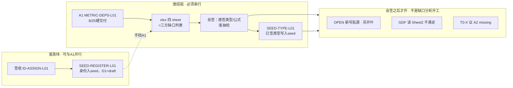

# ALGO-LIB-METRIC-DEPS-L01 协作流程备忘（2026-08-24）

> 过程备忘，非执行真源。真源见：
> - `agent-delivery/agent-handoffs/算法库联调-ALGO-LIB/给人说明-指标与算法工作类型与流程梳理.md`
> - `agent-delivery/agent-handoffs/算法库联调-ALGO-LIB/ALGO-LIB-METRIC-DEPS-L01.md`

## 一句话

A1（METRIC-DEPS）产表、人签、推状态、另开叶贴源，四步按块推进；身份注册（SEED-REGISTER）与 A1 并行但不挡 A1；A1 会签后才开新号贴源（BLOCK3）。

## 流程图（human:淮政玮 2026-08-24 确认）

## 三块对应真实任务

- BLOCK1（淮政玮，与 A1 并行、不挡 A1）
  - `METRIC-ID-ASSIGN-L01` 签收（done）
  - `METRIC-SEED-REGISTER-L01` 身份入 seed（D1=draft，algorithm_type=UNKNOWN，done）
- BLOCK2（唐绍祖，串行）
  - `ALGO-LIB-METRIC-DEPS-L01`（A1）产出表1/2/3 + xlsx 四 sheet
  - 唐绍祖会签类型/公式 → 淮政玮抽检 → `ALGO-LIB-SEED-TYPE-L01` 才写 seed
- BLOCK3（会签后才开）
  - OPEN 新号贴源另开叶
  - GDF 只读 Sheet2 不满足（none+partial）
  - T0-X 议 A2 missing

## 易错点（本次踩过的坑）

1. `pending_ods=334` 是「待核验」，不是已确认缺口。已确认不满足 = none(37)+partial(3)=40。禁止把 `pending_ods` 写进 Sheet2，禁止对外说成「已确认不满足」。
2. A1 禁止改 `metrics/registry/cfg_metric-*-seed.yaml` 和就绪度矩阵；类型/公式会签后由 `ALGO-LIB-SEED-TYPE-L01` 回填。
3. handoff 规范路径：`agent-delivery/agent-handoffs/算法库联调-ALGO-LIB/ALGO-LIB-METRIC-DEPS-L01.md`；机器产物放 `metrics/algo-results/`。
4. 状态必须「文件产物 + task-registry + 看板/MCP」同步推进，且 push 后才能被看到；本地改了不算数。本次淮政玮反馈「仍是 ready」= 状态/看板未同步或未推送（本地其实已 review → done）。
5. push 时只推本叶任务范围文件；工作树里无关的 M/UU 文件不要动、不要 revert、不要 stash。
6. 会签后通知用 `ALGO-LIB-METRIC-DEPS-L01-ods-status.xlsx` + `-ods-gaps.md`，并明确 `pending_ods` 语义。

## 收口检查清单

- [ ] xlsx 四 sheet 数据行：469 / 40 / 334 / 9
- [ ] task-registry：A1=done、SEED-REGISTER=done、SEED-TYPE=backlog（未 ready）
- [ ] handoff 在规范路径，status=done、signoff=approved、signed_by=human:淮政玮
- [ ] 已 push，远端 registry 与 handoff 一致
