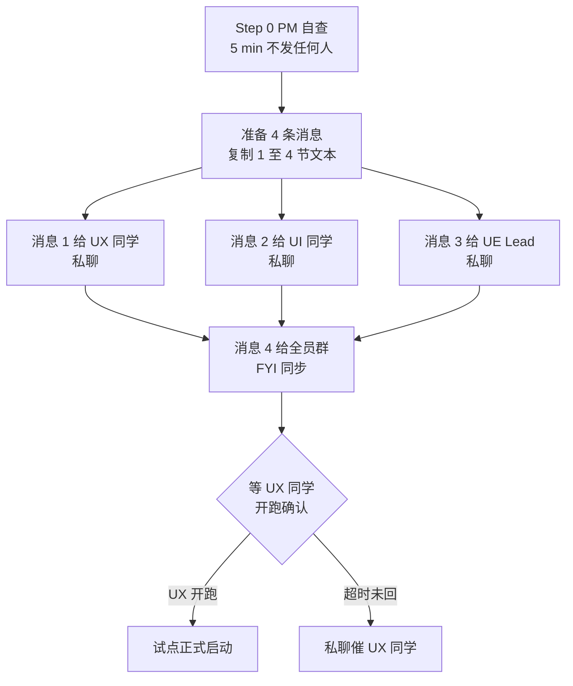

# PM 发件清单 · DS-25 软科学成果展示 智能体编排试点
> ⚠️ **后续编辑注解（2026-06-18，v2 重组）**：本文产出时引用的 UI 规范为 `AI可复用UI框架与设计规范.md`，**2026-06-18 已全量重组为 `agent-delivery/Design.md`**（Figma 风格稿落地版，14 节）。本文档**保留原引用以示事实历史**；下游 agent 接力时请按下表换算：
>
> | 本文中的旧引用 | 现行 `Design.md` 引用 |
> |---|---|
> | `AI可复用UI框架与设计规范.md` | `Design.md` |
> | §3 产品定位 / §4 信息架构 | §1 设计定位 + §3 页面骨架（六骨架 + 三段工作区） |
> | §5 技术框架 / §10 Arco 接入 | §0 给 AI 的执行指令（强制 Arco React + 主色 `#165DFF`）+ §13 推荐实现映射 |
> | §7 设计 Token | §4 色彩 + §5 字体 + §6 圆角描边阴影 + §13 主题 token |
> | §7.3 `.content-shell-glass` | §3.1 `.content-shell`（**取消毛玻璃强效果**） |
> | §7.3 / §7.4 图表分类色 chart-01~20 | §4.3 图表序列优先顺序（直接色值） |
> | §7.3.3 / §7.4.3 11 类业务对象 | §4.3 科技要素与图表色（**10 类，"资讯" 已取消**） |
> | §9 17 个通用组件（PageShell / GlobalWorkbenchTabs 等） | §7 通用组件 8 + §8 工作区 3（Figma 风格 class：`app-shell` / `content-shell` / `workspace-grid` / `layer-panel` / `map-stage` / `analysis-panel`） |
> | §9.3 / §9.4 Tab 分级 | §7.3 Tabs（**分级取消**） |
> | §18 验收 18 条 | §14 检查 8 + 验收 6 = 14 条（含截图取样定量验收） |
>
> 详见 `agent-delivery/architecture-baseline.md §8` v2.0 变更记录。

> **作用**：试点启动时 PM（你）要发的所有消息**复制即用版**
> **使用方法**：
> 1. 按时序图先做 Step 0（PM 自查 5 min）
> 2. 然后按 §1～§4 顺序复制 4 条消息分别发给 UX / UI / UE Lead / 全员群
> 3. 每条消息末尾有 "对方期望动作 + 你的下一步"
> **创建时间**：2026-06-17
> **关联**：
> - `PILOT-DS-25-PM-handbook.md`（你的总指挥手册）
> - `客户决策清单跟踪表.md`（甲方决策跟踪 §2.1 已含 Q001-Q007）
> - `data/DS-25-data-availability-matrix.md`（数据可用性映射表）

---

## 0. 发件时序总览



**发件时间建议**：
- **今天晚上 21:00 前**：完成 Step 0 + 发完 4 条消息
- **明天 09:30**：UX 同学应当已读 + 答复"我什么时候开跑"
- **明天 10:00–11:30**：UX 试点跑
- **明天 11:30–12:00**：UX 评审 + UI 派单准备
- **明天 14:00–15:00**：UI 试点跑
- **明天 15:00–15:30**：UI 评审 + retro

---

## Step 0 · PM 自查（5 min，不发任何人）

> **背景**：上一轮你曾计划"和数据 Lead 开 15 min 小会拍板 7 项默认值"。
> **修正**：那 7 项**都是甲方口径决策**（"软科学"范围、"难题攻关历程"语义、市/区地图精度等），团队公约 §3.8 明确"业务口径决策只能甲方拍板"，所以数据 Lead 也定不了。
> **正确做法**：PM 自己做 4 步检查，不召集任何人，5 min 完事。

打开 `agent-delivery/客户决策清单跟踪表.md`，做以下 4 件事：

- [ ] **检查 §2.1**：Q001-Q007 7 项是否都在（已经登记好；只需扫一眼确认）
- [ ] **回填 §1 总览看板**：
  - 🔴 高优先级 / 阻塞中：`0`
  - 🟡 中优先级 / 临时默认：`7`
  - 🟢 已确认：`0`
  - ⚪ 已撤销 / 合并：`0`
  - 当前未确认总数：`7`
  - 最早 deadline：`待 PM 填`（如下次甲方汇报会日期）
  - 下次甲方接触日期：`待 PM 填`（建议至少在 1 周内安排）
- [ ] **检查 task-registry.yaml**：DS-25 试点是否有任务记录；如无则同步 coordinator-agent 补一条
- [ ] **打开 demo2 仓** `git pull` 确认 main 是最新状态（避免 UX 跑完 push 时冲突）

完成后，开始按 §1 ～ §4 顺序发消息。

---

## 1. 消息 1 → UX 同学（私聊，**最优先发**）

**渠道**：企微 / 钉钉 / 私聊
**主题**：`[DS-25 试点] Step 1 启动：你来跑 ux-agent，1.5 h`

**附件 / 链接**（4 个）：
- `agent-delivery/agent-handoffs/软科学成果展示-DS25/PILOT-DS-25-UX-guide.md` —— 你看的操作指南
- `agent-delivery/agent-handoffs/软科学成果展示-DS25/UX-DS-25-trial-dispatch.md` —— 要复制给 agent 的派单话术
- `agent-delivery/data/DS-25-data-availability-matrix.md` —— 数据字段映射表（agent 必读）
- `agent-delivery/AI可复用UI框架与设计规范.md` —— D8 设计规范（agent 必读）

**正文**（复制即可）：

```
@UX 同学

我们启动智能体编排试点，第一步由你来跑 ux-agent，产出 DS-25 软科学成果展示
的 IA + 用户旅程 + 低保真线框 3 类 4 份 md 文档。

🎯 这是团队第 1 次完整试点，目的是发现现有手册和规范的不足，所以你跑过程中
   遇到的任何"卡顿、困惑、不确定"都是金子 —— 务必记下来反馈给我

📖 怎么做：精读 PILOT-DS-25-UX-guide.md（你的操作指南，1 步 1 步教）
🚀 何时启动：随时（建议明天上午 10 点开始，1.5 h 完成）
📤 干完通知我：群里 @我，把 handoff 路径 + commit hash + GitLab 链接发我

⚠️ 重要约束（指南里有详细写）：
  - 工作区一定是 E:\gkx_src（不是子目录）
  - 产物只写在 demo2/docs/ia/sandbox/soft-science-2026-06-17/
  - 允许直接 git push 到 demo2 main，会自动部署
  - commit message 末尾必须有 [agent:ux-agent]
  - 字段表必须 6 列（含 metric_id）
  - 来源列写真实 ODS 字段名（参考 DS-25-data-availability-matrix.md §2）

📌 关于"软科学"过滤范围、"难题攻关历程"业务语义等 7 项：
  这些是甲方口径决策，团队定不了，我已登记到 客户决策清单跟踪表.md
  你跑 ux-agent 时按 DS-25-data-availability-matrix.md §6.1 的
  "团队临时默认值"先跑就行，agent 应该在 wireframe 对应区域加
  ⚠️ "待甲方确认" 注释（D9 数据血缘规约要求）

完成后我会和 UE 一起评审你的产物，30 min 内给反馈。

—— PM
```

**对方期望动作**：
- [ ] 已读 + 回复"收到，明天 X 点开跑"
- [ ] 明天准时启动 ux-agent，跑 1–1.5 h
- [ ] 跑完通知你（含 handoff 路径 + commit hash + GitLab 链接）

**你的下一步**：
- 如果对方 1 小时内未读 → 私聊电话提醒
- 如果对方明天 10:30 还没开跑 → 私聊催一下
- 收到完成通知 → 进入 PM 手册 §6 评审流程

---

## 2. 消息 2 → UI 同学（私聊，**与消息 1 同时发**）

**渠道**：企微 / 钉钉 / 私聊
**主题**：`[DS-25 试点] 你先待命读规范，等 UX 跑完我再正式派单`

**附件 / 链接**（4 个）：
- `agent-delivery/agent-handoffs/软科学成果展示-DS25/PILOT-DS-25-UI-standby.md` —— 你看的待命指南
- `agent-delivery/AI可复用UI框架与设计规范.md` —— D8 设计规范（必读）
- `agent-delivery/data-lineage-policy.md` —— 数据血缘规约（必读）
- `agent-delivery/data/DS-25-data-availability-matrix.md` —— 数据映射表（必读，§5 你要重点看）

**正文**（复制即可）：

```
@UI 同学

DS-25 软科学成果展示试点启动，UX 先跑，**你先待命** 30–40 min 做 3 件事：

1. 读 D8 设计规范（10 min）—— 你产物的硬约束
2. 读数据血缘规约（10 min）—— UI 上每个统计数字必须有 MetricSpecCard
3. 读 DS-25 数据映射表（10 min）—— mock JSON 字段名要严格沿用 ODS

⚠️ 不要先跑 ui-agent，理由：
  - 你的派单话术还没生成（要等 UX 实际产出后由我和 AI 一起生成）
  - UX 产物可能评审后调整 1–2 项
  - 强行先跑 = 浪费 $5 token + 你 45 min

📌 额外要点：
  - mock JSON 字段名要严格沿用 ODS（如 dwd_zh_project.title 不是"项目名称"），
    未来切真实数据前端零改动
  - wireframe 中 ⚠️ "待甲方确认" 的指标，UI 上要保留 ⚠️ 角标 + tooltip，
    不要擅自删（团队公约 §3.8）

完整指南：PILOT-DS-25-UI-standby.md

预计 UX 跑完是明天上午（含评审），下午 14:00 我会给你正式派单话术。

—— PM
```

**对方期望动作**：
- [ ] 已读 + 回复"收到，待命"
- [ ] 30–40 min 内读完 3 份规范
- [ ] 不擅自启动 ui-agent

**你的下一步**：
- UX 评审通过后，PM + AI 一起生成 `UI-DS-25-trial-dispatch.md`，发给 UI 同学

---

## 3. 消息 3 → UE Lead（私聊，**与消息 1/2 同时发**）

**渠道**：企微 / 钉钉 / 私聊
**主题**：`[DS-25 试点] 你担任评审 Lead，预留 2 段 30 min 评审窗口`

**附件 / 链接**（5 个）：
- `agent-delivery/agent-handoffs/软科学成果展示-DS25/PILOT-DS-25-UE-review-guide.md` —— 你的评审手册
- `agent-delivery/agent-handoffs/科技人才态势-DS15/D8-DS-15-retrofit-decision.md` —— DS-15 回看决策模板
- `agent-delivery/AI可复用UI框架与设计规范.md` —— D8 规范（评审依据）
- `agent-delivery/data-lineage-policy.md` —— 数据血缘规约
- `agent-delivery/data/DS-25-data-availability-matrix.md` —— 评审字段表"来源"列的核心依据

**正文**（复制即可）：

```
@UE Lead

DS-25 智能体编排试点启动，你担任评审 Lead，我们一起跑 2 个评审节点：

📅 评审窗口预估
  - 评审 1（UX 产出，30 min）：明天上午 UX 跑完后立刻（约 11:30–12:00）
  - 评审 1.5（D8/DS-15 决策会，30 min）：紧接评审 1
  - 评审 2（UI 产出，30 min）：明天下午 UI 跑完后立刻（约 15:00–15:30）

📖 评审手册：PILOT-DS-25-UE-review-guide.md（含检查清单 + 决策表 + 评论模板）

🎯 评审重点（与 DS-15 试点的关键差异）：
  1. wireframe 字段表必须 6 列（新增 metric_id 列）
  2. "来源"列要引用真实 ODS 字段名（如 dwd_zh_project.title），抽 3 个字段核查
  3. 必有 §4.2 5 段优先级 + §18 18 条对照表（DS-15 没做齐）
  4. §9 通用组件名至少 8 个被引用，不能再用"左栏 240px / 主区"等口语命名
  5. wireframe 中遇到"软科学范围 / 难题攻关历程"等业务口径相关，
     必须标 ⚠️ "待甲方确认"，并登记到 客户决策清单跟踪表.md

🔖 第 1 次评审一定要严，因为 DS-25 完成后会作为后续所有 DS-XX 试点的标杆模板。

—— PM
```

**对方期望动作**：
- [ ] 已读 + 回复"收到，预留时间"
- [ ] 试点前 30 min 提前读完 5 份附件
- [ ] 评审时按检查清单逐条勾选

**你的下一步**：
- UX 跑完后立刻拉群（你 + UE Lead + UX 同学），30 min 评审
- 评审通过 → 进 D8/DS-15 决策会；评审未过 → UX 同学同会话修，30 min 内完成

---

## 4. 消息 4 → 全员项目大群（FYI 同步，**与消息 1/2/3 同时发**）

**渠道**：项目大群（含全部团队成员，包括算法 / 数据 / API / QA / 后端 等不直接参与本试点的角色）
**主题**：`[FYI] DS-25 软科学成果展示 智能体编排试点 - 明天启动`

**正文**（复制即可）：

```
@all 同步一个事

我们明天启动 智能体编排试点 PILOT-DS-25-001 —— DS-25 软科学成果展示
目的：端到端走通 UX → UI 沙箱流程，发现现有手册/规范的不足

🎯 本次试点关键人
  - 总指挥：PM（我）
  - 跑 ux-agent：UX 同学（Step 1，1.5 h）
  - 评审 lead：UE Lead（Step 1/2 评审 30 min × 2）
  - 跑 ui-agent：UI 同学（Step 2，1 h）
  - 其他角色：retro 时旁听（约 30 min）

📅 时间表（估算）
  Day 1 上午：UX 跑 + 评审
  Day 1 下午：UI 跑 + 评审
  Day 2 上午：retro（全员）

🔖 与 DS-15 试点的本质区别
  - DS-15 是纯 Mock 试点（D8/D9 还没立）
  - DS-25 是 D8（设计规范）+ D9（数据血缘）双约束试点
  - 而且：可基于甲方提供的 ODS v2 数据真实建模（80% 字段有真表映射）

🚀 产出会发布在 https://skxrules.unicomcn.tech:30999/sandbox/soft-science-2026-06-17/
   评审过后再决定是否给甲方汇报

⚠️ 已知的 7 项业务口径待甲方确认（已登记到 客户决策清单跟踪表.md）：
   团队按"临时默认值"先跑，UI 上会标 ⚠️ 角标，等甲方下次确认后再去除。
   涉及："软科学"过滤范围、市/区地图精度、难题攻关历程语义、互动传播范围、
        国外项目是否纳入、结题判定逻辑 等。

—— PM
```

**对方期望动作**：
- [ ] 不需要回复（FYI 同步）
- [ ] 但所有人都知道发生了什么，避免试点期间被无关需求打断

**你的下一步**：
- 进入 PM 手册 §3 战前清单（如还没做完）
- 等明天 UX 同学开跑

---

## 5. 后续待发消息（**等 UX/UI 评审后用**，今天不发）

### 5.1 消息 5 → UI 同学正式派单（UX 评审通过后）

**主题**：`[DS-25 试点] Step 2 启动：你来跑 ui-agent，1 h`

**正文模板**（明天 UX 评审通过后 PM + AI 一起生成 `UI-DS-25-trial-dispatch.md` 后再用）：

```
@UI 同学

UX 已交付（commit hash: xxx），UE 评审通过，你可以开跑了。

📤 派单话术：agent-delivery/agent-handoffs/软科学成果展示-DS25/UI-DS-25-trial-dispatch.md
📖 待命指南你已经读过，开干吧
⏰ 预计 1 h，跑完群里 @我

详见派单话术里的硬约束 + DoD。

—— PM
```

### 5.2 消息 6 → 全员 retro 通知（试点结束后）

**主题**：`[DS-25 试点] retro 会议，明天 10:00，30 min`

**正文模板**：

```
@all DS-25 试点已完成，明天 10:00 retro，30 min。

议程：
1. UX/UI 同学说"跑过程中最卡的 3 个地方"（10 min）
2. UE Lead 说"评审发现的 3 个最严重问题"（5 min）
3. 全员就"现有手册/规范不足"提改进项（10 min）
4. PM 总结 + 决定下一个 DS-XX 试点是否复制本模板（5 min）

腾讯会议号：xxx-xxx-xxx

—— PM
```

### 5.3 消息 7 → 甲方对接人（视试点结果决定，**不强制**）

**主题**：`关于"软科学成果展示"功能 7 项业务口径请贵方确认`

**正文模板**（待 PM 与甲方接触前定稿，建议附上 wireframe / UI 截图）：

```
@甲方对接人

我们已完成"软科学成果展示"功能的初版原型（沙箱地址 URL），
其中有 7 项业务口径需要贵方决策（详见附件 客户决策清单跟踪表.md Q001-Q007）：

1. "软科学"如何精确过滤（涉及学科范围）
2. 是否在数据层做"软科学子集表"
3. 市/区级地图精度从哪来
4. "难题攻关历程时间轴"业务语义
5. 互动传播功能（评论/点赞/收藏）Wave 0 是否实现
6. 国外软科学课题是否纳入
7. 项目"结题判定"逻辑

每项我们都附了"团队临时建议"，请贵方确认或给出新意见。
建议在下次评审会议（建议日期：xxxx-xx-xx）上集中讨论。

—— PM
```

---

## 6. 发件 checklist 总览

### 6.1 今晚 / 明早发件清单

- [ ] **Step 0** PM 自查 5 min（不发任何人）
- [ ] **消息 1** → UX 同学（私聊）
- [ ] **消息 2** → UI 同学（私聊）
- [ ] **消息 3** → UE Lead（私聊）
- [ ] **消息 4** → 项目大群（FYI）

### 6.2 明天等触发后发的（不要今晚发）

- [ ] **消息 5** → UI 同学正式派单（UX 评审通过后）
- [ ] **消息 6** → 全员 retro 通知（试点完成后）
- [ ] **消息 7** → 甲方对接人 7 项确认请求（视试点结果 + PM 与甲方的对接节奏）

### 6.3 PM 操作小贴士

- **不要 4 条消息一起群发**：UX/UI/UE 是私聊（避免互相干扰），消息 4 才是大群同步
- **截图保留消息证据**：试点 retro 时回顾"我当时是怎么沟通的"，能发现沟通效率问题
- **预留 buffer**：第 1 次试点 80% 概率会出意外（agent 跑慢、产物有缺、push 失败），别把当天排得太满
- **UX 同学开跑前**：让她在群里发一句 "我现在开始" 给你确认状态，避免出问题没人发现
- **第一次评审一定要严**：宁可让 UX 重跑一次，也不要让不合格的产物进入 UI 阶段（不然你要返工 2 次）
- **明天试点**：提前 30 min 自己再读一遍 `PILOT-DS-25-PM-handbook.md` §6 评审流程

---

## 7. 应急话术（出问题时用）

### 7.1 UX 同学说"agent 跑了 30 min 没产出"

```
能截一张当前 Cursor agent 会话的截图发我吗？
我看下是卡在哪一步：
  - 是不是 token 余额不够？右下角看下
  - 是不是 agent 在反复读 bid-reference 找不到章节？
    那就需要我把 PILOT-DS-25-UX-guide.md §2.3 的"必读章节锚点"截图发给你
  - 是不是模型选错了？换 claude-opus-4.7 重试
```

### 7.2 UX 产物评审有 5+ 项不合格

```
不要让 ux-agent 在同会话里修（修改面太大容易越改越乱）。
开新会话，复制 UX-DS-25-trial-dispatch.md，在开头加一段：

  上一次产出已在 commit xxx，但存在以下 N 项问题：
  1. [具体问题 1]
  2. [具体问题 2]
  ...
  请基于上一次产出 + 以下修正建议重新产出。
```

### 7.3 UI 同学说"mock 字段名编不出来"

```
打开 agent-delivery/data/DS-25-data-availability-matrix.md §5.1
里面有完整的 mock JSON 模板，照抄字段名就行。
字段值可以让 ui-agent 用 Faker 生成，但 KEY 不许改。
```

### 7.4 甲方临时插一脚说"想看看"

```
现在还是 demo2 沙箱原型，wireframe 评审中。
我们计划 X 月 X 日做正式汇报，到时一并展示：
  - 7 个三级功能完整 UI
  - 数据血缘 MetricSpecCard 演示
  - 7 项业务口径确认清单
您 X 月 X 日 X 点方便吗？

（不要给原始沙箱链接！甲方看到 ⚠️ "待确认"标会被吓到）
```

---

## 8. 文档维护

- **本文档由 PM 维护**；每次试点启动前根据"上一次试点的痛点"修订话术
- **试点 retro 时回填**：哪条消息收到/响应慢？哪条话术不够清楚？
- **未来其他 DS 试点**：可基于本文档为模板，替换 DS-XX 编号和功能描述即可复用

---

**生成时间**：2026-06-17
**首次使用**：DS-25 软科学成果展示试点（PILOT-DS-25-001）
**Owner**：PM