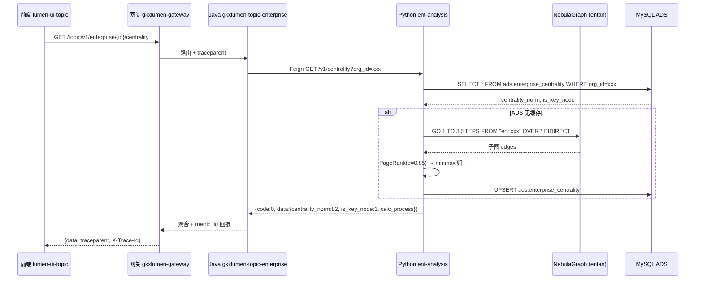
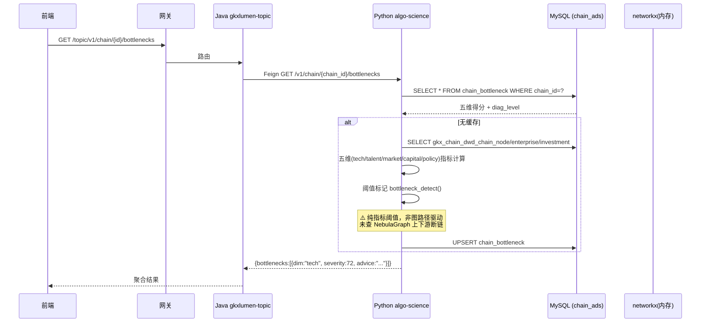
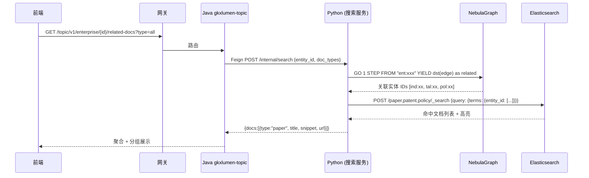
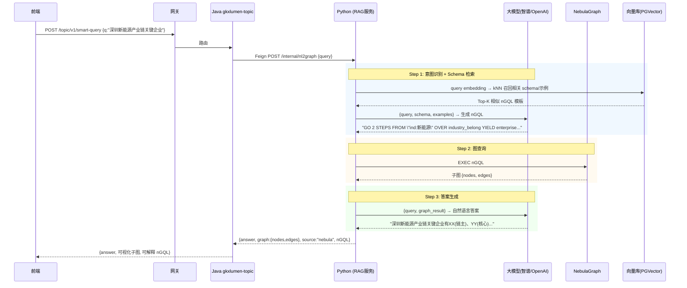
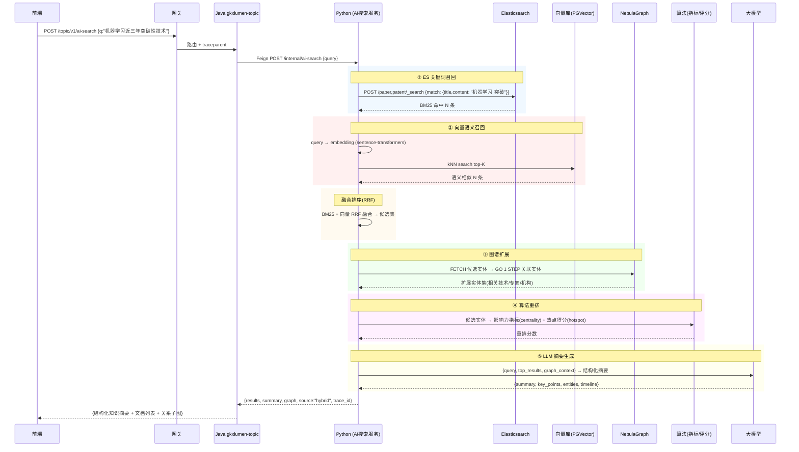
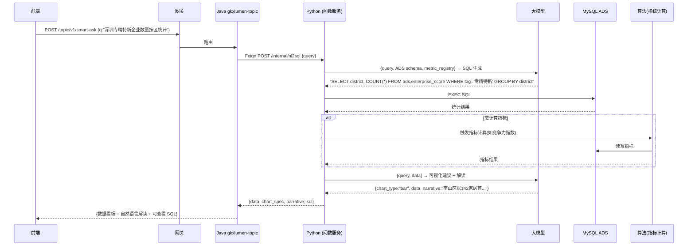
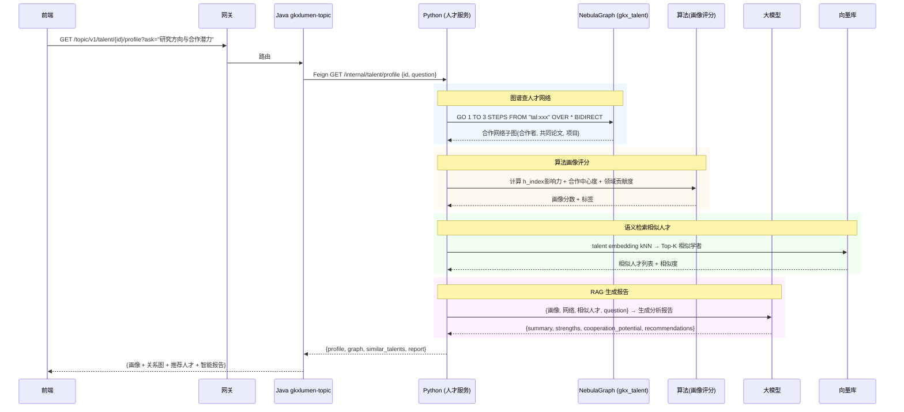
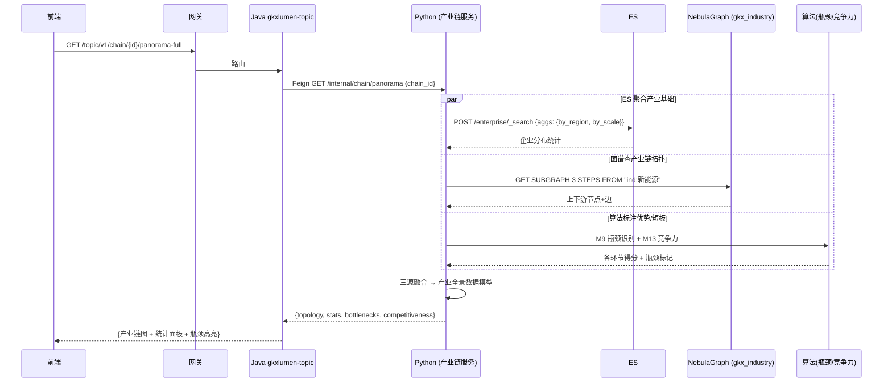

# 技术栈交叉场景与覆盖分析（ES × 图 × RAG × 算法）

> **产出时间**：2026-07-27
> **产出方式**：基于 `demo-algo-science` 与 `demo-algo-ent-analysis` 两仓代码实测（非文档推断）
> **招标依据**：`bid-reference/智能服务集群-完整.md`（425K 字）+ `科技专题服务算法库.md`（105K 字）
> **关联**：`architecture-baseline.md`（方案 A）· `数据库设计.md`（三引擎）· `graph-engine.md`（NebulaGraph）· `observability.md`（OTel）
>
> **用途**：全方位讨论"ES / 图技术 / RAG / 算法"四大技术栈在独立与交叉场景下的应用，评估两仓覆盖情况，给出典型场景数据流时序图。

---

## 目录

- [Part A：P1 关键交叉场景 × demo-algo 两仓覆盖分析](#part-a)
- [Part B：典型场景数据流时序图 + 服务调用链](#part-b)
- [场景汇总：落地状态一览](#场景汇总)
- [建议讨论重点](#建议讨论重点)

---

<a id="part-a"></a>
# Part A：P1 关键交叉场景 × demo-algo 两仓覆盖分析

## 一、两仓能力盘点（基于代码实测）

### 1.1 demo-algo-science（创新监测 + 产业链）

| 模块 | 算法 | 图谱 | API 端点 | 数据写入 |
|---|---|---|---|---|
| **innov P1–P9** | ✅ P1 机构贯通 / P2 结构化直转 / P3 资讯 NLP / P4 重要性分级 / P6 实体赋分 / P7 指数计算 / P8 预测突变 / P9 报告生成 | ⚠️ P5 networkx 内存图（注释写 Neo4j 但实际是 networkx + dwm 快照） | `/internal/run-pipeline` `/internal/status` `/v1/chain/**` | innov_ads / innov_dwd / innov_dwm |
| **chainan M1–M13** | ✅ M3 周期分析 / M9 瓶颈识别 / M10 区域指数 / M11 深圳布局 / M12 机会分析 / M13 竞争力 | ⚠️ M1/M2 networkx 产业链图（`chainan/graph/build.py` 用 `nx.DiGraph`） | 13 个 `/v1/chain/**` 端点 | chain_panorama / chain_bottleneck / chain_* |
| **tech_news_ie** | ✅ NER + LLM 四要素抽取（`innov/tech_news_ie/`，含 `llm/openai_compatible.py`） | — | `innov/tech_news_ie/api.py` | ads_tech_news_ie |

**关键发现**：
- `innov/graph/build.py` 第 4 行注释：`图库运行时主存（正式版 Neo4j）在 demo 中即 networkx 内存图` → **P5 图谱未接 NebulaGraph**
- `chainan/graph/build.py` 用 `networkx.DiGraph` → **产业链图也未接 NebulaGraph**
- P8 预测用 `numpy.polyfit` 线性外推（注释：`正式版 ≥8 年用 Prophet`）→ **轻量替身**
- **零 ES 写入**：全仓无 elasticsearch 客户端代码
- **零向量/embedding**：无 sentence-transformers / faiss / 向量库

### 1.2 demo-algo-ent-analysis（企业 + 政策）

| 模块 | 算法 | 图谱 | API 端点 | 数据写入 |
|---|---|---|---|---|
| **entan A1–A4** | ✅ A1 企业打分（49 指标）/ A2 排名 / A3 诊断 / A4 中心性（PageRank） | ✅ **NebulaGraph 真源**（`nebula_loader.py` 灌数 + `nebula_query.py` 查询） | `/v1/score` `/v1/ranking` `/v1/diagnosis` `/v1/centrality` `/v1/risk` | ads.enterprise_score / ads.graph_node / ads.graph_edge + Nebula `entan` space |
| **polan B1–B3** | ✅ B1 政策匹配 / B3 政策 19 指标 / 政策效果推演 / 政策文本解析 | ⚠️ B2 政策图谱有 `nebula_loader.py` 但 space `gkx_policy`（graph-engine.md 标"Wave1 待建"） | `/v1/policy/**`（7 个端点） | ads.policy_* / gkx_policy space |
| **entan/eval** | ✅ B1 商业能力 / A4 技术能力评估 | — | `/v1/evaluation/compute` | — |
| **graph** | — | ✅ `/v1/graph` 子图 / `/v1/graph/path` 路径 / `/v1/graph/candidates` 候选 | 3 个图查询端点 | Nebula `entan` space |

**关键发现**：
- **唯一真正接入 NebulaGraph 的仓**（`entan/common/nebula.py` + `nebula_loader.py` + `nebula_query.py`）
- `nebula_query.py` 实现：`subgraph()`（N 跳邻域）+ `find_path()`（路径发现）→ **G-3 路径搜索已落地**
- `entan_analysis_routes.py` 的 `centrality` 端点用 **PageRank**（`d=0.85`）→ **GA-1 图算法驱动指标已落地**
- PG 兜底机制：Nebula 不可用时回退 `ads.graph_node/edge` → **兜底已落地**
- **零 ES 写入**：全仓无 elasticsearch 客户端
- **零向量/embedding**
- 政策图谱 space `gkx_policy` 代码已有但 graph-engine.md 标"待建" → **polan 图谱未验证**

---

## 二、P1 关键交叉场景覆盖矩阵

> 以下基于代码实测，非文档推断。
>
> ✅ 已实现 · ⚠️ 有代码但未接入正式引擎/未验证 · ❌ 无代码 · 🔵 Java 侧有读端点

### 2.1 图 × 算法（GA 系列）——核心交付

| 场景 | 算法 | 招标依据 | ent-analysis | algo-science | 覆盖判定 |
|---|---|---|---|---|---|
| **GA-1 图算法→指标** | PageRank→中心度→影响力指标 | "网络密度、中心度" | ✅ `A4 centrality` PageRank→`ads.enterprise_centrality` | ❌ P5 图谱无图算法 | **企业域 ✅ / 其他要素 ❌** |
| **GA-2 产业集群识别** | 社区发现→集群标签 | "社群发现" | ❌ 无社区发现算法 | ❌ chainan 无社区发现 | **❌ 未实现** |
| **GA-3 推荐/匹配** | 图路径+评分排序 | "推荐匹配" | ⚠️ `/v1/graph/candidates` 有候选但非推荐算法 | ❌ | **⚠️ 有图查询无推荐算法** |
| **GA-4 瓶颈识别** | 图路径+指标→短板 | "瓶颈识别" | ❌ | ✅ `M9 bottleneck` 五维阈值（但非图路径驱动，是指标阈值） | **⚠️ algo-science 有但非图驱动** |
| **GA-5 合作网络分析** | 图+统计→核心团队 | "科技社会网络" | ⚠️ `research_coop` 边已灌 Nebula，无分析算法 | ❌ innov P5 有 scholar-org 边但无分析 | **⚠️ 有图无算法** |

### 2.2 ES × 图（EG 系列）

| 场景 | algo-science | ent-analysis | 覆盖判定 |
|---|---|---|---|
| EG-1 图谱节点→ES 检索 | ❌ 无 ES | ❌ 无 ES | **❌ 双仓均无 ES** |
| EG-2 产业链节点→ES 聚合 | ❌ | ❌ | **❌** |
| EG-3 关系网络+事件流 | ❌ | ❌ | **❌** |
| EG-4 图算法结果→ES | ❌ | ❌ | **❌** |

### 2.3 ES × 算法（EA 系列）

| 场景 | algo-science | ent-analysis | 覆盖判定 |
|---|---|---|---|
| EA-1 聚类标签→ES | ❌ 无 ES | ❌ 无 ES | **❌** |
| EA-2 推荐结果→ES | ❌ | ❌ | **❌** |
| EA-3 指标+ES 校验 | ❌ | ❌ | **❌** |

### 2.4 图 × RAG（GR 系列）

| 场景 | algo-science | ent-analysis | 覆盖判定 |
|---|---|---|---|
| GR-1 NL2Graph | ❌ | ❌ | **❌** |
| GR-2 GraphRAG | ❌ | ❌ | **❌** |
| GR-3 专家问答 | ❌ | ❌ | **❌** |
| GR-4 产业链问答 | ❌ | ❌ | **❌** |

### 2.5 ES × RAG（ER 系列）——全 ❌

### 2.6 RAG × 算法（RA 系列）——全 ❌（`tech_news_ie` 有 LLM 调用但非 RAG）

---

## 三、覆盖结论

### 3.1 已覆盖（P1 范围内）

| 已落地能力 | 仓 | 要素 |
|---|---|---|
| 企业图谱（NebulaGraph 真源）+ 子图/路径查询 | ent-analysis | E1 企业 |
| 企业 PageRank 中心度→链主识别 | ent-analysis | E1 企业 |
| 企业 49 指标打分/排名/诊断 | ent-analysis | E1 企业 |
| 政策 19 指标计算 + 文本解析 + 效果推演 | ent-analysis(polan) | E7 政策 |
| 产业链 13 类深度模型（瓶颈/周期/竞争力/热点/路线图） | algo-science(chainan) | E2 产业链 |
| 创新监测 P1–P9 全流水线 | algo-science(innov) | E4 技术 |
| 科技新闻 NER + LLM 四要素抽取 | algo-science(tech_news_ie) | 横切 |

### 3.2 关键缺口（P1 范围内应补）

| 缺口 | 影响 | 优先级 |
|---|---|---|
| **algo-science P5 图谱未接 NebulaGraph**（networkx 内存图） | G-1/G-2/G-5 无法规模化；创新图谱不持久化 | P0 |
| **双仓零 ES 写入** | EG/EA 系列全不可用；全文检索/聚合无数据源 | P0 |
| **社区发现算法缺失** | GA-2 产业集群识别无法交付 | P1 |
| **推荐算法缺失** | GA-3 人才/企业推荐无法交付（有图查询无评分排序） | P1 |
| **政策图谱 gkx_policy 未验证** | E7 图谱能力存疑 | P1 |
| **零向量/RAG** | GR/ER/RA 系列全不可用 | P2 |

### 3.3 要素覆盖不均

| 要素 | 算法 | 图谱(Nebula) | ES | 向量 |
|---|---|---|---|---|
| E1 企业 | ✅ A1-A4 | ✅ entan | ❌ | ❌ |
| E2 产业链 | ✅ M1-M13 | ❌ networkx | ❌ | ❌ |
| E3 机构 | ⚠️ innov P6 | ❌ networkx | ❌ | ❌ |
| E4 技术 | ✅ innov P1-P9 | ❌ networkx | ❌ | ❌ |
| E5 人才 | ❌ | ❌ | ❌ | ❌ |
| E6 服务机构 | ❌ | ❌ | ❌ | ❌ |
| E7 政策 | ✅ B1-B3 | ⚠️ 代码有未验证 | ❌ | ❌ |

> **E5 人才 / E6 服务机构 完全空白**——这是范围基线 58 功能点中的两个要素，需要新建算法。


---

<a id="part-b"></a>
# Part B：典型场景数据流时序图 + 服务调用链

> 以下场景按"已落地 → 部分落地 → 未落地"排列，每个场景含：**调用链 + 时序图 + 数据流 + 覆盖判定**。

---

## 场景 GA-1：企业链主识别（图算法→指标）✅ 已落地

### 调用链

```
前端(lumen-ui-topic) 
  → 网关(gkxlumen-gateway) /topic/v1/enterprise/{id}/centrality
  → Java(gkxlumen-topic-enterprise) Feign /internal/...
  → Python(demo-algo-ent-analysis) /v1/centrality?org_id=xxx
  → NebulaGraph(entan space) PageRank
  → 结果已写 ads.enterprise_centrality
```

### 时序图



### 覆盖判定

| 环节 | 状态 | 代码位置 |
|---|---|---|
| Java 聚合 | 🔵 待建（gkxlumen-topic-enterprise 模块存在但 API 未确认） | `lumen-svc-platform/gkxlumen-topic-enterprise/` |
| Python API | ✅ | `api/entan_analysis_routes.py:GET /v1/centrality` |
| NebulaGraph | ✅ | `entan/graph/nebula_query.py` + `nebula_loader.py` |
| ADS 写入 | ✅ | `ads.enterprise_centrality` |
| 指标注册 | ✅ | `METRIC_MAP["centrality"] = M_ENT_NODE_CENTRALITY` |

---

## 场景 GA-4：产业链瓶颈识别（图+算法）⚠️ 部分落地

### 调用链

```
前端 → 网关 /topic/v1/chain/{id}/bottlenecks
  → Java gkxlumen-topic → Feign → Python algo-science /v1/chain/{id}/bottlenecks
  → MySQL chain_bottleneck（M9 算法结果，五维阈值，非图驱动）
```

### 时序图



### 缺口

- 当前 M9 瓶颈识别是**五维指标阈值**，**未用图路径分析**查"上下游断链"
- `chainan/graph/build.py` 用 networkx，未接 NebulaGraph → 无法做图层面瓶颈分析
- **改进方向**：产业链图灌入 Nebula `gkx_industry` space → 图查询断链节点 → 与指标阈值结合


---

## 场景 EG-1：图谱节点下钻检索（图×ES）❌ 未落地

### 目标调用链（待建）

```
前端点击图谱节点(企业)
  → 网关 /topic/v1/enterprise/{id}/related-docs
  → Java gkxlumen-topic → Feign → Python /internal/search
  → ES 检索该企业相关论文/专利/政策/资讯
```

### 时序图（待建）



### 缺口清单

| 环节 | 状态 | 需做什么 |
|---|---|---|
| Python ES 客户端 | ❌ | 双仓均无 `elasticsearch` 依赖，需新增 |
| ES 索引 | ❌ | 需建 `idx_paper` / `idx_patent` / `idx_policy` 并灌数 |
| 图→ES 关联 | ❌ | 需约定 `entity_id` 在 ES 文档中的字段映射 |
| Java Feign 接口 | ❌ | `gkxlumen-topic` 需新增 `/internal/search` 代理 |

---

## 场景 GR-1：NL2Graph 自然语言查图谱（图×RAG）❌ 未落地

### 目标调用链（待建）

```
用户输入"深圳新能源产业链有哪些关键企业"
  → 网关 /topic/v1/smart-query
  → Java gkxlumen-topic → Feign → Python /internal/nl2graph
  → LLM 意图识别 + nGQL 生成 → NebulaGraph 查询 → LLM 组织答案
```

### 时序图（待建）



### 缺口清单

| 环节 | 状态 | 需做什么 |
|---|---|---|
| 向量库 | ❌ | 引入 PGVector，灌入 nGQL 模板 + schema embedding |
| LLM 接入 | ⚠️ `tech_news_ie/llm/openai_compatible.py` 已有可复用 | 抽象为通用 LLM 服务 |
| nGQL 生成 | ❌ | Prompt 工程 + few-shot 示例库 |
| NebulaGraph 查询代理 | ✅ `nebula_query.py` 可复用 | — |
| 答案生成 | ❌ | LLM 组织结构化答案 |
| Java Feign | ❌ | 新增 `/internal/nl2graph` |

---

## 场景 ALL-1：AI 搜索全链路（ES×图×RAG×算法）❌ 未落地（旗舰）

### 目标调用链（待建）

```
用户输入"机器学习领域近三年有哪些突破性技术"
  → 网关 /topic/v1/ai-search
  → Java gkxlumen-topic → Feign → Python /internal/ai-search
  → ① ES 关键词召回 + ② 向量语义召回 → ③ 图谱扩展关联实体
  → ④ 算法重排评分 → ⑤ LLM 生成结构化知识摘要
```

### 时序图（待建）



### 缺口清单（全栈）

| 环节 | 现有可复用 | 需新建 |
|---|---|---|
| ES 召回 | ❌ 双仓无 ES | ES 索引 + 灌数 + 查询 |
| 向量召回 | ❌ | PGVector + embedding 服务 |
| RRF 融合 | ❌ | 融合排序算法 |
| 图谱扩展 | ✅ `nebula_query.py` | — |
| 算法重排 | ✅ `centrality` / `hotspot` 可复用 | 统一评分接口 |
| LLM 摘要 | ⚠️ `tech_news_ie/llm/` 可复用 | 搜索摘要 Prompt |
| Java 聚合 | 🔵 `gkxlumen-topic` 框架在 | `/internal/ai-search` Feign |


---

## 场景 RA-1：智能问数 NL2SQL（RAG×算法）❌ 未落地

### 时序图（待建）



---

## 场景 GRA-2：人才智慧服务（图×RAG×算法）❌ 未落地

### 时序图（待建）



### 缺口

- E5 人才要素**完全空白**：无算法、无图谱、无数据
- 需新建 `gkx_talent` Nebula space + 人才 embedding + 画像算法

---

## 场景 EGA-1：产业全景一张图（ES×图×算法）❌ 未落地

### 时序图（待建）



### 缺口

- `chainan/graph/build.py` 用 networkx → 需迁 NebulaGraph `gkx_industry` space
- 无 ES → 产业基础统计无法聚合
- 三源融合逻辑需新建

---

<a id="场景汇总"></a>
## 场景汇总：落地状态一览

| 场景 | 技术 栈 | 状态 | 主要缺口 |
|---|---|---|---|
| **GA-1 企业链主识别** | 图+算法 | ✅ 已落地 | Java 聚合层待建 |
| **GA-4 产业链瓶颈** | 图+算法 | ⚠️ 部分 | 非图驱动；networkx 需迁 Nebula |
| **EGA-1 产业全景** | ES+图+算法 | ❌ 未落地 | ES 缺失 + 产业链图未接 Nebula |
| **EG-1 图谱下钻检索** | ES+图 | ❌ 未落地 | ES 全缺 |
| **GR-1 NL2Graph** | 图+RAG | ❌ 未落地 | 向量库 + LLM nGQL 生成 |
| **RA-1 智能问数** | RAG+算法 | ❌ 未落地 | NL2SQL + LLM |
| **GRA-2 人才服务** | 图+RAG+算法 | ❌ 未落地 | E5 人才全空 |
| **ALL-1 AI 搜索** | 全栈 | ❌ 未落地 | ES+向量+LLM+融合排序 |

---

<a id="建议讨论重点"></a>
## 建议讨论重点

1. **P0 堵点**：algo-science P5/chainan 图谱从 networkx 迁 NebulaGraph——这是所有图场景规模化的前提。
2. **P0 堵点**：双仓引入 ES 客户端 + 索引灌数——EG/EA/EGA 系列的前提。
3. **P1 决策**：社区发现算法（GA-2）和推荐算法（GA-3）是否本期交付？缺这两个算法，"推荐匹配"功能点无法闭环。
4. **P2 决策**：RAG 引入走 D11 架构变更——GR/RA/ALL 系列全依赖此。
5. **要素空白**：E5 人才 / E6 服务机构 完全无算法无图谱——是否本期补齐？

---

## 附录：两仓 API 端点全览（实测）

### demo-algo-science

| 方法 | 路径 | 说明 |
|---|---|---|
| GET | `/healthz` | 健康检查 |
| POST | `/internal/run-pipeline` | 触发 innov 全流水线 |
| POST | `/internal/run-chain-pipeline` | 触发 chainan 全流水线 |
| GET | `/internal/status` | 流水线状态 |
| GET | `/internal/models/registry` | 模型注册表 |
| GET | `/v1/chain/list` | 产业链列表 |
| GET | `/v1/chain/{chain_id}/panorama` | 产业链全景 |
| GET | `/v1/chain/{chain_id}/cycle` | 周期分析 |
| GET | `/v1/chain/{chain_id}/key-nodes` | 关键节点 |
| GET | `/v1/chain/{chain_id}/bottlenecks` | 瓶颈识别 |
| GET | `/v1/chain/{chain_id}/region-index` | 区域指数 |
| GET | `/v1/chain/{chain_id}/shenzhen` | 深圳布局 |
| GET | `/v1/chain/{chain_id}/competitiveness` | 竞争力 |
| GET | `/v1/chain/{chain_id}/hotspot` | 热点检测 |
| GET | `/v1/chain/{chain_id}/roadmap` | 路线图 |
| GET | `/v1/chain/{chain_id}/recommendation` | 推荐 |
| GET | `/v1/chain/market-stats` | 市场统计 |
| GET | `/v1/chain/investment-stats` | 投资统计 |
| POST | `/gdf/tasks/create-and-start` | 异步任务创建+启动 |
| GET | `/gdf/tasks/{task_id}` | 任务状态 |
| GET | `/gdf/tasks/{task_id}/result` | 任务结果 |
| POST | `/gdf/tasks/{task_id}/cancel` | 取消任务 |
| GET | `/gdf/tasks` | 任务列表 |

### demo-algo-ent-analysis

| 方法 | 路径 | 说明 |
|---|---|---|
| GET | `/healthz` | 健康检查 |
| POST | `/internal/run-pipeline` | 触发企业流水线 |
| GET | `/internal/status` | 流水线状态 |
| GET | `/internal/models/registry` | 模型注册表 |
| GET | `/internal/models/registry/{model_id}` | 单模型详情 |
| POST | `/internal/models/registry/seed` | 种子模型 |
| POST | `/internal/graph/subgraph` | 图子图查询 |
| POST | `/internal/graph-init` | 图谱初始化 |
| GET | `/v1/meta/filters` | 元数据筛选 |
| GET | `/v1/enterprises` | 企业列表 |
| GET | `/v1/key-enterprises` | 关键企业 |
| GET | `/v1/type-distribution` | 类型分布 |
| GET | `/v1/domain-distribution` | 领域分布 |
| GET | `/v1/news` | 资讯 |
| GET | `/v1/news/stats` | 资讯统计 |
| GET | `/v1/new-enterprises` | 新增企业 |
| GET | `/v1/graph/entities` | 图实体 |
| GET | `/v1/graph` | 图子图（Nebula 优先） |
| GET | `/v1/graph/path` | 图路径 |
| GET | `/v1/graph/candidates` | 候选节点 |
| POST | `/v1/graph/nodes` | 新增节点 |
| DELETE | `/v1/graph/nodes/{org_id}` | 删除节点 |
| POST | `/v1/graph/mock-enterprise` | Mock 企业 |
| GET | `/v1/tech-power/rank` | 技术能力排名 |
| GET | `/v1/tech-power/{org_id}` | 单企业技术能力 |
| GET | `/v1/biz-power/rank` | 商业能力排名 |
| GET | `/v1/biz-power/{org_id}` | 单企业商业能力 |
| GET | `/v1/eval/weights` | 评估权重 |
| GET | `/v1/enterprises/{org_id}/report` | 企业报告 |
| GET | `/v1/score` | 企业评分 |
| GET | `/v1/ranking` | 企业排名 |
| GET | `/v1/diagnosis` | 企业诊断 |
| GET | `/v1/centrality` | 中心度（PageRank） |
| GET | `/v1/risk` | 风险 |
| GET | `/v1/analysis/metrics` | 分析指标 |
| GET | `/v1/evaluation/precheck` | 评估预检 |
| POST | `/v1/evaluation/precheck` | 评估预检 |
| POST | `/v1/evaluation/compute` | 交互式评估 |
| GET | `/v1/policy/indicators` | 政策指标 |
| GET | `/v1/policy/metrics` | 政策指标总览 |
| GET | `/v1/policy/graph` | 政策图谱 |
| GET | `/v1/policy/analysis/{model_id}` | 政策深度模型 |
| GET | `/v1/policy/text/parse` | 政策文本解析 |
| GET | `/v1/policy/match` | 政策匹配 |
| GET | `/v1/policy/simulate` | 政策效果推演 |
| GET | `/internal/policy/models/registry` | 政策模型注册 |
| POST | `/internal/policy/run-pipeline` | 政策流水线 |
| GET | `/internal/policy/status` | 政策流水线状态 |

---

> **文档维护**：本文为 2026-07-27 架构讨论产出，后续更新需同步 `architecture-baseline.md` 与 `数据库设计.md`。
