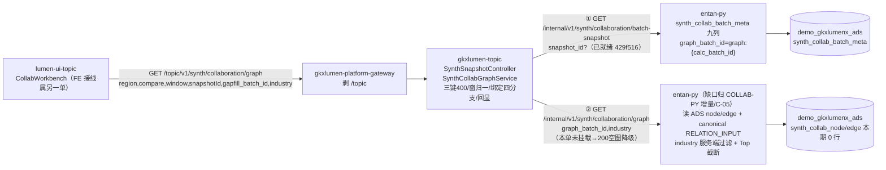

# LUMEN-INTEL-COLLAB-GRAPH-L01 · handoff

- 任务：综合智能分析协同 — 图谱查询接口（Java 门面 + 批次绑定）
- Epic：E8-综合智能分析 ｜ 执行：agent:api-agent ｜ 监管：human:徐滕强
- 仓：`repos/lumen-svc-platform`（origin/dev，commit `084b2d1`，**未 push**——任务文明示不 push，待监管人验收后推）
- 日期：2026-11-05
- 强度：ponytail full
- 真源：`agent-delivery/agent-handoffs/综合智能分析-SYNTH/sdd/l2/SYNTH-L2-COLLAB.md` **v1.0.8**（§3.2 图谱查询契约）；`LUMEN-INTEL-SDD-SIGNOFF-L01.md`（AR-2/TC-1 三窗空图合法、AR-4 批次清理保护 batch_meta 引用批）；`LUMEN-INTEL-COLLAB-PY-L01.md`（Python 侧行为对齐：snapshot_id 可选回读、batch_meta 九列、cache_key 改指 AR-9、graph_batch_id=`graph:{calc_batch_id}` 派生、空图契约）；`LUMEN-INTEL-MOCK-INV-L01.md`（CollabResult/graph 响应结构）
- 同构样板：`0fdc245`（VIT-FP 快照门面）与 `14e3fd2`（ELEM-BE）——Controller/Feign/Service/测试模式完全复用

## 1. 范围与实现（对照任务书 5 条 + COLLAB 册 §3.2）

| 要求 | 实现 |
|---|---|
| `GET /topic/v1/synth/collaboration/graph` 门面 | ✅ `SynthSnapshotController.collaborationGraph`（`@Inner(false)`，网关剥 `/topic` 后 `/v1/synth/collaboration/graph`）→ `SynthCollabGraphService`。Python graph 独立端点**本单未挂载**，按 VIT-FP 先例做「Feign 调用 + Python 404 → 诚实降级 200 空图 `reason=graph_upstream_unavailable`」，**见 §2 偏离 2 的分层说明** |
| 契约逐参数 | ✅ 必填三键 `region/compare/window` 缺→400（`REGION_COMPARE_WINDOW_REQUIRED`，不默改；window 与快照门面不同——**无缺省**）；窗归一 1y\|3y\|5y 或中文（非法 400）；`industry` 透传 Python 服务端过滤（Java 不筛行）；截断（`truncated` 标志）由 Python 执行、Java 透传回显；`depth` 见偏离 1 |
| 批次绑定规则（核心） | ✅ 四分支见 §4；绑定解析经 Python **已就绪**端点 `/internal/v1/synth/collaboration/batch-snapshot`（COLLAB-PY-L01 `429f516`）读 `synth_collab_batch_meta` 九列，Java 全程不直连 ADS（D3） |
| 空图合法态 | ✅ HTTP 200 + `nodes=[]/edges=[]/truncated=false` + `reason`（`batch_meta_missing` / `no_year_on_source` / `graph_upstream_unavailable` 三种，各自语义见 §4）；无 meta 恒 200 不 404（册 §3.1「无 meta 时图谱固定 HTTP 200」）；AR-2/TC-1 口径：非空验收属 C-05 解锁单，本单验收=空态契约正确 |
| 单测 | ✅ 12 新增（`SynthCollabGraphServiceTest`）：三键必填/绑定四分支各一/同传不一致 400/meta 缺失不回落（断言 graph 端点未被调用）/A·B 批不串三场景/industry+截断透传/契约回显/空图 reason 补齐/Python 404 与异常双路径降级；复用 ELEM-VIT 测试模式（mock Feign + ArgumentCaptor） |

## 2. 偏离说明

1. **`depth` 参数未实现（任务书旧口径 vs 真源）**：任务书列「可选 depth」，但真源 v1.0.8 §3.2 参数表明确「**本期没有 depth。本期没有 gapfill_batch_id**」（v1.0.5 会签退回废止 depth 与服务端截断规划、gapfill 图不进 ADS）。按唯一真源实现：无 depth 入参；截断走 `limit_nodes/limit_edges`（由 Python 执行）。后续若恢复 depth 属契约变更，须先改册。
2. **Python graph 端点缺口的处理（分层说明）**：本单只动 Java 仓（任务书边界），禁止在 Python 加端点。`RemoteSynthPythonClient.collaborationGraph` 已按册 §3.2 签好 Feign 契约（javadoc 注明挂载归 COLLAB-PY 增量 / C-05 单，TODO 已留）；端点 404/异常 → 门面 200 空图 `graph_upstream_unavailable`（不伪非空、不 500 泄漏）。**分层**：批次绑定解析在 Java 门面（经已就绪 batch-snapshot 端点读 batch_meta）；图行读取/canonical RELATION_INPUT 过滤/industry 服务端过滤/Top 截断全在 Python——端点挂载后 Java 零改动，前端即可拿到真图。
3. **`gapfill_batch_id` 参数名保留、语义收窄**：绑定四分支与回显字段名由任务书钉死（registry DoD 引用），保留该参数作为「显式图批直读」入口（语义=`graph_batch_id` 显式指定，优先于 snapshotId）；真源已废止 gapfill 图，故不实现「按 gapfill 前缀表读」的旧语义。
4. **指定 snapshotId 无 meta = HTTP 200（registry DoD 写 404）**：registry DoD 措辞「batch_meta_missing/404 写死一种」属 v1.0.8 前旧口径；真源 §3.1/§3.2 钉死「无 meta 固定 HTTP 200、`nodes=[]`、`reason=batch_meta_missing`，不用 404」。按真源实现，禁回落最新批语义不变。
5. **回显覆盖语义**：`snapshotId/gapfill_batch_id/graph_batch_id` 三个绑定回显值由 Java 从 batch_meta 权威解析后**强制覆盖**（防上游回显漂移，单测钉死）；`truncated/nodes/edges/reason` 为 Python 执行结果，不覆盖（空响应无 reason 时 Java 兜底补 `no_year_on_source`，保证本期空图契约 reason 必带；端点挂载后 Python 为真源）。
6. **绑定互斥的派生豁免**：两绑定参数同传时，仅 `snapshotId` 文本 == 图批号视为一致（`task:{id}` 语义不含批次本体，任何组合最终由 batch_meta 真源裁决，不误伤 400）；其余组合不一致 → 400 `SNAPSHOT_BATCH_MISMATCH`。

## 3. 产物清单

| 文件 | 说明 |
|---|---|
| `gkxlumen-topic/.../controller/synth/SynthSnapshotController.java` | +`/collaboration/graph` 端点（参数 Javadoc=契约镜像）；类注释补「协同图谱空图合法态例外」 |
| `gkxlumen-topic/.../service/synth/SynthCollabGraphService.java` | 新增：三键校验/窗归一/绑定四分支/契约回显/诚实降级（+269 行） |
| `gkxlumen-topic/.../feign/RemoteSynthPythonClient.java` | +`collabBatchSnapshot`（COLLAB-PY-L01 已就绪端点）+`collaborationGraph`（册 §3.2 契约，挂载归 COLLAB-PY 增量/C-05） |
| `gkxlumen-topic/src/test/.../synth/SynthCollabGraphServiceTest.java` | 新增 12 测（+377 行） |
| `agent-delivery/agent-handoffs/LUMEN-INTEL-COLLAB-GRAPH-L01.md` | 本 handoff |

commit：`084b2d1 feat(synth-collab): 图谱查询门面+批次绑定 [agent:api]`（4 files，+666/−6；未 push）
工作区他人 WIP：开工时 `git status` clean，无触碰；`spring-javaformat:apply` 误格式化的 3 个非本单文件已 `git checkout --` 还原（最小 diff）。

## 4. 批次绑定四分支（落点：`SynthCollabGraphService.resolveBatchBinding` + 单测 bindingBranch1–4）

| 分支 | 入参形态 | 行为 | 响应 |
|---|---|---|---|
| ① snapshotId 直读 | 仅传 `snapshotId` | `snapshot_id` 透传 Python batch-snapshot → 只按该行持久 meta 取 `graph_batch_id`；**meta 缺失 → `nodes=[]+reason=batch_meta_missing`（写死一种，禁回落最新批），graph 端点不被调用** | 200 空图 / 200 图 |
| ② 显式图批 | 传 `gapfill_batch_id` | 只读该批，meta 二跳省略；与 snapshotId 同传不一致 → 400 `SNAPSHOT_BATCH_MISMATCH` | 200 图；回显 `gapfill_batch_id` |
| ③ 条件最新批 | 均不传 | 不带 `snapshot_id` 查 batch_meta → `cache_key+is_latest=1` 行（AR-9 改指语义）；无行 → `graph_batch_id=null` 空图 | 200；回显所用批 |
| ④ 同传一致 | 两者同传且一致（含派生豁免） | 按显式图批直读；回显双字段 | 200 图 |

空图 reason 三种：`batch_meta_missing`（①无 meta）/ `no_year_on_source`（本期三窗 0 行源无年，AR-2/TC-1）/ `graph_upstream_unavailable`（Python graph 端点未挂载或异常，偏离 2）。

## 5. 验收证据

- `JAVA_HOME=jdk-21 mvn -pl gkxlumen-topic test` → **28 过 0 fail**（新增 `SynthCollabGraphServiceTest` 12 + 既有 `SynthVitalitySnapshotServiceTest` 9 + `SynthElementsSnapshotServiceTest` 7，无回归）；BUILD SUCCESS
- 修复过程：3 处失败（绑定回显被上游 stub 盖住）→ 根因=回显用 `putIfAbsent`，改绑定值强制覆盖后全绿（偏离 5 已钉单测）
- 格式化：`spring-javaformat:apply` 后全量测试复跑绿；非本单文件格式漂移已还原
- 未 push（任务文明示）；push origin/dev + CI 绿由监管人验收后执行（DoD 第 4 条交接项）

## 6. 调用链（FE → Java → Python graph）

## 7. 架构合规自检（公约 §2 铁律 16 条）

| # | 铁律 | 自检 |
|---|---|---|
| 1 | 算法只在 Python | ✅ Java 零算法：无筛选/截断/图算法逻辑；过滤与 Top 截断全在 Python（透传） |
| 2 | 调用链 FE→Java→Python `/internal/*` | ✅ Java 仅 Feign 两个 internal GET；无越层、无直连库 |
| 3 | NebulaGraph 协议 | ✅ 本期图谱读 ADS node/edge（册 §1 不做 Nebula 导出）；未写 nGQL |
| 4 | 可观测性 | ✅ 门面 trace 日志：条件/批号/nodes 数/truncated/耗时（ok/降级/meta 缺失三分支各有）；OTel Agent 属部署段未动 |
| 5 | CI/CD push→Pipeline→K8s | ⏳ 未 push（任务文明示）；push 后走既有 topic CI |
| 6 | demo2 只读 merge | ✅ 未动 demo 仓 |
| 7 | 共享聚合核心（方案 A） | ✅ 走 `gkxlumen-topic`；前端只调 Java；Java 只读 ADS 经 Python |
| 8 | ADS 先行 + Mock | ✅ 空图=读 ADS 后结果非写死 JSON（D18）；降级 reason 诚实披露端点缺口 |
| 9 | D8 前端规范 | N/A（未动 FE） |
| 10 | D9 数据血缘 | ✅ graph 响应回显 `graph_batch_id/calc_batch_id/snapshotId`（册 §5 追溯）；无统计数字点位，无 ⓘ 需求 |
| 11 | D10 交互规范 | N/A（未动 FE） |
| 12 | D12 demo/lumen 隔离 | ✅ Feign 仅 `lumen-algo-py`（`gkxlumen.topic.algo-base-url` 继承 VIT/ELEM 同款）；零 demo-* 引用 |
| 13 | D14 对象存储 | N/A |
| 14 | D16 gapfill 边界 | ✅ 未写任何 gapfill 表；`gapfill_batch_id` 仅作显式图批直读参数名（偏离 3） |
| 15 | D17 合规算法 | ✅ 未触碰唐绍祖锁定闭包 |
| 16 | D18 签收=可实现 | ✅ 空态=读表/读 meta 后的诚实结果；降级仅披露端点缺口，不伪数据；Python 端点挂载后即真图（可实现） |

## 8. ponytail 自检

ponytail: full——完全复用 0fdc245/14e3fd2 类结构/包络/Feign/测试模式（`R` 包络、窗归一 switch、`asInt/textOrNull` 同款私有件、mock+ArgumentCaptor 测试）；最小文件集（1 新 Service + 1 新测试 + 2 既有文件小改）；无新依赖；graph_batch 派生格式 ceiling 已知（`graph:{calc_batch_id}`，COLLAB-PY 偏离 2 同源，升级路径=C-05 单）；自检=12 单测（含绑定四分支/不回落反例/降级双路径）。

## 9. cost（按 budget-estimate.md 四字段）

| 字段 | 值 |
|---|---|
| actual_tokens | ~125000 |
| model_used | glm-5.3-Flash（Cursor 内） |
| actual_cost | ~$0.16 |
| cost_warn | false（< $10 阈值） |

## 10. DoD 对照与后续依赖（不属本单）

- ✅ DoD1 契约逐参数（depth 按 v1.0.8 无此参数——偏离 1）
- ✅ DoD2 指定 snapshotId 无 meta → 不可用写死一种（`batch_meta_missing`+200，禁回落；404 措辞偏离 4）
- ✅ DoD3 canonical/industry 服务端过滤/truncated/A·B 批不串自检（执行方=Python；门面透传+回显+单测钉死）
- ✅ DoD4a 单测 12；handoff+ponytail+cost+图（本文）
- ⏳ DoD4b push origin/dev + CI 绿：待监管人验收后推（任务文明示不 push）
- 后续：①Python `/internal/v1/synth/collaboration/graph` 挂载（COLLAB-PY 增量 / C-05 单，Feign 契约已签好）；②FE 接线（industry 下拉+图谱 API，册 §6/§7-8）；③Java Adapter `region_innovation_collaboration` 键（async-service，与要素线协调）；④C-05 解锁后非空验收移 `COLLAB-C05-SRC`
