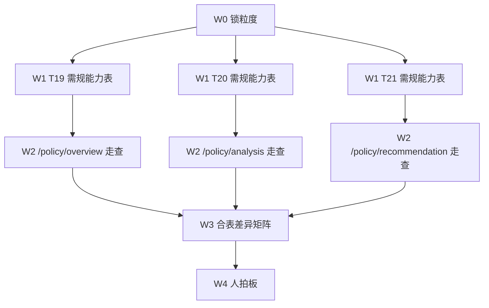

# 会话记录 · 黄敬洲提交核查 + 专题政策拆点 vs 原型

- 导出格式：MarkDownload（Markdown）
- 日期：2026-08-19
- 会话： [黄敬洲提交与政策对照](0e0200b2-2082-4711-8251-be5d4127c13e)
- 范围：本会话用户问句与助手可见回复；不含工具调用原文
- 本轮产物：`agent-delivery/agent-handoffs/QA/POLICY-FP-vs-PROTO-gap.md`

---

## 用户 · 13:47

任务管理：查看黄敬洲提交的内容

## 助手 · 13:47

黄敬洲当前真正**交出来待签收**的，是 QA 总集拆点两张单。registry 里 `claimed_by = human:黄敬洲` 且状态为 **待签收（`ready_to_sign`）** 的只有这两条。

### 待签收（本轮提交）

| 任务 | 标题 | 状态 | 更新 | 产物规模 |
|------|------|------|------|----------|
| `QA-KJZTFWXT-FUNCLIST-SPLIT-L01` | 需求功能清单功能点拆分-专题系统 | 待签收 | 2026-08-18 19:00 | v8 **1298** 条 |
| `QA-KJXXZSXT-FUNCLIST-SPLIT-L01` | 需求功能清单功能点拆分-展示系统 | 待签收 | 2026-08-19 00:09 | v1 **8378** 条 |

两单都是 `tech_task`，签收人是 **淮政玮**。自动验收对 `ready_to_sign` 不再推进，看板卡在待签收是预期行为。

### 1）专题系统 · `QA-KJZTFWXT-FUNCLIST-SPLIT-L01`

- **提交口径**：只拆战略分析 **5 个四级**（产业服务链 / 产业链 / 企业 / 政策 / 综合智能），32 个五级 T01–T32。
- **合表**：`agent-delivery/qa/total-set/KJZTFWXT/6.国际科技信息中心项目_科技专题服务系统_功能点拆分_v8.xlsx`（约 138 KB，8/18 18:27）
- **编号**：`ZNFWJQ-KJZTFWXT-v1.0-FUNC-00001`–`01298`
- **分册条数**：产业链 305 / 企业 384 / 政策 127 / 产业服务链 327 / 综合智能 155
- **工作稿**：`fp-split-run/work` 32、`review` 32（已核对落盘）
- **handoff**：`agent-delivery/agent-handoffs/QA/QA-KJZTFWXT-FUNCLIST-SPLIT-L01.md`
- **git**：`436d5bf`（2026-08-18）`feat(qa): 专题战略分析功能点拆分 v8（1298 条） [agent:qa-agent]`
- **cost**：约 $11.88，`cost_warn: orange`（>$10）
- **测试步骤**：留空（监管人确认本任务不写）

签收 = 签收「战略分析 5 个四级功能点表」，**不是** 6 个 L3 全系统总集。未拆：数据查询 / 项目管理 / 信息发布 / 运营中心 / 系统管理，以及技术链 / 科研机构 / 人才 3 个四级。

### 2）展示系统 · `QA-KJXXZSXT-FUNCLIST-SPLIT-L01`

- **提交口径**：招标七模块 + 政策对比核增 = **606 个六级 / 140 个五级**（T01–T140）
- **合表**：`agent-delivery/qa/total-set/KJXXZSXT/6.国际科技信息中心项目_科技信息展示系统_功能点拆分_v1.xlsx`（约 853 KB，8/19 13:09）
- **编号**：`ZNFWJQ-KJXXZSXT-v1.0-FUNC-00001`–`08378`
- **按三级**：科技发展态势 2785 / 科技成果展示 1221 / 科技人才态势 1219 / 科技数据资源 915 / 科技知识图谱 753 / 科技政策跟踪 650 / 科技服务全景 573 / 政策对比核增 262
- **工作稿**：`fp-split-run/work` 140、`review` 140（已核对落盘）
- **handoff**：`agent-delivery/agent-handoffs/QA/QA-KJXXZSXT-FUNCLIST-SPLIT-L01.md`
- **git**：`68e85ac`（2026-08-19）`feat(qa): 展示系统功能点拆分 v1（8378 条） [agent:qa-agent]`
- **cost**：约 $51.84，`cost_warn: red`（>$20；估算 token 960 万，registry 原估 20 万严重偏低）
- **测试步骤**：留空

签收 = 签收「606 六级功能点表」。未拆：数据需求 73 行、科技抗疫主题报告（核减）、学习类核增 78 个五级（T141–T218 skipped）。

### 签收时要注意的偏离

两单 DoD 原文都比 as-built **更宽**，handoff 已写明，签收等于接受这些收窄：

1. 专题：6 个 L3 → 只做战略分析 5 四级；不复用 v1.3 旧用例文案。
2. 展示：sheet 全部 L3 → 不含数据需求、核减需求、学习类核增。
3. 两单都不写测试步骤；数量超出不裁（专题 1298、展示 8378）。
4. 展示单 **成本红灯**，按预算规约应知会 PM / architect；产物已齐，不宜再拆执行。

### 名下还有、但不是本次提交

- `FIX-A11Y-INFO-POPOVER`（claimed，锁到 2026-07-31）
- `FIX-A11Y-PERM-LOCK`（claimed，锁到 2026-07-31）

默认不动状态。

### 核验补记 · 13:55

两份合表 Excel 都在盘上，工作稿也对得上——专题 `work`/`review` 各 32 份，展示各 140 份。

---

## 用户 · 14:01

读取专题系统 “政策”相关的拆分结果md文件。我需要分析拆解的功能和专题系统原型的差异。怎么做一个流程编排？

## 助手 · 14:01

政策拆点稿在专题仓 **T19–T21**，合计 **127 条**。它们是按需规拆的，**刻意没对原型**。差异分析要另开一条编排，不能拿 127 条去逐条对控件。

### 政策拆分落在哪

| 五级 | 文件 | 六级 | 条数 |
|------|------|------|------|
| 政策时序分析 | `qa/total-set/KJZTFWXT/fp-split-run/work/T19.md` | 政策数据自动关联（18）+ 时序模型智能分析（21） | 39 |
| 区域政策对比 | `.../work/T20.md` | 跨区域政策采集（19）+ 标准化对比分析（18） | 37 |
| 深圳政策现状分析 | `.../work/T21.md` | 指标体系构建（20）+ 深圳政策对标（17）+ 结果可视化输出（14） | 51 |

自检稿在同级 `review/T19.md`–`T21.md`，均标通过。提示词写明：**不要读 `demo-ui-topic`、不要读五件套**。所以拆点表不是「已对齐原型的功能清单」。

原型侧已有映射，但只到页面壳：

- 路由：`/policy/overview` · `/policy/analysis` · `/policy/recommendation`
- 壳：`PolicyAnalysisGate` → **配置 → 过程 → 结果 → 报告**（`PolicyAnalysisWorkspace`）
- 目录：`prototype-catalog-zt-strategy.yaml`（政策 3 页各约 3 个 zone，偏粗）
- 冲突策略：`product-pack-index-zt-strategy.yaml` 写的是 **`prototype_wins`**

### 先认清粒度，再谈差异

127 条里大约一半是 **校验 / 空态 / 加载 / 失败**（规则层）。这些应对 `Design.md` / D10，**不要当「原型缺功能」**。

对照应滚到 **七条六级能力**（原文直接 + 原文隐含）：

| 六级 | 需规要什么 | 原型实际（demo-ui-topic） |
|------|------------|---------------------------|
| 自动关联 | 选定产业**或**技术领域后自动抓取部委+地方，建动态库 | 对比篮/配置页选对象后 Mock 估算条数；无真实抓取、无渠道清单 |
| 时序模型 | 发布时间 / 效力层级 / 支持力度 → 密度指数、支持强度趋势、演变规律、关键节点 | 有密度趋势、支持强度（资金/税/地/才）、时间轴+明细表+Drawer；粒度年/季/月。效力层级多在级别分布，不一定是时序第三维 |
| 跨区域采集 | **自动**采长三角、粤港澳；抽条款/补贴/准入 | 用户**多选区域**（≥2）；矩阵单元点选做条款溯源（标 NLP 待 polan / QPOL-03） |
| 标准化对比 | 统一评价框架 → 对比矩阵 + 雷达 + 热力 + 差异/优势 | 有矩阵（深圳行高亮）+ 雷达 + 热力 + 差异结论 Tab；区域是勾选不是固定两大经济区 |
| 三维指标 | 力度–适配–实效框架下自由选：政策数量、资金规模、创新激励 | 有三维 + 一级权重 + 入模二级指标；指标集比需规三点更细，可 URL 覆盖 |
| 深圳对标 | 固定深圳，自动算分，出竞争力评估报告 | 对象锁深圳；有三维得分、综合分、报告壳；**不是兄弟城市对标** |
| 仪表盘输出 | 优势领域 / 短板环节 / 优化策略 | 阈值下判短板 + `OPTIMIZATION_STRATEGIES`；有仪表盘/卡片 |

另外两条是 **原型有、需规拆点没有**（拆点当时禁止读原型）：

- 分析记录 / 对比记录 Tab
- 系统任务：配置 → 处理中 → 查看结果 → 报告 PDF 壳

目录里「深圳政策现状 · 选择对标城市」和现页不一致，对照时以页面代码为准。

### 建议的流程编排（政策试点，可复制到其他四级）

不要开 127 路子 agent。一页一叶，三叶并行，最后一张差异表。

**W0 锁粒度**：对照单元 = 六级，不是 127 条。路由/控件原型赢；业务口径以需规为准。

**W1 需规侧**：每个 Txx 一张能力表；丢掉验收补充的空/加载/失败。

**W2 原型侧**：按工作区四态走查，禁止用 catalog 三行 zone 代替。

**W3 合表**：每条能力只进 A/B/C/D 四桶之一。

**W4 人拍板**：改原型 / 标缺口 / 写步骤时用五件套加严。本会话后续选择：**不改原型**。

### 扫描补记 · 14:06

政策分析五级就是 **T19 / T20 / T21**。提示词里还命中了 T05/T06/T07、T23/T28，那是产业链/服务链正文里写到「政策」，不是政策模块本身。`产品整体定义` 下没有搜到带「政策」的目录。

---

## 用户 · 15:42

嗯，不改原型。先出 W1+W3 差异矩阵草稿

## 助手 · 15:42

草稿已落在 `agent-delivery/agent-handoffs/QA/POLICY-FP-vs-PROTO-gap.md`。原型和 T19–T21 都没改。

127 条滚成 **35 条六级能力** 再对照现页：

| 桶 | 数量 | 结论 |
|----|------|------|
| **A 对齐** | 24 | 密度指数、支持强度图、关键节点、矩阵/雷达/热力、三维框架、深圳计分/报告/仪表盘/策略，都可以按现页写步骤 |
| **B 需规弱/无** | 5 | 真抓取与动态库、部委/地方渠道、效力层级作时序维、两大经济区自动采集、NLP 三字段提取。本轮只标缺口 |
| **C 原型多出来** | 9 类 | 记录 Tab、系统任务四态、年季月、京津冀/成渝、一级权重等，不回写拆点 |
| **D 规则层** | 不进差集 | 空/加载/失败留给写步骤 |

写步骤时用原型加严即可：点生成才出结果、产业 XOR 技术领域、对比至少两区、深圳每维至少 1 个指标且权重 100%。

目录里深圳页那条「选择对标城市」和现页不符，要改的是 `prototype-catalog-zt-strategy.yaml`，不是页面。

完整矩阵见该 gap 文件，此处不重复粘贴。

---

## 用户 · 15:49

列出 B 的明细

## 助手 · 15:49

桶 B 共 **5 条**（需规有、原型弱或无）。深圳页 T21 没有 B。

### 1. TS-02 · 渠道：国家部委 + 地方政府

- **页**：政策时序 `/policy/overview`
- **需规**：抓取渠道必须是国家部委、地方政府，且可验收「这两类都有」
- **原型**：配置 TRACE 只写「权威渠道自动关联，不可手选政策清单」；没有部委/地方清单，也没有渠道过滤
- **缺口**：渠道两类没有可验收控件，关联停在文案 + Mock 条数

### 2. TS-03 · 自动抓取并纳入动态政策数据库

- **页**：同上
- **需规**：选定产业或技术领域后自动抓取、匹配、入库；对象变更后更新库；能展示库和条数
- **原型**：`estimateAssociatedPolicyCount` 按选中个数估算条数；结果页只有关键节点明细表，没有「动态政策数据库」
- **缺口**：没有真抓取、没有入库、没有对象变更后自动更新库

### 3. TS-04 · 时序三维：发布时间 / 效力层级 / 支持力度

- **页**：同上
- **需规**：时序模型必须同时用这三维，缺一维不能分析
- **原型**：
  - 发布时间 → 配置里的年/季/月粒度
  - 效力层级 → 明细表一列，不是模型维
  - 支持力度 → 拆成资金 / 税 / 地 / 才四条堆叠面积，不是「支持力度」这一维
- **缺口**：三维没有按需规同构；效力层级不作时序维

### 4. RC-02 · 自动采集长三角 + 粤港澳大湾区

- **页**：区域政策对比 `/policy/analysis`
- **需规**：针对已选产业/领域**自动**采集这两区，并且两区都要齐
- **原型**：用户多选区域，默认 5 个——深圳（大湾区）/ 长三角 / 京津冀 / 成渝 / 粤港澳（除深）；闸门是 **任意 ≥2 区**
- **缺口**：不是自动采集，也不是「必须这两区」；多出来的京津冀/成渝/深圳是桶 C，不抵这条 B

### 5. RC-03 · 提取政策条款 / 补贴标准 / 准入条件

- **页**：同上
- **需规**：从已采集文本抽出这三字段，能展示文本和结构化结果；没采到不能提取
- **原型**：点矩阵单元格打开政策 Drawer；脚注写这三字段；标 `QPOL-03` / polan 待接
- **缺口**：没有采集结果表、没有三列结构化字段；NLP 是占位，抽屉里看的是代表政策，不是提取结果

写测试步骤时这 5 条不要当页面已交付。建议标缺口（已有 QPOL-03 的继续挂），不要为对齐去改原型。

---

## 用户 · 15:53

把会话记录导出成 markdownload 文件

## 助手 · 15:53

本文件即该导出。
