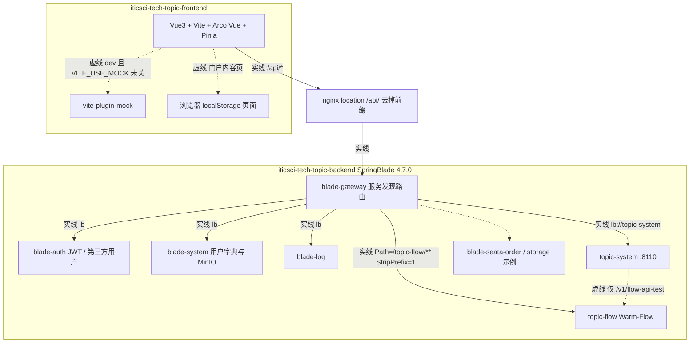
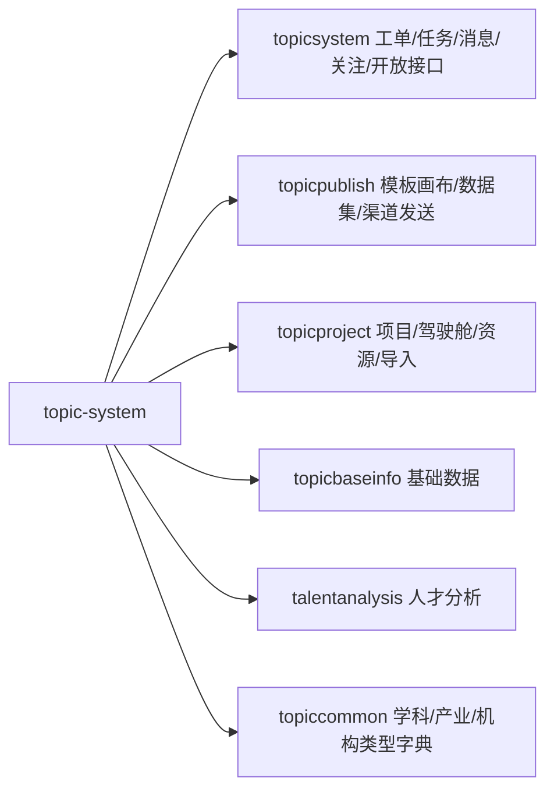
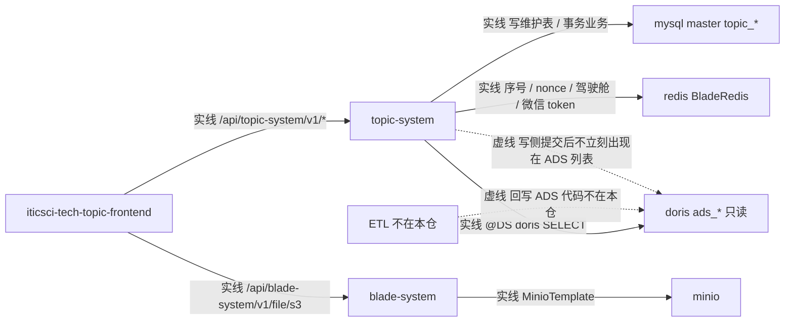
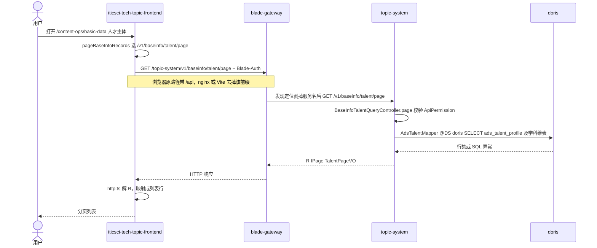

# JX-TOPIC-ARCH-ASBUILT-L01 · 久新专题系统现状分析（代码架构、数据架构、已实现功能与实现方案）

> 只读现状。本文描述 `iticsci-tech-topic-backend` / `iticsci-tech-topic-frontend` 仓内已经落地的结构，不是国科信方案 A 的目标架构。未改久新代码，未改 `architecture-baseline.md`，未改 `ARCH-TOPO-LUMEN` / `CHAIN-STORAGE-FLOW`。
>
> 日期：2026-10-16。证据来自仓内源码、配置、SQL 脚本与设计说明，不凭目录名推断。

```yaml
---
doc_id: JX-TOPIC-ARCH-ASBUILT-L01
role: as-built-spike
status: draft
version: "2026-10-16"
updated: 2026-10-16
signoff_owner: architect
signoff_status: draft
diagram_id:
  - JX-TOPIC-ASBUILT-CODE
  - JX-TOPIC-ASBUILT-DATA
  - JX-TOPIC-ASBUILT-SEQ
---
```

## 任务认领（必填）

| 字段 | 值 |
|------|-----|
| claimed_by | `human:淮政玮`（开工时 MCP `task-get` 核对仍为该值；本单未改成 agent） |
| supervised_by | `human:淮政玮` |
| claim_type | `coordinator_dispatch` |
| 说明 | 开工时状态为 `claimed`，已改为 `in_progress`。MCP 返回体未带 `claim_type` 字段；按本单派单指令记录 `coordinator_dispatch`。任务备注原文为人工派给淮政玮本人执行。收尾不改为 `ready_to_sign` / `done`。 |

## Ponytail（coding 任务必填）

| 字段 | 值 |
|------|-----|
| ponytail | `N/A`（定义/文档） |
| 说明 | 本单不写业务代码。未用 YAGNI 删架构图、功能清单或对照结论。 |

## Headroom（可选）

| 字段 | 值 |
|------|-----|
| headroom | `skip` |
| 说明 | 本机动态工具未挂载 headroom。架构基线、图契约、久新编码规范与设计说明按原文阅读；大目录用检索，不用 compress 代替精读。 |

## 图即契约（架构 / 存储流图 / ARCH-IMPL / 联调 / IA 首页必填）

| 字段 | 值 |
|------|-----|
| diagram_id | `JX-TOPIC-ASBUILT-CODE`、`JX-TOPIC-ASBUILT-DATA`、`JX-TOPIC-ASBUILT-SEQ` |
| 图 diff | 新增三张久新现状图。未改已会签图 `ARCH-TOPO-LUMEN`、`CHAIN-STORAGE-FLOW` 及 `architecture-baseline.md`。 |
| 会签态 | `draft`（本文件 frontmatter；禁止当成已签） |
| 说明 | 三张图只描述久新现状。图文冲突以图为准。节点名用仓内运行时服务名 / 数据源名，不写成 `gkxlumen-*`。 |

## 格式参考（可选）

| 项 | 对齐来源 |
|----|---------|
| 章节结构 | `templates/handoff-template.md` |
| 图下四列表 | `diagram-as-contract.md` §2 |
| 对照基线 | `architecture-baseline.md` §1–§5（只对照，不改） |

## 问题清单

- 久新专题已经实现了哪些用户功能，每条功能的页面/接口、代码落点和数据落点是什么？
- 代码怎么分层，一次请求怎么从浏览器走到库？
- 用了哪些库、缓存、对象存储；哪些存储仓内没有证据？
- 和国科信方案 A / 调用链 / D12 差在哪里（只记录，不整改）？
- 科研机构、人才、技术三个维度，各自实现了哪些指标、哪些分析功能？

## 修改内容

- 新增本 handoff。未改久新前后端任何代码或配置。未 commit、未 push。
- 2026-10-16 补充 §3.1：科研机构、人才、技术的已实现指标与分析功能。同步收紧 §3 人才分析行与技术链行，避免把 11 个页面都写成已接通。

---

## 1. 代码架构

**diagram_id：`JX-TOPIC-ASBUILT-CODE`**（现状 · draft）

实线 = 仓内能对上的现行调用。虚线 = 仓内有代码或页面，但不是这条业务主链（示例模块、仅测试探测、仅 mock、仅浏览器本地）。



`topic-system` 内部按包分界，不是按招标叶子拆服务：



| 生产者 | 消费者 | 触发 | 失败语义 | 禁止事项 |
|---|---|---|---|---|
| `iticsci-tech-topic-frontend` 经 axios `src/api/http.ts` | `blade-gateway` → 各 Java 服务 | 在线 HTTP | 401 走 refresh / 门户换票，失败清登录态；5xx 由拦截器 `Message.error` | 禁止把本图节点改名成 `gkxlumen-topic` 或 `lumen-ui-topic` |
| `blade-gateway` 发现定位器 | `topic-system` / `blade-auth` / `blade-system` / `blade-log` | 路径第一段 = 服务名 | 无实例则网关失败，前端看不到半套假数据 | 禁止前端绕过网关直连 Doris / MySQL / MinIO SDK |
| `topic-system` 测试控制器 | `topic-flow` Feign `ITopicFlowClient` | 仅 `/v1/flow-api-test` | 流程中心不可用返回常量「流程中心服务暂不可用」 | 禁止把 Seata 示例模块画成专题业务依赖 |
| 浏览器本地仓库 | 门户介绍 / 产研报告等页 | 页面保存按钮 | 本地配额失败则页面报「本地保存失败」 | 禁止把 localStorage 画成已落库 |

### 1.1 技术栈（以构建文件为准）

| 端 | 证据 | 现状 |
|---|---|---|
| 前端 | `package.json`、`design.md` §0、`src/main.ts` 使用链 | Vue `^3.5`、Vite `^7`、Vue Router 4、Pinia 2、**Arco Design Vue `^2.58`**、Axios、ECharts、Less、pnpm 9。`README.md` 第一部分仍写 Ant Design Vue，与 `package.json` 和 `design.md`「2026-06 已迁 Arco」冲突，**以 package.json 与 design.md 为准**。 |
| 后端 | 根 `pom.xml`、`CLAUDE.md` | Java 21、Spring Boot 3.5.6、Spring Cloud 2025.0.0、SpringBlade `4.7.0`、MyBatis Plus、Nacos、动态数据源 `dynamic-datasource` 4.3.1、Warm-Flow 1.8.8。 |
| 可部署模块 | 父 POM `<modules>` 与各 `*Application` | `blade-auth`、`blade-gateway`、`blade-common`、`blade-service-api`、`blade-ops`（admin / develop / report / resource / seata 示例）、`blade-service`（`blade-desk`、`blade-log`、`blade-system`、`topic-flow`、`topic-system`）。专题业务在后两个。 |

编码约定（`后端编码规范.md`，已读全文）：Controller 入参 DTO、出参 `R<VO>`，实体不出接口；SQL 不写在 Mapper 注解上；ADS 查询的 Mapper 类必须 `@DS("doris")` 且只允许 SELECT，ADS 不建 MyBatis-Plus 实体。标杆类是 `TaskController`。规范第 9 条写不考虑多租户；前端仍统一带 `Tenant-Id`（默认 `000000`），这是 SpringBlade 网关头，不是业务多租户模型。

### 1.2 模块边界

| 服务 | `spring.application.name` / 路由 | 职责 | 不做 |
|---|---|---|---|
| `iticsci-tech-topic-frontend` | 开发 `:8000`；生产静态 + `nginx.conf` | 页面、`/api/*` 调用、部分 mock、部分浏览器本地内容 | 不直连库 |
| `blade-gateway` | `application.yml`：发现定位器 `lower-case-service-id=true`；另有显式 `Path=/topic-flow/**` + `StripPrefix=1` | 按服务名转发、聚合 Knife4j | 业务规则不在网关 |
| `blade-auth` | 登录 `POST /api/blade-auth/token` | 自签 JWT；`thirdparty` 包对接统一用户中心 | 不存专题业务表 |
| `blade-system` | `/v1/file/s3`、字典、用户 | 对象存储、字典、SSO 用户查询 | 专题指标计算 |
| `topic-system` | `bootstrap.yml` 名 `topic-system`，端口 `8110` | 工单、任务、消息、关注、发布、项目、基础数据、人才分析、开放接口 | 不写 ADS；流程引擎不内嵌，只在测试接口调 `topic-flow` |
| `topic-flow` | 对外 `/topic-flow/v1/flow/{definition,instance,task}` | Warm-Flow 流程定义 / 实例 / 任务 | 前端 `src` 未发现调用 |
| `blade-log` | `/api`、`/error`、`/usual` | 平台日志；任务侧另有 `/api/blade-log/api/biz-log` | Kafka `send` 在三个 Log*ServiceImpl 里是注释掉的 |

一次现行请求的路径：浏览器 `/api/{服务名}/...` → nginx `proxy_pass http://gateway:15800/`（或 Vite 同样去掉 `/api`）→ `blade-gateway` 按第一段服务名负载均衡并剥掉服务名 → 业务 Controller 上的 `/v1/...`。`ApiVersionConstant.API_PREFIX = "/v1"`（`blade-common`）。

鉴权：业务请求头 `Blade-Auth: bearer <token>` + `Tenant-Id`。页面守卫在 `src/router/index.ts`：未登录依次尝试 dev token、门户 iframe Cookie、统一用户中心跳转。另有 `/uc/sso/callback`、`/gkx/sso/callback`。发布页 `/publish/:releaseCode` 标记为公开。

`topic-flow` 与业务的关系：`topic-system` 里只有 `TopicFlowApiTestController`（`/v1/flow-api-test`）注入 `ITopicFlowClient`。工单 / 项目状态机在本服务自己的表和 Service 里，不经过 Warm-Flow。

## 2. 数据架构

**diagram_id：`JX-TOPIC-ASBUILT-DATA`**（现状 · draft）



| 生产者 | 消费者 | 触发 | 失败语义 | 禁止事项 |
|---|---|---|---|---|
| `topic-system` 写侧 Service | `mysql master` 的 `topic_*` | 在线提交 | 校验失败返回业务错误；`@RepeatSubmit` 挡重复提交 | 禁止对 `ads_*` 做 INSERT/UPDATE/DELETE |
| 数仓（仓外） | `topic-system` 的 `mapper/ads` XML | 在线查询 | Doris 未配置时懒加载，查询时报错，不改走 master | 禁止用前端 fixture 填 ADS 查询结果 |
| `blade-system` `S3ChunkController` | MinIO / 注释中的 RustFS | 上传、预签名下载 | 预览/下载 URL 由后端签发，前端不持有桶密钥 | 禁止在本文补一种仓内没出现的对象存储产品名当已接入 |
| `topic-system` | Redis | 工单号、开放接口 nonce、驾驶舱热点、公众号 token | 微信凭据缓存不可用时明确失败，不在内存冒充成功 | 禁止把 `script/kuboard` 里的 Redis 部署地址当成 topic-system 的连接配置 |

### 2.1 库与配置入口

`topic-system` `application-dev.yml`：动态数据源 `primary: master`，`strict: true`，`lazy: true`。

| 数据源名 | 配置 | 谁用 | 仓内有什么 |
|---|---|---|---|
| `master` | `${blade.datasource.dev.url}` 等，真实值在 Nacos | MyBatis-Plus 实体 `@TableName("topic_*")` | `script/sql/**` 下 MySQL DDL，含 `UNIQUE KEY` / `KEY` |
| `doris` | `${blade.datasource.doris.url}` | 类上 `@DS("doris")` 的 Mapper，XML 只 SELECT `ads_*` | **没有** `sql/doris/` 目录。`docs/ADS_SCHEMA.md` 自称 schema 2.3.0 并指向该目录，文件不在本仓 |
| Redis | `topic-system` 的 yml **没有** Redis URL | `BladeRedis`：工单日序号、开放接口 nonce、`CockpitCacheServiceImpl`、`RedisWxMpCredentialStorage` | 连接信息在 Nacos / Blade 公共配置，本文不抄地址 |
| MinIO | `blade-system` `MinioConfig` + `MinioTemplate` | `S3ChunkController` `@RequestMapping("/v1/file/s3")`；前端 `src/api/s3-upload-api.ts`、`vite.config.ts` 的 `/oss-files`、`/community-files` | 桶名来自配置，不在 topic yml |
| Nacos | `topic-system` `bootstrap.yml` | 配置中心 + 注册发现 | 仓内有默认地址与口令字面量，**本文不抄录** |

**仓内未发现、因此不画进实线的存储：** Elasticsearch、NebulaGraph / nGQL、独立 Python 进程、生产路径上的 Kafka 发送（`blade-log` 的 `kafkaTemplate.send` 已注释）。`docs/portal-info` 有门户 Kafka 报文说明，专题业务包没有对应生产者。Seata 示例库不是专题库。

### 2.2 MySQL 业务表（`topic-system-api` 实体，按域）

索引以脚本为准，例如 `script/sql/topic-talent/mysql/20261009-talent-analysis-30tables.sql` 中 `uk_talent_source_ext`、`idx_talent_name`。不是每张表都在这里重复索引名。

| 域 | 表（实体） | 代码入口 |
|---|---|---|
| 工单 | `topic_work_order`、`topic_work_order_handler`、`topic_work_order_business`、`topic_order_track`、`topic_order_template`、`topic_order_evaluation`、`topic_order_biz_record`、`topic_order_attachment`、`topic_open_upload` | `topicsystem.controller.workorder`、`openapi` |
| 任务 | `topic_task`、`topic_sub_task`、`topic_sub_task_participant`、`topic_task_attachment`、`topic_task_delay_apply`、`topic_task_experience_summary` | `controller/task` |
| 站内信 | `topic_internal_message`、`topic_internal_message_attachment` | `internalmessage` |
| 历史关注 | `topic_follow_record`、`topic_follow_group`、`topic_follow_group_ref`、`topic_follow_content`、`topic_follow_content_dynamic`、`topic_browse_record` | `historyfollow` |
| 发布 | `topic_publish_template`、`_version`、`_review_record`、`_canvas`、`_dataset`、`_dataset_group`、`_dataset_ref`、`_render`、`_release`、`_release_plan`、`_release_channel`、`_release_channel_target`、`_send_task`、`_send_task_channel`、`_send_record`、`_mail`、`_sms`、`_sms_signature`、`_wechat_mp`、`_account`、`_account_group`、`_account_group_ref`、`_account_permission` | `topicpublish.controller` |
| 项目 | `topic_project` 及 type/stage/status/status_flow/status_stage/progress/news/issue/timeline/tag/domain/attachment/achievement；价值 `topic_project_value_model`、`_indicator`；成效 `topic_project_effect_indicator`；重点项目筛选 `topic_project_key_project_model`、`_indicator`；导入 `topic_project_datasource`、`_field_mapping`、`_import_log`、`_import_log_detail`；驾驶舱 `topic_cockpit_panel_config`、`_template`、`topic_export_task` | `topicproject.controller` |
| 资源 | `topic_resource`、`topic_resource_tag`、`topic_tag`、`topic_tag_category`、`topic_resource_rule`、`topic_resource_feedback`、`topic_resource_contact` | `resource` / `tag` / `rule` / `recommend` |
| 基础数据写侧 | `topic_baseinfo_talent`、`topic_baseinfo_talent_news`、`topic_baseinfo_institution`、`topic_baseinfo_institution_news`、`topic_baseinfo_expert_knowledge`、`topic_baseinfo_expert_knowledge_field` | `topicbaseinfo` 的 Command Controller |
| 人才分析平台表 | `topic_talent`、`topic_talent_data_batch`、`topic_talent_supply_stat`、`_supply_struct`、`_university_forecast`、`_supply_demand_stat`、`_sd_issue`、`_sd_edu_gap`、`topic_talent_eval_*`、`topic_talent_academic_metric`、`topic_talent_recommend`、`topic_talent_rec_batch`；脚本另有 `topic_talent_analysis_record` | `talentanalysis.controller` |
| 平台字典 | `topic_tech_field`、`topic_industry` | `topiccommon`；`package-info` 写明字典方向仍可能挂起，学科选项走 ADS |

### 2.3 Doris 只读表（Mapper XML 里出现的 `from ads_*`）

这些表没有实体。查询类在 `topicbaseinfo.mapper.ads`、`topiccommon.mapper.ads`、`talentanalysis.mapper.ads|network|nurture|academic`。

已在 SQL 中出现、因而算已接入读路径的表：`ads_talent_profile`、`ads_talent_taxonomy`、`ads_talent_taxonomy_relation`、`ads_talent_experience`、`ads_talent_news`、`ads_talent_topic_profile`、`ads_talent_collaborator`、`ads_talent_potential_result`、`ads_institution_profile`、`ads_institution_type`、`ads_institution_news`、`ads_institution_discipline_profile`、`ads_institution_collaboration_yearly`、`ads_institution_cooperation_type`、`ads_technology_profile`、`ads_technology_term`、`ads_technology_news`、`ads_technology_local_program`、`ads_discipline_domain`、`ads_discipline_field`、`ads_discipline_subfield`、`ads_discipline_topic`、`ads_industry`、`ads_location`。

`docs/ADS_SCHEMA.md` 与 `docs/data/base-info/base-info-analysis.md` 还列了待补列（人才 `priority`、深圳专项区域与研究方向等）。`application-dev.yml` 里 `topic.baseinfo.ads.*-columns-enabled` 默认 **false**：列未补齐时 SQL 不选这些列，避免整条查询失败。文档里有、XML 的 `from` 没出现的表，本单不写成已接入。

### 2.4 读写分工（基础数据的设计思路）

`BaseInfoTalentQueryController` 类注释：列表和详情只读数仓 ADS，返回已同步数据。`BaseInfoTalentCommandController` 类注释：新增/编辑/删除只写平台维护表并置为待同步，**不会立刻出现在列表**；ETL 不在本模块，也没有同步状态查询接口。这是现行设计，不是推测。技术实体/术语/技术资讯/深圳技术专项在前端被标成只读（`BASEINFO_READ_ONLY_RESOURCES`），后端查询同样走 Doris。

## 3. 功能实现对照

路由真源：`iticsci-tech-topic-frontend/src/router/index.ts`。接口真源：`src/api/module/*.ts` 的 URL 与后端 `@RequestMapping`。`README` 里的 AiSpace / 知识库 / 清流对话是技术框架示例，路由里不存在，不算已实现功能。

dev 默认 `VITE_USE_MOCK !== 'false'` 时，`vite-plugin-mock` 会先截获 **mock 文件登记过的 URL**。信息发布 mock 登记的就是 `/api/topic-system/v1/publish/**`，所以本地默认开 mock 时发布接口打不到 Java。人才 `/v1/baseinfo/talent`、`/v1/talent-analysis` 不在 mock 清单里，会继续走代理。

| 功能 | 入口 | 实现落点 | 数据落点 | 设计思路 |
|---|---|---|---|---|
| 账号登录 | `/user/login` | `src/api/module/auth.ts` → `blade-auth` | Blade 用户库（Nacos/平台库，不在 topic SQL） | 密码 SM2；响应 `R<T>` 由 `http.ts` 解包 |
| 统一用户中心 / 国科信 SSO / 门户嵌入 | `/uc/sso/callback`、`/gkx/sso/callback`、embed Cookie | `uc-auth.ts`、`gkx-sso.ts`、`blade-auth/.../thirdparty` | 第三方用户中心 + 本系统 JWT | 自签 JWT，菜单可按 UC 原样透传；`docs/auth-center` TDD 早期写「不做 SSO」，**以现有 callback 代码为准** |
| 欢迎页 | `/home` | `views/Home/index.vue` | 无 | 只有欢迎文案，文案仍写着 Ant Design Vue，与现行 Arco 不一致 |
| 综合智能查询 | `/home/dashboard`、详情 `/home/dashboard/search/:category/:id` | `HomeDashboard/query/searchData.ts` 常量 | **无后端**。人才详情里的关注调用历史关注接口 | 页面和交互已做，检索结果是源码内样例。README 写明真实接口以后替换数据源模块 |
| 重点专题 | `/key-topic` | `blade-kj-key-topic.ts` → `/api/blade-kj-key-topic/*` | mock `mock/key-topic.ts` | **未见后端 Controller**。文件注释写创建等待联调 |
| 技术链分析及 5 个详情 | `/strategy/tech-chain` 及 panorama / hotspot / potential / stage / shenzhen | `blade-kj-strategy.ts` | mock `mock/strategy.ts` | 文件首行写明「后端待建，先走 mock」。**后端 Java 无 tech-chain / blade-kj-strategy**。页面上的指标是演示字段，清单见 §3.1 |
| 产业链分析 | `/strategy/industry-chain` | `blade-kj-industry.ts` → `/api/blade-kj-industry/chain` | mock `mock/industry.ts` | **未见后端实现** |
| 人才分析 11 个场景 | `/strategy/talent/*`（供给、供需、区域、机构、关系链、深圳现状、学术力、产业力、引进、培育、高校） | 已接通的执行入口：`TalentAnalysisRecordExecutor` 按 scene 分发；查询前缀 `/v1/talent-analysis`、`/network`、`/academic`、`/eval-model`、`/eval-list`、`/nurture`、`/batch`、`/analysis-record` | 平台表 `topic_talent_*`（master）+ Doris `ads_talent_*` / `ads_institution_*` / `ads_discipline_*` | 11 个页面都有。后端执行体只登记 6 个 scene。指标与未接通场景见 §3.1。范围筛选走 `/v1/topic-common/dict` |
| 数据查询、企业分析、科研机构分析、政策分析、产业服务链、综合智能分析、账户管理 | 路由 `stub(...)` → `Placeholder.vue` | 无业务页 | 无 | **未见实现**（占位，避免菜单 404）。科研机构侧栏 10 个场景名见 §3.1，没有分析接口 |
| 项目驾驶舱 | `/project/cockpit` | `ProjectCockpitController` `/v1/cockpit`、`CockpitPanelController`、`KeyProjectFilterController` | `topic_project*` + Redis 热点缓存 + `topic_cockpit_panel_*` | 非管理员按负责人过滤；统计走缓存，业务变更删 key。导出任务表 `topic_export_task` |
| 项目跟踪 | `/project/tracking`、`/:id` | `/v1/project`、`/progress`、`/issue`、`/timeline`、`/value`、`/effect` | `topic_project*`、价值/成效指标表 | 跟踪、进度、问题、时间线、价值模型、成效模型分 Controller，共用项目主表 |
| 项目内容与导入 | `/project/content`、`/import`、`/status-config`、`/:id` | `ProjectController`、`ProjectImport*`、`ProjectStatus*`、`ProjectAttachmentController` | 项目表 + 导入数据源/映射/日志表；附件走文件服务 | 导入有独立数据源配置和字段映射；另有 `MockDatasourceController` `/v1/project/import/mock` 供对接演练 |
| 资源管理 | `/project/resource` | `/v1/resource`、`/tag`、`/tag-category`、`/resource-rule`、`/resource/recommend` | `topic_resource*`、`topic_tag*` | 资源、标签、规则、推荐反馈分表 |
| 信息发布（模板、画布、数据集、审核、发布、发送记录、发送对象） | `/info-publish` 及 editor / dataset / review / recipient / send-record；公开页 `/publish/:releaseCode` | `topicpublish.controller` 前缀 `/v1/publish/**` | `topic_publish_*`；图片/文件走 MinIO；微信 token 走 Redis；数据集 API 源用 Hutool `HttpUtil` 拉外部 HTTP | 画布协议与版本冻结见 `docs/info-pub`。渠道执行器有邮件、短信、微信公众号。**dev 默认 mock 会截获同 URL**，关 `VITE_USE_MOCK` 才打到 Java |
| 工单申请 / 工单管理 | `/system/ticket-apply`、`/system/ticket`、`/:id` | `MyWorkOrderController`、`WorkOrderController`、`OrderAttachmentController`、`OrderTemplateController` | `topic_work_order*`；单号 Redis INCR；附件 MinIO / 预览 URL | 适配层 `WORK_ORDER_SERVICE` 默认 `topic-system`。状态机在工单服务内，不调用 `topic-flow` |
| 任务管理 | `/system/task`、`/:id` | `TaskController` `/v1/task`、`SubTaskController` `/v1/subtask` | `topic_task*`；操作日志 `/api/blade-log/api/biz-log`；附件 MinIO | 主任务/子任务/延期/经验总结分表。`mock/task.ts` 仍登记旧的 `/api/blade-kj-task/*`，现行客户端已改打 `topic-system` |
| 消息管理 | `/system/message`、`/:id` | `InternalMessageController` `/v1/internal-message` | `topic_internal_message*` | 站内信及附件。mock 里未读数路径与现行路径部分重叠，以客户端 URL 为准 |
| 历史关注 | `/system/history`；查询首页人才详情也会调 | `HistoryFollowController` `/v1/history-follow` | `topic_follow_*`、`topic_browse_record` | 关注、分组、动态、浏览记录 |
| 内容运营 · 工单 | `/content-ops/work-order` 及 system/consult 详情 | 同上工单包，管理端列表 | 同上 | 与「我的工单」共用服务，入口分我的/管理 |
| 内容运营 · 基础数据 | `/content-ops/basic-data/:groupKey` | 已联调：`/v1/baseinfo/talent|local-talent|news|institution|...` 与技术只读查询。未联调资源见 `BASIC_DATA_MOCK_ONLY_RESOURCES` | 查询 Doris；维护写 `topic_baseinfo_*`。产业/企业/政策/服务机构等 key **走 mock 或无接口** | 查询与维护分离，见 §2.4。技术术语在线修订在非 mock 时直接拒绝 |
| 专家知识 | 后端 `/v1/baseinfo/expert-knowledge` | `ExpertKnowledgeController` | `topic_baseinfo_expert_knowledge*` | **前端 `src` 未见调用**。设计在 `docs/data/expert-knowledge/` |
| 门户介绍 / 产研报告 / 领军人才 / 科研力量 | `/content-ops/portal/*` | `local-repository` 或组件内 `localStorage` | **浏览器本地** | 保存成功提示「已保存到当前浏览器」。**未见后端表** |
| 开放接口工单 | 无主站菜单 | `OpenApiWorkOrderController`、`OpenApiHistoryFollowController`；签名 `OpenApiSignatureVerifier` | 工单表 + Redis nonce | 外部系统 HMAC/公钥验签，文档 `docs/work-order/科技专题服务系统开放接口-API文档V1.0.md` |
| 流程中心 | 无前端路由 | `topic-flow` 三个 Controller；`topic-system` 仅测试接口调用 | Warm-Flow 表（引擎自带，不在 topic SQL 清单的业务语义里） | **业务页面未见使用** |

### 3.1 科研机构、人才、技术：已实现指标与分析功能

三个战略分析里，只有人才分析有后端计算。科研机构分析是占位页。技术链页面已画出，数字来自前端 Mock。基础数据里的科研机构、人才、技术是档案维护，不计算本节指标。

证据：`TalentAnalysisRecordConstant`、`TalentAnalysisRecordExecutor`、`src/views/strategy/TalentAnalysis/mode.ts`、`live-data.ts` 的 `FRONTEND_TO_BACKEND_SCENE`、`src/constants/research-institution-scenes.ts`、`src/api/module/blade-kj-strategy.ts`、`mock/strategy.ts`。

#### 人才

后端执行体只分发这 6 个 scene。前端 `isLiveTalentScene` 与此一致的有供给、深圳供需、关系链、机构分布、学术力、培育。

| 分析功能 | 前端路径 / 后端 scene | 已实现的指标或结果 | 计算落点 |
|---|---|---|---|
| 人才供给情况分析 | `/strategy/talent/supply` · `supply` | 年度供给人数；学历、职称、年龄结构的人数和占比。按技术领域分析时，结果里另有高校新增供给预测人数（按预测年求和） | 平台表 `topic_talent_supply_stat`、`_supply_struct`、`_university_forecast`，取 valid 批次。结构占比在查询期重算。`TalentAnalysisQueryServiceImpl` |
| 深圳人才供需分析 | `/strategy/talent/supply-demand` · `shenzhen-supply-demand` | 供给量、需求量、缺口（需求−供给）、缺口率、缺口方向；再按学历拆缺口。问题维度是文字结论（供给描述、需求描述、结论） | `topic_talent_supply_demand_stat`、`_sd_edu_gap`、`_sd_issue`。缺口、缺口率、缺口方向在查询期计算，不落库。`SupplyDemandKpiVO` |
| 重点人才机构分布分析 | `/strategy/talent/institution` · `org-distribution` | 各机构人才数，以及占所选领域全量的比例（分子÷分母，4 位小数） | Doris `AdsOrgDistributionMapper`。`TalentOrgDistributionServiceImpl` |
| 重点人才关系链分析 | `/strategy/talent/relationship` · `relation` | 关系图、两人路径、人物检索与画像。没有统计指标 | Doris `AdsTalentNetworkMapper`。`TalentNetworkServiceImpl` |
| 人才学术力评估分析 | `/strategy/talent/academic` · `academic-capability` | 加权指标：论文数量、被引次数、H 指数、合作广度、期刊影响力，以及加权总分。分级：核心人才、重点人才。规则判定还用主导论文数、批次内排名 | 指标从 Doris 人才画像抽到 `topic_talent_academic_metric`，权重在 `topic_talent_eval_*`。字典只实现 academic 一组（`TalentEvalModelServiceImpl`、`TalentAcademicConstant`）。期刊影响力常量原因是「无源待确认」，过渡期固定为 0 |
| 培育人才推荐分析 | `/strategy/talent/nurture` · `nurture` | 潜力总分，以及近期影响力、产出动量、引用动量、领导力、主题拓展五项分项。输出还有培育方向建议和推荐依据 | 分数读 Doris `ads_talent_potential_result`（`is_potential_talent=1`），按潜力总分排序。平台不重算分。文案由 `NurtureCopywriter` 调大模型，失败则整批失败 |

另外 5 个场景有页面，真实分析未接通：

| 场景 | 前端路径 | 仓内现状 |
|---|---|---|
| 重点人才区域分布分析 | `/strategy/talent/region` | `mode.ts` 把它算进已接通，并映射后端 scene `distribution`。`TalentAnalysisRecordConstant` 与执行体都没有这个 scene，提交会按非法场景拒绝 |
| 深圳人才现状分析 | `/strategy/talent/shenzhen-status` | 前端常量 `TALENT_INDICATORS` 有人才总量、高层次人才占比、人才密度、国际化程度、成果转化率、产业匹配度。建表脚本 `20261009-talent-analysis-30tables.sql` 的城市指标表注释写了同一组名字。Java 未检索到读取该表的 Mapper |
| 人才产业力评估分析 | `/strategy/talent/industry` | 同一脚本的模型指标注释写了专利产出、专利转化、项目参与、商业化价值。`TalentEvalModelServiceImpl` 写明配置面只实现 academic；`industry` 走拒绝分支 |
| 引入人才推荐分析 | `/strategy/talent/introduction` | 无对应 scene 常量，无执行分支 |
| 高校培育人才分析 | `/strategy/talent/university` | 无对应 scene。高校新增供给预测挂在「人才供给情况分析」的结果里，不走这个独立页 |

#### 科研机构

`RESEARCH_INSTITUTION_SCENES` 有 10 个场景名，路由 `strategy/institution` 是 `Placeholder.vue`。没有机构分析 Controller，没有指标计算。

场景名：科研机构涉及产业分析、布局技术领域分析、新增动态分析、深圳科研机构现状分析、科研合作关系链条分析、技术力对比分析、引入科研机构推荐分析、培育科研机构推荐分析、深圳科研机构优势分析、深圳科研机构痛难点分析。

内容运营「科研力量」里的机构分析（`InstitutionAnalysisPanel.vue`、`analysis-repository.ts`）写在浏览器本地，字段是优势、平台、创新、匹配度等文字，不调用后端。

基础数据的机构列表、详情、合作关系、机构动态是档案查询：读 Doris `ads_institution_*`，维护写 `topic_baseinfo_institution*`。那里没有本节意义上的分析指标。

#### 技术

`TechChainAnalysis/index.vue` 有 6 个页签：全景图谱、热点发现、潜力识别、阶段研判、深圳分析、瓶颈识别。详情路由有全景、热点、潜力对标、阶段、深圳。`blade-kj-strategy.ts` 首行写明后端待建。`mock/strategy.ts` 提供列表和详情。后端 Java 没有这些 URL。

演示字段（接口类型与 mock 种子，不是计算结果）：

| 页面 | 演示指标 |
|---|---|
| 热点详情 | 热度指数、论文总量及涨幅、增长速度、语义新鲜度 |
| 图谱节点 | 论文数、专利数、企业数 |
| 深圳分析 | 雷达：技术成熟度、市场规模、政策支持、人才储备、热度。列表另有深圳领先指数（0–100） |
| 潜力对标 | 技术成熟度、市场规模、政策支持、人才储备、投资热度，以及综合分排名 |

基础数据的技术实体、术语、技术动态、深圳技术专项是档案查询，前端标为只读，走 Doris `ads_technology_*`。那里没有技术链分析指标。

## 4. 代表请求时序

**diagram_id：`JX-TOPIC-ASBUILT-SEQ`**（现状 · draft）

选「内容运营 → 基础数据 → 人才列表」。这条链前端、网关、Java、Doris 都能在源码对上，且不被 vite mock 截获。



| 生产者 | 消费者 | 触发 | 失败语义 | 禁止事项 |
|---|---|---|---|---|
| 用户打开人才主体 Tab | `BasicDataListPanel` → `pageBaseInfoRecords` | 在线翻页/搜索 | 无关键字也允许查；total=0 返回空列表，不塞样例行 | 禁止这条读路径去查 `topic_baseinfo_talent` 写侧表 |
| `iticsci-tech-topic-frontend` | `blade-gateway` → `topic-system` | GET | 未登录由路由守卫挡住；401 走刷新；5xx 拦截器报错 | 禁止在 mock 开启时把 `/api/blade-kj-strategy` 的假数据算进这条链 |
| `BaseInfoTalentQueryServiceImpl` | Doris `ads_talent_profile` 等 | 每次查询 | 数据源缺失或 SQL 失败向上抛，不改读 master | 禁止为补列把 `extended-columns-enabled` 在未补列时打开（配置注释写明会让整查询失败） |
| 写侧 `POST /v1/baseinfo/talent`（本图不画执行） | `mysql master` | 另一次提交 | 写入后列表仍只有 ADS 已发布行 | 禁止把「保存成功」理解成列表立刻可见 |

对应代码：`blade-kj-baseinfo.ts` 的 `talentApiBase`；`BaseInfoTalentQueryController`；`AdsTalentMapper` 与 `AdsTalentMapper.xml` 的 `from ads_talent_profile`。

## 5. 与国科信方案 A / 调用链 / D12 的差异（只对照）

对照真源是 `architecture-baseline.md` 的 `ARCH-TOPO-LUMEN`。本单不改那张图，也不把久新实现写成国科信目标。

| 国科信锁定项 | 久新现状 |
|---|---|
| 方案 A：两前端共享 `gkxlumen-topic` + `gkxlumen-metrics` | 独立 SpringBlade。业务聚合在 `topic-system`，没有 `gkxlumen-topic` / `gkxlumen-metrics` |
| 调用链：前端 → 网关 → Java → Python `/internal/*` | 前端 → `blade-gateway` → Java → MySQL / Doris。**没有 Python 服务** |
| Java 只读 ADS、不写算法 | Java **直读** Doris `ads_*`（方向与「读 ADS」同），业务写入 MySQL `topic_*`。人才评估、发布渲染、驾驶舱统计都在 Java。无独立算法仓 |
| D12：lumen 不调用 demo 服务 | 久新两仓不在 `lumen-*` / `demo-*` 调用链上，也不调用这两套服务。隔离成立的方式是「另一套系统」，不是 D12 的 lumen 网关约束 |
| 图谱 Nebula、`CHAIN-STORAGE-FLOW` | 仓内未发现图数据库客户端。技术链/产业链页面是前端 mock |
| D8 React + `@arco-design/web-react` | 久新是 Vue + `@arco-design/web-vue`。主色 `#165DFF` 与其 `design.md` 一致，规范文件不是国科信 `Design.md` |
| D7 Mock 由 Python 写入 ADS | Mock 在前端 `mock/*.ts`，由 Vite 开关控制 |

## 6. 架构合规自检

按国科信铁律对照**久新现状**。偏离只记录，本单不整改。

| 铁律 | 结论 | 依据 |
|---|---|---|
| 1 算法只在 Python | 现状偏离 | 专题计算与渲染在 `topic-system` Java；仓内无 Python 服务 |
| 2 调用链前端 → Java → Python `/internal` | 现状偏离 | 链停在 Java 与 Doris/MySQL/Redis/MinIO |
| 3 图谱 Nebula，禁止 Neo4j | 现状偏离 | 两种图库都未发现；不是「已用 Nebula」 |
| 4 可观测 Java Agent + Python instrument + 前端 observability | 现状偏离 | `package.json` 有 OTel 依赖，`src` 无初始化；`topic-system` pom 无 OTel。详见下方「可观测性」节的本单口径 |
| 5 CI/CD push → Pipeline → K8s | 本单不适用 | 本单未改运行时代码，未核 Pipeline |
| 6 禁止 demo merge 进 lumen | 本单不适用 | 未做合并；久新仓本身不是 demo→lumen |
| 7 方案 A 共享 `gkxlumen-topic` | 现状偏离 | 见 §5 |
| 8 数据走 ADS，Python 写、Java 只读 | 现状偏离 | Java 只读 Doris ADS 这一条成立；写入方不是本仓 Python，业务真相源还有 MySQL |
| 9 D8 前端 React Arco / Design.md | 现状偏离 | Vue + Arco Vue + 仓内 `design.md` |
| 10 D9 指标 8 件套与 ⓘ | 现状偏离 | 页面统计数字未见 MetricSpecCard / metric_id |
| 11 D10 国科信交互规范 | 本单不适用 | 久新交互以仓内 `design.md` 与 Arco Vue 为准；本单未做走查打分 |
| 12 D12 lumen 不打 demo | 本单不适用 | 调用链不进入 lumen/demo。不能据此把久新记成「已符合 lumen 正式拓扑」 |

## 产物清单

| 产物 | 路径 |
|---|---|
| 本 handoff（唯一写入） | `agent-delivery/agent-handoffs/thirdpart/JX-TOPIC-ARCH-ASBUILT-L01.md` |
| 未改 | 久新前后端、`architecture-baseline.md`、`ARCH-TOPO-LUMEN`、`CHAIN-STORAGE-FLOW` |
| 登记表 DoD 写的路径 | `agent-handoffs/JX-TOPIC-ARCH-ASBUILT-L01.md`（无 `thirdpart/`）。本单按派单「唯一允许写入」放在 `thirdpart/`，不另存一份 |

## 开放项

- `docs/ADS_SCHEMA.md` 指向的 `sql/doris/` 不在本仓，ADS 物理 DDL 与索引无法在本仓复核；已接入表以 Mapper XML 为准。
- 未逐方法读完全部 Controller（约百余个）。功能表覆盖路由上的主功能和后端有接口但前端没挂上的专家知识、流程中心。
- `openspec/changes/**` 历史变更单未逐份精读；已读与现状直接相关的 `后端编码规范.md`、`docs/info-pub/信息发布模块业务设计及说明.md` 总览、`docs/data/base-info/base-info-analysis.md`、`docs/ADS_SCHEMA.md` 文首、`docs/auth-center` TDD 文首。变更单若与代码冲突，以代码和上图为准。
- §3.1 的人才指标以执行体、指标常量和 Mapper 为准。区域分布存在前端已标接通、后端无 `distribution` scene 的偏差，已记在该节，未改代码。
- dev 默认开 mock。信息发布等「前后端都有」的功能，在默认 dev 下看到的是 mock。
- 注册表 `touched_files` 与本文件路径差一个 `thirdpart/` 目录。
- 本会话没有独立 token 计量器。估算 120000，未看到超过 3 倍的计量读数，故未按超额截断。未覆盖范围即上面四条，不是主链缺失。

## 遗留风险

- `topic-system/src/main/resources/bootstrap.yml` 含 Nacos 默认地址与口令字面量。本文不抄录。应视为配置泄漏风险，不在本单修改。
- 基础数据「保存成功但列表没有」来自写 MySQL、读 Doris 的最终一致，若 ETL 未接上，运营会认为保存失败。
- 技术链、产业链、重点专题、综合查询已有完整页面，数据不是后端。对外演示时容易被当成已联调。
- 门户内容页只在浏览器本地，换浏览器即丢失。
- `README` 技术栈段落与 `package.json` 不一致，后续若按 README 引入 Ant Design Vue 会和现行 Arco 混搭。
- `topic-flow` 已部署形态的服务，业务主链未接上，存在「流程引擎空转」的理解成本。

## 测试结果

- 本单是只读梳理，未跑前后端测试，未起服务，未打真实 Doris/MySQL。
- 核对手段：读构建文件、路由、`@RequestMapping`、`@TableName`、`@DS`、Mapper XML、`application-dev.yml`、`nginx.conf`、代表 Service 与设计说明原文。

## CI/CD（必填）

- 本单未改运行时代码，不适用。
- 未产生 commit，无 pipeline，无 K8s rollout。

## 可观测性（建议）

- 本单未改运行时代码，不适用。
- 现状附注（不作为本单交付改动）：前端依赖里有 `@opentelemetry/*`，`src` 未检索到初始化；`topic-system` 模块 pom 未检索到 OTel。`blade-log` 的 Kafka 发送被注释。

## 涉及文件

- 写入：`agent-delivery/agent-handoffs/thirdpart/JX-TOPIC-ARCH-ASBUILT-L01.md`
- 只读主证据：
  - `iticsci-tech-topic-backend`：`pom.xml`、`后端编码规范.md`、`blade-gateway/.../application.yml`、`blade-service/topic-system/.../bootstrap.yml`、`application-dev.yml`、`blade-common/.../ApiVersionConstant.java`、各 `*Controller.java`、`topic-system-api` 实体、`mapper/**/*.xml`、`script/sql/**`
  - `iticsci-tech-topic-frontend`：`package.json`、`design.md`、`vite.config.ts`、`nginx.conf`、`src/router/index.ts`、`src/api/http.ts`、`src/api/module/*.ts`、`mock/*.ts`、`src/constants/talent-analysis-scenes.ts`、`src/constants/research-institution-scenes.ts`、`src/views/strategy/TalentAnalysis/mode.ts`、`live-data.ts`、`src/views/strategy/TechChainAnalysis/index.vue`
  - 编排仓对照：`agent-delivery/architecture-baseline.md`、`agent-delivery/diagram-as-contract.md`、`agent-delivery/templates/handoff-template.md`
