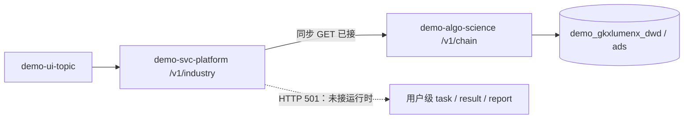

# CHAIN-ENG-JAVA-DEMO-L01 · 产业链 demo Java 门面与 demo 库证据

> 日期：2026-08-25  
> parent：`CHAIN-HZW-THREE-TRACK-L01`  
> 范围：只改 `demo-svc-platform` 后台；未改 `demo-ui-topic`、fixture/localStorage、产业集群 3 条既有接口及 dim 表结构。

## 任务认领

| 字段 | 值 |
|---|---|
| claimed_by | `agent:api-agent` |
| supervised_by | `human:李伟` |
| claim_type | `pull` |

## Ponytail

| 字段 | 值 |
|---|---|
| ponytail | `full` |
| 说明 | 复用既有 `ChainController → ChainService → ChainAlgoClient`，只新增缺失的异步契约；未造第二套任务运行时、未伪造 task/result/report ID。 |

## 图即契约

| 字段 | 值 |
|---|---|
| diagram_id | `CHAIN-DEMO-BACKEND-FLOW` |
| 图 diff | 已接同步边保持实线；未接的用户级 task/result/report 明确为 501 虚线边。 |
| 会签态 | `draft` |

## 范围与实现

### 已复用

- Java 同步门面已有 19 条只读接口，继续经 Feign 调 `demo-algo-science`，Java 不做算法。
- `DataPlaneFeignInterceptor` 已透传 `X-GKX-PLANE-CHAIN`；Python 默认 `demo`，可按请求切 `live`。
- 产业集群目录、`resolve-scope`、映射 PUT 保持原样，本叶未触碰。

### 本叶新增

- Java 在调用 Python 前校验 `chainId`：仅接受 `INB*` / 历史 `CH*`；`CL-*` 和 slug 返回业务错误并提示先走 `resolve-scope`，不再误报“算法服务暂不可达”。
- Java 对 Python 的 `/internal/status`、`/internal/models/registry` 扁平响应补统一 `{code,msg,data}` 包络；若上游后续已带包络则原样返回。
- 对齐 lumen 真源新增 `/v1/analysis/tasks`、任务查询、结果查询、报告创建、报告查询 5 条 Java 契约。
- 当前 Python science 仓没有产业链用户级持久化任务运行时，5 条端点统一返回 **HTTP 501 + code=1**。
- 响应给出 `CHAIN_ASYNC_RUNTIME_NOT_CONNECTED` 和可用同步端点；明确不返回伪 `task_id`、`result_id`、`report_id`。
- 新增独立 OpenAPI 文件，不改既有同步接口契约。

## 8 页接口 × 下游 × 库矩阵

| 页面 | Java 接口 | 下游 / 库边界 | 当前结论 |
|---|---|---|---|
| 产业查询 | `GET /v1/industry/list`；基础统计接口 | Feign → Python `read_v2` → demo DWD/ADS | 列表可接；搜索仍无专用后台接口 |
| 产业链总览 | `market-stats`、`enterprise-stats`、`institution-stats`、`investment-stats`、`global-dist`、`national-dist`、`news-stats`、`sz-elements`、`sz-dist` | Feign → Python → demo ADS/DWD | 企业等可读；`market-stats`、`institution-stats` 当前诚实为空，不编数 |
| 全景图谱 | `GET /{chainId}/panorama` | Feign → Python；Nebula/ADS graph snapshot/DWD 兜底 | 已接同步门面 |
| 运行诊断 | `cycle`、`key-nodes`、`bottlenecks` | Feign → Python `read_v2` → demo DWD/ADS + 算法 | 已接同步门面 |
| 区域评价 | `region-index`、`competitiveness` | Feign → Python `read_v2` → demo DWD/ADS + 算法 | 已接；Python 尚未优先消费已灌 scorecard，另叶处理 |
| 深圳决策 | `shenzhen`、`hotspot`、`roadmap`、`recommendation` | Feign → Python `read_v2` → demo DWD/ADS + 算法 | 已接同步门面 |
| 维护管理 | 既有 cluster list / resolve-scope / maps PUT | Java JDBC → `demo_gkxlumenx_dim.industry_cluster(_map)` | 既有真实子链，冻结未改 |
| 结果/报告 | `POST/GET /v1/analysis/tasks/**`、`POST/GET /v1/analysis/reports/**` | 暂无产业链用户级持久化运行时 | 新增诚实 HTTP 501 契约；网关 `/topic/v1/analysis/**` 尚待配置，未冒充工程闭环 |

## 关键事实与偏离

1. `demo-algo-science` 的 7 个主要深度端点已能按 `INB*` chainId 出数；不需要在 Java 重写算法。
2. Java Feign 与 Python 共 24 条 method/path/query/body 已逐项对齐；无需改现有公开接口签名。
3. science 仓原 `/gdf/tasks` 已迁到 `demo-algo-ent-analysis`，当前全部返回迁移提示；在 science 仓恢复副本会形成双运行时，本叶拒绝这样做。
4. `industry_chain_model_run` / `model_result_detail` 只有表结构，现有 pipeline 不写运行记录，因此不能据此返回真实 result_id。
5. 原规划提到“持久化”，但当前 registry DoD 要求为“有 Java 契约”；本叶只交付可验证的 501 契约。真正接通需另叶移植 lumen 的产业链任务编排并完成 DDL/状态机会签。

## 产物

- `gkx-innov/src/main/java/com/topcomm/gkx/innov/chain/ChainAnalysisController.java`
- `gkx-innov/src/main/java/com/topcomm/gkx/innov/chain/ChainService.java`
- `gkx-innov/src/main/resources/openapi/openapi-topic-industry-analysis-v1.yaml`
- `gkx-innov/src/test/java/com/topcomm/gkx/innov/chain/ChainAnalysisContractCheck.java`

## 验收证据

| 检查 | 结果 |
|---|---|
| `mvn -pl gkx-innov -am test -DskipTests=false`（`JAVA_HOME=C:\Program Files\Java\jdk-17`） | BUILD PASS；仓内 Surefire 2.12 不发现 JUnit 5，显示 tests=0 |
| `mvn -f gkx-innov/pom.xml ... exec:java` 执行 `ChainAnalysisContractCheck` | PASS；断言 HTTP 501、零伪 ID、非法 chainId 不调 Python、internal GET 包络 |
| 新 OpenAPI YAML 解析并断言 5 条路径 | PASS |
| `git diff --check` | PASS |
| IDE lints（新增 Java / YAML） | 0 error |
| 首次 Maven（本机 `JAVA_HOME` 指向 JDK 8） | FAIL：release 17；纠正会话级 `JAVA_HOME` 后通过，未改机器配置 |
| 在线 Java→Python→demo 库 curl / traceId | 待部署环境补证 |

## 架构合规自检

- ✅ D1：Java 未写 NLP、图谱或评分算法。
- ✅ D2：调用链保持前端 → Java → Python；未改前端直连。
- ✅ D3：图谱仍由 Python/Nebula 路径负责，Java 不写 nGQL。
- ✅ D4：既有 Java Agent + Feign/Python trace 链保持；本叶未移除埋点。
- ✅ D8/D10：本叶无前端改动。
- ✅ D9：未伪造指标值或把缺口改绿。
- ✅ D12：未引入 lumen→demo 依赖；本叶仅 demo 仓。
- ✅ 失败诚实：未用浏览器 localStorage、JVM 内存任务或伪 ID 冒充持久化运行时。

## 遗留风险与下一叶

1. 要实现 I2-12 的工程级同条件单飞、当天复用，需在 `demo-algo-ent-analysis` 通用任务框架增加 `chain_analysis` 类型，并由 Java Feign 聚合；涉及跨仓与持久表契约，应另建任务。
2. Python `region-index` / `competitiveness` 应优先读取已灌 `industry_chain_region_scorecard`，无行再现场计算；不在本 Java 仓任务内。
3. `market-stats`、`institution-stats` 无真实来源时继续空，禁止为“看起来完整”编造。
4. 前端仍未调用同步 Java 门面；按用户本轮要求未改前端。

## CI/CD

- 分支：`dev`
- commit：待提交
- pipeline URL / ID：待 push 后补
- 部署 namespace / 镜像 tag：待 CI
- K8s rollout：待 CI
- dev 测试 URL：待部署环境

