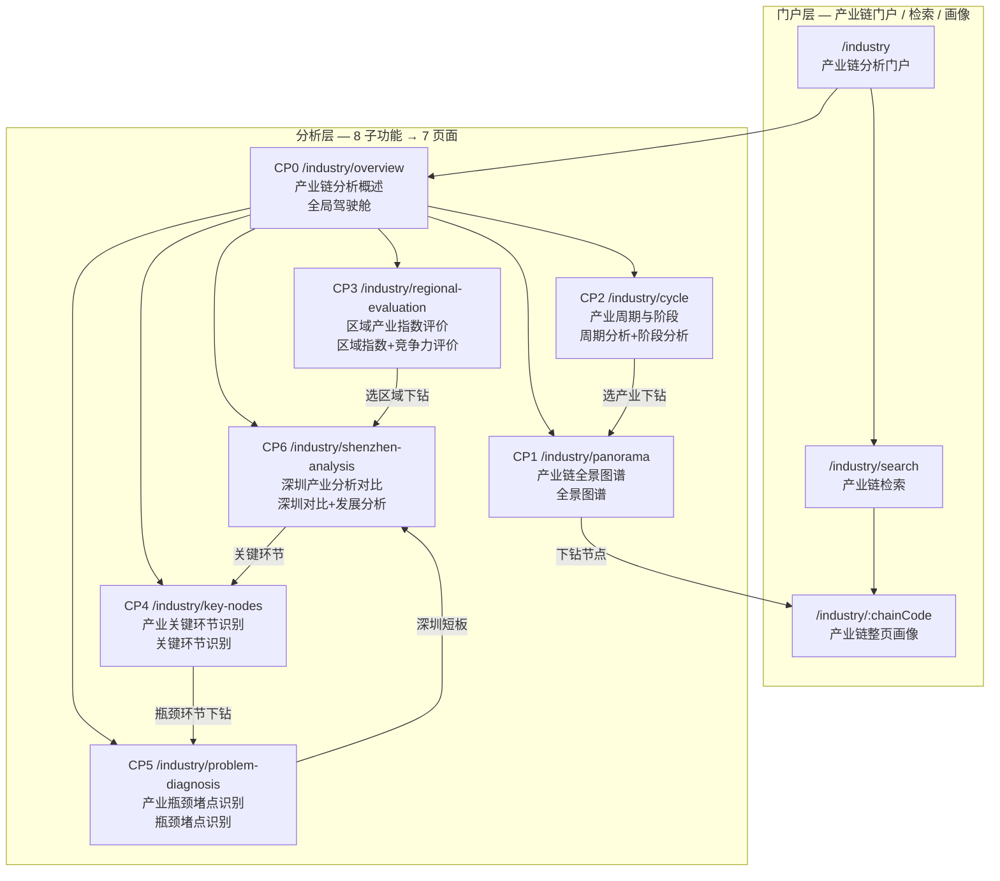

# CHAIN-IA — 产业链分析信息架构

> **要素**：产业链（CHAIN / E2）
> **scope_ref**：bid `§1.1.1.2.4.2.2 产业链分析`（8 子功能）
> **algo_ref**：bid `§1.1.1.1.1.1.4.3.1 产业链深度分析模型`（13 类模型）
> **数据真源**：`dwd_industry_chain_info` / `dwd_org_industry_chain_dtl` / `dwd_org_industry_chain_prod_dtl` / `dwd_org_industry_chain_pat_dtl` / `dwd_industry_chain_news_info`
> **参照**：ENT-IA.md（企业域两层架构）
> **作者**：ux-agent
> **日期**：2026-06-23

---

## 1. 两层站点图



---

## 2. 页面清单

| 代号 | 页面名称 | 路由 | bid 子功能 | 算法模型 | 验收点 | 权限 |
|------|---------|------|-----------|---------|--------|------|
| — | 产业链门户 | `/industry` | — | — | 门户入口，展示产业链快速导航与全局统计 | L0 |
| — | 产业链检索 | `/industry/search` | — | — | 支持关键词/图谱/语义搜索产业链 | L0 |
| — | 产业链画像 | `/industry/:chainCode` | — | — | 整页产业链画像，跨要素下钻 | L1 |
| CP0 | 产业链分析概述 | `/industry/overview` | 全局驾驶舱 | 基础指标×9 维度 | KPI 驾驶舱，9 维度指标一览 | L1 |
| CP1 | 产业链全景图谱 | `/industry/panorama` | §1.1.1.2.4.2.2.1 全景图谱 | 产业链全景模型 + 深圳产业链模型 | 交互式图谱，节点下钻，动态演进 | L1 |
| CP2 | 产业周期与阶段 | `/industry/cycle` | §1.1.1.2.4.2.2.2 周期分析 | 产业周期分析模型 + 产业阶段分析模型 | 周期阶段判定 + 趋势预测 | L1 |
| CP3 | 区域产业指数评价 | `/industry/regional-evaluation` | §1.1.1.2.4.2.2.3 区域指数 + §1.1.1.2.4.2.2.8 竞争力评价 | 区域产业指数模型 | 多维评价体系 + 多区域对比 + 竞争力排名 | L2 |
| CP4 | 产业关键环节识别 | `/industry/key-nodes` | §1.1.1.2.4.2.2.4 关键环节识别 | 产业链关键环节识别模型 | 环节拆解 + 智能标注 + 高端化指数 | L2 |
| CP5 | 产业瓶颈堵点识别 | `/industry/problem-diagnosis` | §1.1.1.2.4.2.2.5 瓶颈堵点识别 | 产业瓶颈堵点识别模型 | 多维瓶颈分析 + 归因建议 | L2 |
| CP6 | 深圳产业分析对比 | `/industry/shenzhen-analysis` | §1.1.1.2.4.2.2.6 深圳对比 + §1.1.1.2.4.2.2.7 深圳发展分析 | 深圳产业优势识别模型 + 深圳问题识别模型 + 深圳机遇分析模型 + 重点布局产业推荐模型 | 深圳多维对标 + 发展建议 + 机遇推荐 | L2 |

---

## 3. 路由规划

### 3.1 已有路由（demo-ui-topic `Layout.tsx`）

| 已有路由 | 已有页面 | 对应 CHAIN 页面 | 复用/改造策略 |
|---------|---------|---------------|-------------|
| `/industry/overview` | 产业全景总览 | CP0 产业链分析概述 | **改造**：从纯总览升级为驾驶舱，增加 9 维度 KPI |
| `/industry/shenzhen-analysis` | 深圳产业综合分析 | CP6 深圳产业分析对比 | **改造**：增加发展分析 Tab + 机遇推荐 |
| `/industry/general-overview` | 产业总体概览 | — | **保留**：作为门户层辅助页（产业总体概览不等于分析概述） |
| `/industry/regional-evaluation` | 产业区域评价 | CP3 区域产业指数评价 | **改造**：增加竞争力评价维度 + 权重配置 |
| `/industry/structure-analysis` | 产业结构研判 | CP4 产业关键环节识别 | **改造**：从结构展示升级为关键环节智能标注 |
| `/industry/problem-diagnosis` | 产业瓶颈堵点识别 | CP5 产业瓶颈堵点识别 | **改造**：增加归因建议 + 多维瓶颈分析 |

### 3.2 新增路由

| 新增路由 | 对应 CHAIN 页面 | 说明 |
|---------|---------------|------|
| `/industry/panorama` | CP1 产业链全景图谱 | 全景图谱为独立交互页，需独立路由 |
| `/industry/cycle` | CP2 产业周期与阶段 | 周期+阶段为独立分析页 |
| `/industry/key-nodes` | CP4 产业关键环节识别 | 关键环节独立于结构研判，需独立路由 |
| `/industry/search` | 产业链检索 | 检索工作台 |
| `/industry/:chainCode` | 产业链画像 | 整页画像（动态路由） |

### 3.3 路由结构总览

```
/industry                           → 门户入口（重定向到 /industry/overview）
/industry/overview                  → CP0 产业链分析概述
/industry/panorama                  → CP1 产业链全景图谱（新增）
/industry/cycle                     → CP2 产业周期与阶段（新增）
/industry/regional-evaluation       → CP3 区域产业指数评价（改造）
/industry/key-nodes                 → CP4 产业关键环节识别（新增）
/industry/problem-diagnosis         → CP5 产业瓶颈堵点识别（改造）
/industry/shenzhen-analysis         → CP6 深圳产业分析对比（改造）
/industry/general-overview          → 产业总体概览（保留）
/industry/search                    → 产业链检索（新增）
/industry/:chainCode                → 产业链画像（新增）
```

---

## 4. 跨要素关联

产业链分析需要关联其他要素的下钻能力：

| 产业链页面 | 下钻目标要素 | 下钻方式 | 目标路由 |
|-----------|------------|---------|---------|
| CP1 全景图谱 | 企业 | 点击节点 → 查看关联企业列表 | `/development/enterprise/:code` |
| CP1 全景图谱 | 技术 | 点击节点 → 查看关联技术标签 | `/technology/overview` |
| CP1 全景图谱 | 机构 | 点击节点 → 查看关联科研机构 | `/institution/overview` |
| CP2 周期与阶段 | 政策 | 查看周期相关政策 | `/policy/overview` |
| CP3 区域指数 | 企业 | 查看区域内企业贡献 | `/development/enterprise/:code` |
| CP3 区域指数 | 人才 | 查看区域人才供给 | `/talent/overview` |
| CP4 关键环节 | 企业 | 查看环节代表企业 | `/development/enterprise/:code` |
| CP4 关键环节 | 专利 | 查看环节专利分布 | — (专利无独立要素页) |
| CP5 瓶颈堵点 | 政策 | 查看政策覆盖缺口 | `/policy/overview` |
| CP5 瓶颈堵点 | 人才 | 查看人才供给缺口 | `/talent/overview` |
| CP6 深圳对比 | 企业 | 查看深圳企业详情 | `/development/enterprise/:code` |
| CP6 深圳对比 | 服务机构 | 查看服务机构支持 | `/service/overview` |

---

## 5. 权限级别

| 级别 | 可见范围 | 角色 |
|------|---------|------|
| L0 | 门户层（`/industry`、`/industry/search`、`/industry/general-overview`） | 公众用户 / 访客 |
| L1 | 分析层 CP0~CP2（概述 + 全景图谱 + 周期阶段） | 注册用户 / 普通分析师 |
| L2 | 分析层 CP3~CP6（区域指数 + 关键环节 + 瓶颈 + 深圳分析） | 高级分析师 / 管理员 |

---

## 6. 与企业域（ENT）的对照关系

| 维度 | ENT 企业域 | CHAIN 产业链域 |
|------|-----------|--------------|
| 门户入口 | `/development` | `/industry` |
| 分析层页数 | 9 页（含画像） | 7 页（含画像） |
| 子功能合并 | .3.3+.3.4 → P3, .3.6+.3.7 → P6 | .2.3+.2.8 → CP3, .2.6+.2.7 → CP6 |
| 全景图谱 | 供应链关系图（AntV G6） | 产业链全景图谱（AntV G6 + NebulaGraph） |
| 区域评价 | 竞争力评分 | 区域产业指数 + 竞争力排名 |
| 深圳特色 | 深圳企业现状分析 | 深圳产业对比 + 发展建议 + 机遇推荐 |
| 核心数据源 | `dwd.enterprise` 系列 | `dwd_industry_chain_info` 系列 |
| metric 前缀 | `M_ENT_*` | `M_CHAIN_*` |
| 算法模型 | 技术力/商业力/竞争力模型 | 13 类产业链深度分析模型 |

---

## 7. 范围合规自检

| 检查项 | 结果 |
|--------|------|
| bid 8 子功能全覆盖 | ✅ .2.1→CP1, .2.2→CP2, .2.3→CP3, .2.4→CP4, .2.5→CP5, .2.6→CP6, .2.7→CP6, .2.8→CP3 |
| 算法 13 类模型全覆盖 | ✅ 全景模型→CP1, 深圳产业链→CP1+CP6, 路线历程→CP2, 热点识别→CP0, 深圳优势→CP6, 周期→CP2, 阶段→CP2, 关键环节→CP4, 瓶颈堵点→CP5, 区域指数→CP3, 深圳问题→CP6, 深圳机遇→CP6, 重点布局→CP6 |
| 子功能合并不改变叶子数 | ✅ .2.3+.2.8 合并为 CP3（区域指数+竞争力评价），.2.6+.2.7 合并为 CP6（深圳对比+发展分析），8 叶子不变 |
| D9 数据血缘 | ✅ 所有统计字段分配 `M_CHAIN_*`，来源引用真实 ODS 表 |
| D8 设计规范 | ✅ 三段工作台骨架（左图层+中央主视图+右分析面板），Arco Design 组件 |
