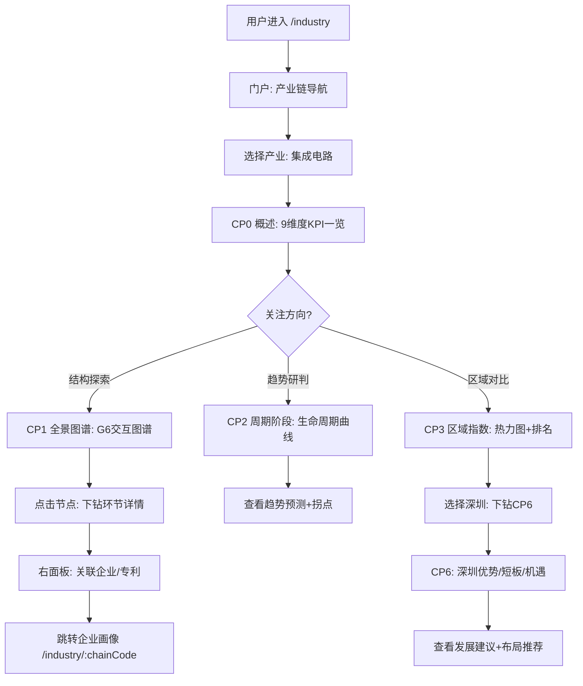

# CHAIN-userflow — 产业链分析用户流程

> **要素**：产业链（CHAIN / E2）
> **参照**：ENT-userflow.md（企业域用户流程）
> **作者**：ux-agent
> **日期**：2026-06-23

---

## 1. 主路径：产业链全景探索

### 主路径详细步骤

| 步骤 | 用户操作 | 系统响应 | 页面 |
|------|---------|---------|------|
| 1 | 进入产业链分析门户 | 展示产业链导航 + 快速统计 | `/industry` |
| 2 | 选择"集成电路"产业 | 加载该产业上下文，筛选条联动 | 所有 `/industry/*` |
| 3 | 查看CP0概述 | 展示9维度KPI卡片 + 趋势图 | CP0 |
| 4 | 点击"全景图谱"Tab | 加载G6交互图谱 | CP1 |
| 5 | 点击"芯片设计"节点 | 右面板展示节点详情 | CP1 |
| 6 | 点击"查看关联企业" | 弹出企业列表Drawer | CP1 |
| 7 | 点击某企业 | 跳转企业画像 | `/development/enterprise/:code` |
| 8 | 返回产业链，切换"周期阶段" | 展示生命周期曲线 | CP2 |
| 9 | 查看趋势预测 | 展示拐点预测+驱动因素 | CP2 |
| 10 | 切换"区域评价" | 展示热力图+竞争力排名 | CP3 |
| 11 | 选择深圳下钻 | 跳转CP6深圳分析 | CP6 |
| 12 | 查看"机遇推荐"Tab | 展示发展建议+布局推荐 | CP6 |

---

## 2. 异常流程

### 2.1 产业链数据为空

| 条件 | 触发 | 系统响应 |
|------|------|---------|
| 所选产业在 ODS 中无数据 | 用户选择某产业 | 页面显示 EmptyState："该产业链数据正在建设中，预计 {mock_until} 接入"。KPI 卡片显示 🧪 MockBadge，数值为 Mock 占位 |
| 某维度指标无来源 | 加载CP0概述 | 对应 KPI 卡片显示 "⚠️ 数据待接入"，点击 ⓘ 显示 source_systems: pending_data_lead_review |

### 2.2 图谱加载失败/超时

| 条件 | 触发 | 系统响应 |
|------|------|---------|
| NebulaGraph 连接超时 | CP1加载图谱 | 显示 Skeleton + "图谱加载中..."，3次重试后显示 ErrorState："图谱服务暂时不可用，请稍后重试"。提供"刷新"按钮 |
| 图谱节点过多(>500) | 选择大型产业链 | 自动启用层级折叠，仅显示一级节点 + "展开更多"按钮，防止浏览器卡顿 |

### 2.3 算法模型未就绪

| 条件 | 触发 | 系统响应 |
|------|------|---------|
| 周期分析模型未部署 | 用户访问CP2 | 周期阶段显示 "🔧 算法开发中"，趋势预测区域降级为纯历史数据折线图（无预测虚线）。点击 ⓘ 显示 formula: pending_algorithm_implementation |
| 竞争力评价权重未确认 | CP3权重配置 | 使用默认等权权重，显示 ⚠️ "当前使用默认权重，待甲方确认"。权重滑块可调但标注"配置待确认" |

### 2.4 跨要素下钻失败

| 条件 | 触发 | 系统响应 |
|------|------|---------|
| 目标要素页面未上线 | 从CP1点击"查看关联企业" | 弹出 Arco Modal："企业画像功能即将上线"，提供"加入关注列表"替代操作 |
| 跨要素API超时 | 下钻请求 > 5s | 显示 Toast："数据加载较慢，正在重试..."，不阻塞当前页面 |

---

## 3. 埋点设计

### 3.1 页面级埋点

| 埋点ID | 事件名 | 触发条件 | 属性 |
|--------|--------|---------|------|
| `CHAIN_P01` | `chain_overview_view` | CP0页面加载完成 | `{industry, timeWindow, region}` |
| `CHAIN_P02` | `chain_panorama_view` | CP1页面加载完成 | `{industry, viewMode}` |
| `CHAIN_P03` | `chain_cycle_view` | CP2页面加载完成 | `{industry, activeTab}` |
| `CHAIN_P04` | `chain_regional_view` | CP3页面加载完成 | `{industry, compareRegions[]}` |
| `CHAIN_P05` | `chain_key_nodes_view` | CP4页面加载完成 | `{industry}` |
| `CHAIN_P06` | `chain_problem_view` | CP5页面加载完成 | `{industry, filterSeverity}` |
| `CHAIN_P07` | `chain_sz_analysis_view` | CP6页面加载完成 | `{industry, activeTab}` |

### 3.2 交互级埋点

| 埋点ID | 事件名 | 触发条件 | 属性 |
|--------|--------|---------|------|
| `CHAIN_I01` | `chain_node_click` | CP1点击图谱节点 | `{industry, nodeId, nodeName, nodeStage}` |
| `CHAIN_I02` | `chain_node_drilldown` | CP1节点下钻查看详情 | `{industry, nodeId, drillTarget}` |
| `CHAIN_I03` | `chain_cycle_param_change` | CP2修改周期模型参数 | `{industry, param, oldValue, newValue}` |
| `CHAIN_I04` | `chain_weight_adjust` | CP3调整评价权重 | `{industry, dimension, newWeight}` |
| `CHAIN_I05` | `chain_region_select` | CP3选择对比区域 | `{industry, region, action}` |
| `CHAIN_I06` | `chain_bottleneck_filter` | CP5切换瓶颈筛选 | `{industry, dimension, severity}` |
| `CHAIN_I07` | `chain_sz_city_compare` | CP6切换对标城市 | `{industry, cities[]}` |
| `CHAIN_I08` | `chain_cross_element_drill` | 跨要素下钻点击 | `{sourcePage, targetElement, targetId}` |
| `CHAIN_I09` | `chain_export` | 导出操作 | `{industry, page, format}` |
| `CHAIN_I10` | `chain_metric_info_click` | 点击 ⓘ 查看指标详情 | `{metricId, page}` |

### 3.3 异常级埋点

| 埋点ID | 事件名 | 触发条件 | 属性 |
|--------|--------|---------|------|
| `CHAIN_E01` | `chain_graph_load_fail` | 图谱加载失败 | `{industry, errorType, retryCount}` |
| `CHAIN_E02` | `chain_model_not_ready` | 算法模型未就绪 | `{industry, modelId}` |
| `CHAIN_E03` | `chain_data_empty` | 产业链数据为空 | `{industry, dimension}` |
| `CHAIN_E04` | `chain_drilldown_fail` | 跨要素下钻失败 | `{targetElement, errorType}` |
