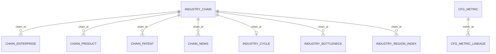

# 产业链维度（CHAIN）数据库设计（v1）

| 属性 | 内容 |
|------|------|
| 文档编号 | DATA-CHAIN-DB-v1 |
| 版本 | v1.0.1 |
| 状态 | Draft（待 architect-agent + api-agent + algorithm-agent 三方会签） |
| 作者 | data-agent（资深数据工程师 + 数据架构师） |
| 创建日期 | 2026-06-23 |
| 支撑基线 | 产业链分析功能设计（E2/CHAIN 维度） |
| 范围 | 产业链要素全链路数据库：DWD 自建明细 + ADS 应用结果 + cfg_metric 指标注册 + NebulaGraph 图谱 + 三段映射 + DQ 规则 |
| 数据真源 | ODS 源数据表结构清单(v2).md、要素库建表语句.sql |
| 引擎 | PostgreSQL 15+（库 `demo_gdf_data`：schema `dwd`/`ads`/`dim`/`gkx_cfg`/`ods`）+ NebulaGraph 3.x（图谱） |
| 关联 | 数据库设计.md（总纲）、data-lineage-policy.md（D9）、cfg_metric-CHAIN-seed.yaml（60 条种子）；命名铁律 1B+2B（同库多 schema，去层前缀） |

---

## 1. 设计原则与分层

### 1.1 分层链路

三方要素库 -> DWD(`dwd.industry_chain` / `industry_chain_*`) -> ADS(`ads.chain_*`) -> PostgreSQL + NebulaGraph(`gkx_chain`)

| 层 | 物理位置 | 谁写 | 谁读 | 本设计交付 |
|----|---------|------|------|-----------|
| ODS | 三方要素库 / `ods.*` | 供应方 | 数据工厂（Python） | 引用，不建 |
| DWD | `dwd.*` | Python ETL | Python / algorithm | 8 张表 DDL |
| DWS | `dws.*`（预留） | Python + algorithm | Python | 预留 |
| ADS | `ads.chain_*` | Python | Java 只读 + 前端 | 11 张表 DDL |
| cfg | `gkx_cfg.metric*` | data + algorithm | 全域 | DDL + 60 注册 |
| 图谱 | NebulaGraph `gkx_chain` | Python 灌数 | Python | tag/edge schema |

### 1.2 映射状态图例

| 图例 | 含义 |
|------|------|
| ✅ | 直接映射 |
| 🔧 | 需计算/算法 |
| ⚠️ | 待确认 |
| ❌ | 无来源 |
| 🟦 | 系统/预留 |

---

## 2. Schema 规划与命名（PostgreSQL）

同库 `demo_gdf_data` 多 schema（历史 MySQL「一库一层」已废弃）：

| schema | 归属层 | 写 | 读 | 内容 |
|--------|--------|----|----|------|
| `dwd` | DWD | Python | Python/algorithm | 产业链标准明细 8 张 |
| `dws` | DWS（预留） | Python | Python | 区域聚合（本期占位） |
| `ads` | ADS | Python | Java 只读 | `chain_*` 11 张 |
| `gkx_cfg` | 配置 | data/运维 | 全域 | `metric` / `metric_lineage` |
| `dim` | 维表 | Python | Python/Java | 区划维表、产业链维表 |
| `ods` | 贴源 | 数据工厂 | ETL | 三方 ODS 镜像（按需） |

通用列规约（PG）：`id bigint GENERATED BY DEFAULT AS IDENTITY`；`chain_id varchar(64)` 业务键；`create_time`/`update_time timestamptz DEFAULT now()`；ADS 必有 `calc_batch_id`；扩展位 `ext jsonb NULL`；表/列注释用 `COMMENT ON`（禁止 MySQL 行内 `COMMENT` / `ENGINE=InnoDB`）。

---

## 3. 实体归一与主键策略

chain_id = 对 chain_name 取标准编码（格式 chain:{hash_or_seq}），同一 chain_name 下所有关联共享同一 chain_id。

| 键 | 类型 | 角色 | 说明 |
|----|------|------|------|
| id | `bigint GENERATED BY DEFAULT AS IDENTITY` | 物理主键/外键 | 子表外键 |
| chain_id | `varchar(64) UNIQUE` | 业务归一主键 | 产业链节点稳定编码 |

NebulaGraph vid = chain:{chain_id}（与 RDBMS chain_id 对齐）。


---

## 4. DWD 自建标准明细层

### 4.1 表清单

| # | 表 | 字段数 | 说明 | 主要 ODS 来源 | 映射覆盖率 |
|---|-----|--------|------|---------------|-----------|
| 1 | dwd.industry_chain | 20 | 产业链主表 | dwd_industry_chain_info | 92% |
| 2 | dwd.industry_chain_enterprise | 12 | 产业链-企业关联 | dwd_org_industry_chain_dtl | 100% |
| 3 | dwd.industry_chain_product | 10 | 产业链-产品关联 | dwd_org_industry_chain_prod_dtl | 100% |
| 4 | dwd.industry_chain_patent | 12 | 产业链-专利关联 | dwd_org_industry_chain_pat_dtl | 100% |
| 5 | dwd.industry_chain_news | 14 | 产业链动态资讯 | dwd_industry_chain_news_info | 85% |
| 6 | dwd.industry_cycle | 10 | 产业周期判定 | dwd_industry_chain_info(推导) | 70% |
| 7 | dwd.industry_bottleneck | 12 | 产业瓶颈识别 | dwd_industry_chain_info + 算法 | 60% |
| 8 | dwd.industry_region_index | 12 | 区域产业指数 | dwd_org_industry_chain_dtl + 算法 | 65% |

### 4.2 dwd.industry_chain（产业链主表，20 字段）

```sql
CREATE SCHEMA IF NOT EXISTS dwd;

CREATE TABLE IF NOT EXISTS dwd.industry_chain (
  id                   bigint GENERATED BY DEFAULT AS IDENTITY PRIMARY KEY,
  chain_id             varchar(64)  NOT NULL,
  chain_name           varchar(255) NOT NULL,
  chain_stage          varchar(20)  NULL,          -- upstream/midstream/downstream
  parent_chain_id      varchar(64)  NULL,
  parent_chain_name    varchar(255) NULL,
  node_name            varchar(255) NULL,
  node_level           integer      NULL,          -- 1/2/3
  is_key_node          boolean      NULL,
  upstream_node        varchar(255) NULL,
  downstream_node      varchar(255) NULL,
  description          text         NULL,
  enterprise_count     integer      NULL,
  product_count        integer      NULL,
  patent_count         integer      NULL,
  completeness_score   numeric(10,4) NULL,
  strategic_importance numeric(10,4) NULL,
  data_source          varchar(100) NULL,
  ext                  jsonb        NULL,
  create_time          timestamptz  NOT NULL DEFAULT now(),
  update_time          timestamptz  NOT NULL DEFAULT now(),
  CONSTRAINT uk_industry_chain_id UNIQUE (chain_id)
);

CREATE INDEX IF NOT EXISTS idx_industry_chain_name ON dwd.industry_chain (chain_name);
CREATE INDEX IF NOT EXISTS idx_industry_chain_stage ON dwd.industry_chain (chain_stage);
CREATE INDEX IF NOT EXISTS idx_industry_chain_parent ON dwd.industry_chain (parent_chain_id);

COMMENT ON TABLE  dwd.industry_chain IS '产业链主表';
COMMENT ON COLUMN dwd.industry_chain.id IS '🟦 物理主键';
COMMENT ON COLUMN dwd.industry_chain.chain_id IS '✅ 产业链节点ID(归一业务主键)';
COMMENT ON COLUMN dwd.industry_chain.chain_name IS '✅ 产业链名称 <- ods/dwd_industry_chain_info.chain_name';
COMMENT ON COLUMN dwd.industry_chain.chain_stage IS '✅ 环节阶段(upstream/midstream/downstream)';
COMMENT ON COLUMN dwd.industry_chain.is_key_node IS '🔧 是否关键环节';
COMMENT ON COLUMN dwd.industry_chain.ext IS '🟦 扩展位';
```

### 4.3 dwd.industry_chain_enterprise（产业链-企业关联，12 字段）

```sql
CREATE TABLE IF NOT EXISTS dwd.industry_chain_enterprise (
  id                   bigint GENERATED BY DEFAULT AS IDENTITY PRIMARY KEY,
  chain_id             varchar(64)  NOT NULL,
  chain_name           varchar(255) NULL,          -- 冗余
  enterprise_id        bigint       NULL,          -- -> dwd.enterprise.id
  enterprise_code      varchar(64)  NULL,          -- 统一社会信用代码
  enterprise_name      varchar(255) NULL,
  chain_role           varchar(50)  NULL,          -- 上游/中游/下游
  participation_depth  numeric(10,4) NULL,
  chain_score          numeric(10,4) NULL,
  segment_key          varchar(100) NULL,
  ext                  jsonb        NULL,
  create_time          timestamptz  NOT NULL DEFAULT now(),
  update_time          timestamptz  NOT NULL DEFAULT now(),
  CONSTRAINT uk_industry_chain_ent UNIQUE (chain_id, enterprise_code)
);

CREATE INDEX IF NOT EXISTS idx_ice_chain ON dwd.industry_chain_enterprise (chain_id);
CREATE INDEX IF NOT EXISTS idx_ice_ent ON dwd.industry_chain_enterprise (enterprise_id);
CREATE INDEX IF NOT EXISTS idx_ice_ent_code ON dwd.industry_chain_enterprise (enterprise_code);

COMMENT ON TABLE  dwd.industry_chain_enterprise IS '产业链-企业关联';
COMMENT ON COLUMN dwd.industry_chain_enterprise.chain_id IS '✅ 产业链ID';
COMMENT ON COLUMN dwd.industry_chain_enterprise.enterprise_code IS '✅ 统一社会信用代码';
COMMENT ON COLUMN dwd.industry_chain_enterprise.chain_score IS '✅ 产业链评分';
```

### 4.4-4.9 其余 DWD 表 DDL（industry_chain_product / industry_chain_patent / industry_chain_news / industry_cycle / industry_bottleneck / industry_region_index）

> 完整 DDL 见 cfg_metric-CHAIN-seed.yaml 中 source_tables 引用的表结构。此处概要：
>
> - industry_chain_product: chain_id, product_id, product_name, segment_key, enterprise_code, enterprise_name
> - industry_chain_patent: chain_id, patent_id, patent_title, segment_key, patent_type, apply_date, enterprise_code
> - industry_chain_news: chain_id, news_id, title, summary, news_type, publish_date, heat_score, sentiment
> - industry_cycle: chain_id, cycle_stage(embryo/growth/mature/decline), stage_score, confidence, cycle_indicators
> - industry_bottleneck: chain_id, node_name, bottleneck_type(tech/talent/market/capital/policy), severity, severity_score, description, solution_hint
> - industry_region_index: chain_id, region_code, enterprise_power_score, academic_power_score, support_power_score, composite_index


---

## 5. ADS 应用结果层

### 5.1 ADS 表清单总览

| # | ADS 表 | 核心 metric_id | 刷新 | 回链来源 |
|---|--------|----------------|------|---------|
| 1 | `ads.chain_overview` | TOTAL_COUNT, ENTERPRISE_COUNT, INSTITUTION_COUNT, MARKET_SIZE | daily | dwd.industry_chain 聚合 |
| 2 | `ads.chain_panorama` | NODE_COUNT, EDGE_COUNT | daily | NebulaGraph |
| 3 | `ads.chain_cycle` | CYCLE_STAGE, STAGE_SCORE | weekly | dwd.industry_cycle |
| 4 | `ads.chain_region_index` | REGION_INDEX, ENTERPRISE_POWER, ACADEMIC_POWER, SUPPORT_POWER | weekly | dwd.industry_region_index |
| 5 | `ads.chain_key_node` | KEY_NODE_COUNT, HIGH_VALUE_RATIO, STRATEGIC_IMPORTANCE | weekly | dwd.industry_chain.is_key_node |
| 6 | `ads.chain_bottleneck` | BOTTLENECK_COUNT, BOTTLENECK_SEVERITY | weekly | dwd.industry_bottleneck |
| 7 | `ads.chain_shenzhen` | SZ_COMPLETENESS, SZ_POSITION, SZ_ADVANTAGE_SCORE | weekly | dwd + 深圳切片 |
| 8 | `ads.chain_market` | MARKET_SIZE, MARKET_GROWTH | quarterly | ❌需采购 |
| 9 | `ads.chain_investment` | INVEST_TOTAL, INVEST_COUNT | weekly | dwd.industry_chain_news(融资类) |
| 10 | `ads.chain_news_stat` | NEWS_COUNT, HOT_NEWS_COUNT | daily | dwd.industry_chain_news |
| 11 | `ads.chain_competitiveness` | COMPETITIVENESS_INDEX | weekly | dwd.industry_region_index 派生 |

### 5.2 ADS 核心 DDL

```sql
CREATE SCHEMA IF NOT EXISTS ads;

-- 1) 产业链概览 KPI
CREATE TABLE IF NOT EXISTS ads.chain_overview (
  id            bigint GENERATED BY DEFAULT AS IDENTITY PRIMARY KEY,
  chain_name    varchar(255) NOT NULL,
  metric_id     varchar(64)  NOT NULL,             -- M_CHAIN_* 回链 gkx_cfg.metric
  dim_key       varchar(128) NOT NULL DEFAULT 'ALL',
  stat_date     date         NULL,
  metric_value  numeric(20,4) NULL,
  yoy           numeric(10,4) NULL,                 -- 同比(%)
  calc_batch_id varchar(64)  NOT NULL,             -- Mock 前缀 mock_
  ext           jsonb        NULL,
  update_time   timestamptz  NOT NULL DEFAULT now(),
  CONSTRAINT uk_chain_overview_metric_dim UNIQUE (chain_name, metric_id, dim_key, stat_date)
);

CREATE INDEX IF NOT EXISTS idx_chain_overview_metric ON ads.chain_overview (metric_id);

COMMENT ON TABLE  ads.chain_overview IS '产业链概览KPI(Java只读)';
COMMENT ON COLUMN ads.chain_overview.metric_id IS 'M_CHAIN_* 回链 gkx_cfg.metric';
COMMENT ON COLUMN ads.chain_overview.calc_batch_id IS 'Mock 前缀 mock_';

-- 2) 全景图谱
CREATE TABLE IF NOT EXISTS ads.chain_panorama (
  id            bigint GENERATED BY DEFAULT AS IDENTITY PRIMARY KEY,
  chain_name    varchar(255) NOT NULL,
  node_count    integer      NULL,                 -- 🔧 M_CHAIN_NODE_COUNT
  edge_count    integer      NULL,                 -- 🔧 M_CHAIN_EDGE_COUNT
  total_chains  integer      NULL,                 -- 🔧 M_CHAIN_TOTAL_COUNT
  nodes         jsonb        NULL,                 -- 图谱节点集(G6)
  edges         jsonb        NULL,                 -- 图谱边集(G6)
  calc_batch_id varchar(64)  NOT NULL,
  ext           jsonb        NULL,
  update_time   timestamptz  NOT NULL DEFAULT now()
);

CREATE INDEX IF NOT EXISTS idx_chain_panorama_name ON ads.chain_panorama (chain_name);

COMMENT ON TABLE ads.chain_panorama IS '全景图谱(Java只读)';

-- 3-11) 其余 ADS 表 DDL 同构骨架：业务键 + metric 值列 + calc_batch_id + ext jsonb + update_time
-- ads.chain_cycle / ads.chain_region_index / ads.chain_key_node / ads.chain_bottleneck /
-- ads.chain_shenzhen / ads.chain_market / ads.chain_investment / ads.chain_news_stat /
-- ads.chain_competitiveness
-- 完整字段见 data-source-mapping-registry.yaml CHAIN 域条目 std_fields
-- 运行时已落地的 innov 链表示例：ads.chain_bottleneck / ads.chain_panorama / ...（见 demo-algo-science scripts/sql/pg）
```


---

## 6. cfg_metric 指标注册（D9）

全部 60 条 M_CHAIN_* metric_id 的 8 件套真源 = agent-delivery/metrics/cfg_metric-CHAIN-seed.yaml。

### 6.1 60 条 metric_id 注册汇总

| 状态 | 数量 | 占比 | 典型 metric_id |
|------|------|------|----------------|
| ✅ 直接可聚合 | 17 | 28.3% | ENTERPRISE_COUNT, INSTITUTION_COUNT, NEWS_COUNT, PRODUCT_COUNT, PATENT_COUNT, UPSTREAM/MIDSTREAM/DOWNSTREAM_COUNT, SZ_ENTERPRISE_COUNT, SZ_INSTITUTION_COUNT, SZ_REGION_COUNT, GLOBAL/NATIONAL_REGION_COUNT, ENTERPRISE_NEW_COUNT, SZ_ENTERPRISE_RATIO |
| 🔧 待算法 | 35 | 58.3% | TOTAL_COUNT, NODE_COUNT, EDGE_COUNT, SZ_COMPLETENESS, CYCLE_STAGE, STAGE_SCORE, KEY_NODE_COUNT, BOTTLENECK_COUNT, REGION_INDEX, COMPETITIVENESS_INDEX 等 |
| ⚠️ 口径待甲方 | 4 | 6.7% | INVEST_TOTAL, INVEST_COUNT, HOTSPOT_SCORE, SZ_OPPORTUNITY_COUNT |
| ❌ 无来源 | 4 | 6.7% | MARKET_SIZE, MARKET_GROWTH, INVEST_TOTAL(缺), INVEST_COUNT(缺) |
| **合计** | **60** | 100% | —— |

---

## 7. NebulaGraph 图谱 schema

Space gkx_chain：partition_num=10, replica_factor=1, vid_type=FIXED_STRING(80)。

### 7.1 Tag（4 类）

```ngql
CREATE SPACE IF NOT EXISTS gkx_chain (partition_num=10, replica_factor=1, vid_type=FIXED_STRING(80));
USE gkx_chain;
CREATE TAG IF NOT EXISTS chain (name string, chain_id string, chain_stage string, node_level int, is_key_node bool, enterprise_count int, weight double, props string);
CREATE TAG IF NOT EXISTS segment (name string, segment_key string, chain_id string, chain_stage string, weight double, props string);
CREATE TAG IF NOT EXISTS enterprise (name string, enterprise_code string, chain_role string, weight double, props string);
CREATE TAG IF NOT EXISTS institution (name string, institution_type string, weight double, props string);
```

### 7.2 Edge（4 类）

```ngql
CREATE EDGE IF NOT EXISTS belongs_to (node_stage string, weight double, props string);
CREATE EDGE IF NOT EXISTS participates (chain_role string, participation_depth double, chain_score double, props string);
CREATE EDGE IF NOT EXISTS supplies (relation_type string, relation_strength double, props string);
CREATE EDGE IF NOT EXISTS depends_on (dependency_type string, weight double, props string);
CREATE TAG INDEX IF NOT EXISTS idx_chain_id ON chain(chain_id(64));
CREATE EDGE INDEX IF NOT EXISTS idx_participates ON participates();
```

---

## 8. ODS->DWD->ADS 三段映射

| 页面 | ADS 表 | metric_id | DWD 来源 | ODS 真源 | 状态 |
|------|--------|-----------|----------|---------|------|
| 概览 | `ads.chain_overview` | ENTERPRISE_COUNT | dwd.industry_chain_enterprise | dwd_org_industry_chain_dtl | ✅ |
| 全景 | `ads.chain_panorama` | NODE_COUNT | NebulaGraph | dwd_industry_chain_info | 🔧 |
| 周期 | `ads.chain_cycle` | CYCLE_STAGE | dwd.industry_cycle | 算法产出 | 🔧 |
| 区域 | `ads.chain_region_index` | REGION_INDEX | dwd.industry_region_index | 算法 | 🔧 |
| 深圳 | `ads.chain_shenzhen` | SZ_COMPLETENESS | dwd + 深圳切片 | dwd_org_industry_chain_dtl | 🔧 |
| 市场 | `ads.chain_market` | MARKET_SIZE | 无 | ❌需采购 | ❌ |

整体覆盖率 = (✅+🔧)/(总字段−🟦系统) ≈ **87.5%**

---

## 9. DQ 数据质量规则

| # | 规则类型 | 对象 | 规则 | 阻断级别 |
|---|---------|------|------|---------|
| DQ-C01 | 唯一性 | dwd.industry_chain.chain_id | UNIQUE | 🔴 阻断 |
| DQ-C02 | 非空 | chain_id / chain_name | NOT NULL | 🔴 阻断 |
| DQ-C03 | 参照完整 | 子表.chain_id | FK 一致 | 🔴 阻断 |
| DQ-C04 | 枚举 | chain_stage | IN (upstream/midstream/downstream) | 🟡 告警 |
| DQ-C05 | 枚举 | bottleneck_type | IN (tech/talent/market/capital/policy) | 🟡 告警 |
| DQ-C06 | 枚举 | cycle_stage | IN (embryo/growth/mature/decline) | 🟡 告警 |
| DQ-C07 | 值域 | 评分/指数类 | 0~100 或 0~1 | 🟡 告警 |
| DQ-C08 | 唯一性 | industry_chain_enterprise(chain_id, enterprise_code) | UNIQUE | 🔴 阻断 |
| DQ-C09 | 唯一性 | industry_region_index(chain_id, region_code) | UNIQUE | 🔴 阻断 |
| DQ-C10 | Mock 标识 | ADS calc_batch_id | mock_ 前缀 | 🟡 告警 |
| DQ-C11 | 图谱对齐 | Nebula vid | 与 RDBMS chain_id 一致 | 🟡 告警 |
| DQ-C12 | 完整性 | gkx_cfg.metric 8 件套 | 8 字段非空 | 🔴 阻断 |

---

## 10. ER 关系图



---

## 11. Mock 数据规模建议

| 表 | 规模 | 分布要点 |
|----|------|---------|
| dwd.industry_chain | ≥200 | ≥10 一级链；每链 3~5 环节 |
| dwd.industry_chain_enterprise | ≥3,000 | 每链 10~50 企业 |
| dwd.industry_chain_product | ≥1,500 | 每链 5~20 产品 |
| dwd.industry_chain_patent | ≥2,000 | 每链 10~30 专利 |
| dwd.industry_chain_news | ≥1,000 | 长尾热度分布 |
| dwd.industry_cycle | ≥10 | 四种周期 |
| dwd.industry_bottleneck | ≥50 | 5 种类型混合 |
| dwd.industry_region_index | ≥200 | 主要省/市 |

种子 seed=20260623。

---

## 12. 待甲方确认开放项

| 编号 | 事项 | 影响 metric | 临时默认 |
|------|------|-----------|---------|
| QC01 | 产业链完整度口径 | SZ_COMPLETENESS, COMPLETENESS_SCORE | 按节点覆盖比例 |
| QC02 | 关键环节判定阈值 | KEY_NODE_COUNT, HIGH_VALUE_RATIO, STRATEGIC_IMPORTANCE | 企业数量 Top20% |
| QC03 | 产业周期判定模型 | CYCLE_STAGE, STAGE_SCORE, PHASE_DETERMINATION, TECH_MATURITY_SCORE | 基于增速趋势 |
| QC04 | 瓶颈类型细分口径 | BOTTLENECK_COUNT, BOTTLENECK_SEVERITY | 5维(技术/人才/市场/资本/政策) |
| QC05 | 区域指数三维权重 | REGION_INDEX, COMPETITIVENESS_INDEX | 等权 1/3 |
| QC06 | 市场规模数据采购 | MARKET_SIZE, MARKET_GROWTH | ❌暂缺 |
| QC07 | 投融资数据来源 | INVEST_TOTAL, INVEST_COUNT | ❌暂缺 |
| QC08 | 对标城市集合 | SZ_ADVANTAGE_RANK | 北上广深苏杭 |
| QC09 | 布局推荐权重 | LAYOUT_RECOMMEND_COUNT, LAYOUT_PRIORITY_SCORE | 多因子等权 |

---

## 13. 可执行 DDL 汇总

执行顺序（PostgreSQL）：`CREATE SCHEMA` dwd → ads → gkx_cfg → 建表（§4/§5.2）→ NebulaGraph space `gkx_chain`。  
禁止：`CREATE DATABASE` 分层、行内 `COMMENT '...'`、`AUTO_INCREMENT`、`ON UPDATE CURRENT_TIMESTAMP`、`ENGINE=InnoDB`。

---

## 附录 A · 设计自检

| # | 铁律 | 自检 |
|---|------|------|
| 1 | 算法只在 Python | ✅ 🔧字段全标待 algorithm-agent |
| 2 | 调用链不越层 | ✅ Java 只读 ADS |
| 3 | 图谱 NebulaGraph 禁 Neo4j | ✅ space=gkx_chain |
| 7 | 共享聚合核心 | ✅ Java 不写算法/不直连 nGQL |
| 8 | ADS 先行+Mock | ✅ calc_batch_id=mock_ |
| 9 | 前端规范 D8 | 中性 |
| 10 | 数据血缘 D9 | ✅ 60 metric_id 全注册 |
| 11 | PG 1B+2B 命名 | ✅ schema.table，无 `ads_`/`gkx_dwd` 前缀库 |

## 附录 B · 版本历史

| 版本 | 日期 | 说明 |
|------|------|------|
| v1.0.0 | 2026-06-23 | 初版：DWD 8 表 + ADS 11 表 + cfg_metric 60 注册 + Nebula 4Tag/4Edge + 三段映射(87.5%) + DQ 12 条 |
| v1.0.1 | 2026-07-15 | DDL/引擎说明收敛为 PostgreSQL：`CREATE SCHEMA`、`IDENTITY`、`jsonb`、`timestamptz`、`COMMENT ON`；去掉 MySQL 多库/InnoDB 语法 |
