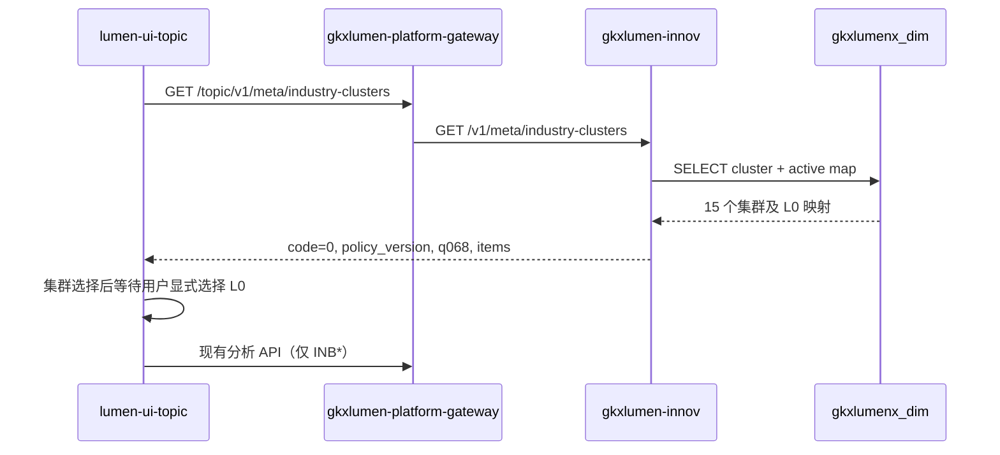

# LUMEN-CHAIN-INDUSTRY-CLUSTER-L01 · lumen 复刻产业集群 + 产业级联选择器（波次 D）

> 日期：2026-09-02  
> 范围：`lumen-svc-platform` + `lumen-ui-topic`  
> 契约真源：`API-CHAIN-INDUSTRY-CLUSTER.md`  
> 父单：`CHAIN-INDUSTRY-CLUSTER-SUPP-L01`

## 任务认领

| 字段 | 值 |
|------|-----|
| claimed_by | `human:李伟` |
| supervised_by | `human:李伟` |
| claim_type | `coordinator_dispatch` |
| 当前状态 | `in_progress`；前端/Java 已 push `dev`；全景筛选对齐已修（`lumen-ui-topic` `c475820`）；K8s 集群接口仍 500，e2e 未绿 |

## Ponytail

| 字段 | 值 |
|------|-----|
| ponytail | `full` |
| 说明 | 复用现有 `defineApi`、全局 request/Mock、Arco Select 和产业中心页面结构；未新增依赖，未以 YAGNI 跳过 D8/D9/D10、可观测或 handoff。 |

## 范围与实现

- 对照产业链分析范围及父单波次 D，仅复刻已评审的深圳 3.0「10+5」产业集群目录和「集群 → L0」选择流程；未扩展国标 NIC、移动端或维护写接口。
- Java 在 `gkxlumen-innov` 新增只读目录及查询粒度解析：
  - `GET /v1/meta/industry-clusters`
  - `POST /v1/meta/industry-clusters/resolve-scope`
  - 只读 `gkxlumenx_dim.industry_cluster`、`gkxlumenx_dim.industry_cluster_map`。
  - dim schema 由 `INNOV_DIM_SCHEMA` 配置，默认正式库 `gkxlumenx_dim`，并校验 schema 名后再拼接 SQL。
- 网关新增 `/topic/v1/meta/industry-clusters/**` 专用路由；沿用 `GkxlumenRequestGlobalFilter` 剥离首段后转发到 `gkxlumen-innov`。
- `lumen-ui-topic` 新增 API 类型、共享 composable、Mock 和 `IndustryClusterSelect`；产业诊断、总览、全景、区域、深圳工作区换为集群与 L0 两级选择。
- 切换集群时只清空 L0，不自动选第一项；无映射集群禁用 L0 并显示「无相关产业数据」。
- 分析页面仍只把 `INB*` L0 写入现有 `industry_id` / `industry_ids`；`CL-*` 不进入分析 API。
- 旧 URL / 对比篮回填仅接受 `INB\d+`；移除旧 slug 目录的默认首产业、默认首链回填，避免页面未操作时发出非法分析请求。
- Q068 保留警示入口；`USE_MOCK=false` 时数据由 Java API 提供，不使用 fixture 填数。

## 调用链

## 测试结果

- 前端：`npm run build` ✅
  - `vue-tsc --build` 通过。
  - Vite 生产构建通过，3755 modules transformed。
  - 环境提示 Node `20.18.0` 低于 Vite 建议的 `20.19+`，但本次构建 exit code 为 0。
- Java：JDK 17 下 `mvn -pl gkxlumen-innov -am "-DskipTests" test-compile` ✅
- Java 最小自检：`java -ea -cp "gkxlumen-innov\target\test-classes;gkxlumen-innov\target\classes" com.topcomm.gkxlumen.innov.cluster.IndustryClusterLogicTest` ✅
  - 覆盖集群展开、无映射诚实空态、未知集群 404、禁止 `CL-*` 冒充 L0、共享 L0 不猜所属集群。
- IDE lint：本次 Java、Vue、TypeScript 改动无新增诊断 ✅
- `git diff --check`：两个业务仓均通过 ✅
- 产业中心自检：`industryReplicaFix`、`industryPanoramaPage`、`industrySearchModel`、`industryChainTask` ✅
- `industryAnalysisGate.selfcheck.mjs` ❌：检查脚本要求 `IndustryPanoramaPage.vue` 含历史标记 `gateInflightTask`，当前基线页面原本即无该标记；与本次集群/INB 接线无关，未在本叶扩范围修复。

## D8 / D9 / D10 对照

- D8 Design §14：使用仓内 Arco 组件与既有 `sci-arco-select` token；未新增视觉体系；状态色使用现有 warning token。
- D9：本叶只处理分析对象目录，不新增统计数字或指标点位；指标 ⓘ / 四维就绪度不适用。
- D10 §19：两个下拉均有 `aria-label`、加载/禁用/空态/错误重试；切父级清子级；点击隔离与 demo 评审行为一致。
- D10 §3.4：键盘行为由 Arco Select 提供；无映射不生成伪选项；接口失败不回落 fixture。

## 架构合规自检

- ✅ D1：Java 未承载算法、NLP、图谱推理。
- ✅ D2：前端只调 Java REST；本叶未直连 Python。
- ✅ D3：未引入 Neo4j，未改 Nebula 链路。
- ✅ D4：前端沿用全局 request/observability；Java 沿用平台 Java Agent。
- ⏳ D5：前端/Java 已 push `dev`；Pipeline 有部署成功记录，但 `e2e:chain-gold` 因 `industry-clusters` HTTP 500 未绿。
- ✅ D6：仅阅读 demo 作为语义参考，未 merge demo 分支。
- ✅ D7：未改变共享专题/指标聚合核心。
- ✅ D8：沿用 Arco 与既有 token。
- ✅ D9：无新增指标展示点位。
- ✅ D10：空态、错误、键盘与可访问语义已覆盖。
- ✅ D11：未改变数据路径与标准表策略。
- ✅ D12：lumen 运行时不调用任何 `demo-*` 服务或前端 fixture。

## CI/CD

- 分支：两个业务仓均为 `dev`
- 近期前端 commit：`c475820`（全景筛选顶对齐）、此前菜单/集群降级等已在 `origin/dev`
- pipeline / K8s：`deploy:k8s` 有成功；`e2e:chain-gold` 因 `GET /topic/v1/meta/industry-clusters` 读 dim 失败返回 500
- dev 测试：50892/30892 集群接口仍 500；前端可 catalog 降级，但 e2e 守卫任意 5xx 即红

## 可观测性

- OTEL_SERVICE_NAME：沿用 `gkxlumen-innov`
- traceId：待 K8s dev 联调抽样
- Tempo / Loki：待部署后验证

## 成本

- actual_tokens：约 `190000`（当前 Cursor 会话未提供精确 token 计量，按上下文与产出估算）
- model_used：`Auto`
- actual_cost：约 `$0.40`（按团队主力模型量级估算）
- cost_warn：`false`

## 遗留风险

- Q068 仍为甲方待确认口径，UI 警示不得提前移除。
- dev 环境必须已有 `gkxlumenx_dim.industry_cluster` 与 `industry_cluster_map`；否则 Java 会返回数据库错误，不允许前端用 Mock 掩盖。
- Java 项目现有 Surefire `2.12.4` 未执行 JUnit 5，因此本叶使用可直接运行的断言自检；升级测试基础设施不在本叶范围。
- Node 版本应由环境维护者升级到 Vite 建议版本；本叶未修改 `package.json` 或工具链配置。

## 涉及文件

### `lumen-svc-platform`

- `gkxlumen-innov/src/main/java/com/topcomm/gkxlumen/innov/cluster/IndustryClusterController.java`
- `gkxlumen-innov/src/main/java/com/topcomm/gkxlumen/innov/cluster/IndustryClusterService.java`
- `gkxlumen-innov/src/main/java/com/topcomm/gkxlumen/innov/cluster/IndustryClusterLogic.java`
- `gkxlumen-innov/src/test/java/com/topcomm/gkxlumen/innov/cluster/IndustryClusterLogicTest.java`
- `helm/gkxlumen-platform/configs/gkxlumen-gateway-dev.yml`

### `lumen-ui-topic`

- `src/api/industry/index.ts`
- `src/api/industry/paths.ts`
- `src/api/industry/types.ts`
- `src/composables/useIndustryClusters.ts`
- `src/composables/useIndustryCatalog.ts`
- `src/components/form/IndustryClusterSelect.vue`
- `src/components/form/index.ts`
- `src/mock/industry/industryClusters.ts`
- `src/mock/register.ts`
- `src/views/industry-center/IndustryDiagnosisPage.vue`
- `src/views/industry-center/IndustryOverviewPage.vue`
- `src/views/industry-center/IndustryPanoramaPage.vue`
- `src/views/industry-center/IndustryRegionalPage.vue`
- `src/views/industry-center/IndustryShenzhenPage.vue`
