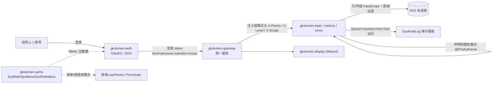
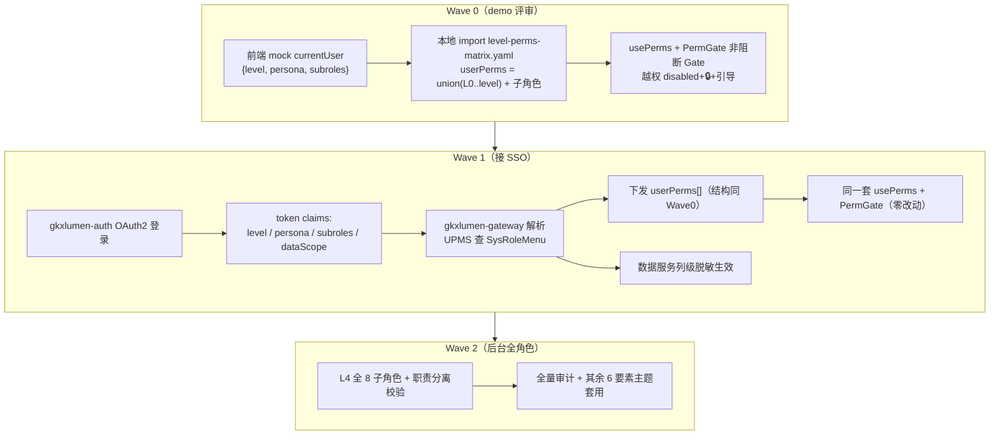

# 权限体系 — 架构评审（E-PERM-L00）

> **任务**：E-PERM-L00（Epic E-PERM-M1 先行棒）
> **角色**：architect-agent（资深系统架构师）
> **评审范围**：全系统角色权限体系（级别 L0–L4 × 身份场景 × 屏幕形态 × 7 类权限对象）能否由「网关 + 统一权限服务（RBAC）」承载；SSO 演进；权限服务数据模型；数据密级脱敏落点；两仓 React 落地约束。
> **时间**：2026-06-22
> **评审结论**：**通过（带整改项与待甲方拍板项）** — 设计与 D6 一致，可作为 UX（L01）/UI（L02）/FE（L03）的架构约束基线启动；正式仓落地复用 PigX `gkxlumen-auth` + `gkxlumen-upms` + `gkxlumen-gateway`，不另造权限轮子。
> **关联真源**：
> - `全系统角色权限体系设计.md`（设计稿，§1–§16）
> - `level-perms-matrix.yaml`（权限映射种子表）
> - `权限点清单-菜单与按钮.md`（菜单/按钮实现级）
> - `architecture-baseline.md` **D6**（鉴权/SSO/权限经网关统一）
> - `data-lineage-policy.md`（指标 8 件套 / 敏感字段标识）
> - `客户决策清单跟踪表.md` §2.5（Q020~Q030）
> - lumen 正式仓现状：`gkxlumen-auth`（OAuth2/认证）、`gkxlumen-upms`（`SysUser/SysRole/SysMenu/SysRoleMenu/SysDept/SysAuditLog/SysOauthClientDetails`）、`gkxlumen-gateway`

---

## 0. 评审一句话结论

权限设计稿的「**统一身份 + 双维度授权（级别 × 身份）+ 屏幕形态正交 + 数据按密级/范围过滤**」模型**与 D6 完全一致**，且**正好落在 PigX 既有 RBAC（UPMS）+ OAuth2（auth）+ 网关**的能力范围内——**无需新造权限服务**，只需在既有 `SysRole/SysMenu` 上扩 3 个维度字段（level / persona / screen-feature-class）并把网关从「登录态校验」升级为「权限点下发 + 强校验」。**核心风险不在技术，而在 11 项业务口径（Q020~Q030）未经甲方拍板**——Wave 0 按临时默认 + ⚠️ 角标先跑，上线前必须升 🟢。

---

## 1. D6 逐条对照：7 类权限对象能否由「网关 + 统一权限服务」承载

设计稿 §13 定义了 7 类权限对象，逐条核对其校验落点是否合规 D6（"鉴权/SSO/权限经网关统一，业务服务不各自实现"）：

| # | 权限类型 | 控制对象 | 设计稿校验位置 | 架构裁定 | 承载组件（lumen 现状） |
|---|---|---|---|---|---|
| 1 | 系统权限 | 进入展示/专题系统 | 网关 | ✅ 合规 | `gkxlumen-gateway` 鉴权过滤器 |
| 2 | 场景权限 | 决策/创新/智库/接待（persona） | 网关 + 前端路由守卫 | ✅ 合规（persona 只决定默认视图+数据范围，不增减 perm，见 §3） | gateway + 前端 |
| 3 | 页面权限 | 一/二/三级页面（menu:*） | 前端路由 + 后端接口 | ✅ 合规 | `SysMenu` + 前端路由 meta |
| 4 | 功能权限 | 查看/下钻/导出/推演/播放/维护/审核/发布（btn:*） | 后端接口 + 前端 Gate | ✅ 合规（前端非阻断、后端强校验 403） | `SysMenu`（按钮类）+ 接口 `@PreAuthorize` |
| 5 | 数据权限 | 区域/领域/机构/密级 | 数据服务（行/列级） | ✅ 合规，**但必须落在数据服务层，禁前端假脱敏**（见 §5） | 业务服务 DataScope + ADS 视图 |
| 6 | 资源权限 | 数据/图谱/指标/报告/设备资源 | 资源服务 | ✅ 合规 | 各业务服务声明权限点 |
| 7 | 设备权限 | 超大屏/中屏/小屏/直播间 | 设备/播控服务 | ✅ 合规（与屏幕 feature_class 区分：设备权限=能否操作播控；屏幕形态=功能呈现形态） | 播控服务 + L4 子角色 |

**裁定**：7 类权限对象**全部可由「网关统一鉴权 + 统一权限服务（RBAC）+ 业务服务声明权限点 + 数据服务行列级过滤」承载**，无任何一类需要业务服务自造鉴权逻辑。**符合 D6。**

### 1.1 三维授权模型的架构合规性

设计稿的最终可用判定式：

```
最终可用 = 级别(L0–L4 累加)  ∧  屏幕功能类(feature_classes[class][screen] ≠ false)  ∧  数据密级/子角色命中
persona = 仅决定默认视图 + 数据范围（不增减 perm，L4 子角色除外）
```

- **级别（Level）** = 能力档位，高包含低（累加式）→ 对应 RBAC 的「角色权限并集」，技术上成立。
- **身份（Persona）** = 默认视图 + 数据范围 → **正确地与权限解耦**（不参与 perm 增减），避免了"领导权限高却看得少"的悖论。架构上认可这一拆分。
- **屏幕（Screen）** = 设备形态，与级别正交 → 作为**前端运行时维度**（由设备/视口判定）叠加在权限点之上，**不进 RBAC 授权表**，仅作功能类显隐裁剪。裁定合理。

> **整改建议 A1**：判定式三因子的**计算位置**要分层明确——级别/子角色/数据密级属**授权**（网关下发 + 数据服务执行），屏幕 feature_class 属**呈现**（前端纯本地推导，后端不感知 screen）。务必在 UX/FE handoff 中写死，避免把"屏幕"误塞进后端鉴权，污染 D6 的"统一权限"边界。

---

## 2. 级别 × 身份 × 屏幕 × 7 类对象 = 是否承载得住（容量与边界）

| 维度 | 取值数 | 承载方式 | 风险 |
|---|---|---|---|
| 级别 L0–L4 | 5（累加） | `SysRole` 映射为 5 个基础角色或 1 个 level 字段 | 低 |
| 身份 persona | 6（GOV/INNO/THINK/VISIT/OPS/SYS） | 账号属性 + 默认视图配置（非角色） | 低 |
| L4 子角色 | 8（super_admin…lecturer） | `SysRole` 叠加，职责分离约束 | 中（编辑 vs 审核发布互斥需校验） |
| 屏幕 | 3（LARGE/MEDIUM/SMALL） | 前端 feature_class 推导 | 低（仅展示系统多屏，专题仅中屏） |
| 权限点 | menu ~50 + btn ~25 ≈ 75 | `SysMenu`（菜单类 + 按钮类）现有结构直接容纳 | 低 |

**裁定**：维度组合**不爆炸**——级别累加 + persona 解耦 + 屏幕前端推导，使授权矩阵实际只需维护 ~75 个权限点的 `minLevel`/`roles` 元数据（即 `level-perms-matrix.yaml` 的 `permissions[]`），而非 5×6×3 笛卡尔积。**PigX `SysMenu` 表完全容纳得下，承载无压力。**

> **整改建议 A2**：`level-perms-matrix.yaml` 的 `permissions[]` 与 `level_perms[]` 当前是**两份手工维护**（注册表 + 级别累加展开），存在漂移风险。落地时应**以 `permissions[].minLevel` 为唯一真源**，`level_perms` 由脚本生成（或运行时累加），避免两份不一致。

---

## 3. 统一权限服务实现路径（复用 PigX，不另造）

lumen 正式仓已含 PigX 全套 IAM 基建，**评审强烈建议直接复用、增量扩展**，禁止新起一个权限微服务（违反"轻量 + D6 统一"）：

| 能力 | PigX 现成件 | 本项目改造 |
|---|---|---|
| 身份认证 / SSO | `gkxlumen-auth`（Spring Authorization Server / OAuth2） | token 增 claim：`level` / `persona` / `subroles` / `dataScope` |
| RBAC 主数据 | `gkxlumen-upms`：`SysUser`/`SysRole`/`SysMenu`/`SysRoleMenu`/`SysDept` | `SysRole` 增 `level`；`SysMenu` 增 `feature_class` + `min_level`；新增 `persona`、密级映射配置 |
| 统一鉴权入口 | `gkxlumen-gateway` | 从「登录态校验」升级为「解析 token → 注入权限点头 → 路由」 |
| 审计留痕 | `SysAuditLog` | 敏感数据访问（密级 SENSITIVE/RESTRICTED）强制写审计 |
| 数据范围 | PigX `DataScope`（dept 维度） | 扩展为 区域/领域/机构/密级 多维 |



> **整改建议 A3**：业务服务（topic/metrics/innov）**只声明所需权限点**（注解式），鉴权决策在网关 + UPMS 完成，业务服务不查权限表、不实现 RBAC 逻辑（D6 铁律）。评审将此列为后续 api-agent 任务的 DoD 硬指标。

---

## 4. SSO 演进方案（Wave0 mock → Wave1 token 下发，结构同构）

设计稿要求 perms 结构在 Wave 切换时**前端零改动**。评审确认 `level-perms-matrix.yaml` 的设计满足这一点（同一份 perms 结构，来源从本地静态切换为网关下发）：



| Wave | 鉴权来源 | 级别覆盖 | 数据密级 | 关键交付 |
|---|---|---|---|---|
| **Wave 0** | 前端 mock + 本地 matrix | L0/L1/L2/L3（够评审） | 假脱敏占位 + 🧪 MockBadge | 顶栏级别/身份切换器；非阻断 Gate；⚠️ 待确认角标 |
| **Wave 1** | gkxlumen-auth + 网关下发 | + L2 实名、密级真生效 | **数据服务列级脱敏（真）** | token claim 注入；网关权限点下发；前端零改动验证 |
| **Wave 2** | + UPMS 全子角色 | L4 全 8 子角色 | + 行级 DataScope | 职责分离校验；全量审计；6 要素主题套用同一模型 |

> **关键铁律（评审强调）**：Wave 0 前端的脱敏是**假脱敏（仅占位演示）**，**绝不能**作为真实数据保护手段。Wave 1 起，列级脱敏/敏感字段过滤**必须在数据服务层完成**（见 §5）。FE handoff 必须明确标注 Wave0 脱敏为 🧪 Mock。

---

## 5. 数据密级行/列级脱敏落点（数据服务层，非前端假脱敏）

设计稿 §9 + matrix §5 定义 4 级密级。架构裁定脱敏落点如下：

| 密级 | 最低可见级别 | 行/列级 | 落点 | 审计 |
|---|---|---|---|---|
| `PUBLIC` | L0 | — | 全量返回 | 否 |
| `INTERNAL` | L1 | 列级（部分字段隐藏） | **数据服务层 / ADS 视图** | 否 |
| `SENSITIVE` | L3 | 列级脱敏（L2 以下打码） | **数据服务层（SQL 投影 + 脱敏函数）** | ✅ 强制 |
| `RESTRICTED` | L3（+persona 限定） | 行级（按身份/范围过滤）+ 列级 | **数据服务层 + DataScope** | ✅ 强制 |

**架构裁定（硬约束，写入 D6 关联约束）**：
1. **脱敏在数据服务层完成**——SQL 投影裁列 / 脱敏函数 / ADS 脱敏视图，**API 返回的就已是脱敏后数据**；前端永不接触明文再"打码"。
2. **行级**按区域/领域/机构/项目（Q024）通过 DataScope 注入 WHERE 条件，与级别叠加。
3. **列级**按敏感字段清单（Q023）在投影层裁剪；L3 解禁完整字段。
4. **SENSITIVE/RESTRICTED 访问全程写 `SysAuditLog`**（合规留痕，招标"分级权限管控与安全审计"原文要求）。
5. 敏感字段标识对齐 `data-lineage-policy.md` 的"敏感字段标识"，与指标 8 件套元数据同源管理。

> **整改建议 A4**：当前 `*_ads` 标准表（D3 契约面）尚未标注字段密级。落地前需 data-agent 在 `数据库设计.md` / `data-source-mapping-registry.yaml` 为每个字段补 `classification` 列（PUBLIC/INTERNAL/SENSITIVE/RESTRICTED），作为脱敏函数的元数据真源。此为 Wave1 前置依赖。

---

## 6. 两仓 React 落地约束（demo-ui-science + demo-ui-topic）+ demo→lumen 迁移注意

### 6.1 前端权限内核约束（给 UX-L01 / UI-L02 / FE-L03）

1. **权限内核由 `level-perms-matrix.yaml` 派生**：`usePerms()` Hook + `<PermGate perm="...">` 组件 + 路由 `meta.perm`/`meta.minLevel`。三套角色（展示 12 / demo U1-S2 / 驾析研政运数）**全部收敛到 L0–L4 + persona**，UI 上收敛为「**1 个级别选择器 + 1 个身份/视图标识**」。
2. **非阻断 Gate（沿用 demo RoleLevelGate 思路）**：越权不整页 403，而是 `disabled + 🔒 + 登录/升级/申请引导`；埋点记录 `user_level`（observability）。
3. **屏幕维度纯前端**：`feature_classes[class][screen]` 由当前视口/设备推导；**展示系统三屏（大/中/小），专题系统仅中屏（PC）**——专题仓不得误用大屏 `showcase` 酷炫态。
4. **D9 血缘三件套接入**：每个统计指标旁 ⓘ → MetricSpecCard；Wave0 Mock 数据带 🧪 MockBadge；Q020~Q030 未决口径处加 ⚠️"待甲方确认"角标。
5. **D8 UI 规范**：权限态/锁态/角标视觉严守 `Design.md`（主色 `#165DFF`、控件 32px）；新增态不得引入 `antd`（硬铁律）。

### 6.2 demo → lumen 迁移注意（关键风险）

| 注意点 | 说明 |
|---|---|
| **demo 仓权限是 mock，lumen 必须接真 SSO** | demo-ui-science/topic 的 `currentUser` 是顶栏切换器写入的假数据；迁到 lumen-ui-science-pc/topic 时，perms 来源切换为网关下发，**usePerms/PermGate 接口保持同构**（Wave 设计已保证零改动） |
| **demo2 只读 merge 铁律** | demo 仓权限改造产物**禁止直接 merge 进 lumen 正式仓**；lumen 侧由 frontend-agent 走 feature 分支 + PR 重新落地（参照 demo 实现，非代码直搬） |
| **science 可直推 main，topic 需 PM 确认** | E-PERM-L03 DoD：science push 后 2-3min 生效；topic 改动需 PM 确认后再推 |
| **企业 E-21/E-22 去重** | 设计稿 §8.2 类型分析(E-21) / 领域分布(E-22) 在 demo 存在 tab vs 独立菜单重复，UX-L01 需出 IA 去重决策，FE 落地时统一 |
| **后端菜单驱动路由** | lumen-ui（PigX 系）是后端控制路由（`SysMenu` 下发）；权限点须同时在 `SysMenu` 建档，前端 PermGate 与后端菜单**双轨一致** |

---

## 7. §5 架构合规自检（architecture-baseline.md 清单）

本任务为设计评审（无代码），按 §5.1 横切相关项核对设计稿合规性：

| # | 检查项 | 结论 |
|---|---|---|
| 调用链 | 前端→网关→Java，鉴权在网关 | ✅ 设计稿 §13 一致 |
| Java 不造算法/鉴权轮子 | 业务服务只声明权限点 | ✅（整改 A3 列入后续 DoD） |
| 横切统一（D6） | 鉴权/SSO/权限经网关 + 统一权限服务 | ✅ 复用 PigX auth/upms/gateway |
| 数据契约（D3/D7） | 脱敏在数据服务层读 ADS，不前端假脱敏 | ✅（整改 A4：ADS 补 classification 列） |
| 前端规范（D8） | 权限态视觉守 Design.md、禁 antd | ✅ 列入 UI-L02/FE-L03 DoD |
| D9 血缘 | ⓘ/MetricSpecCard/🧪/⚠️ 接入 | ✅ 列入 FE-L03 DoD |

---

## 8. 风险与需 PM/甲方拍板项

### 8.1 架构风险

| # | 风险 | 等级 | 缓解 |
|---|---|---|---|
| R1 | `permissions[]` 与 `level_perms[]` 两份手工维护漂移 | 中 | 整改 A2：minLevel 为单一真源，累加表脚本生成 |
| R2 | ADS 字段缺密级标注，Wave1 脱敏无元数据 | 高（Wave1 前置） | 整改 A4：data-agent 补 `classification` 列 |
| R3 | L4 子角色"编辑 vs 审核发布"职责分离若仅前端约束，可被绕过 | 中 | 后端 UPMS 角色互斥校验（不可同授） |
| R4 | demo 假脱敏被误当真实保护 | 高 | Wave0 全部 🧪 标注；Wave1 强制数据服务层脱敏 |
| R5 | 三套旧角色映射期间，存量账号迁移口径 | 中 | Wave1 出账号迁移脚本 + 映射表（§12 已有映射） |

### 8.2 需甲方拍板（Q020~Q030，全部 🟡 待甲方）

| 决策项 | 阻塞内容 | 团队临时默认（Wave0 先跑） |
|---|---|---|
| **Q020** | 级别档数与命名 | L0–L4 五档 |
| **Q021** | 各级别准入条件 | L1 注册即得 / L2 实名认证 / L3 内部审批 |
| **Q022** | 密级 4 级及可见映射 | §9.1 四级 |
| **Q023** | 敏感字段清单 | §9.2 样板 |
| **Q024** | 数据范围过滤维度 | 按区域+单位 |
| **Q025** | 导出配额与水印 | L1 低 / L2 中 / L3 不限 |
| **Q026** | 生态企业能否升 L2 | 认证后可 L2 |
| **Q027** | 接待大屏是否全无登录 | 是，L0 公开 |
| **Q028** | 讲解员/运维角色归属 | 甲方现场+我方支持 |
| **Q029** | 展示/专题后台是否同一套 SSO | **同一套（架构强烈建议，复用 PigX）** |
| **Q030** | DS-01~30 各页最低级别 + 屏幕呈现口径 | 见 matrix `permissions[]` + 清单 §2.1 |

> **架构对 Q029 的明确建议**：**必须同一套 SSO + 统一权限服务**（D6 + 复用 PigX upms/auth）。若甲方要求展示与专题分账号体系，将违反"统一身份"与 D6，需架构师 + PM 升级评估。

---

## 9. 给后续接力棒的架构约束清单（交付物）

| 接棒任务 | 架构约束（必须遵守） |
|---|---|
| **E-PERM-L01（UX）** | 三套角色收敛 L0–L4+persona 的切换交互；屏幕 feature_class 呈现规则（展示三屏/专题中屏）；E-21/E-22 IA 去重决策；ⓘ/🧪/⚠️ 交互 |
| **E-PERM-L02（UI）** | 权限态/锁态/无权占位视觉守 Design.md（#165DFF/32px）；禁 antd；三屏布局；专题不得误用大屏酷炫态 |
| **E-PERM-L03（FE）** | usePerms+PermGate+路由 meta 由 matrix 派生；非阻断 Gate；Wave0 脱敏标 🧪；demo→lumen 走 PR 非直搬；science 可推 main / topic 待 PM |
| **后续 api-agent（Wave1）** | 业务服务只声明权限点（@PreAuthorize），鉴权在网关+UPMS；脱敏在数据服务层；SENSITIVE/RESTRICTED 写审计 |
| **后续 data-agent（Wave1 前置）** | ADS 每字段补 `classification`；DataScope 多维（区域/领域/机构/密级） |

---

## 10. 评审决议

- **决议**：**通过（带 4 项整改建议 A1–A4 + 11 项待甲方 Q020~Q030）**。
- **可启动**：E-PERM-L01（UX）/ L02（UI）/ L03（FE）可按本评审的架构约束清单（§9）接力启动；E-PERM-L04（PM）全程并行推进 Q020~Q030。
- **Wave1 前置阻塞**：整改 A4（ADS 字段密级标注）必须在 Wave1 脱敏落地前完成。
- **范围铁律**：权限为横切能力（D6），**不计入 58 功能点 ±10%**；界面行为（脱敏/导出/推演开关）在对应 DS/E 功能点内实现，不另立功能点（符合设计稿 §16）。
- **签字**：architect-agent（AI 起草） + 架构师 lead（人）_待签_ + PM 知情 _待签_

---

## 附：成本回填（cost_tracking_policy）

| 字段 | 值 |
|---|---|
| estimated_tokens | 120,000 |
| actual_tokens | ~85,000 |
| model_used | claude-opus-4.8 |
| actual_cost | ~$1.9 |
| cost_warn | green |
