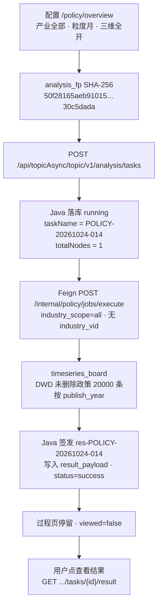
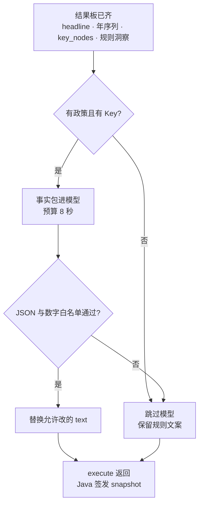

# FUNC-DESIGN · E7 政策分析

> **状态**：draft（v0.8）· 派生自交互五件套 + 已批 DEC；§4.1.1 / §6 为现网 as-built；§4.1.2 为解读润色设计，尚未上线；时序调用链见详设 `05.6.1`；深圳实现见详设 `05.6.2`  
> **日期**：2026-08-07；as-built 补充 2026-10-24；解读润色 2026-10-24；详设拆出 2026-10-24；深圳需规 114–116 完成线 2026-11-07  
> **Track**：Track-MS（专题）+ 门户展示承接  
> **derived_only**：`true`（禁止本文件扩 scope；冲突先回写五件套 / DEC）  
> **规程**：`产品定义评审规程.md` §3.5（v2.7）  
> **样例对照**：`E2-产业链分析/.../FUNC-DESIGN-CHAIN-TOPIC-DIAGNOSIS.md`、`FUNC-DESIGN-CHAIN-PORTAL-OVERVIEW-PANORAMA.md`

---

## 0. 权威与派生关系

| 类型 | 路径 / ID | 版本（填表时核对） |
| --- | --- | --- |
| IA | `IA-E7-政策分析.md`（同目录） | v1.4.5+ |
| TRACE | `TRACE-E7-政策分析.yaml`（同目录） | 与包同步 |
| USM | `USM-E7-政策分析.md`（同目录） | v1.4.8 |
| Wireframe | `Wireframe-E7-政策分析.md`（同目录） | 与包同步 |
| UX-SPEC | `UX-SPEC-E7-政策分析.md`（同目录） | 与包同步 |
| DEC（对象流） | `DEC-E7-POLICY-LAUNCH-FROM-INDUSTRY-BASKET-20260807` · `DEC-E7-POLICY-SCOPE-MUTEX-20260807` | 已批 |
| DEC（门户） | `DEC-E7-PORTAL-TAB-MERGE-A` · `NO-GLOBAL-FILTER` · `STATS-MAP-DENSITY` · `STATS-INDUSTRY-COMPARE` · `RANK-PRESENTATION` · `SHENZHEN-MIRROR` | 已批 |
| DEC（共享） | `DEC-E7-SEARCH-REUSE` · `SYSTEM-TASK-REUSE` · `REPORT-TEMPLATE-HTML-PDF` · `OPS-REUSE` | 已批 |
| Bid 专题 | `bid-reference/科技信息展示系统和科技专题服务系统.md` §1.1.1.2.4.2.6（P-70/P-72/P-73） | — |
| Bid 门户 | `bid-reference/智慧服务门户系统-要素相关.md`（P-17~P-22） | — |
| Demo 仓 | `${GKX_ROOT}/repos/demo-ui-topic` · `/policy/*` · `/policy-portal/*` | 实现证据，非需求源 |
| 时序系统设计 | `科技专题服务系统-完整详细设计/05.6.1-政策时序分析.md` | 调用链与分片档。卡面仍以本文 §4.1 为准 |

**派生铁律**：本说明书只重组已批产品行为；不得新增 Bid 叶子、角色、metric 语义或验收范围。

---

## 1. 模块目标与不承接

### 1.1 目标

在「政策分析」二级菜单域内交付：

1. **门户政策扶持展示**（单壳四 Tab）：概览 / 产业覆盖 / 最新政策动态 / 深圳政策（P-17~P-22）。  
2. **政策查询**：智能检索 / 查政策 / 高级筛选；**仅语料核对与画像**，不入篮、不发起分析（US-E7-POL-01c）。  
3. **三项计算型分析**（配置 → 系统任务过程 → 显式查看不可变结果 → 可选报告）：  
   - 政策时序分析（P-70）  
   - 区域政策对比（P-72）  
   - 深圳政策现状分析 · 三维框架与指标体系构建（P-73）  
4. **维护管理**（复用 ENT-OPS 菜单形态，不承接企业字段硬套）。  
5. 接入共享：**系统对比篮·产业 Tab**、**SystemTaskLayer**、**ENT-EXPORT**（HTML→PDF）。

### 1.2 不承接

| 项 | 说明 |
| --- | --- |
| 对比篮「政策」文档 Tab | 已废止；三项分析不以政策文档为对象 |
| 查询/门户「深度分析」直达 | 禁止绕过对比篮/配置合同 |
| 展示系统 DS-10/11/12 与核增多维对比结果页 | 另包 |
| P-74 / P-75 独立报告页 | Wave2；本包结果页内嵌可视化，不宣称独立页关闭 |
| 对比篮/任务/报告壳层内部实现 | 归属 ENT-COMPARE / SystemTaskLayer / ENT-EXPORT |
| 前端 NLP / 图谱 / 杜撰生产公式 | 算法经 Java → Python `/internal/*`；Demo 得分仅演示聚合 |
| 统一智能检索全站页 | 其它厂商范围 |

---

## 2. 对象 / 身份 / 路由参数

### 2.1 对象合同（`DEC-E7-POLICY-SCOPE-MUTEX`）

| 对象 | 稳定身份 | 规则 | 禁止 |
| --- | --- | --- | --- |
| 产业 | `industry_id`（`object_type=industry`） | 对比篮分发恰好 **1**。页内可选 1 个 L0，或「全部」（见 §4.1.1） | 与技术领域同时生效 |
| 技术领域 | `tech_field_id[]`（`object_type=tech_field`） | 可多选 **≥1**；**仅页内**，不进篮 | 写入对比篮 |
| 政策文档 | `policy_id` | 查询/详情画像；可选核对语料 | 入篮发起三项分析 |
| 分析任务 / 结果 | 共享 `analysis_task` / `result_id` | 配置提交后快照冻结 | 页内私造任务中心 |
| 报告 | `report_template_id` + fingerprint | HTML 预览 → 同源 PDF | 跳过 HTML 直出 PDF |

### 2.2 路由

| 路由 | 职责 | Bid / 故事 |
| --- | --- | --- |
| `/policy-portal/overview?tab=&view=` | 门户单壳四 Tab | P-17~P-22 · US-08 |
| `/policy/search?mode=smart\|policy\|advanced` | 政策查询（核对语料） | US-01c · DEC-SEARCH-REUSE |
| `/policy/overview` | 时序分析工作区 | P-70 · US-02 |
| `/policy/analysis` | 区域对比工作区 | P-72 · US-03 |
| `/policy/recommendation` | 深圳三维工作区 | P-73 · US-04 |
| `/policy/maintenance` | 维护管理 | US-09 · DEC-OPS-REUSE |

### 2.3 工作区 URL 参数（分析页）

| 参数 | 说明 |
| --- | --- |
| `demo_state=config\|processing\|result` | 三段态 |
| `object_type` / `object_ids[]` / `object_names[]` | 锚点 |
| `source=compare-basket\|page` | 来源 |
| `analysis_type` | Registry key |
| `task_id` / `result_id` | 任务与结果 |
| `granularity` | 时序：year\|quarter\|month |
| `regions[]` / `dims[]` | 区域对比 |
| `weight_support\|fit\|effect` | 三维一级权重 |
| `indicators_support[]\|fit[]\|effect[]` | 二级入模指标 id |

---

## 3. 功能点清单

### 3.1 门户政策扶持（展示）

| # | 功能点 | Bid | 五件套锚点 | 工程备注 |
| --- | --- | --- | --- | --- |
| F-PT-01 | 单壳四 Tab | P-17~P-22 | DEC-TAB-MERGE-A · US-08 | `/policy-portal/overview` |
| F-PT-02 | 概览 stats/map/rank | P-17/18/20 | STATS-MAP-DENSITY · RANK | 无页级全局筛选 |
| F-PT-03 | 产业覆盖 / 最新动态 / 深圳 | P-19/21/22 | SHENZHEN-MIRROR | 深圳无力度榜；各区对照 |
| F-PT-04 | 浏览与详情 | — | Wireframe 门户 | **不**写政策文档入篮；不发起分析 |

### 3.2 政策查询

| # | 功能点 | Bid | 五件套锚点 | 工程备注 |
| --- | --- | --- | --- | --- |
| F-SQ-01 | ElementSearchWorkbench 同构 | 关联准备解释 | DEC-SEARCH-REUSE · US-01c | storage 与门户分轨 |
| F-SQ-02 | 智能 / 查政策 / 高级筛选 | — | Wireframe F-POL-00 | 高筛独立 mode 页 |
| F-SQ-03 | 结果画像 / 详情抽屉 | — | US-01c | 无「加入对比篮」「深度分析」 |

### 3.3 三项分析 · 公共壳

| # | 功能点 | 五件套锚点 | 工程备注 |
| --- | --- | --- | --- |
| F-AN-00 | 产业篮分发「政策分析」分组 | US-05 · DEC-LAUNCH-FROM-INDUSTRY | 恰好 1 产业 |
| F-AN-00b | 页内锚点 XOR | US-01b · SCOPE-MUTEX | 技术领域可多选不进篮 |
| F-AN-00c | 关联政策概要 | Bid `.6.1.1` | 配置态只读预览；系统自动关联 |
| F-AN-00d | 配置→生成分析→过程→显式查看结果 | US-02/03/04/06 | 复用 SystemTaskLayer |
| F-AN-00e | 有效结果生成报告 HTML→PDF | US-07 · DEC-REPORT | `policy:report:{templateId}` |

### 3.4 政策时序分析（P-70）

| # | 功能点 | 配置 | 结果 |
| --- | --- | --- | --- |
| F-TS-01 | 时序粒度 | year / quarter / month | 快照只读 |
| F-TS-02 | 密度 / 支持强度趋势 | — | 折线 + 堆叠面积 |
| F-TS-03 | 关键节点时间轴 + 明细表 | — | 点选打开政策详情 |
| F-TS-04 | 关键节点洞察 | — | 见 §4.1.2。规则决定出哪些卡；模型只改写文案。连续性口径 Pending 仅评审态 |

过程页可见文案：`政策数据自动关联 → 时序模型智能分析 → 窗口期识别 → 结果组装 → 解读润色`。这五段是说明，不是已执行节点。Java `totalNodes` 保持 1。结果四张卡读本次 `result_payload.headline`（政策总数、最近一年发布量、年度增长率、有效政策占比），不读全库 `/policy/metrics`。现网执行顺序见 §4.1.1；解读润色见 §4.1.2，014 尚未走这一步。

### 3.5 区域政策对比（P-72）

| # | 功能点 | 配置 | 结果 |
| --- | --- | --- | --- |
| F-RG-01 | 对比区域 | ≥2 | 快照只读 |
| F-RG-02 | 评价维度 | ≥1 | 矩阵列 |
| F-RG-03 | 矩阵 / 雷达 / 热力 / 差异结论 | — | 差异结论文案同 §4.1.2 收尾；图与得分不改 |
| F-RG-04 | 条款溯源抽屉 | — | 单元点选；NLP 缺口仅评审注 |

过程阶段：`条件校验 → 区域对齐 → 多维对比 → 结果组装 → 解读润色`。五段是说明。`totalNodes` 保持 1。

### 3.6 深圳政策现状分析（P-73）

完成线等于需规 114–116，不再把自由选指标和仪表盘写成覆盖不到、不实现。配置区对照 demo-ui-topic `/policy/recommendation`（线上 `http://10.50.69.111:30888/policy/recommendation`）。指标清单以 `POLICY_SZ_CORE_INDICATORS` 为准，共 10 项，不收成三个勾选。截图用词优先：政策层级覆盖面、细分领域命中率、受益覆盖广度（常量短名分别是政策层级覆盖、细分领域命中、受益覆盖度）。算分仍消费各 `metric_id` 已跑通的三张卡。口径真源：`metrics/calc-logic/POLICY/M_POLICY_SUPPORT_STRENGTH.md`（及同目录 `M_POLICY_INDUSTRY_FIT.md`、`M_POLICY_IMPLEMENTATION_EFFECT.md`）。前端任务号 `LUMEN-POLICY-SZ3D-FE-SRS-R20261107`，由另一支执行，本文不改代码。字段与样本见详设 `05.6.2` v0.3-2026-11-07。

| # | 功能点 | 配置 | 结果 |
| --- | --- | --- | --- |
| F-SZ-01 | **需规 114 · 指标体系构建** | 三维固定：支持力度 / 产业适配性 / 落地实效性。二级可勾选入模，默认 8 项：政策数量、资金规模、创新激励、政策-产业需求匹配、产业链覆盖广度、细分领域命中率、落地执行率、受益覆盖广度。政策层级覆盖面、反馈满意度默认为不勾，仍在清单内。勾选写入创建请求 `selectedIndicators`，不得再固定成空对象。维内等权只显示在配置区 | 快照冻三张卡的可算状态，并冻本次入模 id。没有单独接口分的二级指标不回填 demo 常量分 |
| F-SZ-02 | 支持力度 | 分数因子仍是政策条数、政策层级，内部 0.5/0.5 待 `QPOL-02`。资金规模只读 `demo_gkxlumenx_dwd.policy_support_amount`，口径恰好是资助/奖励/补贴/补助；上限、总额、0 不接 | 城市截面：009/011 为 879 / 33.5585 / 名次 5 / 层级均值 0.4653。有金额则档位为非 0（这两次 `value=4`，原因「截面金额均值临时分位，QPOL-02」）。无金额则档位为空，不得写成 0。不读 `dwd_bid_*` |
| F-SZ-03 | 一级权重 | 默认 34/33/33。合计 100 才能开始。每维至少勾选 1 项才能开始。「一键均分」回到 34/33/33。「恢复默认模型」同时恢复权重和默认 8 项。权重可改，不标成 `QPOL-02` 已确认 | 不出综合分。前端不用这组权重把三维分乘成综合分 |
| F-SZ-04 | **需规 115 · 锚点与适配性** | 产业 XOR 技术领域仍在。产业提交同时带链名，不能只交 VID。技术领域仍带关联产业。支持力度不按所选产业重算 | 009 目前只交 `industry_vid=chain:INB1303`，适配性仍是「未提供链名」。缺陷包 `LUMEN-POLICY-SZ3D-E1-DEFECT-C1` 仍记录原因，本轮前端要改。011 只选人工智能 `sub_641e8d4be99d4bcb9c0d9b3beba9e1d3`，请求仍是 `scope_kind=industry`，`industry_codes=[INB1209,INB1309]`，`industry_name=智能网联汽车、人工智能`，适配性 `score=9.245`，`hit_count=43`。004 不再作为通过样本 |
| F-SZ-05 | 落地实效 | 落地执行率、受益覆盖广度、反馈满意度标 Mock 缺口，mock 分不进接口 | 真实实施日（不等于发布日）或非空适用对象则可算。009/011 为 `computable=true`，`score=50`，不是 0。全缺则不可算，不得写 0 分。反馈可缺。不参与综合分 |
| F-SZ-06 | **需规 116 · 结果读面** | — | 结果页有仪表盘，用接口返回的三维分数标优势领域和短板环节，空分不编 0。有非 0 的档位和实效分就显示。已发布结果板仍把这两项写成不可算，设计目标改为显示非 0 分。优化策略保留。报告读已签发结果，见详设 `05.6.2` §6 |

过程阶段：`条件校验 → 分卡读数（支持力度城市截面 / 适配性按锚点 / 落地实效按实施日或适用对象） → 结果组装 → 优化建议`。短板用三维分数在仪表盘上标，不在综合分上做。优化建议的规则卡与润色见详设 `05.6.2` §5，复用 §4.1.2 的机器边界。

招标锚点：`§1.1.1.2.4.2.6.3.1 指标体系构建`，对应需规 114。本页按 demo 原型承接自由选择核心指标，不写成偏离，也不改成只读固定因子。`GET .../indicators?kind=all` 仍是层级、类型、时序、区县分布，不是这 10 项的清单。`QPOL-02` 仍待甲方确认权重与档位切点，本页不把 0.5/0.5 或 34/33/33 标成已会签口径。

支持力度卡必须同时写明：分数来自条数与层级；金额只读 `policy_support_amount`。有金额则显示非 0 档位及临时分位原因；无金额则档位为空，不得写成 0，不得用 `dwd_bid_*` 中标金额顶替。min-max 是截面，不能当跨期趋势。约半数政策 `city` 为空因此不进深圳分子。深圳分数偏低时说明市级文件为主、层级权重奖励省级与国家级，不写成「深圳政策弱」。同文件 §4.3 仍是 2026-10-24 的固定卡禁勾选句子，配置与完成线以本节为准。

### 3.7 维护管理

| # | 功能点 | 五件套 | 备注 |
| --- | --- | --- | --- |
| F-OPS-01 | ENT-OPS 菜单形态复用 | US-09 · DEC-OPS-REUSE | 内容运营 / 图谱运营 / 分析配置；不硬套企业字段 |

---

## 4. 交互与控制边界

### 4.1 分析页状态机

```text
[config] 配置合法 → 点击「生成分析」
    ↓
创建 analysis_task + 配置快照冻结（URL / 任务）
    ↓
[processing] StageSteps（queued 可撤回；running 不可取消）
    ↓ succeeded 且用户显式「查看结果」
[result] 不可变结果 + 可选「生成报告」
    ↓
report 任务 → HTML 预览 → 同源 PDF
```

同类型已有 queued/running → **不**新建，引导恢复原任务。当天相同指纹已成功 → 打开过程页，不自动进入结果。

### 4.1.1 时序分析执行过程（as-built）

创建请求内同步做完。前端仍先停在过程页；`viewed=false` 时不自动打开结果。样例 `POLICY-20261024-014`（2026-10-24 22:03:13–22:03:14，用户 `guest`）。调用链、取数顺序和三档分片的展开见 `科技专题服务系统-完整详细设计/05.6.1-政策时序分析.md`。



| 步 | 本单事实 |
| --- | --- |
| 范围 | `industry_scope=all`，`industry_name=全部`。不传 `industry_vid`。集群内「全部」则传 `industry_scope=cluster` 和该集群 L0 的 `industry_codes` |
| 粒度 | 请求 `granularity=month`，`timeseries_dims=发布时间/效力层级/支持力度`。在线板不读粒度，序列按 `publish_year`，本单为 1981–2026 |
| 取数 | `scope=all` 时只保留 `is_deleted=0`，不走 `policy_industry_rel`。单产业才按 `industry_link_code` 等值。上限 `ONLINE_FULL_SCAN_CEILING-1`（39999） |
| 结果 | `policy_count=20000`；最近一年（2026）发布 3；2025 为 0，故 `M_POLICY_GROWTH_RATE` 为空；有效占比 100%；峰值年 2020，发布 2402。峰值是切片内最大年发布量，不是政策密度指数 |
| 快照 | 输入 `ins-POLICY-20261024-014`；结果 `res-POLICY-20261024-014`。Python 不自签 snapshot |

### 4.1.2 结果组装后的解读润色（设计，未上线）

数字板组装完成后，由 Python 在同一次 `POST /internal/policy/jobs/execute` 里收尾。模型只写解读。Java 不调大模型，只把返回的 `result_payload` 原样签发。前端仍只渲染 `insights` 的 `title` / `text` / `tone`。无 Key、超时、输出不合规时，任务仍成功，文案退回规则草稿。



模型不改这些字段：`headline`、`density_trend`、`support_trend`、`level_trend`、`key_nodes`、`policy_count`、`honesty.fabricated`。空结果不调用模型，保留「无匹配政策」。

时序「关键节点洞察」分成两类卡。规则层决定卡片是否出现、标题、`tone`、`pending_ref`。模型只改 `text`。

| 卡 | 何时出现 | 模型边界 |
| --- | --- | --- |
| 发布高峰 | 有峰值年 | 只复述峰值年与条数。这条数是切片内最大年发布量 |
| 最近环比 | `M_POLICY_GROWTH_RATE` 非空 | 增长率写成百分数。空值时这张卡不出现，模型不得补一张写成 0 |
| 发布连续性 | 连续性非空 | 必须保留「有发布年数 / 跨度年数」。`pending_ref=QPOL-07` 仍由规则挂上 |
| 有效占比 | 占比非空 | 只复述占比。空状态不算有效 |
| 节点分布 | `key_nodes` 非空时追加 1 张，`tone=flat` | 只根据标题、发布日期、效力层级、是否窗口年来写。不评价条文，不概括摘要 |

窗口年沿用结果板现口径：该年发布量大于 0，且不低于「均值的 1.5 倍」与「峰值的 0.8 倍」中的较大者。模型不得另定窗口。

事实包只带汇总，不带 2 万条正文：

| 块 | 内容 |
| --- | --- |
| 范围 | `match_object`、`policy_count`、年份起止 |
| 指标 | `headline` 原值，空就是空 |
| 峰值 | 峰值年、该年条数，标注为最大年发布量 |
| 近三年 | 每年的 `publish_count` 与 `growth_rate` |
| 窗口年 | 命中窗口的年份列表 |
| 节点 | 已排序 `key_nodes` 的前 8 条：标题、日期、层级、`window`；另给节点总数（上限 50）和落在窗口年的条数 |
| 草稿 | 规则洞察的 `title` + `text`，供改写 |

区域对比复用同一次收尾，事实包换成 `compare_rows`、未归入条数和规则洞察。模型只改已有差异卡的 `text`，不新增卡。「计分口径」必须保留「该维最高=100、综合分为等权均值」，`pending_ref=QPOL-02` 仍由规则挂上。深圳三维复用同一收尾，只润色优化建议的 `conclusion`：事实包换成三张固定卡，不润色综合分。卡片名单与报告章节见详设 `05.6.2` §5、§6。深圳已离开 `harness.dispatch`，`harness_mode=shenzhen_board`，优化建议与结果板同一次签发，不再写成尚未上线。

校验不过则该卡退回草稿，不把整单打失败：

- 返回须是 JSON，`text` 为字符串。指标卡不得增删。节点卡最多 1 张，标题固定「节点分布」。
- 文案里的年份和数字必须能在事实包里找到。
- 禁止「政策密度指数」；禁止把空增长率写成 0 或 -100；禁止事实包以外的标题、年份和原因。
- 单卡 `text` 不超过 80 字，节点卡不超过 120 字。
- 数字核对只做字符串白名单，不证明因果。因果句一律拒绝。

调用沿用仓内 OpenAI 兼容客户端（`ENTAN_LLM_*`，默认同智谱）。本步超时 8 秒，与条款抽取的 45 秒分开。返回旁增加 `narration`：`status=ok|fallback|skipped`、`model`、`reason`。业务界面不展示该块。润色失败不把 `honesty.degraded` 设为真，避免和取数失败混在一起。

以 `POLICY-20261024-014` 的规则结果为例，润色后允许写成：

- 发布高峰：1981–2026 内，2020 年发布 2402 条，为观察期内最多的一年。
- 发布连续性：有发布的年份占跨度的 82.61%（有发布年数 / 跨度年数）。
- 有效占比：当前切片有效政策占 100%。
- 节点分布：只点名事实包前 8 条里的标题，并写明日期、层级、是否落在窗口年。事实包没有的标题不出现。

本单不出现「最近环比」卡：2026 年 3 条、2025 年 0 条，增长率留空。节点卡不把 2402 称为密度指数，也不写观察期以外的原因。

### 4.2 发起边界

| 允许 | 禁止 |
| --- | --- |
| 产业篮勾选 1 产业 → 政策分析分组分发 | 政策文档入篮发起 |
| 配置页产业 XOR 技术领域 | 产业与技术领域同时生效 |
| 查询打开摘要核对语料 | 查询「深度分析」带对象直达配置发起 |
| 门户浏览 | 门户写政策文档入篮 / 跑分析任务 |

### 4.3 深圳固定指标卡控制边界

| 区域 | 允许 | 禁止 |
| --- | --- | --- |
| 三维标题 | 查看 ⓘ（三个 `metric_id`）与可算 / 不可算状态 | 删除三维；把落地实效显示成可勾选入模 |
| 支持力度因子 | 只读展示政策条数、政策层级；档位行显示不可算 | 勾选资金规模、创新激励；把档位显示成 0；用招标金额填档位 |
| 产业 / 技术锚点 | 改变产业适配性的计算范围 | 用锚点重算支持力度城市截面 |
| 权重 | 评审模式可见「内部 0.5/0.5 冻结，待 QPOL-02」 | 行内改一级权重、一键均分、维内等权勾选 |
| 工具栏 | 开始分析（锚点合法即可） | 因「目录为空」放过校验却显示可开始；配置页导出报告 |
| 分布接口 | `indicators?kind=all` 继续只服务门户分布 | 用该接口的 `items` 充当二级指标目录 |

### 4.4 业务 / 评审双模

- 业务模式：不渲染 Trace / Mock / Pending / 开放项明文。  
- 评审模式：挂载 metric_spec / mock_badge / pending_badge / requirement_trace（见 Wireframe `review_trace_contract`）。

---

## 5. 参数 / 任务快照 / 导出

### 5.1 task_type（Demo / SYS-JOBS 约定）

| 分析 | analysis taskType | report templateId（示例） |
| --- | --- | --- |
| 时序 | `policy:overview:policy_timeseries` | `POL-TIMESERIES-PDF-v1` |
| 区域 | `policy:analysis:policy_region_compare` | `POL-REGION-COMPARE-PDF-v1` |
| 深圳三维 | `policy:recommendation:policy_sz_3d` | `POL-SZ-3D-PDF-v1` |
| 报告 | `policy:report:{templateId}` | — |

> TRACE 登记名：`policy_timeseries_analysis` / `policy_region_compare` / `policy_sz_3d_assessment`（产品语义）；实现键以上表 surface 约定为准，定稿后对齐。

### 5.2 快照规则

| 规则 | 说明 |
| --- | --- |
| 提交前 | 草稿可改；不写成功任务历史 |
| 提交后 | 对象、粒度/区域维度冻结。深圳三维另冻三张卡的可算状态与支持力度冻结因子（条数、层级、档位 null），不冻用户入模清单，不冻 34/33/33 |
| 结果 | 不可变；「复制配置」开新草稿 |
| 维内权重 | 时序 / 区域对比仍按各自配置。深圳支持力度内部 0.5/0.5 只作冻结说明，不由勾选列表推导 |

### 5.3 导出

- 仅有效结果可生成报告。  
- 统一模板：先 HTML 预览，再下载同源修订 PDF。  
- 政策模块只提供 `report_template_id`、章节 payload、fingerprint。

---

## 6. 接口与数据合同骨架

调用链铁律：**前端 → Java REST →（必要时）Python `/internal/*`**；前端不直连算法/图库；Java 不写 nGQL、不做 NLP。

| 能力 | 建议 Java 门面（TBD） | Python internal（TBD） |
| --- | --- | --- |
| 政策检索 | `GET/POST /topic/v1/policy/search` | 可选 `/internal/v1/policy/search` |
| 关联语料概要 | `GET .../policy/corpus-preview` | `/internal/v1/policy/associate` |
| 创建三项分析 | `POST /topic/v1/analysis/tasks`（网关 `/api/topicAsync` + StripPrefix） | `POST /internal/policy/jobs/execute`。时序 `policy_timeseries`、区域 `policy_regional` 走结果板，组装后再按 §4.1.2 润色解读。深圳 `policy_shenzhen` 改走分卡结果板：支持力度城市截面、适配性按锚点、落地实效 `computable=false`；不润色综合分。优化建议复用同一收尾，只改 `strategies[].conclusion`，见详设 `05.6.2` |
| 深圳指标目录 | 不新增目录接口 | 因子列表来自结果板，不来自 `indicators?kind=all` |
| 查询任务/结果 | `GET /topic/v1/analysis/tasks/{id}` · `.../result` | 时序结果在 `targetParams.result_payload`，不在 `resultData` |
| 报告导出 | 复用 ENT-EXPORT 合同 | — |
| 门户展示块 | `GET .../portal/policy/...` | — |

> TODO：请求/响应 JSON 示例、错误码、幂等与 fingerprint 字段（对齐诊断 FUNC-DESIGN 粒度）。

---

## 7. 权限与异常态

| 场景 | 行为 |
| --- | --- |
| 无锚点进分析页 | 可配置；引导打开产业篮或页内选产业/技术领域 |
| 一级权重 ≠100% / 任维 0 指标 | 仅时序、区域对比按各自规则禁用。深圳三维不使用这条 |
| 深圳三维锚点未选 | 「开始分析」禁用 |
| 深圳落地实效不可算 | 整卡空态；不因此禁用开始分析，也不进入综合分 |
| 同类型任务进行中 | 复用并恢复过程页 |
| queued | 可撤回 |
| running | 无取消 |
| 查询零命中 | 空态；不伪造推荐冒充命中 |
| 关联政策为空 | 分析区空态；更换锚点 |
| 无报告权限 | 生成/下载锁态；结果仍可读 |
| 过期结果点报告 | 失败关闭；可复制配置重跑 |
| 评审模式关闭 | 评审挂载完整隐藏 |

产品角色见 IA §2；前端不从 Mock 用户推断权限。

---

## 8. 开放项与待填

| ID | 问题 | 建议处置 |
| --- | --- | --- |
| POL-FDS-01 | Java/Python 路径与字段终表 | §6 与 §4.1.1 已按 2026-10-24 现网回填。OpenAPI 字段全表仍待架构定稿 |
| POL-FDS-02 | `task_type` 产品名 vs Demo surface 键对齐 | 与 SystemTaskLayer 枚举会签 |
| POL-FDS-03 | 政策密度指数正式公式（GAP-E7-01） | 时序卡已改标「最近一年发布量」，不再把峰值年发布量标成密度指数。正式归一公式仍待甲方 |
| POL-FDS-04 | 支持力度档位定义与内部权重（QPOL-02） | 交付冻结 0.5/0.5，档位保持 `null`。甲方会签前不出综合分，UI ⚠️ |
| POL-FDS-05 | 落地实效三维全断（实施日 / 支持对象 / 反馈） | 整卡不可算。禁止 Mock 填执行率、受益覆盖、满意度 |
| POL-FDS-06 | 技术领域正式分类体系 | 数据侧；Demo 单一 Mock 体系 |
| POL-FDS-07 | 维护管理字段与 ENT-OPS 映射表 | OPS-REUSE 落地清单 |
| POL-FDS-08 | 门户 CMS 文案是否拆 SPEC-CMS | 会议点名则另建附录 |
| POL-FDS-09 | 解读润色尚未上线 | 验收以 §4.1.2 为准：模型只改文案；8 秒超时或无 Key 时任务仍成功并退回规则草稿。实现另开任务 |

---

## 9. 填充检查清单（出 v1.0 前）

- [ ] TRACE `leaves_required` 与本 §3 功能点双向勾完（含门户 6 + 专题 3）  
- [ ] UX-SPEC 状态机 / 合并配置区与本 §4 无冲突句  
- [x] USM v1.4.9 主路径 C 与 F-SZ-01 固定指标卡一致（2026-10-24）
- [ ] §6 至少各分析 1 个创建任务接口有示例 JSON  
- [ ] 架构抽检：无前端直连 Nebula / Python；无 Java 内 NLP  
- [ ] 评审/业务双模：业务 DOM 无 QPOL / Mock / GAP 明文  

---

## 10. 修订记录

| 版本 | 日期 | 说明 |
| --- | --- | --- |
| v0.2 | 2026-08-07 | 首版汇编：对照产业链 FUNC-DESIGN 样例；纳入产业篮发起、SCOPE-MUTEX、查询仅核对语料、P-73 合并指标体系构建 |
| v0.3 | 2026-10-24 | as-built：§4.1.1 写入时序执行过程，样例 `POLICY-20261024-014`；§6 改为共用 analysis tasks 与 `/internal/policy/jobs/execute`；页内产业增加「全部」；过程四段标明为说明文案 |
| v0.4 | 2026-10-24 | §4.1.2：结果组装后由 Python 做解读润色。时序关键节点洞察由规则定卡，模型只改文案，并追加「节点分布」。区域差异结论同口径。尚未上线 |
| v0.5 | 2026-10-24 | §3.6 / §4.3：深圳三维改为三张固定指标卡。支持力度只读条数+层级，档位 null；产业锚点只进适配性；落地实效整卡不可算；QPOL-02 前不出综合分。废止自由勾选与 34/33/33 |
| v0.6 | 2026-10-24 | 时序调用链拆到详设 `05.6.1-政策时序分析.md`。本文 §4.1 仍是卡面与洞察合同 |
| v0.7 | 2026-10-25 | 深圳实现拆到详设 `05.6.2`。优化建议复用 §4.1.2：规则定卡，模型只改 `conclusion`。不润色综合分 |
| v0.8 | 2026-11-07 | §3.6：深圳完成线对齐需规 114–116 与 demo 十项指标原型。档位和实效有非 0 分就显示，空不写 0。§4.1.2 深圳已离开 harness。§4.3 本次未改，配置以 §3.6 为准 |
