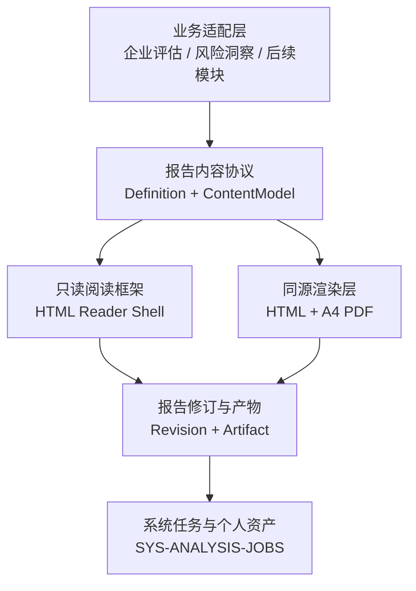

# IA-ENT-EXPORT｜系统报告复用框架信息架构

> module_key：`ENT-EXPORT`
> 产品名：系统报告复用框架
> 版本：v0.5
> 更新日期：2026-07-31
> 状态：共用报告产品数据契约基线已补齐；V1 首轮可实施，正式范围与 PDR/V1-FINAL/V2 仍待批准和契约冻结
> Track：Track-MS / 下游目标 `v1_hifi_round1`（带阶段化缺口激活）
> 屏幕档位：`medium_1440_1920`

## 1. 定义目标

将企业评估中已经验证的“结构化报告 → 只读 HTML 阅读 → 同源 PDF 下载”抽为系统级能力，使后续业务模块只提交业务报告内容，不重复建设阅读器、分页打印、下载状态、权限复核和产物审计。

本包沿用台账中的 `ENT-EXPORT` 标识，避免新建语义重复的 `SYS-*` 模块。其逻辑定位是跨专题服务模块的系统共用层，不等同于“企业模块专属导出”。

## 2. 原始需求与产品增强边界

### 2.1 原始 Bid 可直接支撑

- `bid-reference/智慧服务门户系统-要素相关.md` §1.1.1.1.3：系统管理模块包括“报告管理”。
- 多个业务叶子分别要求生成、查看、下载或导出分析报告；这些叶子仍由各自业务模块负责，不迁移到本模块。

### 2.2 本包的产品增强

以下内容不是原始 Bid 的直接细化，统一登记为 `product_enhancement`：

- 跨模块 `ReportDefinition / ReportContentModel / ReportRevision / ReportArtifact` 协议；
- 固定核心章节与系统装配的扩展章节；
- 同一不可变报告修订渲染只读 HTML 与 A4 PDF；
- 模板版本、来源快照、报告指纹、文件有效期、下载授权和审计契约；
- 业务模块适配器注册及第二消费者一致性验证。

用户已确认本轮产品方向，但这不替代项目负责人和合规 PM 的正式范围变更批准。正式编号缺失前，本包可用于产品、架构、UX 和 V1 首轮高保真验证；不得宣称已进入活动范围、PDR-ready、V1-FINAL、V2 或生产交付。

## 3. 产品角色

| 角色 | Bid 依据 | 目标 | 边界 |
|---|---|---|---|
| 政府科技管理与决策人员 | 门户业务流程明确列出政府科技管理与决策部门 | 阅读可信、可追溯、适合汇报的分析报告并下载 PDF | 不编辑报告正文，不配置章节 |
| 高校、科研院所及智库研究人员 | 门户业务流程明确列出高校、科研院所、智库 | 阅读完整分析、证据、来源和局限性，用于研究判断 | 不改变来源快照或计算结果 |

## 4. 五层架构

### 4.1 报告内容协议

- `ReportDefinition`：模板标识、模板版本、适用模块、固定核心章节、允许的扩展章节、支持格式。
- `ReportContentModel`：标题、摘要、对象范围、结构化章节、图表描述、证据引用、数据来源、生成说明、局限性。
- 业务模块拥有指标、算法、事实、结论和措辞；共用层只校验结构，不推导业务结论。

### 4.2 只读阅读框架

- 由来源模块挂载，不新增全局菜单，也不强制把用户带离业务上下文。
- 阅读页提供目录、章节定位、生成信息、证据与局限性、下载动作。
- 正文、章节顺序和显隐均不可由终端用户修改。

### 4.3 同源多格式渲染

- HTML 与 PDF 必须绑定同一 `report_revision_id`。
- PDF 采用 A4 分页；阅读页采用连续流式布局。
- 格式差异只允许出现在分页、页眉页脚、交互控件和打印适配，不得改变事实、结论、图表数据或章节语义。
- V1 只承诺 HTML 与 PDF；Word、PPT、Excel 不在本轮范围。

### 4.4 系统报告任务

- 任务排队、并发、失败重试、跨登录恢复和个人资产归档由 `SYS-ANALYSIS-JOBS` 负责。
- 本框架提供报告定义、快照绑定、指纹生成输入、修订与产物元数据。
- 不在本模块重复建设任务中心、通知中心或个人资产页面。

### 4.5 业务适配层

- 来源模块提交结构化内容、权限上下文、来源快照和回跳路由。
- 企业评估为首个消费者；风险洞察为第二消费者。`ENT-RISK-第二消费者一致性验证.md` 已完成产品定义层映射，证明骨架不含企业评估模式、权重、评分、排名、雷达图或评估模板等专属必填字段；该结论不声明代码适配或 Demo 验证。
- 业务模块可以增加扩展章节，但不得覆盖固定核心章节、证据、来源、局限性和生成信息。

## 5. 信息对象

| 对象 | 主责 | 最小字段 |
|---|---|---|
| `ReportDefinition` | 报告框架 | `template_id`、`template_version`、`module_key`、`core_sections`、`extension_slots`、`supported_formats` |
| `ReportSnapshotRef` | 来源模块 / 任务系统 | `source_task_id`、`source_snapshot_id`、`subject_scope`、`data_version`、`algorithm_version`、`permission_context_ref` |
| `ReportContentModel` | 来源模块 | `title`、`executive_summary`、`sections`、`evidence_refs`、`data_sources`、`limitations` |
| `ReportRevision` | 报告框架 | `report_id`、`report_revision_id`、`report_fingerprint`、`definition_ref`、`snapshot_ref`、`created_at` |
| `ReportArtifact` | 报告框架 / 任务系统 | `artifact_id`、`format`、`status`、`file_ref`、`expires_at`、`download_policy_ref`、`audit_ref` |

任何业务统计字段继续使用来源模块登记的 `metric_id`、单位、时间范围、空间粒度、来源和算法版本。本框架不创建新的统计口径。

### 5.1 产品数据契约基线

字段状态、所有权、可见性、七个核心章节及两类消费者映射统一以 `REPORT-CONTRACT-ENT-EXPORT.md` v0.1 为准。该基线已经确认产品层最小结构，但不替代 `GAP-ENT-EXPORT-CONTRACT-01` 所需的架构、后端与合规评审。

共用层只要求来源模块提交业务无关的身份、快照、权限上下文、结构化内容、修订和产物字段。以下 ENT-EVAL 专属内容不得成为共用必填字段：

- 技术力 / 商业力 / 综合竞争力评估模式；
- 指标选择与权重；
- 企业得分与排名；
- 雷达图或评估对比矩阵；
- 系统模板、个人模板或当次评估配置；
- 单企 / 双企 / 多企评估专属版式。

业务模式隐藏原始内部 ID、权限编码和评审 payload，但必须保留业务可理解的数据来源、版本、证据和局限性。PDF 同样不进入评审载荷，不能据此删除报告业务信息。

## 6. 页面与承载关系

| Frame | 名称 | 承载方 | 说明 |
|---|---|---|---|
| F-EXPORT-01 | 来源模块报告入口 | 来源业务模块 | 展示报告状态，触发生成或进入已有报告 |
| F-EXPORT-02 | 只读 HTML 报告阅读页 | 来源业务路由挂载共用 Reader | 连续阅读、目录定位、证据和局限性、PDF 下载 |
| F-EXPORT-03 | 报告生成任务反馈 | `SYS-ANALYSIS-JOBS` | 准备中、生成中、成功、失败；本包只定义交接字段 |
| F-EXPORT-04 | 产物不可用状态 | Reader / 来源模块 | 无权限、文件过期、来源版本失效、生成失败 |
| F-EXPORT-05 | 个人资产恢复入口 | 个人资产中心 + 来源模块 | 按 `report_id` 和回跳路由恢复阅读上下文 |

F-EXPORT-03 与 F-EXPORT-05 是跨模块协作 Frame，不代表 `ENT-EXPORT` 拥有对应独立页面。

### 6.1 路由与状态责任

| Frame | 路由契约 | 状态责任 |
|---|---|---|
| F-EXPORT-01 | `source_module_defined_result_route` | 来源模块承载 `not_generated / preparing / generating / ready` |
| F-EXPORT-02 | `source_module_defined_report_route` | 来源模块提供安全路由，Reader 只读取 `report_revision_id` |
| F-EXPORT-03 | `system_task_layer` | `SYS-ANALYSIS-JOBS` 承载准备、生成、成功和失败 |
| F-EXPORT-04 | `source_module_defined_report_route` | Reader 承载无权、过期、来源失效、产物缺失和失败 |
| F-EXPORT-05 | `/personal/assets` | 个人资产中心恢复至来源模块提供的安全路由 |

本框架不为所有业务模块强制统一 URL；适配器必须显式提供来源结果路由和报告路由，Demo 覆盖按消费者记录实际路由。

## 7. 固定报告骨架

### 7.1 固定核心章节

1. 封面与报告身份；
2. 决策摘要；
3. 对象与范围；
4. 核心发现；
5. 证据与分析；
6. 数据来源与生成说明；
7. 局限性与使用边界。

### 7.2 扩展章节

- 由 `ReportDefinition` 声明槽位，来源模块按模式、对象数量、数据可用性和权限自动装配。
- 终端用户不可新增、删除、排序、隐藏或改名。
- 无数据时不得生成看似完整的空结论；应隐藏扩展章节或显示明确的不可用说明。

### 7.3 决策摘要约束

- PDF 前 2–3 页优先承载报告身份、范围、结论摘要、关键发现和风险提示。
- 摘要只可压缩已有结构化事实，不得新增无证据因果或策略外推。

## 8. 状态模型

`not_generated → preparing → generating → ready → expired`

异常分支：

- `failed`：生成失败，可按任务系统规则重试；
- `forbidden`：当前用户无权查看或下载；
- `source_invalid`：来源快照、算法版本或数据版本不可解析；
- `artifact_missing`：报告修订存在，但目标格式产物缺失。

状态不应通过颜色单独表达；必须同时提供文本、图标或可访问名称。

## 9. 权限、合规与审计

- 生成前校验来源模块当前权限；下载前再次复核，不以历史生成成功替代当前授权。
- 报告只包含当前用户在来源模块可见的数据；敏感字段沿用来源模块脱敏策略。
- 记录操作者、生成时间、来源任务、来源快照、模板版本、数据/算法版本、下载动作和结果。
- 文件有效期、下载授权枚举和审计留存周期仍待 `GAP-SYS-JOBS-REPORT-01` 技术与合规评审闭合。
- 用户侧不开放模板编辑、章节配置、模板市场或运营后台。

## 10. 非目标

- 通用卡片、表格、Excel 或配置导出；
- 业务指标、算法、排名和结论生成；
- 任务队列、并发、通知、重试和个人资产页面；
- 用户自定义模板、章节编辑、章节排序、章节隐藏；
- Word/PPT 输出、批量报告编排、模板市场、商业配额；
- 全局报告中心菜单或取代来源模块结果页。

## 11. Track-MS 定位与依赖

本包是 `ENT-MOD-EXPORT-PACK-L01` 候选产物，不改动任务台账、不认领任务，也不改变现有 `ENT-MOD-EXPORT-PDR-G1` 的 `blocked` 状态。

下游唯一目标阶段为 `v1_hifi_round1`。当前四件套与 UX 已能形成安全、确定的 V1 方案，因此可进入首轮高保真验证；正式范围批准、技术/合规契约和历史台账核验仍作为 PDR、V1-FINAL、V2 与生产的后续关闭条件。

前置与相邻依赖：

- `SYS-ANALYSIS-JOBS`：任务生命周期、个人资产、报告任务投影；
- `GAP-SYS-JOBS-REPORT-01`：模板、快照、指纹、有效期和下载授权契约；
- `REPORT-CONTRACT-ENT-EXPORT.md` v0.1：产品层字段、章节、可见性与消费者映射基线；不等于技术接口冻结；
- 来源业务模块：业务内容、指标、算法、权限和回跳路由；
- 正式 `approved_scope_change`：激活跨模块产品增强。
- `review_trace_contract`：由 Wireframe §11 提供唯一机器可读挂点清单，TRACE 与 USM 只引用其稳定 `mount_id`。

## 12. 来源差异与叶子处理

| 来源事实 | 当前归位 | 范围处理 |
|---|---|---|
| 门户 Bid §1.1.1.1.3 出现“报告管理” | 作为系统存在报告管理能力的直接上下文 | 当前 scope baseline 与验收目录没有 ENT-EXPORT 可计数叶子，登记 `GAP-ENT-EXPORT-CATALOG-01` |
| 各业务模块拥有自己的报告生成/导出要求 | 来源模块保留业务内容、指标、算法、权限和入口 | 不迁移、不合并、不重复计入 ENT-EXPORT |
| 跨模块内容协议、Reader、同源 HTML/PDF | 归为系统报告复用框架 | `product_enhancement`；正式范围未激活，但允许 V1 首轮以非正式交付证据验证 |

本次重组没有删除、合并或拆分任何活动 Bid 叶子。

## 13. 内部评审层

- 5 个 Frame 共 7 个稳定挂点，完整契约见 Wireframe §11。
- 评审标识只在内部评审模式出现，业务模式挂点数必须为 0。
- 切换评审模式不得改变报告内容、权限结果、章节集合或可用动作。
- 评审标识不得进入 PDF，也不得以页级总横幅替代具体宿主挂点。

## 14. PDR 准入条件

- [ ] 项目负责人和合规 PM 共同签署正式 `approved_scope_change`；
- [ ] `GAP-SYS-JOBS-REPORT-01` 闭合并形成接口/字段归属；
- [x] 产品层共用字段、七核心章节、模式隔离与 ENT-EVAL / ENT-RISK 映射已形成 `REPORT-CONTRACT-ENT-EXPORT.md` v0.1；
- [ ] 历史 `ENT-MOD-EXPORT-PDR-G1` 的“blocked / 已通过”冲突完成核验；
- [ ] 企业评估适配器完成 V1 体验验证；
- [x] 风险洞察完成第二消费者产品定义验证，确认无企业评估专属字段进入共用协议；证据：`ENT-RISK-第二消费者一致性验证.md`（代码适配与 V1 视觉验证未声明）；
- [ ] 权限、脱敏、下载授权、文件有效期和审计留存规则完成合规评审；
- [ ] 1920 / 1680 / 1440 及默认、加载、空、错误、无权限、过期状态完成视觉 QA。
