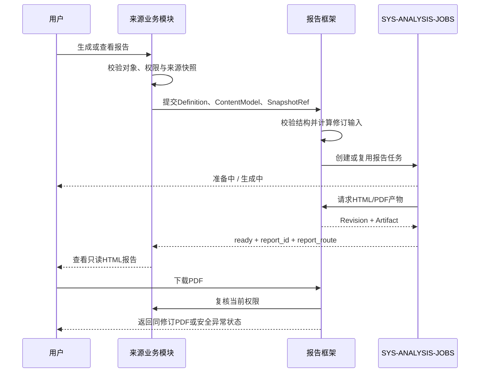

# USM-ENT-EXPORT｜系统报告复用框架用户故事地图

> 版本：v0.5｜2026-07-31
> 状态：产品层共用数据契约基线已补齐；跨模块故事可进入 V1 首轮验证，正式范围仍待 `approved_scope_change`
> Track：Track-MS｜屏幕档位：`medium_1440_1920`

## 1. 用户活动地图

| 活动 | 进入报告 | 阅读与核对 | 下载与归档 | 恢复与异常处理 |
|---|---|---|---|---|
| 用户任务 | 在来源业务结果中看到报告状态 | 阅读摘要、完整分析、证据、来源和局限性 | 获取与当前阅读内容同源的 PDF | 从个人资产返回同一修订，处理过期或无权 |
| 共用层职责 | 接收适配器和报告身份 | 只读 Reader 与章节导航 | 同一 `report_revision_id` 渲染 PDF | 解释状态并提供安全动作 |
| 来源模块职责 | 提供入口、内容、快照、权限和回跳路由 | 提供业务事实、指标、算法、结论 | 确定可见内容与脱敏上下文 | 重新校验业务权限 |
| 任务系统职责 | 创建/复用任务 | 投影状态 | 排队、进度、失败重试、资产记录 | 跨登录恢复 |

## 2. Release Slice

### Slice A｜框架契约与企业评估首接入

- `REPORT-CONTRACT-ENT-EXPORT.md` v0.1 定义的结构化报告内容协议；
- 只读 HTML Reader；
- 同源 A4 PDF；
- 来源快照、修订、指纹和产物元数据；
- 企业评估适配器；
- 生成、成功、失败、无权、过期状态。

### Slice B｜第二消费者与治理闭合

- 风险洞察产品定义适配已完成，证据为 `ENT-RISK-第二消费者一致性验证.md`；
- 固定核心章节与扩展槽位已验证无企业评估专属耦合；代码适配与 V1 视觉验证不在该结论内；
- 下载授权、文件有效期、脱敏和审计规则闭合；
- 1920 / 1680 / 1440 视觉与状态 QA。

### Later

- DOCX/PPTX/XLSX；
- 批量报告、定时生成、模板市场；
- 用户自定义章节、正文编辑或版式编辑；
- 独立全局报告中心。

## 3. 用户故事

### US-ENT-EXPORT-READ｜在来源业务上下文阅读完整报告

作为政府科技管理与决策人员，我希望从业务分析结果进入只读报告，以便在不丢失对象和任务上下文的情况下完成决策阅读。

验收条件：

1. 来源模块展示“生成报告 / 查看报告 / 重新生成”等与状态一致的动作。
2. 阅读页绑定明确的 `report_id` 与 `report_revision_id`。
3. 页面固定展示报告身份、决策摘要、对象与范围、核心发现、证据与分析、来源与生成说明、局限性。
4. 扩展章节由系统按模式、对象范围、数据可用性和权限装配，终端用户不能调整。
5. 页面不提供正文编辑、章节配置、拖拽排序、隐藏章节或另存模板。
6. 返回动作回到来源模块提供的安全路由，不引入独立全局菜单。

追溯：`F-EXPORT-01`、`F-EXPORT-02`、`F-EXPORT-04`。
范围关系：`product_enhancement`，待正式 `approved_scope_change`。

### US-ENT-EXPORT-EVIDENCE｜核对证据、来源和局限性

作为高校科研或智库研究人员，我希望核对每份报告的范围、数据版本、算法版本、证据和局限性，以判断其是否适合被引用。

验收条件：

1. 报告展示对象范围、时间范围、空间范围、数据版本和算法版本；不存在时明确标“未提供”，不得伪造。
2. 业务统计值继续携带来源模块登记的 `metric_id` 或等价语义引用。
3. 结论可定位到结构化证据或分析章节。
4. 无数据、低可信度或来源不可用时明确降级，不生成看似确定的结论。
5. 报告显示生成时间、模板版本、来源任务和来源快照引用。
6. 业务模式不显示内部实现约束；内部评审模式通过标题挂点展示追溯。

追溯：`F-EXPORT-02`。
范围关系：`product_enhancement`，待正式 `approved_scope_change`。

### US-ENT-EXPORT-PDF｜下载同源 PDF

作为政府科技管理与决策人员，我希望下载与当前阅读页内容同源的 PDF，以便汇报、流转和归档。

验收条件：

1. HTML 与 PDF 使用同一不可变 `report_revision_id`。
2. PDF 允许 A4 分页、页眉页脚和打印适配，但不得改变事实、结论、图表数据和章节语义。
3. PDF 前 2–3 页优先呈现报告身份、对象范围、决策摘要、关键发现和风险提示。
4. 下载前重新校验当前用户权限和来源模块可见范围。
5. 生成时间较长时交给 `SYS-ANALYSIS-JOBS`，展示准备中、生成中、成功或失败。
6. 文件过期时不下载旧链接，提示重新生成；无权限时不泄露文件元数据和敏感摘要。
7. V1 只出现 PDF 下载，不展示 Word、PPT 或 Excel 占位动作。

追溯：`F-EXPORT-02`、`F-EXPORT-03`、`F-EXPORT-04`。
范围关系：`product_enhancement`，待正式 `approved_scope_change`。

### US-ENT-EXPORT-RESUME｜从个人资产恢复报告

作为高校科研或智库研究人员，我希望从个人资产回到同一份报告，以便跨登录继续阅读。

验收条件：

1. 资产记录包含 `report_id`、`report_revision_id`、来源模块和安全回跳路由。
2. 回跳后恢复同一修订，不因来源模块出现新数据而静默替换。
3. 如权限已失效，展示无权限状态；如文件过期但修订仍有效，允许按规则重新生成产物。
4. 如来源快照不可解析，展示来源失效说明，不自动改用最新数据。
5. 个人资产列表与跨登录恢复仍由 `SYS-ANALYSIS-JOBS` / 个人中心负责。

追溯：`F-EXPORT-05`、`F-EXPORT-02`、`F-EXPORT-04`。
范围关系：`product_enhancement`，待正式 `approved_scope_change`。

## 4. 核心流程

## 5. 关键业务规则

1. `report_revision_id` 是阅读和下载的一致性边界；禁止 HTML 跟随最新数据而 PDF 保持旧数据。
2. `report_fingerprint` 的算法细节由架构评审确定，但输入至少绑定模板版本、来源快照、生成参数和脱敏策略版本。
3. 报告内容必须由来源模块给出；框架不根据图表自行编写业务结论。
4. 固定核心章节不可删；扩展章节只由系统规则装配。
5. 用户没有报告编辑权，也没有章节配置权。
6. 缺失数据必须如实呈现，不用模拟值补齐正式报告。
7. 下载与查看分别校验权限；历史成功不代表当前有权。
8. 企业评估适配成功不能单独证明框架已复用完成；风险洞察已完成产品定义层第二消费者验证，代码适配、同源产物和 V1 视觉证据仍须分别验证。
9. 共用协议不得要求消费者提供评估模式、指标权重、企业得分、排名、雷达图或终端用户评估模板配置。
10. 业务模式和 PDF 不显示原始证据 ID、内部权限编码、指纹或评审 payload；数据来源、业务化版本说明和局限性仍必须保留。
11. 字段、章节、所有权和可见性以 `REPORT-CONTRACT-ENT-EXPORT.md` v0.1 为产品层基线；接口、存储、授权和审计枚举作为 `GAP-ENT-EXPORT-CONTRACT-01` 阻断 PDR 及后续阶段，V1 使用确定性 Demo 契约并对权限 fail closed。

## 6. 状态与动作

| 状态 | 用户看到 | 可用动作 |
|---|---|---|
| `not_generated` | 尚未生成报告 | 生成报告 |
| `preparing` | 正在准备来源快照 | 查看任务 |
| `generating` | 正在生成报告 | 查看任务 |
| `ready` | 报告可阅读 | 查看报告、下载 PDF |
| `failed` | 生成失败及可理解原因 | 按任务规则重试、返回结果 |
| `forbidden` | 无权限 | 返回来源页面 |
| `expired` | PDF 已过期 | 重新生成 PDF |
| `source_invalid` | 来源快照或版本不可解析 | 返回来源页面、联系管理员 |
| `artifact_missing` | 当前格式暂不可用 | 重新生成目标格式 |

## 7. 异常与边界场景

- 内容模型缺少固定核心章节：拒绝生成并返回结构校验错误。
- 图表数据存在但无语义、单位或时间范围：标记来源内容不完整，不由框架猜测。
- 模板升级后打开旧报告：继续使用旧 `template_version` 渲染该修订。
- 用户权限降级：Reader 和下载均按当前权限处理，不回显历史敏感内容。
- 来源模块被下线：保留审计元数据；产物可见性按留存与授权策略处理。
- PDF 生成失败但 HTML 可用：保留 HTML 阅读，明确 PDF 暂不可用。
- 生成过程中重复点击：交由任务系统按 `report_fingerprint` 复用或返回进行中任务。

## 8. 非功能验收

- 可访问性：目录、按钮、状态和错误均可键盘操作并具备可访问名称。
- 响应式：仅验收 1920 / 1680 / 1440，中小屏不在本轮范围。
- 性能：长报告章节按可访问的渐进加载策略处理，不能导致目录定位失效。
- 安全：下载链接不可长期公开；错误态不泄露文件地址、敏感对象名或内部路径。
- 审计：生成、查看和下载至少关联用户、时间、来源任务、模板版本和结果状态。

## 9. 内部评审挂点验收

| 故事 | 必须出现的评审挂点 |
|---|---|
| `US-ENT-EXPORT-READ` | `ENT-EXPORT-F01-ENTRY-TITLE`、`ENT-EXPORT-F02-REPORT-TITLE`、`ENT-EXPORT-F04-STATE-TITLE` |
| `US-ENT-EXPORT-EVIDENCE` | `ENT-EXPORT-F02-SOURCE-TITLE`、`ENT-EXPORT-F02-LIMITATION-TITLE` |
| `US-ENT-EXPORT-PDF` | `ENT-EXPORT-F02-REPORT-TITLE`、`ENT-EXPORT-F03-TASK-TITLE`、`ENT-EXPORT-F04-STATE-TITLE` |
| `US-ENT-EXPORT-RESUME` | `ENT-EXPORT-F05-ASSET-TITLE`、`ENT-EXPORT-F02-REPORT-TITLE`、`ENT-EXPORT-F04-STATE-TITLE` |

共同验收规则：

1. 挂点字段、marker 类型和 payload 以 Wireframe §11 的唯一 `review_trace_contract` 为准。
2. 相同路由和状态下，内部评审模式必须渲染全部定义挂点，业务模式挂点数必须为 0。
3. 打开评审说明后可核对 `required_payload`；仅出现图标不算满足。
4. 切换评审模式不得改变业务字段、报告修订、权限结果、章节集合或动作可用性。
5. 评审标识不得写入导出的 PDF。

## 10. 与 Bid / IA 的差异说明

| 原始能力 | 当前 IA 归位 | 是否改变活动叶子 | TRACE 动作 |
|---|---|---|---|
| 门户系统存在报告管理 | 来源模块内嵌报告入口与只读 Reader | 否；当前无 ENT-EXPORT 可计数验收叶子 | `BID-PORTAL-REPORT-MANAGEMENT-01` + `GAP-ENT-EXPORT-CATALOG-01` |
| 业务模块各自生成分析报告 | 业务内容仍由来源模块拥有，共用层只承载协议和渲染 | 否 | 来源模块叶子不迁移、不重复计数 |
| 跨模块 Reader 与同源 HTML/PDF | 系统报告复用框架 | 正式产品增强未激活；允许 V1 首轮验证 | `PROPOSED-SCOPE-ENT-EXPORT-SYSTEM-REPORT-FRAMEWORK-20260731` |

## 11. 开放缺口

| 缺口 | V1 处理 | Owner | `blocks_v1` | 后续阻断 |
|---|---|---|---:|---|
| `GAP-ENT-EXPORT-SCOPE-01` 正式范围变更编号缺失 | 仅形成未激活范围的 V1 高保真证据，不登记活动叶子 | 郭万迎 / 项目负责人 | false | PDR / V1-FINAL / V2 / production |
| `GAP-ENT-EXPORT-CONTRACT-01` 技术接口、指纹算法、有效期、授权和审计枚举未冻结 | 使用 `REPORT-CONTRACT-ENT-EXPORT.md` v0.1、固定 fixture 和 fail-closed 权限；不承诺最终接口和枚举 | 侯佳伟 | false | PDR / V1-FINAL / V2 / production |
| `GAP-ENT-EXPORT-CATALOG-01` 门户报告管理未进入当前验收目录 | 独立记录 Bid 锚点和零计数结论，不虚增验收条目 | 郭万迎 | false | PDR / V1-FINAL / V2 / production |
| `GAP-ENT-EXPORT-HISTORY-01` 历史 PDR 状态冲突 | V1 不继承历史通过结论，不改变任务台账 | 郭万迎 | false | 建单 / PDR / V1-FINAL / V2 / production |

已关闭记录：`GAP-ENT-EXPORT-CONSUMER-02` 已由 `ENT-RISK-第二消费者一致性验证.md` 关闭产品定义一致性验证；不据此声明实现接入、V1 会签或 PDR 完成。
