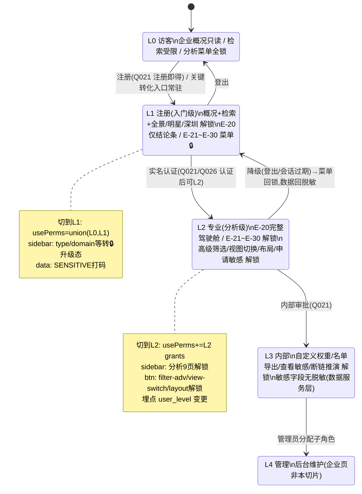
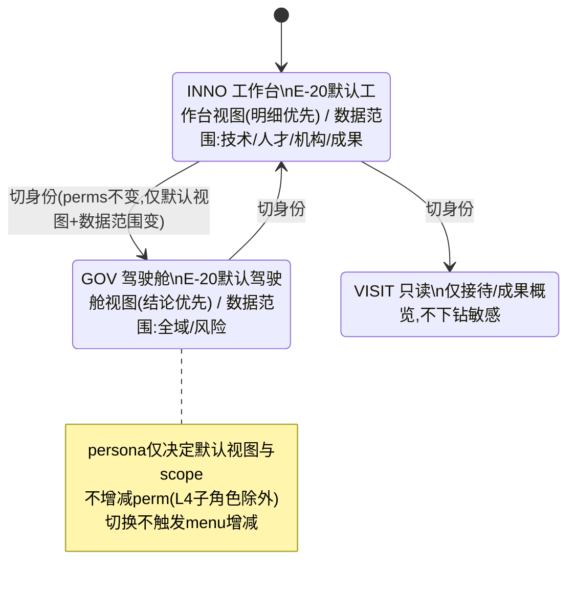
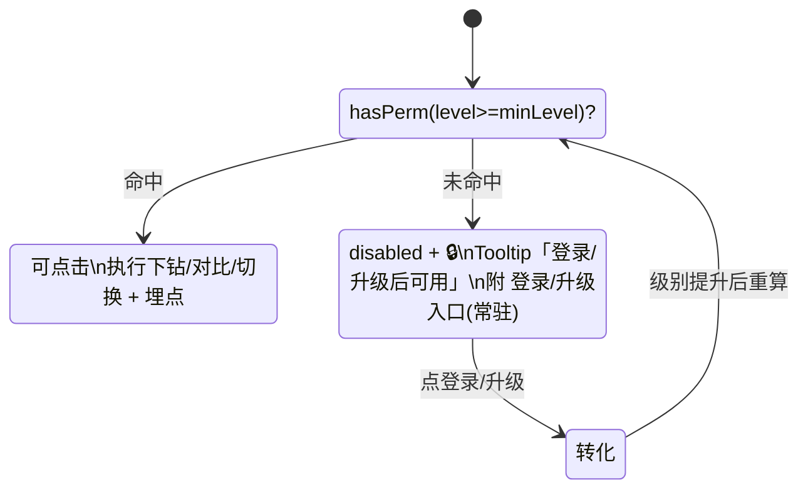
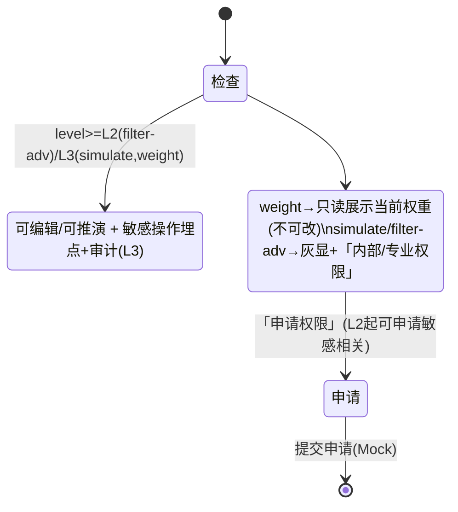
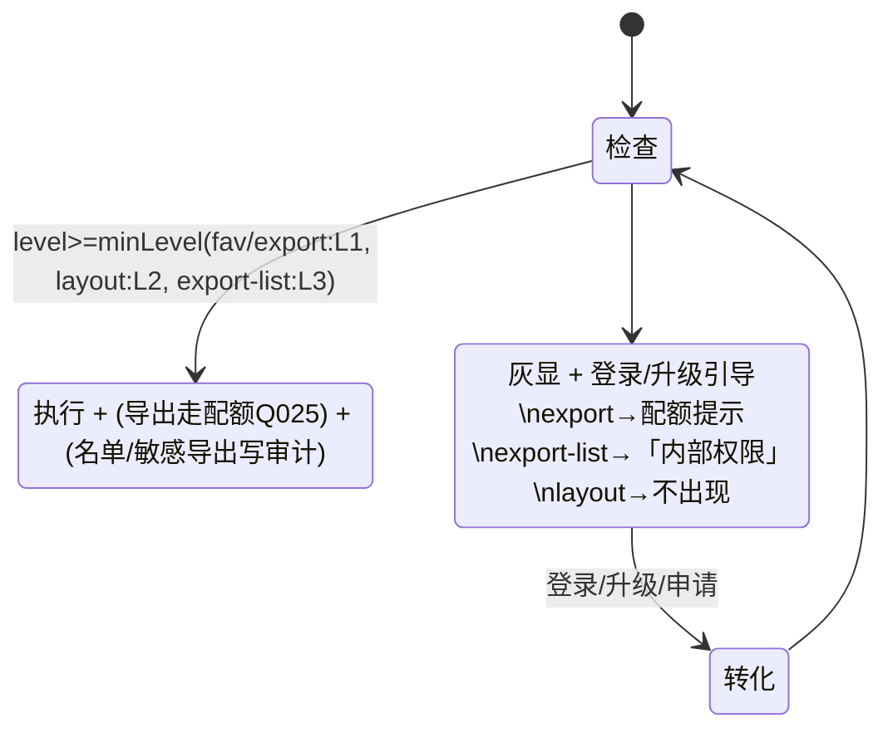
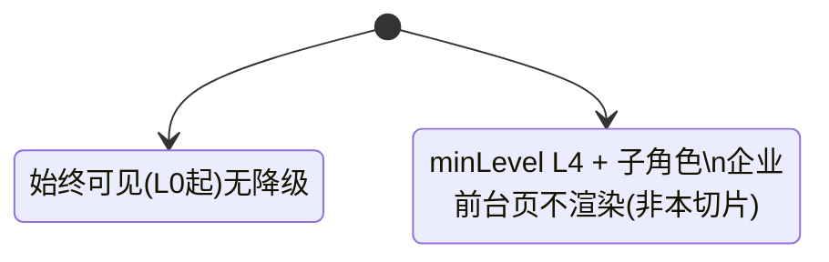
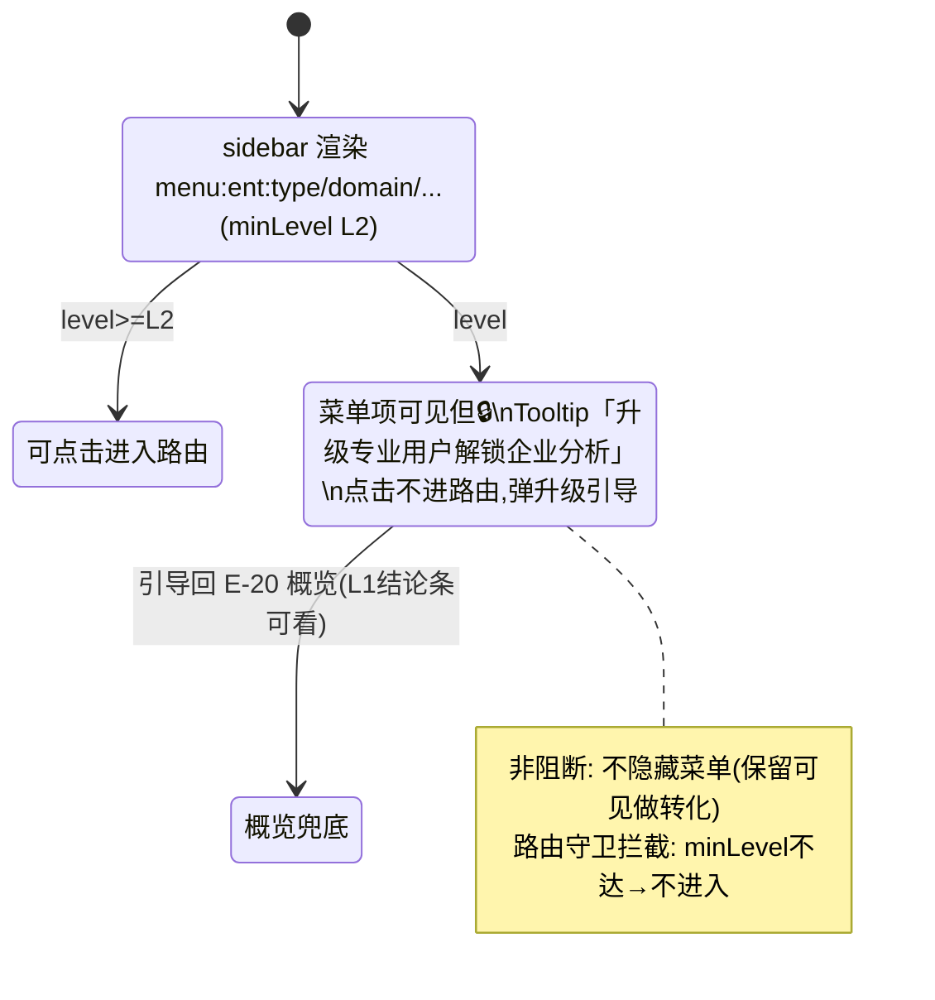
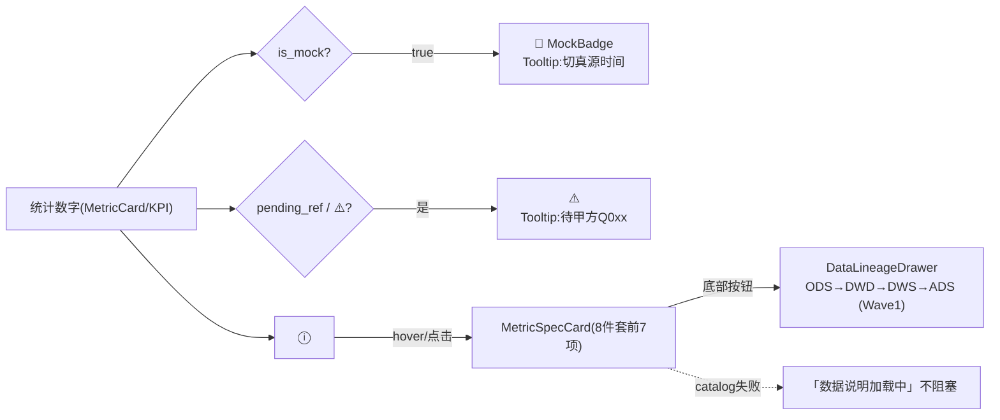

# UX 权限交互规范 · 企业维度切片（E-PERM-L01）

> **任务**：E-PERM-L01（Epic `E-PERM-M1`）—— **企业维度切片**（D-3 去重 / D-1 级别收敛 / D-2 分级降级 / D-5 D9 血缘交互）
> **角色**：ux-agent（资深 UX / 交互设计师，只写 docs）
> **时间**：2026-06-22
> **范围**：**仅 `demo-ui-topic` 专题系统 · 仅 PC（中屏 MEDIUM 单形态）**；仅"企业"垂直要素主题的权限交互；不涉及展示系统三屏、不重设计企业业务页本身。
> **上游依据**：`ARCH-权限体系-评审.md`（§9 架构约束 + 整改 A1 屏幕仅前端推导 + §4 Wave0 mock）、`全系统角色权限体系设计.md`（§8.1/§8.2 企业矩阵）、`权限点清单-菜单与按钮.md`（`menu:ent:*` / `btn:*`）、`level-perms-matrix.yaml`、`PROD-原型核对-权限规划对照.md`（D-3 现状）、`data-lineage-policy.md`（D9 八件套）、`Design.md`（§3 骨架 / §7 组件 / §8 工作区）。
> **下游接力**：UI（E-PERM-L02）做视觉态；FE（E-PERM-L03）落 `demo-ui-topic` 代码（含 E-21/E-22 去重）。

---

## 0. 头部元信息与隔离声明

| 项 | 内容 |
|---|---|
| 工作根 | `GKX_ROOT = E:/gkx-lumen`（已读 `gkx-orchestration/.env` 确认） |
| 唯一可写文件 | 本文件 `agent-delivery/agent-handoffs/产品整体定义/UX-权限交互规范-企业维度.md`（新建）+ `客户决策清单跟踪表.md` §2.5 追加企业待决项（Q031/Q032，经授权例外） |
| **隔离声明** | 本任务**不动任何现有文件**（不改 `src/`、不改路由、不改 `metricSeed.ts`、不改其它编排 md）；除上述白名单外全部只读。`demo-ui-topic` 仅作现状只读核对。 |
| 不做 | 不写 `.tsx/.jsx/.css/.json`；不指定视觉色值（颜色/字号/间距留给 UI）；不替甲方拍板业务口径；不扩范围 |
| 屏幕维度遵守 | 遵 ARCH 整改 A1：**屏幕 `feature_class` 仅前端推导、不进后端鉴权**；专题系统恒为 MEDIUM，本文不出现大屏酷炫态 / 小屏裁剪态 |
| wireframe 区块命名 | 复用 `Design.md` 组件名：`app-shell` / `app-header` / `app-sidebar` / `content-shell` / `workspace-grid` / `layer-panel` / `map-stage` / `analysis-panel` / `filter-row` / `Button` / `Tabs` / `Tag` / `Drawer` |

### 0.1 企业维度术语对齐（与 matrix / 原型一致）

| 级别 | 代号 | 企业语境典型用户 | 默认视图 |
|---|---|---|---|
| L0 | GUEST 公众访客 | 未登录浏览企业概况 | 只读概览 |
| L1 | REGISTERED 注册用户 | 注册企业 / 公众（"企业入门级"主开放档） | 工作台（入门） |
| L2 | PRO 专业用户 | 实名认证的企业 / 科研 / 智库分析人员（"企业分析级"主开放档） | 工作台（完整） |
| L3 | INTERNAL 内部业务用户 | 政府 / 管委会经办 | GOV=驾驶舱 / INNO=工作台 |
| L4 | ADMIN 管理 / 运营 | 后台维护（企业页非本切片重点） | 后台 |

> 身份标识（persona）只决定**默认视图 + 数据范围**，不增减权限：`GOV=驾驶舱`、`INNO/THINK=工作台`、`VISIT=只读`。企业切片主要落在 INNO/GOV。

### 0.2 演示态 Persona 与 Level 的主从关系

企业切片的演示态不应把 `Persona` 与 `Level` 表达为两个完全平行、可任意拼接的开关。

- **主选择项是 Persona / 用户视角**：用户先选择 GOV、INNO、THINK、VISIT、OPS、SYS 等业务视角。
- **Level 由 Persona 自动带出推荐值**：用于表达该视角默认拥有的权限深度。
- **Level 仅作为高级演示调节项保留**：用于演示权限边界、锁态、脱敏、升级引导等，不作为面向业务用户的主选择。
- **非推荐组合必须显式提示**：当演示人员手动调出不符合推荐关系的组合时，界面提示“该组合仅用于权限边界演示，非真实业务角色”。

推荐映射如下：

| Persona / 用户视角 | 推荐 Level | 说明 |
|---|---|---|
| `GOV · 驾驶舱` | L3 内部 | 面向领导/政府决策，默认看结论、风险、机会和推演 |
| `INNO · 工作台` | L2 专业 | 面向创新主体/专业分析，默认进入完整分析工作台 |
| `THINK · 工作台` | L2 专业（可升 L3 内部） | 面向智库研究，默认专业分析；内部研究可演示 L3 |
| `VISIT · 只读` | L0 访客 | 面向接待/公众浏览，仅公开只读 |
| `OPS · 后台` | L4 管理 | 面向内容运营、审核发布、专题维护 |
| `SYS · 后台` | L4 管理 | 面向系统管理、设备运维、权限配置 |
 
这条规则是产品交互真源：顶部对外只强调“当前用户视角”，Level 不与 Persona 平级展示；如果保留 Level 调节，应放在下拉面板的二级区域并标注为“高级演示调节”。

实现验收备注：

- 前端顶部控件以 `PersonaLevelSwitcher` 为准。
- 旧 `app-user-switch` / `app-user-role-menu` / `app-user-role-option` 契约废弃。
- `scripts/check-design-contract.mjs` 应检查 `PersonaLevelSwitcher`、`persona-switch`、`persona-menu`、`persona-menu__advanced`、`persona-menu__warning` 等新契约，不得再要求旧用户切换器结构。

---

## 1. D-3 企业 E-21/E-22 去重决策（核心）

### 1.1 现状（只读核对 `demo-ui-topic`）

实地核对 `src/app/pages/enterprise/EnterpriseOverview.tsx` + `routes.tsx`，企业"类型/领域"内容**当前存在三处呈现，互相重叠**：

| 序 | 呈现位置 | 路由 / 容器 | 内容 | 验收点 | 规划菜单码 |
|---|---|---|---|---|---|
| ① | 企业概览页「**态势总览**」tab | `/enterprise/overview`（`activeTab=situation`） | 结论条 + KPI×5 + 趋势 + 全国分布(点击省→P1) + TopN + **决策链下钻入口面板**（已含 →P1/→P2 按钮） | E-20 | `menu:ent:dash` |
| ② | 企业概览页「**结构洞察**」tab | 同上（`activeTab=structure`，二级 `analysis-tabs`：企业全景 / 企业类型分布概览 / 领域分布概览） | 类型饼图 + 领域饼图（**概览级摘要**）+ "查看完整…→P1/P2"按钮；另含"企业全景" | E-21/E-22 摘要 + E-33 全景 | （内嵌，无独立菜单码） |
| ③ | 「**企业分析**」独立菜单页 | `/enterprise/type-distribution`（E-21）、`/enterprise/domain-distribution`（E-22） | 完整：国/省/市三级下钻、区域×类型堆叠、集聚指数、广度/深度/多元化等 | E-21 / E-22 | `menu:ent:type` / `menu:ent:domain` |

**重复结论**：②「结构洞察」tab 与 ③ 独立菜单页**对 E-21/E-22 的呈现重叠**；且②中的"企业全景"与门户层 **E-33 重点企业全景图**（`menu:ent:keypano`，`/development/key-enterprises`）**也重叠**。这正是 PROD 核对报告 D-3 标记的偏差。

### 1.2 二选一：tab 方案 vs 独立页方案

| 维度 | 方案 A：tab 内置（类型/领域并入概览页 `analysis-tabs`） | 方案 B：独立页权威（保留 `menu:ent:type`/`domain` 独立菜单页，概览页去重） |
|---|---|---|
| 权限分级落地 | ❌ tab 切换不改路由，**无法在菜单层做 minLevel/PermGate 拦截**；E-21/E-22 应为 L2，但内嵌于 L1/L2 概览页只能做组件级降级，路由 meta 无处挂 | ✅ E-21/E-22 = 独立 `menu:ent:*`，可直接挂 `meta.minLevel=L2` + 路由守卫 + 菜单级 PermGate；与 `level-perms-matrix.yaml` 一一对应 |
| IA / 决策链清晰度 | ❌ 概览页承载过重（结论 + 完整类型 + 完整领域 + 全景），违反"结论先行→下钻"骨架 | ✅ 概览=结论入口（L1 结论条 / L2 完整驾驶舱），下钻→独立分析页（L2），符合 `Design.md §4` 信息架构骨架 |
| 与原型现状契合 | 需把独立页内容回灌 tab，**返工量大** | ✅ 独立页已存在且完整，只需**收敛概览页 tab**，改动小、风险低 |
| 数据血缘 / 埋点 | tab 内同一指标出现两份，metric_id 复用但下钻埋点 `target_page` 语义混乱 | ✅ 每页单一权威入口，metric_id / 埋点 `GEO_DRILLDOWN target_page` 语义干净 |
| 移动到 lumen 正式仓 | tab 内嵌难与后端 `SysMenu` 菜单驱动路由对齐 | ✅ 独立菜单页天然对齐 lumen 后端菜单驱动路由（PigX `SysMenu`） |

### 1.3 推荐结论 ✅ **方案 B（独立页权威）**

> **推荐：保留 `menu:ent:type`（E-21 /enterprise/type-distribution）与 `menu:ent:domain`（E-22 /enterprise/domain-distribution）为唯一权威分析入口；概览页 `menu:ent:dash`（E-20）移除"结构洞察"tab 中重复的类型/领域完整内容，仅保留单一"态势总览"驾驶舱 + 决策链下钻入口面板。**

**理由（四条）**：
1. **权限分级唯一可落地路径**：E-21/E-22 在 matrix 明确为 `minLevel:L2`，唯有独立路由页才能挂 `meta.minLevel/perms` 并被路由守卫 + 菜单级 PermGate 拦截；tab 内嵌只能做组件级降级，无法满足"L1 进概览但不能进 E-21/E-22"的分级。
2. **决策链 IA 干净**：E-20 概览作"结论先行"入口（L1 仅结论条 / L2 完整），下钻才到 L2 的 E-21/E-22 明细，符合 `Design.md §4`「上下文→结论摘要→核心指标→主可视化→下钻」骨架。
3. **顺带消除 E-33 二次重复**："结构洞察"tab 里的"企业全景"实为门户层 **E-33**（`menu:ent:keypano`）内容，移除该 tab 同时去掉这处跨层重复。
4. **改动最小、迁移友好**：独立页已完整存在，仅需收敛概览页 tab；且独立菜单页与 lumen 后端 `SysMenu` 菜单驱动路由天然对齐。

### 1.4 去重后企业 IA 页面树（专题系统 · 企业要素 · 仅 PC）

```
门户-企业发展（入门级 · menu:ent:* 门户层）
├── 企业发展概况        menu:ent:overview   /development/overview          E-32  L0概览/L1
├── 企业检索工作台      menu:ent:search     /development/search            E-31  L0受限/L1
├── 重点企业全景图      menu:ent:keypano    /development/key-enterprises   E-33  L1（← "企业全景"唯一归属）
├── 明星企业介绍        menu:ent:star       /development/star-enterprises  E-34  L1
├── 深圳企业介绍        menu:ent:sz         /development/shenzhen          E-35  L1
└── 统一企业画像(详情)  menu:ent:profile    /development/enterprise/:code  —     L1脱敏 / L3敏感

企业分析（分析级 · menu:ent:* 分析层）
├── 企业分析概览·驾驶舱 menu:ent:dash       /enterprise/overview           E-20  L1结论条/L2完整  ← 去重后只剩"态势总览"
├── 重点企业类型分析    menu:ent:type       /enterprise/type-distribution  E-21  L2  ★唯一权威
├── 领域分布分析        menu:ent:domain     /enterprise/domain-distribution E-22 L2  ★唯一权威
├── 能力评估(技术/商业) menu:ent:capability /enterprise/capability         E-23/E-24 L2（权重L3）
├── 深圳现状/多城市对标 menu:ent:szstatus   /enterprise/status-analysis    E-25  L2
├── 招引/培育推荐       menu:ent:attract    /enterprise/recommendation     E-26/E-27 L2看/L3名单
├── 供应链协同分析      menu:ent:supply     /enterprise/supply-chain       E-28  L2（断链推演L3）
├── 痛难点诊断          menu:ent:painpoint  /enterprise/pain-points        E-29  L2受限/L3底稿
└── 综合竞争力          menu:ent:compete    /enterprise/competitiveness    E-30  L2（自定义权重L3）
```

> ⚠️ 命名待统一：PROD 核对发现原型 E-29 实测命名"企业发展支持"，规划口径为"痛难点诊断"；建议口径统一为"痛难点诊断"（登记 Q032，待业务/甲方确认验收目录命名）。

### 1.5 概览页（E-20）去重后线框（`Design.md` 组件名）

```
app-shell
└─ app-frame
   ├─ app-header(64px)   ［级别切换器 + 身份标识，见 §2］
   ├─ app-sidebar(200px) ［企业分析菜单组：dash/type/domain/...］
   └─ content-shell(16px)
      ├─ filter-row       产业范围 | 区域 | 年份 | 关键字
      ├─ [结论先行] JudgmentStrip  本期企业总数 1,286 / 创新型 32% …（ⓘ 见 §4）
      ├─ [核心指标] MetricCard ×5  企业总数 / 创新型 / 平均研发投入 / 专利总量 / 高企数（每个 ⓘ + 🧪）
      ├─ workspace-grid（概览不强制三段，用双列分析区）
      │   ├─ analysis-panel-左：历年新增企业趋势（EChart）
      │   └─ analysis-panel-右：全国分布（点击省 → 下钻 E-21，带 region 参数）
      ├─ [重点企业 TopN] 列表（加入对比篮 btn:common:compare / 打开画像 Drawer）
      └─ [决策链下钻入口] Button 组：
            → 类型分析(P1/E-21)  → 领域分布(P2/E-22)  → 深圳现状(P5/E-25)
            → 引育推荐(P6/E-26/27)  → 综合竞争力(P10/E-30, L3 强调)
      ✗ 移除：原"结构洞察"二级 Tabs（企业全景 / 类型概览 / 领域概览）整组
```

### 1.6 路由建议

| 动作 | 路由 | 说明 |
|---|---|---|
| 概览唯一入口 | `/enterprise/overview` | 保留；删除内部 `activeTab=structure` 分支与 `analysis-tabs` |
| 兼容重定向（保留） | `/enterprise/analysis` → `/enterprise/overview` | 现状已有 `Navigate replace`，保留 |
| E-21 唯一入口 | `/enterprise/type-distribution` | 保留为权威；概览仅以"下钻入口"按钮带参跳转（`?region=`） |
| E-22 唯一入口 | `/enterprise/domain-distribution` | 同上 |
| 路由 meta（FE 落地）| `meta:{ minLevel, perms, screens:[MEDIUM] }` | `dash:L1`、`type/domain:L2`；`screens` 恒 `[MEDIUM]`（专题仅 PC，遵 `system_screen_scope.topic_system`） |

### 1.7 给 FE 的迁移注意点（D-3）

1. **删 tab 不删数据**：移除概览页 `MainTab='structure'` 分支与 `analysis-tabs`（`panoramaSubTab`），但**保留**"决策链下钻入口"面板（已含 →P1/→P2）。类型/领域完整图表保留在独立页，不要回灌。
2. **"企业全景"归门户**：原 `structure` tab 的"企业全景（沿产业链）"内容归属门户 **E-33 `/development/key-enterprises`**；概览页不再承载，避免与 E-33 重复。如门户页缺该呈现，由门户页补（不在本切片范围）。
3. **下钻埋点统一**：省份点击/按钮下钻沿用 `ENT_TRACK.GEO_DRILLDOWN { region, target_page:'E-21' }`，确保唯一 `target_page` 语义。
4. **L1 概览降级**：E-20 在 L1 仅显示"结论条"（隐藏完整 KPI/趋势/TopN 下钻），L2 显示完整；该分级用 §3 状态机 + §2.2 降级态实现（具体哪些块对 L1 隐藏待 Q031 确认，先按"L1=结论条+检索入口，其余降级"临时默认）。
5. **菜单级 Gate**：`menu:ent:type/domain` 挂 `minLevel:L2`；L1 用户在 `app-sidebar` 看到该菜单项时按 §2.2「menu 降级态」（🔒 + 升级引导），点击不进入路由。

---

## 2. D-1 企业角色收敛 · 级别切换器交互

### 2.1 现状三套并存（只读核对）

| # | 现状控件 | 位置 | 取值 |
|---|---|---|---|
| ① | persona 切换（`userRoles`） | `app-header` 顶栏 | 驾/析/研/政/运/数（6 个） |
| ② | "切换角色级别"（`RoleLevelGate` 的 `UserLevel`） | 页面内 | U1/U2/S1/S2(/U3) |
| ③ | "当前角色 S2 内部管理" 标识 | 顶栏/页面 | 文字标识 |

> 三套口径互不映射，违反"统一身份"。收敛目标见 `level-perms-matrix.yaml §7 demo_mapping`：U1→L0、U2→L1·INNO、U3→L2·INNO、S1→L3·GOV、S2→L3·INNO；顶栏 驾/析/研/政/运/数 → persona。

### 2.2 收敛后统一控件（位于 `app-header`）

```
app-header(64px)
  ├─ 左：Logo + 系统名「科技专题服务 · 企业」
  ├─ 中：filter/全局检索入口（可选）
  └─ 右：[当前用户视角胶囊] + [用户菜单]
        └─ 胶囊点击展开：
             一级区域：用户视角 Persona（GOV / INNO / THINK / VISIT / OPS / SYS）
             二级区域：权限级别 Level（高级演示调节，默认由 Persona 自动带出）
```

控件规格（交互层，视觉留 UI）：
- **用户视角胶囊**：顶部只显示当前 Persona，例如 `GOV · 驾驶舱`、`INNO · 工作台`。切换 Persona 会自动切换到推荐 Level，并改变默认视图与数据范围。
- **权限级别调节**：仅在下拉面板内作为“高级演示调节”出现。手动切换 Level 会重算 `userPerms = union(level_perms[L0..level])`，触发菜单/按钮/数据全局响应（§2.3），但必须显示演示调试说明。
- **非推荐组合提示**：当用户手动设置出与 §0.2 推荐映射不一致的组合时，面板内显示“该组合仅用于权限边界演示，非真实业务角色”。顶部胶囊可挂轻提示“演示权限已调整”。
- **身份标识语义**：Persona 决定默认视图 + 数据范围；Level 决定权限深度。两者不是平级自由组合关系。
- **关键转化入口常驻**：未登录(L0)时"登录/注册"按钮在 header 常驻可见（即使无权也保留，引导转化）。

Wave1 接 SSO 后，Level 调节器应隐藏或只读；真实 Level 由 token / 统一权限服务决定，仅管理员或演示账号可进入调试态。

### 2.3 切 L1 ↔ L2 时企业菜单/按钮/数据的响应（核心场景）

> 企业切片最关键的逐级开通边界 = **入门级(L1) ↔ 分析级(L2)**。

| 对象 | L1（注册/入门级） | L2（专业/分析级） | 切换响应 |
|---|---|---|---|
| **菜单 `menu:ent:dash`** | 可见、可进（仅结论条） | 可见、可进（完整驾驶舱） | 进入后页面内容由级别决定（§3 状态机） |
| **菜单 `menu:ent:type/domain/capability/szstatus/attract/supply/painpoint/compete`** | 🔒 降级态（可见但锁，hover「升级专业用户解锁分析」） | ✅ 解锁可进 | `app-sidebar` 菜单项即时由锁态→正常 |
| **按钮 `btn:common:drill` 下钻** | ✅（L1 起） | ✅ | 不变 |
| **按钮 `btn:common:compare` 加入对比** | ✅（多维对比 L2） | ✅ 多维 | L1→L2 解锁多维对比 |
| **按钮 `btn:common:filter-adv` 高级筛选/模板** | 🔒 灰显「升级专业用户」 | ✅ | 即时解锁 |
| **按钮 `btn:common:view-switch` 驾驶舱/工作台切换** | 🔒 | ✅ | 即时解锁 |
| **按钮 `btn:common:layout` 自定义布局** | 🔒 | ✅ | 即时解锁 |
| **数据密级** | INTERNAL 可见、SENSITIVE 打码（脱敏在数据服务层，前端不假脱敏） | 同 L1（敏感字段仍需 L3）；可 `btn:common:apply-sensitive` 申请 | L2 多出"申请敏感数据"入口 |

> 注：自定义权重 `btn:common:weight`、名单导出 `btn:common:export-list`、查看敏感 `btn:common:view-sensitive`、断链推演 `btn:common:simulate` 均为 **L3**，L1/L2 都降级（见 §3）。

### 2.4 级别切换状态机（mermaid）



### 2.5 身份切换状态机（persona，不改 perms）



---

## 3. D-2 企业分级降级态（非阻断交互）

### 3.1 降级总则（遵 `权限点清单` §1 + 整改 A1）

- **非阻断**：无权**不整页 403**，关键转化入口即使无权也保留可见；表现为 `disabled + 🔒 + Tooltip + 升级/登录/申请入口`。
- **后端强校验**：前端降级仅体验层；越权后端 403（FE 阶段约束，本文不展开）。
- **埋点**：每次降态命中埋点 `user_level + perm_code`（沿用 `observability` / 现状 `ENT_TRACK.ENT_UPGRADE_PROMPT`）。
- **屏幕维度**：专题恒 MEDIUM，故 `showcase` 类在企业页**根本不出现**（非降级、是不渲染）；`feature_class` 由前端推导，不进后端鉴权。

### 3.2 企业页降级态对照表

> 适用范围 = 专题系统 MEDIUM。"降级形态"= L 未达 minLevel 时的体验态。

| feature_class | 代表按钮/对象 | minLevel | 企业页典型位置 | 无权降级形态（MEDIUM） |
|---|---|---|---|---|
| `display` | `btn:common:view` 查看图表 | L0 | 全页 | 默认可见，无降级 |
| `interact` | `btn:common:drill` 下钻 | L1 | E-20 省份下钻 / 列表详情 | L0：可见但 🔒，Tooltip「登录后下钻」+ 登录入口 |
| `interact` | `btn:common:compare` 对比篮 | L1（多维 L2） | E-20 TopN / 检索结果 | 灰显 + 登录引导；多维对比对 L1 灰显「升级专业」 |
| `interact` | `btn:common:view-switch` 视图切换 | L2 | E-20 驾驶舱/工作台 | L0/L1 灰显「升级专业用户」 |
| `interact` | `btn:common:view-sensitive` 查看敏感 | L3 敏感 | 企业画像联系方式/法人/财务 | 打码占位 + `apply-sensitive` 申请入口（L2 起可申请） |
| `deep` | `btn:common:filter-adv` 高级筛选/模板 | L2 | E-31 检索 / E-21 筛选 | 灰显 + 「升级专业用户」 |
| `deep` | `btn:common:simulate` 断链推演 | L3 | E-28 供应链 | 灰显 + 「内部权限」+ 申请 |
| `deep` | `btn:common:weight` 权重/口径配置 | L3 | E-23/24/30 能力/竞争力 | **只读展示当前权重**（不可编辑）+ 「内部权限可调」 |
| `personal` | `btn:common:fav` 收藏 / `subscribe` 订阅 | L1 | 全页 | 灰显 + 登录引导 |
| `personal` | `btn:common:export` 导出(配额) | L1 | E-20/E-21 图表 | 灰显 + 配额提示（L0 不可导出） |
| `personal` | `btn:common:export-list` 名单/明细导出 | L3 敏感 | E-26/E-27 招引培育名单 | 隐藏/灰显 + 「内部权限」+ 申请 |
| `personal` | `btn:common:apply-sensitive` 申请敏感 | L2 | 画像 / 名单 | L0/L1 「登录/升级后可申请」 |
| `personal` | `btn:common:layout` 自定义布局 | L2 | E-20 卡片 | 不出现（L0/L1） |
| `manage` | `btn:sys:edit/audit/publish` | L4 | 企业后台 E-36/E-37（非本切片） | 不出现 |
| `showcase` | — | — | 企业页 | **不存在**（专题无大屏） |

> **页面级分级补充**：E-20 概览 L1=仅结论条 / L2=完整；E-21~E-25/E-28/E-30 需 L2（菜单 🔒 降级）；自定义权重 `weight` 需 L3。

### 3.3 每类降级态交互状态图（企业页 MEDIUM）

#### 3.3.1 `interact`（下钻 / 对比 / 视图切换）



#### 3.3.2 `deep`（推演 / 权重配置 / 高级筛选）



#### 3.3.3 `personal`（收藏 / 订阅 / 导出 / 名单导出 / 布局）



#### 3.3.4 `display`（基础展示，无降级）+ `manage`（后台，企业页不出现）



#### 3.3.5 页面级降级（菜单 `menu:ent:*` 未达 minLevel）



---

## 4. D-5 企业页 D9 血缘交互（ⓘ / 🧪 / ⚠️ → MetricSpecCard）

### 4.1 三类角标交互行为（对照 `data-lineage-policy.md` §5）

| 角标 | 触发条件 | 交互行为 | 内容来源 |
|---|---|---|---|
| **ⓘ MetricSpecCard** | 每个统计/聚合数字旁 | hover/点击 → 弹"数据说明卡"（8 件套前 7 项：metric_id / 中文名 / 口径定义 / 公式 / 源表 / 源系统 / 更新频率；version 收副信息）。卡底「查看完整加工链路」→ `DataLineageDrawer`（Wave1，ODS→DWD→DWS→ADS）。catalog 失败显示"数据说明加载中"不阻塞 | Wave0：本地 `metricSeed.ts`（只读引用，不改）；Wave1：`/metrics/v1/catalog?ids=` |
| **🧪 MockBadge** | `is_mock=true`（Wave0 全部统计数字） | 数字旁显示 🧪；Tooltip「当前为 Mock 数据，预计 {mock_until} 切换真实源 {source_systems}」。Wave0 **强制全显**，Wave1 真值后自动消失 | metric meta `is_mock` / `mock_until` |
| **⚠️ 待甲方确认** | metric `pending_ref` 指向未决 Q（如 Q010/Q011/…）或口径 `mapping_status='⚠️'` | 数字旁 ⚠️ 角标；Tooltip「口径待甲方确认（{Q0xx}），现按临时默认展示」。甲方确认升 🟢 后移除 | metric meta `pending_ref` + 客户决策清单跟踪表状态 |

### 4.2 三角标共存优先级与放置

- 同一数字可同时带 ⓘ + 🧪 + ⚠️：放置顺序（数字右侧）= `数字 → ⓘ → 🧪 → ⚠️`。
- ⓘ 始终在（每个统计数字必有，**禁止删除/隐藏 ⓘ 让界面更干净**——D9 §7.5 铁律）。
- 🧪 / ⚠️ 条件出现。
- 角标只读、不参与权限降级（数据密级脱敏是数据服务层的事，与角标正交）。

### 4.3 角标交互流程（mermaid）



### 4.4 企业页角标落点示例（对照现状 `EnterpriseOverview.tsx`）

- E-20 概览 KPI×5：`M_ENT_TOTAL_COUNT`(✅) / `M_ENT_INNOVATIVE_COUNT`(⚠️Q011) / `M_ENT_RD_INVEST_AVG`(🔧) / `M_ENT_PATENT_TOTAL`(✅) / `M_ENT_HIGH_TECH_COUNT`(⚠️Q010)，均带 ⓘ+🧪，含 pending 的额外带 ⚠️。
- E-21/E-22/E-23…：每页统计/聚合字段旁 ⓘ+🧪，pending 字段加 ⚠️（见 §5 各页 metric 清单的 `状态` 列）。

---

## 5. 企业分析 9 页字段表（6 列 + 本页 metric_id 清单）

> 列定义（D9 §5.2）：名称 / 类型 / 来源（尽量引用真实 ODS 字段；不确定写 `pending_data_lead_review`）/ 必填 / 示例 / metric_id。**统计/聚合字段必填 `M_ENT_*`**；明细字段 metric_id 记 `—`。来源引用 Wave0 本地 `metricSeed.ts` 的 `source_tables`（真源：`cfg_metric-ENT-seed.yaml`，49 条）。状态列 = `mapping_status`（✅/🔧/⚠️/❌）+ pending Q。

### 5.1 E-20 企业分析概览·驾驶舱（`menu:ent:dash` /enterprise/overview · L1结论条/L2完整）

| 名称 | 类型 | 来源 | 必填 | 示例 | metric_id（状态） |
|---|---|---|---|---|---|
| 企业总数 | int | `ads:dwd.enterprise` / `dwd.enterprise_industry` | ✅ | 1,286 | `M_ENT_TOTAL_COUNT`（✅） |
| 创新型企业数 | int | `dwd.enterprise <- ods:dwd_org_tag_info, dwd_company_honor_tags` | ✅ | 412 | `M_ENT_INNOVATIVE_COUNT`（⚠️Q011） |
| 平均研发投入 | float(亿) | `dwd.enterprise.rd_investment <- ods:dwd_org_annual_financial_info` | ✅ | 2.6 | `M_ENT_RD_INVEST_AVG`（🔧） |
| 专利总量 | int | `dwd.enterprise.patent_valid_count <- ods:dwd_org_rd_achiev_info` | ✅ | 3,184 | `M_ENT_PATENT_TOTAL`（✅） |
| 高企数量 | int | `dwd.enterprise.is_high_tech <- ods:dwd_org_tag_info, dwd_company_honor_tags` | ✅ | 892 | `M_ENT_HIGH_TECH_COUNT`（⚠️Q010） |
| 历年新增趋势(年→值) | series | `dwd.enterprise（按 approval/reg year 聚合）` | ✅ | 2024:258 | `M_ENT_TOTAL_COUNT`（按年，✅复用） |
| 企业名称 | string | `dwd.enterprise.enterprise_name` | ✅ | "XX科技" | —（明细） |
| 所属行业 | string | `dwd.enterprise_industry.industry_chain` | ✅ | "集成电路" | —（明细） |
| 综合竞争力得分(TopN排序) | float | 见 E-30 | ✅ | 86.5 | `M_ENT_COMPETITIVENESS_SCORE`（🔧Q014） |

**本页 metric_id 清单**：`M_ENT_TOTAL_COUNT` / `M_ENT_INNOVATIVE_COUNT` / `M_ENT_RD_INVEST_AVG` / `M_ENT_PATENT_TOTAL` / `M_ENT_HIGH_TECH_COUNT` / `M_ENT_COMPETITIVENESS_SCORE`

### 5.2 E-21 重点企业类型分析（`menu:ent:type` /enterprise/type-distribution · L2）

| 名称 | 类型 | 来源 | 必填 | 示例 | metric_id（状态） |
|---|---|---|---|---|---|
| 各类型企业数 | int | `dwd.enterprise.is_foreign/is_high_tech/is_sme/is_listed <- ods:dwd_org_tag_info, dwd_company_honor_tags, dwd_org_stock_base` | ✅ | 高企 412 | `M_ENT_TYPE_COUNT`（⚠️Q010） |
| 企业类型占比 | float% | 同上 | ✅ | 32% | `M_ENT_TYPE_RATIO`（⚠️Q010） |
| 区域企业数(国/省/市三级) | int | `dwd.enterprise.headquarters_city/district <- ods:dwd_org_reg_info` | ✅ | 广东 386 | `M_ENT_REGIONAL_COUNT`（✅） |
| 企业集聚指数 | float | `dwd.enterprise.headquarters_city/district <- ods:dwd_org_reg_info` | ✅ | 1.32 | `M_ENT_CLUSTER_INDEX`（⚠️Q012） |
| 区域名称 | string | `ods:dwd_org_reg_info.province/city` | ✅ | "深圳市" | —（明细） |
| 企业类型标签 | enum | `ods:dwd_org_tag_info.org_tag` | ✅ | "专精特新" | —（明细） |

**本页 metric_id 清单**：`M_ENT_TYPE_COUNT` / `M_ENT_TYPE_RATIO` / `M_ENT_REGIONAL_COUNT` / `M_ENT_CLUSTER_INDEX`

### 5.3 E-22 领域分布分析（`menu:ent:domain` /enterprise/domain-distribution · L2）

| 名称 | 类型 | 来源 | 必填 | 示例 | metric_id（状态） |
|---|---|---|---|---|---|
| 覆盖领域数 | int | `dwd.enterprise_industry <- ods:dwd_org_industry_chain_dtl, dwd_industry_chain_info` | ✅ | 18 | `M_ENT_DOMAIN_COVERAGE_COUNT`（✅） |
| 领域覆盖广度 | int | `dwd.enterprise_business_tag, dwd.enterprise_industry <- ods:dwd_org_tag_info, dwd_org_industry_chain_dtl` | ✅ | 12 | `M_ENT_DOMAIN_BREADTH`（⚠️Q013） |
| 领域覆盖深度 | int | 同上 | ✅ | 6 | `M_ENT_DOMAIN_DEPTH`（⚠️Q013） |
| 多元化指数 | float(0~1) | `dwd.enterprise_industry <- ods:dwd_org_industry_chain_dtl, dwd_industry_chain_info` | ✅ | 0.67 | `M_ENT_DOMAIN_DIVERSITY`（⚠️Q013） |
| 领域名称 | string | `ods:dwd_industry_chain_info.chain_name` | ✅ | "人工智能" | —（明细） |
| 企业-领域标签 | string | `ods:dwd_org_tag_info` | ✅ | "算法/芯片" | —（明细） |

**本页 metric_id 清单**：`M_ENT_DOMAIN_COVERAGE_COUNT` / `M_ENT_DOMAIN_BREADTH` / `M_ENT_DOMAIN_DEPTH` / `M_ENT_DOMAIN_DIVERSITY`

### 5.4 E-23/E-24 能力评估·技术力/商业力（`menu:ent:capability` /enterprise/capability · L2看·权重L3）

| 名称 | 类型 | 来源 | 必填 | 示例 | metric_id（状态） |
|---|---|---|---|---|---|
| 技术力得分 | float | `dwd.enterprise <- ods:dwd_org_rd_achiev_info, dwd_org_annual_financial_info` | ✅ | 78.5 | `M_ENT_TECH_POWER_SCORE`（🔧Q014） |
| 商业力得分 | float | `dwd.enterprise <- ods:dwd_org_annual_financial_info` | ✅ | 72.1 | `M_ENT_BUSINESS_POWER_SCORE`（🔧Q014） |
| 营收 | float(亿) | `dwd.enterprise.revenue_latest <- ods:dwd_org_annual_financial_info.operating_revenue` | ✅ | 12.4 | `M_ENT_REVENUE_LATEST`（✅） |
| 有效专利数 | int | `dwd.enterprise.patent_valid_count <- ods:dwd_org_rd_achiev_info` | ✅ | 326 | `M_ENT_PATENT_VALID_COUNT`（✅） |
| 市场份额 | float% | `pending_data_lead_review`（无数据源，Q019：采购/降级/下架待定） | ✅ | — | `M_ENT_MARKET_SHARE`（❌无源Q019） |
| 指标权重(可配 L3) | float% | `cfg_model_registry`（口径配置） | ✅ | 专利25% | `M_ENT_TECH_POWER_SCORE`（权重项，🔧Q014） |

**本页 metric_id 清单**：`M_ENT_TECH_POWER_SCORE` / `M_ENT_BUSINESS_POWER_SCORE` / `M_ENT_REVENUE_LATEST` / `M_ENT_PATENT_VALID_COUNT` / `M_ENT_MARKET_SHARE`(❌)

> ⚠️ `M_ENT_MARKET_SHARE` 无数据源（Q019），UI 标 ❌「无来源」，Wave0 暂置空不实现。

### 5.5 E-25 深圳现状/多城市对标（`menu:ent:szstatus` /enterprise/status-analysis · L2·对标城市集L3）

| 名称 | 类型 | 来源 | 必填 | 示例 | metric_id（状态） |
|---|---|---|---|---|---|
| 深圳企业数 | int | `dwd.enterprise（filter 深圳）<- ods:dwd_org_reg_info` | ✅ | 642 | `M_ENT_SZ_COUNT`（✅） |
| 深圳企业规模分布 | series | `pending_data_lead_review <- ods:dwd.enterprise, dwd_org_annual_financial_info` | ✅ | 规上38% | `M_ENT_SZ_SCALE_DIST`（🔧） |
| 产业链完整度 | float% | `dwd.enterprise_industry <- ods:dwd_org_industry_chain_dtl, dwd_industry_chain_info` | ✅ | 84% | `M_ENT_CHAIN_COMPLETENESS`（🔧） |
| 多城市对标排名 | int | `pending_data_lead_review`（对标城市集合 Q016 待定） | ✅ | 第2 | `M_ENT_CITY_RANK`（⚠️Q016） |
| 对标城市名称 | string | `pending_data_lead_review`（Q016 默认北京/上海/苏州/广州） | ✅ | "苏州" | —（明细，Q016） |
| 链环节名称 | string | `ods:dwd_industry_chain_info` | ✅ | "封测" | —（明细） |

**本页 metric_id 清单**：`M_ENT_SZ_COUNT` / `M_ENT_SZ_SCALE_DIST` / `M_ENT_CHAIN_COMPLETENESS` / `M_ENT_CITY_RANK`

### 5.6 E-26/E-27 招引/培育推荐（`menu:ent:attract` /enterprise/recommendation · L2看指数·L3名单）

| 名称 | 类型 | 来源 | 必填 | 示例 | metric_id（状态） |
|---|---|---|---|---|---|
| 招引推荐指数 | float | `pending_data_lead_review <- dwd.enterprise, dwd.enterprise_industry`（Q015 阈值/权重待定） | ✅ | 88.2 | `M_ENT_ATTRACTION_INDEX`（🔧Q015） |
| 培育推荐指数 | float | `pending_data_lead_review <- dwd.enterprise, dwd_company_honor_tags`（Q015） | ✅ | 76.5 | `M_ENT_CULTIVATION_INDEX`（🔧Q015） |
| 推荐企业名称(名单L3) | string | `dwd.enterprise.enterprise_name`（导出 `btn:common:export-list` 需 L3 + 审计） | ✅ | "XX企业" | —（明细，敏感名单） |
| 匹配领域/链环节 | string | `ods:dwd_org_industry_chain_dtl` | ✅ | "补链:封测" | —（明细） |
| 梯度层级 | enum | `ods:dwd_company_honor_tags`（专精特新/瞪羚/小巨人/独角兽） | ✅ | "瞪羚" | —（明细） |

**本页 metric_id 清单**：`M_ENT_ATTRACTION_INDEX` / `M_ENT_CULTIVATION_INDEX`

### 5.7 E-28 供应链协同分析（`menu:ent:supply` /enterprise/supply-chain · L2·断链推演L3）

| 名称 | 类型 | 来源 | 必填 | 示例 | metric_id（状态） |
|---|---|---|---|---|---|
| 供应链中心性 | float | `NebulaGraph:enterprise_supply_chain <- ods:dwd_org_supply_chain` | ✅ | 0.42 | `M_ENT_NODE_CENTRALITY`（⚠️Q017） |
| 断链风险等级 | enum(高/中/低) | 同上 | ✅ | "中" | `M_ENT_SUPPLY_CHAIN_RISK`（⚠️Q017） |
| 核心供应商数 | int | `pending_data_lead_review <- ods:dwd_org_supply_chain`（核心阈值 Q017 待定） | ✅ | 8 | `M_ENT_NODE_CENTRALITY`（派生核心节点计数，⚠️Q017） |
| 供应商企业名称 | string | `dwd.enterprise.enterprise_name` | ✅ | "XX材料" | —（明细） |
| 链路关系类型 | string | `ods:dwd_org_supply_chain.relation_type` | ✅ | "上游供应" | —（明细） |

**本页 metric_id 清单**：`M_ENT_NODE_CENTRALITY` / `M_ENT_SUPPLY_CHAIN_RISK`

> 断链风险推演 `btn:common:simulate` 需 L3（deep 类，§3.3.2 降级）。

### 5.8 E-29 痛难点诊断（`menu:ent:painpoint` /enterprise/pain-points · L2受限/L3底稿）

| 名称 | 类型 | 来源 | 必填 | 示例 | metric_id（状态） |
|---|---|---|---|---|---|
| 痛难点反映企业数 | int | `pending_data_lead_review <- 企业诉求/调研/年报文本 NLP`（诊断维度 Q018 待定） | ✅ | 156 | `M_ENT_PAINPOINT_COUNT`（⚠️Q018） |
| 痛难点严重度 | float | `pending_data_lead_review <- 企业诉求/调研 NLP + 行业基准`（Q018） | ✅ | 7.2 | `M_ENT_PAINPOINT_SEVERITY`（⚠️Q018） |
| 诊断维度 | enum | `pending_data_lead_review`（Q018 默认技术/市场/融资/管理四维） | ✅ | "融资" | —（明细，Q018） |
| 诊断底稿/明细(L3) | text | `pending_data_lead_review`（敏感底稿 `btn:common:view-sensitive` 需 L3） | ✅ | — | —（明细，敏感） |

**本页 metric_id 清单**：`M_ENT_PAINPOINT_COUNT` / `M_ENT_PAINPOINT_SEVERITY`

### 5.9 E-30 综合竞争力（`menu:ent:compete` /enterprise/competitiveness · L2·自定义权重L3）

| 名称 | 类型 | 来源 | 必填 | 示例 | metric_id（状态） |
|---|---|---|---|---|---|
| 综合竞争力得分 | float | `dwd.enterprise.competitiveness_score <- 派生自 tech_score/business_score；ods:dwd_org_rd_achiev_info, dwd_org_annual_financial_info` | ✅ | 86.5 | `M_ENT_COMPETITIVENESS_SCORE`（🔧Q014） |
| 技术力分项 | float | 见 E-23 | ✅ | 78.5 | `M_ENT_TECH_POWER_SCORE`（🔧Q014） |
| 商业力分项 | float | 见 E-24 | ✅ | 72.1 | `M_ENT_BUSINESS_POWER_SCORE`（🔧Q014） |
| 竞争力排名 | int | `dwd.enterprise（按 competitiveness_score 排序）` | ✅ | 第3 | `M_ENT_COMPETITIVENESS_SCORE`（排序派生，🔧） |
| 竞争力模型权重(可配L3) | float% | `cfg_model_registry` | ✅ | 技术60% | `M_ENT_COMPETITIVENESS_SCORE`（权重项，🔧Q014） |

**本页 metric_id 清单**：`M_ENT_COMPETITIVENESS_SCORE` / `M_ENT_TECH_POWER_SCORE` / `M_ENT_BUSINESS_POWER_SCORE`

### 5.10 企业分析全量 metric_id 汇总（去重）

```
M_ENT_TOTAL_COUNT, M_ENT_INNOVATIVE_COUNT, M_ENT_RD_INVEST_AVG, M_ENT_PATENT_TOTAL,
M_ENT_HIGH_TECH_COUNT, M_ENT_PATENT_VALID_COUNT, M_ENT_TYPE_COUNT, M_ENT_TYPE_RATIO,
M_ENT_REGIONAL_COUNT, M_ENT_CLUSTER_INDEX, M_ENT_DOMAIN_COVERAGE_COUNT, M_ENT_DOMAIN_BREADTH,
M_ENT_DOMAIN_DEPTH, M_ENT_DOMAIN_DIVERSITY, M_ENT_TECH_POWER_SCORE, M_ENT_BUSINESS_POWER_SCORE,
M_ENT_REVENUE_LATEST, M_ENT_MARKET_SHARE(❌), M_ENT_SZ_COUNT, M_ENT_SZ_SCALE_DIST,
M_ENT_CHAIN_COMPLETENESS, M_ENT_CITY_RANK, M_ENT_ATTRACTION_INDEX, M_ENT_CULTIVATION_INDEX,
M_ENT_NODE_CENTRALITY, M_ENT_SUPPLY_CHAIN_RISK, M_ENT_PAINPOINT_COUNT, M_ENT_PAINPOINT_SEVERITY,
M_ENT_COMPETITIVENESS_SCORE
```
> 共 29 个（含 1 个 ❌ 无源）。来源真源 `cfg_metric-ENT-seed.yaml`（49 条），本切片仅列分析 9 页引用项；命名遵 D9 `M_{ENT}_{INDICATOR}` 规则。

---

## 6. 待评审开放项（≥5，业务口径未定标 ⚠️，已登记跟踪表）

> 权限/口径未决项已在 `客户决策清单跟踪表.md` 登记。企业相关引用如下；新增 Q031/Q032 本任务已追加到 §2.5。

| # | 开放项 | 关联 Q-ID | 临时默认（Wave0 先跑） | UI 标注 | Owner |
|---|---|---|---|---|---|
| 1 | 企业用户 L1↔L2 升级路径（生态企业认证后能否升 L2 分析级） | **Q026** | 认证后可 L2 | 级别切换器旁 ⚠️ | PM→甲方 |
| 2 | 各级别准入条件（注册/实名/审批） | **Q021** | L1 注册即得 / L2 实名 / L3 审批 | 升级引导文案 ⚠️ | PM→甲方 |
| 3 | 数据密级 4 级与企业敏感字段清单（联系方式/法人/财务/名单/尽调底稿） | **Q022/Q023** | §9.1/§9.2 样板 | 敏感字段打码处 ⚠️ | PM→甲方 |
| 4 | 数据范围过滤维度（企业是否按所属区域/单位限定可见） | **Q024** | 按区域+单位 | 数据范围说明 ⚠️ | PM→甲方 |
| 5 | 导出配额与水印（L1/L2 配额数、名单导出水印） | **Q025** | L1 低/L2 中/L3 不限+水印 | 导出按钮配额提示 ⚠️ | PM→甲方 |
| 6 | 企业分析各页最低级别口径（E-20=L1结论/L2全；E-21~E-30=L2；权重/名单=L3） | **Q030** | 见 matrix/§5 | 菜单锁态 ⚠️ | PM→架构师/甲方 |
| 7 | 企业类型/创新型/区划精度/能力权重/招引培育/对标城市/供应链/痛难点等口径 | **Q010~Q019** | 见跟踪表 §2.4 | 对应数字 ⚠️ | PM→甲方/算法lead |
| 8 | **E-20 概览 L1"仅结论条"的精确范围**（哪些 KPI/图表/TopN 对 L1 隐藏 vs 显示） | **Q031（新增）** | L1=结论条+检索入口，KPI/趋势/TopN下钻降级 | E-20 L1 态 ⚠️ | PM→产品/甲方 |
| 9 | **E-21/E-22 去重后 IA 与命名统一**（移除"结构洞察"tab 是否需业务确认；"痛难点诊断↔企业发展支持"命名统一） | **Q032（新增）** | 采方案 B 独立页权威；命名统一为"痛难点诊断" | 概览页/菜单 ⚠️ | PM→产品/甲方 |

> 说明：本切片不替甲方拍板任何口径；Wave0 按临时默认运行并加 ⚠️"待甲方确认"角标，确认后升 🟢 由 FE/UI 移除角标。

---

## 7. handoff：DoD 自检 + 接力建议 + 成本回填

### 7.1 ux.mdc 产物质量自检（11 项）

| # | 检查项 | 通过条件 | 结论 |
|---|---|---|---|
| 1 | 覆盖 bid/范围章节 | 企业分析 9 页 E-20~E-30 + 入门级引用 100% 覆盖 + 验收点对照 | ✅ |
| 2 | 路由命名 | 用真实 `/enterprise/*` 路由 + `menu:ent:*` 码 | ✅ |
| 3 | 用户旅程含异常路径 | 降级/锁态/申请/无源/口径待定多条异常态（§2.4/§3.3 状态机） | ✅（异常≥3） |
| 4 | 埋点节点列出 | `user_level` 变更 / `ENT_UPGRADE_PROMPT` / `GEO_DRILLDOWN` / 角标命中 / 导出配额 ≥5 | ✅ |
| 5 | 开放项标注 | 视觉色值/组件选型留 UI；口径留甲方（§6） | ✅ |
| 6 | 隔离声明 | §0 写明"不动现有文件" | ✅ |
| 7 | 组件命名对齐 Design.md | §1.5 线框用 `app-shell/app-header/app-sidebar/content-shell/workspace-grid/analysis-panel/filter-row/Tabs/Button/Tag/Drawer` | ✅ |
| 8 | 信息架构骨架对齐 §4 | 上下文+结论摘要+核心指标+筛选+主可视化+右侧研判+下钻 | ✅ |
| 9 | 字段表 6 列 | §5 九页均 名称/类型/来源(真实ODS)/必填/示例/metric_id | ✅ |
| 10 | metric_id 占位 | 统计/聚合字段必填 `M_ENT_*`；明细记 — | ✅ |
| 11 | 业务口径未定登记 | Q010~Q032 登记跟踪表 + 文档 ⚠️ 标注 | ✅ |

补充范围自检（团队公约）：未写代码 ✅ / 未指定色值 ✅ / 仅 commit 不 push ✅ / 专题仅 PC 无大屏小屏态 ✅ / 屏幕仅前端推导未塞后端鉴权 ✅ / 未替甲方拍板 ✅ / 未扩范围（仅权限交互） ✅。

### 7.2 给 ui-agent（E-PERM-L02）企业维度接力建议

| UX 态 | 需 UI 出的视觉 |
|---|---|
| 级别切换器 L0–L4（§2.2） | 各级别配色阶（L0 灰/L1-L2 主色阶/L3 强调/L4 管理色）、常态/悬停/选中、Segmented 高度 32px |
| 身份标识徽标 | GOV 驾驶舱 / INNO·THINK 工作台 / VISIT 只读 三徽标视觉 |
| 降级态（§3.3） | 🔒 锁标、disabled 灰显、Tooltip、升级/登录/申请入口按钮样式（按 Design.md §7 Button） |
| 权重只读态 | `weight` L3 以下"只读展示权重"视觉（区别可编辑态） |
| D9 角标（§4） | ⓘ 图标、🧪 MockBadge、⚠️ 待确认角标、MetricSpecCard 卡片（浅蓝灰+8px 圆角，§5.1）、DataLineageDrawer |
| 菜单锁态（§3.3.5） | `app-sidebar` 菜单项 🔒 升级态视觉 |
| 概览去重后布局（§1.5） | E-20 去 tab 后单视图布局视觉（专题 MEDIUM 标准浅色，**禁大屏酷炫**） |

### 7.3 给 frontend-agent（E-PERM-L03）企业维度接力建议

1. **D-3 去重**：删 `EnterpriseOverview.tsx` 的 `structure` tab + `analysis-tabs`，保留"决策链下钻入口"；E-21/E-22 独立页为唯一权威；"企业全景"归门户 E-33。路由保留 `/enterprise/analysis→overview` 重定向。
2. **D-1 收敛**：顶栏 `userRoles`(驾/析/研/政/运/数) + 页面 U/S 级别 → 收敛为「级别切换器 L0–L4 + 身份标识」；mock `currentUser={level,persona,subroles}` 对照 `level-perms-matrix.yaml mock_users`；映射见 `demo_mapping`。
3. **D-2 Gate**：`menu:ent:type/domain/...` 挂 `meta.minLevel=L2 + screens:[MEDIUM]`；按钮按 §3.2 接 `<PermGate>`；专题恒 MEDIUM（`system_screen_scope.topic_system`），不启用三屏过滤；`showcase` 类企业页不渲染。
4. **D-5 角标**：每统计数字接 ⓘ→MetricSpecCard（读 `metricSeed.ts`，Wave1 切 `/metrics/v1/catalog`）、🧪 按 `is_mock`、⚠️ 按 `pending_ref`；不删 ⓘ。
5. **L1 概览降级**：E-20 L1 仅结论条（Q031 临时默认）。
6. **push 纪律**：`demo-ui-topic` 改动 **push 前确认 PM**（公约 §4.2）。

### 7.4 成本回填（cost_tracking_policy）

| 字段 | 值 |
|---|---|
| estimated_tokens | 130,000 |
| actual_tokens | ~120,000 |
| model_used | claude-opus-4.8 |
| actual_cost | ~$2.4 |
| cost_warn | green |

---

**本文档为 UX 讨论稿；Q010~Q032 口径经甲方确认后升 🟢，UI/FE 移除 ⚠️ 角标。E-21/E-22 去重推荐方案 B（独立页权威）需架构师/PM 知会、FE 落地。**
