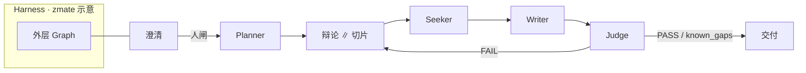

# ARCH-ZMATE-战略报告创作.md

> **模块**：ZMATE 战略报告创作（Zmate 战略咨询报告创作工作台原型）  
> **任务**：`ZMATE-RPT-ARCH-L01`  
> **作者**：`agent:arch-agent` · **监管人**：`human:淮政玮`  
> **版本**：v1.0.0 · **定档日**：2026-11-16  
> **会签态**：`approved`（门 1 有条件闭合 + 本 ARCH 定档；默认签收授权见 G1 简报）  
> **ponytail**：`off`（定义任务）  
> **diagram_id**：`ARCH-ZMATE-RPT-DEMO-BOUNDARY`  
> **输入真源（只读）**：  
> - `agent-delivery/architecture-baseline.md`（D12 / 调用链）  
> - `…/对端/2026-11-16-战略咨询报告Agent设计模式-graph-loop-harness.md`  
> - `…/对端/2026-11-16-战略分析整体建设方案.md`  
> - `USM/IA/Wireframe-ZMATE-战略报告创作.md` · TRACE · 门 1 核对表  
> **禁止**：本叶改业务代码；本叶不替代 UI-HIFI / FE-DEMO 实现。

---

## 0. 定档一句

**本阶段 = Demo 样机 / 纯前端 Mock**（仓 `demo-ui-topic`）：只验收产品形态与 Graph 协作可见性；**禁止** lumen 直连与真后端取数；旧 L01–L08 脚手架按 **Q161 默认废稿**，由 `ZMATE-RPT-FE-DEMO-L01` 按签收 WF/高保真重做。

---

## 1. 定档结论

| 项 | 定档 | 依据 |
|---|---|---|
| 交付档位 | **Demo 样机**（可点击说明书），非正式 V1 后端闭环 | 建设方案 §0 / §2.2 / §9；USM「本阶段边界」；门 1 PDR-11 |
| 数据面 | **纯 Mock / fixture**；`USE_MOCK=true`；关 Mock 时禁止 fixture 填数 | 建设方案 §6.5 / §9.3；D8/D12 仓规约 |
| 目标仓 | **仅** `demo-ui-topic`（React + Vite + Arco） | D12；建设方案 §9 |
| 真后端 | **本阶段不做** Java / Python `/internal/*` / Nacos / ADS 建表 | FDE 一屏计划 §5「明确跳过」 |
| 门 1 | **有条件闭合**（Q156–Q161 🟡 临时默认跑 Demo） | `ZMATE-RPT-G1-签收.md` |
| 旧 FE | **废稿重做**（非局部复用为默认） | **Q161** / OPEN-ZMATE-DEMO-01 |

---

## 2. D12 仓隔离声明（只读）

对齐 `architecture-baseline.md` **D12**：

1. **`demo-*` 只做原型**；正式交付只在 `lumen-*`。本模块当前波次产物落在 **demo 沙箱**，**不得** merge 进 `lumen-ui-*` / `lumen-svc-*`。  
2. **lumen 前端调用链禁止调用任何 `demo-*` 服务**（反向亦成立于本 Demo）：本 Demo **禁止**经 `VITE_*` / nginx / 直连打到 `gkxlumen-*` / `lumen-*` 正式服务。  
3. 对照建设方案可读 harness / HTML 原型后**重写**；禁止把预研 Graph 脚手架当正式正式稿并仓。  
4. 菜单铁律（建设方案 §9.3）：`demo-ui-topic` **只增量**加入口，禁止删改既有专题菜单集合。

**本 ARCH 结论**：ZMATE-RPT 在 UI-HIFI / FE-DEMO 波次仍属 **demo 原型轨**；真链切流属后续独立 ARCH/实现叶，不在本叶范围。

---

## 3. 调用链只读声明

### 3.1 目标态（正式，本阶段不实现）

```text
工作台前端（Zmate 壳 / 将来 lumen-ui-*）
  → gkxlumen-platform-gateway
    → Java REST（gkxlumen-* 聚合）
      → Python /internal/*（算法 / 分析）
      → MCP 配置面（业务取数 + 指标查询/进化，挂 Harness）
    → 指标身份经「专题切片」消费 metric-registry（非写手直连）
```

铁律摘要（`architecture-baseline` §1 / D1–D2）：前端不直连 Python/DB/Nebula；Java 不写算法、不直连 nGQL。

### 3.2 Demo 态（本阶段强制）

```text
demo-ui-topic（纯前端）
  → 内存 / fixture / 本地 Mock 状态机
  → （禁止）任何 lumen / demo Java·Python 真服务
  → （禁止）浏览器直连 metric-registry / 业务 MCP / ADS
```

| 允许 | 禁止 |
|---|---|
| 路由与阶段语义对齐建设方案 §9.2 | `fetch`/`axios` 打正式网关或 K8s ClusterIP |
| Mock 信封形状预留 `slice_id` / `metric_id` / `data_status` / `known_gaps` | 假 live（冒充 D4=live） |
| 评审模式 MockBadge / 缺口角标示意 | Agent/页面静默改绿 D1–D4 |
| 对照 harness 文档做分站 UI | 单页 autoRun 假进度跑完全链 |

---

## 4. Graph / Loop / Harness 阶段对照表

> 真源：`2026-11-16-战略咨询报告Agent设计模式-graph-loop-harness.md` §4 / §6；建设方案 §6.2；IA/WF 分站。  
> **分层**：Harness（zmate/openclaw）⊃ 外层 Graph ⊃ 节点内 Loop；中间必有**专题切片**，Agent 不直怼指标库。

### 4.1 总览

| 层 | 本模块落点（定档） | Demo 可见性 |
|---|---|---|
| **Harness** | zmate AaaS：Persona / Skills / MCP / Extensions / Sandbox（文档对齐；Demo 用 UI 示意，不接真 harness 运行时） | 专家·Skill「安装 ≠ 本次使用」芯片；工作区文件名示意即可 |
| **外层 Graph** | 澄清 → Planner → 辩论∥切片 → Seeker → Writer/Assembler → Judge | **分站必显**；Hub 只展示进度与解锁条件 |
| **节点内 Loop** | 域 Seeker / 辩论方的「想→工具→观察」 | 工具调用摘要；**不露思维链** |
| **质检环** | 合规 Judge · Default-FAIL（≠ 战略胜负裁判） | FAIL 原因 + `known_gaps` + 回环提示 |

### 4.2 阶段对照（澄清 → … → Judge）

| # | Graph 节点 | harness 文档角色 | Loop？ | 人闸 | Demo 路由（§9.2） | Mock 最低交付 |
|---|---|---|---|---|---|---|
| 0 | 创作壳 / Brief | Harness 入口 + Extensions | — | Query 必填 | `/zmate-strategy-demo` | 项目轨 + Query + 专家/Skill |
| 1 | **澄清** | Clarify | 弱 | **确认前禁 autoRun** | `…/clarify` | 澄清卡 + 候选研判卡；确认后暴露 `slice_id` |
| 2 | **Planner** | Planner | 规划环（示意） | 可选确认 task_plan | `…/planner` | 组件开关 / 任务树占位 |
| 3a | **正反辩论** | Research 子图 D | 各方 ReAct 示意 | 人控轮次；结束辩论 | `…/debate` | 辩论知识卷宗三层；**无胜负 Judge**；V1 可跳过但须可点验（Q159） |
| 3b | **专题切片** | ThematicSlice Skills | 切片编排 | 指标需求确认（可选） | `…/slice` | 研判卡 + 方面域 + 四态 Mock |
| 4 | **域 Seeker** | 并行 Seeker | **是**（有界） | — | `…/seeker` | 仅「切片已批准」指标 Mock；信封 `metric_ids` |
| 5 | **Writer / Assembler** | Writer + HV-11 | 受控写入 | — | `…/writer` | 四层十组件结构草稿；禁黑盒一步成文 |
| 6 | **合规 Judge** | Fresh Critic / HV-12 | Reflection 环（独立上下文示意） | FAIL→回环 | `…/judge` | Default-FAIL 规则；PASS 或带缺口交付 |
| 7 | 交付 / 阅读 | 制品 | — | — | Hub 右侧终稿 | 溯源角标；对抗审查 V3 可降级抽屉壳 |



### 4.3 与指标库关系（只读约束）

| 铁律 | Demo 含义 |
|---|---|
| Agent **不对** metric-registry 做业务编排入口；入口是**专题切片** | 页面不提供「搜全库指标再写报告」主路径 |
| 关键数字：`metric_id` 或显式 `known_gaps` | Mock 数旁挂示意 id 或缺口 |
| `aligned` + `D4=mock` 合法，须暴露 | 评审开时 🧪；禁止改绿 live |
| 进化 MCP / 真取数 | **本阶段不做**；四态「待建/待真接」仅状态机示意 |

---

## 5. 与 FE-DEMO 交付边界

> 下游任务：`ZMATE-RPT-FE-DEMO-L01`（依赖：UI-HIFI + 本 ARCH 会签）。  
> 客户决策：**Q161（OPEN-ZMATE-DEMO-01）** = **默认废稿，按 Wireframe 重做**。

### 5.1 本 ARCH 锁定给 FE 的边界

| 边界 | 要求 |
|---|---|
| 仓 | 只改 `demo-ui-topic`；不碰 `lumen-*` |
| 定义真源 | 以签收 **USM / IA / Wireframe** + UI-HIFI 为准；建设方案 / harness 作对齐参考，**不得**跳过定义自造 IA |
| 旧代码 | `ZMATE-FE-INTEGRATED-DEMO-L01` + L02–L08 Graph 脚手架 = **预研废稿**；允许对照阅读，**默认整段废弃重写**；局部复用须会签明示，不得默认保留路由/状态机 |
| Mock | 纯前端；禁 lumen 直连；关 `USE_MOCK` 零 fixture |
| Graph | 分站可见；Hub 禁假全链；澄清人闸 + Judge Default-FAIL 为验收硬点 |
| 菜单 | 仅增量入口；不删既有菜单 |
| 非目标 | Java/Python 真链、指标进化闭环、门户消费侧、替代 Zmate 运行时 |

### 5.2 本 ARCH **不**交付

- 高保真视觉稿（`ZMATE-RPT-UI-HIFI-L01`）  
- 可运行 Demo 代码 / 合规演示用例（FE-DEMO / QA）  
- 正式调用链切流设计细稿（真后端波次另开）

### 5.3 升级路径（超出本档时）

当需要真 MCP / 真 ADS 时：另开 ARCH 叶，按 §3.1 目标态走 Java → `/internal/*`，并遵守 D12（lumen 不回落 demo 服务）。在此之前任何「半真半假」直连 **一律否决**。

---

## 6. 架构合规自检（本叶）

| 铁律 | 结论 |
|---|---|
| D12 demo/lumen 隔离 | ✅ 定档仅 demo；禁 lumen 直连 |
| 调用链前端→Java→Python | ✅ 只读声明目标态；Demo 态显式 Mock |
| D8 Design / Arco | ✅ 指向 FE/UI 叶；本叶不定视觉细节 |
| D9 指标 8 件套 / 就绪度 | ✅ Demo 诚实 Mock；禁假 live；真 METRIC-OPEN 后置 |
| D10 交互 | ✅ 对齐 WF 人闸 / 六态；实现归 FE |
| 算法只在 Python | ✅ 本阶段无算法实现 |
| 禁改业务代码 | ✅ 本叶仅文档 |

---

## 7. 修订记录

| 日期 | 说明 |
|---|---|
| 2026-11-16 | `ZMATE-RPT-ARCH-L01` 初稿定档：Demo/纯 Mock、D12、调用链只读、harness 阶段对照、Q161 废稿边界 |
