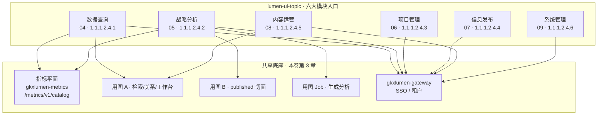
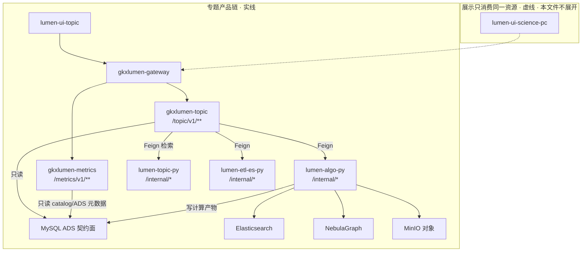
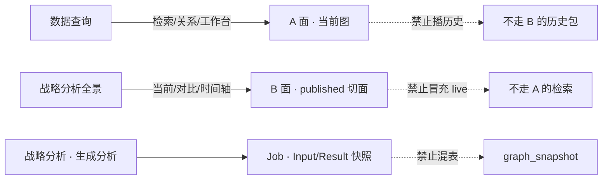
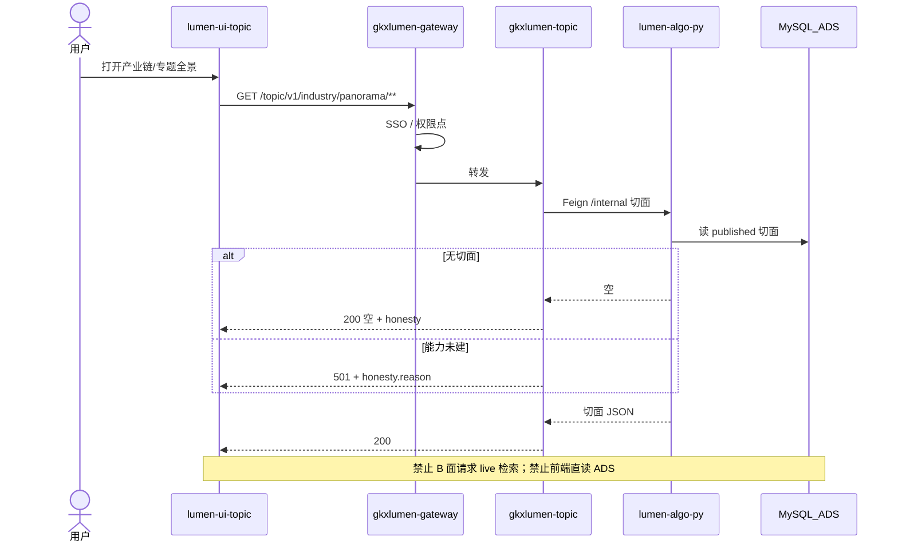
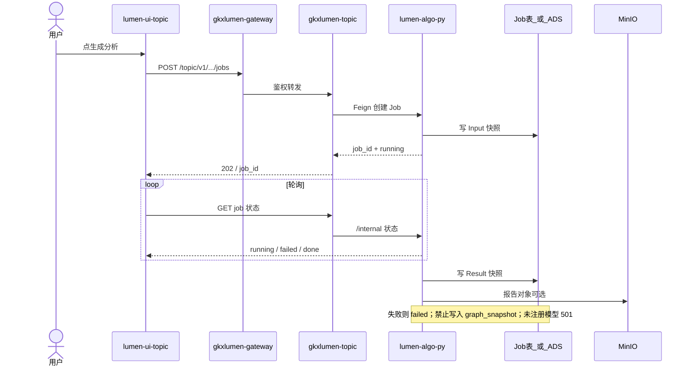

# 03 · 总体设计 · 共享底座 · 图

```yaml
---
doc_id: TOPIC-SHARED-DIAGRAMS
role: architecture-diagrams
status: draft
version: "2026-08-19"
updated: 2026-08-19
signoff_owner: architect
signoff_status: draft
scope: 科技专题服务系统（招标 1.1.1.2）共享底座
source_prose: ./03-总体设计-共享底座.md
---
```

> **本页给人看图。** 散文真源仍是 [`03-总体设计-共享底座.md`](./03-总体设计-共享底座.md)。图文冲突以**图**为准，改拓扑先改本页。  
> **范围**：只画 **科技专题服务系统**。展示系统页面不展开（[`科技信息展示系统完整详设`](../科技信息展示系统-完整详细设计/INDEX.md)）。  
> **粒度**：本文件对齐详设 **第 3 章共享底座**（系统级），不是 `E-32` 级 bid 叶子，也不是按 `05.1`～`05.8` 各画一张。规约 [`diagram-as-contract.md`](../../../diagram-as-contract.md) §0。  
> **会签态**：`draft`。架构会签前 **不据此实现新 OpenAPI**（与 00 / CROSS-KG 一致）。

| diagram_id | 层 | 答什么 |
|---|---|---|
| `ARCH-TOPO-LUMEN` | L0 | 全项目拓扑 · **只链不复制** |
| `TOPIC-SHARED-FUNC` | L1 | 六大模块怎么挂底座 |
| `ENT/CHAIN/SVC-STORAGE-FLOW` | L2 | 工厂流图 · **只链，不按叶子复制** |
| `TOPIC-SHARED-IMPL` | L3 | 专题运行时（仓名/服务名） |
| `TOPIC-SHARED-SEQ-B` | L4 | 打开专题全景（B 面） |
| `TOPIC-SHARED-SEQ-JOB` | L4 | 「生成分析」Job |

---

## 0. 先认已有真源（禁止另画）

| 层 | 认哪张 | 本页做什么 |
|---|---|---|
| L0 | [`architecture-baseline.md`](../../../architecture-baseline.md) §1 · `ARCH-TOPO-LUMEN` | 专题切片见 §2；禁止再画含 `lumen-ui-science-pc` / `gkxlumen-innov` 的全局图当专题真源 |
| 四平面 | [CROSS-KG 02-概要设计](../跨系统-知识图谱/02-概要设计.md) §1 | **不复制** GDF/DWD/亿集/在线那张图 |
| L2 | [`storage/README.md`](../../../data/data-design/storage/README.md) | 企业认 `ENT-STORAGE-FLOW`；专题全景/产业链认 `CHAIN-STORAGE-FLOW`；产业服务链认 `SVC-STORAGE-FLOW`。技术/人才/机构/政策域未建 → 缺口，禁止在本目录发明平行 `stores` |
| A/B/Job 说明书 | CROSS-KG 03 · Published-Cut · Job Runtime | 本页只画专题怎么用这三面 |

D12：`lumen-ui-topic` 只经 `gkxlumen-gateway` 调 `gkxlumen-*`。禁止回落 `demo-*`。

---

## 1. L1 · 六大模块挂底座 · `TOPIC-SHARED-FUNC`

一张图只答：用户从哪进、底座提供哪三件事（查数 / 用图 / 鉴权）。**不画表、不拆 05.x 叶子。**



| 职责 | 不做 |
| --- | --- |
| 六模块都进同一网关、同一指标 catalog、同一套 A/B/Job | 为某个 `05.x` 叶子另造指标中心或第二套图库 |
| 查询吃 `.1` 指标 + `.2` 图谱 API；战略分析八域吃 `.3`～`.10` | 从页面反推岗位名；把展示 DS 页画进本图 |
| 项目 / 发布 / 系统管理走鉴权与用户态 | 给这三块各起深度模型章、各起 L2 流图 |

战略分析八域（技术链…综合智能）在 [05](./05-功能-战略分析.md) + `05.x`，**共用**本图底座，不在此展开。

---

## 2. L3 · 专题运行时 · `TOPIC-SHARED-IMPL`

节点名 = 仓 / 服务。实线 = 本详设专题产品链。虚线 = 展示共享或未授权施工（本文件不展开、不改 lumen 展示仓）。



| 生产者 | 消费者 | 触发 | 失败语义 | 禁止事项 |
|---|---|---|---|---|
| `lumen-ui-topic` | `gkxlumen-gateway` | 用户打开 `/topic/**` | 网关 401/403；不把 `/internal` 暴露给浏览器 | 前端直连 Python / MySQL / Nebula / ES / MinIO；nginx 回落 `demo-*` |
| `gkxlumen-topic` | `lumen-algo-py` / `lumen-topic-py` / `lumen-etl-es-py` | Feign `/internal/*` | 同步失败 → Java 5xx 或能力未建 **501** + honesty；空结果 **200** 空 | Java 写 ADS；Java nGQL；Java NER；对前端开 `/internal` |
| Python | ADS / ES / Nebula / MinIO | 批或任务；Job 完成写结果 | 写失败任务 `failed`；禁止半成品冒充 published | 前端目录充数；Job 写入 `graph_snapshot`；display 专有图库 |
| `gkxlumen-metrics` | 专题前端 ⓘ | 读 catalog | 就绪度只读；禁止前端改绿 | 页面手写四维状态 |
| `lumen-ui-science-pc` | 同一 `gkxlumen-topic` graph/metrics | 展示嵌图（他系统） | 不在本文件验收 | 本图实线画展示 34 页；复制一套图 API |

**与 L0 的关系**：全量仓清单以 `ARCH-TOPO-LUMEN` 为准。本图故意不画 `gkxlumen-innov` / `gkxlumen-display` / mobile / admin——那些不是专题共享底座的施工面。

**分期（03 §3.8）**：A 面查图、多数 G2/G3 允许 **501**（虚线能力，禁止 200 假分）。B 面 / Job 已有说明书的路径画实线。

---

## 3. 用图三面（专题怎么用 · 不复制四平面）



| 面 | 用户看见 | 数据 | 失败 | 禁止事项 |
|---|---|---|---|---|
| A | 检索、关系、知识图谱工作台 | 当前图 | 未接通 **501**；空图 200 | A 面播历史切面 |
| B | 全景当前 / 对比 / 时间轴 | **仅** published 切面 | 无切面 200 空 + honesty.payload_thin | B 面包 live 检索 |
| Job | 「生成分析」阶段与报告 | Input/Result 快照，结果不可变 | 轮询 failed；禁止静默部分成功 | 与 `graph_snapshot` 混表 |

真源：CROSS-KG 03 · Published-Cut · Job Runtime。Q5（亿集物理库 vs Nebula）**待确认**；在线只暴露 `source`，业务态不解释存储品牌。

---

## 4. L4 · 打开专题全景（B 面）· `TOPIC-SHARED-SEQ-B`

一次用户动作。对验收时补一条 dev `traceId`（门 I2-11）。本图不代替 walkthrough。



| 生产者 | 消费者 | 触发 | 失败语义 | 禁止事项 |
|---|---|---|---|---|
| 用户 / `lumen-ui-topic` | `gkxlumen-topic` | 打开全景 | 空=200；未建=501；无权=4xx | 把 A 面检索当全景；display 专用 panorama API |

---

## 5. L4 · 「生成分析」Job · `TOPIC-SHARED-SEQ-JOB`



| 生产者 | 消费者 | 触发 | 失败语义 | 禁止事项 |
|---|---|---|---|---|
| 用户 | Job Runtime | 「生成分析」 | 未注册模型 **501**；跑失败 `failed`；结果不可变 | 200 假「颠覆指数」等；Job 与切面混表；前端假文件冒充已发送 |

---

## 6. 指标 / 模型 / 鉴权（不另起图）

| 平面 | 实线约定 | 禁止 |
|---|---|---|
| 指标 | `gkxlumen-metrics` `/metrics/v1/catalog`；D9 八件套 + 四维就绪度；前端只读 | 页面改绿；自填就绪度 |
| 模型 | `cfg_model_registry`；未注册 → **501** | 200 假分；未注册当已交付 |
| 鉴权 | 网关统一 SSO / 租户；业务服务校验权限点 | 专题仓自建登录；系统管理账户与网关账户分叉（见 [09](./09-功能-系统管理.md)） |

---

## 7. 开放项（不画进实线当已接通）

| ID | 项 | 图上画法 |
|---|---|---|
| Q5 | 亿集物理库 vs Nebula | 在线不画品牌；CROSS-KG 待确认 |
| 11.4 | TECH / TALENT / ORG / POLICY 存储域未建 | 不发明平行 L2；挂已有域或 N/A |
| 3.8 | A 面查图、多数 G2/G3 | 允许 501；禁止画成已 live |
| D12 | lumen 调 demo | 本图无 `demo-*` 节点 |

---

## 8. 变更

| 日期 | 说明 |
|---|---|
| 2026-08-19 | 初稿：图即契约样例（专题共享底座）；L0/L2/四平面只链；新画 L1/L3 + 两条 L4 |
