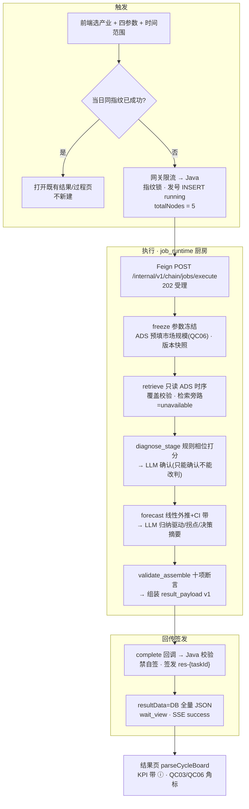

# 05.2.1 · 产业周期分析（完整分析链路 + LLM 落点）

| 项 | 内容 |
| --- | --- |
| 文档 | 科技专题服务系统 · 产业链产业周期分析链路设计 |
| 版本 | v0.1-draft |
| 日期 | 2026-10-26 |
| 条款 | `1.1.1.2.4.2.2` 页面叶子「产业周期分析」（八叶子之二，算法 `.3.6`/`.3.7`，标签 M，读面 ADS/Job） |
| 产品合同 | `E2-产业链分析/` 五件套（CHAIN-TOPIC-DIAGNOSIS；卡面/过程文案/状态覆盖以此为准） |
| 前端锚点 | `lumen-ui-topic` → `industry-center/diagnosis`，`menuKey=chain-diagnosis-cycle`，`workspace=cycle`，`tab=cycle` |
| 现网 | 接收、指纹单飞、五节点执行、规则相位打分、线性外推+CI、结果组装、回调签发、过程页、结果板。证据：`lumen-algo-py` `chain/cycle.py` + `chain/job_runtime.py`（`tests/test_chain_cycle.py`）、Java `ChainAnalysisTypes/ChainAnalysisAdapterImpl/ChainAnalysisJobCallbackController/completeChainJob`、FE `IndustryDiagnosisPage.vue`/`IndustryCycleResultBoard.vue`/`parseCycleBoard` |
| 未观察到 | 有 Key 时 LLM 实调现网样本（同政策 005 之前的阶段）；`lumen_common/prompts/` 统一目录（当前 prompt 内联，见 §8）；检索旁路实时链路（恒 `unavailable`，validate 硬拒 live） |
| 金样 | 体例对齐 [05.3.1 企业技术力](./05.3.1-企业技术力评估对比分析.md)（v0.3，§5.6 Prompt 规范必遵）；润色契约金样 [05.6.1 政策时序](./05.6.1-政策时序分析.md)；全域落点方法 [05.3.2 企业分析LLM落点表](./05.3.2-企业分析LLM落点表.md)（三档判定口径） |

> **本叶性质**：as-built 已有完整五节点链路与 LLM 双落点（招标能力内嵌），本文是 **as-built ↔ 金样契约差距清单 + 目标态设计**，不是从零发明。结构差异先写死：**本链是异步回调制、五真实节点（`totalNodes=5`）**——政策时序 `totalNodes=1` 的五段说明文案模式、企业评价「六节点+事后单收尾润色」模式**都不适用**；LLM 在本链是**流程内能力节点**（diagnose 确认 + forecast 归纳），不是事后润色。

---

## 1. 这条链路做什么

用户在 `/industry-center/diagnosis?workspace=cycle&tab=cycle` 配置产业周期分析：单选一个产业（cycle 拒 `industry_chain`），填四参数（增长率 %、利润率 %、技术成熟度分必填；市场规模亿元可空，留空由 ADS 按 QC06 预填），选分析时间范围（年/季，默认近 5 年）。点「开始分析」→ Java 指纹单飞发号 → Feign 投递算法厨房 → 五真实节点执行（冻结 → 取数 → 相位诊断 → 趋势预测 → 校验组装）→ complete 回调 Java 校验签发 `res-{taskId}` → 前端停在过程页看五段进度，完成后手动进结果页。当天同指纹已成功则复用，不新建；「重新分析」= force（只跳过复用不绕单飞）。

调用链：前端 → 网关 `/api/topicAsync` → `gkxlumen-topic-async-service` `POST /topic/v1/analysis/tasks` → Feign `POST /internal/v1/chain/jobs/execute`（`lumen-algo-py`，202 受理）→ 阶段/完成回调 `/internal/v1/analysis-jobs/{taskId}/stages|complete` 回 Java。Java 不调大模型、不写 nGQL、不读 DWD、唯一发号与签发；Python 禁自签 `result_snapshot_id`（payload 带该字段直接 `RESULT_SCHEMA_INVALID`）。

## 2. 完整逻辑



| 步 | 状态 | 事实 |
| --- | --- | --- |
| 1 触发 | 现网 | 指纹 = `chainAnalysisFingerprint('diagnosis','cycle',[industryId, chainId, JSON{timeRange,四参数}])`；Java `userId+analysisType+fp` 单飞；force 不透传 Python |
| 2 冻结 | 现网 | `node_freeze`：`_lift_cycle_blob` 兼容 FE 旧 `cycle:{}` 嵌套；source 枚举 `ads_prefill/user_override/user_input`；`user_override` 必带 `ads_value`；范围断言（PARAM_META lo/hi/gt）；市场规模空则 ADS `industry_chain_metric_fact` 预填（取不到不填，诚实） |
| 3 执行框架 | 现网 | `job_runtime` 厨房：线性跑图、进程内锁（单副本 ceiling）、无自有任务库、无节点重试、超时 `limits.timeout_sec` 默认 600s；权威状态机在 Java |
| 4 相位诊断 | 现网 | 规则包 `temp.qc03.cycle_phase.v1` 四参数打分（增长阈值+序列斜率+成熟度+利润率→四相位候选分）→ `primary_phase` → LLM 确认（L1） |
| 5 趋势预测 | 现网 | 线性外推 `value=last+slope*i`；CI 半宽 `max(|slope|*0.8, |last|*0.04, 0.5)*i`（不越过中值）；LLM 归纳（L2）；`_hist_fp` 指纹校验禁改序列点 |
| 6 校验组装 | 现网 | 断言：object 仍 industry、phase∈候选、label 匹配、序列未被改写、forecast 不与 hist 重叠、`low≤value≤high`、retrieval.mode∈{replay_snapshot,unavailable}、override 诚实标记在、无 `FORBIDDEN_KPI`、无黑名单短语（「全网检索完成」等）、KPI label 一致 |
| 7 回传签发 | 现网 | complete 回调 → Java `completeChainJob` 校验 → 签发 `res-{taskId}` → `task.resultData` 存全量 payload（`resultBucket/resultUrl=null`，**无对象存储写路径**）→ SSE success |
| 8 结果查看 | 现网 | FE `GET` 读 `result_payload`；`parseCycleBoard` 消费；报告经 `IndustryChainReportHost` → `chain:report:export` 另域，不再触发计算 |

节点失败即整链 failed（`failed_stage_code/label` 回传；**无节点重试**，与企业六节点重试 3 次不同）；LLM 失败**永不**改终态（§7）。

## 3. 触发与条件冻结（输入契约）

| 项 | 契约 |
| --- | --- |
| 对象 | `{type:"industry", object_id, industry_id, chain_id?, name}`；`chain_id` 可选（用于 ADS 预填优先键） |
| params | `growth_rate`(%, -50~200, 必填)、`profit_margin`(%, -100~100, 必填)、`tech_maturity`(分, 0~100, 必填)、`market_size`(亿元, >0, 可空→QC06 ADS 预填)；每项 `{value, unit, source, ads_value, user_overridden}` |
| time_range | `{start, end, grain: year|quarter}`；整数 N → 近 N 年（end=当前年）；start < end 强制 |
| honesty 冻结 | `pending_decisions=[QC03, QC10]`、`gaps=[GAP-CHAIN-DIAG-METRICS, QC06]`、params override 清单 |
| versions 快照 | `graph_version=cycle.graph.v1`、`prompt_packs=[cycle.diagnose.v1→v2, cycle.forecast.v1→v2]`、`rule_pack`、`forecast_rule_pack`、`data_as_of` |

## 4. 五阶段节点 ↔ 前端过程页（1:1 真节点）

| # | stage_code | 前端过程页文案（`CYCLE_LABELS`，与算法侧 1:1） | 关键行为 |
| --- | --- | --- | --- |
| 1 | `freeze` | 任务提交与参数冻结 | §3；快照 `ins-{taskId}` 由 Java 签发 |
| 2 | `retrieve` | 整合产业参数与联网检索的历史与市场数据 | 只读 ADS `industry_chain_metric_series`（排除 Q056/QC07 指标）；`_hist_cover_ok`：时序须 ≥2 点且覆盖 time_range 起点，不足→`ADS_SERIES_UNAVAILABLE` 节点失败；`retrieval_events` 现网恒空→`honesty.retrieval={mode:unavailable, live_claimed:false}` + `GAP-CHAIN-DIAG-RETRIEVAL`；**validate 硬拒 live**——招商标的能力「全网检索」现网诚实未接，不伪造 |
| 3 | `diagnose_stage` | 大语言模型推理与周期阶段判断（诊断） | 规则打分四候选（恒四项，全零给 growth 0.01 兜底）→ L1 确认；`confirmed_phase != primary_phase` → 整包丢弃回规则稿 |
| 4 | `forecast` | 基于全网检索动态归纳趋势预测、关键驱动因素与潜在拐点 | 外推+CI；L2 归纳；序列点指纹校验 |
| 5 | `validate_assemble` | 结果可信性校验与分析报告组装 | §2 步 6 十项断言 → `chain.cycle.result_payload.v1` |

过程页由 `IndustryAnalysisProcessShell` 按节点事件推进（stage 回调 `started/succeeded/failed` + `degraded` 标志上抛 SSE）。

## 5. 中间产物（arts 管线）

```text
arts["input"]                  # FE/Java 传入 payload
arts["art.context"]            # 冻结对象/params/time_range/rule_pack_version/versions/honesty
arts["art.facts"]              # load_cycle_facts：series_hist + retrieval_events + peer_candidates
arts["art.retrieval_bundle"]   # 归一化 hist + 检索诚实块
arts["art.phase_diagnosis"]    # candidates/primary/phase_source/rationale/evidence_refs/confidence/honesty.llm
arts["art.forecast_bundle"]    # series_hist/series_forecast/ci_low/ci_high/drivers/turning_points/decision_brief/honesty
arts["result_payload"]         # chain.cycle.result_payload.v1（唯一对外交付物）
```

## 6. 结果 payload（`chain.cycle.result_payload.v1`）

| 块 | 字段 | 说明 |
| --- | --- | --- |
| 头 | `result_schema_version` / `result_title` | `"{产业} · 产业周期分析结果"` |
| `summary` | `cycle_phase` / `cycle_phase_label` / `phase_judgment` | 相位四枚举（introduction/growth/maturity/decline ↔ 导入/成长/成熟/衰退）+ 判语（扩张加速/扩张趋稳/规模启动/增长趋稳/景气回落） |
| `kpi` | `current_phase_label`→`M_CHAIN_CYCLE_STAGE`、`phase_judgment`→`M_CHAIN_PHASE_DETERMINATION` | status=mock + `pending_ref=QC03` + `gap_ref=GAP-CHAIN-DIAG-METRICS`；`FORBIDDEN_KPI=(stage_score_kpi, tech_maturity_kpi)` 禁入 |
| `object` | `object_type/object_id/display_name` | |
| `sections.backtrace` | `params`（带 source/ads_value/metric_id）、`time_range{start,end,grain}`、`param_source`、`series_anchor` | 参数回溯 |
| `sections.diagnosis` | 相位、`phase_source`（rule_primary/llm_confirmed/rule_fallback_after_llm）、`candidates`、`rationale`、`evidence_refs`、`confidence` | |
| `sections.forecast` | `series_hist` / `series_forecast` / `ci_low` / `ci_high` / `drivers` / `turning_points` | |
| `sections.retrieval_events` / `peer_comparison` | 现网恒空 | QC10 对标未闭合，诚实空 |
| `sections.decision_brief` | `investment_rhythm` / `policy_window` | LLM ok→润色稿；否则 `RULE_BRIEF` 规则稿 |
| `metrics_used` | 六个 metric_id | `M_CHAIN_CYCLE_STAGE/M_CHAIN_PHASE_DETERMINATION/M_CHAIN_MARKET_SIZE/M_CHAIN_GROWTH_RATE/M_CHAIN_PROFIT_MARGIN/M_CHAIN_TECH_MATURITY_SCORE` |
| `honesty` | `data_mode:mock`、`params`、`retrieval{mode,live_claimed:false}`、`llm{diagnose,forecast}`、`forecast`、`data_gap`、`pending_decisions`、`gaps`、`degraded`、`degrade_reasons` | |
| `versions` | `graph_version/prompt_packs/rule_pack/forecast_rule_pack/data_as_of` | 任务快照版本指纹 |

## 7. LLM 落点专章

**结论：需要 LLM，双落点（2026-10-26 监管人冻结）**。理由：招标能力原文即「大语言模型推理与周期阶段判断」「动态归纳趋势预测、关键驱动因素与潜在拐点」——LLM 是流程内能力节点而非事后润色；「四参数+时序斜率→一段可读诊断」「开放式驱动/拐点归纳」属 05.3.2 三档判定口径中的 **LLM** 档（规则写不全或写死即僵硬）。与企业「单收尾」的结构差异是**域间合理差异**（§11），不互抄。

| 项 | L1 相位确认（`diagnose_stage`） | L2 趋势归纳（`forecast`） |
| --- | --- | --- |
| 输入事实包 | `chain.cycle.diagnose_context.v1`：candidates 四项+`primary_phase`+params(value,source)+series_summary+retrieval_excerpts(≤8，仅 id/title)+prohibitions | `chain.cycle.forecast_context.v1`：`cycle_phase`+hist_summary+forecast_summary+retrieval_excerpts+prohibitions |
| 输出契约 | `{confirmed_phase, rationale≤120字, evidence_ids⊆事件集, confidence∈[0,1]}` | `{drivers≤5条每条≤40字, turning_points≤3条每条≤60字(axis_year∈time_range, direction∈{up,down,inflect}), decision_brief{investment_rhythm≤80字, policy_window≤80字}}` |
| 硬护栏 | **confirmed_phase 必须 == primary_phase**（润色≠改判，不符整包丢弃退规则稿）；evidence_ids 不得编造（⊆ retrieval_excerpts id 集） | 禁改序列点（`_hist_fp` 校验）；越权键（series_hist/ci/cycle_phase）一律剥离 |
| 数字白名单 | rationale 文案中每个数字必须能在事实包找到（浮点相等），否则退规则稿 | drivers/turning_points/decision_brief 同规则 |
| 失败降级 | 无 Key→`skipped`；超时/异常/坏 JSON/校验败→`degraded`→`rule_fallback_after_llm` 规则稿；**任务仍 success**，不新增 `degraded` 终态 | 同左→`RULE_BRIEF` 规则稿 |
| prompt_id / version | `cycle.diagnose.v2`（§8） | `cycle.forecast.v2`（§8） |
| temperature / max_tokens / timeout / retry | 0.1 / 512 / 8s / 0 | 0.3 / 1024 / 15s / 0 |
| 客户端 | 算法仓 Common 管道（`chain_llm_env` + `_glm53_thinking`），密钥仅集群 Secret `gkx-zhipu-llm`（`model/base-url/api-key`）；Java/编排层不感知、不透传 Key | 同左 |

**不交 LLM 的位（规则锁死）**：相位改判权、序列点/CI 数值、四参数回显、KPI、`metrics_used`、`honesty` 全块、metric_id、`peer_comparison`（QC10 未闭合）。

**口径未闭合先改造（2026-10-26 监管人确认）**：LLM 改造与 QC03 是否闭合**正交**——LLM 只吃当前规则层输出做解释/归纳；甲方闭合 QC03 换规则包时 `rule_pack_version` 升版，prompt 不动。三条护栏随改造落死：①不得改判；②事实包带 `pending_decisions=[QC03,QC10]`、prompt 保持「临时口径」研判语气（宜/建议关注），禁写成行业定论；③数字白名单。

## 8. Prompt 统一管理（§05.3.1 §5.6 对齐）

**目标态**：`lumen-algo-py/lumen_common/prompts/chain/` 统一目录 + 单一 loader；文件版本化命名，代码只引用 prompt_pack id+version；改语义=升版本+金标样例；**禁止**在业务 `.py` 内联长 system/user 字符串。**现状债**：`cycle.py` 内联 `DIAGNOSIE_SYSTEM`/`FORECAST_SYSTEM`（`PROMPT_PACK="cycle.prompts.v1"` 仅为元数据标签无实体文件），且 chain 域 8 图同模式内联（key_link/bottleneck/panorama/regional/shenzhen_common 等）——**本单只落 cycle 两文件+最小 loader 跑通模式**，全域收敛另开任务（开放项 OPEN-CY-1）。

以下为 v2 草案全文（数据科学家/产业分析顾问口径；金标样例随实现单落 `tests/`）：

```text
【cycle.diagnose.v2 · system】
你是产业经济分析师，为产业链平台撰写产业周期阶段诊断的确认意见。

输入 Context 含：四项周期候选（candidates）、规则引擎首选相位（primary_phase）、
四项参数（params，含来源）、历史序列摘要（series_summary）、检索事件摘录（retrieval_excerpts）。

任务：复核并确认规则首选相位，用一段中文短评说明依据。
硬性规则：
1. confirmed_phase 必须等于 primary_phase，你没有改判权；若认为证据不足，confidence 调低即可。
2. rationale 不超过 120 字，只依据 Context 归纳；文案中出现的每个数字必须能在 Context 中找到。
3. 不得引入 Context 之外的行业事实、宏观事件或政策作为原因；不得使用无证据归因句式。
4. evidence_ids 只能从 retrieval_excerpts 的 id 中选；无可用证据时留空数组，不得编造。
5. 禁止出现「全网检索完成」「已完成实时全网检索」及同类表述。
6. 只输出 JSON：{"confirmed_phase":str,"rationale":str,"evidence_ids":[str],"confidence":float}
   除此之外不得输出任何文字。
```

```text
【cycle.forecast.v2 · system】
你是产业经济分析师，为产业链平台归纳产业周期的趋势研判意见。

输入 Context 含：已确认相位（cycle_phase）、历史序列摘要（hist_summary）、
规则外推序列摘要（forecast_summary）、检索事件摘录（retrieval_excerpts）。

任务：归纳关键驱动因素、潜在拐点与决策摘要。序列与置信区间已由规则引擎算出，你没有数值改写权。
硬性规则：
1. 不得改写、补充或否定 hist_summary / forecast_summary 中的任何数值；输出不含序列字段。
2. drivers ≤5 条、每条 ≤40 字；turning_points ≤3 条、每条 ≤60 字，
   axis_year 必须落在分析时间范围内，direction 取 up|down|inflect。
3. decision_brief 固定两键：investment_rhythm、policy_window，各 ≤80 字；
   语气为研判建议，不承诺收益、不推荐具体标的、不点名具体政策工具与金额。
4. Context 的 pending_decisions 表明当前口径为临时默认：禁止把相位与趋势写成行业定论，
   保留「宜」「建议关注」等研判语气。
5. 文案中出现的每个数字必须能在 Context 中找到；不得编造检索来源；
   禁止出现「全网检索完成」「已完成实时全网检索」及同类表述。
6. 只输出 JSON：
   {"drivers":[str],"turning_points":[{"axis_year":str,"label":str,"direction":str,"description":str}],
    "decision_brief":{"investment_rhythm":str,"policy_window":str}}
   除此之外不得输出任何文字。
```

数字白名单校验伪代码（实现于算法仓 `_call_json_llm` 返回后、落 `art.*` 前）：

```python
def numbers_in(text: str) -> list[float]:
    return [float(x) for x in re.findall(r"-?\d+(?:\.\d+)?", text)]

def whitelist_ok(text: str, pack: dict) -> bool:
    pool = collect_numbers(pack)   # params 值 + series/forecast 点值 + 年份 + candidates 分
    return all(any(abs(n - p) < 1e-9 for p in pool) for n in numbers_in(text))
```

## 9. OpenAPI / 内部契约（as-built 文档化，无新接口）

> LLM 改造对上层完全屏蔽：Java 不调模型、不透传 Key，FE 无感；本节五段契约不受 LLM 改造影响。契约面唯一与 LLM 沾边的是三个**既有字段**：`payload.honesty.llm{diagnose,forecast}`（随结果回传、业务界面不展示）、stage 回调 `degraded` 标志、complete 回调 `prompt_pack_version` 元数据。

| # | 段 | 端点 | 关键字段 |
| --- | --- | --- | --- |
| 1 | 创建受理 | FE→网关→Java `POST /topic/v1/analysis/tasks` | `analysisType=chain:diagnosis:cycle`、`analysisFp`、`object`、`params`、`time_range`、`force`；resp=running 任务（Java 发号，`totalNodes=5`） |
| 2 | 投递执行 | Java→Python `POST /internal/v1/chain/jobs/execute`（202） | `task_id/task_type/analysis_key=cycle/graph_version=cycle.graph.v1/input_snapshot_id/schema_version=chain.cycle.input.v1/input_payload/callback{stage_url,complete_url}/limits{timeout_sec,llm_retry_max}/trace_id`；resp `{accepted,task_id,...}` 不含业务结果 |
| 3 | 阶段回调 | Python→Java `POST /internal/v1/analysis-jobs/{taskId}/stages` | `stage_code/stage_label/stage_index/stage_total=5/status/degraded/degrade_reasons/at/trace_id` → SSE progress |
| 4 | 完成回调 | Python→Java `POST /internal/v1/analysis-jobs/{taskId}/complete` | `outcome=succeeded|failed`、`result_schema_version`、`result_payload`、`prompt_pack_version`；失败 `error_code/error_message/failed_stage_code/failed_stage_label`；ack 回 `result_snapshot_id=res-{taskId}`+`page_mode_hint=process_succeeded_wait_view` |
| 5 | 查询结果 | FE→Java `GET /topic/v1/analysis/tasks/{taskId}` / `.../result` | 返回 `result_payload` 全量 + `result_snapshot_id`；`viewed` 留 FE 置位；无返回空态诚实 |

**快照/对象存储**：本叶结果走 `task.resultData` DB 全量 JSON，`resultBucket/resultUrl=null`，**无 RustFS 写路径、无新增 key**；`res-{taskId}` 为 Java 签发的逻辑快照号；报告导出属 `chain:report:export` 另域，本设计不触及。**取消**：Java 侧标记取消；厨房无中途取消协议（差异见 §11），节点跑完或超时自然收敛。

## 10. Java 状态机与前端字段映射

状态机：`create(受理 running)` → `stages×5(SSE progress)` → `complete(succeeded→校验→签发→success, wait_view)` / `failed(failChainTask)`；`viewed` 由 FE 查看结果置位。超时 `limits.timeout_sec` 默认 600s。

| 结果页区块（`IndustryCycleResultBoard`） | 后端字段（`parseCycleBoard`） | 备注 |
| --- | --- | --- |
| 周期旅程 | `sections.journey` | as-built 未产，FE 空态「不伪造阶段文案」；补产与否=开放项 OPEN-CY-5 |
| 周期阶段卡 | `summary.cycle_phase_label`→`kpi.current_phase_label` | ⓘ M_CHAIN_CYCLE_STAGE + QC03 ⚠️ |
| 市场规模卡 | `summary.market_size` ?? `backtrace.params.market_size` | ⓘ M_CHAIN_MARKET_SIZE + QC06 |
| 回溯时间线与趋势预测 | `forecast.series_hist + series_forecast` 合并画线 | **接线缺口 G-FE-1**：`ci_low/ci_high` 已回传但 FE 未画阴影带，本期 FE 微改补 CI 可视化（数据零改动） |
| 回溯阶段标签 | `sections.phases` / `backtrace[]` | as-built 未产数组→不渲染，如实登记 |
| 决策摘要 | `forecast.decision_brief.{investment_rhythm,policy_window}` | LLM 润色稿或规则稿 |
| 关键驱动 / 潜在拐点 | `forecast.drivers` / `forecast.turning_points` | degraded→空态诚实 |
| 对标表 | `peer_comparison` | QC10 🟡 固定演示约定，现网空 |
| 检索来源与快照 | `honesty.retrieval` | unavailable→「未接通实时检索」提示 |

配置页：四参数范围校验（`validateCycleParameters` + PARAM_META）+「提交后冻结」⚠️；QC06 ADS 预填说明、⚠️ QC03 口径角标已挂（Design.md §7.4 / D9 对齐）。

## 11. 与企业评价链路差异（复用什么、本叶独有什么）

| 维度 | 企业评价（05.3.1） | 产业周期（本叶） | 定性 |
| --- | --- | --- | --- |
| LLM 结构 | 事后单收尾 `narrate_eval`（六节点后只改 `gap_text`，一个函数三种 sub_type） | 流程内双落点（diagnose 确认 + forecast 归纳，只确认/归纳不改判/不改数） | **域间合理差异**：招标能力内嵌 vs 纯润色，不互抄 |
| 执行框架 | 自有任务库 `lumen_analysis_task/_node/_retry` + Worker CAS + 节点重试 3 + 取消协议 | `job_runtime` 厨房：无自有库、无重试、进程内锁（单副本 ceiling）、超时 600s、无中途取消 | 链域统一模式 |
| 权威状态机 | 算法侧 MySQL + Java 对账 | Java 唯一权威（`completeChainJob` 校验+签发） | 同原则不同实现 |
| totalNodes | 6 真节点 | 5 真节点（过程页 1:1） | 同构 |
| 单飞/指纹 | `analysis_fp` 64 位 SHA-256 | `chainAnalysisFingerprint(域+key+对象+参数)` | 各域封装 |
| 结果持久化 | MQ→Worker→MinIO，Java 只存指针 | `resultData` DB 全量 | 差异登记；快照膨胀再议 MinIO 指针，非本期 |
| 报告 | 双路径（FE v2 + ARTIFACT） | `IndustryChainReportHost` → `chain:report:export` 另域 | 复用链域设施 |
| 降级命名 | `narration={ok|fallback|skipped}` | `honesty.llm={ok|degraded|skipped}` | **语义等价映射**（ok↔ok、fallback↔degraded、skipped↔skipped）；命名冻结不改（2026-10-26 监管人拍板） |
| **复用** | — | 执行框架同源思想（状态机权威在 Java、禁算法自签快照、指纹单飞、wait_view、指标 ⓘ/角标、诚实空态） | |
| **本叶独有** | — | QC06 ADS 预填、参数冻结表（source 三枚举+override 校验）、相位四枚举+判语、线性外推 CI 带、检索 honesty 禁 live、`_lift_cycle_blob` 兼容、黑名单短语防伪 | |

## 12. 现状对照与差距清单（A 表结论归档）

| # | 差距 | 严重度 | 处置 |
| --- | --- | --- | --- |
| G1 | Prompt 内联在 `cycle.py`，未落 `lumen_common/prompts/` 版本化文件（§5.6 违约，chain 域 8 图共性债） | 🔴 | §8 目标态；本单落 cycle 两文件（OPEN-CY-1） |
| G2 | LLM 输出无数字白名单校验 | 🔴 | §7/§8；随实现单（OPEN-CY-2） |
| G3 | temperature/timeout 契约未写死（现 20s、无 temperature） | 🟡 | §7 写死：L1 8s/0.1/512，L2 15s/0.3/1024 |
| G4 | `honesty.llm` vs 金样 `narration` 命名 | 🟡 | 已拍板保持现名（§11） |
| G5 | Java `validateChainResult` 对 cycle 只做「非空+禁自签」，无 schema 级校验 | 🟡 | OPEN-CY-3（参照 `ChainKeyLinkResultValidator` 样板） |
| G6 | RustFS：本叶走 `resultData` DB 全量，无对象存储写路径 | ℹ️ | §9 登记即闭环，不新造 |
| G7 | 注册表 8 件套口径（融资热度+年龄结构，20261021 王惠批）vs Job 内四参数规则打分是**两套相位口径**，同挂 `M_CHAIN_CYCLE_STAGE`，均属 QC03 🟡 | ⚠️ | 登记**不调和、不替甲方拍板**；UI ⓘ 呈现以 Job 快照口径为准 + 待甲方确认角标 |
| G-FE-1 | FE 未画 CI 阴影带（数据已回传，纯前端缺口） | 🟡 | OPEN-CY-4 |

指标现状（metric-registry 实查，2026-10-26）：`M_CHAIN_CYCLE_STAGE`（D1 aligned / D3 partial / D4 mock，QC03）、`M_CHAIN_PHASE_DETERMINATION`（同上）、`M_CHAIN_MARKET_SIZE`（D1 aligned / **D3 none**：金额维不可得=未定义≠0 / D4 mock，QC06）。`honesty.data_mode=mock` 与 `kpi.status=mock` 与 D4 一致，禁止在前端改绿。

## 13. 开放项

| ID | 项 | 处置 |
| --- | --- | --- |
| QC03 / QC10 | 相位口径（含两套并存事实）、多产业对比对标产生方式 | 已在客户决策清单 🟡，本文只引用；闭合后 `rule_pack_version` 升版，prompt 不动 |
| OPEN-CY-1 | Prompt 全域收敛：`lumen_common/prompts/chain/` 目录+loader 本单只落 cycle 两文件，其余 7 图后续迁入 | 另开 tech_task |
| OPEN-CY-2 | 数字白名单校验函数随改造实现 | 随实现单（建议 `CHAIN-CYCLE-NARRATE-L01`） |
| OPEN-CY-3 | Java cycle 结果 schema 级校验 | 随实现单（api 侧） |
| OPEN-CY-4 | FE CI 阴影带接线 | 随实现单（frontend 侧，纯 FE） |
| OPEN-CY-5 | `sections.journey` / `phases` 是否补产 | 待产品定义；FE 现空态诚实 |

## 14. 相关文档

| 文档 | 关系 |
| --- | --- |
| [05.2 产业链](./05.2-产业链.md) | 八叶子总册；本文展开「产业周期」一叶 |
| [05.3.1 企业技术力](./05.3.1-企业技术力评估对比分析.md) | 链路文体金样 + §5.6 Prompt 规范真源 |
| [05.3.2 企业分析LLM落点表](./05.3.2-企业分析LLM落点表.md) | 三档判定口径方法论 |
| [05.6.1 政策时序分析](./05.6.1-政策时序分析.md) | 润色契约金样（narrate_board 模式） |
| `E2-产业链分析/` 五件套 | 产品合同（CHAIN-TOPIC-DIAGNOSIS） |
| `客户决策清单跟踪表.md` | QC03/QC06/QC10 🟡 真源 |

## 15. 修订记录

| 版本 | 日期 | 说明 |
| --- | --- | --- |
| v0.1 | 2026-10-26 | 首版：as-built 对照 + 完整链路 + LLM 双落点契约 + Prompt v2 草案 + as-built 契约五段 + 企业域差异说明 + 开放项（`DOC-CHAIN-CYCLE-ANALYSIS-CHAIN-L01`，监管人 human:徐滕强） |
