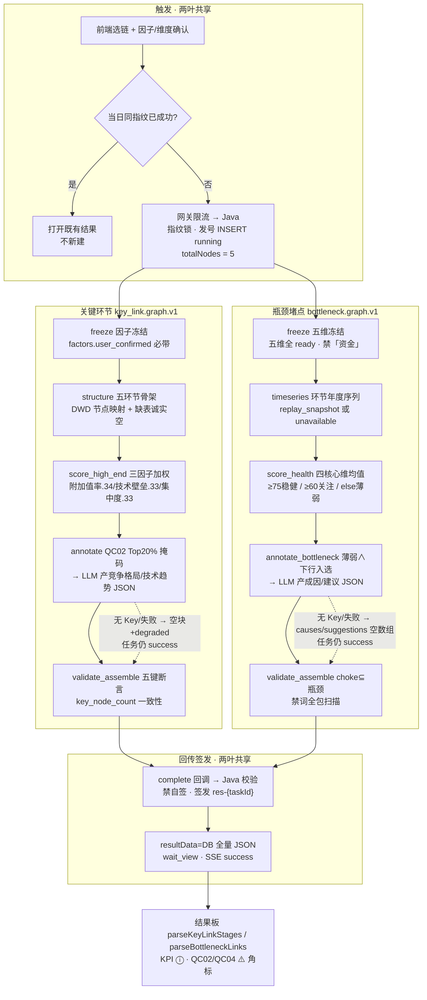

# 05.2.2 · 产业诊断分析（关键环节 + 瓶颈堵点，完整分析链路 + LLM 落点）

| 项 | 内容 |
| --- | --- |
| 文档 | 科技专题服务系统 · 产业诊断分析链路设计（关键环节识别 + 瓶颈堵点识别合并族） |
| 版本 | v0.1-draft |
| 日期 | 2026-10-27 |
| 条款 | `1.1.1.2.4.2.2` 页面叶子「关键环节」「瓶颈堵点」（八叶子之四/之五，算法 `.3.8`/`.3.9`，标签 G3，读面 Job；样板 `chain:diagnosis:key_link`） |
| 产品合同 | `E2-产业链分析/` 五件套（CHAIN-TOPIC-DIAGNOSIS；卡面/过程文案/状态覆盖以此为准） |
| 前端锚点 | `lumen-ui-topic` → `industry-center/diagnosis`，`workspace=key-link\|bottleneck`（诊断工作区三 tab 之二，与 cycle 同壳 `IndustryDiagnosisPage.vue`） |
| 现网 | 接收、指纹单飞、五节点执行、规则判定（关键环节：三因子高端化指数 + QC02 Top20% 掩码；瓶颈：五维健康分档 + 薄弱∧下行入选）、流程内 LLM 双落点（竞争格局/技术趋势 JSON；瓶颈成因/建议）、结果组装、回调签发、过程页、结果板。证据：`lumen-algo-py` `chain/key_link.py` + `chain/bottleneck.py` + `chain/job_runtime.py`（`tests/test_chain_key_link.py`、`tests/test_chain_bottleneck.py`）、Java `ChainAnalysisTypes/ChainKeyLinkResultValidator/completeChainJob`、FE `IndustryDiagnosisPage.vue`/`IndustryBottleneckResultBoard.vue`/`parseKeyLinkStages`/`parseBottleneckLinks` |
| 未观察到 | 有 Key 时 LLM 实调现网样本（同 cycle 005 之前阶段）；`lumen_common/prompts/` 统一目录实体文件（两叶 prompt 内联，见 §5.4）；FE 对 `competition`/`tech_trends`/`node_details.causes/suggestions` 的消费（零接线，见 §7 与 CHAIN-DIAG-06）；Java 对 bottleneck 的 schema 级校验（仅通用门禁，见 CHAIN-DIAG-05） |
| 金样 | 体例对齐 [05.2.1 产业周期](./05.2.1-产业周期分析链路.md)（链域五节点 as-built 文体）；润色契约金样 [05.3.1 企业技术力 §5](./05.3.1-企业技术力评估对比分析.md)（§5.6 Prompt 规范必遵）；逐格退先例 [05.3.5 痛难点 §5](./05.3.5-企业发展痛难点分析.md)；全域落点方法 [05.3.2 企业分析LLM落点表](./05.3.2-企业分析LLM落点表.md)（三档判定口径） |

> **本族性质**：as-built 已有完整五节点链路与流程内 LLM 落点（招标能力内嵌），本文是 **as-built ↔ 金样契约差距清单 + 目标态设计**，不是从零发明。**两叶合并一文**（不拆 05.2.3）：两叶共享同一五环节骨架（`STAGE_KEYS`/`STAGE_LABELS`/`STAGE_CATALOG`/`_edges`/`map_node_to_stage`/`load_key_link_facts` 全部复用，`bottleneck.py` 直接 `import key_link as kl`）、同一 FE 工作区与过程壳、同一执行厨房；拆文会把骨架契约写两遍。结构差异先写死：**本族是异步回调制、五真实节点（`totalNodes=5`）**，LLM 在本族是**流程内能力节点**（annotate 环节内调用），不是事后润色收尾——与 05.2.1 cycle 同模式，与企业「六节点+单收尾」不互抄。

---

## 1. 这条链路做什么

用户在 `/industry-center/diagnosis` 诊断工作区选择 **关键环节** 或 **瓶颈堵点** tab：

- **关键环节**：单选一条产业链，确认三因子（附加值率/技术壁垒/市场集中度，`factors.user_confirmed=true` 必带），可选因子版本。点「开始分析」→ 五节点执行（冻结 → 结构化拆解 → 高端化指数 → 关键环节标注 → 校验组装）→ 产出五环节结构 + 关键环节标注 + 竞争格局/技术趋势 + 代表企业清单。
- **瓶颈堵点**：单选一条产业链，确认五维（技术/人才/市场需求/资本/政策，`dimensions.user_confirmed=true` 且五维全部 `status=ready`，硬闸拒「资金」），可选维度版本。点「开始分析」→ 五节点执行（冻结 → 时序整合 → 健康度分档 → 瓶颈标注 → 校验组装）→ 产出环节健康图谱 + 瓶颈/卡脖子清单 + 逐环节成因与建议。

两叶同走链域异步回调链：Java 指纹单飞发号 → Feign 投递算法厨房 → 五真实节点执行 → complete 回调 Java 校验签发 `res-{taskId}` → 前端过程页看五段进度，完成后进结果板。当天同指纹已成功则复用；「重新分析」= force（只跳过复用不绕单飞）。

调用链：前端 → 网关 `/api/topicAsync` → `gkxlumen-topic-async-service` `POST /topic/v1/analysis/tasks` → Feign `POST /internal/v1/chain/jobs/execute`（`lumen-algo-py`，202 受理）→ 阶段/完成回调 `/internal/v1/analysis-jobs/{taskId}/stages|complete` 回 Java。Java 不调大模型、不写 nGQL、不读 DWD、唯一发号与签发；Python 禁自签 `result_snapshot_id`。

---

## 2. 完整逻辑



```mermaid
sequenceDiagram
  actor FE as 前端
  participant GW as 网关
  participant JA as topic-async(Java)
  participant AL as lumen-algo(厨房)
  participant DB as DWD/ADS

  FE->>GW: POST 创建(chain:diagnosis:key_link|bottleneck)
  GW->>JA: /topic/v1/analysis/tasks
  JA->>JA: 指纹锁 · 发号 INSERT running(totalNodes=5)
  JA->>AL: Feign POST /internal/v1/chain/jobs/execute
  AL-->>JA: 202 受理
  JA-->>FE: SSE 停过程页(五段 1:1)
  AL->>DB: freeze/structure·timeseries 只读 DWD+ADS
  AL->>AL: 规则判定(掩码/分档/入选)
  Note over AL: annotate 环节内调 LLM(有 Key 时)<br/>无 Key/失败 → degraded, 任务仍 success
  AL->>JA: stage 回调 started/succeeded/failed(+degraded)
  AL->>JA: complete 回调 result_payload
  JA->>JA: 校验(禁自签; key_link 走结构门禁) · 签发 res-{taskId}
  JA-->>FE: SSE success(wait_view)
  FE->>JA: GET 任务/结果
  JA-->>FE: result_payload 全量
```

| 步 | 状态 | 事实 |
| --- | --- | --- |
| 1 触发 | 现网 | 两叶同构：指纹 = `chainAnalysisFingerprint(analysisType, [chainId, 版本 JSON])`；Java `userId+analysisType+fp` 单飞；force 不透传 Python。`analysisType` ∈ `chain:diagnosis:key_link` / `chain:diagnosis:bottleneck` |
| 2 冻结 | 现网 | key_link：`factors.user_confirmed=true` 必带（缺 → `VALIDATION_FACTORS_NOT_CONFIRMED`），因子按 `FACTOR_CANON` 别名归一，`rules.unavailable` 拒（`RULE_PACK_UNAVAILABLE`）；bottleneck：`dimensions.user_confirmed=true` 且五维全部 `status=ready`（缺 → `DIM_PACK_UNAVAILABLE`），标签/键命中「资金/funding/fund」**节点直接拒**（Bid 面是「资本」） |
| 3 执行框架 | 现网 | `job_runtime` 厨房（引 05.2.1 §2 步 3 / §11）：线性跑图、进程内锁（单副本 ceiling）、无自有任务库、无节点重试、超时 `limits.timeout_sec` 默认 600s；权威状态机在 Java；节点失败即整链 failed，LLM 失败**永不**改终态 |
| 4 结构/时序 | 现网 | 共享 loader `load_key_link_facts(chain_id)`：只读 DWD `industry_chain`/`industry_chain_node`/`industry_chain_entity_rel` + ADS `industry_chain_metric_fact`/`industry_chain_topn`（只读连接 `connect_chain_readonly`，缺表诚实空不建表）；五环节按 `STAGE_ALIASES` 别名映射，全不中 → `GAP-CHAIN-DIAG-STAGE-MAP` + `STRUCT_AMBIGUITY_ESCALATE:human:李伟`；bottleneck 另读 `industry_chain_metric_series` 环节维年度序列（trend=最近两年环比符号；全空 → `retrieval mode=unavailable` + `GAP-CHAIN-DIAG-TIMESERIES`，**不入选瓶颈**——时序缺失时 `rule_bottleneck` 恒 False） |
| 5 规则判定 | 现网 | key_link：`high_end_index` = 三因子归一加权（`FACTOR_WEIGHTS` 0.34/0.33/0.33，>1 值除 100；缺任一因子 → `MISSING_INDEX` 诚实缺）；`is_key_node` = `qc02_key_mask` 企业数 Top20%（`temp.qc02.top20.v1` 临时默认，ceil 取整）；Q056/QC07 指标禁入记分（`FORBIDDEN_SCORE_METRICS`）。bottleneck：`health_score` = 四核心维（技术/人才/资本/政策）均值（市场需求维**不进均值**、只参与最弱维判定）；band 75/60 分档（`temp.qc04.health_band.v1` 临时默认）；`is_bottleneck` = 薄弱 ∧ trend=down；`is_choke` = 瓶颈 ∧ score<50（severity=高）；`bottleneck_type` = 五维最弱维名 |
| 6 LLM 标注 | 现网 | annotate 环节内同步调用（§5）：key_link 产 `competition`/`tech_trends` 结构化 JSON（schema 校验 + **数字白名单已有** `_fact_conflict` + 禁「已完成实时全网检索」）；bottleneck 产逐瓶颈 `causes`/`suggestions`（stage_key ⊆ 瓶颈集 + 禁「断链」「资金」；**无数字白名单**，差距 G2） |
| 7 校验组装 | 现网 | key_link：五环节键序断言、`key_tag` ∈ {key_link, crown_jewel}（仅关键环节可挂）、每个关键环节必有 annotation、`key_node_count` 与掩码一致。bottleneck：五环节键序断言、`choke ⊆ bottleneck`、choke 必 severity=高、type≠资金、band ∈ 三档、**禁词「断链/资金」对整个 result_payload 全文扫描**（命中 → `SCHEMA_VALIDATION_FAILED`） |
| 8 回传签发 | 现网 | complete 回调 → Java `validateChainResult`：key_link 走 `ChainKeyLinkResultValidator` 结构门禁（非空/禁自签/六必需键/sections 五块/stages=5/key_node_count 一致性/honesty.data_mode），bottleneck 仅通用门禁（非空+禁自签）→ 签发 `res-{taskId}` → `task.resultData` 存全量 payload（**无对象存储写路径**）→ SSE success |
| 9 结果查看 | 现网 | FE `GET` 读 `result_payload`；key_link 走 `parseKeyLinkStages`+`parseKeyLinkDetail`（环节图 + 选中环节详情），bottleneck 走 `parseBottleneckLinks`（健康图谱 + 详情侧栏） |

`annotate`/`annotate_bottleneck` 环节的 `stage_degraded`（或 payload `honesty.degraded`）由厨房上抛 stage 回调 `degraded=true` + `degrade_reasons=["llm_unavailable"]` → SSE progress 透出，终态不受影响。

---

## 3. 取数与计算（as-built）

数据真源 demo DWD/ADS（`assert_demo_mysql_targets` 锁目标；只读连接）。与 cycle 的差异：本族**无参数冻结表**（cycle 的 source 三枚举/override 校验不适用），冻结闸是「因子/维度确认 + 规则包可用性」。

| 环节 | key_link | bottleneck |
| --- | --- | --- |
| 输入契约 | `object{type:"industry_chain", chain_id, ...}` + `factors{user_confirmed, items[]}` + `rules?` | 同左，`dimensions{user_confirmed, items[]}`（五维全 ready 硬闸） |
| 读面 | DWD 链/节点/企业关系 + ADS `industry_chain_metric_fact`（五维分数、`industry_chain_topn` 关键企业榜） | 同左 + ADS `industry_chain_metric_series`（环节维年度序列） |
| 注入口 | `stage_enterprise_counts`/`stage_factor_raws`（测试注入；正式接 ADS 后由真表供数） | `stage_health_raws`/`stage_timeseries`（`key_link._load_stage_health_raws`/`_load_stage_timeseries` 读 ADS 真表，无 mock 分支） |
| 计算核心 | 三因子加权 → `high_end_index`（mock 态 + `GAP-CHAIN-DIAG-METRICS`；缺因子 → MISSING 诚实缺） | 四维均值 → `health_score`（mock 态 + QC04）→ band 分档 → 瓶颈/卡脖子规则 |
| 规则包 | `temp.qc02.top20.v1`（Top20% 掩码，QC02 🟡 临时默认） | `temp.qc04.health_band.v1`（75/60 分档 + choke<50，QC04 🟡 临时默认；`ponytail:` 代码内已注明天花板=临时分档，甲方确认后改 cfg 阈值） |
| honesty 冻结 | `pending_decisions=[QC02]`、`gaps=[GAP-CHAIN-DIAG-METRICS, …]` | `pending_decisions=[QC04]`、`gaps=[GAP-CHAIN-DIAG-METRICS, …]`、`timeseries{mode}` |
| versions 快照 | `graph_version=key_link.graph.v1`、`prompt_pack_version=key_link.n4c.prompts.v1`（元数据标签，无实体文件） | `graph_version=bottleneck.graph.v1`、`prompt_pack_version=bottleneck.annotate.prompts.v1`（同左） |

指标就绪度（metric-registry 实查，2026-10-27）：`M_CHAIN_KEY_NODE_COUNT`（D1 aligned / D2 partial·provisional / **D3 partial**——三因子只有「企业规模」一维可算，掩码是企业数分位代理 / D4 mock，QC02 🟡）；`M_CHAIN_BOTTLENECK_COUNT` 族四枚（D1 aligned / D2 partial·provisional / D3 partial——读表口径已定 2026-10-14，QC04 只影响何时有数不进口径 / D4 mock，QC04 🟡）。`honesty.data_mode=mock` 与 D4 一致，禁止在前端改绿。

---

## 4. 结果组装（as-built）

| 块 | key_link（`chain.key_link.result_payload.v1`） | bottleneck（`chain.bottleneck.result_payload.v1`） |
| --- | --- | --- |
| 头 | `result_title`（"{链名} · 产业关键环节识别结果"） | `result_title`（"{链名} · 产业瓶颈堵点识别结果"）+ `object` |
| 汇总/KPI | `summary.key_node_count`（metric_value，mock + QC02 ⓘ） | `kpi` 四卡：`bottleneck_count` / `max_severity` / `type_distribution` / `choke_link_count`（全 mock + QC04 ⓘ，metric_id `M_CHAIN_BOTTLENECK_COUNT/SEVERITY/TYPE_DIST/CHOKE_LINK_COUNT`） |
| 结构 | `sections.chain_structure`（五环节 + sequence 边；环节含 `function_boundary`/`high_end_index`/`is_key_node`/`key_tag`/`enterprise_count`） | `sections.health_graph`（五环节节点 + 边 + legend 三档/角标）+ `sections.link_health`（健康度清单） |
| 标注 | `sections.annotations`（逐关键环节 reason_codes/reason_text「企业数量处于全链 Top20%（临时默认 QC02…）」/rule_pack_version） | `sections.bottlenecks`（瓶颈项：severity/type/is_choke/reason_text「L1 分档=…且时序趋势下行（临时默认 QC04…）」）+ `sections.node_details`（逐环节 `causes[]`/`suggestions[]`） |
| LLM 产出 | `sections.competition`（overview ≤120 字 + by_stage 逐环节 ≤3 点）/ `sections.tech_trends`（items ≤5，可挂 evidence_ref）/ `sections.representative_enterprises.items`（≤20 家，关键环节优先） | 无独立块——LLM 产出**回填**进 `node_details[].causes/suggestions`，瓶颈项挂 `advice_refs:["advice:{stage_key}"]` |
| 指标 | `metrics_used=["M_CHAIN_KEY_NODE_COUNT"]` | `metrics_used` 四枚（§3 表） |
| honesty | `data_mode=mock` + `pending_decisions` + `gaps` + `degraded` + `degrade_reasons`（**无 llm 命名字段**，G3） | 同左 + **`llm: ok\|degraded`** + `timeseries{mode}` + `weak_not_forced_bottleneck` + `weak_stage_keys`/`bottleneck_stage_keys`（薄弱不强制入选的诚实清单） |
| versions | **无独立 versions 块**（版本只在 art.context） | `versions`（graph/prompt_pack） |

组装期失败断言两叶都硬拒（§2 步 7）；`honesty.gaps` 汇聚过程缺口（链行缺失 `ADS_CHAIN_ROW_MISSING`、环节映射失败 `GAP-CHAIN-DIAG-STAGE-MAP`、时序缺失 `GAP-CHAIN-DIAG-TIMESERIES`）。

---

## 5. LLM 落点专章（逐点位三档判定）

**结论：两叶各一个流程内 LLM 落点，均已 as-built**（招标能力内嵌：「关键环节智能标注与竞争格局/代表企业/技术趋势归纳」「瓶颈智能识别与卡脖子环节归因/改进建议生成」——过程页文案即点名 LLM）。本节先给落点表，再给 as-built ↔ 金样契约差距清单。

### 5.1 落点表

| # | 点位（页面可见名 = 后端字段） | 判定 | 可改字段 | 事实包 | 无 Key 行为（现网） | 优先级 |
| --- | --- | --- | --- | --- | --- | --- |
| K1 | 关键环节结果板「竞争格局」叙述 = `sections.competition.{overview, by_stage}` | **LLM（已 as-built，差距收敛）** | `competition.overview`（≤120 字）/ `by_stage[]`（逐环节 ≤3 点） | `chain.key_link.n4c_context_pack.v1`：五环节（label/is_key/指数 display/企业数/功能边界）+ key_nodes 标注 + 代表企业 shortlist + `prohibitions` 三条 | `_empty_narrative("llm_unavailable")`：overview 空、by_stage 空、`degraded=true`；**无规则稿文本兜底**（空态诚实，G6） | P1（随 CHAIN-DIAG-01/02 收敛契约） |
| K2 | 同板「技术趋势」块 = `sections.tech_trends.items` | **LLM（已 as-built，同 K1 一次调用）** | `tech_trends.items[]`（≤5 条，可带 evidence_ref） | 同 K1（同一 context_pack、同一 JSON） | 同 K1（items=[] + degraded） | P1（同 K1） |
| K3 | 环节图关键角标/代表企业清单/高端化指数 = `is_key_node`/`key_tag`/`representative_enterprises`/`high_end_index` | **规则锁死（口径未闭合）** | —（LLM 输出协议层无此键替换权，`key_nodes 只读` 写进 system） | — | — | 规则保持（QC02 🟡 闭合后 `rule_pack_version` 升版，LLM 位不动） |
| K4 | KPI「关键环节数」= `summary.key_node_count` + `annotations[].reason_text` | **规则锁死** | —（reason_text 含「临时默认 QC02」诚实语义，润色=给临时口径穿正式外衣，对齐 05.3.2 ENT-NARRATE-02 同逻辑） | — | — | 规则保持 |
| B1 | 瓶颈详情「成因」= `sections.node_details[].causes[]` | **LLM（已 as-built，差距收敛）** | `causes[]`（逐瓶颈环节，数组） | `chain.bottleneck.advice_context.v1`：link_health（band/健康分 display）+ bottlenecks（severity/type/is_choke）+ `prohibitions` 三条 | causes=[]（空数组，无规则稿）+ `honesty.llm=degraded`（G6 同） | P1（随 CHAIN-DIAG-01/02 收敛契约） |
| B2 | 瓶颈详情「建议」= `sections.node_details[].suggestions[]` | **LLM（已 as-built，同 B1 一次调用）** | `suggestions[]` | 同 B1（同一 context_pack） | suggestions=[] | P1（同 B1） |
| B3 | 健康图谱分档/瓶颈/卡脖子角标 = `band`/`is_bottleneck`/`is_choke`/`severity`/`bottleneck_type` | **规则锁死（口径未闭合）** | —（`不得改 health_score / band / is_bottleneck / is_choke / severity` 写进 system + 校验器只放行 advice 键） | — | — | 规则保持（QC04 🟡 闭合后 cfg 阈值升版） |
| B4 | 瓶颈项判定依据句 = `bottlenecks[].reason_text` | **规则锁死** | —（含「临时默认 QC04」诚实语义，同 K4） | — | — | 规则保持 |
| B5 | KPI 四卡（§4） | **规则锁死** | —（结构化计数，LLM 无增益） | — | — | 规则保持 |

**暂缓位**：无新增。QC02/QC04 只登记引用[客户决策清单跟踪表](../../../客户决策清单跟踪表.md) 🟡（第 222/224 行），本文不回潮、不替甲方拍板。与 cycle §7 同款正交原则成立：**LLM 改造与 QC02/QC04 闭合正交**——LLM 只吃规则层输出做归纳/建议，甲方闭合后 `rule_pack_version` 升版、LLM 位不动。

### 5.2 输出契约与硬护栏（as-built）

| 项 | key_link（N4C） | bottleneck（ADVICE） |
| --- | --- | --- |
| 输出 JSON | `{"competition":{overview, by_stage[]}, "tech_trends":{items[]}}`（**严格两键**，多余键剥离） | `{"advice":[{stage_key, causes[], suggestions[]}]}`（多余键拒收 `extra_keys`） |
| schema 校验 | `_n4c_schema_ok`：两键存在、by_stage/items 为数组、stage_key ∈ 五规范键、禁「已完成实时全网检索」 | `_advice_ok`：只 advice 键、stage_key ⊆ 瓶颈集、causes/suggestions 为数组、禁「断链」（payload 级再扫「资金」） |
| 数字白名单 | **有**：`_fact_conflict` 整包正则——输出数字 ⊄ context 数字即拒（`fact_conflict`） | **无**（prompt 仅口头「不得发明数字」）——差距 G2 |
| 规则字段保护 | `key_nodes 只读，不得增删改`（system）+ 组装期 `key_node_count` 一致性断言 | `不得改 health_score / band / is_bottleneck / is_choke / severity`（system）+ 校验器只放行 advice 键 + LLM 行 stage_key 白名单过滤 |
| 调用参数 | timeout 20s、`llm_retry_max`（默认 0）、`_glm53_thinking`（glm-5.3 强制开思考）；**temperature 未写死**（G4） | 同左 |

### 5.3 失败语义（对照金样三态）

两叶 LLM 失败**永不改任务终态**（对齐金样「任务仍 success」铁律）✅。但三态粒度与金样 `narration={ok|fallback|skipped}` 有差距（G3）：现网 `llm_configured()=False`（无 Key）与调用失败（超时/坏 JSON/校验拒）**同入一条路**——`call_*_llm` 返回 `None` → `degrade_reasons=["llm_unavailable"]`，无 skipped/fallback 二分；bottleneck 有 `honesty.llm: ok|degraded` 两态，key_link 连 llm 命名字段都没有（仅 `degraded` 布尔）。语义映射等价于 `fallback+skipped 合并 → degraded`，命名差异延续 05.2.1 §11 拍板精神（链域 `honesty.*` 家族冻结不改），粒度细化登记 CHAIN-DIAG-03，不阻塞。

### 5.4 Prompt 统一管理（§05.3.1 §5.6 对齐）

**现状债（与 05.2.1 §8 同款，chain 域 8 图共性）**：`N4C_SYSTEM`/`ADVICE_SYSTEM` 内联在业务 `.py`，`PROMPT_PACK="key_link.n4c.prompts.v1"` / `"bottleneck.annotate.prompts.v1"` 仅为元数据标签**无实体文件**。

**目标态**：迁入 `lumen_common/prompts/chain/` 统一目录（cycle 两文件由 OPEN-CY-1 先行落模式，本族两文件随后同批迁入）：`chain.key_link.narrate.v1.txt` + `chain.bottleneck.advice.v1.txt`，单一 loader、升版删旧、数据科学家口径。改造**语义零变化**——两 system 现文的硬规则（key_nodes 只读 / 禁发明数字 / 禁「断链」「资金」/ 维名资本 / 禁「已完成实时全网检索」/ 只输出 JSON）全部保留原文迁置；升版时机只在语义真改时。细节见 CHAIN-DIAG-01。

### 5.5 允许写成什么（校验示例）

- key_link 允许：overview「研发环节企业集聚度最高（占比 32%），竞争焦点集中于基础专利布局」——32% 可在 context_pack 溯源。不允许：出现 context 之外的市占率/企业名；「已完成实时全网检索的技术趋势显示…」；任何改写 `is_key_node` 的表述。
- bottleneck 允许：causes「该环节人才供给分 42 低于全链均值，且近两年健康分持续下行」——数字须 ⊆ context（link_health display/分档值）。不允许：causes 出现「断链」；suggestions 指名具体政策工具或金额（方向粒度约束，同 05.3.5 §5.4 精神）；type 写成「资金」。

---

## 6. 执行框架（并发 / 重试 / 取消 / 超时）

链域统一厨房，与 05.2.1 §2 步 3 / §11 完全共享，引用不重写：`job_runtime` 线性跑图、进程内锁（单副本 ceiling）、无自有任务库、无节点重试、超时 `limits.timeout_sec` 默认 600s、权威状态机在 Java、无中途取消协议（节点跑完或超时自然收敛）、`stage_degraded` 上抛 SSE。本族特有两点：

| 项 | 事实 |
| --- | --- |
| 冻结硬闸 | `VALIDATION_FACTORS_NOT_CONFIRMED`（key_link）/ `DIM_PACK_UNAVAILABLE`（bottleneck 五维不齐或「资金」混入）/ `RULE_PACK_UNAVAILABLE`（两叶）——节点失败即整链 failed |
| LLM 失败隔离 | `call_n4c_llm`/`call_advice_llm` 任何异常吞掉降级，不抛 `NodeFailed`；`stage_degraded` 标志走 stage 回调 `degraded` 字段（厨房 463 行统一读取 `arts["stage_degraded"]` 或 payload `honesty.degraded`） |

---

## 7. 报告

两叶 Job 均不产报告 artifact：`report_export.py` 只认 `chain:report` 前缀任务，两叶 `analysisType` 是诊断域，不在导出管线上（同 05.2.1 §2 步 8 模式：报告经 `IndustryChainReportHost` → `chain:report:export` 另域，本设计不触及）。诊断结果的用户消费面 = **FE 结果板本身**（环节图 + 详情侧栏 + KPI 卡），无独立报告页。

**FE 消费现状与接线缺口（CHAIN-DIAG-06 的事实基础）**：

| 消费点 | 后端字段 | 现状 |
| --- | --- | --- |
| 环节图五节点/关键角标/高端化分 | `chain_structure.stages[]` | ✅ 已接（`parseKeyLinkStages`；crown = is_key ∧ score≥70 前端口径） |
| 健康图谱/瓶颈/卡脖子角标 | `health_graph.nodes[]` | ✅ 已接（`parseBottleneckLinks`；band 缺失按 75/60 前端推断，仅展示档位不改数值） |
| KPI「瓶颈堵点数/严重度」 | `kpi.bottleneck_count` / `kpi.bottleneck_severity` | ⚠️ **块错位**：FE 读 `summary.*`，后端在 `kpi` 块——堵点数退化为前端按 `is_bottleneck` 重算（数值巧合一致），严重度恒「暂无」 |
| 选中环节「代表企业」 | `sections.representative_enterprises.items[]` | ⚠️ **包装错位**：FE 读该键为数组，后端是 `{schema_version, items[]}` 对象——现网恒空态「暂无代表企业」 |
| **「竞争格局」/「技术趋势」块** | `sections.competition` / `sections.tech_trends` | ❌ **零消费**（FE 全仓 grep 无触点）；LLM 稿落快照也无渲染位 |
| **瓶颈「成因/建议」** | `sections.node_details[].causes/suggestions` | ❌ **零消费**（详情侧栏只显示健康度/档位/角标） |

上述四缺口全部登记 CHAIN-DIAG-06（FE 小单）；其中竞争格局/技术趋势**是否新增展示块**属产品定义（涉 QC02 关联面），按 I2 流程过 Wireframe 后实施，不在本文拍板。

---

## 8. 相关文档与开放项

| 文档 | 关系 |
| --- | --- |
| [05.2 产业链](./05.2-产业链.md) | 八叶子总册；本文展开「关键环节」「瓶颈堵点」两叶 |
| [05.2.1 产业周期分析链路](./05.2.1-产业周期分析链路.md) | 链域体例金样 + 执行框架/契约五段真源（§6 引用） |
| [05.3.1 企业技术力 §5](./05.3.1-企业技术力评估对比分析.md) | 润色契约金样 + §5.6 Prompt 规范真源 |
| [05.3.2 企业分析LLM落点表](./05.3.2-企业分析LLM落点表.md) | 三档判定口径方法论（规则锁死的判定依据） |
| [05.3.5 企业发展痛难点 §5](./05.3.5-企业发展痛难点分析.md) | 逐格退/方向粒度先例（§5.5 B2 约束引用） |
| `E2-产业链分析/` 五件套 | 产品合同（CHAIN-TOPIC-DIAGNOSIS） |
| `客户决策清单跟踪表.md` | QC02/QC04 🟡 真源（第 222/224 行） |

开放项（CHAIN-DIAG-* 前缀，与 05.2.1 OPEN-CY-*、05.3.2 ENT-* 不冲突）：

| ID | 项 | 处置 |
| --- | --- | --- |
| CHAIN-DIAG-01 | Prompt 外置：`N4C_SYSTEM`/`ADVICE_SYSTEM` 迁 `lumen_common/prompts/chain/`（`key_link.narrate.v1` + `bottleneck.advice.v1`）+ 单一 loader，语义零变化 | 随实现单（algorithm；OPEN-CY-1 落目录模式后同批迁入） |
| CHAIN-DIAG-02 | bottleneck 数字白名单：复用 key_link `_fact_conflict` 模式（输出数字 ⊆ context 整包正则），随 CHAIN-DIAG-01 同单 | 随实现单（algorithm） |
| CHAIN-DIAG-03 | LLM 三态粒度：无 Key（skipped）与调用失败（degraded）二分；key_link `honesty` 增 `llm` 字段对齐 bottleneck；degrade_reasons 细分 `no_key/timeout/schema` | 登记；随实现后观测补记评估，命名家族（`honesty.*`）维持冻结不改 |
| CHAIN-DIAG-04 | 调用参数写死：temperature/max_tokens/timeout 契约化（建议 N4C 0.3/1024/20s、ADVICE 0.2/512/15s，随实现单实测校准） | 随实现单（algorithm） |
| CHAIN-DIAG-05 | Java bottleneck schema 级校验：参照 `ChainKeyLinkResultValidator` 样板（kpi 四卡 mock+QC04、choke⊆bottleneck、禁词） | 随实现单（api 侧） |
| CHAIN-DIAG-06 | FE 接线包（§7 四缺口）：`kpi` 块读取、`representative_enterprises.items` 包装、「竞争格局/技术趋势」块与「成因/建议」渲染 | frontend 小单；竞争格局/技术趋势块先过产品定义（QC02 关联面） |
| CHAIN-DIAG-07 | degraded 空态产品定义：成因/建议与竞争格局是否需要规则稿占位（现网=诚实空态），还是维持空态+提示文案 | 待产品定义；FE 现空态诚实，不伪造 |

---

## 9. 修订记录

| 版本 | 日期 | 说明 |
| --- | --- | --- |
| v0.1 | 2026-10-27 | 首版：关键环节+瓶颈合并族 as-built 对照（五节点×2 + 流程内 LLM 双落点）+ 逐点位落点表 + 金样契约差距清单（prompt 内联/bottleneck 无白名单/三态粒度/参数未写死/Java 校验缺口/FE 四缺口）+ 开放项 CHAIN-DIAG-01~07（`DOC-CHAIN-DIAG-FAMILY-L01`，监管人 human:徐滕强） |
