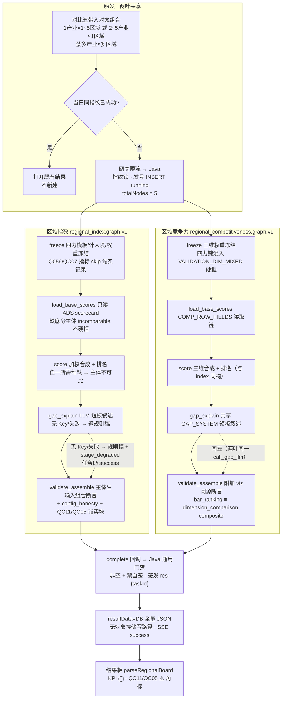
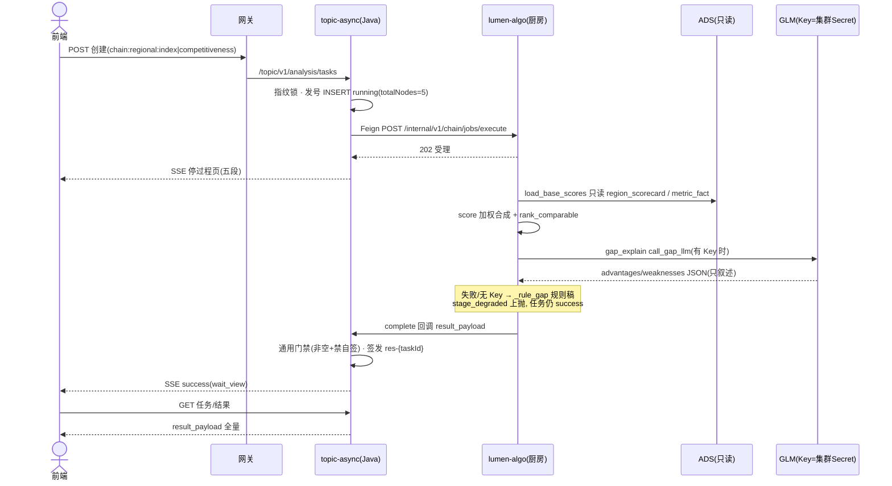

# 05.2.3 · 区域产业评价（区域产业指数 + 区域竞争力，完整分析链路 + LLM 落点）

| 项 | 内容 |
| --- | --- |
| 文档 | 科技专题服务系统 · 区域产业评价链路设计（区域指数 `regional_index` + 区域竞争力 `regional_competitiveness` 合并族） |
| 版本 | v0.1-draft |
| 日期 | 2026-10-27 |
| 条款 | `1.1.1.2.4.2.2` 页面叶子「区域产业指数」「区域竞争力」（八叶子之六/之八，算法 `.3.10` 一叶覆盖两页，标签 M，读面 ADS/Job；样板 `chain:regional:index`） |
| 产品合同 | `E2-产业链分析/CHAIN-TOPIC-REGIONAL-区域产业分析/` 五件套（卡面/过程文案/状态覆盖以此为准） |
| 前端锚点 | `lumen-ui-topic` → `/industry-center/regional`，`workspace=index\|competitiveness`（区域工作区两 tab），菜单权限 `MENU_CHAIN_REGIONAL` |
| 现网 | 接收、指纹单飞、五节点执行、共享对象栏（1产业×1~5区域 或 2~5产业×1区域）、加权合成+排名、共享 LLM 短板叙述、结果组装、回调签发、过程页、结果板。证据：`lumen-algo-py` `chain/regional_index.py` + `chain/regional_competitiveness.py` + `chain/regional_common.py` + `chain/job_runtime.py`（`tests/test_chain_regional.py` 17 例）、Java `ChainAnalysisTypes`（`chain:regional:*` 白名单注册）、FE `IndustryRegionalPage.vue`/`IndustryRegionalResultBoard.vue`/`parseRegionalBoard`（`industryChainTask.ts`） |
| 未观察到 | **「有 pack 名无文件」半迁移态**：两叶 `PROMPT_PACK="regional_{index,competitiveness}.gap.prompts.v1"` 仅为 job_runtime `PROMPT_PACKS` 元数据，`lumen_common/prompts/chain/` 无对应实体文件，system 文案内联在 `regional_common.GAP_SYSTEM`（见 §5.4）；有 Key 时 LLM 实调现网样本（同 05.2.2 登记阶段）；FE 对 `heatmap_gis`/`leaf_contributions`/`config_honesty` 三块零消费（见 §7）；Java 对两叶无 schema 级校验（仅通用门禁，见 REGIONAL-06） |
| 金样 | 体例对齐 [05.3.1 企业技术力](./05.3.1-企业技术力评估对比分析.md)（链路文体 + §5.6 Prompt 规范真源）；链域骨架金样 [05.2.1 产业周期](./05.2.1-产业周期分析链路.md)；姊妹文 [05.2.2 产业诊断](./05.2.2-产业诊断分析链路.md)（§5 落点表三档判定 + G 系列差距清单格式直接对标）；逐格退先例 [05.3.5 痛难点 §5](./05.3.5-企业发展痛难点分析.md)；全域落点方法 [05.3.2 企业分析LLM落点表](./05.3.2-企业分析LLM落点表.md)（三档判定口径） |

> **本族性质**：as-built 已有完整五节点链路与流程内 LLM 落点（短板叙述），本文是 **as-built ↔ 金样契约差距清单 + 目标态设计**，不是从零发明。**两叶合并一文（不拆 05.2.3/05.2.4）**：两叶共享同一对象栏（`regional_common.parse_regional_combo`，1 产业×1~5 区域 或 2~5 产业×1区域）、同一读取链（`load_regional_scorecard` / `apply_input_bases`）、同一 LLM 客户端（`call_gap_llm` + `GAP_SYSTEM`）、各自一套 `_rule_gap` 规则稿、同构五环节 STAGE_CODES（freeze / load_base_scores / score / gap_explain / validate_assemble）；差异只在「模型侧输入契约」（四力模板+计入项 vs 三维固定权重）与「视图侧 sections 形状」。拆文会把共享契约写两遍。结构差异先写死：**本族是异步回调制、五真实节点（`totalNodes=5`）**，LLM 在本族是**流程内能力节点**（gap_explain 环节内调用、只叙述不改数），不是事后润色收尾——与 05.2.1 / 05.2.2 同模式，与企业「六节点+单收尾」不互抄。
>
> **QC11 ⚠️ 命名纪律（客户决策清单第 231 行，🟡）**：指数四力（产业力/创新力/学术力/支撑力）是**原型加工词临时默认**（`INDEX_DIM_LABELS`）；Demo 页「商业力/技术力」为输入别名（`INDEX_DIM_ALIASES` 收纳，非正式命名）。竞争力三维（产业基础/学术生态/创新生态）是 Bid 固定三维，**禁止与四力混用**——`VALIDATION_DIM_MIXED` 硬拒、别名表（`canon_index_dim` / `canon_comp_dim`）隔离、`test_comp_rejects_four_force_weights` 回归。甲方确认后只换 `INDEX_DIM_LABELS` 文案与 seed 口径，模型键与契约面不动。

---

## 1. 这条链路做什么

用户在 `/industry-center/regional` 区域工作区选 **区域产业指数评价** 或 **区域产业竞争力评价** tab：

- **区域产业指数评价**：对象组合 = 1 产业 × 1~5 区域（或 2~5 产业 × 1 区域，**禁多产业×多区域**，对比篮带入）。配置区选官方模板（`reg_index_sys_default`，四叶子各 25）或自定义计入项与整数权重（合计 100%）。配置区所见即所得汇总（`wysiwyg_is_not_result: true`，本地即时计算**不写正式结果**，DESIGN-LANDING RI1）。点「开始分析」→ 五真实节点执行（冻结 → 底分与数据就绪校验 → 加权合成指数与排名 → 优劣短板归纳 → 结果可信性校验与报告组装）→ 产出综合指数排名 + 四力维度得分 + 叶子贡献 + 优劣短板。
- **区域产业竞争力评价**：同一对象组合，三维权重（产业基础/学术生态/创新生态；默认 33.3/33.3/33.4，可自定义合计 100）。同链五节点执行 → 产出柱状排名 + 三维得分热力矩阵（+ 多区域模式 GIS 热力预留）+ 优势短板。

两叶同走链域异步回调链：Java 指纹单飞发号 → Feign 投递算法厨房 → 五真实节点执行 → complete 回调 Java 校验签发 `res-{taskId}` → 前端过程页看五段进度，完成后进结果板。当天同指纹已成功则复用；「重新分析」= force（只跳过复用不绕单飞）。

调用链：前端 → 网关 `/api/topicAsync` → `gkxlumen-topic-async-service` `POST /topic/v1/analysis/tasks` → Feign `POST /internal/v1/chain/jobs/execute`（`lumen-algo-py`，202 受理）→ 阶段/完成回调回 Java → Java 校验签发 → SSE。Java 不调大模型、不写 nGQL、不读 DWD、唯一发号与签发；Python 禁自签 `result_snapshot_id`（`_no_snapshot` 测试断言三禁键）。

---

## 2. 完整逻辑

| # | 步 | 状态 | 事实 |
| --- | --- | --- | --- |
| 1 | 触发 | 现网 | 指纹 = `chainAnalysisFingerprint(analysisType, [对象组合键序 + 配置 JSON])`；Java `userId+analysisType+fp` 单飞；force 不透传 Python。`analysisType` ∈ `chain:regional:index` / `chain:regional:competitiveness`（`ChainAnalysisTypes.WHITELIST` 注册，`task_type→graph_version→analysis_key→result_schema` 四映射齐） |
| 2 | 冻结 | 现网 | index：`parse_index_config`——官方模板兜底（`_system_default_metrics` 四叶子 25×4，**禁止铺 INDEX_LEAVES 全库 12 叶**）；自定义计入项 ≥1 且 `weight_sum=100±0.05`（`weight_ok`，`WEIGHT_TOL=0.05`）；Q056/QC07 指标 skip 记 `skipped_forbidden`（全被 skip → `VALIDATION_METRICS_EMPTY`）；模板元数据（`template_id/template_version/template_kind/model_version`）缺省落 `DEFAULT_TEMPLATE`。comp：`parse_comp_weights`——三维别名归一（`canon_comp_dim`），四力键混入 `VALIDATION_DIM_MIXED` 硬拒，维不全 `VALIDATION_DIM_MISSING`，合计≠100 `VALIDATION_WEIGHT_SUM`；兼容 legacy `weights` 平铺别名入口（`test_comp_accepts_legacy_weights_alias`） |
| 3 | 执行框架 | 现网 | `job_runtime` 厨房（引 05.2.1 §2 步 3 / §11，链域统一不重写）：线性跑图、进程内锁（单副本 ceiling）、无自有任务库、无节点重试、超时 `limits.timeout_sec` 默认 600s；权威状态机在 Java；节点失败即整链 failed，LLM 失败**永不**改终态 |
| 4 | 底分校验 | 现网 | 注入口优先：`apply_input_bases`（payload `base_scores[]`，key=`industry_id|region_code`，source=input_snapshot）；无注入才读 ADS：`load_regional_scorecard` 只读 `industry_chain_region_scorecard`（LIMIT 1 最新行）→ 缺行回退 `industry_chain_metric_fact`；命中 Q056/QC07 metric_id 的行整行维度置 None（`FORBIDDEN_SCORE_METRICS` 防护）。缺底分主体 → `comparable=false`（`incomparable_reason="base_score_missing"`，不硬拒）；**全主体不可比 → `BASE_SCORE_MISSING` 节点失败**（gap_ref=`GAP-CHAIN-REG-METRICS`，诚实缺） |
| 5 | 合成排名 | 现网 | `weighted_composite(dims, weights)`：任一**权重>0 维**缺失 → 返回 None（主体不可比，禁部分加权）；`rank_comparable` 可比主体按分降序排名连续、不可比主体 `rank=null` 追加（**禁伪名次**）；无 rank=1 → `SCORE_INCOMPARABLE` 节点失败。index 键 `composite_index`、comp 键 `composite_competitiveness`，余全同构。**分数/排名真源=加权计算，LLM 无改写权** |
| 6 | LLM 短板叙述 | 现网 | gap_explain 环节内同步调 `call_gap_llm(context_pack, retry_max=limits.llm_retry_max 默认 0)`：`GAP_SYSTEM` 硬护栏（不得改分数/排名/权重、不得发明数字或主体、只输出 advantages/weaknesses 两键 JSON）+ `_glm53_thinking`；成功 → `source="llm"`；无 Key（`llm_configured()=False`）/ 20s 超时 / HTTP 异常 / 响应非 dict / 两键缺失 → 返回 None → **退 `_rule_gap` 规则稿**（`source="rule_template"`）+ `stage_degraded`（`degrade_reasons=["llm_unavailable"]`）上抛 SSE，**任务仍 success** |
| 7 | 校验组装 | 现网 | 共同断言：排名主体集合 ⊆ 输入对象组合（违者 `SCHEMA_VALIDATION_FAILED`）。index：`delta_vs_second`（第1减第2，仅一名可比时 None 安全）。comp 附加：`bar_ranking` 与 `dimension_comparison` 每行 composite 逐一相等（**viz 同源 score_bundle**，违者硬拒）；GIS 块仅在 multi-region 且区域 ≥2 时 `enabled=true`，否则带 `skipped_reason`（multi-industry 恒省略） |
| 8 | 回传签发 | 现网 | complete 回调 → Java `validateChainResult` 通用门禁（非空+禁自签；**两叶无专用 schema 校验器**，差距 G5）→ 签发 `res-{taskId}` → `task.resultData` 存全量 payload（`resultBucket/resultUrl=null`，无对象存储写路径）→ SSE success |
| 9 | 结果查看 | 现网 | FE `GET` 读 `result_payload` → `parseRegionalBoard` 统一消费两叶形状（§7；旧契约兼容层并存） |

---

## 3. 取数与计算（as-built 逐行对照）

数据真源 demo DWD/ADS（`assert_demo_mysql_targets` 锁目标、只读连接 `connect_chain_readonly`，缺表诚实空不建表）。底分模型（原 demo 算法库 `chainan/metrics.py` 预计算写入 ADS scorecard）；Job 只消费底分做加权合成，**不在链内重算子项**。

| 环节 | regional_index（四力模板） | regional_competitiveness（三维固定） |
| --- | --- | --- |
| 身份 | `graph_version=regional_index.graph.v1` / `result_schema=chain.regional_index.result_payload.v1` / `analysis_key=regional_index` | `regional_competitiveness.graph.v1` / `chain.regional_competitiveness.result_payload.v1` / `regional_competitiveness` |
| 输入契约 | `object{industries,regions}` + `evaluation_config{template_id,template_version,template_kind,included_metrics[],weight_sum,model_version,data_snapshot_id?}` | `object{...}` + `dimension_weights{三维}`（或 legacy `weights` 平铺；或 `evaluation_config.dimension_weights`）+ `model_version` |
| 对象栏（共享） | `parse_regional_combo`：1产业×1~5区域=`multi-region`（主体=区域，轴标签「区域」）；2~5产业×1区域=`multi-industry`（主体=产业，轴标签「产业」）；多×多 `INPUT_OBJECT_INVALID`；>5 主体 `OBJECT_LIMIT_EXCEEDED`；误投瓶颈五维包（`dimensions{}`）显式拒绝（`INPUT_OBJECT_INVALID`，防深圳瓶颈包误投） | 同左（同一函数，共享上下文标签 `context_label`：「评价区域：X」/「分析产业：X」） |
| 维度模型 | 四力 `INDEX_DIMS`（industry_force/innovation_force/academic_force/support_force，QC11 临时）+ `INDEX_LEAVES` 12 叶归属四力；官方模板只取 4 个代表叶（`INDEX_DIM_METRIC`） | 三维 `COMP_DIMS`（industry_foundation/academic_ecology/innovation_ecology，Bid 固定）；demo 输入别名「企业能力/学术生态/配套生态力」仅进 `COMP_DIM_ALIASES`，**禁止当四力**（`INDEX_FORCE_KEYS` 混入即拒） |
| 读面 | `INDEX_ROW_FIELDS` 字段别名链（score_commerce→industry_force…）；ADS `industry_chain_region_scorecard` → 回退 `industry_chain_metric_fact` | `COMP_ROW_FIELDS` 字段别名链（score_enterprise→industry_foundation…）；同一对表 |
| 计算核心 | `weighted_composite(dims, group_weights)`——`group_weights` 由计入项按 `dimension_group` 聚合；叶缺失=维缺失=主体不可比 | `weighted_composite(dims, dimension_weights)`——三维直接加权；缺一维=不可比 |
| 排名 | `rank_comparable` 降序；`incomparable_reason="base_score_missing"`；末位主体参与 `_rule_gap` 短板叙述 | 同构（键 `composite_competitiveness`） |
| 规则稿 | `_rule_gap`：第 1 名综合指数+最强维（`pick_extremes`）→ advantages；最弱维（带值）+ 末位排名（或「唯一可比主体」）→ weaknesses | `_rule_gap`：multi-industry 模式文案前缀「{主体}在{区域}」；优势=综合第 1+最强维；短板=最弱维（带值）+ 末位相对靠后 |
| honesty 冻结 | `pending_decisions=["QC11","QC05"]`、`gaps=["GAP-CHAIN-REG-METRICS"]`、notes「四力命名 QC11 临时：产业力/创新力/学术力/支撑力；Demo 商业力/技术力为别名，禁止与竞争力三维混用」；有 skip 项时追加 `"Q056"` 进 gaps | `pending_decisions=["QC05"]`、`gaps=["GAP-CHAIN-REG-METRICS"]`、notes「竞争力固定三维，禁止四力/模板 UX 混入」 |
| versions 快照 | `graph_version` / `prompt_pack_version=regional_index.gap.prompts.v1`（**元数据，无实体文件**）/ `model_version=reg_index_model.v1` / `template_id` / `template_version` | 同左（`regional_competitiveness.gap.prompts.v1`；`model_version` 缺省 `reg_comp_model.v1`） |

指标就绪度（metric-registry 实查，2026-10-27）：`M_CHAIN_REGION_INDEX`（壳指标，D1 aligned / D2 partial·provisional / **D3 partial**——8 子项仅 4 个链×城可算、学术生态维交集 0 / D4 mock，pending_ref=**QC05**）；`M_CHAIN_REG_COMMERCIALIZATION` 族（D1 aligned / D2 partial·provisional / D3 **full**——专利三段链完全闭合 / D4 mock）；`M_CHAIN_COMPETITIVENESS_INDEX`（D1 aligned / D2 partial·provisional / **D3 partial**——王惠三维八项仅 2 项全量可用，5 条代理合成 / D4 mock，pending_ref=QC05）。`honesty.data_mode="mock"` 与 D4 一致，禁止在前端改绿。

---

## 4. 结果组装（as-built）

| 块 | regional_index（`chain.regional_index.result_payload.v1`） | regional_competitiveness（`chain.regional_competitiveness.result_payload.v1`） |
| --- | --- | --- |
| 头 | `result_title`（"{context_label} · 区域产业指数"） | `result_title`（"{context_label} · 区域产业竞争力"） |
| KPI | `composite_index`（第 1 名主体值，metric_value mock+QC05）、`leader_subject`、`strongest_dimension`、`relative_gap`、`delta_vs_second`（第1−第2，一名可比时 None） | `composite_competitiveness`（同构 mock+QC05）、`leader_subject`、`strongest_dimension`、`weakest_dimension` |
| summary | `leader_subject` / `subject_count` / `comparable_count` | 同左 |
| 排名视图 | `sections.ranking_comparison`：axis_label + 逐主体行（composite_index 为 metric_value 对象、rank、comparable、incomparable_reason、dimensions 四力逐维 metric_value） | `sections.bar_ranking`（key/subject/rank/comparable/composite）+ `sections.dimension_comparison`（labels/metric_ids + 逐主体三维+综合行） |
| 维度视图 | `sections.dimension_scores`：`model="qc11_four_force"` + labels + 逐主体四力宽行 | `sections.heatmap_matrix`：x=[三维,综合] + x_labels + values 矩阵；`sections.heatmap_gis`：multi-region 且 ≥2 区域时 enabled（region_code/name/value 映射 composite，honesty 注「Demo GIS 坐标待 Leaflet；数值与柱状/热力同源」），否则 disabled+skipped_reason |
| 叶子贡献 | `sections.leaf_contributions.items[]`：仅计入项（key/metric_id/label/dimension_group/dimension_label/weight/逐主体 scores） | 无（三维即全景，无叶层） |
| LLM 产出 | `sections.advantage_gap`：advantages/weaknesses + `source`（llm / rule_template） | 同左 |
| 配置诚实 | `sections.config_honesty`：template_id/version、weight_sum、model_version、included_metric_ids、`wysiwyg_is_not_result=true`（配置预览≠正式结果） | `config_honesty`：dimension_weights、weight_sum、model_version、`wysiwyg_is_not_result=true`；`report_handoff`（kind=generate_report，**报告任务只读本 Result，禁止重跑分析**） |
| object | `mode` / `industries` / `regions` | 同左 |
| metrics_used | `M_CHAIN_REGION_INDEX` + 计入项 metric_id 全列 | `M_CHAIN_COMPETITIVENESS_INDEX` + `COMP_DIM_METRIC` 三枚 |
| honesty | `data_mode="mock"`、degraded（LLM 降级 ∨ 存在不可比主体）、degrade_reasons、gaps、pending_decisions=[QC11,QC05]、`qc11_four_force`（四力标签表）、`gap_explain_source`、skipped_forbidden_metrics（有 skip 时） | 同构（pending_decisions=[QC05]，无 qc11 块）+ **`version_boundary`「仅同模型版本与同权重快照可横向比较；跨版本禁止混排」** |
| versions | graph_version / prompt_pack_version / model_version / template_id / template_version | graph_version / prompt_pack_version / model_version |

---

## 5. LLM 落点专章（逐点位三档判定）

**结论：两叶各一个流程内 LLM 落点，均已 as-built，且共享同一客户端**（DESIGN-LANDING 定调「计算型 Job，默认可无重 Prompt；gap_explain 可选轻」；现网已接 gap_explain 叙述）。本节先给落点表（对标 05.2.2 §5.1 格式），再给半迁移态与差距清单。

### 5.1 落点表

| # | 点位（页面可见名 = 后端字段） | 判定 | 可改字段 | 事实包 | 无 Key 行为（现网） | 优先级 |
| --- | --- | --- | --- | --- | --- | --- |
| R1 | 指数结果板「优势/短板」卡 = `sections.advantage_gap.{advantages,weaknesses}`（+source） | **LLM（已 as-built，差距收敛）** | 仅两数组文本；分数/排名/权重/主体不可改（GAP_SYSTEM 硬护栏 + 组装期只读 score_bundle 字段） | `{leader:{subject,composite_index,rank:1}, strength, weakness, rows:[{subject,rank,composite_index}]}`（全部来自 art.score_bundle，无原始明细） | 退 `_rule_gap` 规则稿（「X综合指数第 1（75.0）；相对优势在产业力…」「Y综合指数排名末位…」），`source="rule_template"` + stage_degraded；**任务仍 success** | P1（随 REGIONAL-01/02 收敛契约） |
| R2 | 竞争力结果板「优势/短板」卡 = 同上（共享 `call_gap_llm`） | **LLM（已 as-built，同 R1 同一实现）** | 同 R1 | `{leader:{subject,composite_competitiveness,...}, strength, weakness, rows}`（pack 形状镜像 R1，键换 comp） | 同 R1（multi-industry 文案带「在{区域}」前缀） | P1（同 R1） |
| R3 | 综合指数/排名/四力/叶子贡献/热力矩阵全部数值 = `kpi`/`sections.ranking_comparison`/`dimension_scores`/`leaf_contributions`/`heatmap_*` | **规则锁死（真源=加权计算）** | —（LLM 输出协议层只有 advantages/weaknesses 两键，多余键丢弃；`test_llm_cannot_change_index_scores` 注入越权键回归验证） | — | — | 规则保持 |
| R4 | 配置诚实块 = `sections.config_honesty` + `honesty` 全块 + `versions` | **规则锁死** | —（`wysiwyg_is_not_result` 诚实语义 + QC11/QC05 待决标记，润色=给临时口径穿正式外衣，对齐 05.2.2 K4/B4 同逻辑） | — | — | 规则保持 |

**暂缓位**：无新增。QC05（区域指数权重，清单第 225 行）/ QC11（四力命名与国标映射，清单第 231 行）只在[客户决策清单跟踪表](../../../客户决策清单跟踪表.md) 🟡 引用，本文不回潮、不替甲方拍板；GAP-CHAIN-REG-METRICS 缺口真源在 `CHAIN-TOPIC-REGIONAL` 五件套与 `metrics/request/专题系统/pages/CHAIN-TOPIC-REGIONAL.yaml`，前端禁止硬编码缺口文案。与 05.2.1 §7 / 05.2.2 §5.1 同款正交原则成立：**LLM 叙述改造与 QC05/QC11 闭合正交**——LLM 只吃规则层输出做归纳，甲方闭合后权重/维度名升版、LLM 位不动。

### 5.2 输出契约与硬护栏（as-built）

| 项 | 现状 | 与金样差距 |
| --- | --- | --- |
| 输出 JSON | `{"advantages":[str], "weaknesses":[str]}` 两键；非 dict / 缺键 → 整包拒（返回 None 退规则稿） | — |
| 数字白名单 | **无**——prompt 口头「不得发明数字」，无 `_fact_conflict` 式整包正则校验（05.2.2 key_link 已有先例） | **差距 G2**（复用 key_link 模式即可，随 REGIONAL-02） |
| 规则字段保护 | 协议层两键白名单 + 组装期数值全部取自 score_bundle（LLM 返回值只进 advantage_gap 文本，**结构性不可能改数**）；`test_llm_cannot_change_index_scores` 注入 `composite_index/rank` 越权键断言数值不变 | 结构性防护强于 05.2.2（其靠 system 声明+校验器），无需额外加锁 |
| 调用参数 | timeout 20s、`llm_retry_max`（limits 默认 0）、`_glm53_thinking`（glm-5.3 强制思考）；**temperature / max_tokens 未写死**（同 05.2.2 G4） | 差距 G4 |
| prompt 管理 | `GAP_SYSTEM` 内联 `regional_common.py`；`PROMPT_PACKS` 注册 `regional_{index,competitiveness}.gap.prompts.v1` 两条**无实体文件**（job_runtime 第 222–223 行） | **半迁移态，见 §5.3/§5.4** |

### 5.3 「gap.prompts.v1」半迁移态（如实记录）

事实链（供后续迁移单核对，勿凭记忆改写）：

1. `regional_index.py` 头 `PROMPT_PACK = "regional_index.gap.prompts.v1"`、`regional_competitiveness.py` 头 `PROMPT_PACK = "regional_competitiveness.gap.prompts.v1"`——仅模块常量。
2. `job_runtime.PROMPT_PACKS`（第 222–223 行）把两 pack 名注册进 graph→pack 映射，随 complete 回调 `prompt_pack_version` 元数据回传 Java。
3. **仓内无对应实体文件**：`lumen_common/prompts/` 下无 `regional_*`；两叶实际生效的 system 是 `regional_common.GAP_SYSTEM`（内联字符串，「你是区域产业评价助手。只根据 Context 写优劣短板 JSON……」），user 侧由 `call_gap_llm` 内联拼接 Context Pack JSON。
4. 定性：**有 pack 名、无 pack 文件**的半迁移态。对上层无感（Java 只收元数据字符串），但对 §05.3.1 §5.6 Prompt 统一管理规约是违约项——与 05.2.1 G1 / 05.2.2 §5.4「chain 域 8 图共性债」同款，且本族是**两图共享一份内联文案**，迁移收益双倍。
5. 迁移方案进实现单建议（不本单落码）：随 chain 域 prompt 收敛任务（OPEN-CY-1 落目录与 loader 模式后）迁入 `lumen_common/prompts/chain/regional.gap.v1.txt`（**两图共用一份**；若后续两叶叙述口径分化再拆 `regional_index.gap.v1` / `regional_competitiveness.gap.v1`），语义零变化——GAP_SYSTEM 硬规则原文迁置，升版删旧、数据科学家口径、金标样例随单落 `tests/`。

### 5.4 失败语义（对照金样三态）

LLM 失败**永不改任务终态**（对齐金样「任务仍 success」铁律）✅。现网粒度：`llm_configured()=False`（无 Key）与调用失败（超时/HTTP 异常/坏 JSON/缺键）**同入一条路**——`call_gap_llm` 返回 None → `_rule_gap` 规则稿 + `degrade_reasons=["llm_unavailable"]`，无 skipped/fallback 二分（05.2.2 CHAIN-DIAG-03 同款，登记 G3）。本族**有规则稿兜底**（优于 key_link 空块），结果板优势/短板卡在降级态仍有可读文案；`honesty.degraded=true` 时 FE 有诚实角标位。

### 5.5 允许写成什么（校验示例）

- 允许：优势「深圳市综合指数第 1（75.0）；相对优势在产业力」——75.0 来自 score_bundle、主体与维度名固定；短板「上海市综合指数排名末位（第 2，65.0）」。
- 不允许：出现 score_bundle 之外的数字（如「专利授权量同比增长 32%」——底分子项数值不在 pack 内）；发明主体名或维度名；改写任何 rank/composite 表述；因果链推断（「因政策覆盖不足导致支撑力偏弱」——pack 无政策覆盖率叶值时该数字不存在于白名单，即使有也禁因果句式，对齐 05.3.1 §5.3）。

---

## 6. 执行框架（并发 / 重试 / 取消 / 超时）

链域统一厨房，与 05.2.1 §2 步 3 / §11、05.2.2 §6 完全共享，引用不重写：`job_runtime` 线性跑图、进程内锁（单副本 ceiling）、无自有任务库、无节点重试、超时 `limits.timeout_sec` 默认 600s、权威状态机在 Java、无中途取消协议、`stage_degraded` 上抛 SSE。本族特有两点：

| 项 | 事实 |
| --- | --- |
| 冻结硬闸 | index：`VALIDATION_METRICS_EMPTY`（计入项全被 skip）/ `VALIDATION_WEIGHT_SUM`；comp：`VALIDATION_DIM_MIXED` / `VALIDATION_DIM_MISSING` / `VALIDATION_WEIGHT_SUM`；两叶共享 `INPUT_OBJECT_INVALID` / `OBJECT_LIMIT_EXCEEDED`（maxObjects=5，**冻结期拒绝，不触 ADS**，`test_max_objects_freeze_fail` 断言） |
| 底分语义 | 与 05.2.1/05.2.2 不同：本族缺底分**不是节点失败**而是主体级 `incomparable`（诚实缺 + 排名剔除）；只有全主体不可比才 `BASE_SCORE_MISSING` / `SCORE_INCOMPARABLE` 节点失败——多主体对比场景下部分缺数不应拖死整体，这是「可比性」语义的核心设计 |
| LLM 失败隔离 | `call_gap_llm` 任何异常吞掉降级返回 None，不抛 `NodeFailed`；`stage_degraded` 走 stage 回调 `degraded` 字段 |

---

## 7. 报告与前端消费

两叶 Job 均不产报告 artifact：`report_export.py` 只认 `chain:report` 前缀任务，本族 `analysisType` 不在导出管线（同 05.2.1 §2 步 8 / 05.2.2 §7）。竞争力 payload 已带 `report_handoff`（报告任务只读 Result 禁重跑），指数叶无此块（报告接续待产品定义，见 REGIONAL-06）。用户消费面 = **FE 结果板本身**。

**FE 消费现状与接线缺口（REGIONAL-05 的事实基础）**——`parseRegionalBoard`（`industryChainTask.ts` L524–613）统一消费两叶 + 旧契约兼容层：

| 消费点 | 后端字段 | 现状 |
| --- | --- | --- |
| 维度表 | `sections.dimension_scores.rows`（指数宽行）/ `dimension_comparison.rows`（竞争力） | ✅ 已接（宽行按 labels 逐维拆行；标签读 `labels` 映射） |
| 排名行 | `ranking_comparison.rows` / `bar_ranking.rows` | ✅ 已接（旧契约键 `competitiveness_rows`/`ranks` 兼容层并存） |
| 综合 KPI | `kpi.composite_index` / `kpi.composite_competitiveness` | ✅ 已接（旧契约 `summary.*` 兜底） |
| 优势/短板卡 | `sections.advantage_gap.{advantages,weaknesses}` | ✅ 已接（LLM 稿与规则稿同源渲染，空数组 `a-empty`「未返回」） |
| 三维热力矩阵 | `dimension_comparison.rows`（FE 自组 [enterprise, academic, support, composite] 四列） | ⚠️ **x 轴标签硬编码 demo 别名**「企业能力/学术生态/配套生态力/综合指数」（`COMP_HEATMAP_DIMS` 常量），未读后端 `x_labels`（产业基础/学术生态/创新生态/综合）——QC11 关联展示缺口，登记 REGIONAL-05 |
| GIS 热力 | `sections.heatmap_gis` | ⚠️ **零消费**：FE 用 `evalMode/regionCount` 本地推导 `showGisPlaceholder`，渲染 Leaflet 占位 Alert（「GIS 按批准分期」），不读后端 enabled/items——语义巧合一致（multi-region ∧ ≥2），数据链路未通 |
| 叶子贡献表 | `sections.leaf_contributions` | ❌ **零消费**（指数板无叶层渲染位；计入项权重/逐叶得分落快照无展示） |
| 配置诚实块 | `sections.config_honesty` | ❌ **零消费**（`wysiwyg_is_not_result`/模板/权重回显未上板） |
| 版本边界句 | `honesty.version_boundary` | ⚠️ **块错位**：`parseRegionalBoard` 读 `sections.version_boundary`，后端在 `honesty.version_boundary`——FE 恒空，跨版本禁混排提示未透出 |

process 页五段文案：FE `REGIONAL_TASK_STAGES`（`industryWorkspace.ts` L276–290）与算法侧 `REGIONAL_INDEX_LABELS`/`REGIONAL_COMP_LABELS` **语义对应非字面 1:1**（FE 文案偏用户语言，如「按已选四力指标计算区域产业综合指数」↔ 算法「加权合成指数与排名计算」）；`test_both_graphs_registered` 断言两图 stage_code 序列一致且 score 段文案叶间不同。文案是否收紧为字面 1:1 属 FE 小改，并入 REGIONAL-05 一并评估。

---

## 8. 相关文档与开放项

| 文档 | 关系 |
| --- | --- |
| [05.2 产业链](./05.2-产业链.md) | 八叶子总册；本文展开「区域产业指数」「区域竞争力」两叶 |
| [05.2.1 产业周期分析链路](./05.2.1-产业周期分析链路.md) | 链域体例金样 + 执行框架真源（§6 引用） |
| [05.2.2 产业诊断分析链路](./05.2.2-产业诊断分析链路.md) | 姊妹文；§5 落点表三档判定与 G 系列差距清单格式真源 |
| [05.3.1 企业技术力 §5](./05.3.1-企业技术力评估对比分析.md) | 润色契约金样 + §5.6 Prompt 统一管理真源 |
| [05.3.2 企业分析LLM落点表](./05.3.2-企业分析LLM落点表.md) | 三档判定口径方法论 |
| `E2-产业链分析/CHAIN-TOPIC-REGIONAL-区域产业分析/` 五件套 | 产品合同；`schemas/DESIGN-LANDING-regional_index.v0.md` / `GRAPH-regional_index.v0.md` / `DESIGN-LANDING-regional_competitiveness.v0.md` 为落地设计真源 |
| `storage/CHAIN/seeds/README.md` SEED-09 | ADS `region_scorecard` MOCK 底分种子真源（四力+三维 JSON、honesty=mock、不写 Q056/QC07） |
| `客户决策清单跟踪表.md` | QC05（第 225 行）/ QC11（第 231 行）🟡 真源 |

开放项（REGIONAL-* 前缀，与 OPEN-CY-* / CHAIN-DIAG-* / ENT-* 不冲突）：

| ID | 项 | 处置 |
| --- | --- | --- |
| QC05 / QC11 | 区域指数权重口径、四力命名与国标映射 | 已在客户决策清单 🟡（第 225/231 行），本文只引用；闭合后 `INDEX_DIM_LABELS`/seed 升版，LLM 位与模型键不动 |
| REGIONAL-01 | Prompt 外置：`GAP_SYSTEM` 迁 `lumen_common/prompts/chain/regional.gap.v1.txt`（两图共用一份）+ 单一 loader，语义零变化；消除「有 pack 名无文件」半迁移态（§5.3） | 随实现单（algorithm；OPEN-CY-1 落目录模式后同批迁入） |
| REGIONAL-02 | gap 叙述数字白名单：复用 key_link `_fact_conflict` 模式（输出数字 ⊆ context pack 整包正则），随 REGIONAL-01 同单 | 随实现单（algorithm） |
| REGIONAL-03 | LLM 三态粒度：无 Key（skipped）与调用失败（degraded）二分、degrade_reasons 细分 no_key/timeout/schema | 登记；随实现后观测补记评估（同 CHAIN-DIAG-03 口径，`honesty.*` 家族维持冻结不改） |
| REGIONAL-04 | 调用参数写死：temperature/max_tokens 契约化（建议 0.2/512 起步，随实现单实测校准；timeout/重试已定 20s/0） | 随实现单（algorithm） |
| REGIONAL-05 | FE 接线包（§7）：热力图 x 轴读后端 `x_labels`（替换 demo 别名硬编码，QC11 关联）、`version_boundary` 块错位修正、`leaf_contributions`/`config_honesty` 渲染位、`heatmap_gis` 数据链路接通、过程页文案与算法侧 1:1 评估 | frontend 小单；叶贡献/配置诚实块先过产品定义（QC05 关联面） |
| REGIONAL-06 | Java 两叶 schema 级校验：参照 `ChainKeyLinkResultValidator` 样板（主体⊆对象组合、weight_sum=100 回显、viz 同源断言、config_honesty 必含 `wysiwyg_is_not_result`）+ 指数叶报告接续（`report_handoff` 是否补齐） | 随实现单（api 侧） |

---

## 9. 修订记录

| 版本 | 日期 | 说明 |
| --- | --- | --- |
| v0.1 | 2026-10-27 | 首版：区域指数+区域竞争力合并族 as-built 对照（五节点×2 + 共享对象栏/读取链/LLM 短板叙述）+ 逐点位落点表（R1~R4）+ 「gap.prompts.v1 有名无文件」半迁移态如实记录 + 金样契约差距清单（prompt 内联/无数字白名单/三态粒度/参数未写死/Java 校验缺口/FE 五缺口）+ 开放项 REGIONAL-01~06（`DOC-CHAIN-REGIONAL-FAMILY-L01`，监管人 human:徐滕强） |
