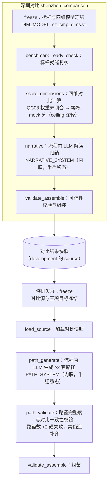
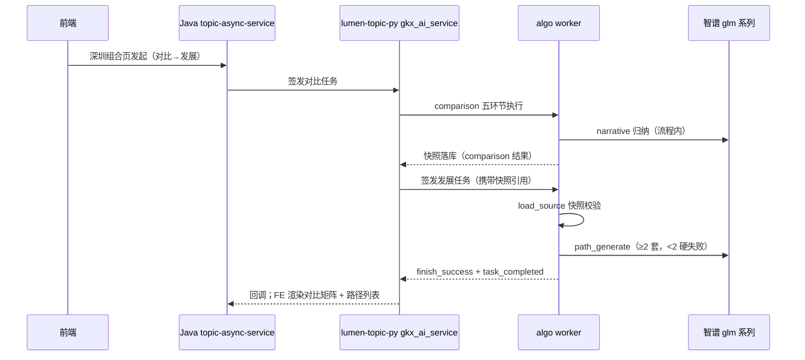

# 05.2.4 · 深圳产业对比与发展链路

| 项 | 内容 |
| --- | --- |
| 文档 | 科技专题服务系统 · 深圳产业对比与发展链路设计（对比 + 发展合并族） |
| 版本 | v0.1-draft |
| 日期 | 2026-10-28 |
| 条款 | `1.1.1.2.4.2.3.5` 页面叶子「深圳企业现状分析」（深圳产业链定位 / 多城市横向对标）；「深圳产业对比与发展」为专题侧深圳组合页的两段链路 |
| 产品合同 | 深圳现状/对标页随产业链五件套关联；具体卡面以 FE `IndustryShenzhen*` 页为准 |
| 现网 | SCIENCE/chain 五环节异步执行：深圳对比（四维对比 + 流程内 LLM 解读归纳）与深圳发展（消费对比快照 → LLM 生成 ≥2 套发展路径）；MQ 回传、Java 签发、报告框架同族；**无独立 narrate 收尾**——LLM 是流程内能力节点（对齐 05.2.1/05.2.2 同构），prompt 为「有名无文件」半迁移态 |
| 代码 | `lumen-algo-py` `lumen_common/algorithms/chain/shenzhen_comparison.py`（`PROMPT_PACK="shenzhen_comparison.narrative.prompts.v1"`、`DIM_MODEL="sz_cmp_dims.v1"`、`NARRATIVE_SYSTEM` 内联）、`shenzhen_development.py`（`PROMPT_PACK="shenzhen_development.path.prompts.v1"`、`PATH_SYSTEM` 内联）；前端 `lumen-ui-topic` 深圳现状/对标页 |

本文是深圳组合叶（对比 + 发展）的完整链路文。与产业链族共享异步骨架（引用不重写）；两叶有**快照依赖边**（development 消费 comparison 结果快照）。口径以现网 as-built 为准，本文不提出改口径。

---

## 1. 这条链路做什么

**深圳产业对比**：以标杆城市/区域为对照，对目标产业链做四维（产业/专利/政策/人才）对比计算，流程内 LLM 归纳解读（unique_advantages / gaps / disadvantages / narrative）。**深圳发展**：加载对比结果快照，按三项目标（政策/技术/人才）由 LLM 生成 ≥2 套发展路径（name/steps/horizon/targets/condition/limit）+ 三段建议。两叶合跑即「先对比、后发展」的组合页主链。

## 2. 完整逻辑

### 2.1 链路图（含快照依赖边）

失败重试/取消/超时/并发与 05.3.1 §6 共享，引用不重写。

## 3. 两叶 as-built 逐行对照

### 3.1 深圳对比（shenzhen_comparison.py）

| 项 | as-built |
| --- | --- |
| STAGE_LABELS | freeze / benchmark_ready_check / score_dimensions / narrative / validate_assemble |
| 四维 | industry 产业 / patent 专利 / policy 政策 / talent 人才（`DIM_MODEL="sz_cmp_dims.v1"`） |
| 分数来源 | `QC08 权重未闭合 → SZ_MOCK 等权 mock 分`（源码 ponytail ceiling 注释：升级=甲方确认后改 rule_pack） |
| 流程内 LLM | `narrative` 环节，`NARRATIVE_SYSTEM` 内联：「只归纳解读，不得改四维分数与矩阵标签；禁止合并产业与人才标签；只输出 JSON {unique_advantages,gaps,disadvantages,narrative}」 |
| 禁区 | `FORBIDDEN_KPI_BLOCKS`（产业发展摘要/development_summary_kpi/summary_metrics_kpi 三块禁入对比报告）；`FORBIDDEN_SCORE_METRICS` 禁入分 |
| 结果 | `dimension_comparison:{rows, model}` + 四格解读；快照供 development 消费 |

### 3.2 深圳发展（shenzhen_development.py）

| 项 | as-built |
| --- | --- |
| STAGE_LABELS | freeze（对比源与三项目标冻结）/ load_source（加载对比快照）/ path_generate / path_validate / validate_assemble |
| 快照依赖 | `_snapshot_of` 兼容 source_snapshot/source_result/result_payload/snapshot 多代键 |
| 三项目标 | policy / technology / talent（`GOAL_KEYS/GOAL_LABELS`） |
| 流程内 LLM | `path_generate` 环节，`PATH_SYSTEM` 内联：「≥2 套路径；不得编造源外数字；不得宣称全球案例库已匹配；不得合并产业与人才标签；每条 path 含 name,steps,horizon,targets,condition,limit」 |
| 硬失败 | 路径数 <2 → 任务失败，禁伪造补齐；不自签 result_snapshot_id |
| 静默键 | `SILENT_KEYS`（快照内不回显字段集） |

### 3.3 半迁移态（如实记录）

两叶 `PROMPT_PACK`（`shenzhen_comparison.narrative.prompts.v1` / `shenzhen_development.path.prompts.v1`）**有 pack 名无文件**——生效文案是 `NARRATIVE_SYSTEM` / `PATH_SYSTEM` 内联。迁移方案对标已交付的 regional.gap.v1 / key_link.n4c.v2 手法：`prompts/chain/shenzhen_comparison.narrative.v1.txt` + `shenzhen_development.path.v1.txt` 落盘（或合一文件分节），经统一 loader 加载，pack 升 v2——**进实现单建议（SZ-NARRATE 或等价）**。

## 4. 结果组装

| 叶 | 信封要点 |
| --- | --- |
| comparison | `dimension_comparison:{rows, model}` + unique_advantages/gaps/disadvantages/narrative + 快照（供 development） |
| development | `paths[]`（≥2）+ policy/tech/talent 三段 advice + 快照引用回显；不自签 result_snapshot_id |

## 5. LLM 落点表（逐点位三档判定）

| 点位 | 判定 | 可改字段 | 事实包边界 | 无 Key 行为 | 优先级 |
| --- | --- | --- | --- | --- | --- |
| SZ-1 comparison·narrative 归纳 | **LLM（as-built）** | unique_advantages/gaps/disadvantages/narrative | 四维分数矩阵 + 对象标识；禁 KPI 禁区三块 | 归纳退空态（narrative 空），分数矩阵不受影响 | 已上线 |
| SZ-2 development·path 生成 | **LLM（as-built）** | paths[]（≥2）+ 三段 advice | 对比快照短板/优势 + 三目标 | 硬失败路径数不足=任务 failed（判定类，非文案） | 已上线 |
| SZ-3 四维分数与矩阵 | **规则锁死** | — | QC08 未闭合，等权 mock 分（⚠️ 源码 ceiling 注释） | — | 规则保持 |
| SZ-4 报告 KPI 禁区 | **规则锁死** | — | `FORBIDDEN_KPI_BLOCKS` | — | 规则保持 |
| SZ-5 prompt 文件化迁移 | **LLM 治理项** | — | — | — | 实现单（见 §8） |

- SZ-1/SZ-2 与金样三态差异（G 系列预登记，实现单收敛）：无 Key 行为未显式建模（流程内节点，无独立 skipped 语义）；失败语义=SZ-2 判定硬失败与「文案润色失败退稿」不同族，迁移时不得混淆。
- QC08（权重口径）只引用客户决策清单 🟡，不拍板。

## 6. 执行框架（并发 / 重试 / 取消 / 超时）

chain 异步框架与 05.3.1 §6 共享，引用不重写；两叶经由组合页编排的先后依赖见 §2.1 快照边。

## 7. 报告双路径

与族内 05.2.2/05.2.3 同构；`FORBIDDEN_KPI_BLOCKS` 为对比报告禁区块（as-built）。FE 消费缺口逐条对源码登记为 SZ-系列（实现单核对源码后补行级锚点，本文不臆测行号）。

## 8. 相关文档与开放项

| 项 | 说明 |
| --- | --- |
| [05.2.1 周期](./05.2.1-产业周期分析链路.md) | 链域体例金样；CY 不回潮 |
| [05.2.2 诊断](./05.2.2-产业诊断分析链路.md) / [05.2.3 区域](./05.2.3-区域产业评价链路.md) | 姊妹文（G 系列与 REGIONAL 系列格式来源） |
| QC08 | 四维权重口径 🟡（客户决策清单） |
| SZ-01 | prompt 文件化迁移（NARRATIVE_SYSTEM/PATH_SYSTEM → prompts/chain/shenzhen*.v1.txt，pack 升 v2）——实现单建议 |
| SZ-02 | 流程内 LLM 的无 Key/失败语义显式建模（对齐三态；注意与 SZ-2 判定硬失败区分） |
| SZ-03 | FE 消费缺口行级锚点登记（实现单核对源码） |
| SZ-04 | QC08 闭合后 SZ_MOCK 等权分退役（源码 ceiling 注释的升级路径） |

## 9. 修订记录

| 版本 | 日期 | 说明 |
| --- | --- | --- |
| v0.1 | 2026-10-28 | 首版（DOC-ENT-PAIN 后产业链队列 C3）：对比+发展合并族链路 + 四格外的流程内 LLM as-built 对照 + 半迁移态记录 + 落点表 SZ-1~5；口径零改动 |
