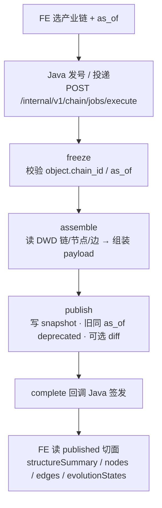

# 05.2.5 · 产业全景图谱（完整分析链路 · 本期不落 LLM）

| 项 | 内容 |
| --- | --- |
| 文档 | 科技专题服务系统 · 产业链「产业全景图谱」链路设计 |
| 版本 | v0.1-draft |
| 日期 | 2026-10-28 |
| 条款 | `1.1.1.2.4.2.2` 八叶子之首「全景图谱 / 结构可视化」（算法 `.3.1`/`.3.2`，标签 G1，读面 **Published-Cut / B 面**） |
| 产品合同 | `E2-产业链分析/` 五件套（CHAIN-TOPIC-* 全景相关；卡面/三态文案以五件套为准） |
| 前端锚点 | `lumen-ui-topic` → `IndustryPanoramaPage.vue` / `IndustryOverviewPage.vue`；组件 `IndustryPanoramaGraph` / `IndustryPanoramaDetail` |
| 现网 | freeze → assemble → publish 三节点；快照表 `industry_chain_graph_snapshot`；FE 读已发布切面三态（当前 / 对比 / 演进） |
| 金样体例 | 对齐 [05.2.1](./05.2.1-产业周期分析链路.md) 章节骨架；本叶**不是**异步诊断 Job 的「五节点+流程内 LLM」形态 |
| 相关探针 | [DOC-CHAIN-PANORAMA-LLM-PROBE-L01](../../DOC-CHAIN-PANORAMA-LLM-PROBE-L01.md)（结论曾为「有薄润色触点」） |
| **监管裁定** | **human:徐滕强 2026-10-28：本期不落 LLM**；`CHAIN-PANORAMA-NARRATE-L01` 搁置（blocked）。验收以规则切面为准 |

> **本叶性质**：主业是 **只播已发布图谱切面**（Published-Cut），不是诊断结论页。本文是 **as-built 链路说明 + LLM 落点表（明确不落）**，不发明新分析能力。

---

## 1. 这条链路做什么

用户在产业中心打开 **产业全景 / 概览**，选定一条产业链后：

1. 看该链 **当前已发布** 的节点 / 边 / 布局 / 结构摘要；
2. 可切换 **状态对比**、沿 **演进时间轴** 浏览历史 **published** 刻度；
3. 「开始分析 / 发布」类动作走 Job Runtime 厨房，产出新快照并发布；**不**在前端私自 diff 历史。

与周期 / 诊断 / 区域 / 深圳的差异（写死）：

| 维度 | 全景（本叶） | 周期·诊断·区域·深圳 |
| --- | --- | --- |
| 读面 | **B 面 Published-Cut** | 多为 Job Result / ADS |
| 主交付物 | `industry_chain_graph_snapshot` 切面包 | `result_payload` 诊断/指数板 |
| LLM | **本期不落（裁定）** | 流程内叙述落点（各 05.2.1–05.2.4） |
| 七键 / 报告 | **禁进切面包** | 另域，不写入全景 snapshot |

---

## 2. 完整逻辑（as-built）

| 步 | stage | 事实（代码锚点 `lumen-algo-py` `chain/panorama.py`） |
| --- | --- | --- |
| 1 | `freeze` | 要求 `chain_id`；`object.type` ∈ `{industry_chain, industry}`；解析 `as_of` |
| 2 | `assemble` | `load_panorama_facts` → 节点/边/布局；`structureSummary` 规则稿 = 链 `description` 或「{链名}全景结构（N 个环节 / M 条关系）」；禁七键字段进 payload |
| 3 | `publish` | 生成 `snap:{chain_id}:p:{date}:{token}`；同 as_of 旧行 deprecated；`graph_diff` 为结构化差集（非长文案）；demo 库门拒绝非 demo 前缀误写 |

调用链：前端 → Java REST → Python `/internal/*`（不可越层）。Java 不写 nGQL、不调 LLM。

---

## 3. 结果切面包（面向 FE）

| 字段 | 来源 | 说明 |
| --- | --- | --- |
| `structureSummary` | 规则稿（链 description 优先，否则计数句） | 页头 / 图卡摘要；**验收只认规则稿语义** |
| `nodes[]` | DWD 节点直拷（含 description/summary） | 数据字段，非模型生成 |
| `edges[]` | 关系表；`summary` **写死空串** | 无边级长文案能力 |
| `layout` | 布局算法 `panorama.v1` | baseline / 坐标 |
| `evolutionStates[]` | 与当前切面同源回显 | FE 时间轴主要用 value/label |
| `graph_diff`（旁路表） | 结构化 node_add / node_exit / … | 差异叙事若要做成长文，属**新能力**，须另开范围变更 |

---

## 4. LLM 落点表（监管裁定：本期不落）

> 判定三档沿用 05.3.2：规则 / LLM / 暂缓|锁死。本叶 **全部不纳入 LLM 验收**。

| # | 点位 | 判定 | 说明 |
| --- | --- | --- | --- |
| 1 | 图谱结构摘要 `structureSummary` | **规则（本期）** | 计数句 / 链 description；**不**作为 LLM 落点验收 |
| 2 | 时间轴 `evolutionStates[].description` | 规则（回显） | 与 summary 同源，非独立文案位 |
| 3 | 节点简介 `nodes[].description/summary` | 规则 | DWD 直拷 |
| 4 | 边摘要 `edges[].summary` | **规则锁死** | 空串；禁止为落 LLM 造边级数据 |
| 5 | `graph_diff` 叙事 | 规则 / 新能力另议 | 结构化差集；长文案须范围变更 |

### 4.1 代码遗留说明（诚实记账，不验收）

现网 `maybe_narrate()`（`panorama.py`）仍可能对 `structureSummary` 做一句薄润色（内联 prompt、旧三态词表）。**产品与 QA 本期视其为遗留实现，不纳入 DoD / 线上 LLM 验收**；失败或无 Key 时本就退回规则稿，与「只认规则切面」一致。若日后要正式落 LLM，须新开 feature 并改本表判定，不得静默当已交付。

关联实现单 `CHAIN-PANORAMA-NARRATE-L01`：**blocked**（搁置），非 ready 待开工。

---

## 5. 明确不做

- live 播放未发布历史；前端私自 diff
- 七键结论 / 报告入口进切面包
- 本期对 `structureSummary` 做 prompt 外置、三态对齐、温度治理等 NARRATE 代差改造
- 把全景做成诊断结论页（关键环节 / 瓶颈等另见 05.2.2）

---

## 6. 开放项

| ID | 内容 | 状态 |
| --- | --- | --- |
| OPEN-PANO-1 | 遗留 `maybe_narrate` 是否物理删除或长期保留 | 仅登记；**不**在本期拍板实现 |
| OPEN-PANO-2 | `graph_diff` 是否要差异叙事长文案 | 新能力；验收嫌干再议 |
| OPEN-PANO-3 | 企业挂接数组为空时的 UI 诚实态 | 产品五件套；不改口径 |

---

## 7. 架构合规自检（摘要）

| 铁律 | 自检 |
| --- | --- |
| 算法只在 Python | ✅ 组装/发布在 lumen-algo-py |
| 调用链 | ✅ FE → Java → `/internal/*` |
| 图谱 | ✅ Nebula 段计数只读可选；主结构来自 DWD 切面 |
| D12 | ✅ 正式仓 lumen-*；demo 防写门保留 |
| D9 | ✅ 本叶以结构切面为主；诊断 KPI 不进 snapshot |

---

## 8. 修订记录

| 版本 | 日期 | 说明 |
| --- | --- | --- |
| v0.1-draft | 2026-10-28 | 首版 as-built；监管裁定本期不落 LLM；挂总册指针 |
