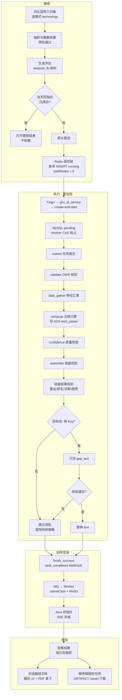
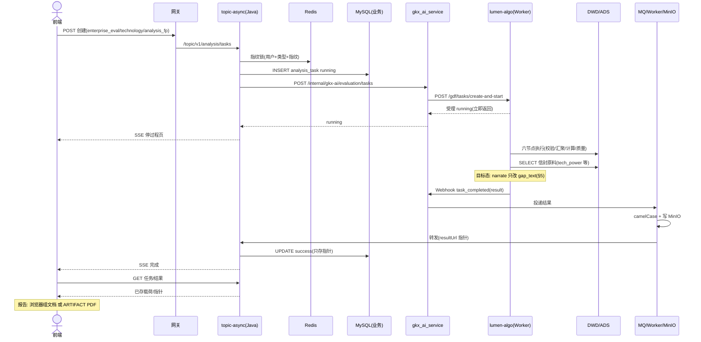
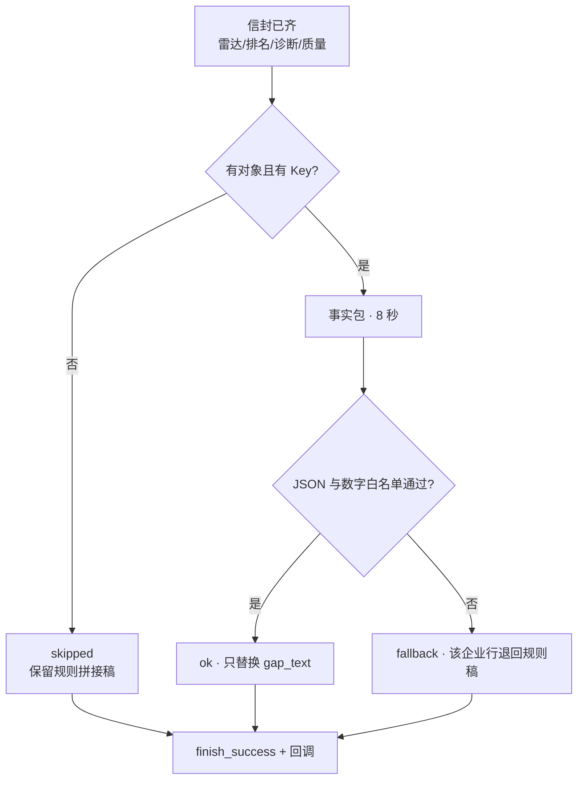

# 05.3.1 · 企业技术力评估对比分析

| 项 | 内容 |
| --- | --- |
| 文档 | 科技专题服务系统 · 企业技术力评估对比分析链路设计 |
| 版本 | v0.2-draft |
| 日期 | 2026-10-26 |
| 条款 | `1.1.1.2.4.2.3.3` 页面叶子「企业技术力评估分析」（E-23 / REQ-ENT-003） |
| 产品合同 | `E-23_E-24_E-30-企业评估/` 五件套（卡面以 Wireframe §3.2「技术力结果细节」为准） |
| 现网 | 接收、指纹单飞、六节点执行、五维计算、结果组装、MQ 回传、Java 签发、过程页、结果页、报告双路径。证据：`ENT-PY-ANALYSIS-完工.md`（v3.4）、`ENT-JAVA-ANALYSIS-CORE.md`、`ENT-JAVA-ANALYSIS-ARTIFACT.md`、`FE-ENT-EVAL-REPORT-REAL-L01.md`、`QA-KJZTFWSFK-SCRIPT-ENTAN-EVAL-ASYNC-L01.md` |
| 未观察到 | LLM 解读润色。**本叶（技术力评估 Job）无模型调用**——不同于政策时序「润色已跑、no_key 跳过」；目标态契约见 §5（v0.2，对齐 05.3.2 v0.9）。注：仓内另有链图谱类 `enterprise/narrative` 等，不在本叶 Job 路径 |
| 代码 | `lumen-algo-py` `lumen_common/tasks/executor.py`、`lumen_common/algorithms/evaluation/tech_power.py`、`lumen_common/tasks/{manager,webhook,repository,lifecycle}.py`；`lumen-topic-py` `gkx_ai_service/views/{evaluation,callback}.py`、`gkx_ai_worker/`；前端 `lumen-ui-topic` `EnterpriseEvaluation.vue`、`EvalResultWorkspace.vue`、`evalReportDocument.ts`、`config/enterpriseEvaluation.ts` |

产品卡面、指标说明与状态覆盖以五件套为准。本文写调用链、取数、组装、回传与（目标态）润色。体例对齐 [05.6.1 政策时序分析](./05.6.1-政策时序分析.md)。

---

## 1. 这条链路做什么

用户在 `/enterprise-center/evaluation` 配置技术力评估：从对比篮带入 2～50 家企业，选择指标与整数权重（合计 100），数据预检通过后点「生成评估」。Java 以 `analysis_fp` 指纹做当日单飞与成功复用，创建 `analysis_task` 并经 Python 编排层把任务交给算法侧。算法侧 Worker 按六个真实节点执行（任务提交 → 权限与配置校验 → 企业数据汇聚 → 指标计算 → 可信度与可比性校验 → 结果图表组装），把五维得分写回 ADS，再从 ADS 组装结果信封，经回调 + MQ + MinIO 交回 Java 签发。前端停在过程页看六节点进度，完成后进结果页；报告有浏览器组文档与服务端 PDF 两条路径，都不再触发计算。

与政策时序的两点结构差异，先写死避免混淆：

1. **六节点是真实执行单元**。`totalNodes=6`，过程页六段文案与算法侧节点 1:1 映射，SSE 按节点事件推进。政策时序的 `totalNodes=1`、五段说明文案的模式**不适用**于本链。
2. **执行是异步回调制**。创建请求只负责受理（Feign 返回 running），计算在算法侧后台完成，结果经 `task_completed` Webhook → MQ → MinIO 指针回流 Java。政策时序「同一次 execute 里做完」的同步模式**不适用**。因此润色收尾的位置在算法侧组装信封之后、落库回调之前（§5）。

调用链：前端 → 网关 `/api/topicAsync` → `gkxlumen-topic-async-service` `POST /topic/v1/analysis/tasks` → Feign `/internal/gkx-ai/evaluation/tasks`（`lumen-topic-py gkx_ai_service`）→ HTTP `/gdf/tasks/create-and-start`（`lumen-algo-py`）。Java 不调大模型、不写 nGQL、不读 DWD；Python 编排层不生成 taskId（Java 唯一发号）。

---

## 2. 完整逻辑



节点失败走有限重试（默认 3 次），耗尽才 `task_failed`；取消是逻辑取消（`cancel_flag`，节点边界生效，回调 `task_cancelled` 不是 `task_failed`）。润色（§5）夹在信封组装与落库之间，任何失败都不改变任务终态。



### 八步

| 步 | 状态 | 事实 |
| --- | --- | --- |
| 1 创建 | 现网 | `analysis_fp` 64 位 SHA-256 强制；`userId+analysisType+analysis_fp` Redis 锁单飞；按 `Asia/Shanghai` 当天成功复用；`force=true` 只跳过成功复用不绕单飞；`enterprise_codes` 2～50 家（技术力最少 2）；指纹与 force 不透传 Python。见 `ENT-API-I2-12-ANALYSIS-GATE-L01.md` |
| 2 校验 | 现网 | validate 节点查 DWD `enterprise_base`，`missing` 即节点失败（重试后仍缺 → `task_failed`，错误文案点名缺失企业） |
| 3 执行框架 | 现网 | 六节点顺序执行；全局并发 3（`LUMEN_ALGO_GLOBAL_CONCURRENCY`）；节点失败重试默认 3（`LUMEN_ALGO_MAX_RETRIES`）；超时默认 3600s + Java `analysisStatusReconcileJob` 对账。见 §6 |
| 4 计算 | 现网 | `tech_power.run(enterprise_codes)`：DWD 特征 → 五维 min-max（长尾维先 log1p）→ 权重加权 → 只替换请求行写 ADS `tech_power`；权重快照写 `eval_weight`（方法说明用）。见 §3 |
| 5 组装 | 现网 | `_compute_eval_result` 回读 ADS 组装信封（雷达五维/排名/诊断表/趋势/质量）。见 §4 |
| 6 润色 | **未实现** | 目标态契约见 §5：只改 `gap_text`，失败不打 failed。当前规则拼接稿直接落库 |
| 7 回传签发 | 现网 | `task_completed` → MQ → Worker（snake→camelCase、写 MinIO、resultUrl 指针）→ Java 只存指针不写全量 `result_data` → SSE |
| 8 报告 | 现网 | 双路径：FE 报告 v2（分块模型 + `jspdf`/`html2canvas` PDF 直下）与 Java ARTIFACT（`eval_report`/`eval_export` 产物任务，`/asset` 鉴权下载）。见 §7 |

---

## 3. 取数与计算

数据真源 DWD `gkxlumenx_dwd`，结果落 ADS `gkxlumenx_ads`。存储契约见 `storage/ENT/stores/mysql/`（`ads.md` / `dwd-entity.md` / `dwd-aggregate.md`）。

| 环节 | 事实 |
| --- | --- |
| 特征汇聚 | `load_enterprise_profiles(enterprise_codes)`：只读 DWD（企业主数据、专利、合作、创新载体、投标、融资、投资、供应链、风险等域）；缺字段表示为 0/空 + `available_fields` 元数据，**禁止合成回退**；正式列名优先，demo 旧同义列只作回退 |
| 五维原始特征 | 技术人才=高管数+2×合作类型数；技术创新=有效专利+0.3×被引；技术转化=合作专利+5×创新载体；技术合作=合作项目+10×合作类型；技术投入=融资次数+融资额/百万+注册资本/万。**注意：这是 lumen 正式仓特征公式，与 demo 仓 entan 旧公式（rd_staff/patent_grant 等）不同，以 lumen 为准** |
| 归一化 | 每维在**本次参评集合内** min-max 到 0-100（人才/创新/转化先 log1p 压长尾；全同值给 50） |
| 加权 | `tech_power_weights`（settings，受 Q014 临时默认约束）加权得 `tech_power_index`；集合内排名 `rank_overall` |
| 诊断 | `diagnose`：维分 ≥70 记优势、<45 记短板并挂 `ADVICE` 固定建议；建议文案是规则模板（见 §5 润色边界） |
| 趋势 | lumen 正式仓 `trend` 恒为空（DWD 无企业级技术力时序），`trend_available=false`、`trend_hint` 固定文案。**禁止把专利授权趋势改称技术力趋势** |
| 写回 | ADS `tech_power` 只 DELETE+INSERT 本次请求的 org_id 行（含旧调用别名残留清理）；权重写 `eval_weight` |
| 防护 | `assert_real_identifiers` / `assert_analysis_ready` / demo 模型版本直接拒绝——mock 状态禁止算正式分 |

诊断表现状（组装层）：`innovation_count` 取真实有效专利数；`rd_investment_pct` **恒 None**（DWD 无研发投入占比字段，诚实空，禁止补 0）；`confidence` 由 `available_fields` 覆盖档位推导（≥7 域 high / ≥4 medium / ≥1 low / 0 blocked），只反映源覆盖不反映分数。

---

## 4. 结果组装

`_compute_eval_result(sub_type=technology)` 在全部节点成功后、落库前执行，产出稳定信封（契约真源 `API-ENT-ANALYSIS-RESULT-CONTRACT.md` §1.2，v3.2 §9 三套 sub_type 之一）：

| 块 | 规则 |
| --- | --- |
| `radar_axes` / `radar_series` | 五维固定轴（技术创新/技术人才/技术投入/技术合作/技术转化），值取 ADS 五维分；缺失点前端断点显示，不画 0 |
| `ranking` | 按 `tech_power_index` 降序，覆盖任务全部对象；前端 >10 家 Top5 主蓝 + Bottom5 中性灰 |
| `diagnosis_rows` | 每企业一行：总分 / `innovation_count` / `rd_investment_pct`(None) / `confidence` / `gap_text`。`gap_text` = `_join_diagnosis(weaknesses, suggestions)` 规则拼接（如「技术转化(23.45)：…；技术合作(31.2)：…」）——**算法侧润色只改该字段**；报告 v2「关键发现」已按 FE 路径 A 接线消费（§5.5 / ENT-NARRATE-05，2026-10-26） |
| `trend_series` / `trend_available` | lumen 现网恒空 + 固定提示文案 |
| `summary` | `max_score` / `avg_score` / `enterprise_count` / `high_risk_count`(<40 计) |
| `data_quality` | `compute_data_quality` 逐企业覆盖/可信度/缺失指标快照（`missing_metric_ids` 如 `M_ENT_PATENT_GRANT_COUNT`） |
| 信封外层 | `task_id` / `analysis_type` / `sub_type` / `status` / `report_status=not_created` / `meta` / `enterprises` / `weights` / `data_source=entan` |

编排层 `_enrich_eval_result` 只加 FE 别名（`enterprise_code`/`coverage`/`missingMetricIds`/`radarSeries`/`dataTime`），不发明数值。前端 `evalResultMap.ts` 消费同一信封；`gapText` 缺失时前端有本地兜底文案（「距领先对象 X 分…」），该兜底属展示层逻辑，与后端润色无关、不删。

结果契约补充：双企对比走 `POST /evaluation/tasks/compare`（body 传 `task_id`/`enterprise_a`/`enterprise_b`，只读父任务结果，不建新任务）；「差异结论」当前为前端规则拼接（见 [05.3.2](./05.3.2-企业分析LLM落点表.md) 落点表 P1）。

---

## 5. 解读润色（目标态契约，未上线）

> 状态：**算法侧已实现**（2026-10-26 `LUMEN-ENT-EVAL-NARRATE-L01`，handoff 见 `agent-delivery/agent-handoffs/LUMEN-ENT-EVAL-NARRATE-L01.md`；as-built 锚点见 §5.7）。  
> 本叶（技术力）润色收尾已落地：无 Key / 无对象时 `skipped` 退规则稿，页面无感；FE 侧 ENT-NARRATE-05 路径 A 由 frontend-agent 同批交付。  
> 金样：[05.6.1 §5](./05.6.1-政策时序分析.md)；全域落点真源：05.3.2（页面对照 §1.1、密度说明 §1.2、开放项 §3）。

### 5.0 本叶页面落点（防迷路）

技术力结果页与报告是**两处消费**，后端字段只有一个：

| 位置 | 页面可见名 | 后端字段 | 现网是否消费后端稿 | 目标态 |
| --- | --- | --- | --- | --- |
| 结果页 | 「技术指标与差距诊断」表 · 尾列「领先差距与优势短板」 | `diagnosis_rows[].gap_text` → FE `gapText` | ✅ 已接（`EvalModeResultBody` techColumns） | **P0**：`narrate_eval` 只改该字段 |
| 报告 v2 | 「关键发现」块 | 同上（经 `diagnosisByCode`） | ✅ 已接（`evalReportDocument.ts` 路径 A，ENT-NARRATE-05，2026-10-26）：稿在规则两句后按企业追加，skipped/无稿退 FE 规则两句 | **P0 同批**：润色稿落快照即进报告 |
| 结果页 KPI / 结论条 / 雷达 / 排名 | — | 结构化数 | ❌ 不润色 | 规则保持 |
| 趋势条 | `trend_available=false` 固定提示 | — | 诚实空 | **暂缓**（无时序数据前禁 LLM 趋势解读） |

FE 兜底句（`gapText` 缺失时「距领先对象 X 分…」）只在 mock/无结果时出现；真实任务必有后端规则稿，润色只替换后端稿，不删 FE 兜底。

### 5.1 位置与边界

信封组装完成后、`finish_success` 落库之前，仍在算法侧 Worker 同一执行流内收尾（函数名目标态：`narrate_eval`）。

**本叶（`sub_type=technology`）模型只改 `diagnosis_rows[].gap_text`。**

| 不动 | 理由 |
| --- | --- |
| `suggestions` / ADVICE 固定话术 | Q014 未闭合；润色等于给临时口径穿正式外衣（ENT-NARRATE-02） |
| 分数、排名、雷达、`confidence`、`data_quality`、`trend_*`、`missing_metric_ids`、`weights` | 结构化真源，非文案 |
| 结果页「结论条」 | 现阶段规则（05.3.2 P3）；输入全是结构化差值 |
| 报告「关键发现」的**生成** | 不在算法侧另起 findings；算法只产 `gap_text`，报告由 FE 路径 A **消费** |



### 5.2 事实包（只带汇总，不带企业原始明细）

```
{
  "sub_type": "technology",
  "enterprise_count": 5,
  "weights": {五维权重},
  "summary": {max_score, avg_score, high_risk_count},
  "enterprises": [
    {
      "name": "…", "tech_power_index": 78.5, "rank": 1,
      "dimension_scores": {技术创新: …, 技术人才: …, 技术投入: …, 技术合作: …, 技术转化: …},
      "advantages": [{name, score}], "weaknesses": [{name, score}],
      "confidence": "high", "innovation_count": 12,
      "missing_metric_ids": […]
    }, …
  ],
  "drafts": [{"enterprise": "…", "gap_text": 规则拼接稿}]
}
```

不送：企业融资额、注册资本、诉讼明细等原始特征；不送 `rd_investment_pct`（恒 None，送了诱导编数）。50 家时只带汇总（ENT-NARRATE-03）；仍超预算可分批调用，**禁止**砍掉企业行。

### 5.3 校验规则（写死）

- 返回 JSON `{"cards":[{"enterprise":"企业名","text":"中文短评"}]}`；企业名必须在事实包内，多出来的丢弃。
- 单条 `text` ≤80 字；**数字白名单**：文案里每个数字必须能在事实包里找到（浮点相等）。
- 禁因果句（因为/由于/导致/受…影响）；禁发明维度名与 metric 名（五维名固定）；禁把 `rd_investment_pct` 空写成 0 或任何数；禁把趋势不可用写成趋势结论；禁扩写行业事实或策略推断（对齐五件套 US-REPORT「只归纳任务快照结构化结果」）。
- 无 Key：`narration={status:skipped, model:"", reason:no_key}`；超时（8 秒）/异常/坏 JSON/数字不在包：`fallback`，该企业行退回规则稿，**任务仍 success**。
- 客户端：`timeout_sec=8`、`max_retries=0`、`temperature=0.1`；密钥只在集群 Secret `gkx-zhipu-llm`，不进仓库。
- `narration` 随信封返回，**业务界面不展示**；润色失败不改 `confidence`/`data_quality`，不新增 `degraded`（避免与取数失败混淆）。
- Java / `gkx_ai_service` 不感知、不透传 Key——润色只活在 `lumen-algo-py`。
- 测试注入 `_narrate_client`（对齐政策 `test_policy_narrate.py`）。

### 5.4 允许写成什么（示例）

以规则稿「技术转化(23.45)：推动专利、创新载体与合作成果转化；当前 DWD 无技术交易额字段」为底，润色后允许：*「技术转化 23.45 分为当前短板，低于 45 分线；建议围绕专利产业化与创新载体共建补强。」*——数字来自事实包、无因果推断、不越 80 字。不允许：*「由于研发投入不足导致转化偏弱，建议加大亿元级投入」*（因果 + 事实包外数字 + 编策略）。

### 5.5 同函数覆盖面与报告接线（与 05.3.2 v0.9 对齐）

`narrate_eval` = **一个收尾函数、三种事实包**（实现可同批或紧随，契约相同）：

| 梯度 | `sub_type` | 算法只改字段 | 结果页消费 | 报告 v2 消费 |
| --- | --- | --- | --- | --- |
| **P0（本叶）** | `technology` | `diagnosis_rows[].gap_text` | ✅ 尾列已接 | ✅ 路径 A **已接线**（`evalReportDocument.ts`，2026-10-26）：`gapText` 进「关键发现」，skipped 退 FE 规则句 |
| P1 | `business` | `diagnosis_rows[].diagnosis_text` | ✅ 「诊断结论」已接 | ✅ 路径 A **已接线**（同一次 FE 交付）：`diagnosisText` 进「关键发现」，skipped 退 FE 规则句 |
| P1 | `competitiveness` | `dimension_rows[].gap_text` | ❌ 结果页两列是 **FE 数字拼接**，保持规则、不消费后端稿 | ✅「维度差距诊断」尾列 +「关键发现」weakLines **已接**，润色落快照即覆盖、**零 FE 改动** |

**ENT-NARRATE-05（已拍板，监管人 human:徐滕强 2026-10-26）**

- 根因：`evalReportDocument.ts` 现状只消费 `dimensionRows[].gapText`；technology/business 后端无 `dimension_rows`，故「关键发现」进不去后端润色稿。
- **路径 A（采纳）**：FE 报告构造器把 `diagnosisByCode` 的 `gapText` / `diagnosisText` 接进「关键发现」（对齐竞争力消费模式）；纯 FE；与 P0/P1 润色**同批交付**。skipped 时退 FE 规则两句。
- **路径 B（不采纳）**：后端另产 `summary.findings[]` 集合级草稿——除非 P0 验收后明确要跨企业整体归纳再重开。

服务端 ARTIFACT「决策摘要」**暂不**另开润色（ENT-NARRATE-04）；摘要素材用已润色的 `gap_text` 即可。

### 5.6 Prompt 统一管理（多场景硬约束）

后续企业/产业链/服务链等多场景都会接 LLM，**禁止**在各业务 `.py` 里散落硬编码长 system/user 字符串（政策 `insight_narrate.py` 内联 `_SYSTEM` 为历史债，新实现不跟抄）。

| 项 | 要求 |
| --- | --- |
| 存放 | 算法仓 Common 下统一目录（建议 `lumen_common/prompts/` 或等价），按域/能力分子目录；文件版本化命名（如 `ent.eval.narrate.v1.txt`），代码只引用 **prompt_pack id + 版本** |
| 加载 | 单一 loader（读文件/打包资源）；业务函数禁止再拼第二套文案真源 |
| 内容质量 | **数据科学家专业口径**：角色=产业/企业分析顾问；只依据事实包归纳；禁空话、禁营销腔、禁因果臆断、禁编数；与 §5.3 校验同向；中文短评、维度名与指标名固定 |
| 变更 | 改 prompt = 升版本号 + 单测金标样例；禁止 silent 改同名文件语义 |
| 与链域对齐 | 链侧已有 `PROMPT_PACK = "*.prompts.v1"` 元数据习惯；企业评估新包纳入同一治理，逐步收敛旧内联文案 |

本叶 `narrate_eval` 首包即按上表落盘；痛点 `narrate_pain`、后续场景复用同一目录与 loader。

### 5.7 本叶交付批次（DoD 锚点）

| 交付物 | 仓 / 角色 | 锚点 |
| --- | --- | --- |
| `narrate_eval`（至少 technology；business/competitiveness 同函数换包） | `lumen-algo-py` / algorithm-agent | 本节 §5.1–§5.6 + `narration` 三态 + `_narrate_client` 单测；建议单 `LUMEN-ENT-EVAL-NARRATE-L01` |
| 报告「关键发现」路径 A | `lumen-ui-topic` / frontend-agent | ENT-NARRATE-05；`USE_MOCK=false` 禁 fixture 填文案 |
| 不在本叶同批 | — | 痛点四格 `narrate_pain`（05.3.2 P7，另单）；招引/培育 P3 可选；规则锁死项（断链风险、风险与信用） |

> **as-built（2026-10-26，L01）**：算法侧 `narrate_eval` 已交付——`lumen_common/tasks/narrate_eval.py`（一个函数三种事实包）+ `lumen_common/tasks/executor.py::_narrate_eval_tail`（`_compute_eval_result` 后、`finish_success` 前）+ `lumen_common/prompts/ent/eval.narrate.v1.txt`（§5.6 统一 prompt，`PROMPT_PACK="ent.eval.narrate.v1"`）；三模式同批全接；测试 `tests/test_ent_eval_narrate.py`（10 例：三态 / 只改文案 / 数字白名单 / 禁句 / 事实包断面 / 8s-0 重试）。观测补记指引：`narration` 随结果信封持久化，日志检索 `narrate_eval sub_type= status=`（另见 handoff §观测补记）。

---

## 6. 执行框架（并发 / 重试 / 取消 / 超时）

政策时序的三档分片不适用于企业评估（对象上限 50 家，无全表扫描面）。企业侧执行控制：

| 项 | 值 | 说明 |
| --- | --- | --- |
| 状态库 | `gkxlumenx_cfg.lumen_analysis_task` / `_node` / `_retry` | 算法侧自有 MySQL；pending 只在算法侧，对上永远映射 running |
| 抢占 | Worker `claim_pending` CAS pending→running | `params` 大 JSON 不进排序 SELECT（线上 filesort 事故 REC-20261016-029 教训） |
| 并发 | 全局信号量 3（`LUMEN_ALGO_GLOBAL_CONCURRENCY`） | 满则回 pending 等下轮 |
| 节点回调 | `step_started`/`step_completed` 重叠异步 | 不等 Webhook 返回即推进下一节点 |
| 失败 | 节点失败重试默认 3 次，耗尽 `task_failed`（CAS 防覆盖超时/取消） | 回调 payload 强制带 `analysis_type`，全 snake_case（D-30） |
| 取消 | `POST /gdf/tasks/{id}/cancel` 设 `cancel_flag`，节点边界检查 | 终止后发 `task_cancelled`（**不是** `task_failed`，D-31）；正在跑的节点可跑完但不提交结果 |
| 超时 | 默认 3600s（`LUMEN_ALGO_TASK_TIMEOUT`）+ `detect-timeout` | Java 侧 `analysisStatusReconcileJob` 对账兜底（无锁 redeliver、超时 failed） |
| 幂等 | taskId 全局唯一（Java 发号） | 重复 taskId 拒绝；回调去重 task_id+event+node_index 有界 LRU |

---

## 7. 报告双路径

| 路径 | 事实 | 证据 |
| --- | --- | --- |
| FE 报告 v2（浏览器组文档） | `evalReportDocument.ts` 分块模型（KPI/对象与范围/关键发现/排名条形/维度雷达/排名明细/维度差距/来源/局限性）；`EvalReportReader.vue` A4 分页渲染；`jspdf`+`html2canvas` 直下 PDF（文字图片化，天花板已注释）。诚实空态不伪闭合；KPI 带 metric_id 供 ⓘ | `FE-ENT-EVAL-REPORT-REAL-L01.md`（2026-10-24 走查通过，`2df95de`） |
| Java ARTIFACT（服务端产物任务） | `eval_report`/`eval_export` 六类产物任务挂 `parent_task_id`；Thymeleaf→OpenHTMLtoPDF；`/asset` 鉴权代理下载；幂等 `userId+analysisType+parentTaskId+format` | `ENT-JAVA-ANALYSIS-ARTIFACT.md`（`9c6dc44`） |

两条路径都从**不可变结果快照**取数，生成报告不重新调用算法。§5 润色写入快照后：

- **竞争力**报告两块现已消费后端 `gap_text` → 润色后自动同源；
- **技术力/商业力**「关键发现」已完成 ENT-NARRATE-05 路径 A FE 接线（2026-10-26，`evalReportDocument.ts`）：润色稿落快照即进报告，三模式报告与结果页**同源**；skipped/无稿时报告退 FE 规则两句。算法侧润色（L01，2026-10-26）已写入快照，`narration.status=skipped` 时文本即规则稿、页面与报告均无感。

五件套 US-ENT-EVAL-REPORT 为产品合同，本表只记 as-built 分工与接线缺口。

---

## 8. 相关文档

| 文档 | 关系 |
| --- | --- |
| [05.3 企业](./05.3-企业.md) | 十叶子总册。本文只展开技术力评估 |
| [05.3.2 企业分析 LLM 落点表](./05.3.2-企业分析LLM落点表.md) | **全域落点真源**（v0.9）；本节 §5 契约须与之同步 |
| [05.6.1 政策时序分析](./05.6.1-政策时序分析.md) | 润色契约金样（`narrate_board` 模式） |
| `E-23_E-24_E-30-企业评估/` 五件套 | 产品合同。卡面、状态覆盖、GAP 以此为准 |
| `企业战略分析-ENT/API-ENT-ANALYSIS-RESULT-CONTRACT.md` | 结果信封契约真源（三套 sub_type） |
| `企业战略分析-ENT/ARCH-ANALYSIS-TASK-设计方案.md` | 任务框架架构真源（v3.4，D-30～D-33） |
| `storage/ENT/stores/mysql/` | DWD/ADS 存储契约 |

---

## 9. 修订记录

| 版本 | 日期 | 说明 |
| --- | --- | --- |
| v0.1 | 2026-10-26 | 首版：技术力完整链路 + 润色初稿（仅 gap_text） |
| v0.2 | 2026-10-26 | §5 对齐 05.3.2 v0.9：补页面落点表、ENT-NARRATE-05 路径 A、三模式同函数覆盖、交付批次；勘误「报告自动同源」与「唯一文案对象」表述；§7 同步接线前置条件 |
| v0.3 | 2026-10-26 | 新增 §5.6 Prompt 统一管理（Common 版本化文件、禁业务代码内联长文案、数据科学家专业口径）；原交付批次改 §5.7 |
| v0.4 | 2026-10-26 | §5 状态改「算法侧已实现」：`narrate_eval` 落地（L01，三模式同批）；§5.7 补 as-built 锚点；§7 补快照同源现状（ENT-NARRATE-05 路径 A 仍待 FE 同批） |
| v0.5 | 2026-10-26 | FE 路径 A 接线完成（LUMEN-ENT-EVAL-REPORT-WIRE-L01）：§4 `diagnosis_rows` 行、§5.0 报告行 ❌→✅、§5.5 覆盖表 technology/business 报告列 ❌→✅；§7 三模式报告与结果页同源成立；自检 `scripts/eval-report-findings.test.mts`（5 用例：技术力 gapText / 商业力 diagnosisText / skipped 退规则句 / 竞争力 weakLines 回归 / 诚实空态） |
