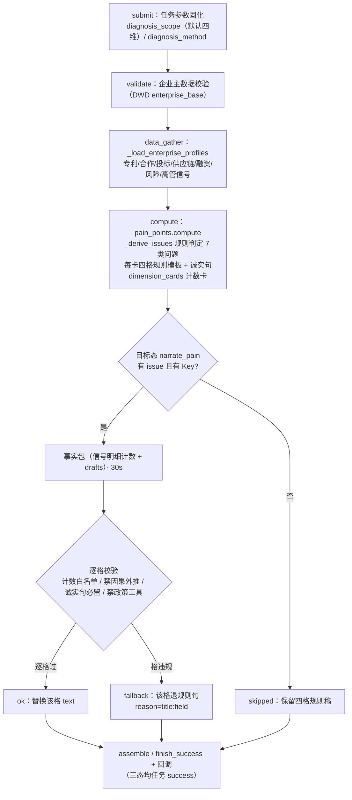
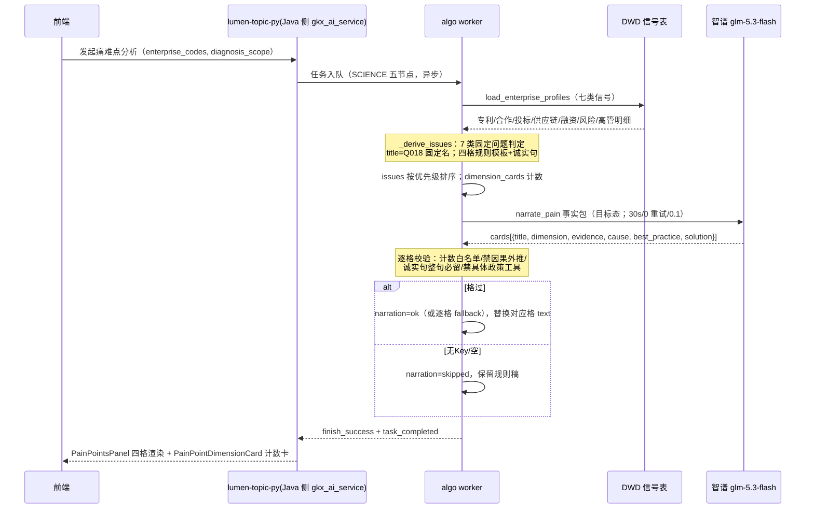

# 05.3.5 · 企业发展痛难点分析

| 项 | 内容 |
| --- | --- |
| 文档 | 科技专题服务系统 · 企业发展痛难点分析链路设计 |
| 版本 | v1.0-draft |
| 日期 | 2026-10-27 |
| 条款 | `1.1.1.2.4.2.3.9` 页面叶子「企业发展痛难点分析」（E-29 / REQ-ENT-009；子叶 `.9.1` 智能痛难点诊断模型、`.9.2` 分析建议报告输出） |
| 产品合同 | `E-23_E-24_E-30-企业评估/` 五件套关联页（痛难点面板随风险洞察工作区） |
| 现网 | SCIENCE 五节点异步执行、四维七类问题规则判定、四格规则模板、维度计数卡、MQ 回传、Java 签发、过程页、结果页、报告双路径；**无 LLM**——目标态 `narrate_pain` 见 §5（05.3.2 P7 判定 LLM-P2 唯一推荐落点） |
| 代码 | `lumen-algo-py` `lumen_common/algorithms/science/pain_points.py`、`lumen_common/tasks/{executor,manager,webhook,repository,lifecycle}.py`；前端 `lumen-ui-topic` `PainPointsPanel.vue`（四格渲染）、`PainPointDimensionCard.vue`（维度计数卡） |

本文是痛难点叶的完整链路文。与评估族共享 SCIENCE 骨架（引用不重写）；本叶主体=四维七类规则判定 as-built + 四格润色目标态契约。口径以现网 as-built 为准，本文不提出改口径。

---

## 1. 这条链路做什么

对企业集合（1~50 家）做**发展痛难点四维诊断**：技术研发 `tech_rd`、市场拓展 `market_expand`、融资 `financing`、管理 `management`。规则引擎比对 DWD 可观测信号，命中即产出问题卡（7 类固定问题），每卡含四格论证：命中依据 `evidence` / 成因 `cause` / 行业最佳实践 `best_practice` / 解决方向 `solution`；另出四维计数卡。产品语义对齐招标「智能痛难点诊断模型 + 分析建议报告输出」。

## 2. 完整逻辑

### 2.1 五节点链路图（与评估族六节点的差异：无 confidence 节点）





节点失败重试（默认 3 次）、取消（节点边界 `task_cancelled`）、超时（3600s）、并发（全局信号量 3）与 05.3.1 §6 共享，引用不重写。

## 3. 规则判定与四格模板（as-built，不改）

### 3.1 七类问题（title = Q018 判定输出，固定名禁润色）

| # | dimension | title | 触发信号（evidence 函数） | 诚实句 |
| --- | --- | --- | --- | --- |
| 1 | tech_rd | 专利储备偏弱 | 有效专利数低于同集合水平 | 「研发投入字段在当前 DWD 来源中不可用，未作为判断依据。」 |
| 2 | tech_rd | 产学研协同不足 | 有专利记录但无合作项目记录 | — |
| 3 | market_expand | 近期市场订单信号偏弱 | 有历史投标但近两年无投标 | — |
| 4 | market_expand | 供应链关系存在风险 | 供应链关系含中高风险 | — |
| 5 | financing | 近期融资活跃度不足 | 融资事件时序近期无活动 | 「营收字段在当前 DWD 来源中不可用，未推断现金流或营收水平。」 |
| 6 | management | 当前风险记录待治理 | 存在司法/失信/异常/处罚当前记录 | — |
| 7 | management | 高管数据不足以支撑治理判断 | 高管信号缺失或不足 | 「研发人员占比字段在当前 DWD 来源中不可用，未作为判断依据。」 |

### 3.2 四格规则模板

每格现网为写死一句（as-built 示例，#1 专利储备偏弱）：

| 格 | 规则句 |
| --- | --- |
| evidence | 命中企业计数 + 信号描述（动态函数，如「N 家企业有效专利储备较少」） |
| cause | 「现有 DWD 专利记录显示有效专利储备较少，核心技术保护能力需进一步核验。」 |
| best_practice | 「结合专利有效量、被引量和年度增长持续评估技术积累质量。」 |
| solution | 「梳理核心技术并加强有效专利布局，优先提升高被引和可转化专利储备。」 |

规则稿的缺陷（05.3.2 v0.8 判定）：七类×四格互相独立写死、不与具体企业集合呼应、论证链断裂——这正是 LLM 润色的价值点。

### 3.3 维度计数卡

`dimension_cards[]`：每维 `{dimension, issue_count, priority(高>中>低取最严), affected_enterprise_count}`——纯结构化计数，**规则保持**（05.3.2 已判无长文案不润色）。

## 4. 结果组装

信封外层：`{sub_type:"pain_points", summary:{enterprises, diagnosis_method, diagnosis_scope, data_time}, dimension_cards[], issues[], report_status}`（`task_id` 由 executor 统一回填）。

`issues[]` 每卡字段与润色触碰面：

| 字段 | 内容 | 润色触碰 |
| --- | --- | --- |
| `dimension` / `title` / `priority` | 维度标识 / Q018 固定名 / 高中低 | **否** |
| `typical_enterprises[]` | 典型企业名 | 否 |
| `evidence` | 命中依据（动态计数句） | **是（逐格）** |
| `cause` | 成因 | **是（逐格）** |
| `best_practice` | 行业最佳实践 | **是（逐格）** |
| `solution` | 解决方向 | **是（逐格）** |

## 5. 解读润色（目标态 `narrate_pain`，未上线）

> 状态：**设计**（实现另开 NARRATE feature 单，随 BIZCOMP 后排期）。金样：05.3.1 §5 + 本叶差异。硬约束四条来自 05.3.2 v0.8 拍板，写死。

### 5.1 位置与边界

`compute`（pain_points）结果组装之后、`finish_success` 之前，worker 同一执行流内；模式对齐 `narrate_eval`（复用同一 30s/0 重试/0.1 客户端与三态骨架），**不新建第二套收尾框架**。

**本叶只改 `issues[]` 四格 text；一格一格独立校验、逐格替换。**

| 不动 | 理由 |
| --- | --- |
| `title`（7 类固定名） | Q018 判定输出，润色=可追溯判定退化（05.3.2 v0.8 拍板①） |
| `dimension` / `priority` / `typical_enterprises` / 受影响计数 | 结构化真源 |
| `dimension_cards[]` | 纯计数卡 |
| 诚实句 | 见 §5.3 整句必留 |

### 5.2 事实包（只带信号计数，不带企业原始明细）

```json
{
  "sub_type": "pain_points",
  "enterprise_count": 5,
  "scope": ["tech_rd", "market_expand", "financing", "management"],
  "signal_summary": {
    "patent_total": 37, "cooperation_zero_count": 3, "bid_stale_count": 2,
    "supply_high_risk_count": 1, "financing_recent_zero_count": 4,
    "risk_open_count": 2, "executive_sparse_count": 5
  },
  "unavailable_fields": ["研发投入", "营收", "研发人员占比"],
  "issues": [
    {"title": "专利储备偏弱", "dimension": "tech_rd", "priority": "高",
     "affected_count": 3, "typical_enterprises": ["甲企业", "乙企业"],
     "drafts": {"evidence": "…", "cause": "…", "best_practice": "…", "solution": "…"}}
  ],
  "honesty_note": "研发投入/营收/研发人员占比字段在当前 DWD 来源中不可用，未作为判断依据"
}
```

不送：企业逐家原始特征（注册资本/融资额/诉讼明细）、`rd_investment_pct` 类空字段——与评估族同一边界。**signal_summary 的计数**是白名单主体（模型引用「3 家企业」「37 件专利」必须能溯源）。

### 5.3 校验规则（写死）

- 返回 JSON `{"cards":[{"title","dimension","evidence","cause","best_practice","solution"}]}`；`(title, dimension)` 定位卡（固定名天然唯一）；卡缺失/多出按 `missing:N` / `card{i}` 记。
- **逐格校验、逐格替换**：每格独立过检，违规格退该格规则句，其余格保留润色稿；`narration.reason` 记 `title:field:verdict`（verdict ∈ `long{N}|cause|num:{x}|policy|honesty_missing`）。
- 单格 ≤100 字（对齐评估族 `TEXT_LIMIT=100`）。
- **计数白名单**：文案中每个数字必须能溯源事实包（signal_summary 计数 / affected_count / 诚实句内数字）；浮点相等，正则与评估族同一套。
- **四条硬约束（05.3.2 v0.8 拍板，写死）**：
  1. 标题禁润色（不在 cards 可改字段内，协议层面即无此键的替换权）；
  2. **诚实句整句必留**：涉及字段不可用的 issue，润色稿对应格必须**原样包含**诚实句整句（子串匹配校验，`honesty_missing` 判拒）——模型只可润色该格其余文字；
  3. 成因禁因果外推：`cause` 格命中因果正则即拒（对齐评估族 `_CAUSE`），且禁将计数相关性写成因果断言；
  4. `solution` 保持方向粒度：命中具体政策工具词表（如「专精特新申报」「高新技术企业认定」「政府补贴」等白名单外政策名词，词表随实现单冻结）即 `policy` 判拒。
- 三态与评估族一致：`narration={ok|fallback|skipped}`；无 Key / 无 issues → `skipped`（退固定模板句=现网行为）；任何失败任务仍 success；`narration` 业务界面不展示。
- 客户端：`timeout_sec=30 / max_retries=0 / temperature=0.1`，复用 Common `llm_client`；密钥只在集群 Secret，Java 不感知。
- 事实包不送原始明细；`rd_investment_pct` 类恒空字段禁入包（对齐评估族）。

### 5.4 允许写成什么（示例）

规则稿 cause「现有 DWD 专利记录显示有效专利储备较少，核心技术保护能力需进一步核验。」润色后允许：*「本组 5 家企业中 3 家有效专利储备偏弱，研发投入字段在当前 DWD 来源中不可用，未作为判断依据；建议先补齐数据再评估技术积累质量。」*——计数 5/3 可溯源、诚实句整句保留、无因果外推。不允许：*「由于研发投入不足导致专利偏弱，建议申报专精特新认定获取补贴」*（因果外推 + 具体政策工具 + 编造投入不足）。

### 5.5 页面与报告接线

- 结果页 `PainPointsPanel.vue` 四格标签渲染：✅ 已接后端字段（evidence/cause/best_practice/solution）——润色稿落快照即同源，零 FE 改动；
- 维度计数卡：规则保持；
- 报告 v2：痛难点块同源消费四格（随评估族报告框架）；
- 服务端 ARTIFACT：暂不另开（ENT-NARRATE-04 同口径）。

### 5.6 Prompt 统一管理（§5.6 治理）

**新文件** `lumen_common/prompts/pain/pain.narrate.v1.txt`，`PROMPT_PACK = "pain.narrate.v1"`——与 `ent.eval.narrate.v3` 分文件：评估族是「单条短评改写」，本叶是「四格论证链连接 + 诚实句保留 + 禁政策工具」，语义不同不共用；同目录同 loader 同治理（升版删旧版、单一真源、业务 .py 禁内联）。prompt 草案要点（实现单落稿）：

- 角色=产业诊断顾问；任务=只改写四格 text，cards 与 issues 一一对应（title+dimension 回填）；
- 长度铁律（每格 40~85 字，100 硬上限）、计数白名单、禁因果外推、禁具体政策工具、诚实句整句保留；
- 中文、数据科学家口径、禁空话/营销腔。

### 5.7 本叶交付批次

| 交付物 | 仓 / 角色 | 锚点 |
| --- | --- | --- |
| `narrate_pain` 实现（executor 接线 + prompts/pain + 逐格校验 + 测试） | `lumen-algo-py` / algorithm-agent | 本节 §5 + 实现单（随 BIZCOMP QA 后排期） |
| FE / 报告 | 零改动 | §5.5 已同源 |

## 6. 执行框架（并发 / 重试 / 取消 / 超时）

SCIENCE 五节点；其余与 05.3.1 §6 完全共享，引用不重写。

## 7. 报告双路径

与 05.3.1 §7 同构；痛难点块消费四格润色稿（快照同源）；`report_status="not_created"` 字段语义同评估族。

## 8. 相关文档与开放项

| 项 | 说明 |
| --- | --- |
| [05.3.1 技术力](./05.3.1-企业技术力评估对比分析.md) | 润色契约金样（三态/事实包/校验框架） |
| [05.3.2 落点表](./05.3.2-企业分析LLM落点表.md) | P7 判定真源（LLM-P2 推荐 + 四条硬约束 v0.8 拍板） |
| [05.3.3](./05.3.3-企业商业力评估对比分析.md) / [05.3.4](./05.3.4-企业综合竞争力评估.md) | 评估族姊妹叶 |
| ENT-PAIN-01 | `narrate_pain` 实现单未开（本文 §5 为实现契约；随 BIZCOMP QA 后排期） |
| ENT-PAIN-02 | 政策工具词表冻结（solution 判拒依据）随实现单定稿；词表外新工具词出现时按 `policy` 拒 |
| ENT-PAIN-03 | `.9.2` 分析建议报告输出的报告模板细化（现 report_status 占位），与 ARTIFACT 框架对齐后另评 |

## 9. 修订记录

| 版本 | 日期 | 说明 |
| --- | --- | --- |
| v1.0 | 2026-10-27 | 首版（DOC-ENT-PAIN-ANALYSIS-CHAIN-L01）：五节点链路 + 四维七类规则 as-built + 四格润色目标态契约（诚实句整句必留/逐格退/禁政策工具/计数白名单）；口径零改动 |
