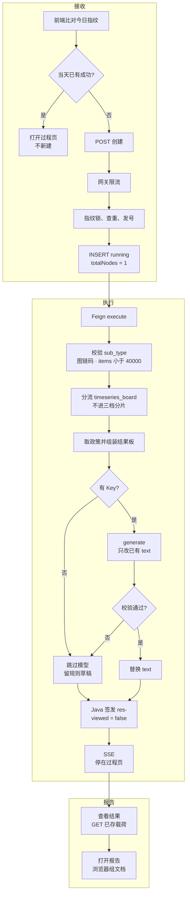
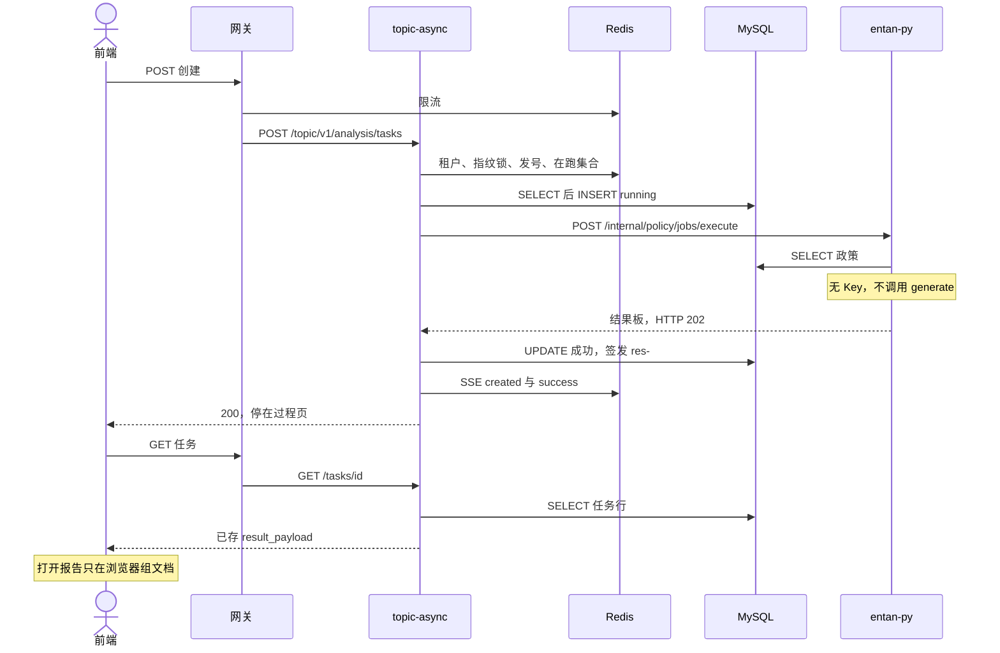
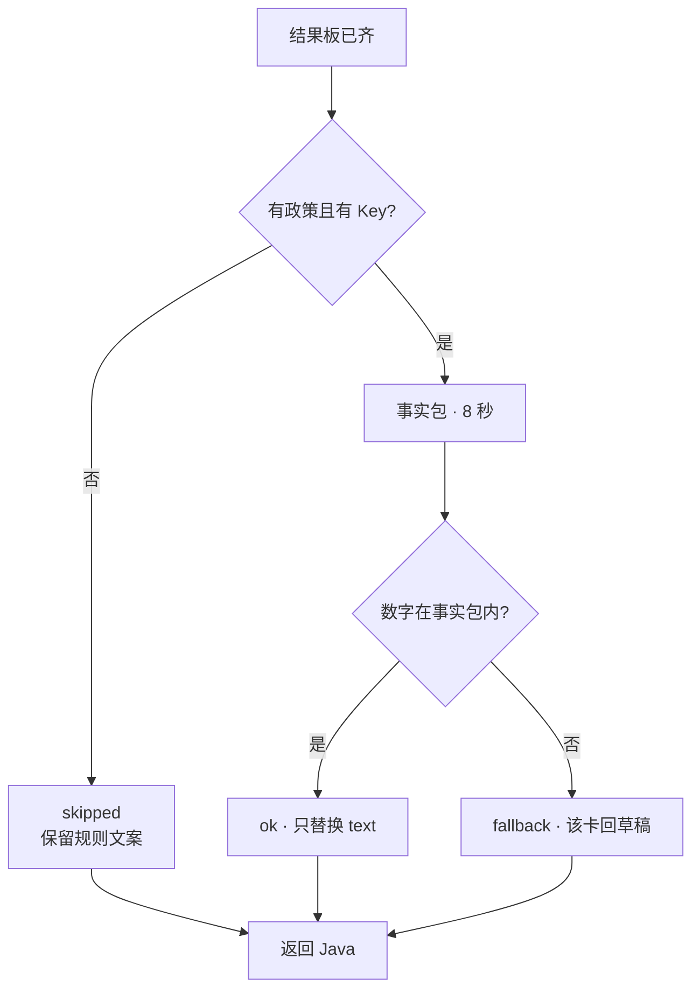

# 05.6.1 · 政策时序分析

| 项 | 内容 |
| --- | --- |
| 文档 | 科技专题服务系统 · 政策时序分析系统设计 |
| 版本 | v0.2-draft |
| 日期 | 2026-10-25 |
| 条款 | `1.1.1.2.4.2.6` 页面叶子「政策时序」 |
| 产品合同 | `E7-政策分析/FUNC-DESIGN-E7-政策分析.md` §4.1.1、§4.1.2 |
| 现网 | 接收、执行、签发、过程页读取、浏览器组报告。样例 `POLICY-20261025-005`、`POLICY-20261024-014` |
| 未观察到 | 有 Key 时的模型改写。005 的 `narration.status=skipped`，`reason=no_key`，未调用 `generate` |
| 代码 | `lumen-algo-py` `polan/job.py`、`polan/timeseries_board.py`、`polan/insight_narrate.py`、`polan/harness/core.py`；前端 `usePolicyAnalysisJob.ts`、`PolicyTimeseriesReportHost.vue` |

产品卡面、过程文案和洞察卡片以 FUNC-DESIGN 为准。本文写调用链、取数、组装、润色和三档分片。

---

## 1. 这条链路做什么

用户在 `/policy/overview` 提交时序分析。当天相同指纹已成功时，前端只打开过程页，不新建任务。否则 Java 在同一次创建请求里调用 Python。Python 从 DWD 取出政策，组装结果板，再做解读润色（无 Key 则跳过模型），返回给 Java 签发。前端停在过程页。查看结果只读取已存载荷。打开报告由浏览器用这份载荷组文档，不再请求 Python，也不调用大模型。

过程页五段文案是说明：`政策数据自动关联 → 时序模型智能分析 → 窗口期识别 → 结果组装 → 解读润色`。Java `totalNodes` 保持 1。

调用链：前端 → 网关 `/api/topicAsync` → `gkxlumen-topic-async-service` `POST /topic/v1/analysis/tasks` → Feign `POST /internal/policy/jobs/execute`。Java 不调大模型，不写 nGQL。Python 不签发 `result_snapshot_id`。

---

## 2. 完整逻辑

接收、执行、报告是一条链。执行在创建请求内做完。报告不另起任务。

005 走了「新建 → 无 Key 跳过 → 查看结果」。当天已有成功、有 Key 改写，这两条这次没走。打开报告不在这两条 trace 里，它是前端本地步骤。

| 段 | 005 观测 | 耗时 |
| --- | --- | --- |
| 创建 | trace `a17838469bc46b433e31ebb6b36c1636`，2026-10-25 01:42:18 | 整链 621 ms。Python 555 ms，其中政策 SELECT 299 ms，其后约 244 ms 无模型 span |
| 读取 | trace `84e396bdc2974dc6ca02de71df0c6994`，13:39:13 | 13.3 ms。只到 Java 与 MySQL，无 entan-py |
| 报告 | 无后端 span | 浏览器读已加载的 `result_payload` |

### 七步

时序在第 3 步离开 `harness.dispatch`。库内查出的条数不用来选分片档。三档分片见 §6，时序不进入。

| 步 | 状态 | 事实 |
| --- | --- | --- |
| 1 创建 | 现网 | `taskName` 等于任务 ID。当天相同指纹已成功则打开过程页，不自动进结果 |
| 2 校验 | 现网 | `sub_type=policy_timeseries`。出现的 `industry_vid` 必须匹配 `chain:` 或 `segment:`。`items` 达到 40000 条拒绝，错误码 `FULL_SCAN_FORBIDDEN` |
| 3 分流 | 现网 | 不调用 `harness.dispatch`。返回字段 `harness_mode=timeseries_board`。库内查出的条数不用来选分片档 |
| 4 取政策 | 现网 | 见 §3 |
| 5 组装 | 现网 | 见 §4 |
| 6 润色 | 跳过已跑，改写未观察到 | 见 §5。005 为 `skipped` / `no_key`。失败不把任务打成 failed |
| 7 签发 | 现网 | Java 写入 `targetParams.result_payload`，快照号 `res-{taskId}`，`page_mode_hint=process_succeeded_wait_view`，`viewed=false`。查看结果再 `GET .../tasks/{id}/result`。打开报告不发新请求 |

---

## 3. 取政策

入口 `resolve_policies` → `default_load_policies`。表是 DWD `policy_base_info`，条件含 `is_deleted=0`。查询上限 `ONLINE_FULL_SCAN_CEILING - 1`，即 39999。

| 顺序 | 条件 | 做法 |
| --- | --- | --- |
| 1 | 请求里已有带标题、年份或因素的条目，且没有「只有 ID」的条目 | 直接用这些条目，不再把库内同产业政策并进来。`honesty.source=items` |
| 2 | 有 `policy_id` | `policy_id IN (...)` |
| 3 | 有图链码 VID | ADS `policy_industry_rel` 等值 `industry_link_code` |
| 4 | 有 `industry_codes` | 多个 INB 做 `industry_link_code` 等值或分段匹配。`CL-*` 与非 INB 丢掉 |
| 5 | `industry_scope=all` 且没有 codes | 只保留未删除，不读关联表 |
| 6 | 以上都没有 | 空列表 |
| 7 | 库异常 | 空列表，`honesty.degraded=true`，`honesty.error=true` |

`scope=all` 且同时带了 codes 时，按 codes 过滤，不当成全库。集群内「全部」走第 4 行：`industry_scope=cluster` 加上该集群 L0 的 INB。

在线板不读请求里的 `granularity`。年序列按 `publish_year`。不读 ADS `policy_timeseries` 填这四张卡。

---

## 4. 结果组装

`build_timeseries_board` 在取数之后、润色之前写出结果板。`mode=timeseries_board`。

| 块 | 规则 |
| --- | --- |
| headline | `M_POLICY_TOTAL_COUNT` 为条数。`latest_year_publish_count` 为跨度最后一年的发布量。`M_POLICY_GROWTH_RATE` 为最近一个有发布年份相对上一公历年的增长率；上一年为 0 或缺失则为空。`M_POLICY_VALIDITY_RATE` 只计 `status` 为 1 且未过期，空状态不算有效。`M_POLICY_PEAK_YEAR_PUBLISH` 为切片内最大年发布量 |
| 年序列 | `density_trend` / `support_trend` / `level_trend` |
| 窗口年 | 该年发布量大于 0，且不低于「均值的 1.5 倍」与「峰值的 0.8 倍」里较大的那个 |
| 节点 | 窗口年优先，其次年份新的在前，最多 50 条 |
| 规则洞察 | 有峰值年才有「发布高峰」。增长率非空才有「最近环比」。有连续性才有「发布连续性」。有占比才有「有效占比」。无政策时只留「无匹配政策」 |
| 四张结果卡 | 政策总数、最近一年发布量、年度增长率、有效政策占比。读本次 `headline`，不读全库 `/policy/metrics` |

增长率和有效占比在界面上带 `%`。空增长率显示「—」，不显示 0。峰值年发布量不标成政策密度指数。

---

## 5. 解读润色

组装完成后，仍在同一次 `execute` 里收尾。005 已执行到本步：无 Key，`status=skipped`，`reason=no_key`，未调用 `generate`。有 Key 时模型只改已有卡片的 `text`。无 Key、超过 8 秒、JSON 不合格或数字不在事实包里时，任务仍成功，该卡退回规则草稿。有 Key 的成功改写尚未在现网观察到。

规则层决定卡片是否出现、标题、`tone`、`pending_ref`。模型只改 `text`。

| 卡 | 何时出现 | 模型边界 |
| --- | --- | --- |
| 发布高峰 | 有峰值年 | 只复述峰值年与条数。这条数是切片内最大年发布量 |
| 最近环比 | 增长率非空 | 写成百分数。空值时这张卡不出现，也不补成 0 |
| 发布连续性 | 连续性非空 | 保留「有发布年数 / 跨度年数」。`pending_ref=QPOL-07` 由规则挂上 |
| 有效占比 | 占比非空 | 只复述占比 |
| 节点分布 | `key_nodes` 非空时追加 1 张，`tone=flat`，标题固定 | 只用前 8 条的标题、日期、层级、是否窗口年。不评价条文，不概括摘要 |

事实包只带汇总：`match_object`、`policy_count`、年份起止、`headline` 原值、峰值年与条数、近三年的发布量和增长率、窗口年列表、前 8 个节点、节点总数、落在窗口年的条数、规则草稿。不送政策正文。

不改 `headline`、三条年序列、`key_nodes`、`policy_count`、`honesty.fabricated`。润色失败不把 `honesty.degraded` 设为真。返回旁增加 `narration`：`status=ok|fallback|skipped`、`model`、`reason`。业务界面不展示该块。

文案里的年份和数字必须能在事实包里找到。单卡 `text` 不超过 80 字，节点卡不超过 120 字。因果句拒绝。模型名、地址和密钥只在集群 Secret `gkx-zhipu-llm`（键 `model` / `base-url` / `api-key`），发布时由 GitLab 变量写入，不进仓库。操作见 [发布注意事项](../../../devops/发布注意事项.md)。本步 8 秒、不重试，与条款抽取的 45 秒分开。

以 `POLICY-20261024-014` 的规则结果为例，允许写成：

- 发布高峰：1981–2026 内，2020 年发布 2402 条，为观察期内最多的一年。
- 发布连续性：有发布的年份占跨度的 82.61%（有发布年数 / 跨度年数）。
- 有效占比：当前切片有效政策占 100%。
- 节点分布：只点名事实包前 8 条里的标题，并写明日期、层级、是否窗口年。

本单不出现「最近环比」：2026 年 3 条，2025 年 0 条，增长率留空。

区域对比的差异结论复用这一收尾，事实包换成 `compare_rows`。本文不展开区域。深圳优化建议走 `narrate_strategies`，Key、地址和模型名与本步同一套客户端，见 [05.6.2 §2](./05.6.2-深圳政策现状分析.md)。

---

## 6. 三档分片

`dispatch` 的默认算子是 `focus_one`。时序在 §2 第 3 步已经离开，不按库内条数进入下表。焦点、分片，以及现网尚未改道的其余子类，才走这里。

| 档 | 条数 | 行为 |
| --- | --- | --- |
| 同步 | 0–32 | 单片，`mode=sync` |
| 线程池 | 33–2000 | 批大小 32，最多 8 线程，单片 120 秒，重试 2 次 |
| fan-in | 2001–39999 | 需要 `parent_task_id`。子任务 ID `{parent}:s{序号}`，`sub_type=policy_shard` |
| 入口拒绝 | `items` ≥ 40000 | `FULL_SCAN_FORBIDDEN`。时序在进结果板之前同样拒绝 |

---

## 7. 样例

### POLICY-20261025-005

2026-10-25 01:42:18，用户 `guest`，创建 trace 见 §2。`analysisType=policy_timeseries`，`taskName` 等于任务 ID，`totalNodes=1`，状态 success。`narration` 为 `skipped` / `no_key`。洞察四张：发布高峰、发布连续性（`pending_ref=QPOL-07`）、有效占比、节点分布。没有最近环比。

| 项 | 值 |
| --- | --- |
| 范围 | `industry_scope=all`，`industry_name=全部` |
| 快照 | `res-POLICY-20261025-005` |
| 提示 | `page_mode_hint=process_succeeded_wait_view`，`viewed=false` |
| 模型 | 未调用。`model` 为空 |

### POLICY-20261024-014

2026-10-24 22:03:13–22:03:14，用户 `guest`。本单创建于润色上线之前，结果里没有 `narration`。

| 项 | 值 |
| --- | --- |
| 范围 | `industry_scope=all`，`industry_name=全部`，无 VID |
| 请求粒度 | `month`。结果按年，1981–2026 |
| 条数 | 20000 |
| 2026 / 2025 | 发布 3 / 0。增长率空 |
| 有效占比 | 100% |
| 峰值 | 2020 年 2402 条，是切片内最大年发布量 |
| 指纹 | `50f28165aeb91015…30c5dada` |
| 快照 | 输入 `ins-POLICY-20261024-014`，结果 `res-POLICY-20261024-014` |

---

## 8. 相关文档

| 文档 | 关系 |
| --- | --- |
| [05.6 政策](./05.6-政策.md) | 三叶子总册。本文只展开时序 |
| FUNC-DESIGN §4.1.1 / §4.1.2 | 产品合同。卡面与洞察规则以那里为准 |
| `storage/POLICY/01-data-flow.md` §2.2.1 | 数仓边。时序读 DWD，单产业或集群才读 `policy_industry_rel` |
