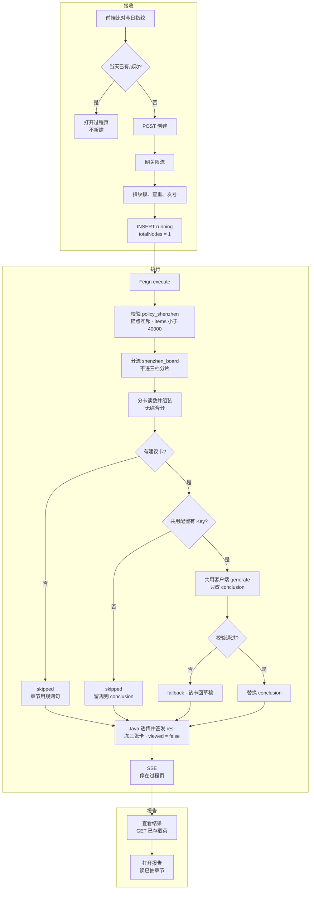
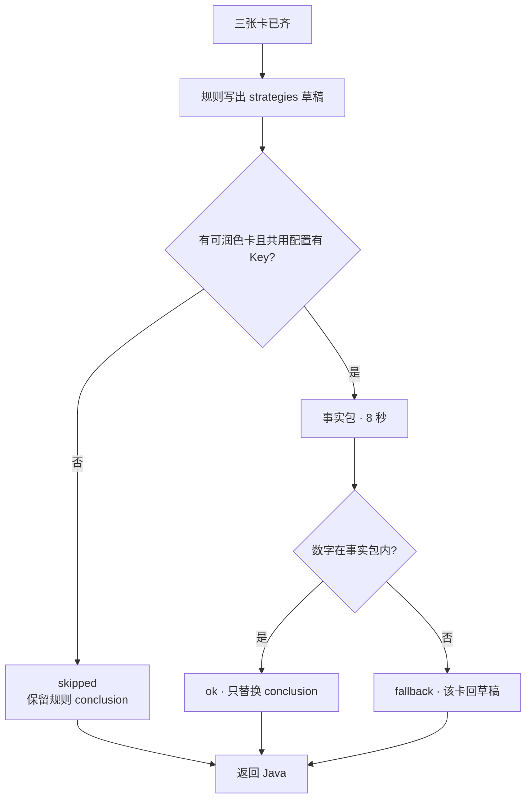

# 05.6.2 · 深圳政策现状分析

| 项 | 内容 |
| --- | --- |
| 文档 | 科技专题服务系统 · 深圳政策现状分析系统设计 |
| 版本 | v0.3-2026-11-07 |
| 日期 | 2026-11-07 |
| 条款 | `1.1.1.2.4.2.6.3` 页面叶子「深圳政策现状」 |
| 需规 | `agent-delivery/bid-reference/srs/04-科技专题服务系统/科技专题战略分析/政策分析.md` 序号 114–116。完成线等于这三句 |
| 产品合同 | `E7-政策分析/FUNC-DESIGN-E7-政策分析.md` §3.6（2026-11-07）。同文件 §4.3 仍是 2026-10-24 的固定卡句子，卡面以 §3.6 与本文为准 |
| 原型 | demo-ui-topic 配置页 `/policy/recommendation`，线上 `http://10.50.69.111:30888/policy/recommendation`。指标清单以 `POLICY_SZ_CORE_INDICATORS` 为准 |
| 现网 | 创建、签发、过程页读取与时序同一条 Java 链。深圳已离开 harness，`harness_mode=shenzhen_board`。已发布结果板仍把档位和实效写成不可算。Java 报告第 4 章抽取已推 `origin/dev`（`3a2c3c7` 合入 `a31ba3e`）。009/011 已存第 4 章仍是旧文案，要等新任务重算 |
| 前端 | 仓 `lumen-ui-topic`，页 `/policy/recommendation`，任务号 `LUMEN-POLICY-SZ3D-FE-SRS-R20261107`。另一支执行。改动停在本地，推送另说。本文不改代码 |
| 代码 | `lumen-algo-py` `polan/job.py`、`polan/shenzhen_board.py`、`polan/insight_narrate.py`（`narrate_strategies`）；Java `PolicyShenzhenSnapshot`；结果页 `PolicyShenzhenResultBoard.vue` |
| 实现叶 | `LUMEN-POLICY-SZ3D-B/C/D/E0/E1` 与前端任务 `LUMEN-POLICY-SZ3D-FE-SRS-R20261107`。总控 `政策模块-E7/LUMEN-POLICY-SZ3D-长任务总控.md` |

产品卡面以 FUNC-DESIGN §3.6 为准。完成线是需规 114–116，不再把自由选指标和仪表盘写成覆盖不到、不实现。本文写调用链、配置区、分卡取数、结果板、仪表盘、优化建议润色和报告章节。润色的失败边界与 [05.6.1 §5](./05.6.1-政策时序分析.md) 相同。Key、服务地址和模型名不另设，见 §2。本文只改事实包、卡片名单和要替换的字段（`conclusion`）。

## 0. 需规完成线

| 序号 | 需规原文要点 | 落点 |
| --- | --- | --- |
| 114 | 在「政策支持力度－产业适配性－落地实效性」三维框架下，用户可自由选择政策数量、资金规模、创新激励等核心指标，构建定制化分析模型 | §4.1 配置区。清单是 10 项，不收成三个勾选 |
| 115 | 系统自动计算选定产业/技术领域下深圳的政策指标得分，生成政策竞争力评估报告 | §3 三张卡取数；§6 报告。通过样本是 009、011 |
| 116 | 通过仪表盘展示深圳政策优势领域与短板环节，辅助制定区域政策优化策略 | §4.3 仪表盘；优化策略仍走 §5 |

`QPOL-02` 仍未会签。一级权重和档位切点不标成已确认。不出综合分。空值不写成 0。不读招标金额。

---

## 1. 这条链路做什么

用户在 `/policy/recommendation` 提交深圳政策现状分析。创建请求写入本次勾选的 `selectedIndicators` 和一级权重，不再把 `selectedIndicators` 固定成空对象。产业提交同时带链名（`industry_name`），不能只交 `industry_vid`。技术领域仍带关联产业。Java 创建任务并在同一次请求里调用 Python。Python 离开 harness，按三张卡组装结果板，再为「优化建议」写规则草稿并可选润色，返回给 Java 签发。前端先停在过程页，用户再打开结果。结果页用接口返回的三维分数做仪表盘。报告只读这次已签发的结果，不再次调用模型。

过程页五段文案是说明：`条件校验 → 分卡读数 → 结果组装 → 优化建议 → 解读润色`。Java `totalNodes` 保持 1。

调用链：前端 → 网关 `/api/topicAsync` → `gkxlumen-topic-async-service` `POST /topic/v1/analysis/tasks` → Feign `POST /internal/policy/jobs/execute`。Java 不调大模型，不写 nGQL，不把 `null` 改成 0。Python 不签发 `result_snapshot_id`。

`sub_type=policy_shenzhen`（surface `policy:recommendation:policy_sz_3d`）。已离开 `harness.dispatch`，与时序、区域同级，`harness_mode=shenzhen_board`。焦点和 `policy_shard` 仍走分片。

---

## 2. 完整逻辑

接收、执行、报告是一条链。执行在创建请求内做完。报告不另起任务，也不再调模型。



无建议卡、无 Key、超时、坏 JSON 或数字不在事实包里，都不调用第二次模型，任务仍成功。Java 不调模型。


模型不单开一套。`narrate_strategies` 与时序 `narrate_board` 共用 `entan.common.llm_client.OpenAICompatibleClient` 和 `_default_client`。

| 项 | 通用来源 | 本步 |
| --- | --- | --- |
| Key | `ENTAN_LLM_API_KEY`，否则 `settings.yaml` 的 `llm.api_key`，否则 `OPENAI_API_KEY`。空则 `has_llm_key()` 为假，不建客户端 | 不另设深圳 Key |
| 地址 | `ENTAN_LLM_BASE_URL`，否则 yaml `llm.base_url`，否则客户端默认 | 不另设 |
| 模型名 | `ENTAN_LLM_MODEL`，否则 yaml `llm.model`，否则客户端默认 | 不另写模型名 |
| 全局超时 | `ENTAN_LLM_TIMEOUT_SEC`，默认 45 秒，条款抽取用这个 | 不改 |
| 本次调用 | 客户端入参 | 超时 8 秒，`max_retries=0`，`temperature=0.1` |

本图按已推代码写。没有时序 005 那样的现网 trace，所以不写毫秒。无 Key 时执行链上不应出现模型 span。

### 七步

深圳在第 3 步离开 `harness.dispatch`。库内查出的条数不用来选分片档。三档分片见 [05.6.1 §6](./05.6.1-政策时序分析.md)，深圳不进入。

| 步 | 状态 | 事实 |
| --- | --- | --- |
| 1 创建 | 现网 | 与时序相同。`taskName` 等于任务 ID。当天相同指纹已成功则打开过程页，不自动进结果。请求带 `selectedIndicators` 与一级权重 |
| 2 校验 | 已推代码 | `sub_type=policy_shenzhen`。出现的 `industry_vid` 必须匹配 `chain:` 或 `segment:`。产业与技术领域不得同时生效。`items` 达到 40000 条拒绝，错误码 `FULL_SCAN_FORBIDDEN` |
| 3 分流 | 已推代码 | 不调用 `harness.dispatch`。返回 `harness_mode=shenzhen_board`。焦点与 `policy_shard` 仍走分片 |
| 4 取数 | 已推代码 | 见 §3。空档、空实效不写成 0 |
| 5 组装 | 已推代码 | 见 §4。不输出综合分。入模清单与一级权重留在快照，权重不标已确认 |
| 6 优化建议 | 已推代码，有 Key 改写未观察到 | 见 §5。失败不把任务打成 failed |
| 7 签发 | 现网 + 已推透传 | Java 写入 `targetParams.result_payload`，快照号 `res-{taskId}`，`page_mode_hint=process_succeeded_wait_view`，`viewed=false`。同一次签发写入 `frozen_cards` 与 `report_chapters`。查看结果再 `GET .../tasks/{id}`。打开报告不发新请求。第 4 章抽取代码已在 `origin/dev`；009/011 已存正文仍待新任务重算 |

---

## 3. 分卡读数

三张卡各算各的。支持力度的城市截面不按请求锚点重算。适配性只读锚点。落地实效只认真实实施日或非空适用对象，不另查招标金额。勾选记录在创建请求里，不把 demo 常量上的 mock 分写进这三张卡。

| 卡 | metric_id | 读什么 | 不读什么 |
| --- | --- | --- | --- |
| 支持力度 | `M_POLICY_SUPPORT_STRENGTH` | 在线 DWD `policy_base_info` 的城市截面。分数因子是政策条数、政策层级。门槛、层级权重、内部 0.5/0.5 冻结对齐 calc-logic，页面标明待 `QPOL-02`。档位另读 `demo_gkxlumenx_dwd.policy_support_amount` | `dwd_bid_*`；上限、总额、0 金额；空金额写成 0 |
| 产业适配性 | `M_POLICY_INDUSTRY_FIT` | 标题与链名的既有匹配。产业路径必须带链名。技术领域带关联产业名称。无命中或未达该指标出分门槛则 `score` 为空 | 只交 VID、不交链名时仍会得到「未提供链名」，本轮前端要改掉这条 |
| 落地实效 | `M_POLICY_IMPLEMENTATION_EFFECT` | 真实实施日（不等于发布日）或非空适用对象。二者至少有一项则 `computable=true` 并给出非 0 分。反馈可缺 | 全缺时不打分；不得写 0。落地执行率、受益覆盖广度、反馈满意度的 mock 分不进接口 |

金额口径恰好是资助/奖励/补贴/补助。没有金额则档位为空，`value` 保持空，不得写成 0。有金额则档位取截面均值的临时分位。约半数政策没有城市名时不进截面分子，这条写进 `diagnostics`，不改分数。

### 通过样本

`POLICY-20261107-004` 不再作为通过样本。

| 任务 | 请求 | 支持力度 | 档位 | 适配性 | 实效 |
| --- | --- | --- | --- | --- | --- |
| `POLICY-20261107-009` | 产业样本。集成电路 `INB1303`，`industry_vid=chain:INB1303`。当前只交 VID | 879 / 33.5585 / 名次 5 / 层级均值 0.4653 | `value=4`，原因「截面金额均值临时分位，QPOL-02」 | 仍是「未提供链名」 | `computable=true`，`score=50`，不是 0 |
| `POLICY-20261107-011` | 只选人工智能 `sub_641e8d4be99d4bcb9c0d9b3beba9e1d3`。请求仍是 `scope_kind=industry`，`industry_codes=[INB1209,INB1309]`，`industry_name=智能网联汽车、人工智能` | 与 009 相同 | 与 009 相同 | `score=9.245`，`hit_count=43` | 与 009 相同 |

009 的适配性为空，是因为产业路径没交链名。缺陷包 `LUMEN-POLICY-SZ3D-E1-DEFECT-C1` 仍记录这个原因。本轮前端改为同时交链名，使选定产业能算出得分，不再把该缺陷当成「本轮不改前端」。

---

## 4. 配置区、结果板与仪表盘

### 4.1 配置区（需规 114）

对照 demo-ui-topic 的 `PolicyAnalysisConfigPanel`。三维固定，名称是支持力度、产业适配性、落地实效性。三维不可增删。二级指标可勾选入模。维内等权：已勾选项平分该维的 100%，余数补给该维前列，只显示在配置区。正式维度分仍来自 §3 的三张卡，不用这份百分比去乘 demo 分数。

一级权重默认支持力度 34、产业适配性 33、落地实效性 33。合计必须是 100 才能开始分析。每维至少勾选 1 项才能开始。「一键均分」把一级权重设回 34/33/33。「恢复默认模型」同时恢复这组权重和下面的默认 8 项。权重可改，旁边保持待 `QPOL-02`，不标成已确认。接口不出综合分，前端也不用这组权重把三维分乘成综合分。

候选共 10 项，来自 `POLICY_SZ_CORE_INDICATORS`。默认入模 8 项。三个展示名按监管人截图，长于常量里的短名；id 仍用常量。

| id | 详设用词 | 维 | 默认入模 | 数据 |
| --- | --- | --- | --- | --- |
| `sz_ind_policy_count` | 政策数量 | 支持力度 | 是 | 可用。说明：选定产业/领域下深圳相关政策发文规模 |
| `sz_ind_fund_scale` | 资金规模 | 支持力度 | 是 | 可用。说明：专项资金与单项额度强度。待 `QPOL-02` |
| `sz_ind_innovation` | 创新激励 | 支持力度 | 是 | 可用。说明：研发补贴、成果转化等创新激励条款强度。待 `QPOL-02` |
| `sz_ind_level_coverage` | 政策层级覆盖面 | 支持力度 | 否 | 可用。常量短名是「政策层级覆盖」。说明：国家 / 省 / 市层级叠加覆盖充分度 |
| `sz_ind_demand_fit` | 政策-产业需求匹配 | 产业适配性 | 是 | 可用。待 `QPOL-03`。说明：政策供给与产业需求匹配度 |
| `sz_ind_chain_coverage` | 产业链覆盖广度 | 产业适配性 | 是 | 可用。说明：上中下游环节政策覆盖广度 |
| `sz_ind_segment_hit` | 细分领域命中率 | 产业适配性 | 是 | 可用。常量短名是「细分领域命中」。说明：新兴细分领域专项命中情况 |
| `sz_ind_exec_rate` | 落地执行率 | 落地实效性 | 是 | Mock 缺口。待 `QPOL-02`。说明：政策兑现与执行监测覆盖 |
| `sz_ind_benefit_cover` | 受益覆盖广度 | 落地实效性 | 是 | Mock 缺口。常量短名是「受益覆盖度」。待 `QPOL-02`。说明：受益企业覆盖面 |
| `sz_ind_feedback` | 反馈满意度 | 落地实效性 | 否 | Mock 缺口。待 `QPOL-02`。说明：实施反馈与满意度监测 |

默认 8 项是：政策数量、资金规模、创新激励、政策-产业需求匹配、产业链覆盖广度、细分领域命中率、落地执行率、受益覆盖广度。政策层级覆盖面和反馈满意度留在清单里，默认不勾，用户可以勾上。

落地执行率、受益覆盖广度、反馈满意度在配置区标 Mock 缺口。它们的 demo 分数不写入创建请求，也不写入结果接口。勾选只记录 id。

创建请求里的默认形状：

```text
selectedIndicators.support = [sz_ind_policy_count, sz_ind_fund_scale, sz_ind_innovation]
selectedIndicators.fit = [sz_ind_demand_fit, sz_ind_chain_coverage, sz_ind_segment_hit]
selectedIndicators.effect = [sz_ind_exec_rate, sz_ind_benefit_cover]
weights = { support: 34, fit: 33, effect: 33 }
```

`GET .../indicators?kind=all` 仍是层级、类型、时序、区县分布，不是这 10 项的目录。

### 4.2 结果板

`mode=shenzhen_board`。组装在润色之前完成。已发布结果板仍把档位和实效写成不可算。设计目标改为：有非 0 分数就显示分数。空和 0 都不当作已有分数，也不得把空写成 0。

| 块 | 规则 |
| --- | --- |
| `cards.support` | `computable=true` 当深圳进入排名。字段：`score`、`rank`、`policy_count`、`level_mean`、`tier`、可选 `spearman_vs_count`。009/011 的通过数字是 33.5585、名次 5、879、0.4653。有金额时 `tier.value=4`，原因「截面金额均值临时分位，QPOL-02」。无金额时 `tier.value` 为空。文案标明条数与层级合成、待 `QPOL-02`、min-max 不是趋势 |
| `cards.fit` | 有锚点命中且达到出分门槛才有 `score`。011 为 9.245，`hit_count=43`。只交 VID 时原因是「未提供链名」，`score` 为空 |
| `cards.effect` | 可算时带非 0 的 `score`。009/011 为 `computable=true`，`score=50`。全缺则 `computable=false`，不带 0 分 |
| `composite` | 不出现。`QPOL-02` 会签之前禁止加权合成 |
| `strategies` | 见 §5。规则层先写入，润色只替换 `conclusion` |
| `honesty` | 取数失败才 `degraded=true`。润色失败不置此标记 |

结果页展示这三张卡、仪表盘和 `strategies`。一级权重只作为本次配置的只读数字出现，并标明待 `QPOL-02`。`strategies` 的字段保持 `id`、`title`、`dimension`、`priority`、`conclusion`。

### 4.3 仪表盘（需规 116）

结果页要有仪表盘。只用接口返回的三维分数：`cards.support.score`、`cards.fit.score`、`cards.effect.score`。有非空且非 0 的分才入图。其中最高的维标优势领域，最低的维标短板环节。只剩一维有分时只展示该分，不单方面写成优势或短板。空分不画成 0，也不参与比较。

009 在链名送达之前，适配性为空，仪表盘只比较支持力度 33.5585 与实效 50。011 三张都有分：适配性 9.245 为短板环节，实效 50 为优势领域，支持力度 33.5585 只展示分数。

原型上的综合分仪表（演示值 75）、阈值 75，以及按 mock 二级分绘制的雷达，不作为接口字段。优化策略保留，读 §5 的 `strategies`。

---

## 5. 优化建议（参照时序解读润色）

与 [05.6.1 §5](./05.6.1-政策时序分析.md) 同一套收尾，放在同一次 `execute` 里，组装完成之后。规则层决定哪张卡出现、标题、`dimension`、`priority`。模型只改 `conclusion`。客户端、Key、地址和模型名用 §2 的通用配置。无 Key、超过 8 秒、JSON 不合格或数字不在事实包里时，任务仍成功，该卡退回规则草稿。



| 卡 id | 标题 | 何时出现 | 规则草稿必须留下的事实 | 模型边界 |
| --- | --- | --- | --- | --- |
| `sz-supply-structure` | 供给结构 | 深圳进入城市排名 | 名次、分数、条数、层级均值；市级为主所以层级分偏低 | 只改写成建议口吻。禁止「深圳政策弱」。禁止把空档改成资金强度 |
| `sz-tier` | 扶持档位 | `tier.value` 非空 | 档位数字和原因「截面金额均值临时分位，QPOL-02」 | 不得写成已会签切点，不得改用招标金额，不得把档位改成别的数 |
| `sz-tier-gap` | 扶持档位不可算 | 档位为空 | 「无金额」「不给出资金加码建议」 | 不得建议使用招标金额，不得把档位写成 0 |
| `sz-industry-fit` | 锚点适配 | 适配性 `hit_count>0` 或已有 `score` | 锚点名称、命中条数；未达门槛时写「样本不足」且 `score` 仍为空 | 不编造未命中的链 |
| `sz-effect` | 落地实效 | `computable=true` 且分数非 0 | 实效分数。不引用落地执行率、受益覆盖广度、反馈满意度的 mock 分 | 不得把反馈缺口补成 0 |
| （不出现） | 落地实效 | 不可算 | — | 不生成执行率、覆盖、满意度分数 |
| （不出现） | 综合短板 | 无综合分 | — | 不按加权综合分比高低。优势和短板只在 §4.3 用三维分数标注 |

`sz-tier` 与 `sz-tier-gap` 互斥。`priority` 由规则按出现顺序从 1 起排，模型不得改。单卡 `conclusion` 不超过 80 字。因果句拒绝。调用参数只覆盖本次超时为 8 秒，不改全局 45 秒，也不另写模型名。

事实包只带汇总，不送政策正文，不送招标金额，不送 demo 常量分：锚点名称、三张卡的可算状态、支持力度上表字段、适配性命中条数与分数（空就是空）、实效分数（空就是空）、规则草稿的 `title` + `conclusion`。不送 2 万条政策。

返回旁增加 `narration`：`status=ok|fallback|skipped`、`model`、`reason`。业务界面和报告正文不展示该块。润色失败不把 `honesty.degraded` 设为真。

以 009 的已跑通数字为口径（链名未送达，适配性卡不出现），允许写成：

- 供给结构：深圳名次第 5，截面分 33.5585，政策 879 条，层级均值 0.4653。分数由条数和层级合成。市级文件为主，不宜写成政策偏弱。
- 扶持档位：档位 4。原因是截面金额均值临时分位，`QPOL-02` 尚未会签。

011 可另写锚点适配：锚点「智能网联汽车、人工智能」，命中 43，分数 9.245。009 与 011 的实效分都是 50。适配性无命中或未提供链名时，不出现「锚点适配」。不可算的实效不出现在优化建议里。报告若建议卡都没有，章节只留规则句「本结果没有可写的优化建议」，不调用模型。

结果页「优化建议」和报告第 5 章读同一份 `strategies`。报告生成不再次调用模型。

---

## 6. 报告章节

模板 `POL-SZ-3D-PDF-v1`。这是需规 115 的政策竞争力评估报告。政策只提供 `report_template_id`、章节 payload、fingerprint。先 HTML 预览，再同源 PDF。空字段与空档位打印为「—」或「不可算」，不印 0。有非 0 分数就印分数。

| 章 | 内容 | 来源 |
| --- | --- | --- |
| 1 分析范围 | 锚点、链名或关联产业、任务号、指纹、本次入模 id | 快照 |
| 2 支持力度 | 分数、名次、条数、层级均值。档位有值则写档位与原因，否则「—」 | `cards.support` |
| 3 产业适配性 | 有分数或命中数才写。未送链名时写「未提供链名」。本轮前端改为同时交链名 | `cards.fit` |
| 4 落地实效 | 有非 0 分则写分数。全缺则写不可算及原因，不写 0 | `cards.effect` |
| 5 优化建议 | `strategies` 按 `priority`。无卡时用 §5 的规则句 | 润色后的 `conclusion` |
| 6 口径与局限 | `QPOL-02` 未会签、条数与层级合成、min-max 不可当趋势、市级文件压低层级分、三个实效二级指标是 Mock 缺口 | `diagnostics` |

Java 第 4 章抽取已推 `origin/dev`（`3a2c3c7` 合入 `a31ba3e`）。009/011 已经存下的第 4 章仍是旧文案，要等新任务重算后才换成上面的规则。

---

## 7. 实现落点

前端任务 `LUMEN-POLICY-SZ3D-FE-SRS-R20261107` 由另一支执行，本文不改业务代码。改动停在 `lumen-ui-topic` 本地，推送另说。总控授权已于 2026-11-07 由 `human:淮政玮` 落款，后续认领不必再问。

| 叶 | 吸收什么 |
| --- | --- |
| B `LUMEN-POLICY-SZ3D-B-JOB-L01` | `shenzhen_board`、三张卡、金额档位、实效分、§5 规则草稿与润色。不改 harness 的焦点和分片。不把空值写成 0 |
| C `LUMEN-POLICY-SZ3D-C-FACADE-L01` | 原样透传 `cards` 与 `strategies`。快照冻三张卡可算状态，并保留入模清单。报告章节从 payload 抽取，Java 不调模型。第 4 章抽取以已推代码为准 |
| `LUMEN-POLICY-SZ3D-FE-SRS-R20261107` | 配置区按 §4.1 勾选并写入创建请求。产业提交带链名，技术领域仍带关联产业。结果板和报告显示非 0 的档位与实效分。结果页按 §4.3 做仪表盘，并保留优化策略 |
| E0 / E1 | 发布与金路径以总控为准，并以总控「2026-11-07 需规完成线」覆盖旧的「无勾选、实效整卡空」。优化建议是否出现以 §5 为准 |

库仍用本管线已拍板的 `demo_gkxlumenx_*`。不改正式库，不把调研库 `183.240.141.251` 接进在线 Job。不新开把空值写成 0 的数据叶。不改展示系统。

---

## 8. 明确不做

- 不把指标体系收成只有政策数量、资金规模、创新激励三个勾选。
- 不把 `indicators?kind=all` 当成这 10 项的目录。
- 不把 `POLICY_SZ_CORE_INDICATORS` 上的 score，以及落地执行率、受益覆盖广度、反馈满意度的 mock 分，写进接口。
- 不在前端本地加权，不在 Java 里补综合分或改写 `conclusion`。`QPOL-02` 未会签，权重不标已确认。
- 不把空档、空适配、空实效写成 0。不读 `dwd_bid_*`。上限、总额和 0 金额不接入档位。
- 不把优化建议做成第二次分析任务。润色失败仍算成功。
- 时序、区域对比的润色卡名单不在本文扩展。深圳不进入三档分片。
- 不另设深圳专用的 API Key、服务地址或模型名。
- 不改展示系统。

---

## 9. 相关文档

| 文档 | 关系 |
| --- | --- |
| [05.6 政策](./05.6-政策.md) | 三叶子总册。本文只展开深圳现状 |
| [05.6.1 政策时序](./05.6.1-政策时序分析.md) | 解读润色的机器边界。本文复用，不另起客户端 |
| FUNC-DESIGN §3.6 | 产品合同。2026-11-07 完成线以那里的 §3.6 与本文为准 |
| `metrics/calc-logic/POLICY/M_POLICY_SUPPORT_STRENGTH.md` | 支持力度分数因子。档位金额不在这份旧句的「无金额列」上 |
| `政策模块-E7/LUMEN-POLICY-SZ3D-长任务总控.md` | 授权、金路径与 2026-11-07 需规完成线 |
| `repos/demo-ui-topic/src/app/mock/policy/policyData.ts` | `POLICY_SZ_CORE_INDICATORS` |
| `政策模块-E7/LUMEN-POLICY-SZ3D-E1-DEFECT-C1.md` | 未提供链名的原因。本轮前端仍要改 |
