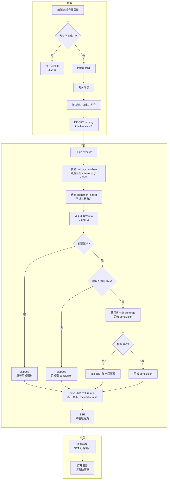
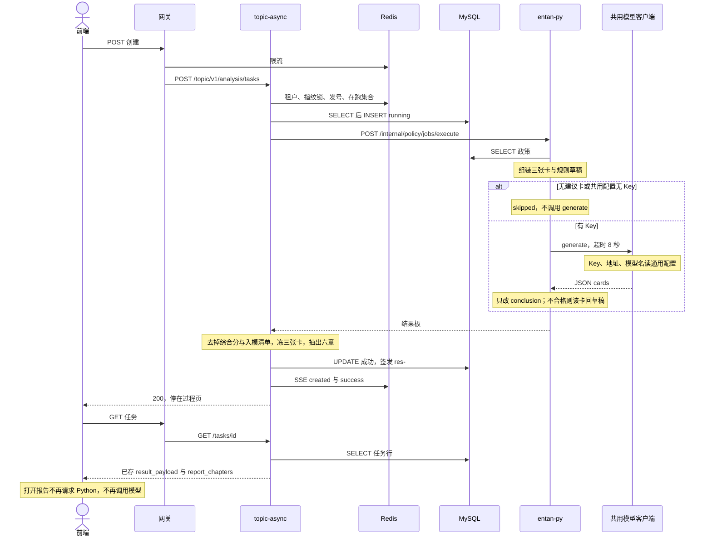
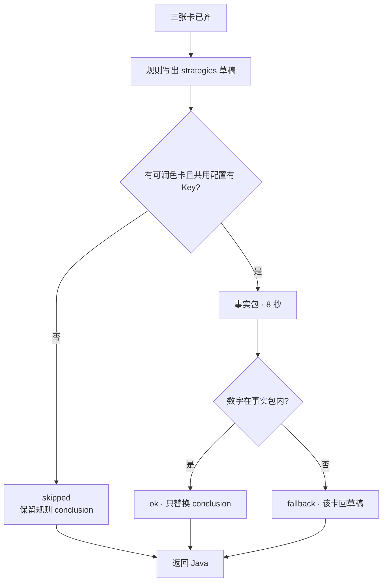

# 05.6.2 · 深圳政策现状分析

| 项 | 内容 |
| --- | --- |
| 文档 | 科技专题服务系统 · 深圳政策现状分析系统设计 |
| 版本 | v0.2-draft |
| 日期 | 2026-10-25 |
| 条款 | `1.1.1.2.4.2.6.3` 页面叶子「深圳政策现状」 |
| 产品合同 | `E7-政策分析/FUNC-DESIGN-E7-政策分析.md` §3.6、§4.3 |
| 现网 | 创建、签发、过程页读取与时序同一条 Java 链。分卡结果板与润色已推代码（B `7a6f6b2`、C `982e038`），本文未附现网 trace。有 Key 时的改写尚未观察到 |
| 未部署 | 叶 D 前端三张固定卡；E0 发布 |
| 代码 | `lumen-algo-py` `polan/job.py`、`polan/shenzhen_board.py`、`polan/insight_narrate.py`（`narrate_strategies`）；Java `PolicyShenzhenSnapshot`；结果页 `PolicyShenzhenResultBoard.vue` |
| 实现叶 | `LUMEN-POLICY-SZ3D-B/C/D/E0/E1`，总控 `政策模块-E7/LUMEN-POLICY-SZ3D-长任务总控.md` |

产品卡面以 FUNC-DESIGN §3.6 为准。本文写调用链、分卡取数、结果板、优化建议润色和报告章节。润色的失败边界与 [05.6.1 §5](./05.6.1-政策时序分析.md) 相同。Key、服务地址和模型名不另设，见 §2。本文只改事实包、卡片名单和要替换的字段（`conclusion`）。

---

## 1. 这条链路做什么

用户在 `/policy/recommendation` 提交深圳政策现状分析。Java 创建任务并在同一次请求里调用 Python。Python 离开 harness，按三张固定卡组装结果板，再为「优化建议」写规则草稿并可选润色，返回给 Java 签发。前端先停在过程页，用户再打开结果。报告只读这次已签发的结果，不再次调用模型。

过程页五段文案是说明：`条件校验 → 分卡读数 → 结果组装 → 优化建议 → 解读润色`。Java `totalNodes` 保持 1。

调用链：前端 → 网关 `/api/topicAsync` → `gkxlumen-topic-async-service` `POST /topic/v1/analysis/tasks` → Feign `POST /internal/policy/jobs/execute`。Java 不调大模型，不写 nGQL，不把 `null` 改成 0。Python 不签发 `result_snapshot_id`。

`sub_type=policy_shenzhen`（surface `policy:recommendation:policy_sz_3d`）。已离开 `harness.dispatch`，与时序、区域同级，`harness_mode=shenzhen_board`。焦点和 `policy_shard` 仍走分片。

---

## 2. 完整逻辑

接收、执行、报告是一条链。执行在创建请求内做完。报告不另起任务，也不再调模型。

无建议卡、无 Key、超时、坏 JSON 或数字不在事实包里，都不调用第二次模型，任务仍成功。Java 不调模型。

模型不单开一套。`narrate_strategies` 与时序 `narrate_board` 共用 `entan.common.llm_client.OpenAICompatibleClient` 和 `_default_client`。

| 项 | 通用来源 | 本步 |
| --- | --- | --- |
| Key | `ENTAN_LLM_API_KEY`，否则 `settings.yaml` 的 `llm.api_key`，否则 `OPENAI_API_KEY`。空则 `has_llm_key()` 为假，不建客户端 | 不另设深圳 Key |
| 地址 | `ENTAN_LLM_BASE_URL`，否则 yaml `llm.base_url`，否则客户端默认 | 不另设 |
| 模型名 | `ENTAN_LLM_MODEL`，否则 yaml `llm.model`，否则客户端默认 | 不另写模型名 |
| 全局超时 | `ENTAN_LLM_TIMEOUT_SEC`，默认 45 秒，条款抽取用这个 | 不改 |
| 本次调用 | 客户端入参 | 超时 8 秒，`max_retries=0`，`temperature=0.1` |

本图按已推代码写。没有时序 005 那样的现网 trace，所以不写毫秒。无 Key 时执行链上不应出现模型 span。

### 七步

深圳在第 3 步离开 `harness.dispatch`。库内查出的条数不用来选分片档。三档分片见 [05.6.1 §6](./05.6.1-政策时序分析.md)，深圳不进入。

| 步 | 状态 | 事实 |
| --- | --- | --- |
| 1 创建 | 现网 | 与时序相同。`taskName` 等于任务 ID。当天相同指纹已成功则打开过程页，不自动进结果 |
| 2 校验 | 已推代码 | `sub_type=policy_shenzhen`。出现的 `industry_vid` 必须匹配 `chain:` 或 `segment:`。产业与技术领域不得同时生效。`items` 达到 40000 条拒绝，错误码 `FULL_SCAN_FORBIDDEN` |
| 3 分流 | 已推代码 | 不调用 `harness.dispatch`。返回 `harness_mode=shenzhen_board`。焦点与 `policy_shard` 仍走分片 |
| 4 取数 | 已推代码 | 见 §3 |
| 5 组装 | 已推代码 | 见 §4。不输出综合分、一级权重、用户入模清单 |
| 6 优化建议 | 已推代码，有 Key 改写未观察到 | 见 §5。失败不把任务打成 failed |
| 7 签发 | 现网 + 已推透传 | Java 写入 `targetParams.result_payload`，快照号 `res-{taskId}`，`page_mode_hint=process_succeeded_wait_view`，`viewed=false`。同一次签发写入 `frozen_cards` 与 `report_chapters`。查看结果再 `GET .../tasks/{id}`。打开报告不发新请求 |

---

## 3. 分卡读数

三张卡各算各的。支持力度不读请求锚点。适配性只读锚点。落地实效不查库补数。

| 卡 | metric_id | 读什么 | 不读什么 |
| --- | --- | --- | --- |
| 支持力度 | `M_POLICY_SUPPORT_STRENGTH` | 在线 DWD `policy_base_info` 的城市截面。因子只有政策条数、政策层级。门槛、层级权重、内部 0.5/0.5 冻结对齐 calc-logic，页面标明待 `QPOL-02` | `dwd_bid_*` 金额；请求里的产业 / 技术锚点；用户勾选 |
| 产业适配性 | `M_POLICY_INDUSTRY_FIT` | 标题与链名的既有匹配，范围收成当前产业锚点。无命中或未达该指标出分门槛则 `score=null` | 技术锚点在 `POL-FDS-06` 会签前不映射到链，本卡 `computable=false` |
| 落地实效 | `M_POLICY_IMPLEMENTATION_EFFECT` | 不取数。`computable=false`，`reason=实施日、支持对象、反馈全缺` | 执行率、受益覆盖、满意度；不得写成 0 |

在线数字以当次任务读到的 DWD 为准。calc-logic 里的深圳截面（名次 5、879 条、层级均值 0.4653、与条数的秩相关 0.9467）只作口径样例，不写死进接口。

扶持力度档位固定 `value=null`，`reason=无金额列`。约半数政策没有城市名时不进截面分子，这条写进 `diagnostics`，不改分数。

---

## 4. 结果板

`mode=shenzhen_board`。组装在润色之前完成。

| 块 | 规则 |
| --- | --- |
| `cards.support` | `computable=true` 当深圳进入排名。字段：`score`、`rank`、`policy_count`、`level_mean`、`tier=null`、`spearman_vs_count`。文案键标明供给规模与层级合成、条数主导、非资金强度、min-max 不是趋势 |
| `cards.fit` | 有锚点命中且达到出分门槛才有 `score`。否则 `score=null`，可带 `hit_count=0` |
| `cards.effect` | 只有 `computable=false`。无分数键，或分数键为 `null` |
| `composite` | 不出现。`QPOL-02` 会签且落地实效可算之前禁止加权合成 |
| `strategies` | 见 §5。规则层先写入，润色只替换 `conclusion` |
| `honesty` | 取数失败才 `degraded=true`。润色失败不置此标记 |

现网结果页仍按综合分、一级权重和入模指标解析（`parsePolicyShenzhenBoard`）。叶 D 改为只渲染这三张卡和 `strategies`。综合分仪表、雷达短板阈值、34/33/33 权重行删除。`strategies` 的字段保持现有四元组：`id`、`title`、`dimension`、`priority`、`conclusion`。

---

## 5. 优化建议（参照时序解读润色）

与 [05.6.1 §5](./05.6.1-政策时序分析.md) 同一套收尾，放在同一次 `execute` 里，组装完成之后。规则层决定哪张卡出现、标题、`dimension`、`priority`。模型只改 `conclusion`。客户端、Key、地址和模型名用 §2 的通用配置。无 Key、超过 8 秒、JSON 不合格或数字不在事实包里时，任务仍成功，该卡退回规则草稿。

| 卡 id | 标题 | 何时出现 | 规则草稿必须留下的事实 | 模型边界 |
| --- | --- | --- | --- | --- |
| `sz-supply-structure` | 供给结构 | 深圳进入城市排名 | 名次、分数、条数、层级均值、与条数的秩相关；市级为主所以层级分偏低 | 只改写成建议口吻。禁止「深圳政策弱」。禁止改成资金强度 |
| `sz-tier-gap` | 扶持档位不可算 | `tier=null` | 「无金额列」「不给出资金加码建议」 | 不得建议使用招标金额，不得把档位写成 0 |
| `sz-industry-fit` | 锚点适配 | 适配性 `hit_count>0` 或已有 `score` | 锚点名称、命中条数；未达门槛时写「样本不足」且 `score` 仍为空 | 不建议新设补贴。不编造未命中的链 |
| （不出现） | 落地实效 | `computable=false` | — | 不生成执行率、覆盖、满意度建议 |
| （不出现） | 综合短板 | 无综合分 | — | 不按三维比高低，不写「低于阈值」 |

`priority` 由规则固定为 1、2、3，模型不得改。单卡 `conclusion` 不超过 80 字。因果句拒绝。调用参数只覆盖本次超时为 8 秒，不改全局 45 秒，也不另写模型名。

事实包只带汇总，不送政策正文，不送招标金额：锚点名称、三张卡的可算状态、支持力度上表字段、适配性命中条数与分数（空就是空）、规则草稿的 `title` + `conclusion`。不送 2 万条政策。

返回旁增加 `narration`：`status=ok|fallback|skipped`、`model`、`reason`。业务界面和报告正文不展示该块。润色失败不把 `honesty.degraded` 设为真。

以 calc-logic 城市截面为口径样例（不是某次已签发任务），允许写成：

- 供给结构：深圳名次第 5，截面分 33.5585，政策 879 条，层级均值 0.4653。分数由条数和层级合成，与条数的秩相关为 0.9467。市级文件为主，不宜写成政策偏弱。
- 扶持档位不可算：政策表没有金额列，本结果不提出资金加码建议。

锚点无命中时不出现「锚点适配」。落地实效不出现在优化建议里。报告若三张建议卡都没有，章节只留规则句「本结果没有可写的优化建议」，不调用模型。

结果页「优化建议」和报告第 5 章读同一份 `strategies`。报告生成不再次调用模型。

---

## 6. 报告章节

模板 `POL-SZ-3D-PDF-v1`。政策只提供 `report_template_id`、章节 payload、fingerprint。先 HTML 预览，再同源 PDF。空字段与 `null` 档位打印为「—」或「不可算」，不印 0。

| 章 | 内容 | 来源 |
| --- | --- | --- |
| 1 分析范围 | 锚点、任务号、指纹 | 快照 |
| 2 支持力度 | 分数、名次、条数、层级均值、档位不可算、非资金强度 | `cards.support` |
| 3 产业适配性 | 有分数或命中数才写；否则「本锚点无适配结果」 | `cards.fit` |
| 4 落地实效 | 只写不可算及原因 | `cards.effect` |
| 5 优化建议 | `strategies` 按 `priority`。无卡时用 §5 的规则句 | 润色后的 `conclusion` |
| 6 口径与局限 | `QPOL-02`、条数主导、min-max 不可当趋势、市级文件压低层级分 | `diagnostics` |

---

## 7. 实现落点

不新开叶子。B、C 已到 integration（代码已推，未部署）。D、E0、E1 仍为 backlog。授权句未落款。

| 叶 | 吸收什么 |
| --- | --- |
| B `LUMEN-POLICY-SZ3D-B-JOB-L01` | `shenzhen_board`、三张卡、§5 规则草稿与润色、样例 JSON。不改 harness 的焦点和分片 |
| C `LUMEN-POLICY-SZ3D-C-FACADE-L01` | 原样透传 `cards` 与 `strategies`。快照冻三张卡可算状态，不冻入模清单。报告章节从 payload 抽取，Java 不调模型 |
| D `LUMEN-POLICY-SZ3D-D-FE-L01` | 配置区三张固定卡。结果页删除综合分与权重行。优化建议只渲染 `strategies`。报告入口沿用现有「生成报告」 |
| E0 / E1 | 发布与五条金路径仍以总控 §2 为准。优化建议是否出现以本节规则卡为准，无数时必须是空态，不能是 Demo 文案 |

库仍用本管线已拍板的 `demo_gkxlumenx_*`。不改正式库，不把调研库 `183.240.141.251` 接进在线 Job。

---

## 8. 明确不做

- 不把 `indicators?kind=all` 当成二级指标目录。
- 不用 Demo `POLICY_SZ_CORE_INDICATORS`（资金规模、创新激励、执行率、受益覆盖、满意度）填卡或填建议。
- 不在前端本地加权，不在 Java 里补综合分或改写 `conclusion`。
- 不把优化建议做成第二次分析任务。
- 时序、区域对比的润色卡名单不在本文扩展。深圳不进入三档分片。
- 不另设深圳专用的 API Key、服务地址或模型名。

---

## 9. 相关文档

| 文档 | 关系 |
| --- | --- |
| [05.6 政策](./05.6-政策.md) | 三叶子总册。本文只展开深圳现状 |
| [05.6.1 政策时序](./05.6.1-政策时序分析.md) | 解读润色的机器边界。本文复用，不另起客户端 |
| FUNC-DESIGN §3.6 / §4.3 | 产品合同。卡面以那里为准 |
| `metrics/calc-logic/POLICY/M_POLICY_SUPPORT_STRENGTH.md` | 支持力度因子与样例数字 |
| `政策模块-E7/LUMEN-POLICY-SZ3D-长任务总控.md` | 实现分段与金路径 |
