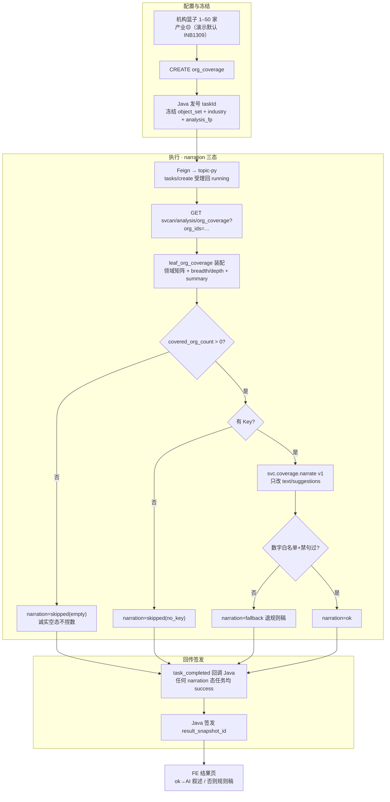
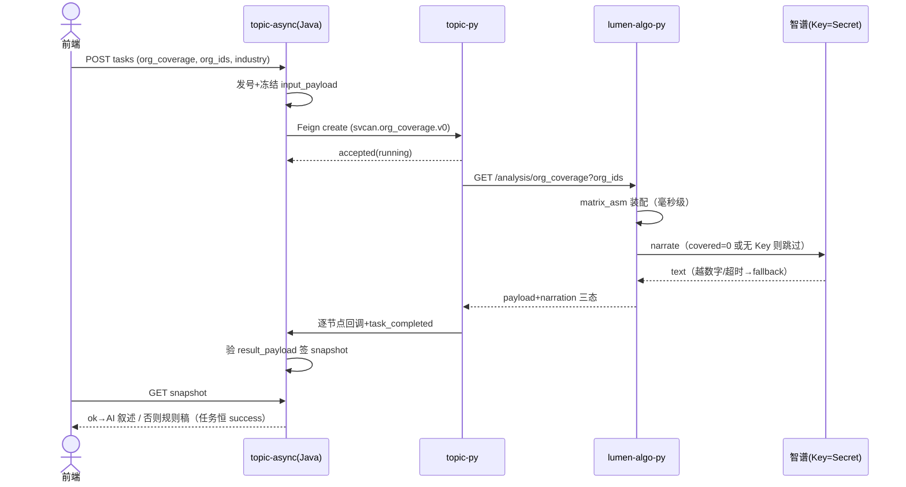

# 05.7.1 · 服务机构产业领域分析（详细设计）

> 条款：`1.1.1.2.4.2.7`（05.7 叶 1）。菜单「服务机构产业领域分析」；前端 `lumen-ui-topic → /service/institution-judgment`，页签 workspace `field`，analysisType/叶子名 `org_coverage`。
> 本文档描述该功能的系统行为与契约。LLM 结论（narration）为功能组成部分（2026-10-27 上线，任务 SVC-20261027-021 实证）。
> 姊妹篇：05.7.3（技术力评估）、05.7.4（新增趋势）；全域落点判定见 05.7.2。

## 1. 功能定义

用户在机构篮子选择 **1–50 家服务机构**，可选产业过滤（演示默认 INB1309 人工智能；口径待甲方确认，界面带 ⚠️ 角标），发起覆盖分析。系统产出：

- 机构 × 产业领域**覆盖矩阵**（热力图/矩阵图切换）；
- 服务**广度**（命中领域数）与**深度**（领域得分）排行；
- **领域覆盖结论**叙述段 + 每机构**合作建议**句（AI 生成，规则稿兜底）。

过程页四阶段：任务提交与分析对象冻结 → 装载机构领域覆盖与服务深度快照 → 计算服务广度与深度矩阵 → 生成领域覆盖结论与可视化。

## 2. 数据与口径

| 项 | 定义 |
| --- | --- |
| 覆盖矩阵行 | 机构（名称取 `ads.svc_org_card.name_cn`） |
| 覆盖矩阵列 | 产业领域（`chain_code/chain_name`，覆盖机构数降序 → 编码） |
| 格值 depth | `round(chain_score × 100)`；缺格不下发，前端渲染空白（不填 0） |
| 广度 breadth | 机构命中领域数（`M_SVC_ORG_COVERAGE_BREADTH`） |
| 深度均值 | `M_SVC_ORG_COVERAGE_DEPTH` |
| 数据源 | `dwd.enterprise_industry_chain` × `ads.svc_org_card`（demo 平面为 demo_ads） |
| 代理口径声明 | depth 为 chain_score 代理（甲方覆盖度列未接入），随 envelope `GAP-SVC-MATRIX-SRC` 下发；机构×机构深度均值可能超 100（chain_score 未归一），归一化随数据接入收口 |

指标 ⓘ：广度/深度数字旁挂对应 metric_id（评审层 `ServiceReviewMount`），状态取 registry 当前值（BREADTH D3 partial / DEPTH 见 registry，均 🧪 mock）。

## 3. 任务链路

时序（任务创建晚于对应服务版本部署时间，否则旧任务快照无 narration，页面显示规则稿——属预期）：

调用链：前端只调 Java；Java 只调 topic-py `/internal/*`；算法只读 ADS；Java 不碰 LLM Key。四阶段过程页节点由 topic-py 逐个回调推进（词表三方同源）。

## 4. 结果页行为

- 数据只来自任务 snapshot（`parseSvcSnapshot → svcCoverageModel`），禁止 Demo 机构名单/领域字典填格子；
- 矩阵/热力渲染：色阶 5 档（depth 分段）；行头/气泡点击开画像抽屉；
- 未覆盖机构列警示条「暂无覆盖数据（不参与结论排名）」；
- **合作建议块**：`narration.status === "ok"` 渲染 AI 叙述段 + 建议句，角标「AI 结论（数字与上图同源）」；否则渲染规则稿建议句（行为与无 narration 快照一致），角标「规则生成」；
- metric ⓘ 四处挂点（TRACE/DEPTH/BREADTH/结论区），评审模式门控。

## 5. LLM 结论（svc.coverage.narrate）

- **落点**：`narration.text`（覆盖格局叙述 150–250 字）+ `narration.suggestions`（≤3 条合作建议句）；矩阵数字/广度/深度/排名一律规则计算，模型只改叙述文案。
- **事实包**（只带汇总，数字白名单）：industry_name、summary（覆盖占比/均值）、breadth_top3、depth_top3、uncovered_orgs。
- **三态**：`ok`（校验通过）/ `fallback`（超时 20s、坏 JSON、越数字、禁因果句 → 退规则稿）/ `skipped`（空覆盖前置短路、无 Key）。任何态任务均 success；业务 UI 不展示 narration 元数据。
- **Prompt**：`lumen_common/prompts/svc/coverage.narrate.v1.txt`（数据科学家口径：只依事实包归纳、禁因果臆断/营销腔/编数、covered=0 固定句；改语义必须升版本 + 金标样例）。
- **边界**：LLM 客户端在 `lumen_common`（企业/链域共用），Key 仅集群 Secret（`gkx-zhipu-llm`）；Java/编排层不调 LLM、不透传 Key。

## 6. 接口与存储

| 项 | 值 |
| --- | --- |
| 前端入口 | `POST /topic/v1/analysis/tasks`（`analysisType: svc:analysis:org_coverage`） |
| Java → topic-py | `POST /internal/gkx-svc/analysis/tasks/create`（`analysis_key: svcan.org_coverage.v0`，params 透传 org_ids/industry） |
| topic-py → 算法 | `GET /internal/v1/svcan/analysis/org_coverage?org_ids=…` |
| 快照 | payload 内联于 `analysis_task.target_params.result_payload`（MySQL 指针 + RustFS 后备归 STAGE 范围） |
| result schema | `schema_id: svcan.org_coverage.v1`（coverage_matrix / matrix / breadth / depth / summary / conclusions / narration / gaps / metric_refs） |

## 7. 待甲方确认口径

- 产业过滤口径（按所选产业过滤矩阵行列，演示默认 INB1309）——已登记《客户决策清单跟踪表》；
- 甲方「服务覆盖度」列接入后替换 chain_score 代理（schema 不变）。

---
*v1.1 2026-10-27 改版：按「详细设计=当前实现行为规格」体例重写（原对照/缺口/目标态内容移 handoff DOC-SVC-ORG-COVERAGE-ANALYSIS-CHAIN-L01）。*
