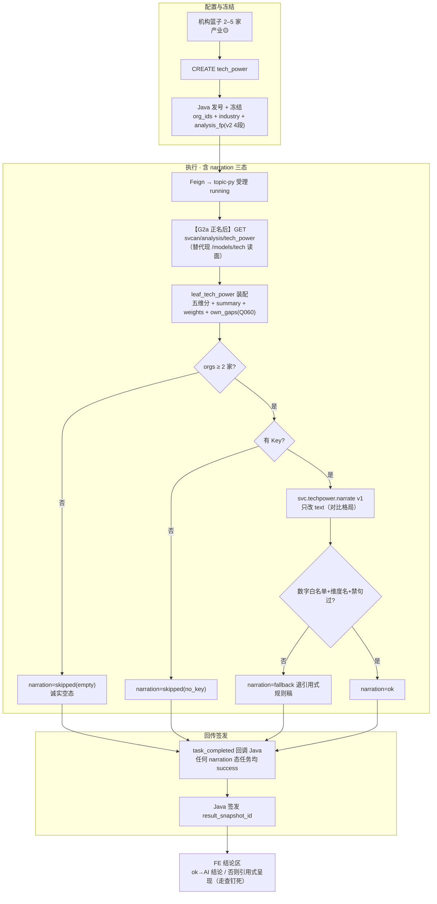

# 05.7.3 · 服务机构技术力评估对比分析（完整链路设计 + LLM 落点）

> 条款：`1.1.1.2.4.2.7`（05.7 叶 3）。叶名 `tech_power`；菜单「服务机构技术力评估分析」；前端 `lumen-ui-topic → /service/institution-judgment` workspace `capability`。
> 状态：**设计稿 v1.0（2026-10-27，DOC-SVC-TECH-TREND-FAMILY-CHAIN-L01）**。族任务：与 05.7.4 同批设计，共享件见 §0（只写一遍，05.7.4 引用）。金样：`05.3.1` §5.6 / `05.7.1`（T1 先例）/ `05.7.2` T2。
> 未实现处标 ❌/🟡，禁止假称已通。本单只设计，repos 实现另开 feature 单。

---

## 0. 族共享件（两叶共用，此处写一遍）

| 件 | as-built（T1 已验） | 本族复用方式 |
| --- | --- | --- |
| narration 三态骨架 | `svcan/narrate_coverage.py`：skipped/fallback/ok、失败任务仍 success | 实现期先**抽公共模块** `narrate_common`（try/三态写回/`_numbers_ok`/`_default_client`/20s 超时），两叶各写 `_fact_pack` + `_parse_output`（各 ≈60 行）；**不复制三份** |
| prompt loader / Key 纪律 | `lumen_common/prompts` 单一 loader；Key 只认 GKX/ENTAN/LLM 前缀，Secret `gkx-zhipu-llm` 注入 | 直接用 |
| 路由正名模式 | T1：`_LEAF_SVCAN_PATH` 1 行 + 单测断言同步（21 passed 先例） | G2a（本叶）/G2b（05.7.4）同款 |
| FE 只读渲染模式 | `parseSvcCoverageNarration` 第四态拒收 + ok 才渲染 + 角标随态切换 | 各叶一个解析函数 + 一个渲染分支 |
| 过程页四阶段词表 | Java/topic-py/前端三方同源 | 零改动；G1 真分步归 STAGE 单，narrate 挂装配不依赖分步 |
| 产物通道 | topic-py `_passthrough_slots` 内联透传；RustFS 归 G4/STAGE | 同 T1，无新通道 |

## 1. 需求与范围

- 对象：机构篮子选 **2–5 家**（`SERVICE_ORG_ANALYSES` capability min2/max5），可选产业过滤（🟡 演示默认沿用）。
- 产出：五维维度分 + 综合得分横向对比（排名表/雷达）、**技术力对比结论**（叙述）、遴选建议（有字段才画）。
- 过程页四阶段（词表已通）：任务提交与分析条件冻结 / 装载对比机构与技术力指标快照 / 计算维度得分并合成技术力评价 / 生成横向对比排名与雷达结果。

## 2. 与金样的结构差异

| 维度 | 企业技术力 05.3.1 | 本叶 tech_power |
| --- | --- | --- |
| 对象规模 | ≤50 家 | **2–5 家**（小对象，N 家 N 行，不编 0） |
| 维度 | 三模式（technology/business/competitiveness） | 单模式五维（专利数量/研发投入/核心专家/…前端常量）+ 综合分 |
| 口径状态 | 已会签 | **等权 20 演示权重（Q060 / Q-SVCCHAIN-01 🟡）**，D1 draft |
| LLM | narrate_eval 三事实包 | 新增单包 `svc.techpower.narrate`（§6） |

## 3. 现网 as-built 对照（凝缩自 A 表，2026-10-27 实查）

| 环节 | as-built | 判定 |
| --- | --- | --- |
| 数据面 | `engine.fetch_models("tech")`：`ads.svc_tech_power_score` 五维分+总分+`ext`（name/rank_no）；产业切片（`dwd.enterprise_industry_chain`）已有 | ✅ 可用 |
| 路由 | topic-py `tech_power → /models/tech` 读面（非装配叶 `leaf_tech_power`）——数据同源，但缺装配叶的 `summary{avg,max,min}` / `weights` / `own_gaps`（Q060 声明）包装 | ❌ **G2a 半正名**（本族内部缺口编号，区别于 05.7.1 G2 产业过滤）：正名至 `/analysis/tech_power`，补事实包所需 summary/weights |
| 指标 | `M_SVC_ORG_TECH_SCORE`（服务机构影响力）**D1 aligned / D2 partial·待核验 / D3 partial / D4 mock 🧪**（MCP 实查 2026-10-27；五维实为三维合成——专家/标准两维数据缺，Q-SVCCHAIN-01 🟡） | 🟡 ⓘ 现状保留；D3/D4 待翻转，不出红问号 |
| 结论区 | 无 narration；FE 走查钉死「只引用本次签发机构名与分，N 家就 N 行」；`suggestions/advice/selection_advice` 有字段才画（现网无来源） | ❌ T2 落点=新增 |
| 四节点 | 词表真、分步假 | G1 族，STAGE 单 |

## 4. 完整链路设计（目标态）



- 路由正名收益：事实包直接消费装配叶 `summary`/`weights`/`own_gaps`，不重复拼装；`tech_power{rows}` 包装层 Java 透传不受影响。
- narration 挂装配收尾（`leaf_tech_power` 返回前一行，同 T1 模式）。
- 产业切片为空（industry 查无机构）→ 诚实空态 → `skipped(empty)`，同 T1。

## 5. LLM 落点专章（05.7.2 T2 展开）

| # | 点位 | 判定 | 说明 |
| --- | --- | --- | --- |
| T2-L1 | 技术力对比结论（叙述段） | **LLM 可改 text** | 本叶唯一新落点：横向格局一段（150–250 字）：谁总分最高、五维分是否存在明显偏科、集合均值位置 |
| R | 五维分/总分/排名/权重 | **规则锁死** | SQL/模型分直出；权重是 Q060 白名单口径，禁模型置喙 |
| R | 遴选建议句 | 暂缓 | 现网无 suggestions 来源；若日后 Java rec-list 下发，按 05.7.2 T6/T7 模式另判，本叶不硬造 |

**事实包白名单**（只带汇总，不带全量明细）：

```json
{"industry_name": "<中文领域名或全产业>",
 "weights": {"patents": 20, "...": 20},
 "weight_note": "等权演示口径，Q060 待甲方确认；五维中专家/标准两维数据缺，评分实为三维合成（registry D3 partial）",
 "summary": {"count": 3, "org_count": 3, "avg_score": 71.2, "max_score": 85.0, "min_score": 60.1},
 "orgs": [{"name": "机构甲", "rank": 1, "score": 85.0,
            "dims": {"patents": 90, "rdInvestment": 80, "experts": 75, "cases": 82, "standards": 70}}]}
```

（`dims` 键名以算法侧 `TECH_W`/`dimension_scores` 实际下发为准——camelCase，与前端 `SVC_CAPABILITY_DIMS` 五键一致。）

**降级**：无 Key→skipped；超时/坏 JSON/越数字/禁因果→fallback；前端 fallback 渲染 = 现行为（只引名与分），任务仍 success。

## 6. Prompt 包（草案 v1；落盘 `lumen_common/prompts/svc/techpower.narrate.v1.txt`）

```text
# svc.techpower.narrate v1 —— 服务机构技术力评估对比 · 结论
角色：你是严谨的产业数据分析师。只依据【事实包】归纳，不编造、不推测、不引用外部信息。

任务：
用 150–250 字中文概述所选机构的综合技术力对比格局：
先总述集合水平（家数、平均分、最高/最低分差距），再点名综合得分最高的机构，
并指出其相对优势维度（仅当某维度分数明显高于该机构其他维度时才提"偏科"事实，
禁止推断原因），最后说明各机构得分是否接近（用事实包数字陈述差距）。

硬约束：
- 只能使用事实包中的数字、机构名与维度名；禁止出现任何其他数字。
- 维度名固定：专利数量/研发投入/核心专家/成功案例/标准制定（与事实包 weights 键一致），禁止发明维度。
- 缺维约束：若 weight_note 声明存在缺维（三维合成），叙述只覆盖事实包 dims 中出现的维度，禁止提及未下发的维度名。
- 权重为等权演示口径（Q060 待确认）：如提及权重，必须原样使用 weight_note 措辞。
- 禁止因果臆断（因为/由于/导致/受…影响）、禁止营销腔、禁止排名之外的比较级断言。
- 输出 JSON：{"text": "..."}，不输出其他键。
- 若事实包 orgs 不足 2 家：text 固定写"对比机构不足，暂不给出对比结论"。
```

护栏：`covered` 类空态前置短路（<2 家不外呼）；金标样例随实现单补（正例 1 + 越数字反例 1 + 单家样例 1）。

## 7. 契约与指标

- **narration 三态**：同 `05.7.1 §5.3`（ok/fallback/skipped；业务 UI 不展示元数据块）。
- **路由变更**：`POST /internal/gkx-svc/analysis/tasks/create`（tech_power）下游 URL 改为 `/internal/v1/svcan/analysis/tech_power`；单测 3 断言同步（T1 先例）。
- **指标 ⓘ**：`M_SVC_ORG_TECH_SCORE`（D1 draft + Q060）既有挂点保留；叙述区角标「AI 结论/规则生成」随态切换（同 T1）。
- **自检清单**（实现单 DoD）：narrate_common 提取后 T1 自检不回归（8 场景）；本叶自检 ≥5 场景（ok/越数字/禁因果/单家短路/no_key）；`serviceOrgCapability.selfcheck` 补 narration 断言；type-check/build 绿。

## 8. 与 org_coverage（05.7.1/T1）差异对照

| 项 | org_coverage（T1 已验） | tech_power（本叶） |
| --- | --- | --- |
| 对象/参数 | 1–50 家 + industry🟡 | 2–5 家 + industry🟡 |
| 装配叶修复 | G3 正名（领域矩阵口径） | **G2a 半正名**（补 summary/weights 包装） |
| 落点 | 结论叙述 + 合作建议句（L3+L4） | 仅结论叙述（T2-L1） |
| 事实包特有 | covered_ratio/uncovered_orgs | 五维分/权重/Q060 声明 |
| 渲染区 | 合作建议块 | 结论区（走查钉死引用式呈现的上方/替换位） |
| 指标态 | BREADTH partial/DEPTH draft | TECH_SCORE aligned+D2 核验（Q060 🟡） |

> 第三列对照（org_trend）见 `05.7.4 §8`——本表按派单 F 项聚焦与 T1 的差异，三叶全景在姊妹稿。

## 9. 开放项（不替甲方拍板）

| 项 | 状态 | 解锁动作 |
| --- | --- | --- |
| Q060 / Q-SVCCHAIN-01 五维权重（现等权 20 演示；registry 口径已会签 20261021 王惠批，专家/标准两维数据缺 → 三维合成） | 🟡 D3/D4 待翻转 | 甲方确认后：D2 核验 + D3/D4 翻转随算法服务上线；`weight_note` 措辞更新 → **prompt 升 v2 + 金标样例** |
| tech_power 指纹含 industry（v2 4 段已 as-built） | ✅ | 无 |
| 产业过滤口径 | 🟡 | 同 05.7.1 §9 共用登记 |

---
*v1.0 2026-10-27 初稿（DOC-SVC-TECH-TREND-FAMILY-CHAIN-L01，设计任务）。姊妹篇：05.7.4（org_trend）。*
