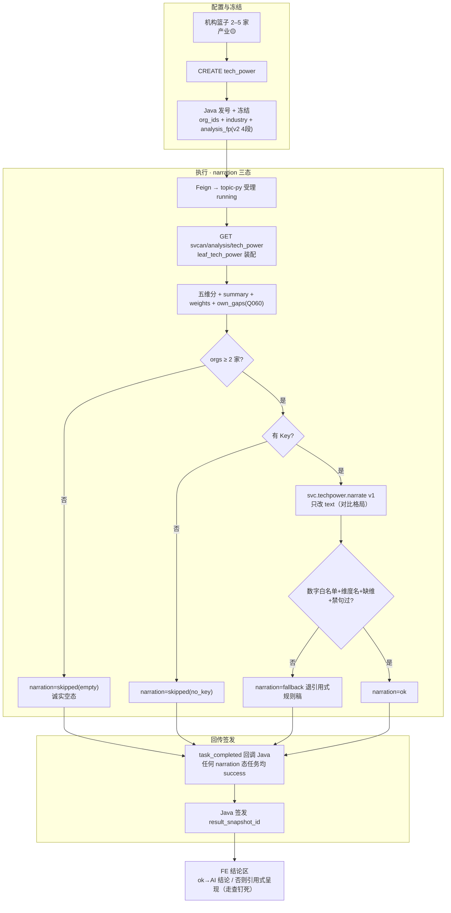

# 05.7.3 · 服务机构技术力评估对比分析（详细设计）

> 条款：`1.1.1.2.4.2.7`（05.7 叶 3）。菜单「服务机构技术力评估分析」；前端 workspace `capability`，叶子名 `tech_power`。
> 本文档描述该功能的系统行为与契约。LLM 结论（narration）为规划中的功能组成部分（prompt 与落点见 §5–§6，实现单另派）。
> 姊妹篇：05.7.1（产业领域，已上线）、05.7.4（新增趋势）。

## 1. 功能定义

用户在机构篮子选择 **2–5 家服务机构**，可选产业过滤（演示口径），发起技术力对比。系统产出：

- 五维维度分（专利数量/研发投入/核心专家/成功案例/标准制定）+ 综合得分横向对比（排名表/雷达图）；
- **技术力对比结论**叙述段（AI 生成，规则稿兜底）；
- 遴选建议（仅当 payload 自带 suggestions 字段时展示）。

过程页四阶段：任务提交与分析条件冻结 → 装载对比机构与技术力指标快照 → 计算维度得分并合成技术力评价 → 生成横向对比排名与雷达结果。

## 2. 数据与口径

| 项 | 定义 |
| --- | --- |
| 数据源 | `ads.svc_tech_power_score`（五维分 + 总分 + ext.name/rank_no），产业切片经 `dwd.enterprise_industry_chain` |
| 维度名 | 固定五维：专利数量/研发投入/核心专家/成功案例/标准制定（前端 `SVC_CAPABILITY_DIMS` 与算法 `TECH_W` 同源） |
| 权重 | 等权 20（演示口径，Q060 / Q-SVCCHAIN-01 待甲方确认）；registry 实际评分按可用维归一（专家/标准两维数据缺，三维合成，D3 partial） |
| 指标 | `M_SVC_ORG_TECH_SCORE`（D1 aligned / D2 待核验 / D3 partial / D4 mock 🧪） |
| 行为约束 | N 家就 N 行，不编 0；结论只引用本次签发机构名与分 |

## 3. 任务链路



## 4. 结果页行为

- 排名列表默认；有 `dimension_scores` 才出维度列/雷达（轴=payload 已有维度，不编 0）；
- 行头点击开画像抽屉；结论区只引用本次签发机构名与分；
- **结论叙述**（narration 上线后）：`ok` 渲染 AI 对比格局段，角标「AI 结论（数字与上图同源）」；`fallback/skipped` 维持引用式呈现；
- metric ⓘ 挂 `M_SVC_ORG_TECH_SCORE` + Q060。

## 5. LLM 结论（svc.techpower.narrate；实现单另派）

- **落点**：仅 `narration.text`（对比格局 150–250 字：集合水平 → 最高分机构 → 偏科事实 → 分差陈述）；五维分/总分/排名/权重规则计算，模型零数字权。
- **事实包白名单**：

```json
{"industry_name": "<中文领域名或全产业>",
 "weights": {"patents": 20, "...": 20},
 "weight_note": "等权演示口径，Q060 待甲方确认；五维中专家/标准两维数据缺，评分实为三维合成",
 "summary": {"count": 3, "org_count": 3, "avg_score": 71.2, "max_score": 85.0, "min_score": 60.1},
 "orgs": [{"name": "机构甲", "rank": 1, "score": 85.0,
            "dims": {"patents": 90, "rdInvestment": 80, "experts": 75, "cases": 82, "standards": 70}}]}
```

（`dims` 键名以算法侧 `TECH_W`/`dimension_scores` 实际下发为准，camelCase。）

- **三态**：同族契约（ok/fallback/skipped；<2 家前置短路；失败退引用式规则稿，任务恒 success）。
- **Prompt**（`lumen_common/prompts/svc/techpower.narrate.v1.txt`）：

```text
# svc.techpower.narrate v1 —— 服务机构技术力评估对比 · 结论
角色：你是严谨的产业数据分析师。只依据【事实包】归纳，不编造、不推测、不引用外部信息。

任务：
用 150–250 字中文概述所选机构的综合技术力对比格局：
先总述集合水平（家数、平均分、最高/最低分差距），再点名综合得分最高的机构，
并指出其相对优势维度（仅当某维度分数明显高于该机构其他维度时才提"偏科"事实，
禁止推断原因），最后说明各机构得分是否接近（用事实包数字陈述差距）。

硬约束：
- 只能使用事实包中的数字、机构名与维度名；禁止出现任何其他数字。
- 维度名固定：专利数量/研发投入/核心专家/成功案例/标准制定（与事实包 weights 键一致），禁止发明维度。
- 缺维约束：若 weight_note 声明存在缺维（三维合成），叙述只覆盖事实包 dims 中出现的维度，禁止提及未下发的维度名。
- 权重为等权演示口径（Q060 待确认）：如提及权重，必须原样使用 weight_note 措辞。
- 禁止因果臆断（因为/由于/导致/受…影响）、禁止营销腔、禁止排名之外的比较级断言。
- 输出 JSON：{"text": "..."}，不输出其他键。
- 若事实包 orgs 不足 2 家：text 固定写"对比机构不足，暂不给出对比结论"。
```

## 6. 接口

| 项 | 值 |
| --- | --- |
| 前端入口 | `POST /topic/v1/analysis/tasks`（`analysisType: svc:analysis:tech_power`） |
| Java → topic-py | `POST /internal/gkx-svc/analysis/tasks/create`（`analysis_key: svcan.tech_power.v0`） |
| topic-py → 算法 | `GET /internal/v1/svcan/analysis/tech_power`（`summary`/`weights`/`own_gaps` 随装配下发） |

## 7. 待甲方确认口径

- 五维权重（现等权演示；registry 口径 20261021 王惠批已入库，专家/标准两维数据缺）——已登记《客户决策清单跟踪表》。

---
*v1.1 2026-10-27 改版：按「详细设计=系统行为规格」体例重写（对照/缺口/实现拆移 handoff DOC-SVC-TECH-TREND-FAMILY-CHAIN-L01）。*
