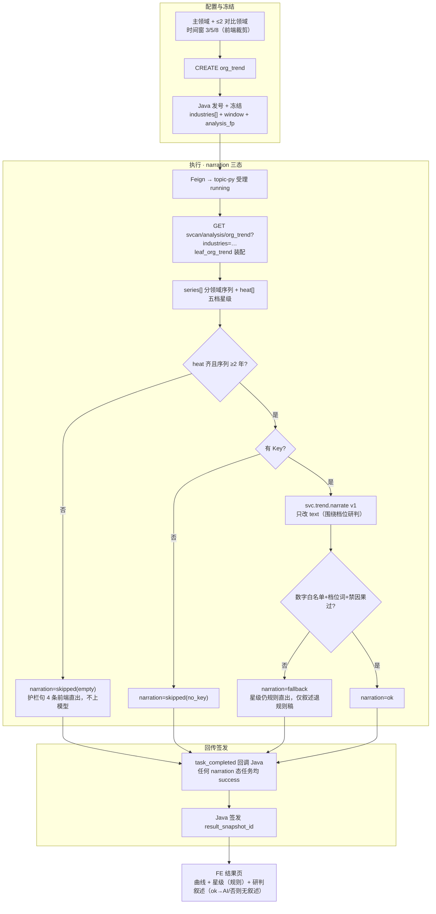

# 05.7.4 · 服务机构新增趋势分析（详细设计）

> 条款：`1.1.1.2.4.2.7`（05.7 叶 2）。菜单「服务机构新增趋势分析」；前端 workspace `trend`，叶子名 `org_trend`。
> 本文档描述该功能的系统行为与契约。市场热度星级与 LLM 研判叙述为功能组成部分（星级由算法规则五档产出；narration 实现单另派，prompt 与落点见 §5–§6）。
> 姊妹篇：05.7.1（产业领域，已上线）、05.7.3（技术力评估）。

## 1. 功能定义

用户选择**主领域一行 + 最多 2 个对比领域**（合计 ≤3 条序列）与时间窗（3/5/8 年，前端裁剪展示），发起新增趋势分析。系统产出：

- 分领域年度新增序列曲线（全量年点下发，前端按窗口裁剪）；
- **市场热度星级**（五档规则：≥20% 增速 5 星高热 / ≥10% 4 星较高 / ≥0% 3 星平稳 / ≥−10% 2 星降温 / <−10% 1 星低迷）+ 依据句；
- **趋势研判叙述**（AI 生成，围绕档位归纳；实现单另派）。

过程页四阶段：任务提交与趋势窗口冻结 → 装载主领域与对比领域新增序列 → 计算年度新增与热度研判 → 生成趋势曲线与研判结论。

本叶无机构集（对象是领域序列，`object_summary`=未选择机构）。

## 2. 数据与口径

| 项 | 定义 |
| --- | --- |
| 数据源 | 年度新增按 `incorporation_year × chain_code` 聚合（代理口径，`GAP-SVC-TREND-FIELD` 随 envelope 下发；正式 ADS 序列表接入后替换） |
| 序列 | 主领域 + ≤2 对比领域（`industries` 列表参数，兼容单值）；≤3 条 |
| 热度 | `heat_judgment` 规则五档 + 依据句（增速 → 星级 + 标签），`heat_by_field` 按领域索引 |
| 指标 | 序列挂 `M_SVC_ORG_NEW_COUNT`（🧪 mock + 代理口径声明）；星级挂 `M_SVC_ORG_MARKET_HEAT`（D1 aligned / D2 待核验 / D3 partial / D4 mock 🧪） |
| 行为约束 | 星级/档位词只认 payload（`heat/rating/stars`），前端禁止斜率评级；无对应领域序列则空/无新增，不缩放伪造 |

## 3. 任务链路



护栏句四条（前端规则直出，任何情况下不交给模型）：暂无趋势序列，无法给出热度研判 / 数据长度不足，暂不给出热度研判 / 该领域暂无服务供给活动 / 当前结果未给出热度评级。

## 4. 结果页行为

- 曲线：主领域一行 + 对比领域简版 + 演示口径声明；自建图例最后一条不可关；
- 星级：只认 payload `heat/rating/stars`（含 `heat_by_field` 按领域映射）；星级旁展示依据句（如「增速 +12.3% → 4 星 较高」，payload 自带原样展示，禁止前端计算）；
- **研判叙述**（narration 上线后）：`ok` 渲染 AI 研判段，角标「AI 结论」；`fallback/skipped` 无叙述（护栏句场景照旧）；
- metric ⓘ：数字旁挂 NEW_COUNT / MARKET_HEAT。

## 5. LLM 研判（svc.trend.narrate；实现单另派）

- **落点**：仅 `narration.text`（120–200 字：主领域档位与星级 → 近两年新增数与增速依据 → 对比领域相对冷热 → 代理口径提示）；星级/档位/序列数字规则计算，模型零改档权。
- **事实包白名单**：

```json
{"industries": [{"field_id": "INB170102", "name": "人工智能",
                 "heat": {"stars": 4, "label": "较高",
                           "basis": "增速 +12.3% → 4 星 较高"},
                 "points_tail": [{"year": "2024", "count": 210},
                                  {"year": "2025", "count": 236}],
                 "growth_pct": 12.3}],
 "window_hint": "前端按 3/5/8 年截窗",
 "trend_note": "序列按 incorporation_year × chain_code 代理口径（GAP-SVC-TREND-FIELD）"}
```

（`points_tail` 只带近 2 年锚点 + growth；全量序列由前端渲染，不经模型。）

- **三态**：同族契约；heat 缺失或序列 <2 年 → 前置短路 `skipped(empty)`（护栏句已覆盖）。
- **Prompt**（`lumen_common/prompts/svc/trend.narrate.v1.txt`）：

```text
# svc.trend.narrate v1 —— 服务机构新增趋势 · 市场热度研判
角色：你是严谨的产业数据分析师。只依据【事实包】归纳，不编造、不推测、不引用外部信息。

任务：
用 120–200 字中文研判主领域的新增趋势：先给出主领域热度档位与星级（原样引用
事实包 heat 的 label 与 stars），再用近两年新增数与增速说明判读依据；若存在对比
领域，用数字陈述其相对冷热（谁增速更高、差距多少）；最后提示该序列为机构注册
口径的代理数据（原样引用 trend_note 措辞）。

硬约束：
- 只能使用事实包中的数字、领域名与档位词；禁止出现任何其他数字。
- 星级与档位（高热/较高/平稳/降温/低迷）只能原样引用，禁止自行评级或改档。
- 禁止因果臆断（为什么增/为什么降）、禁止预测未来年份、禁止营销腔。
- 输出 JSON：{"text": "..."}，不输出其他键。
- 若事实包 industries 为空或无 heat：text 固定写"暂无趋势序列，无法给出热度研判"。
```

## 6. 接口

| 项 | 值 |
| --- | --- |
| 前端入口 | `POST /topic/v1/analysis/tasks`（`analysisType: svc:analysis:org_trend`） |
| Java → topic-py | `POST /internal/gkx-svc/analysis/tasks/create`（`analysis_key: svcan.org_trend.v0`，params 含 industries[]/window） |
| topic-py → 算法 | `GET /internal/v1/svcan/analysis/org_trend?industries=…` |
| payload 契约 | `series[]`（分领域）+ `heat[]`/`heat_by_field`（星级）+ `narration{}`——前端 `svcTrendModel` 解析键覆盖 |

## 7. 待甲方确认口径

- 热度评级口径（现五档规则为演示规则；registry 口径 20261021 批已入库）——已登记《客户决策清单跟踪表》（Q-SVCCHAIN-02）；
- 年度新增代理口径（注册年份 × 挂链）——正式序列表接入后替换。

---
*v1.1 2026-10-27 改版：按「详细设计=系统行为规格」体例重写（对照/缺口/实现拆移 handoff DOC-SVC-TECH-TREND-FAMILY-CHAIN-L01）。*
