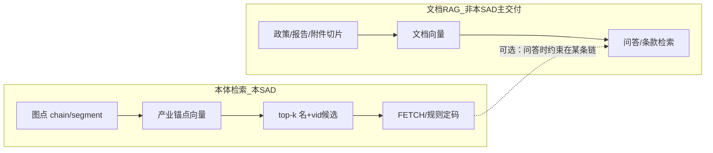

# 01 · 系统分析 · 向量库（跨展示 / 专题）

| 项 | 内容 |
| --- | --- |
| 任务 | `CROSS-VEC-SAD-L01` |
| 版本 | v0.2-draft |
| 日期 | 2026-09-10 |
| 读者 | 架构 / 算法 / 数据 / PM；产品只读覆盖矩阵，不把本卷当 USM |
| 状态 | 会话结论落盘；**物理实例按存量 Milvus 记；collection 隔离与 ACL 待架构会签** |
| 不写 | 页面稿、生产 OpenAPI、类图 |

配套：[INDEX.md](./INDEX.md) · [02-概要设计.md](./02-概要设计.md) · [03-详细设计.md](./03-详细设计.md) · [跨系统-知识图谱/01](../跨系统-知识图谱/01-系统分析.md)

---

## 1. 问题与范围

政府侧要在**同一套产业坐标**上：查政策挂了哪条链、企业是否在链上、区域政策覆盖了哪些环节、用户搜「芯片」时落到 `chain:INB1303`。招标叙事里的「政策图谱 + 向量检索」、企业「关键词映射到产业链细分领域」、人才/报告语义检索，都依赖 **产业名 ↔ 图点** 的稳定对齐。

本 SAD 回答三件事：

1. **向量是什么**：产业锚点向量（受控词表），不是政策/论文全文知识库。
2. **和图谱什么关系**：图谱管身份与边；向量管「这段话像哪个图点」。定码权在图。
3. **哪些模块真正要用**：政策 ETL/上图/匹配、链检索与区域覆盖、企业挂链与匹配度、后续人才/对比（见 §6）。

**范围外**：智能体文档知识库建设；多模态论文向量（情报模块另 SAD）；把向量当建图开工条件。

---

## 2. 现状（事实）

| 事实 | 含义 |
| --- | --- |
| 政策 DWD `ext5` / 详情「目标产业」实为 `theme` | 值是 `监督管理/产业发展` 等主题标签，不是链名 |
| 时序板 / 上图 C 用 `related_entities` LIKE `chain:INB*` | 产业槽被主题污染 → 命中 0；标题字面命中「集成电路」仅数十条级 |
| `ods_to_dwd` 曾把 `theme` 写入 `industry` | 映射语义错误，不是漏灌条数 |
| 上图 hang | 禁止中文名当 VID；须 `industry_link_code` + FETCH 已有点 |
| 政策匹配 `ads.policy_match` | `ext5 == 主体.industry` 硬等 + 六个中文枚举 |
| 企业挂链 | 有 INB 码的 tags 能挂；简介/经营范围无码则挂不上 |
| 链检索 | 名称 contains / 同义词，弱语义 |
| `polan` 无产业 collection | 上图 LLM 每批 8 条且不进 hang 定码；重灌同步 LLM 会超时 |
| 知识图谱 SAD | RAG 不是建图开工条件；本向量面是用图之后的对齐 |
| 应用存储层已有 Milvus | 见下 §2.1；**不是**空白采购项 |

### 2.1 存量向量引擎（盘点，2026-09-10 记入）

| 项 | 值 |
| --- | --- |
| 层 | 应用存储 · 向量存储 |
| 产品 | **Milvus** |
| 版本 | **v2.4.0 standalone** |
| 地址 | `192.168.88.48:19530`（gRPC） |
| 存量 collection 前缀 | `amcpdp-*` |
| 存量用途 | 图片 / 视频帧向量；文搜图 / 图搜图 / 多模态相似度 |

对产业锚点的含义：

- **引擎复用**：不再为「买不买向量库」单独立项；P1 默认连这一台。
- **库表隔离**：`amcpdp-*` 的模型、维度、主键都是多媒体帧，**禁止**当产业词表；产业 collection 用**新前缀**（草稿见 03 §0）。
- **调用隔离**：仅 `lumen-algo-py` 连 gRPC；Java / 前端 / GDF 作业进程不直连。
- **容量预期**：产业锚点 ~10³ 行，相对帧向量可忽略；仍须约定 **quota / 备份不误删 `amcpdp-*`**（VEC-Q1b）。

2026-09-10 已拍板（实现另任务）：

1. L2 LLM **不进**「重灌」。
2. 抽出的名对不上图 → 只留 `{name}`，不造 VID。
3. 产业向量作为系统能力讨论通过；**全文 RAG 不是政策 ETL 的默认路径**。

---

## 3. 需求来源（索引）

| 来源 | 用到哪 |
| --- | --- |
| 知识图谱 SAD 七要素 / 五链 | 词表必须可投影到同一产业点 |
| 展示政策对比核增 | 「融合大模型 + 政策知识图谱与向量检索」 |
| 专题政策时序 / 匹配 / 上图 | 产业槽、match_score、apply_to/support |
| 企业分析算法口径 | 关键词→环节覆盖率、产业匹配度、`dwd_org_industry_tags` |
| 区域产业政策覆盖 | 环节名匹配政策文本 |
| 战略咨询报告 / 技术体系分析（招标） | 报告/文献向量；产业坐标可作过滤维，不替代其专用向量 |
| 智能体知识库（招标） | **文档** collection，与产业锚点分层 |

---

## 4. 两种向量，禁止混用

| | 产业锚点（本 SAD） | 文档 RAG（可后做） | 多模态帧（已有，非本 SAD 交付） |
| --- | --- | --- | --- |
| 引擎 | 同一 Milvus 实例 | 可同实例另 collection | 现网 `amcpdp-*` |
| 文档量 | ~10³ 产业名+别名 | ~10⁴～10⁶ 切片 | 图片/视频帧 |
| 主键 | 图 VID | chunk_id | 媒体对象 ID |
| 成功标准 | 对齐到已有点 | 答对条款 | 文搜图 / 图搜图 |
| 政策重灌 | 不调用 | 不调用 | 不调用 |
| 上图 | 提供候选名 | 不直接写边 | 无关 |

三种混进**同一个 collection**都会脏：主题标签污染产业槽；CLIP 向量与文本向量维度不合，检索无意义。

---

## 5. 干系人与系统边界

| 系统 | 对本向量的角色 |
| --- | --- |
| 展示 / 专题前端 | 只经 Java；不直连向量引擎 |
| Java `gkxlumen-*` | Feign Python；不 embed、不 nGQL |
| Python `lumen-algo-py` | 建索引、检索、L2 抽名、写 DWD 槽 |
| GDF / 产业链灌数 | **建库触发器**：链表+上图成功后 rebuild；不在映射行内 embed |
| 政策/企业等业务灌数 | **只消费** search（默认同步关）；不 rebuild |
| Nebula / 查图 API | 词表与 FETCH 真源 |
| PigX 知识库 | 文档 RAG；禁止覆盖产业 collection |
| 现网 Milvus | 物理引擎；`amcpdp-*` 属多媒体域，只读不改 |

**禁止**：lumen 打 `demo-*`（D12）；前端 / Java 直连 `19530`；算法 drop 或 insert `amcpdp-*`。

---

## 6. 跨域覆盖矩阵（为何「系统级」值得）

| 域 | 当前对齐方式 | 没有产业向量时 | 有锚点向量后 |
| --- | --- | --- | --- |
| 政策 ETL 产业槽 | theme / 字面链名 | 主题标签污染；芯片≠集成电路 | 查询=标题+摘要+要点；召回链名再定码 |
| 政策上图 C | 稳定码 + FETCH | 无码则 skip | 召回名→对码→FETCH；仍不造点 |
| 政策时序板 | DWD LIKE VID | 空板 + 全局 KPI 回落 | 同产业槽 |
| 政策匹配 | ext5 硬等 | 主题当产业 | 主体产业 VID × 政策产业 VID |
| 链检索 | contains | 同义漏检 | 检索词 embed → 链/环节 |
| 区域政策覆盖 | 环节名∩政策文本 | 字面漏 | 政策查询向量 vs 环节向量 |
| 企业挂链 | tags 里 INB | 无码企业挂不上 | 经营范围/简介→候选环节 |
| 企业匹配度 / 领域证据 | 关键词映射环节 | 口径要求语义，实现偏字面 | 同一检索 API |
| 人才 / 报告（后） | 招标要向量 | 易另起学科空间 | 产业维共用；文献向量可另 collection |

结论：**为单篇政策上全文 RAG 不值；为全系统产业对齐做锚点向量值。** 复用面跨展示/专题/匹配/挂链，词表小、重建便宜。

---

## 7. 诚实性

| 情况 | HTTP / 数据 | 禁止 |
| --- | --- | --- |
| 索引未建 / 引擎未就绪 | 检索 501 或明确 `degraded=rule` | 200 + 假 VID |
| 召回低分 | 返回空候选 | 凑一条 chain:INB |
| LLM 失败 | 回退 L1 规则 | 用 theme 填 industry |
| 有名无码 | DWD `{name}`；上图 skip | 名称当 VID |

---

## 8. 开放项

| ID | 项 | 谁拍 |
| --- | --- | --- |
| VEC-Q1 | ~~买不买引擎~~ → **已有 Milvus 2.4**。余项：Python 网段 ACL、standalone 单点风险、是否与智算另实例 | 架构 |
| VEC-Q1b | 产业 collection 配额、备份策略、误操作隔离（相对 `amcpdp-*`） | 架构 + 运维 |
| VEC-Q2 | **文本** embedding 模型与是否内网（不得复用 `amcpdp` 多模态模型） | 架构 + 算法 |
| VEC-Q3 | 索引与发布切面（B 面）是否分 collection | 架构 |
| VEC-Q4 | 企业/人才接入的第一批 API 消费者名单 | PM + 算法 |
