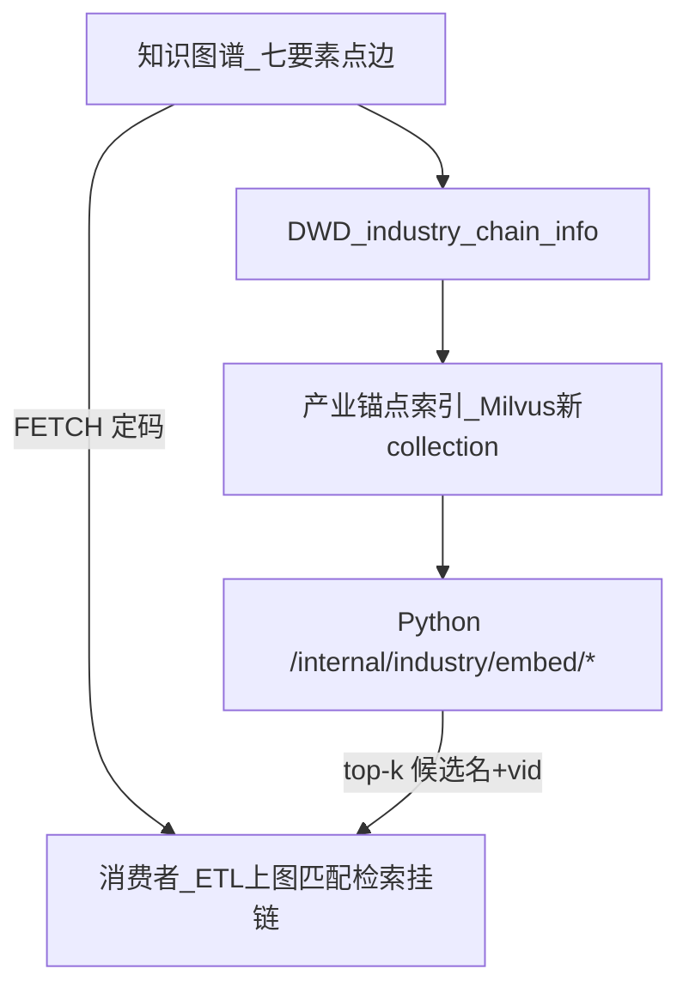
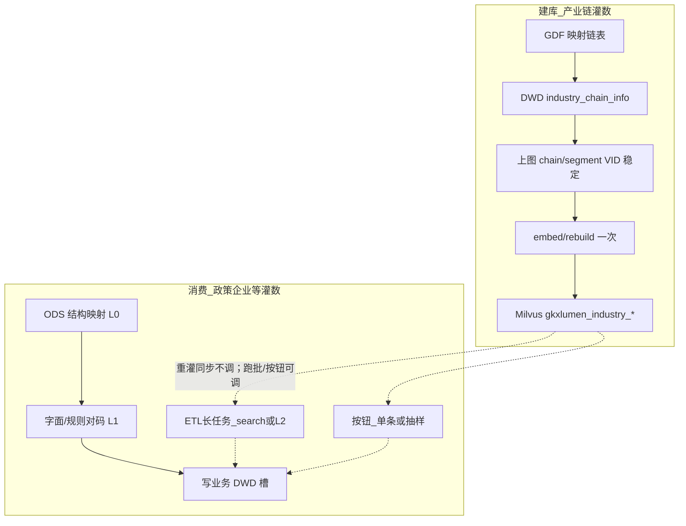

# 02 · 概要设计 · 向量库（跨展示 / 专题）

| 项 | 内容 |
| --- | --- |
| 任务 | `CROSS-VEC-SAD-L01` |
| 版本 | v0.3-draft |
| 日期 | 2026-09-10 |
| 前提 | [01-系统分析.md](./01-系统分析.md) |
| 状态 | 架构草稿；**不采购新向量云**；会签前不改 OpenAPI、不碰 `amcpdp-*` |
| 不写 | 多媒体检索方案、各页 Wireframe |

---

## 1. 总体：三平面 + 图谱



| 平面 | 职责 | 不做 |
| --- | --- | --- |
| 图谱 / DWD 链表 | 点身份、边、发布切面 | 语义相似度 |
| 产业锚点索引 | 名+别名+父链名 embedding；版本号；落 **Milvus 新 collection** | 写入 `amcpdp-*`；存政策全文 / 视频帧 |
| Python 在线检索 | top-k；可选 L2 约束生成 | 签发 VID |
| 消费者 | 规则定码 / FETCH / 写槽 | 各写一套 embedding；在业务灌数里 rebuild |

**落地切面（已拍板）**：产业链灌数负责「货架上有哪些产业点」；业务灌数只消费检索，不负责建库。见下节。

---

## 1.1 产业链灌数 vs 业务灌数



| | 产业链灌数 | 政策 / 企业 / 人才等业务灌数 |
| --- | --- | --- |
| 目的 | 更新受控词表 + 图点 | 把业务对象对到已有点 |
| 向量动作 | 末段 **一次** `embed/rebuild` | **同步重灌不调**；跑批/按钮可 search（不 rebuild） |
| 禁止 | 映射每一行当场 embed | 同步重灌里 rebuild / 同步 LLM / 打全文向量 |
| 失败 | 点未稳定则 **跳过 rebuild**（旧索引可保留 + honesty） | 无码则 `{name}`，上图 skip |
| 发布切面变更 | 与 B 面约定后 rebuild 或分 collection（VEC-Q3） | 不触发建库 |

「重灌」一词只用于 **业务明细**（如政策 ODS→DWD）。产业链侧说 **灌链 / 刷链 / 链上图**，末段再建索引，避免把两件事都叫重灌。

图变更（挂链补点、发布切面切换）同样走 **rebuild**，与全量灌链同一 API，不另做第二套建库。

---

## 2. 调用链（D12）


与知识图谱 SAD 一致：双前端只消费 Java；**仅 Python** 对内连 Milvus gRPC；对外不暴露引擎品牌与 IP。

连接约定（as-built）：`MILVUS_URI=http://192.168.88.43:19530`；collection 名见 03 §0（**下划线**前缀 `gkxlumen_industry_`）。本地单测可用内存回退，**禁止**测试写入 `amcpdp-*`。原记 `88.48` / `gkxlumen-industry-*` **作废**。

---

## 3. 政策 ODS→DWD 与向量的边界（已拍板）

政策「重灌」**不是**建库切面，也 **不是** search/L2 的同步执行切面。建库见 §1.1；消费入口见 §3.1。

| 层 | 产业槽来源 | 进重灌同步？ | 进 ETL 跑批？ |
| --- | --- | --- | --- |
| L0 结构映射 | `theme` → **仅** `ext5`；**不**写入 `related_entities.industry` | **是** | 否（已在重灌做完） |
| L1 规则 / 图名 | 标题+摘要+关键词+要点 + `policy_support`；`match_industry_anchors` | **是** | 否（已在重灌做完） |
| 锚点向量检索 | 同上查询 embed → top-k → 再对码 | **否** | **是**（Job A，默认可调度） |
| L2 LLM 抽名 | 只输出中文名（宜限制在 top-k）；再 L1 对码；失败回退 L1 | **否** | **是**（Job B，默认可关、须配额） |

`content`：L1 不用全文；跑批 search / L2 可用截断。`ministry` 继续进 org 名槽。

对不上图：DWD `industry: [{name}]` 无 `industry_link_code`；上图 `no_stable_id`。

---

## 3.1 三种消费入口（不要混成一种「任务」）

| 入口 | 谁点 | 规模 | search / L2 | 与重灌关系 |
| --- | --- | --- | --- | --- |
| **同步重灌 / 追加** | 灌数按钮、短 HTTP | 全量映射但须秒～分钟级结束 | **关** | 本入口本身 |
| **ETL 长任务跑批** | 调度器 / 运维 / 过夜管线 | 万级政策或增量未对码行 | search=Job A；L2=Job B | **重灌成功之后的下游步**，不是重灌内部 |
| **交互按钮** | 页面「语义抽槽」 | 单条 / 当前筛选抽样 | 可调用同一 worker，小 `limit` | 与跑批共用 API，禁止另写一套定码 |

「独立任务 / 按钮」仍然对：**禁止**把 search/L2 塞进重灌同步线程。跑批是第三种入口，走 **topic-async / 算法 worker**（Java 建任务，Python `/internal` 执行），符合长任务规约：有 task/job id、可恢复、不同步堵死灌数 HTTP。

---

## 3.2 ETL 长任务跑批（支持方案）

### 要解决的问题

L1 字面覆盖低（主题标签党、同义「芯片≠集成电路」）。4.7 万条不能在重灌请求里 embed/LLM（超时已拍板）。交互按钮补不完库。需要 **夜间/空闲调度** 把「未对上码的行」补槽，供时序板、上图、匹配使用。

### 夜管线顺序（建议）

```text
灌链 + 上图 VID 稳定 → embed/rebuild（建库）
        → 政策 L0+L1 重灌/追加（同步，短）
        → Job A  industry_embed_enrich（search 跑批）
        → Job B  industry_llm_extract（可选 L2）
        → 政策上图 hang（仍 FETCH，无码 skip）
```

Job A/B **不** rebuild Milvus。索引未就绪：Job 标 `degraded` / 失败诚实退出，**不**用假 VID 凑成功。

### Job A · 向量补槽

- 扫描范围：产业槽无 `industry_link_code` 的政策（或增量 `updated_at`）；`force=true` 才重打已有码。
- 每条：拼查询文本（同 L1 字段，可加摘要/要点截断）→ `embed/search` → `match_industry_anchors` → 写槽。
- 分片：`policy_id` 区间 / 取模；每批上限与现网 LLM 上图同量级或更宽（search 便宜，仍须限流保护 standalone Milvus）。
- 幂等：已有码且 `force=false` 则 skip。
- 失败：单条记 skip 原因，不回滚整次重灌。

### Job B · L2 抽名

- **默认关**；调度显式打开。宜先跑 A，B 只许从 top-k 名里选。
- 仍禁止模型自造 `chain:` 码。
- 配额：并发 1～N（会签）；失败回退保留 A/L1 结果。

### 调度与长任务约束

- 创建方：Java REST（与现网政策异步分析同一套 job 表/worker），**禁止**前端直打 Milvus。
- 同用户同条件单飞：运维全量批以 `job_kind + index_version + 扫描游标` 为键，已有 running 则拒绝第二份全量。
- 与「专题分析工作区」I2-12 分开：本 Job 是 **ETL 补槽**，不是用户点「开始分析」的业务结果页。
- 观测：进度=已处理/跳过/对码/失败（禁止假百分比代替阶段）。

开放项 **VEC-Q5**：Job A 是否进默认夜班（建议 P1 会签后默认开增量、全量须审批）；Job B 默认关。

---

## 4. 检索 API 形态（概要，非生产）

建议内部路径（Java Feign 包装）：

- `POST /internal/industry/embed/rebuild` — **仅**产业链灌数末段 / 运维；禁止政策重灌与 Job A/B 调用
- `POST /internal/industry/embed/search` — 单条；按钮与 Job A worker 内循环调用
- `POST /internal/industry/jobs/enrich` — **跑批** Job A 创建/续跑（body：`mode=incremental|full`，`force`，`cursor`，`limit`）
- `POST /internal/industry/jobs/extract-llm` — **跑批** Job B（默认拒绝除非 `enable_llm=true`）
- 返回：`{ items: [{ vid, name, score, kind }], source, model_version, degraded }`（search）；Job 类返回 `job_id` + 进度，不返回假码列表充数

消费者：

1. 政策抽槽：重灌 L1 **或** Job A/B **或** 按钮（同一套定码）  
2. 政策匹配 / 链检索 / 企业挂链 / L2 候选约束（同前）

---

## 5. 分期

| 期 | 内容 | 依赖 |
| --- | --- | --- |
| P0 | L0+L1 纠正重灌（theme 退出产业槽） | 图锚点可加载；可无向量 |
| P1 | Milvus 产业 collection + `embed/search`；**Job A 跑批**（增量默认、全量审批） | P0；Python 可达 `19530`；文本 embedding 可达 |
| P2 | Job B L2（dry_run / 配额 / 默认关）+ 页面按钮复用同一 worker | P1 |
| P3 | 匹配推送、链检索、企业挂链改走同一 API | P1 会签 |
| P4 | 文档 RAG 另 collection（仍可同实例）；或 ACL/高可用加固 | VEC-Q1 / Q1b |

P0 不阻塞于 Milvus。P1 **不**再采购引擎。本地 pytest 允许 numpy 假索引，生产路径只认新前缀 collection。

---

## 6. 与知识图谱四平面的关系

知识图谱：GDF → DWD → 亿集/Nebula → 在线查图。  
向量库：**挂在产业链灌数末段** 建索引；**消费**可走 ETL 跑批（§3.2），**不进入**政策/企业重灌同步链，**不占用** `amcpdp-*`。

未建索引时：政策上图与时序仍可只靠 P0 字面链名；覆盖低但是诚实。
