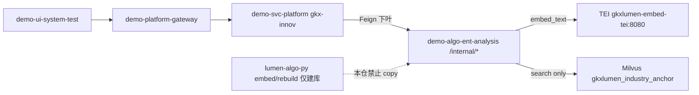

# CROSS-VEC-DEMO-ALGO-L01 · demo-algo-ent-analysis copy 政策产业槽 enrich / Job A

> 总控 [`CROSS-VEC-长任务总控.md`](./CROSS-VEC-长任务总控.md)；前序 lumen [`CROSS-VEC-POLICY-SEARCH-L01.md`](./CROSS-VEC-POLICY-SEARCH-L01.md) / [`CROSS-VEC-JOB-A-L01.md`](./CROSS-VEC-JOB-A-L01.md)。监管人矫正：联调台走 **demo-algo**，禁止 `gkx-innov` 直打 `lumen-algo-py`。

## 任务认领（必填）

| 字段 | 值 |
|------|-----|
| claimed_by | `agent:algorithm-agent` |
| supervised_by | `human:淮政玮` |
| claim_type | `coordinator_dispatch` |
| 说明 | 已 claimed + in_progress；lock 24h；本叶不改 Java / 前端 / lumen-algo-py |

## Ponytail（coding 任务必填）

| 字段 | 值 |
|------|-----|
| ponytail | `full` |
| 说明 | 只 copy 消费切面；未 copy rebuild；零新 pip；TEI/Milvus 用本仓已有 urllib 路线。未用 YAGNI 跳过 honesty / 前缀守卫 / 100 封顶 / handoff。 |

## Headroom（可选）

| 字段 | 值 |
|------|-----|
| headroom | `skip` |
| 说明 | 单仓单叶，本机未挂 Headroom |

## 图即契约

| 字段 | 值 |
|------|-----|
| diagram_id | `CROSS-VEC-DEMO-ALGO-L01-SEQ` |
| 图 diff | **加**联调台边：`demo-ui-system-test → demo-platform-gateway → demo-svc-platform(gkx-innov) → demo-algo-ent-analysis /internal/*`。消费 API 在本仓。**不画** demo→lumen-algo-py。建库边仍停在 lumen `embed/rebuild`，本仓无 rebuild。 |
| 会签态 | `v0.3-draft`（抄 `02-概要设计.md` frontmatter，未自填绿） |



---

## 范围与实现

**做**：把 lumen 已评审的**消费 API** copy 进 `demo-algo-ent-analysis`，路径对齐，供 Java 下叶 Feign。建库仍只在 lumen。

### 两条路径（全文）

**按钮抽槽**

- 方法 / 路径：`POST /internal/policy/industry/enrich`
- 入参：`{"policy_id"}` 或 `{"policy_ids"}`（或筛选 + 小 `limit`，封顶 20）
- 带 `cursor` / `mode=incremental|full` → **400**
- 成功 200；search `degraded` / `code≠0` → **503** 且不写假码
- 定码：search top-k → 本仓 `polan.graph.entity.match_industry_anchors`；禁止采 top1 score 当 `industry_link_code`；无码只留 `{name}`

**Job A 跑批**

- 方法 / 路径：`POST /internal/industry/jobs/enrich`
- 入参：`{"mode":"incremental","force":false,"cursor":"","limit":100}`
- `limit` 缺省 / 封顶 **100**；超 100 → **400**
- `degraded` → **503** 不写
- 同 `job_kind+index_version` 第二份 `full` → **409**

### 拷了哪些 / 刻意没拷

| 拷进本仓 | 源（只读对照） | 适配 |
|---|---|---|
| `polan/industry_embed.py` | `lumen_common/algorithms/industry_embed.py` 的 **search / embed_text / 前缀守卫 / MilvusHttpStore.search** | TEI 改 **urllib**（本仓禁 httpx）；`EMBED_BASE_URL` 可已含 `/v1/embeddings` |
| `polan/industry_enrich.py` | `lumen_common/algorithms/policy/industry_enrich.py` | DB 用 `polan.common.db.connect`；对码用本仓 `polan.graph.entity` |
| `polan/industry_job.py` | `lumen_common/algorithms/policy/industry_job.py` | 同上；limit 硬顶 100 |
| `api/policy_industry_routes.py` | `lumen_algo_service/views/policy_industry.py` | FastAPI 独立 router |
| `api/industry_jobs_routes.py` | `lumen_algo_service/views/industry_jobs.py` | FastAPI 独立 router |

**刻意没拷（建库仍只在 lumen-algo-py）**

- `rebuild` / `load_anchors` / `anchor_docs`
- `MilvusHttpStore.drop` / `create` / `insert` / `list_collections`
- `map_graph` / `graph_project`
- 灌链 hook、`run-pipeline` / append / reload 接线

本仓 `l1_industry_match_text` / `normalize_policy_theme` 原先不在 `entity.py`（任务写「已在」），本叶按 lumen vendor **补了这两个小函数**，未改 `match_industry_anchors` 语义。

### env 键（本仓 bootstrap yaml）

| 键 | 值 | 说明 |
|---|---|---|
| `MILVUS_URI` | `http://192.168.88.43:19530` | HTTP v2 + urllib；只 search |
| `MILVUS_COLLECTION_PREFIX` | `gkxlumen_industry_` | 前缀守卫；禁碰 `amcpdp-*` |
| `EMBED_BASE_URL` | `http://gkxlumen-embed-tei:8080/v1/embeddings` | query 前缀「为这个句子生成表示以用于检索相关文章：」；锚点不加 |
| `EMBED_MODEL` | `BAAI/bge-base-zh-v1.5` | dim 768；TEI 已 L2 归一，客户端不再归一 |

正式 helm 留给 **`CROSS-VEC-DEMO-API-RETARGET-L01`**（`demo-svc-platform`）。本叶只改 `deploy/k8s/entan-api.yaml`。

### 给下一叶（Java Feign 完整路径）

联调台正确链：

```text
demo-ui-system-test → demo-platform-gateway → demo-svc-platform(gkx-innov)
  → demo-algo-ent-analysis
```

`gkx-innov` 应 Feign **本仓**（不要 lumen-algo-py）：

| 用途 | Feign 路径 |
|---|---|
| 按钮抽槽 | `POST /internal/policy/industry/enrich` |
| Job A | `POST /internal/industry/jobs/enrich` |

`search` 不是对外口，由上面两条在进程内循环调用。

---

## 偏离

| # | 偏离 | 理由 / as-built |
|---|------|-----------------|
| 1 | 本叶**未**对现网 DWD 实打 search 写槽 | 本机无 TEI ClusterIP；单测注入 `search_fn`。collection 仍是 SWITCH `gkxlumen_industry_anchor` |
| 2 | `entity.py` 补了 `l1_industry_match_text` / `normalize_policy_theme` | 派单写「已在」，本仓当时没有；与 lumen vendor 同文，未改对码核 |
| 3 | 本仓 bootstrap yaml 补了 4 个 env，未改 helm | 正式 helm 属 `CROSS-VEC-DEMO-API-RETARGET-L01` |

未违反硬闸：不 copy rebuild；不挂钩灌链；不放开 100；不采 top1；不改 Java / 前端 / lumen-algo-py；零新 pip。

---

## 产物清单

- `demo-algo-ent-analysis/polan/industry_embed.py`
- `demo-algo-ent-analysis/polan/industry_enrich.py`
- `demo-algo-ent-analysis/polan/industry_job.py`
- `demo-algo-ent-analysis/api/policy_industry_routes.py`
- `demo-algo-ent-analysis/api/industry_jobs_routes.py`
- `demo-algo-ent-analysis/api/main.py`（try/include，失败不拖垮企业主路由）
- `demo-algo-ent-analysis/polan/graph/entity.py`（补 L1 文本 / theme 归一）
- `demo-algo-ent-analysis/deploy/k8s/entan-api.yaml`（4 env）
- `demo-algo-ent-analysis/tests/test_policy_industry_enrich.py`
- `demo-algo-ent-analysis/tests/test_industry_job_enrich.py`
- `demo-algo-ent-analysis/tests/test_industry_embed_search.py`
- 本 handoff

---

## 验收证据

### 1. pytest

```text
cd ${GKX_ROOT}/repos/demo-algo-ent-analysis
python -m pytest tests/test_policy_industry_enrich.py tests/test_industry_job_enrich.py tests/test_industry_embed_search.py tests/test_policy_hang_industry.py -q
  → 32 passed
```

| 用例 | 断言 |
|------|------|
| `test_http_enrich_route_and_small_limit` | 路由存在；对码写 `chain:INB1303` |
| `test_http_degraded_is_503_and_job_a_is_400` | degraded 503 不写；cursor/full 400 |
| `test_apply_hits_does_not_take_top1_score_or_code` | top1 矿产勘探不写码 |
| `test_limit_over_cap_is_400` | limit>100 → 400 |
| `test_degraded_probe_does_not_write` | Job A degraded 不写 |
| `test_http_route_and_statuses` | Job A 路由；第二份 full 409；degraded 503 |
| `test_job_module_does_not_call_rebuild` | 无 `def rebuild` / drop / create / httpx / pymilvus |
| `test_reload_ingest_files_do_not_import_enrich` | 重灌四文件 grep 零命中 |

### 2. 重灌 grep（exit 1 = 零命中）

```text
rg -n "industry_embed|industry_enrich|industry_job|jobs/enrich|embed/rebuild|policy_industry" \
  polan/mockgen/incr.py polan/mockgen/generate.py scripts/run_all_policy.py scripts/run_all.py
# 无输出，exit 1
```

### 3. 是否实打 search 写槽

**没有。** 未连 19530 / TEI，未 UPDATE 现网 `demo_gkxlumenx_dwd.policy_base_info`。

---

## 问题清单 / 开放项

| # | 事项 | 谁做 | 状态 |
|---|------|------|------|
| A | `gkx-innov` Feign 改打本仓两条路径 | `CROSS-VEC-DEMO-API-RETARGET-L01` | 本叶不改 Java |
| B | helm 注入 4 个 env | 同上 | 本叶只改 bootstrap yaml |
| C | 现网抽样实打 search | 联调 | 本叶诚实未做 |

---

## 修改内容

- FastAPI 挂两条 `/internal/*` 消费路由（独立 try/include）
- search + 写槽 + Job A 进本仓；Milvus 只 search
- k8s bootstrap 补 TEI / Milvus env

## 测试结果

- **32 passed**（含 hang 回归 3 + 守卫 + 按钮 + Job A）
- 未调 LLM、未建库、未碰 `amcpdp-*`

## 遗留风险

- 进程内 job 表，多副本各记各的
- MemoryStore / TEI 不可用时 HTTP 503，不会用 hashgram 假码落库
- helm 未改前，仅 bootstrap yaml 有 4 env；已被 helm 管的 Deployment 要等 RETARGET 叶

## CI/CD（必填）

- 分支：`demo-algo-ent-analysis` `origin/dev`（先 `git pull --ff-only`）
- commit：见本文件落盘后 SHA（`[agent:algorithm-agent]`）
- pipeline：push 触发 GitLab CI
- K8s rollout：bootstrap yaml 仅 CI 在 Helm 未建 Deployment 时 apply；正式 helm 留给 RETARGET
- dev 测试：见上 pytest（未实打 19530）

## 可观测性（建议）

- `current_trace_id()` 写入按钮 / Job A 包络
- 不写查询全文到日志

## 涉及文件

见产物清单。

## 架构合规自检

| 铁律 | 结果 |
|------|------|
| 算法只在 Python `/internal/*` | ✅ 两条新口均 `/internal/*` |
| 调用链不可越层 | ✅ 图为 demo-ui → gateway → gkx-innov → 本仓；**未画** demo→lumen-algo-py |
| 图谱仅 Nebula | ✅ 定码仍 `match_industry_anchors` |
| 可观测 | ✅ `current_trace_id` |
| CI/CD | ✅ push `origin/dev`，未 force；`[agent:algorithm-agent]` |
| D12 | ✅ 未改 lumen 仓；本仓是 demo-algo 消费 copy |
| 数据策略 | ✅ 写槽走 `assert_demo_mysql_targets` |
| Java 不写算法 | ✅ 本叶零 Java |
| D8 / D9 / D10 | N/A |
| 重灌不同步 search | ✅ grep 零命中 |
| 不自建 collection | ✅ 无 drop/create/rebuild |
| 禁止采 top1 | ✅ 单测锁死 |
| 零新 pip | ✅ 未改 `requirements.txt` |

## 成本回填

| 字段 | 值 |
|------|-----|
| actual_tokens | 175000 |
| model_used | cursor-grok-4.6 |
| actual_cost | 1.05 |
| cost_warn | green |

口径：algorithm 默认 75/25；B 档 `$3/$15` per 1M；`175000×0.75×3/1e6 + 175000×0.25×15/1e6 = 1.05`。
