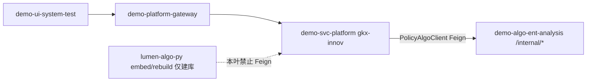

# CROSS-VEC-DEMO-API-RETARGET-L01 · demo-svc Feign 改打 demo-algo-ent-analysis

> 总控 [`CROSS-VEC-长任务总控.md`](./CROSS-VEC-长任务总控.md)；前序 [`CROSS-VEC-DEMO-API-L01.md`](./CROSS-VEC-DEMO-API-L01.md) / [`CROSS-VEC-DEMO-ALGO-L01.md`](./CROSS-VEC-DEMO-ALGO-L01.md)。监管人矫正：`gkx-innov` Feign `lumen-algo-py` **是错的**，必须改打 **demo-algo-ent-analysis**。

## 任务认领（必填）

| 字段 | 值 |
|------|-----|
| claimed_by | `agent:api-agent` |
| supervised_by | `human:淮政玮` |
| claim_type | `coordinator_dispatch` |
| 说明 | 接单时已 claimed + in_progress；lock 24h |

## Ponytail（coding 任务必填）

| 字段 | 值 |
|------|-----|
| ponytail | `full` |
| 说明 | 复用已有 `PolicyAlgoClient` / `INNOV_POLICY_ALGO_BASE_URL`；删除独立 `LumenAlgoClient`。零新 Maven 依赖。未用 YAGNI 跳过 501 honesty / limit 100 / helm 4 env / handoff。 |

## Headroom（可选）

| 字段 | 值 |
|------|-----|
| headroom | `skip` |
| 说明 | 单仓单叶，本机未挂 Headroom |

## 图即契约

| 字段 | 值 |
|------|-----|
| diagram_id | `CROSS-VEC-DEMO-API-RETARGET-L01-SEQ` |
| 图 diff | **改**联调台边：`demo-ui → demo-platform-gateway → gkx-innov → demo-algo-ent-analysis /internal/*`。**删** demo→lumen-algo-py。建库边仍停在 lumen。 |
| 会签态 | `v0.3-draft`（抄 `02-概要设计.md` frontmatter，未自填绿） |

---

## 范围与实现

**做**：enrich 门面改走已有 `PolicyAlgoClient`（现网 Service `demo-platform-entan-py:8000`）。删除 lumen-algo Feign / 配置。对外 REST 不变。helm `entanPy` 补 TEI / Milvus 4 env。

### Feign 现在打哪个 Service / 哪个 env 键

| 项 | 值 |
|---|---|
| Client | `com.topcomm.gkx.innov.policy.PolicyAlgoClient` |
| Feign `name` / `contextId` | `policy-algo` / `policyAlgoClient` |
| base-url 键 | `gkx.innov.policy.algo-base-url` |
| env | `INNOV_POLICY_ALGO_BASE_URL` |
| K8s 值 | `http://demo-platform-entan-py:8000` |
| 下游路径 | `POST /internal/policy/industry/enrich` · `POST /internal/industry/jobs/enrich`（body 原样 Map） |
| 禁止 | `LumenAlgoClient` / `INNOV_LUMEN_ALGO_BASE_URL` / `lumen-platform-algo-py` |

### 对外 REST（不变，UI 不改）

| 用途 | 网关 | gkx-innov |
|------|------|-----------|
| 按钮抽槽 | `POST /policy/v1/policy/industry/enrich` | `POST /v1/policy/industry/enrich` |
| Job A | `POST /policy/v1/industry/jobs/enrich` | `POST /v1/industry/jobs/enrich` |
| 兼容 | `POST /innov/v1/...`（已有 StripPrefix） | 同上 |

未新建网关 route id。

### 501 / 400 / 409 映射（保持）

| 条件 | HTTP |
|------|------|
| `limit>100` Java 先拦 | 400 |
| Python 400 / 409 / 422 | 原样 |
| Python 503 / degraded / `code≠0` / 不可达 | **501** honesty，不填假码 |

honesty `upstream` 改为 `demo-algo-ent-analysis /internal/...`（不再写 `lumen-algo-py`）。不把 `score` 加工成 `chain:`。

### 删了哪些 lumen-algo 配置

| 位置 | 删除 |
|------|------|
| `gkx-innov/.../LumenAlgoClient.java` | 整文件 |
| `application.yml` | `spring.cloud.openfeign...lumen-algo` + `gkx.innov.lumen-algo` / `INNOV_LUMEN_ALGO_BASE_URL` |
| `helm/.../values.yaml` `microservices.innov.env` | `INNOV_LUMEN_ALGO_BASE_URL=http://lumen-platform-algo-py:8000` |
| `helm/.../configs/gkx-innov-dev.yml` | `gkx.innov.lumen-algo.algo-base-url` |

`policy-algo` Feign 读超时并入 300s（承接原 Job A 超时）。

### helm env 是否补上

**是。** 写在已有 `entanPy.env`（`templates/entan-py.yaml` 已 `toYaml` 注入，未另起一套）：

| 键 | 值 |
|---|---|
| `MILVUS_URI` | `http://10.50.69.111:19530` |
| `MILVUS_COLLECTION_PREFIX` | `gkxlumen_industry_` |
| `EMBED_BASE_URL` | `http://gkxlumen-embed-tei:8080/v1/embeddings` |
| `EMBED_MODEL` | `BAAI/bge-base-zh-v1.5` |

未改 `entanPyWorker`（消费口在 API 进程）。Java 不直连 Milvus / TEI。

## 偏离

| # | 偏离 | 理由 / as-built |
|---|------|-----------------|
| 1 | 本机无 JDK / Maven，未跑 `mvn test` | 与 DEMO-API-L01 同；验收走 GitLab CI `backend:build` |
| 2 | 未对现网 DWD 实打 enrich | 本叶改 Feign 目标；实打留给联调台 |

未违反硬闸：不改前端 / demo-algo / lumen-algo-py；不新建 route id；不拼 `chain:`；零新 Maven 依赖。

## 产物清单

- `gkx-innov/.../policy/PolicyAlgoClient.java`（+2 方法；删「enrich 不要加在本接口」）
- `gkx-innov/.../policy/PolicyIndustryEnrichService.java`（改注入 `PolicyAlgoClient`）
- `gkx-innov/.../policy/PolicyIndustryEnrichController.java`（路径不变，注释改目标）
- **删除** `gkx-innov/.../policy/LumenAlgoClient.java`
- `gkx-innov/.../PolicyIndustryEnrichServiceTest.java`（mock `PolicyAlgoClient`；断言无 lumen-algo client）
- `gkx-innov/src/main/resources/application.yml`
- `helm/gkx-platform/values.yaml`（删 `INNOV_LUMEN_ALGO_*`；`entanPy.env` +4）
- `helm/gkx-platform/configs/gkx-innov-dev.yml`
- 本 handoff

## 验收证据

### 1. 单测

`PolicyIndustryEnrichServiceTest` mock `PolicyAlgoClient`（不再出现 `LumenAlgoClient`）：

- `limit>100` → 400 且不调 Python
- Python 409 → 409
- Python 400 → 400
- Python 503 → 501 honesty，`upstream` 含 `demo-algo-ent-analysis`、不含 `lumen-algo`；items 空、无 `chain:`
- 成功路径不改写已有 `industry_link_code`

本机无 `mvn`/`java`；CI `backend:build` 跑同一用例。

### 2. 调用链

`demo-ui → demo-platform-gateway → gkx-innov → demo-platform-entan-py:8000 /internal/*`

## 问题清单 / 开放项

| # | 事项 | 谁做 | 状态 |
|---|------|------|------|
| A | helm upgrade 后 entan-py 带上 4 env | devops / 本仓 deploy | 已写入 values |
| B | 现网抽样实打 search 写槽 | 联调 | 本叶未做 |
| C | 万级放开 100 封顶 | 另叶 | 本波验证闸 |

## 修改内容

- enrich Feign 并入 `PolicyAlgoClient`
- 删除 `LumenAlgoClient` 与全部 `INNOV_LUMEN_ALGO_*`
- `entanPy` 注入 Milvus / TEI 4 env

## 测试结果

- 单测 5 例已改 mock（本机无 mvn，CI 跑）
- 未直连 Milvus / TEI；未新依赖

## 遗留风险

- helm 未 upgrade 前，已被 helm 管的 entan-py Deployment 可能仍缺 4 env（bootstrap yaml 已有）
- Job A 进程内单飞，多副本各记各的

## CI/CD（必填）

- 分支：`demo-svc-platform` `origin/dev`（先 `git pull --ff-only`）
- commit：`demo-svc-platform` **`fc55dda39ab6b483700994298a9bb4356cba02c4`** `[agent:api-agent]`；本 handoff 另 commit
- pipeline：push 触发 GitLab CI
- K8s rollout：gkx-innov + `entanPy` env
- dev 测试：单测 + 联调台（UI 不改）

## 可观测性（建议）

- OTEL_SERVICE_NAME：`gkx-innov`（已有）
- Feign 由 Java Agent 注 W3C traceparent
- 不写查询全文到日志

## 涉及文件

见产物清单。

## 架构合规自检

| 铁律 | 结果 |
|------|------|
| 算法只在 Python `/internal/*` | ✅ Java 只 Feign；零 NLP |
| 调用链不可越层 | ✅ 图为 demo-ui → gateway → gkx-innov → demo-algo-ent-analysis；**已删** demo→lumen-algo-py |
| 图谱仅 Nebula | ✅ 未直连图；定码仍在 Python |
| 可观测 | ✅ 沿用 gkx-innov OTel / Feign Agent |
| CI/CD | ✅ push `origin/dev`，未 force；`[agent:api-agent]` |
| D12 | ✅ 未改 lumen 仓；demo 不再 Feign lumen-algo-py |
| 数据策略 | ✅ Java 不写 ADS；不直连 19530 / TEI |
| Java 不写算法 | ✅ 不改 score / 不拼 `chain:` |
| D8 / D9 / D10 | N/A（无 UI / 无指标卡） |
| 零新 Maven 依赖 | ✅ |

## 成本回填

| 字段 | 值 |
|------|-----|
| actual_tokens | 88000 |
| model_used | cursor-grok-4.6 |
| actual_cost | 0.48 |
| cost_warn | green |

口径：api 默认 80/20；B 档 `$3/$15` per 1M；`88000×0.80×3/1e6 + 88000×0.20×15/1e6 = 0.48`。
