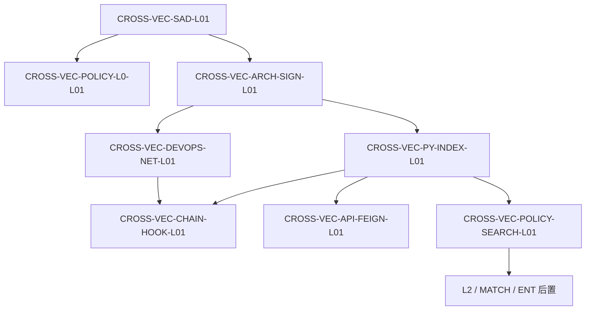

# CROSS-VEC / CROSS-KG 派单索引（2026-09-10）

| 项 | 内容 |
| --- | --- |
| Epic | `E-PLATFORM-P0` |
| 设计真源 | [向量库 INDEX](../INDEX.md)（v0.3）· [知识图谱 INDEX](../../跨系统-知识图谱/INDEX.md)（v0.3） |
| 建单 | MCP `task-create` · 一律 **backlog**（日常解锁须 confirm） |
| 长任务 | [CROSS-VEC-长任务总控.md](../CROSS-VEC-长任务总控.md) · [CROSS-VEC-总派单.md](../CROSS-VEC-总派单.md) |
| 特殊授权 | 2026-09-10 `human:淮政玮`：**不等 SAD/ARCH-SIGN 正式双签**；后续认领不必再问 |
| 本目录 | **厚派单包**；confirm 派单条不覆盖 |

## 依赖简图（registry 真源）

```text
SAD-L01 ──┬── POLICY-L0（可抢跑，不等 ARCH-SIGN）
          └── ARCH-SIGN ──┬── DEVOPS-NET ──┐
                          └── PY-INDEX ────┴── CHAIN-HOOK
                                    │
                                    ├── API-FEIGN
                                    └── POLICY-SEARCH ── L2 / MATCH / ENT（后）
```



L2 本轮已建单 = `CROSS-VEC-JOB-B-L01`（等 POLICY-SEARCH）。MATCH / ENT **未建单**。

## 夜班旁路（不进上图）

灌链 VID 稳定 → CHAIN-HOOK rebuild → L0 重灌 → Job A enrich → Hang → 独立发 B 面。  
`JOB-A` 仍等 PY-INDEX + L0 + CHAIN-HOOK；`API-JOB` 等 JOB-A + API-FEIGN；`HANG` 等 JOB-A。

## 叶清单

| ID | Agent | 仓 | 依赖 | 包 |
| --- | --- | --- | --- | --- |
| CROSS-VEC-SAD-L01 | architect | agent-delivery | — | [SAD](./CROSS-VEC-SAD-L01-派单包.md) |
| CROSS-VEC-POLICY-L0-L01 | algorithm | lumen-algo-py | SAD（可抢跑） | [L0](./CROSS-VEC-POLICY-L0-L01-派单包.md) |
| CROSS-VEC-ARCH-SIGN-L01 | architect | agent-delivery | SAD | [会签](./CROSS-VEC-ARCH-SIGN-L01-派单包.md) |
| CROSS-VEC-DEVOPS-NET-L01 | devops | lumen-algo-py | ARCH-SIGN | [网络](./CROSS-VEC-DEVOPS-NET-L01-派单包.md) |
| CROSS-VEC-PY-INDEX-L01 | algorithm | lumen-algo-py | ARCH-SIGN（与 DEVOPS 并行） | [索引](./CROSS-VEC-PY-INDEX-L01-派单包.md) |
| CROSS-VEC-CHAIN-HOOK-L01 | algorithm | lumen-algo-py | DEVOPS-NET + PY-INDEX | [灌链挂钩](./CROSS-VEC-CHAIN-HOOK-L01-派单包.md) |
| CROSS-VEC-API-FEIGN-L01 | api | lumen-svc-platform | PY-INDEX | [Feign search](./CROSS-VEC-API-FEIGN-L01-派单包.md) |
| CROSS-VEC-POLICY-SEARCH-L01 | algorithm | lumen-algo-py | PY-INDEX | [按钮抽槽](./CROSS-VEC-POLICY-SEARCH-L01-派单包.md) |
| **CROSS-VEC-JOB-A-L01** | algorithm | lumen-algo-py | PY-INDEX + L0 + CHAIN-HOOK（旁路） | [Job A 跑批](./CROSS-VEC-JOB-A-L01-派单包.md) |
| **CROSS-VEC-API-JOB-L01** | api | lumen-svc-platform | JOB-A + API-FEIGN（旁路） | [Feign Job](./CROSS-VEC-API-JOB-L01-派单包.md) |
| **CROSS-KG-HANG-BATCH-L01** | algorithm | lumen-algo-py | JOB-A（旁路） | [Hang 跑批](./CROSS-KG-HANG-BATCH-L01-派单包.md) |
| **CROSS-VEC-JOB-B-L01** | algorithm | lumen-algo-py | POLICY-SEARCH（L2 后置） | [Job B L2](./CROSS-VEC-JOB-B-L01-派单包.md) · P2 |

**本轮仍不做**：匹配推送、企业挂链 UI、链检索 UI、文档 RAG、改 `amcpdp-*`、G3 分析 Job、B 面发布作业（另开图谱叶）。

建议监管：定义 `淮政玮`/`李伟`；算法 `唐绍祖`；Java `侯佳伟`。同仓 `lumen-algo-py` 同时只派一张 coding 单。
