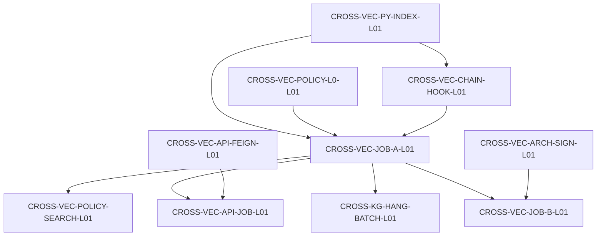

# CROSS-VEC / CROSS-KG 派单索引（2026-09-10）

| 项 | 内容 |
| --- | --- |
| Epic | `E-PLATFORM-P0` |
| 设计真源 | [向量库 INDEX](../INDEX.md)（v0.3）· [知识图谱 INDEX](../../跨系统-知识图谱/INDEX.md)（v0.3） |
| 建单 | MCP `task-create` · 一律 **backlog**（解锁须 confirm） |
| 本目录 | **厚派单包**；confirm 派单条不覆盖 |

## 夜班顺序（验收口径）

```text
灌链 VID 稳定 → embed/rebuild（CHAIN-HOOK）
  → 政策 L0+L1 重灌（POLICY-L0，同步短）
  → Job A enrich（JOB-A）
  → 可选 Job B LLM（JOB-B，默认关）
  → Hang 上图（HANG-BATCH）
  → （图谱）独立发布 B 面 / G3 分析另叶
```

registry `depends_on`（生产 DAG，2026-09-10）：



## 叶清单

| ID | Agent | 仓 | 依赖 | 包 |
| --- | --- | --- | --- | --- |
| CROSS-VEC-SAD-L01 | architect | agent-delivery | — | [SAD](./CROSS-VEC-SAD-L01-派单包.md) |
| CROSS-VEC-POLICY-L0-L01 | algorithm | lumen-algo-py | 无（可并行） | [L0](./CROSS-VEC-POLICY-L0-L01-派单包.md) |
| CROSS-VEC-ARCH-SIGN-L01 | architect | agent-delivery | SAD | [会签](./CROSS-VEC-ARCH-SIGN-L01-派单包.md) |
| CROSS-VEC-DEVOPS-NET-L01 | devops | lumen-algo-py | SAD | [网络](./CROSS-VEC-DEVOPS-NET-L01-派单包.md) |
| CROSS-VEC-PY-INDEX-L01 | algorithm | lumen-algo-py | ARCH-SIGN + DEVOPS | [索引](./CROSS-VEC-PY-INDEX-L01-派单包.md) |
| CROSS-VEC-CHAIN-HOOK-L01 | algorithm | lumen-algo-py | PY-INDEX | [灌链挂钩](./CROSS-VEC-CHAIN-HOOK-L01-派单包.md) |
| CROSS-VEC-API-FEIGN-L01 | api | lumen-svc-platform | PY-INDEX | [Feign search](./CROSS-VEC-API-FEIGN-L01-派单包.md) |
| CROSS-VEC-POLICY-SEARCH-L01 | algorithm | lumen-algo-py | **JOB-A**（共用 worker） | [按钮抽槽](./CROSS-VEC-POLICY-SEARCH-L01-派单包.md) |
| **CROSS-VEC-JOB-A-L01** | algorithm | lumen-algo-py | PY-INDEX + L0 + **CHAIN-HOOK** | [Job A 跑批](./CROSS-VEC-JOB-A-L01-派单包.md) |
| **CROSS-VEC-API-JOB-L01** | api | lumen-svc-platform | JOB-A + **API-FEIGN** | [Feign Job](./CROSS-VEC-API-JOB-L01-派单包.md) |
| **CROSS-KG-HANG-BATCH-L01** | algorithm | lumen-algo-py | **JOB-A**（硬依赖） | [Hang 跑批](./CROSS-KG-HANG-BATCH-L01-派单包.md) |
| **CROSS-VEC-JOB-B-L01** | algorithm | lumen-algo-py | JOB-A + **ARCH-SIGN** | [Job B L2](./CROSS-VEC-JOB-B-L01-派单包.md) · P2 |

**本轮仍不做**：匹配推送、企业挂链 UI、链检索 UI、文档 RAG、改 `amcpdp-*`、G3 分析 Job、B 面发布作业（另开图谱叶）。

建议监管：定义 `淮政玮`/`李伟`；算法 `唐绍祖`；Java `侯佳伟`。同仓 `lumen-algo-py` 同时只派一张 coding 单。
