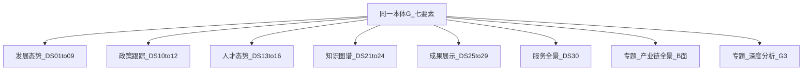

# 01 · 系统分析 · 知识图谱（跨展示 / 专题）

| 项 | 内容 |
| --- | --- |
| 任务 | `CROSS-KG-SAD-L01` |
| 版本 | v0.1-draft |
| 日期 | 2026-08-16 |
| 读者 | 架构 / 算法 / 数据 / PM；产品只读覆盖矩阵，不把本卷当 USM |
| 状态 | 架构主笔结构已齐；**标签与模型口径待算法改行**（标 `【算法补】`） |
| 不写 | 页面稿、OpenAPI、类图、各 DS Wireframe |

配套：[INDEX.md](./INDEX.md) · [02-概要设计.md](./02-概要设计.md) · [03-详细设计.md](./03-详细设计.md)

---

## 1. 问题与范围

政府侧要在**同一张知识网络**上：看科技全域态势、查政策/人才/成果挂接、进知识图谱专题页、再进产业链全景与深度分析。招标叙事是「打通技术链、产业链、人才链、政策链与服务链」；工程落点是 **7 要素节点 + 5 链边类型**，以**产业链结构为底图**。

本 SAD 回答三件事：

1. **图是什么**：一张 `G_科创`，禁止展示与专题各造一套本体。
2. **谁建谁用**：GDF 编排建图；亿集执行 Schema/融合/查图；本仓 Java/Python 只做在线消费与切面/Job。
3. **哪些页真正用图**：六模块每 DS 叶一行；挂不上七要素的标 **M** 或 **501**，不编造点类型。

**范围外**：科技数据资源 DS-17～20（运营视窗，默认不扫全）；亿集管理台；开放式 Agent 建图；任意日 as-of 整图播放。

---

## 2. 现状（事实，不作抱怨）

| 事实 | 含义 |
| --- | --- |
| Demo 图谱多为薄包 / PG 镜像 | 可演示，不可当正式切面或 A 面契约 |
| 亿集未接本仓在线路径 | A 面查图未就绪时合法 **501** |
| 物理库 Q5 未决 | 应用只经查图 API，不感知 Nebula vs 亿集自管 |
| 全景切面说明书已有 v0.2.1-draft | B 面算法与包契约以该件为准，本卷不复制 |
| Job Runtime 已有 v0.9-draft | G3 生成分析以该件为准，禁止与 `graph_snapshot` 混表 |
| `graph-engine.md` 仍写 Nebula 直连纪律 | 与第五轮「应用只经查图 API」并存：Python 适配层对内可连物理库，**对外契约不暴露** |

---

## 3. 需求来源（索引，不抄招标长文）

| 来源 | 用到哪 |
| --- | --- |
| 展示 Catalog `catalog-display-7modules.yaml` | DS-01～16、DS-21～30 覆盖矩阵 |
| 展示系统方案 `1.1.1.1.4.1.1` 等 | 科技全域态势等页是**消费方** |
| 算法库 `.2` | 七要素抽取 + 五大流程 = 建图 |
| 算法库 `.2.15` | A 面五 API |
| 算法库 `.3`～`.10` | 专题深度模型 = 用图 / 打分 / 或纯指标 |
| `5链分析与7要素关系网络.md` | 本体定义 |

`.2.1`～`.2.14` 是实体识别与关系抽取，落在建图（亿集脚本 + DWD），**不在全景页实现**。

---

## 4. 干系人与系统边界

| 系统 | 仓 / 入口 | 对本图的角色 |
| --- | --- | --- |
| 展示 PC | `lumen-ui-science-pc` `/display/**`、`/innov` | 只读消费：嵌图、挂接、指标；主入口之一是 DS-21～24 |
| 专题 | `lumen-ui-topic` `/topic/**` | 只读消费：B 面全景、G3 Job、A 面检索 |
| 管理后台 | `lumen-ui-admin` | 运营/权限；**不**嵌亿集管理 UI |
| 亿集管理面 | 合作方产品 | Schema/任务运维；本项目前端不嵌入 |
| Java | `lumen-svc-platform` `gkxlumen-*` | 只读 ADS + Feign `/internal/*`；禁 nGQL / NER |
| Python | `lumen-algo-py` / `lumen-etl-es-py` | 查图适配、切面、Job、写 ADS |
| GDF | 数据产线 | 编排 DAG：表 ETL + 触发亿集建图 |
| 亿集引擎 | 合作方运行时 | 建图/融合/查图能力面 |

**禁止**：lumen 打 `demo-*` 服务（D12）；前端直连图库；为展示另起 BFF 直连 Python。

驾驶舱/政策/人才/成果/服务是**嵌图或挂接**；DS-21～24 是**用图主入口**；专题全景是**链结构切面**。禁止为任一模块复制本体。

---

## 5. 领域本体（升格自 5 链 × 7 要素）

真源：`agent-delivery/designs/5链分析与7要素关系网络.md`。本卷只定分析口径，物理 Tag/Edge 见 03。

### 5.1 节点 `V`（七要素）

| 编号 | 要素 | 图角色 | 主键语义 |
| --- | --- | --- | --- |
| 1 | 企业 | 实体节点 | 项目归一企业键 |
| 2 | 产业链 / 产业环节 | 底图节点 | `chain_id` + `node_id`（环节） |
| 3 | 科研机构 | 实体节点 | 项目归一机构键 |
| 4 | 技术 | 链上节点 | 技术点 / 技术实体键 |
| 5 | 人才 | 链上节点 | 人才键 |
| 6 | 服务机构 | 链上节点 | 服务机构键 |
| 7 | 政策 | 链上节点 | 政策键 |

**产业链 = 底图**：上下游环节与供给边构成可发布的结构切面。其余要素挂在环节或彼此之间，**不是**第二张底图。

### 5.2 边 `E`（五链 = 边类型族）

| 边族 | 语义（分析级） | 典型连接 |
| --- | --- | --- |
| 技术链 | 研发、产出、掌握、应用 | 机构/企业/人才 ↔ 技术 ↔ 产业环节 |
| 产业链 | 上下游、供给、依赖 | 环节 ↔ 环节；企业分布在环节 |
| 人才链 | 任职、师承、流动、合作 | 人才 ↔ 企业 / 机构 / 技术 |
| 政策链 | 扶持、监管、导向、补贴 | 政策 ↔ 企业 / 机构 / 人才 / 产业 / 服务 |
| 服务链 | 服务、技转、孵化、配套 | 服务机构 ↔ 企业 / 机构 / 产业 |

股权、社交等跨类型关系：**只走 A 面当前图**，不进 B 面切面（CUT-D6）。

### 5.3 必须分清的「5」

| 名称 | 含义 | 本 SAD |
| --- | --- | --- |
| 业务 5 链 | 技术 / 产业 / 人才 / 政策 / 服务 | 边类型族 |
| **瓶颈五维** | 技术 / 人才 / 市场 / 资金 / 政策 | 诊断模型切片，**不是**五种点类型，也不是五张图 |
| 展示 7 模块 | 态势 / 政策 / 人才 / 数据资源 / 图谱 / 成果 / 服务 | 消费方；数据资源默认不扫全 |

瓶颈识别 = 在**一条产业链底图**上切其余链 + 两主体，再跑五维模型。禁止把「五维」画成五种节点。

### 5.4 空间锚点

区域 / 深圳是**空间属性与 GIS 图层**，默认不是第七点类型。需要「位于」边时用属性或弱挂接，不另起 Ontology。

---

## 6. 科创要素映射（挂同一 `G`，挂不上则 M/ES）

展示与专题口语里的「论文、专利、仪器…」**不是**新点类型。映射原则：能落到七要素或底图环节则 G；否则表格/ES/GIS（**M**）。

| 口语对象 | 映射到 | 读面 | 备注 |
| --- | --- | --- | --- |
| 企业 / 公司 | 企业 | A / B 挂接 | 底图 `entities[]` 企业必带可空数组（CUT-D5） |
| 高校 / 院所 / 实验室 | 科研机构 | A | 与产业链多为间接（经技术） |
| 产业环节 / 上下游 | 底图节点 | B 为主 | SCD1 节点；历史只走切面 |
| 技术点 / 技术方向 | 技术 | A；DS-02 | 【算法补】技术点粒度 |
| 人才 / 专家 / 团队负责人 | 人才 | A | |
| 政策 / 条款包 | 政策 | A；DS-10 | |
| 孵化器 / 检测 / 金融等中介 | 服务机构 | A | 与「创新载体」分清，见下 |
| 论文 / 期刊文献 | **成果属性或 ES 文档**，作者/机构挂人才/科研机构 | M + 弱 G1 | 不单列 Paper 点类型 |
| 专利 | 同上；权利人挂企业/机构 | M + 弱 G1 | |
| 项目 / 课题 / 经费 | 事件或 ADS 指标；承担方挂企业/机构 | M | 不单列 Project 点类型 |
| 会议 | M / CMS | M | 除非能稳定挂机构 |
| 创新载体 / 孵化载体 | **载体 ≠ 企业**；运营主体→企业或机构；入驻→企业 | G1 | Catalog DS-26/29 已声明独立实体；**【算法补】是否升为属性节点或挂服务机构**。在升格前禁止第三套「载体本体」与七要素并列扩散 |
| 大型仪器 | 对接展示 | M | DS-28；不建预约闭环 |
| GDP / 规模 / 指数 | ADS 指标 | **M** | 禁止写成图算法 |
| 词云 | 招标可视化举例 | 不进专题全景 | ±10% 不扩 |

**禁止**：按展示模块各造点类型；把 GIS 图层当图谱边；把 CMS「发展历程」当图谱时间轴（`.3.3` ≠ B 面演进）。

载体行未升格前的团队默认：载体作为**挂接对象**（运营/入驻关系），点类型仍落企业/机构/服务机构三选一，由算法在会签前圈定一格，并登记 `客户决策清单跟踪表` 若需甲方拍板。

---

## 7. 场景四标签（全表共用）

| 标签 | 含义 | 典型读面 |
| --- | --- | --- |
| **G1** | 挂接查询 / 子图展示 | A 面 live；或 B 面已发布结构 |
| **G2** | 图算法（路径、中心性、社群、相似度） | A 面 metrics/similarity；未注册 **501** |
| **G3** | 子图打分 / 生成分析 Job | Job Runtime；结果快照 ≠ `graph_snapshot` |
| **M** | 纯指标 / 检索 / GIS，不走图计算 | ADS / ES |

诚实性：

- 能力未就绪 → HTTP **501** + honesty，禁止 200 假分。
- 图在、结果空 → **200** 诚实空。
- Mock → D9 MockBadge；正式禁止用切面包冒充 live 检索。

---

## 8. 展示六模块覆盖矩阵

真源：`catalog-display-7modules.yaml`。**每叶一行**。标签列为架构草稿，算法改标签与缺口。

列说明：读面 = A 当前图 / B 切面 / Job / ADS / ES / GIS。出口 = `display` 或 `topic`。

### 8.1 科技发展态势 DS-01～09

| 场景ID | DS | 标题 | 一句话任务 | 标签 | 读面 | 出口 | V1/501 | 缺口 |
| --- | --- | --- | --- | --- | --- | --- | --- | --- |
| SC-DS-01 | DS-01 | 科技全域态势 | 总驾驶舱嵌同一张图 + GIS 多图层；要素关联可点到子图 | G1 | A 嵌图 + GIS + ADS | display | V1 嵌图可薄；完整七要素挂接可空 | 关联边覆盖 【算法补】 |
| SC-DS-02 | DS-02 | 科学技术全景 | 技术点图谱、关联实体排名、关键路径/关键节点 | G1/G2 | A | display | 路径/关键节点未注册则 501 | 技术点粒度 【算法补】 |
| SC-DS-03 | DS-03 | 技术发展跟踪 | 展示评估结果与工作流，不在本页跑深度研判 | M | ADS | display | V1 指标 | 与专题技术链模型边界 【算法补】 |
| SC-DS-04 | DS-04 | 全球创新监测 | 成果/热点/城市能力：指标与对标 | M | ADS/ES | display | V1 指标 | 城市创新能力口径 【算法补】 |
| SC-DS-05 | DS-05 | 湾区创新监测 | 湾区城市成果与关键指标 | M | ADS | display | V1 | |
| SC-DS-06 | DS-06 | 深圳创新监测 | 本地运行监测与排名；企业/机构可弱挂接 | M/G1 | ADS；可选 A | display | V1 以 M 为主 | |
| SC-DS-07 | DS-07 | 科技创新评估 | 知识产权规模与分布；产业方向决策支持 | M | ADS | display | V1 | 评估对象范围 【算法补】 |
| SC-DS-08 | DS-08 | 科技指数 | 指数/排行可视化；智库管理不在展示页 | M | ADS | display | V1 展示；后台另叶 | |
| SC-DS-09 | DS-09 | 科技发展规划 | 文献趋势/预警/宏观预测可视化；不承担规划编制 | M | ADS/ES | display | 预警模型可 501 | |

### 8.2 科技政策跟踪 DS-10～12

| 场景ID | DS | 标题 | 一句话任务 | 标签 | 读面 | 出口 | V1/501 | 缺口 |
| --- | --- | --- | --- | --- | --- | --- | --- | --- |
| SC-DS-10 | DS-10 | 科创政策全景 | 政策多维展示；政策–企业/机构挂接 | G1 | A + ADS | display | V1 挂接可空 | |
| SC-DS-11 | DS-11 | 政策分析评价 | 分析/解读/推荐方案报告 | G3 | Job | display | **501** 直至模型注册 | 与 `.8.x` 复用 【算法补】 |
| SC-DS-12 | DS-12 | 政策效果推演 | 社会经济/转化等预测呈现 | G3 | Job | display | **501**；不假装因果仿真 | 假设与边界 【算法补】 |

### 8.3 科技人才态势 DS-13～16

| 场景ID | DS | 标题 | 一句话任务 | 标签 | 读面 | 出口 | V1/501 | 缺口 |
| --- | --- | --- | --- | --- | --- | --- | --- | --- |
| SC-DS-13 | DS-13 | 全球领域人才态势 | 人才图谱 + 分布/洞察/详情 | G1 | A + GIS | display | V1 子图可薄 | |
| SC-DS-14 | DS-14 | 关注地区人才态势 | 重点地区分布与迁徙可视化 | G1 | A + GIS | display | 迁徙轨迹不另做轨迹引擎；用关系+时间属性 | |
| SC-DS-15 | DS-15 | 重点科技人才画像 | 成果、合作网络、领域图谱 | G1 | A | display | V1 | |
| SC-DS-16 | DS-16 | 人才引进推荐评估 | 贡献/难度/成本 + 尽调推荐 | G3 | Job | display | **501** | 评分口径 【算法补】 |

### 8.4 科技知识图谱 DS-21～24（用图主入口）

| 场景ID | DS | 标题 | 一句话任务 | 标签 | 读面 | 出口 | V1/501 | 缺口 |
| --- | --- | --- | --- | --- | --- | --- | --- | --- |
| SC-DS-21 | DS-21 | 分析展示 | 交互查询当前图；识别/预测/推荐未就绪则 501 | G1 | A `graph/view` `entities` `relations` | display | V1 查询；预测/推荐 501 | |
| SC-DS-22 | DS-22 | 指标展示 | 图指标与规则；黑名单联动 | G2 | A metrics + ADS | display | 未注册指标 501 | 规则/审计 【算法补】 |
| SC-DS-23 | DS-23 | 算法展示 | 路径 / 中心性 / 社群等结果展示 | G2 | A | display | 路径/社群默认 **501**；密度/中心度可先做 | 禁止做成算法开发平台 |
| SC-DS-24 | DS-24 | 服务展示 | 图查询/分析赋能各业务；权限 | G1 | A 五 API 对内复用 | display | V1 声明赋能清单；SDK 收口 Java REST | |

### 8.5 科技成果展示 DS-25～29

| 场景ID | DS | 标题 | 一句话任务 | 标签 | 读面 | 出口 | V1/501 | 缺口 |
| --- | --- | --- | --- | --- | --- | --- | --- | --- |
| SC-DS-25 | DS-25 | 软科学成果展示 | GIS + 图表；成果按地域聚合 | M | GIS + ADS | display | V1 | 「软科学」口径待甲方，现 ⚠️ |
| SC-DS-26 | DS-26 | 科技创新生态展示 | 载体数量/人才等；载体–运营主体挂接 | G1 | ADS + A | display | V1 弱挂接 | 载体映射见 §6 |
| SC-DS-27 | DS-27 | 科技时空演进展示 | 论文/专利/资金等时空演进 | M | GIS + ADS | display | V1 | **不是** B 面图谱时间轴 |
| SC-DS-28 | DS-28 | 大型科学仪器共享 | 对接仪器平台可视化 | M | 对接 API | display | V1 展示 | 不建预约运营 |
| SC-DS-29 | DS-29 | 创新载体孵化载体 | 分布 + 入驻企业 + 政策联动 | G1 | A + ADS | display | V1 挂接可空 | 同 §6 载体 |

### 8.6 科技服务全景 DS-30

| 场景ID | DS | 标题 | 一句话任务 | 标签 | 读面 | 出口 | V1/501 | 缺口 |
| --- | --- | --- | --- | --- | --- | --- | --- | --- |
| SC-DS-30 | DS-30 | 生态/智库/交流/竞赛/传播 | 服务状态可嵌图谱；细则拆页仍同一本体 | G1 | A 可空 + ADS + GIS | display | V1 汇总；子专题另叶 | |

### 8.7 默认不扫全：科技数据资源 DS-17～20

接入统计、主题库、调用共享属运营视窗。仅当原文「资源关联关系」能落到七要素时，由算法**加一行**，不另造本体。本版不加行。

---

## 9. 专题深度模型覆盖矩阵（算法库 `.3`～`.10`）

每模型一行。GDP/规模类标 **M**。全景结构标 **G1+B**。识别/推荐标 **G3**。关系链标 **G1**。标签为架构草稿。

### 9.1 产业链 `.3`

| 场景ID | 条款 | 模型 | 标签 | 读面 | 出口 | V1/501 |
| --- | --- | --- | --- | --- | --- | --- |
| SC-T-3.1 | `.3.1` | 产业链全景 | G1 | **B** 切面 | topic | 切面说明书 |
| SC-T-3.2 | `.3.2` | 深圳产业链 | G1 | B + 地域过滤 | topic | 同切面 |
| SC-T-3.3 | `.3.3` | 产业发展路线历程 | M | CMS/ADS | topic | **≠** 图谱演进时间轴 |
| SC-T-3.4 | `.3.4` | 产业热点领域识别 | M/G3 | ADS/Job | topic | 【算法补】 |
| SC-T-3.5 | `.3.5` | 深圳产业优势识别 | M/G3 | Job | topic | 【算法补】 |
| SC-T-3.6 | `.3.6` | 产业周期分析 | M | ADS/Job | topic | |
| SC-T-3.7 | `.3.7` | 产业阶段分析 | M | ADS/Job | topic | |
| SC-T-3.8 | `.3.8` | 产业链关键环节识别 | G3 | Job；底图切片 | topic | Job Runtime 样板 |
| SC-T-3.9 | `.3.9` | 产业瓶颈堵点识别 | G3 | Job；**五维模型 ≠ 5 链** | topic | |
| SC-T-3.10 | `.3.10` | 区域产业指数 | **M** | ADS | topic | 禁止当图算法 |
| SC-T-3.11 | `.3.11` | 深圳问题识别 | G3 | Job | topic | 【算法补】 |
| SC-T-3.12 | `.3.12` | 深圳机遇分析 | G3 | Job | topic | 【算法补】 |
| SC-T-3.13 | `.3.13` | 重点布局产业推荐 | G3 | Job | topic | 【算法补】 |

### 9.2 技术链 `.4`

| 场景ID | 条款 | 模型 | 标签 | 读面 | V1/501 |
| --- | --- | --- | --- | --- | --- |
| SC-T-4.1 | `.4.1` | 全景技术链 | G1 | A | 可与 DS-02 同源 |
| SC-T-4.2 | `.4.2` | 深圳技术链 | G1 | A | |
| SC-T-4.3 | `.4.3` | 技术发展历程 | M | CMS/ADS | ≠ B 面时间轴 |
| SC-T-4.4 | `.4.4` | 深圳细分领域分布 | M | ADS | |
| SC-T-4.5 | `.4.5` | 技术前沿热点识别 | M/G3 | Job | 【算法补】 |
| SC-T-4.6 | `.4.6` | 技术产业化潜力 | G3 | Job | 【算法补】 |
| SC-T-4.7 | `.4.7` | 技术转化瓶颈原因 | G3 | Job | 五维可复用思想，仍非点类型 |
| SC-T-4.8 | `.4.8` | 技术阶段分析 | M | ADS/Job | |
| SC-T-4.9 | `.4.9` | 深圳技术问题识别 | G3 | Job | 【算法补】 |
| SC-T-4.10 | `.4.10` | 深圳技术机遇识别 | G3 | Job | 【算法补】 |
| SC-T-4.11 | `.4.11` | 深圳技术重点布局推荐 | G3 | Job | 【算法补】 |

### 9.3 企业 `.5`

| 场景ID | 条款 | 模型 | 标签 | 读面 | V1/501 |
| --- | --- | --- | --- | --- | --- |
| SC-T-5.1 | `.5.1` | 深圳企业竞争力 | M/G3 | ADS/Job | |
| SC-T-5.2 | `.5.2` | 企业发展历程 | M | CMS/ADS | |
| SC-T-5.3 | `.5.3` | 企业痛难点识别 | G3 | Job | 【算法补】 |
| SC-T-5.4 | `.5.4` | 企业供应链关系 | G1/G2 | A 当前；不进 B | 股权/社交 CUT-D6 |
| SC-T-5.5 | `.5.5` | 企业技术力 | M/G3 | ADS/Job | |
| SC-T-5.6 | `.5.6` | 企业商业力 | **M** | ADS | |
| SC-T-5.7 | `.5.7` | 招引企业推荐 | G3 | Job | 龙头引育样例 |
| SC-T-5.8 | `.5.8` | 培育企业推荐 | G3 | Job | 同上 |

### 9.4 科研机构 `.6`

| 场景ID | 条款 | 模型 | 标签 | 读面 | V1/501 |
| --- | --- | --- | --- | --- | --- |
| SC-T-6.1 | `.6.1` | 重点技术领域布局 | M/G1 | ADS + A | |
| SC-T-6.2 | `.6.2` | 机构发展历程 | M | CMS | |
| SC-T-6.3 | `.6.3` | 深圳机构优势 | M/G3 | Job | 【算法补】 |
| SC-T-6.4 | `.6.4` | 深圳机构痛难点 | G3 | Job | 【算法补】 |
| SC-T-6.5 | `.6.5` | 科研合作关系链 | G1 | A | |
| SC-T-6.6 | `.6.6` | 引入推荐 | G3 | Job | 【算法补】 |
| SC-T-6.7 | `.6.7` | 扶持推荐 | G3 | Job | 【算法补】 |

### 9.5 人才 `.7`

| 场景ID | 条款 | 模型 | 标签 | 读面 | V1/501 |
| --- | --- | --- | --- | --- | --- |
| SC-T-7.1 | `.7.1` | 重点人才识别 | M/G3 | Job | |
| SC-T-7.2 | `.7.2` | 人才流动追踪 | G1 | A + 时间属性 | 非轨迹引擎 |
| SC-T-7.3 | `.7.3` | 高校新培育人才 | M | ADS | |
| SC-T-7.4 | `.7.4` | 深圳人才优劣势 | M/G3 | Job | 【算法补】 |
| SC-T-7.5 | `.7.5` | 人才关系链 | G1 | A | 与 DS-15 同源 |
| SC-T-7.6 | `.7.6` | 人才供需 | M | ADS | |
| SC-T-7.7 | `.7.7` | 学术力 | M | ADS | |
| SC-T-7.8 | `.7.8` | 产业力 | M | ADS | |
| SC-T-7.9 | `.7.9` | 招入人才推荐 | G3 | Job | 与 DS-16 可复用 |
| SC-T-7.10 | `.7.10` | 培育人才布局 | G3 | Job | 【算法补】 |

### 9.6 政策 `.8`

| 场景ID | 条款 | 模型 | 标签 | 读面 | V1/501 |
| --- | --- | --- | --- | --- | --- |
| SC-T-8.1 | `.8.1` | 政策焦点识别 | M | ADS/ES | |
| SC-T-8.2 | `.8.2` | 政策力度 | M | ADS | |
| SC-T-8.3 | `.8.3` | 政策效果评估 | G3 | Job | 可与 DS-11 复用 |
| SC-T-8.4 | `.8.4` | 政策短板 | G3 | Job | 【算法补】 |
| SC-T-8.5 | `.8.5` | 政策机遇 | G3 | Job | 【算法补】 |
| SC-T-8.6 | `.8.6` | 政策布局推荐 | G3 | Job | 政策推荐样例；可与 DS-12 分清：推荐≠因果仿真 |

### 9.7 产业服务 `.9`

| 场景ID | 条款 | 模型 | 标签 | 读面 | V1/501 |
| --- | --- | --- | --- | --- | --- |
| SC-T-9.1 | `.9.1` | 服务链短板 | G3 | Job | |
| SC-T-9.2 | `.9.2` | 服务关系链 | G1 | A | 与 DS-30 可嵌 |
| SC-T-9.3～9.8 | `.9.3`～`.9.8` | 六类服务机构技术力 | M | ADS | 金融/IP/HR/市场/咨询/科创 |
| SC-T-9.9 | `.9.9` | 服务机构引入推荐 | G3 | Job | 【算法补】 |
| SC-T-9.10 | `.9.10` | 服务机构培育推荐 | G3 | Job | 【算法补】 |

### 9.8 综合 `.10`

| 场景ID | 条款 | 模型 | 标签 | 读面 | V1/501 |
| --- | --- | --- | --- | --- | --- |
| SC-T-10.1 | `.10.1` | 区域科技创新成果综合评价 | **M** | ADS | |
| SC-T-10.2 | `.10.2` | 区域产业创新成果综合评价 | **M** | ADS | |
| SC-T-10.3 | `.10.3` | 区域创新人才综合评价 | **M** | ADS | |
| SC-T-10.4 | `.10.4` | 区域创新政策综合评价 | **M** | ADS | |
| SC-T-10.5 | `.10.5` | 区域创新活力 | M | ADS | |
| SC-T-10.6 | `.10.6` | 创新要素类型评价 | M | ADS | |
| SC-T-10.7 | `.10.7` | 创新要素层次评价 | M | ADS | |
| SC-T-10.8 | `.10.8` | 创新要素领域评价 | M | ADS | |
| SC-T-10.9 | `.10.9` | 创新要素综合分析 | M | ADS | |
| SC-T-10.10 | `.10.10` | 区域创新协同 | G1/G3 | A 合作网 + Job | 协同网络可 G1；综合分 M |

---

## 10. 追溯（条款 → 场景 → 前端）

| 条款簇 | 场景簇 | 前端 |
| --- | --- | --- |
| 展示 Catalog DS-01～16、21～30 | SC-DS-* | display |
| 算法 `.2.1`～`.2.14` | 建图，无独立展示场景行 | 无页 |
| 算法 `.2.15`（1）（2）（4）（5）+ live（3） | SC-DS-21～24；专题检索 | display / topic |
| 算法 `.2.15`（3）历史形态 + `.3.1` | SC-T-3.1 / 3.2 | topic B 面 |
| 算法 `.3.8` `.3.9` `.5.7` `.8.6` 等 | SC-T-* G3 | topic Job |
| 基础指标 `.1` | 全部 M 行的数 | ADS，Java 只读 |

零漏行 ≠ 全做图算法。大量 501 / M 是合格分析，不是偷工。

---

## 11. 约束（沿用铁律，不另立法）

| 项 | 约束 |
| --- | --- |
| 调用链 | 前端 → 网关 → Java → Python `/internal/*` |
| 算法位置 | 仅 Python；亿集侧脚本在对方平台执行 |
| 图谱 | 禁止 Neo4j；Q5 未决时应用只经查图 API |
| D9 | 统计数字 8 件套 + 四维就绪度；禁止前端改绿 |
| D12 | lumen 不打 demo 服务 |
| CUT-D7 | 推理进演进必须回写 DWD；禁止从 live 图 EXPORT 当切面 |
| 禁 NL2SQL | 直查图库 |
| 禁第二本体 | 新页面只加场景行 |
| 禁 RAG/Agent 当建图前提 | 建图依赖 DWD + 亿集任务；RAG 可后置消费 |
| 三套 snapshot 分家 | 图谱发布包 ≠ Job Input/Result ≠ CMS 历程 |

---

## 12. 算法补行清单（本卷退出条件之一）

架构不代填模型口径。请算法在会签前改：

1. 所有 `【算法补】` 单元格（粒度、复用、评分口径）。
2. 确认或改写 §8 / §9 的 G1/G2/G3/M 与 V1/501。
3. 载体（DS-26/29）落七要素哪一格，或登记甲方决策项。
4. `.2.15`（4）相似度、（5）社群/路径：哪些进 `cfg_model_registry`，哪些长期 501。
5. 不把未注册模型标成 V1。

改表即可，不必另起文档。加厚列放到 [03-详细设计.md](./03-详细设计.md) 场景卡片。
