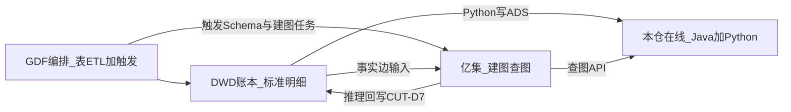
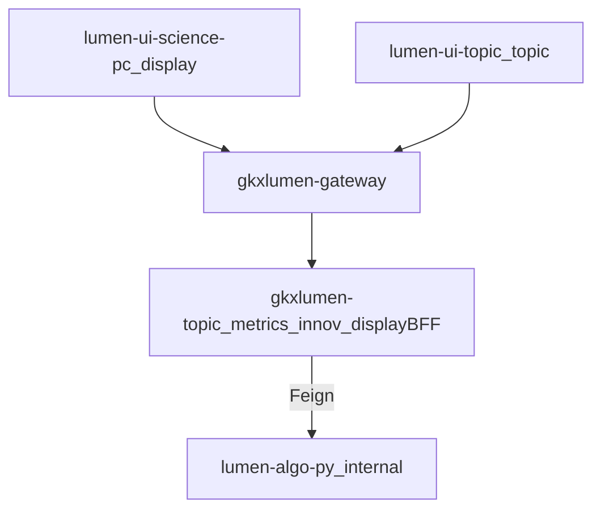
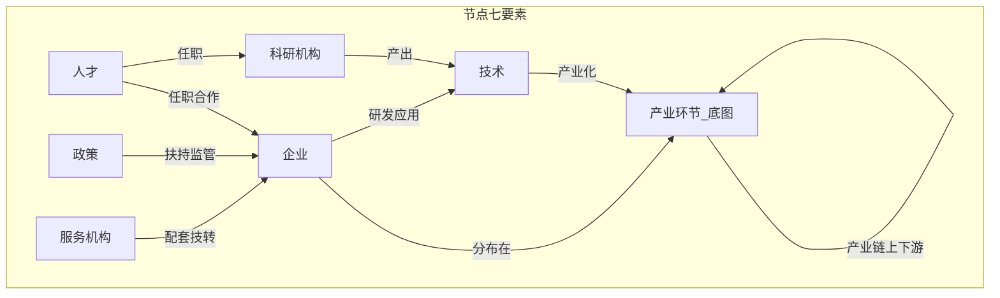
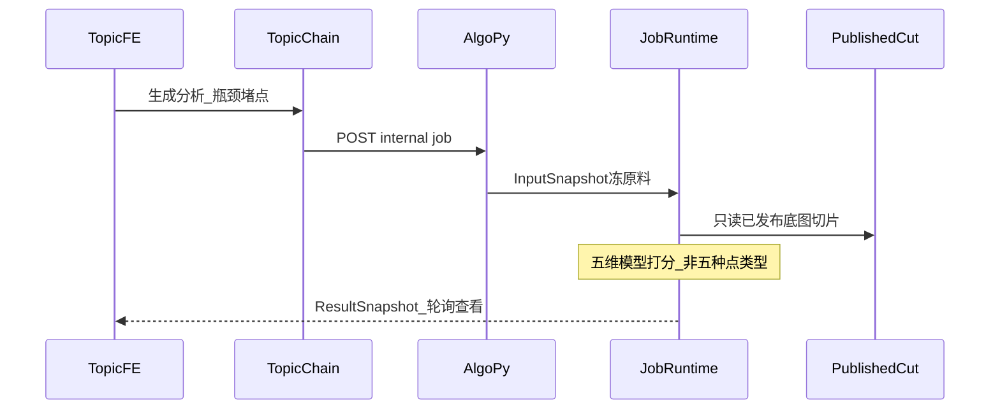

# 02 · 概要设计 · 知识图谱（跨展示 / 专题）

| 项 | 内容 |
| --- | --- |
| 任务 | `CROSS-KG-SAD-L01` |
| 版本 | v0.1-draft |
| 日期 | 2026-08-16 |
| 前提 | [01-系统分析.md](./01-系统分析.md) 本体与覆盖矩阵 |
| 状态 | 架构草稿；四平面会签前 **不据此实现新 OpenAPI** |
| 不写 | 类图、各页 Wireframe、亿集 76 路径照抄 |

---

## 0. 封面纪律（FDE 裁剪，非岗位）

从真实模块发现需求（01 已扫六模块）；接到已有数据与 API（四平面 + A/B/Job）；成功标准 = 生产可用 + honesty，不是幻灯片；新页面只加场景行；GDP/规模走 **M**；未就绪 **501**。

不上 RAG/Agent 当建图开工条件。不上每页私有 Ontology。

---

## 1. 总体：四平面

| 平面 | 职责 | 不做 |
| --- | --- | --- |
| GDF | ODS/DWD；DAG；调亿集 Schema/任务；飞书批次告警 | 重做融合引擎；直写图存储 |
| DWD 账本 | 链/节点 SCD1；`node_rel`/`entity_rel` 半开区间 | 布局坐标；七键分析结论 |
| 亿集能力面 | Schema、实体/事实/推理脚本、融合、查图 API | 本仓历史切面真源；业务前端 |
| 本仓在线 | Java 只读 ADS + Feign；Python 切面/Job/查图适配 | NER、nGQL 在 Java；前端直连 |

**Q5**：亿集物理库 vs Nebula **待确认**。在线契约只暴露 `source: yiji|nebula|pg|error`，业务态不解释存储品牌。

表格走 ADS（M）；关系走查图（A）或链切面（B）。

---

## 2. 双前端只消费

| 前端 | 用图方式 |
| --- | --- |
| display | 嵌图、挂接、DS-21～24 主入口；读 A / ADS / GIS |
| topic | 全景读 **B**；深度分析读 **Job**；检索可走 A |
| admin | 权限与运营，不嵌亿集管理台 |
| mobile | 适配同一 API，不另造图 |

D12：禁止 lumen 回落到 `demo-*`。

---

## 3. 用图三面（A / B / Job）

| 面 | 招标对应 | 数据 | 谁用 | 真源文档 |
| --- | --- | --- | --- | --- |
| **A 当前图** | `.2.15`（1）（2）（4）（5）及（3）live | 亿集查图 + DWD 当前有效 rel | 检索、DS-21、Job 取子图、运营预览 | 本卷 03 + Published-Cut §8.0 A |
| **B 已发布切面** | `.2.15`（3）历史；`.3.1` 全景 | ADS `graph_snapshot` / `graph_diff` | 专题当前/对比/时间轴 | **只引用** Published-Cut |
| **G3 Job** | `.3.x`～`.10.x` 生成分析 | Input/Result Snapshot | 「生成分析」长任务 | **只引用** Job Runtime |

禁止：

- 用 A 面 `graph/view` 播历史。
- 用 B 面包冒充 live 实体检索。
- Job 快照与图谱发布包混表。
- 从亿集当前图 EXPORT 当切面。

正式「开始分析」**不 INSERT** published 包（CUT-D1 推荐）。

---

## 4. 逻辑模块（概要，不拆类）

| 模块 | 概要 |
| --- | --- |
| 建图 | GDF 触发；亿集三类脚本；主键 = 项目归一键；推理回写 DWD |
| 底图切面 | 边上账本裁切 → 冻整图 → 只播 published 刻度 |
| A 面 API | 实体检索、关系、live 可视化 JSON、相似度、网络指标 |
| B 面 API | 目录 / 整图 / diff / 节点详情 |
| Job | Harness × 固定 Graph；阶段事件；不可变 Result |
| 展示消费 | 01 矩阵：每页只定读哪一面，不画 Wireframe |
| 指标 | M 类走 `gkxlumen-metrics`；图指标可回写 `metric_fact` |

---

## 5. 架构图（四张）

### 5.1 本体（与 01 §5 同一张 G）

### 5.2 四平面：见 §1。

### 5.3 场景地图

以 01 §8 / §9 表为准，不在概要复制。口令：驾驶舱嵌图、图谱页走 A、全景走 B、诊断走 Job、指数走 M。

### 5.4 样例时序：瓶颈识别（不是 live 播放）

---

## 6. 接口概要（路径级，非正式契约）

调用链：网关 `/topic/**` 或 `/display/**` → Java → `/internal/v1/...`。

| 面 | Java 前缀（建议） | Python |
| --- | --- | --- |
| A | `/topic/v1/industry/graph/**` | `/internal/v1/chain/graph/**` |
| B | `/topic/v1/industry/panorama/**` | `/internal/v1/chain/sync/**` |
| Job | 已有 SYS-JOBS / chain analysis 前缀 | 见 Job Runtime |

A 面五条与 Published-Cut §8.1 对齐，本概要不重开一套路径。展示 BFF 需要嵌图时 **复用同一 Java 资源**，禁止 display 专有图库。

相似度无模型、社群未注册 → **501**。空图 → **200** `{nodes:[],edges:[],source}`。

---

## 7. 分期与诚实性

| 阶段 | 可交付 | 允许 501 |
| --- | --- | --- |
| 现在 | 01 矩阵；B 面说明书；Job 说明书；Demo 薄包标明 honesty | A 面查图、G2 路径/社群、G3 多数推荐 |
| 建图接通 | GDF 事实边烟测；A 面 entities/relations/view | 相似度、社群 |
| 切面升包 | `panorama.graph.cut.v1` 含坐标与 `entities[]` | 节点 as-of（永久不宣称） |
| 模型注册 | 写入 `cfg_model_registry` 的 G2/G3 | 未注册项保持 501 |

Mock 与正式库隔离（D12）。`source` 必带。

---

## 8. 与合作方亿集

材料在 `designs/亿集知识图谱/`，**另一项目，非招标真源**。本仓：

- 建图：GDF 调对方管理 API（凭证 ≠ 查询凭证，Q9）。
- 用图：Python 适配查图 API；不把 76 条对方路径写成我们的 OpenAPI。
- UI：专题/展示自绘 G6（Q7）；禁止嵌管理前端。

---

## 9. 会签焦点（概要）

1. 四平面与 Q5「应用不感知存储」是否接受。
2. A/B/Job 分家与 CUT-D1～D7 是否沿用。
3. 展示六模块全部只读同一 G，DS-17～20 不扫全。
4. 载体映射未升格前不扩散第三本体。
