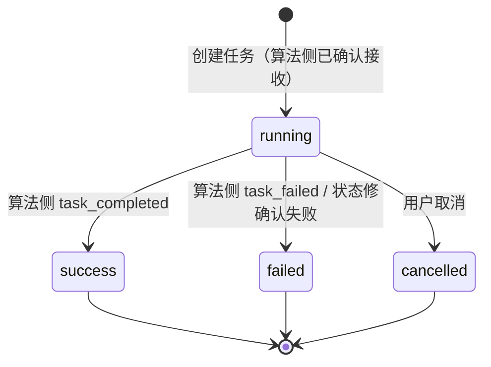

# ARCH-ANALYSIS-TASK — 科技专题异步任务编排 + 业务接口设计方案

> **版本**：v3.0 · 2026-07-24
> **范围**：企业评估 / 风险洞察 / 引育推荐 等所有需要和算法侧交互的异步分析任务；含 Java 本地报告/导出任务
> **状态**：设计草案（v3.0：全链路持久化数据库统一为 **MySQL**，不再使用 PostgreSQL）
> **关联文档**：IA-ENT-EVAL.md / IA-ENT-RISK.md / IA-ENT-RECRUIT.md / ENT-PY-EVAL-TASK-完工.md / ARCHITECTURE.md

### 已确认决策（2026-07-24）

| # | 决策 | 结论 |
|---|---|---|
| C-1 | 流程节点 | **不强制统一**。各模块固定自己的节点列表；框架只存 `current_node_*` / `total_nodes`，节点语义由各模块自己定义 |
| C-2 | taskId | 按类型前缀：`EVAL-` / `RISK-` / `REC-` / `REP-` / `EXP-`；**analysisType 必填**，按类型存储与查询 |
| C-3 | 接口拆分 | **方案 A**：模块级 3 套 path（evaluation / risk / recommend），子类型用字段区分（mode / subType） |
| C-4 | 任务小窗 | **无全局任务列表**。右上角小窗只展示运行中任务；点击跳转到**对应模块的任务详情页** |
| C-5 | 企业评估结果 | **1 套任务 API + 3 套 result schema**（`technology`/`business`/`competitiveness`） |
| C-6 | 创建报告/导出 | **Java 本地异步**：`*_report`（`REP-`，PDF）与 `*_export`（`EXP-`，Excel）；基于父任务快照；不经算法 |
| C-7 | 风险洞察结果 | `supply_chain`（图谱+关键节点+断链风险）/ `pain_points`（四维卡片+共性问题四象限）；共用报告弹窗 |
| C-8 | 引育推荐对象来源 | 招引/培育均支持 `filter`（条件筛选）与 `candidate_workbench`（对比篮候选企业）两种来源；仍共用 1 套推荐任务 API |
| C-9 | 报告/导出任务框架 | `*_report` / `*_export` 写入同一 `analysis_task`；`parent_task_id` 关联；Java 本地异步；状态修正器**不调 Python** |
| C-10 | 供应链图谱展开 | **方案 A**：分析任务一次算满最多 3 级写入结果快照；前端按需展开，不新建分析任务、不二次调算法 |
| C-11 | 三模块异步导出 | 评估 / 风险 / 引育均支持 Java 本地异步 `*_export`（`EXP-`）；与报告分离 |
| C-12 | 幂等键 | 报告/导出：`userId + analysisType + parentTaskId + format`；分析任务：`userId + analysisType + 客户端 requestId`（可选）。**禁止用时间戳做幂等键** |
| C-13 | 运行中取消 | **逻辑取消**：标记 `cancelled` + 释放配额；算法可继续跑完但结果丢弃 |
| C-14 | 大结果外置 | 超过阈值的结果存 **MinIO**（资产中心底层对象存储，与报告/导出同源）；MySQL 只留 `resultAssetId` / `resultUrl` |
| C-15 | 算法侧全局并发 | 暂定 **N=3**，配置项控制（如 `GKX_ALGO_GLOBAL_CONCURRENCY`），**禁止写死代码** |
| C-16 | 持久化数据库 | Java 编排侧与算法侧均使用 **MySQL**；可分库/分 schema 独立部署，禁止跨层直连；**不再使用 PostgreSQL** |

---

# 框架篇：异步任务编排（共用编排能力，不共用业务节点）

## 1. 背景与问题

### 1.1 业务场景

科技专题产品包含多个分析功能（企业评估、风险洞察、引育推荐等），每个功能的业务流程一致：

1. 用户在前端配置分析参数（企业对象、指标权重、模式等）
2. 点击"生成"发起分析
3. 后端逐层调用：**Java → Python svc → 算法侧**，算法侧真正执行计算
4. 分析过程中有多个阶段节点（如数据汇聚、指标计算、结果组装），需要实时反馈给用户
5. 完成后用户可查看结果、下载报告、查看历史任务

### 1.2 现状问题

| 问题域 | 现状 | 影响 |
|---|---|---|
| **任务编排** | Java 侧同步透传，不维护任务状态 | 无法实现异步任务管理、无任务列表、无历史记录 |
| **状态管理** | 三层各自内存存储，互不互通 | 进程重启后任务状态全部丢失；三层状态可能不一致 |
| **并发控制** | 无任何并发限制 | 用户可无限发起分析任务，可能压垮算法侧 |
| **进度通知** | 前端 for 循环 + sleep(3s) 轮询 | 实时性差（3 秒延迟）、服务器压力大、用户体验差 |
| **回调链路** | 算法侧 entan 有 Webhook 回调，但 Java 层未对接 | 回调能力被浪费，全靠轮询 |
| **多分析类型** | 各分析类型独立开发，无统一任务模型 | 重复造轮子，难以统一管理并发和历史 |

### 1.3 已有基础设施（可直接复用）

| 能力 | 所在模块 | 说明 |
|---|---|---|
| SSE 长链接 | `gkx-common-sse` | SseEmitter + Redis 跨实例广播 + 按 userId 推送，端点 `GET /sse/info` |
| WebSocket | `gkx-common-websocket` | 完整长链接管理 + Redis 跨实例广播（备选方案） |
| Redis 分布式锁 | `gkx-common-data` | `RedisUtils.getLock()` / `releaseLock()`，SETNX + Lua |
| 幂等控制 | `gkx-common-idempotent` | `@Idempotent` 注解，防重复提交 |
| Redis Pub/Sub | 多处使用 | 流程状态事件总线模式已有先例 |
| Sentinel 限流 | `gkx-common-sentinel` | Feign 熔断降级 |
| XXL-Job 调度 | `gkx-visual` | 定时任务调度中心，可用于状态修正 |
| Feign 调 Python | `gkx-innov` | `ChainAlgoClient` 已有 Feign 声明式调用模式 |
| 算法侧任务管理 | `demo-algo-ent-analysis` | `/gdf/tasks` + Webhook 回调（4 事件：step_started/step_completed/task_completed/task_failed） |

---

## 2. 整体架构与调用链路

### 2.1 架构总览

```
┌─────────────────┐    ┌───────────────────────────────────────────────┐    ┌──────────────────────┐    ┌─────────────────────┐
│   前端 Vue       │    │        Java 侧 — 编排中心 (gkx-innov)          │    │  Python svc 层        │    │     算法侧           │
│                 │    │                                               │    │  (demo-svc-topic-py)  │    │  (entan / science)  │
│                 │    │  ┌─────────────────────────────────────────┐  │    │                      │    │                     │
│  分析配置页      │──►│  │ AnalysisTaskController                   │  │    │                      │    │                     │
│  发起分析/看结果 │    │  │ 任务CRUD + 取消                          │  │    │                      │    │                     │
│                 │    │  └──────────────┬──────────────────────────┘  │    │                      │    │                     │
│                 │    │                 │                             │    │                      │    │                     │
│                 │    │                 ▼                             │    │  ┌────────────────┐  │    │  ┌───────────────┐  │
│                 │    │  ┌─────────────────────────────────────────┐  │ ─► │  业务适配转发   │ ─► │  │ TaskManager    │  │
│                 │    │  │ AnalysisTaskService                     │  │Feign│  参数转换      │HTTP│  │  异步执行       │  │
│                 │    │  │ 并发控制 + if-else 路由                   │  │    │  + Mock降级    │  │  │  场景步骤串行   │  │
│                 │    │  └──────┬───────────────┬──────────────────┘  │    └────────────────┘  │    │  └───────┬───────┘  │
│                 │    │         │               │                     │    │          │           │    │          │          │
│                 │    │         ▼               ▼                     │    │          │           │    │          ▼          │
│                 │    │  ┌────────────┐  ┌────────────┐               │    │          │           │    │  ┌───────────────┐  │
│                 │    │  │ 并发控制    │  │  MySQL     │               │    │          │           │    │  │ Webhook 回调  │  │
│                 │    │  │ Redis      │  │  任务表    │               │    │          │           │    │  │ 回调 Python    │  │
│                 │    │  │ 总并发5    │  │  节点表    │               │    │          │           │    │  │ 再转发 Java    │  │
│                 │    │  │ 类型并发2  │  │            │               │    │          │           │    │  └───────┬───────┘  │
│                 │    │  └────────────┘  └─────┬──────┘               │    │          │           │    │          │          │
│                 │    │                        │                      │    │          │           │    │          │          │
│                 │    │  ┌────────────────────┴───────────────────┐   │    │          │           │    │          │          │
│                 │    │  │ AnalysisCallbackController              │   │    │          │           │    │          │          │
│                 │    │  │ 接收 Python 转发回调（按类型分 path）  │   │    │          │           │    │          │          │
│                 │    │  │ → 更新MySQL → SSE推送 → 释放并发(终态)│   │    │          │           │    │          │          │
│                 │    │  └───────────────────┬────────────────────┘   │    │          │           │    │          │          │
│                 │    │                      │                        │    │          │           │    │          │          │
│  SSE 客户端     │◄──│                      │ SSE推送                │    │          │           │    │          │          │
│  接收实时进度   │ ──│  SseEmitterMessageSender (已有 gkx-common-sse)  │          │           │    │          │          │
│                 │    │  Redis Pub/Sub 跨实例广播                     │    │          │           │    │          │          │
└─────────────────┘    └───────────────────────────────────────────────┘    └──────────────────────┘    └─────────────────────┘

图例：  ──►  同步调用 (HTTP / Feign)        ─ ─►  异步回调 / SSE推送
        ◄──  返回响应                       ◄──│  Webhook回调（算法→Python→Java）
```

**核心决策**：算法侧 Webhook 回调**经过 Python 转发给 Java**，因为算法是内部服务，Java 不能直连算法侧。Python 收到回调后根据 payload 里的 `analysis_type` 字段路由到对应的 Java 回调接口：

```
算法侧 entan ──► Python /internal/gkx-ai/analysis/callback
                    │
                    │ Python 解析 callback payload 里的 analysis_type
                    │
                    ├─ analysis_type=enterprise_eval ──► Java /api/analysis/callback/eval
                    ├─ analysis_type=risk_insight   ──► Java /api/analysis/callback/risk
                    └─ analysis_type=talent_recommend ──► Java /api/analysis/callback/recommend
```

**各层职责一句话总结**：

| 层 | 定位 | 核心职责 |
|---|---|---|
| **前端** | 用户交互 | 发起分析、SSE 接收进度、查看结果与历史 |
| **Java** | 编排中心 | 任务表管理、并发控制、SSE 推送、状态修正、**三种回调接口** |
| **Python svc** | 业务适配 + 回调分发 | 参数转换、Mock 降级、转发到算法侧、**解析回调类型并转发给 Java** |
| **算法侧** | 内部计算服务 | 异步执行场景步骤、Webhook 回调（打到 Python） |

### 2.2 完整调用时序

```
  前端                Java(编排中心)            Python svc 层            算法侧(entan/science)
    │                      │                        │                        │
    │                      │                        │                        │
━━ 阶段一：发起任务（同步返回 task_id）━━━━━━━━━━━━━━━━━━━━━━━━━━━━━━━━━━━━━━━━
    │                      │                        │                        │
    │  ① POST /api/analysis/tasks                  │                        │
    │ ──────────────────► │                        │                        │
    │                      │ 幂等校验 + 并发检查(Redis)                     │
    │                      │ taskId 由 Java 生成                             │
    │                      │ 写 MySQL (running)                             │
    │                      │                        │                        │
    │                      │  ② 按类型路由到对应 Python 接口               │
    │                      │      enterprise_eval → /internal/gkx-ai/evaluation/tasks
    │                      │      risk_insight  → /internal/gkx-ai/risk/tasks
    │                      │      talent_recommend → /internal/gkx-ai/recommend/tasks
    │                      │ ──────────────────────► │                        │
    │                      │                        │  ③ POST /gdf/tasks/create-and-start
    │                      │                        │      (Java 生成的 taskId 透传)
    │                      │                        │ ──────────────────────► │
    │                      │                        │  返回 (确认接收)        │
    │                      │                        │ ◄─ ─ ─ ─ ─ ─ ─ ─ ─ ─ ─ │
    │                      │  返回 (确认接收)        │                        │
    │                      │ ◄─ ─ ─ ─ ─ ─ ─ ─ ─ ─ ─ │                        │
    │  返回 task_id (running)                      │                        │
    │ ◄─ ─ ─ ─ ─ ─ ─ ─ │                        │                        │
    │                      │                        │                        │
━━ 阶段二：异步执行 + SSE 实时通知（重复多轮）━━━━━━━━━━━━━━━━━━━━━━━━━━━━━━━
    │                      │                        │                        │
    │  ④ GET /sse/info (建立SSE连接，绑定userId)   │                        │
    │ ──────────────────► │                        │                        │
    │                      │                        │      ⑤ 算法侧异步执行    │
    │                      │                        │      第1个节点开始...    │
    │                      │                        │                        │
    │                      │  ⑥ Webhook: step_started (节点1)              │
    │                      │ ◄─ ─ ─ ─ ─ ─ ─ ─ ─ ─ ─ │                        │
    │                      │  ⑦ POST /api/analysis/callback/{type}          │
    │                      │ ◄─ ─ ─ ─ ─ ─ ─ ─ ─ ─ ─ │  (算法→Python→Java)  │
    │                      │ 更新MySQL + SSE推送     │                        │
    │  ⑧ SSE消息: 节点1已开始                        │                        │
    │ ◄─ ─ ─ ─ ─ ─ ─ ─ │                        │                        │
    │                      │                        │                        │
    │                      │  ⑥ Webhook: step_completed                    │
    │                      │ ◄─ ─ ─ ─ ─ ─ ─ ─ ─ ─ ─ │                        │
    │                      │  ⑦ POST /api/analysis/callback/{type}          │
    │                      │ ◄─ ─ ─ ─ ─ ─ ─ ─ ─ ─ ─ │                        │
    │                      │ 更新MySQL + SSE推送     │                        │
    │  ⑧ SSE消息: 节点1已完成                        │                        │
    │ ◄─ ─ ─ ─ ─ ─ ─ ─ │                        │                        │
    │                      │                        │                        │
    │                      │          ... 重复 ⑥⑦⑧，直到所有节点完成 ... │
    │                      │                        │                        │
    │                      │  ⑥ Webhook: task_completed (全部完成，带结果)  │
    │                      │ ◄─ ─ ─ ─ ─ ─ ─ ─ ─ ─ ─ │                        │
    │                      │  ⑦ POST /api/analysis/callback/{type}          │
    │                      │ ◄─ ─ ─ ─ ─ ─ ─ ─ ─ ─ ─ │  (算法→Python→Java)  │
    │                      │ 标记success+存结果到MySQL │                        │
    │                      │ +释放并发+SSE推送      │                        │
    │  ⑧ SSE消息: 任务完成                           │                        │
    │ ◄─ ─ ─ ─ ─ ─ ─ ─ │                        │                        │
    │                      │                        │                        │
━━ 阶段三：获取最终结果（直接查 Java MySQL，不穿透）━━━━━━━━━━━━━━━━━━━━━━━━━
    │                      │                        │                        │
    │  ⑨ GET /api/analysis/tasks/{id}/result      │                        │
    │ ──────────────────► │                        │                        │
    │                      │ 查 MySQL result_data   │                        │
    │  返回分析结果        │ (阶段二回调时已存入)    │                        │
    │ ◄─ ─ ─ ─ ─ ─ ─ ─ │                        │                        │
    │                      │                        │                        │
━━ 旁路：状态修正（XXL-Job 每分钟执行）━━━━━━━━━━━━━━━━━━━━━━━━━━━━━━━━━━━
    │                      │                        │                        │
    │                      │  扫描 status='running' 的任务                │
    │                      │  调 Python /status 确认真实状态               │
    │                      │ ──────────────────────► │                        │
    │                      │  Python 查算法侧 MySQL     │                        │
    │                      │  返回真实状态           │                        │
    │                      │ ◄─ ─ ─ ─ ─ ─ ─ ─ ─ ─ ─ │                        │
    │                      │  若已完成→取结果存MySQL │                        │
    │                      │  +释放并发+SSE通知      │                        │
    │  SSE消息: 任务完成   │                        │                        │
    │ ◄─ ─ ─ ─ ─ ─ ─ ─ ─ │                        │                        │
```

### 2.3 回调链路说明

**关键变化**：算法侧 Webhook 回调**经过 Python 转发给 Java**。因为算法是内部服务，Java 不能直连算法侧，只能看到 Python svc 层。Python 收到回调后解析 `analysis_type` 字段，路由到对应 Java 回调接口。

```
算法侧 entan ──► Python /internal/gkx-ai/analysis/callback
                    │
                    │ Python 解析 callback payload 里的 analysis_type
                    │
                    ├─ analysis_type=enterprise_eval ──► Java /api/analysis/callback/eval
                    ├─ analysis_type=risk_insight   ──► Java /api/analysis/callback/risk
                    └─ analysis_type=talent_recommend ──► Java /api/analysis/callback/recommend
```

Python svc 层负责**回调分发**（解析类型 + 路由），但不解析业务结果。Java 侧暴露三个回调端点接收来自 Python 转发的回调。

算法侧每完成一个场景节点触发一轮回调（以企业评估 6 节点为例）：

```
节点1: submit(任务提交)    → ⑥Webhook step_started  → ⑦Python转发 → ⑧Java更新MySQL → ⑨SSE推送前端
                            → ⑥Webhook step_completed → ⑦Python转发 → ⑧Java更新MySQL → ⑨SSE推送前端
节点2: validate(权限校验)  → 同上（⑦经过Python转发到Java）
        ... 节点3、4、5 同理 ...
节点6: assemble(结果组装) → 同上
全部完成                    → ⑥Webhook task_completed → ⑦Python转发 → ⑧Java存结果 → ⑨SSE终态推送
```

算法侧的 4 种回调事件：

| 事件 | 触发时机 | Java 侧动作 |
|---|---|---|
| `step_started` | 某个节点开始执行 | 更新节点状态为 started + SSE 推送 |
| `step_completed` | 某个节点执行完成 | 更新节点状态为 completed + SSE 推送 |
| `task_completed` | 全部节点完成 | 标记 success + 释放并发 + SSE 推送 |
| `task_failed` | 某节点失败导致任务失败 | 标记 failed + 释放并发 + SSE 推送 |

### 2.4 关于 MQ 的决策：不引入 MQ，用 HTTP 异步回调经 Python 转发 Java

| 维度 | 引入 MQ | HTTP 异步回调经 Python 转发 Java（推荐） |
|---|---|---|
| 基础设施 | 需新增 RabbitMQ/Kafka 运维 | 零新增，已有 HTTP 调用能力 |
| 算法侧改造 | 三个算法服务都要集成 MQ Consumer | entan 已有 Webhook；science 参照补齐即可 |
| 可靠性 | MQ 持久化，消息不丢 | HTTP 回调失败有 XXL-Job 兜底轮询 |
| 复杂度 | 高（MQ 部署、Consumer、死信队列） | 低（HTTP POST + Python 转发） |
| 回调路径 | 算法 → MQ → Python → Java | 算法 → Python → Java（内部服务，Java 不能直连） |

### 2.5 异步发起和执行放在算法侧

**放在算法侧**，理由：

1. **entan 已有完整实现**：`TaskManager` 支持创建任务、异步执行、Webhook 回调、场景化步骤拆分，这是现成的
2. **Python svc 层定位是业务适配 + 回调分发层**：它的职责是参数转换、Mock 降级、屏蔽算法侧差异，**并做回调分发**（解析 analysis_type 路由到不同 Java 回调接口）
3. **science 算法侧需要补齐**：参照 entan 的 `TaskManager` 模式，给 science 补一个类似的任务管理器即可
4. **Java 不直连算法**：算法是内部服务，Java 只能通过 Python 间接调用和接收回调

---

## 3. 任务状态机与节点流转

### 3.1 统一任务状态枚举

Java 侧没有 pending 状态。阶段一同步链路完成（算法侧确认接收）后，Java 直接标记为 running。算法侧内部有 pending（排队等待执行），但对 Java 侧透明。



| 状态 | 说明 | 触发条件 |
|---|---|---|
| `running` | 任务执行中（含算法侧排队） | 阶段一同步链路完成，Java 写入 MySQL 时初始状态 |
| `success` | 任务成功完成 | 收到算法侧 `task_completed` 回调（带结果） |
| `failed` | 任务执行失败 | 收到算法侧 `task_failed` 回调，或状态修确认失败 |
| `cancelled` | 用户主动取消 | 用户调用 cancel API |

### 3.2 各分析类型的节点定义（模块自管，不强行统一）

> **决策 C-1**：不为了统一而统一。企业评估 / 风险洞察 / 引育推荐各自固定自己的节点列表；Java 框架只负责存进度字段并透传回调里的节点信息，不要求各模块节点代码一致。

#### 企业评估（enterprise_eval）— 6 节点

来源：IA-ENT-EVAL.md §6；现有 gkx-ai-service 实现已基本对齐

| 节点序号 | 节点代码 | 节点名称 | 说明 |
|---|---|---|---|
| 1 | `submit` | 任务提交 | 创建任务、固化参数 |
| 2 | `validate` | 权限与配置校验 | 校验对象权限、字段可见性、指标权重 |
| 3 | `data_gather` | 企业数据汇聚 | 调 search 服务获取企业基础数据 |
| 4 | `compute` | 指标计算 | 调算法侧执行评分计算 |
| 5 | `confidence` | 可信度与可比性校验 | 检查数据覆盖、缺失指标影响 |
| 6 | `assemble` | 结果图表组装 | 组装评分、排名、雷达、诊断 |

#### 风险洞察（risk_insight）— 5 节点（供应链 / 痛难点共用同一套节点文案）

来源：原型截图「可视化分析过程」

| 节点序号 | 节点代码 | 节点名称 | 说明 |
|---|---|---|---|
| 1 | `submit` | 任务提交 | 创建任务、固化参数 |
| 2 | `validate` | 权限与配置校验 | 校验企业对象权限与配置 |
| 3 | `data_gather` | 数据汇聚 | 汇聚关系/经营等分析所需数据 |
| 4 | `compute` | 算法计算 | 供应链图谱或痛难点诊断（算法内部按 subType 分支） |
| 5 | `assemble` | 结果组装 | 组装图谱/诊断结果 |

> 子类型通过 `params.subType` 区分：`supply_chain`（供应链关系）/ `pain_points`（发展痛难点）。**节点对外一致，算法内部计算不同**。

#### 引育推荐（talent_recommend）— 5 节点（招引 / 培育共用同一套节点文案）

来源：原型截图「可视化分析过程」

| 节点序号 | 节点代码 | 节点名称 | 说明 |
|---|---|---|---|
| 1 | `submit` | 任务提交 | 创建任务、固化筛选条件 |
| 2 | `validate` | 权限与配置校验 | 校验筛选范围、权重配置 |
| 3 | `data_gather` | 数据汇聚 | 获取候选企业池数据 |
| 4 | `compute` | 算法计算 | 招引/培育推荐算法（按 subType 分支） |
| 5 | `assemble` | 结果组装 | 组装推荐清单、排名、分维得分 |

> 子类型通过 `params.subType` 区分：`attraction`（招引推荐）/ `cultivation`（培育推荐）。招引与培育的**筛选字段和权重模型不同**，见业务篇。
> `selectionMode=candidate_workbench` 时，节点 3 `data_gather` 语义为「汇聚指定企业数据」（不再做候选筛选）。

#### 报告任务（eval_report / risk_report / recommend_report）— 6 节点（Java 本地）

| 节点序号 | 节点代码 | 节点名称 | 说明 |
|---|---|---|---|
| 1 | `submit` | 任务已提交 | 创建报告任务、挂 `parent_task_id` |
| 2 | `read_snapshot` | 读取决策快照 | 读取父任务 `result_data` / 参数快照 |
| 3 | `permission_mask` | 权限与脱敏校验 | 字段可见性、脱敏 |
| 4 | `chart_render` | 图表渲染 | 将结果图表渲染为报告素材 |
| 5 | `report_assemble` | 报告组装 | 组装正文与附件元数据 |
| 6 | `file_ready` | 文件生成完成 | 写入资产中心，可下载 |

> 报告任务**不经 Python/算法**；节点进度由 Java 报告执行器自行推进并 SSE 推送。

#### 导出任务（eval_export / risk_export / recommend_export）— 5 节点（Java 本地）

| 节点序号 | 节点代码 | 节点名称 | 说明 |
|---|---|---|---|
| 1 | `submit` | 任务已提交 | 创建导出任务、挂 `parent_task_id` |
| 2 | `read_snapshot` | 读取决策快照 | 读取父任务结果 + 导出筛选条件 |
| 3 | `permission_mask` | 权限与脱敏校验 | 字段可见性、脱敏 |
| 4 | `file_assemble` | 文件组装 | 生成 Excel/CSV |
| 5 | `file_ready` | 文件生成完成 | 写入资产中心，可下载 |

> 导出与报告共用执行器框架，但节点更短；禁止把导出伪装成 `*_report`。

### 3.3 节点流转数据结构

每次节点转换记录到 `analysis_task_node` 表，形成完整的流转日志：

```json
{
  "task_id": "a1b2c3d4",
  "node_code": "compute",
  "node_name": "当前节点名称",
  "node_status": "started",
  "timestamp": "2026-07-23T10:30:00Z",
  "detail": "当前节点执行中...",
  "cost_seconds": 12
}
```

> 节点代码、节点名称、详情描述因 analysisType 不同而完全不一样，由算法侧在回调时传入原值。

### 3.4 进度展示

进度按节点维度展示，不使用百分制。前端展示格式：`第 3/6 节点：企业数据汇聚`。

```
示例（企业评估 6 节点）：
- 节点1 submit       → 第 1/6 节点：任务提交
- 节点2 validate     → 第 2/6 节点：权限与配置校验
- 节点3 data_gather  → 第 3/6 节点：企业数据汇聚
- 节点4 compute      → 第 4/6 节点：指标计算
- 节点5 confidence   → 第 5/6 节点：可信度校验
- 节点6 assemble     → 第 6/6 节点：结果图表组装 → 完成
```

Java 侧存储 `current_node_index` 和 `total_nodes`，前端根据这两个值渲染进度。

---

## 4. 并发控制方案

### 4.1 控制规则

采用**总并发 + 类型限制**双层控制。Java 侧没有 pending 状态，所有已发起的任务都是 running（含算法侧排队），因此并发计数直接计 running：

| 维度 | 限制 | 说明 |
|---|---|---|
| 用户总并发 | ≤ 5 个 running 任务 | 分析 + 报告 + 导出合计 |
| 单类型并发 | ≤ 2 个 running 任务 | 按 `analysisType` 计；`eval_report` 等与父分析类型**分开计数** |
| 全局并发 | ≤ 50 个 running 任务 | 防止系统级过载（可配置） |

> 以上数值均可通过配置文件调整，初始建议值如上。
> 报告/导出任务计入总并发与全局并发，但不占用父分析类型的类型配额，避免「两个评估在跑时无法出报告/导出」。

### 4.2 Redis 数据结构

```
# 用户级总并发（Set）
key:   analysis:running:user:{userId}
value: Set<taskId>
操作:  SCARD 检查数量 / SADD 加入 / SREM 移除

# 用户级类型并发（Set）
key:   analysis:running:user:{userId}:type:{analysisType}
value: Set<taskId>
操作:  SCARD / SADD / SREM

# 全局并发（计数器）
key:   analysis:running:global
value: Integer
操作:  INCR / DECR
```

### 4.3 并发检查流程

```
发起分析时的检查逻辑（Java 侧，在 @Idempotent 之后）：

1. 获取分布式锁: analysis:lock:user:{userId}
2. SCARD analysis:running:user:{userId} → 检查总并发
   如果 >= 5 → 返回错误"已有 5 个分析任务进行中，请等待完成后重试"
3. SCARD analysis:running:user:{userId}:type:{analysisType} → 检查类型并发
   如果 >= 2 → 返回错误"该分析类型已有 2 个任务进行中"
4. SADD 两个 Set
5. INCR analysis:running:global → 检查全局并发
   如果 > 50 → SREM 回滚，返回"系统繁忙，请稍后重试"
6. 释放分布式锁
7. 继续创建任务流程
```

### 4.4 并发配额释放

任务到达终态（success / failed / cancelled）时释放配额：

```
1. 获取分布式锁: analysis:lock:user:{userId}
2. SREM analysis:running:user:{userId} {taskId}
3. SREM analysis:running:user:{userId}:type:{analysisType} {taskId}
4. DECR analysis:running:global
5. 释放分布式锁
```

由 Java 侧在收到终态回调或状态修正时执行。

### 4.5 创建失败回滚（阶段一）

阶段一写 MySQL `running` 并占用 Redis 配额后，若 Feign 调 Python / 算法确认接收失败：

1. MySQL 标记 `failed`（或直接删除本次任务，实现二选一；推荐 `failed` + error_msg）
2. 释放 Redis 总并发 / 类型并发 / 全局并发
3. 向调用方返回错误，**不返回可继续轮询的成功 taskId**
4. 报告/导出任务同理：本地执行器启动失败也必须释放配额

### 4.6 任务取消（已确认：逻辑取消）

| 状态 | 行为 |
|---|---|
| Java | `POST /api/analysis/tasks/{taskId}/cancel` → 标记 `cancelled`，释放 Redis 配额，SSE 推送终态 |
| Python / 算法 | 透传取消意图；**RUNNING 可不强制杀进程**，允许跑完后丢弃结果 |
| 报告/导出 | Java 本地执行器尽量中断；已写入资产中心的文件按资产策略保留或标记作废 |

> PENDING 可真正取消；RUNNING 以逻辑取消为准，避免强杀带来半写入/资源泄漏。

---

## 5. SSE 通知 + API 兜底方案

### 5.1 通知方式选择

| 方式 | 实时性 | 服务器压力 | 决策 |
|---|---|---|---|
| SSE 长链接 | 毫秒级 | 低 | **主通道** |
| API 轮询 | 3-5 秒延迟 | 高 | **兜底通道** |
| WebSocket | 毫秒级 | 低 | 不采用 |

### 5.2 SSE 推送机制

利用已有的 `gkx-common-sse` 模块：

```java
public void onCallback(AnalysisCallbackRequest req) {
    // 1. 更新 MySQL 任务状态
    analysisTaskService.updateTaskNode(req.getTaskId(), req.getNode(), req.getStatus(), req.getProgress());

    // 2. 构建 SSE 消息
    SseMessage message = SseMessage.builder()
        .type("analysis_progress")
        .taskId(req.getTaskId())
        .analysisType(req.getAnalysisType())
        .status(req.getTaskStatus())
        .nodeCode(req.getNodeCode())
        .nodeName(req.getNodeName())
        .nodeStatus(req.getNodeStatus())
        .progress(req.getProgress())
        .timestamp(req.getTimestamp())
        .build();

    // 3. 按 userId 推送（Redis Pub/Sub 跨实例广播）
    SseEmitterMessageSender.send(userId, JSON.toJSONString(message));
}
```

### 5.3 前端 SSE 订阅 + API 兜底

```typescript
async function initTaskPage() {
  const tasks = await fetchTaskList({ status: 'running' });

  if (tasks.some(t => t.status === 'running')) {
    subscribeSSE();
  }

  renderTaskList(tasks);
}

function subscribeSSE() {
  let pollingTimer: number | null = null;
  let sseConnected = false;

  const eventSource = new EventSource(`/api/sse/info`);

  eventSource.onopen = () => { sseConnected = true; };
  eventSource.onmessage = (event) => {
    const msg = JSON.parse(event.data);
    if (msg.type === 'analysis_progress') {
      updateTaskProgress(msg);
      if (msg.status === 'success' || msg.status === 'failed') {
        eventSource.close();
      }
    }
  };

  eventSource.onerror = () => {
    sseConnected = false;
    eventSource.close();
    // SSE 断线时降级为 API 定时查询（10 秒间隔）
    if (!pollingTimer) {
      pollingTimer = setInterval(async () => {
        const tasks = await fetchTaskList({ status: 'running' });
        updateTaskList(tasks);
        if (!tasks.some(t => t.status === 'running')) {
          clearInterval(pollingTimer);
        }
      }, 10000);
    }
  };
}
```

### 5.4 SSE 消息格式

```json
{
  "type": "analysis_progress",
  "taskId": "a1b2c3d4",
  "analysisType": "enterprise_eval",
  "status": "running",
  "currentNode": {
    "index": 4,
    "total": 6,
    "code": "compute",
    "name": "指标计算",
    "status": "started"
  },
  "elapsedSeconds": 42,
  "timestamp": "2026-07-23T10:30:00Z"
}
```

终态消息示例（带结果 URL）：

```json
{
  "type": "analysis_progress",
  "taskId": "a1b2c3d4",
  "analysisType": "enterprise_eval",
  "status": "success",
  "currentNode": { "index": 6, "total": 6, "code": "assemble", "name": "结果图表组装", "status": "completed" },
  "elapsedSeconds": 120,
  "resultUrl": "/api/analysis/tasks/a1b2c3d4/result",
  "timestamp": "2026-07-23T10:32:00Z"
}
```

---

## 6. 持久化与状态修正方案

### 6.1 持久化策略：Java 编排 MySQL + 算法侧 MySQL 双存

| 层 | 存什么 | 存哪里 | 说明 |
|---|---|---|---|
| **Java** | 任务元信息、状态、节点流转、**最终结果** | MySQL | 任务列表、历史、结果查询的入口 |
| **Python svc** | 无状态。callbackUrl 走配置文件，analysisType 是固定枚举 | Nacos 配置 | 重启不影响，配置切换环境 |
| **算法侧** | 任务状态、执行进度、**最终结果** | MySQL（算法库） | 算法侧定时任务处理 + 兜底查询 |

> **数据库统一不等于跨层共库直连**：Java 只访问编排任务库；算法服务只访问算法任务库；Java ↔ Python ↔ 算法仍通过 API/回调交互。可部署在同一 MySQL 集群的不同 database/schema，也可独立实例。

### 6.2 MySQL 表设计

#### analysis_task（任务主表）

```sql
CREATE TABLE analysis_task (
    id                  BIGINT PRIMARY KEY AUTO_INCREMENT,
    task_id             VARCHAR(64) NOT NULL UNIQUE COMMENT '业务任务ID(Java生成，格式 EVAL|RISK|REC|REP|EXP-YYYYMMDD-NNN)',
    parent_task_id      VARCHAR(64) NULL COMMENT '报告/导出任务挂父分析任务；分析任务为空',
    user_id             BIGINT NOT NULL COMMENT '发起人ID',
    user_name           VARCHAR(64) COMMENT '发起人名称(冗余)',
    analysis_type       VARCHAR(32) NOT NULL COMMENT 'enterprise_eval/risk_insight/talent_recommend/*_report/*_export',
    task_name           VARCHAR(128) NOT NULL COMMENT '任务显示名称(=taskId，格式: EVAL|RISK|REC|REP|EXP-YYYYMMDD-NNN)',
    target_params       JSON COMMENT '分析参数(含 mode/subType/selectionMode 等)；报告/导出含 parentTaskId/format',
    status              VARCHAR(20) NOT NULL DEFAULT 'running' COMMENT 'running/success/failed/cancelled',
    current_node_code   VARCHAR(64) COMMENT '当前节点代码',
    current_node_name   VARCHAR(64) COMMENT '当前节点名称',
    current_node_index  INT COMMENT '当前节点序号',
    total_nodes         INT COMMENT '总节点数',
    result_data         JSON COMMENT '最终结果(task_completed回调时存入)',
    error_msg           TEXT COMMENT '错误信息',
    start_time          DATETIME COMMENT '开始执行时间',
    end_time            DATETIME COMMENT '结束时间',
    cost_seconds        INT COMMENT '总耗时(秒)',
    create_time         DATETIME NOT NULL DEFAULT CURRENT_TIMESTAMP,
    update_time         DATETIME NOT NULL DEFAULT CURRENT_TIMESTAMP ON UPDATE CURRENT_TIMESTAMP,

    INDEX idx_user_status (user_id, status),
    INDEX idx_user_type (user_id, analysis_type),
    INDEX idx_status (status),
    INDEX idx_create_time (create_time),
    INDEX idx_parent_task (parent_task_id)
) ENGINE=InnoDB DEFAULT CHARSET=utf8mb4 COMMENT='分析任务主表';
```

> `task_id` / `task_name` 由 Java 侧生成，格式 `{EVAL|RISK|REC|REP|EXP}-YYYYMMDD-NNN`；`analysis_type` 必填；报告/导出任务写 `parent_task_id`。

#### analysis_task_node（节点流转记录表）

```sql
CREATE TABLE analysis_task_node (
    id            BIGINT PRIMARY KEY AUTO_INCREMENT,
    task_id       VARCHAR(64) NOT NULL COMMENT '关联任务ID',
    node_index    INT NOT NULL COMMENT '节点序号(1,2,3...)',
    node_code     VARCHAR(64) NOT NULL COMMENT '节点代码',
    node_name     VARCHAR(64) NOT NULL COMMENT '节点名称',
    node_status   VARCHAR(20) NOT NULL COMMENT 'started/completed/failed',
    progress      INT DEFAULT 0 COMMENT '节点内进度 0~100',
    detail        TEXT COMMENT '补充说明',
    cost_seconds  INT COMMENT '该节点耗时(秒)',
    start_time    DATETIME COMMENT '节点开始时间',
    end_time      DATETIME COMMENT '节点结束时间',
    create_time   DATETIME NOT NULL DEFAULT CURRENT_TIMESTAMP,

    INDEX idx_task_id (task_id),
    INDEX idx_task_node (task_id, node_index)
) ENGINE=InnoDB DEFAULT CHARSET=utf8mb4 COMMENT='分析任务节点流转记录';
```

### 6.3 状态修正机制

Java 侧不做超时判定，只做**定时状态修正**：

```
XXL-Job: analysis-status-reconciler
Cron:    0 */1 * * * ?     (每分钟执行)
逻辑:
  1. 查询 status='running' 的任务（批量，每次最多 100 条）
  2. 分支：
     A. analysisType ∈ {*_report, *_export}（如 eval_report/risk_report/recommend_report/eval_export/risk_export/recommend_export）：
        - **不调 Python**；查 Java 报告执行器本地状态 / 超时阈值
        - 完成 → success + 回写父任务 `result_data.reportStatus`（可选）+ 释放配额 + SSE
        - 失败/超时 → failed + 释放配额 + SSE
     B. 其余分析类型：调 Python status 确认
  3. Python 返回 success：
     a. 更新 MySQL status=success
     b. 若无 result_data，调 Python result 取回
     c. 释放配额 + SSE
  4. Python 返回 failed：更新 failed + 释放配额 + SSE
  5. 仍 running / Python 不可达 → 等下一轮
```

### 6.4 各层重启恢复

| 层重启后 | 恢复方式 |
|---|---|
| **Java 重启** | MySQL 任务记录完好；running 任务由状态修正器逐分钟确认（报告任务仅查 Java 本地执行态） |
| **Python 重启** | 无状态服务，配置走 Nacos，重启不影响转发 |
| **算法侧重启** | 算法侧 MySQL 数据不丢；算法侧自己的定时任务检测到"执行中但实际未执行"后重新执行 |

### 6.5 大结果外置存储（已确认：MinIO）

供应链 3 级图谱等大 JSON **不要硬塞 MySQL `result_data`**。约定：

| 项 | 约定 |
|---|---|
| 存哪 | **MinIO**（现网可用对象存储）；经资产中心统一鉴权/元数据；报告 PDF、导出 Excel、大结果 JSON **同一套**，不另起第三套存储 |
| 对象键建议 | `analysis/{analysisType}/{taskId}/result.json`；报告/导出另用 `.../report.pdf`、`.../export.xlsx` |
| MySQL 留什么 | 摘要可选 + `resultAssetId` / `resultUrl` / `resultSize` / `resultBucket`；大结果本体不内嵌 JSON |
| 谁上传 | 优先 **Java 在 task_completed 落库时**：payload 超阈值则写 MinIO 再存指针；算法也可先落 MinIO 再回调 `resultUrl` |
| 前端怎么取 | `GET /api/analysis/tasks/{id}/result`：小结果直接返回；大结果返回指针，经资产中心鉴权后从 MinIO 拉取 |
| 阈值 | `gkx.analysis.result-inline-max-bytes`（配置项，禁止写死；建议默认 1MB） |

> MinIO 只负责存字节；业务可见的下载入口仍走资产中心（权限、过期、审计统一）。

---

## 7. Java 侧对外接口（前端调用）

### 7.1 接口清单

| # | 方法 | 路径 | 说明 |
|---|---|---|---|
| 1 | POST | `/api/analysis/tasks` | 发起分析任务（必填 analysisType） |
| 2 | GET | `/api/analysis/tasks` | **模块内**最近任务/历史列表（必填 analysisType，可选 subType/status 分页） |
| 3 | GET | `/api/analysis/tasks/{taskId}` | 任务详情（含节点流转；任务小窗点击落地页） |
| 4 | GET | `/api/analysis/tasks/{taskId}/result` | 获取分析结果 |
| 5 | POST | `/api/analysis/tasks/{taskId}/cancel` | 取消任务 |
| 6 | GET | `/api/analysis/tasks/running` | **当前用户运行中任务**（任务小窗角标与下拉用；返回带 analysisType，供跳转） |
| 7 | GET | `/sse/info` | SSE 订阅端点（已有） |

> **决策 C-4**：没有「全局任务列表页」。`/tasks` 是各模块「最近评估/最近分析」Tab 调用的；`/tasks/running` 只服务右上角任务小窗。点击小窗某条任务 → 前端按 `analysisType` 路由到对应模块任务详情页（`/tasks/{taskId}`）。

### 7.1.1 任务小窗交互

```
右上角「任务 N」角标
  ← SSE analysis_progress 刷新 running 数量
  ← 或轮询 GET /api/analysis/tasks/running

点击角标展开小窗列表（仅 running）
  每条：taskId / analysisType / subType或mode / 当前节点名 / 已用时间

点击某条
  → 按 analysisType 跳转：
      enterprise_eval / eval_report|eval_export           → 企业评估模块 · 任务详情
      risk_insight / risk_report|risk_export             → 风险洞察模块 · 任务详情
      talent_recommend / recommend_report|recommend_export → 引育推荐模块 · 任务详情
  → 详情页调 GET /api/analysis/tasks/{taskId} 渲染该任务自己的节点进度
```

### 7.2 发起分析任务

```
POST /api/analysis/tasks
Content-Type: application/json

Request:
{
  "analysisType": "enterprise_eval",   // 必填：三类分析 或 *_report / *_export
  "params": {
    // 不同 analysisType 的 params 结构完全不同，见下方说明
  }
}

说明（方案 A：模块级 3 path + 字段区分子类型）：

| analysisType | 子类型字段 | params 关键字段 | 下游 |
|---|---|---|---|
| enterprise_eval | `mode` | mode + enterpriseCodes + weights | Python `/internal/gkx-ai/evaluation/tasks` |
| risk_insight | `subType` | subType + enterpriseCodes + 关系/诊断范围 | Python `/internal/gkx-ai/risk/tasks` |
| talent_recommend | `subType` + `selectionMode` | filters 或 enterpriseCodes + 三权重 | Python `/internal/gkx-ai/recommend/tasks` |
| eval_report / risk_report / recommend_report | — | parentTaskId + format=pdf | **Java 本地异步**，不调 Python |
| eval_export / risk_export / recommend_export | — | parentTaskId + format=xlsx + 可选筛选快照 | **Java 本地异步**，不调 Python |

Response (200):
{
  "code": 0,
  "data": {
    "taskId": "EVAL-20260724-001",
    "taskName": "EVAL-20260724-001",
    "status": "running",
    "analysisType": "enterprise_eval",
    "concurrentUsage": {
      "totalRunning": 2,
      "totalLimit": 5,
      "typeRunning": 1,
      "typeLimit": 2
    }
  }
}
```

### 7.3 任务详情（含节点流转）

说明：nodes 数组内容由各模块自己的节点定义决定（§3.2）。以下是企业评估示例。

```
GET /api/analysis/tasks/{taskId}

Response:
{
  "code": 0,
  "data": {
    "taskId": "EVAL-20260724-001",
    "taskName": "EVAL-20260724-001",
    "analysisType": "enterprise_eval",
    "status": "running",
    "currentNodeIndex": 4,
    "totalNodes": 6,
    "params": { "mode": "technology", "enterpriseCodes": [...] },
    "startTime": "2026-07-24T10:30:00Z",
    "elapsedSeconds": 42,
    "nodes": [
      { "nodeIndex": 1, "nodeCode": "submit", "nodeName": "任务提交", "nodeStatus": "completed", "costSeconds": 1 },
      { "nodeIndex": 2, "nodeCode": "validate", "nodeName": "权限与配置校验", "nodeStatus": "completed", "costSeconds": 3 },
      { "nodeIndex": 3, "nodeCode": "data_gather", "nodeName": "企业数据汇聚", "nodeStatus": "completed", "costSeconds": 15 },
      { "nodeIndex": 4, "nodeCode": "compute", "nodeName": "指标计算", "nodeStatus": "running", "progress": 45 }
    ]
  }
}
```

### 7.4 taskId / task_name 生成规则（Java 负责）

| 字段 | 规则 |
|---|---|
| **生成方** | Java 侧 |
| **analysisType** | **必填**，写入 `analysis_task.analysis_type`，列表/小窗/查询均按类型过滤 |
| **前缀** | `enterprise_eval`→`EVAL`；`risk_insight`→`RISK`；`talent_recommend`→`REC`；`*_report`→`REP`；`*_export`→`EXP` |
| **格式** | `{PREFIX}-YYYYMMDD-NNN`（如 `EVAL-20260724-001`、`REP-20260724-002`） |
| **每日重置** | 各前缀独立计数，每天从 001 起 |
| **查询** | 历史列表、任务小窗、状态修正都必须带 / 用 `analysisType` |

### 7.5 结果获取说明

| 场景 | 数据来源 | 说明 |
|---|---|---|
| 前端查结果 | Java MySQL `result_data` 字段 | task_completed 回调时算法侧直接带结果，Java 存入 MySQL；后续前端查结果直接查 MySQL |
| 状态修正器补取结果 | Python → 算法侧 MySQL | 回调时未带结果（用了 resultUrl），状态修正器发现任务已完成但编排 MySQL 无 result_data 时穿透取一次 |
| 算法侧查询 | 算法侧 MySQL | 算法侧自己的定时任务和后续查询用 |

### 7.6 结果结构契约

Java 侧只透传结果，**不关心结果结构**。前端和算法侧之间需要有明确的结构契约。

#### 统一查询接口，按 analysisType 区分解析

结果统一通过 `GET /api/analysis/tasks/{id}/result` 查询，返回中带 `analysisType`：

```
GET /api/analysis/tasks/{id}/result

Response:
{
  "taskId": "xxx",
  "analysisType": "enterprise_eval",
  "status": "success",
  "result": { ... }
}
```

#### 前端 TypeScript 类型定义

每种分析类型在前端 `src/api/analysis/results/` 下对应独立的 `.ts` 类型文件。**字段级权威以 §9 / §10 / §11 为准**；本节为精简骨架。

**企业评估**（`enterprise-eval.ts`，按 `mode` 三套）：

```typescript
export type EvalMode = 'technology' | 'business' | 'competitiveness';

export interface EvalResultBase {
  taskId: string;
  analysisType: 'enterprise_eval';
  mode: EvalMode;
  status: 'success';
  meta: { taskName: string; enterpriseCount: number; templateName: string; createdAt: string; generatedAt: string };
  enterprises: Array<{ enterpriseCode: string; enterpriseName: string }>;
  reportStatus?: 'not_created' | 'running' | 'success';
}

// technology：五维雷达 + 诊断表（见 §9.2.1）
export interface TechEvalResult extends EvalResultBase {
  mode: 'technology';
  summary: { maxScore: number; enterpriseCount: number; avgScore: number; highRiskCount: number };
  result: {
    radarAxes: string[]; // 技术创新/人才/投入/合作/转化
    ranking: Array<{ enterpriseName: string; score: number }>;
    diagnosisRows: Array<{
      enterpriseName: string; totalScore: number; innovationCount: number;
      rdInvestmentPct: number; confidence: number; gapText: string;
    }>;
    trendAvailable: boolean;
  };
}

// business：经营指标对比 + Tab（见 §9.2.2）
export interface BizEvalResult extends EvalResultBase {
  mode: 'business';
  summary: { maxScore: number; enterpriseCount: number; benchmarkAvgScore: number; highConfidenceCount: number };
  result: {
    operatingIndicators: unknown[];
    ranking: Array<{ enterpriseName: string; score: number }>;
    tabs: Array<'operation_diagnosis' | 'revenue_trend' | 'industry_benchmark'>;
    diagnosisRows: Array<{ enterpriseName: string; totalScore: number; confidence: number; diagnosisText: string }>;
  };
}

// competitiveness：三维雷达 + 对标（见 §9.2.3）
export interface CompEvalResult extends EvalResultBase {
  mode: 'competitiveness';
  summary: { maxScore: number; enterpriseCount: number; avgScore: number; highConfidenceCount: number };
  result: {
    radarAxes: ['创新能力', '经营能力', '成长能力'];
    ranking: Array<{ enterpriseName: string; score: number }>;
    dimensionRows: Array<{ dimension: string; score: number; setMean: number; setLeader: number; gapText: string }>;
  };
}

export type EnterpriseEvalResult = TechEvalResult | BizEvalResult | CompEvalResult;
```

**风险洞察**（`risk-insight.ts`，按 `subType`）：

```typescript
export type RiskSubType = 'supply_chain' | 'pain_points';
export type Priority = '高' | '中' | '低';

export interface SupplyChainResult {
  subType: 'supply_chain';
  summary: {
    enterprises: string[];
    relationScope: Array<'supplier' | 'customer' | 'partner'>;
    displayMode: 'expand_by_node';
    dataTime: string;
  };
  graph: {
    maxDepth: 3; // 算法一次算满，前端按需展开
    nodes: Array<{
      id: string; name: string; type: 'center' | 'supplier' | 'customer' | 'partner';
      depth: number; hasChildren: boolean; isKey?: boolean; hasRisk?: boolean;
    }>;
    edges: Array<{ source: string; target: string; relationType: string }>;
    level: number; nodeCount: number; commonNodeCount: number;
  };
  keyNodes: Array<{ name: string; relationType: string; influenceScore: number; suggestion: string; isKey: boolean }>;
  breakRisks: Array<{ name: string; riskLevel: string; impact: string; suggestion: string }>;
  reportStatus: 'not_created' | 'running' | 'success';
}

export interface PainPointsResult {
  subType: 'pain_points';
  summary: {
    enterprises: string[];
    diagnosisMethod: 'joint_common';
    diagnosisScope: Array<'tech_rd' | 'market_expand' | 'financing' | 'management'>;
    dataTime: string;
  };
  dimensionCards: Array<{
    dimension: 'tech_rd' | 'market_expand' | 'financing' | 'management';
    issueCount: number; priority: Priority; affectedEnterpriseCount: number;
  }>;
  issues: Array<{
    title: string; priority: Priority; dimension: string;
    affectedEnterpriseCount: number; typicalEnterprises: string[];
    evidence: string; cause: string; bestPractice: string; solution: string;
  }>;
  reportStatus: 'not_created' | 'running' | 'success';
}

export type RiskInsightResult = SupplyChainResult | PainPointsResult;
```

**引育推荐**（`talent-recommend.ts`，按 `subType` 区分结果、按 `selectionMode` 区分对象来源）：

```typescript
export type RecommendSubType = 'attraction' | 'cultivation';
export type RecommendSelectionMode = 'filter' | 'candidate_workbench';
export type EvidenceStatus = 'available' | 'partial' | 'unavailable';

export interface RecommendResultBase {
  taskId: string;
  analysisType: 'talent_recommend';
  subType: RecommendSubType;
  selectionMode: RecommendSelectionMode;
  generatedAt: string;
  candidateCount: number;
  reportStatus: 'not_created' | 'running' | 'success';
}

export interface AttractionResult extends RecommendResultBase {
  subType: 'attraction';
  weights: { technologyMatch: number; growth: number; regionalFit: number };
  rankings: Array<{
    enterpriseCode: string; enterpriseName: string; rank: number;
    industryDomain: string; geographicSource: string;
    targetTraits: string[]; recommendationScore: number;
  }>;
  details: Record<string, AttractionEnterpriseDetail>;
}

export interface CultivationResult extends RecommendResultBase {
  subType: 'cultivation';
  weights: { technologyBarrier: number; marketGrowth: number; teamBackground: number };
  rankings: Array<{
    enterpriseCode: string; enterpriseName: string; rank: number;
    industryCategory: string; enterpriseScale: string;
    developmentBottleneck: string; recommendationScore: number;
  }>;
  details: Record<string, CultivationEnterpriseDetail>;
}

export interface AttractionEnterpriseDetail {
  riskFocusCount: number;
  tags: string[];
  dimensions: Array<{ code: 'technology_match' | 'growth' | 'regional_fit'; evidenceStatus: EvidenceStatus }>;
  judgmentBasis: Record<string, string>;
  coreAdvantages: string[];
  targetTraits: string[];
  targetTraitBasis: string;
  keyIndicators: KeyIndicators;
  riskCredit: RiskCreditSummary;
  cooperationValue: string;
}

export interface CultivationEnterpriseDetail {
  riskFocusCount: number;
  tags: string[];
  dimensions: Array<{ code: 'technology_barrier' | 'market_growth' | 'team_background'; evidenceStatus: EvidenceStatus }>;
  judgmentBasis: Record<string, string>;
  coreAdvantages: string[];
  developmentBottleneck: string;
  cultivationSuggestion: string;
  keyIndicators: KeyIndicators;
  riskCredit: RiskCreditSummary;
  requiredSupport: string;
}

export interface KeyIndicators {
  validPatentCount: number;
  latestAnnualRevenueYiYuan: number; // 最近年度营收（亿元）
}

export interface RiskCreditSummary {
  judicialLitigationCount: number;
  dishonestEnforcementCount: number;
  abnormalOperationCount: number;
  administrativePenaltyCount: number;
}

export type TalentRecommendResult = AttractionResult | CultivationResult;
```

#### 契约维护流程

| 步骤 | 责任方 | 说明 |
|---|---|---|
| 1 | 产品/架构 | 结果页截图 → 写入 §9/§10/§11 字段表 |
| 2 | 算法侧 | JSON 符合对应契约 |
| 3 | 前端 | `src/api/analysis/results/*.ts` 对齐 |
| 4 | 变更 | 算法改字段 → 前端同步 `.ts` → 编译报错即发现 |

> **Java 侧职责声明**：Java 不消费结果结构，取到什么存什么、查到什么返回什么。结构变更只在「算法侧 ↔ 前端」之间同步；报告任务（`*_report`）只读父任务快照，同样不解析业务字段语义。


## 8. Java 侧回调接口（Python 转发调用）

### 8.1 三个回调端点（按 analysisType 分 path）

> **说明**：算法侧 Webhook 回调 Python，Python 解析 analysisType 后转发到对应的 Java 回调端点。callbackUrl 指向 Python，不直连 Java。

```
POST /api/analysis/callback/eval         ← Python 转发（企业评估）
POST /api/analysis/callback/risk         ← Python 转发（风险洞察）
POST /api/analysis/callback/recommend     ← Python 转发（引育推荐）
```

### 8.2 回调请求体

> **说明**：nodeCode、nodeName、detail 均由算法侧传入原值，不做硬编码假设。不同 analysisType 的节点完全不同。

> **强制字段**：回调 payload **必须带 `analysisType`**（或与之等价、可由 Python 稳定映射的 `scene`），否则 Python 无法路由到 `/callback/eval|risk|recommend`。

通用 step 事件（step_started / step_completed）：

```json
{
  "taskId": "EVAL-20260724-001",
  "analysisType": "enterprise_eval",
  "event": "step_started",
  "nodeCode": "compute",
  "nodeName": "指标计算",
  "nodeIndex": 4,
  "totalNodes": 6,
  "timestamp": "2026-07-24T10:30:42Z",
  "detail": "当前节点执行中..."
}
```

task_completed 事件带结果：

```json
{
  "taskId": "EVAL-20260724-001",
  "analysisType": "enterprise_eval",
  "event": "task_completed",
  "timestamp": "2026-07-24T10:32:00Z",
  "result": { }
}
```

task_failed 事件：

```json
{
  "taskId": "EVAL-20260724-001",
  "analysisType": "enterprise_eval",
  "event": "task_failed",
  "timestamp": "2026-07-24T10:31:00Z",
  "error": "节点执行失败：数据不足"
}
```

---

# 业务篇：各分析类型业务接口

> **说明**：以下三个分析类型接口完全独立，参数结构/节点定义/结果结构均不同，Java 侧按 `analysisType` 路由到对应 Python 接口，**不使用策略模式**。

## 9. 企业评估（enterprise_eval）

**Python 接口**：`/internal/gkx-ai/evaluation/**`（任务 API **合并为一套**，用 `mode` 区分）
**对应 Python svc**：gkx-ai-service（已实现，Mock 优先）
**算法侧**：demo-algo-ent-analysis（entan）
**决策**：结果结构按 mode 做 **3 套契约**，但 **不拆成 3 套任务 API**（编排/节点/SSE 相同）。

### 9.1 Python 接口清单

| # | 路径 | 作用 |
|---|---|---|
| 1 | `POST /internal/gkx-ai/evaluation/industries` | 行业列表 |
| 2 | `POST /internal/gkx-ai/evaluation/indicators` | 指标注册表（按 mode+industry） |
| 3 | `POST /internal/gkx-ai/evaluation/precheck` | 数据预检（覆盖率+可信度） |
| 4 | `POST /internal/gkx-ai/evaluation/tasks` | 创建评估任务（异步，body.mode） |
| 5 | `POST /internal/gkx-ai/evaluation/tasks/{id}/status` | 任务状态 |
| 6 | `POST /internal/gkx-ai/evaluation/tasks/{id}/result` | 评估结果（按 mode 多态） |
| 7 | `POST /internal/gkx-ai/evaluation/tasks/{id}/compare` | 双企对比 |
| 8 | `POST /internal/gkx-ai/evaluation/tasks/history` | 最近评估列表（**联调/Mock 兜底**；正式前端以 Java `GET /api/analysis/tasks` 为准） |

> **历史任务真源**：正式链路前端只查 Java MySQL 任务表。Python `*/tasks/history` 仅用于 svc 自测与 Mock；避免双写双查。

**mode**：

| mode | 名称 | 最少企业数 |
|---|---|---|
| `technology` | 技术力评估 | 2 |
| `business` | 商业力评估 | 2 |
| `competitiveness` | 综合竞争力评估 | 1 |

### 9.2 结果契约（按 mode 三套 schema，同一 HTTP path）

统一外层：

```json
{
  "taskId": "EVAL-20250723-070491",
  "analysisType": "enterprise_eval",
  "mode": "technology",
  "status": "success",
  "meta": {
    "taskName": "技术力评估",
    "enterpriseCount": 2,
    "templateName": "当前自定义配置",
    "createdAt": "2025-07-23T11:24:00",
    "generatedAt": "2025-07-23T11:24:30"
  },
  "enterprises": [
    { "enterpriseCode": "...", "enterpriseName": "深芯微集成电路股份有限公司" }
  ],
  "summary": { },
  "result": { }
}
```

#### 9.2.1 technology（技术力）

| 区块 | 字段 |
|---|---|
| summary KPI | `maxScore` / `enterpriseCount` / `avgScore` / `highRiskCount` |
| 雷达 | 五维：`技术创新` / `技术人才` / `技术投入` / `技术合作` / `技术转化`；支持对象 A/B 选择 |
| 排名 | `ranking[]`：enterpriseName + score |
| 下半诊断表 | `enterpriseName` / `totalScore` / `innovationCount`(项) / `rdInvestmentPct`(%) / `confidence` / `gapText` |
| 趋势建议 | 可空；无时序数据时返回 `trendAvailable=false` + 提示文案 |

#### 9.2.2 business（商业力）

| 区块 | 字段 |
|---|---|
| summary KPI | `maxScore` / `enterpriseCount` / `benchmarkAvgScore`(对标库平均) / `highConfidenceCount` |
| 上半左 | `operatingIndicators[]`：按企业的经营指标对比（非雷达） |
| 上半右 | `ranking[]` |
| 下半 Tab | `tabs`: `operation_diagnosis` / `revenue_trend` / `industry_benchmark` |
| 经营诊断表 | `enterpriseName` / `totalScore` / `confidence` / `diagnosisText` |
| 营收趋势 / 行业对标 | 无数据时返回可用性标志 + 空态文案 |

#### 9.2.3 competitiveness（综合竞争力）

| 区块 | 字段 |
|---|---|
| summary KPI | `maxScore` / `enterpriseCount` / `avgScore` / `highConfidenceCount` |
| 雷达 | 三维：`创新能力` / `经营能力` / `成长能力`；支持 `view=single|dual`；含 `setAverage` / `setLeader` 参照 |
| 排名 | `ranking[]` |
| 下半诊断 | 当前诊断企业 + `totalScore` + `confidence`；维度行：`dimension` / `score` / `setMean` / `setLeader` / `gapText` |

> 前端用 `mode` 选择 `TechEvalResult` / `BizEvalResult` / `CompEvalResult` 解析；Java 仍只透传 JSON。

### 9.3 PDF / 评估报告（Java 本地异步任务，不经 Python/算法）

原型：「创建PDF报告」→ 独立 6 节点进度弹窗；关闭后后台继续；完成后进资产中心。

| 项 | 约定 |
|---|---|
| analysisType | `eval_report`（报告任务，挂 `parentTaskId=EVAL-xxx`） |
| taskId 前缀 | `REP-` |
| 执行位置 | **Java 侧**基于父任务 `result_data` 快照组装，不重跑算法 |
| 节点（固定 6） | ①任务已提交 → ②读取决策快照 → ③权限与脱敏校验 → ④图表渲染 → ⑤报告组装 → ⑥文件生成完成 |
| 继承内容 | 对象、mode、模板、权重、数据可信度 |
| 进度 | 复用 SSE + 任务小窗；点击跳报告任务详情 |

```
POST /api/analysis/tasks
{
  "analysisType": "eval_report",
  "params": { "parentTaskId": "EVAL-20250723-070491", "reportFormat": "pdf" }
}
```

Java：校验父任务 success → 读快照 → 跑 6 节点 → 写资产中心 → SSE 终态。
**不调用 Python/算法。**

### 9.3.1 评估结果导出（eval_export）

与 PDF 报告并列，结果页「导出」走 Java 本地异步：

| 项 | 约定 |
|---|---|
| analysisType | `eval_export` |
| taskId 前缀 | `EXP-` |
| params | `parentTaskId` + `format=xlsx`（可扩展 csv） |
| 执行 | Java 读父任务结果快照导出清单/明细；不经算法 |
| 节点 | 同 §3.2 导出 5 节点 |
| 幂等 | 见 §12.3；同用户对同一父任务同一 format 短时重复提交命中同一业务键 |

### 9.4 为何不拆成三个评估任务接口

| 层 | 做法 |
|---|---|
| create/status/history/SSE/小窗 | 1 套 + `mode` |
| indicators/precheck | 1 套 + `mode` |
| result schema | 3 套（按 mode） |
| PDF | 独立 `eval_report`，Java 本地 |

### 9.5 Java 转发与回调（enterprise_eval）

分析任务：`AnalysisTaskService` 按 `analysisType=enterprise_eval` 转发 Python `/internal/gkx-ai/evaluation/tasks`。
回调：算法 → Python `/internal/gkx-ai/analysis/callback` → Java `/api/analysis/callback/eval`。
Java **不解析** `result_data` 业务结构，只更新节点/进度/终态。

---

## 10. 风险洞察（risk_insight）

**Python 接口**：`/internal/gkx-ai/risk/**`（待建，方案 A 模块级 1 套 path）
**算法侧**：demo-algo-science
**子类型**：`params.subType` = `supply_chain` | `pain_points`
**截图依据（2026-07-24）**：供应链结果 1 张；发展痛难点结果 3 张；二者共用异步「创建报告」弹窗 1 张。

### 10.1 输入参数（对照原型配置/结果摘要）

**供应链关系 `supply_chain`**：

```json
{
  "subType": "supply_chain",
  "enterpriseCodes": ["...", "..."],
  "relationScope": ["supplier", "customer", "partner"],
  "displayMode": "expand_by_node"
}
```

| 字段 | 说明 |
|---|---|
| `enterpriseCodes` | 分析对象（可多企业） |
| `relationScope` | 关系范围：供应商 / 客户 / 合作伙伴 |
| `displayMode` | 展示方式：按节点展开（原型默认） |

**发展痛难点 `pain_points`**：

```json
{
  "subType": "pain_points",
  "enterpriseCodes": ["...", "..."],
  "diagnosisScope": ["tech_rd", "market_expand", "financing", "management"],
  "diagnosisMethod": "joint_common"
}
```

| 字段 | 说明 |
|---|---|
| `diagnosisScope` | 诊断维度：技术研发 / 市场拓展 / 融资 / 管理 |
| `diagnosisMethod` | 诊断方式：企业联合共性诊断（原型） |

### 10.2 分析任务节点

见 §3.2（5 节点）。对外节点文案一致；算法内部按 `subType` 分支。

### 10.3 结果契约

#### 10.3.1 supply_chain（供应链关系）

| 区块 | 字段 |
|---|---|
| 任务摘要 | 分析对象 / 关系范围 / 展示方式 / 数据时间；支持「按此配置新建分析」 |
| 图谱 | 见下方「方案 A」 |
| 统计 | `level`（当前展示级数）/ `nodeCount` / `commonNodeCount`；结果含 `maxDepth=3` |
| 右侧 Tab·关键节点 | `name` / `relationType` / `influenceScore` / `suggestion` / `isKey` |
| 右侧 Tab·断链风险 | 断链风险列表（风险等级、影响说明、建议） |
| 报告区 | `reportStatus`；按钮「创建报告」（Java 本地异步 `risk_report`） |

**图谱展开（方案 A，已确认）**：

| 约定 | 说明 |
|---|---|
| 计算时机 | 供应链分析任务 `compute` 阶段，算法一次性算完 **最多 3 级** 关系图 |
| 结果落库 | 完整图写入父任务 `result_data.graph`：`nodes[]` / `edges[]` / `maxDepth=3`；节点可带 `hasChildren`、`depth` |
| 前端展示 | 默认只渲染 1 级；点击节点 `+` **从快照按需展开**，不新建 `RISK-*` 任务、不二次调 Python/算法 |
| 无下级 | `hasChildren=false` 或展开子集为空 → 展示「暂无下级关系」 |
| 筛选 | 「只看关键 / 只看风险」仅过滤已落库结果，不触发重算 |
| 禁止 | 禁止把「展开下一级」做成新的异步分析任务 |

#### 10.3.2 pain_points（发展痛难点）

| 区块 | 字段 |
|---|---|
| 对象与诊断摘要 | 分析对象 / 诊断方式 / 诊断维度 / 数据时间；支持「按此配置重新分析」 |
| 四维诊断卡片 | 每维：`dimension` / `issueCount` / `priority`(高\|中\|低) / `affectedEnterpriseCount` |
| 共性问题 TopN | 可按维度 Tab 过滤；每条见下表 |
| 报告区 | `reportStatus`；按钮「创建报告」 |

**共性问题卡片字段**：

| 字段 | 说明 |
|---|---|
| `title` | 痛点标题（如「客户结构集中」「新市场验证周期偏长」） |
| `priority` | 阅读/解决优先级：高 / 中 / 低 |
| `affectedEnterpriseCount` | 影响企业数 |
| `typicalEnterprises[]` | 典型企业名称列表 |
| `evidence` | 命中依据 |
| `cause` | 成因 |
| `bestPractice` | 行业最佳实践 |
| `solution` | 解决方向 |

### 10.4 报告任务（与企业评估 PDF 同模式，Java 本地）

供应链 / 痛难点结果页均有「创建报告」+ 6 节点弹窗（与评估 PDF 节点一致）。

| 项 | 约定 |
|---|---|
| analysisType | `risk_report` |
| taskId 前缀 | `REP-` |
| params | `parentTaskId` + `subType`（`supply_chain` / `pain_points`） |
| 执行 | Java 读父任务结果快照组装；**不经 Python/算法** |
| 节点 | 同 §9.3：提交 → 读快照 → 权限脱敏 → 图表渲染 → 报告组装 → 文件完成 |
| UX | 关闭弹窗后后台继续；复用 SSE + 任务小窗 |

### 10.4.1 风险结果导出（risk_export）

| 项 | 约定 |
|---|---|
| analysisType | `risk_export` |
| taskId 前缀 | `EXP-` |
| params | `parentTaskId` + `subType` + `format=xlsx` |
| 执行 | Java 基于父任务快照导出（供应链节点清单 / 痛难点列表等）；不经算法 |
| 节点 | 同 §3.2 导出 5 节点 |

### 10.5 最近分析

模块内 Tab「最近分析」调 `GET /api/analysis/tasks?analysisType=risk_insight`，可选 `subType` 过滤。

| 列表字段 | 来源 |
|---|---|
| 企业名称 / 代码 | 发起参数 |
| 分析类型文案 | subType → 供应链关系 / 发展痛难点 |
| 分析时间 | create_time |
| 操作 | 查看 / 删除 |

### 10.6 回调链路

```
science 算法侧
  → Webhook → Python `/internal/gkx-ai/analysis/callback`
  → Java `/api/analysis/callback/risk`
```

---

## 11. 引育推荐（talent_recommend）

**Python 接口**：`/internal/gkx-ai/recommend/tasks`（待建）
**算法侧**：demo-algo-science
**子类型**：`attraction`（招引）/ `cultivation`（培育）

### 11.1 企业范围来源：两种入口，同一任务模型

招引与培育都支持两种对象来源。`selectionMode` 只决定企业集合如何形成，**不新增 analysisType、不新增 subType、不拆任务 API**。

| selectionMode | 页面入口 | 企业集合形成方式 | 任务请求 |
|---|---|---|---|
| `filter` | 条件筛选推荐 | 按筛选条件生成候选集合，再进行推荐评分 | 传 `filters`，`enterpriseCodes` 可空 |
| `candidate_workbench` | 候选工作台 | 企业先从对比篮加入人工候选，再勾选指定企业分析 | 必传 `enterpriseCodes[]`，不再执行候选筛选 |

候选工作台展示字段：`enterpriseName` / `industry` / `enterpriseScale` / `clueSource` / `joinedAt` / `status`；支持搜索、行业/规模过滤、勾选后“执行选中企业分析”。

> `candidate_workbench` 是推荐任务的对象输入方式，不是第三个推荐子类型。招引和培育均复用该工作台机制。

### 11.2 创建任务请求

**招引 · 条件筛选**：

```json
{
  "analysisType": "talent_recommend",
  "params": {
    "subType": "attraction",
    "selectionMode": "filter",
    "filters": {
      "enterpriseTags": [],
      "industryDomains": [],
      "geographicSources": []
    },
    "weights": {
      "technologyMatch": 34,
      "growth": 33,
      "regionalFit": 33
    }
  }
}
```

**培育 · 条件筛选**：

```json
{
  "analysisType": "talent_recommend",
  "params": {
    "subType": "cultivation",
    "selectionMode": "filter",
    "filters": {
      "industryCategories": [],
      "policyOrientations": [],
      "enterpriseScales": []
    },
    "weights": {
      "technologyBarrier": 34,
      "marketGrowth": 33,
      "teamBackground": 33
    }
  }
}
```

**候选工作台指定企业**（招引/培育通用）：

```json
{
  "analysisType": "talent_recommend",
  "params": {
    "subType": "attraction",
    "selectionMode": "candidate_workbench",
    "enterpriseCodes": ["9132...", "9144..."],
    "weights": {
      "technologyMatch": 34,
      "growth": 33,
      "regionalFit": 33
    }
  }
}
```

约束：

- 三项权重合计必须为 100；`filter` 模式校验对应筛选字段。
- `candidate_workbench` 至少选择 1 家企业，并校验这些企业属于当前用户可见候选池。
- Java 负责鉴权、候选池归属校验和任务快照；Python/算法只接收最终合法参数。
- 任务快照必须保存 `subType`、`selectionMode`、筛选条件或显式企业集合、权重。

### 11.3 招引推荐结果契约（attraction）

结果页由左侧推荐排名与右侧当前企业评价组成；支持搜索、行业/区域/目标特征过滤、批量加入对比篮、**异步导出推荐数据**、按条件重新分析和**异步创建/查看分析报告**。

**排名列表**：

| 字段 | 说明 |
|---|---|
| `rank` | 排名 |
| `enterpriseCode` / `enterpriseName` | 企业标识与名称 |
| `industryDomain` | 行业领域 |
| `geographicSource` | 地域来源 |
| `targetTraits[]` | 目标特征，如专精特新、关键技术型 |
| `recommendationScore` | 招引推荐指数/得分 |

**企业评价详情**：

| 区块 | 字段 |
|---|---|
| 摘要 | 企业名称、标签、`riskFocusCount` |
| 判定维度 | 技术匹配度 / 成长性 / 区域适配性；每维带 `evidenceStatus`（证据可用/部分/不可用） |
| 判定依据 | `technologyMatchBasis` / `growthBasis` / `regionalFitBasis` |
| 核心优势 | `coreAdvantages[]` |
| 目标特征与依据 | `targetTraits[]` + `targetTraitBasis` |
| 关键指标 | 有效专利数、最近年度营收（亿元） |
| 企业风险与信用 | 司法涉诉、失信被执行、经营异常、行政处罚数量；支持查看风险明细 |
| 合作价值 | `cooperationValue` |

### 11.4 培育推荐结果契约（cultivation）

页面骨架与招引一致，但筛选、评分维度、列表字段和详情语义不同；支持企业排名/行业分布 Tab、批量加入对比篮、**异步导出推荐数据**、按条件重新分析和**异步创建/查看分析报告**。

**排名列表**：

| 字段 | 说明 |
|---|---|
| `rank` | 排名 |
| `enterpriseCode` / `enterpriseName` | 企业标识与名称 |
| `industryCategory` | 产业类别 |
| `enterpriseScale` | 企业规模 |
| `developmentBottleneck` | 发展瓶颈摘要 |
| `recommendationScore` | 培育推荐指数/得分 |

**企业评价详情**：

| 区块 | 字段 |
|---|---|
| 摘要 | 企业名称、标签、`riskFocusCount` |
| 判定维度 | 技术壁垒 / 市场增速 / 团队背景；每维带 `evidenceStatus` |
| 判定依据 | `technologyBarrierBasis` / `marketGrowthBasis` / `teamBackgroundBasis` |
| 核心优势 | `coreAdvantages[]`（如行业壁垒、知识储备、场景交付） |
| 发展瓶颈 | `developmentBottleneck` |
| 培育建议 | `cultivationSuggestion` |
| 关键指标 | 有效专利数、最近年度营收（亿元） |
| 企业风险与信用 | 司法涉诉、失信被执行、经营异常、行政处罚数量；支持查看风险明细 |
| 所需支持 | `requiredSupport` |

### 11.5 结果统一外层与空态

```json
{
  "taskId": "REC-20260724-001",
  "analysisType": "talent_recommend",
  "subType": "attraction",
  "selectionMode": "filter",
  "generatedAt": "2026-07-21T16:30:00+08:00",
  "candidateCount": 48,
  "weights": {},
  "rankings": [],
  "details": {},
  "reportStatus": "not_created"
}
```

- 条件无匹配企业：任务正常完成，`candidateCount=0`，前端展示空态，不标记算法失败。
- 证据不足：保留企业结果，将对应维度 `evidenceStatus` 标为 `partial` 或 `unavailable`，不得伪造证据。
- 右侧详情按 `enterpriseCode` 从 `details` 取值；大结果量时可改为详情按需查询，见 Q-5。

### 11.6 分析报告与导出（Java 本地异步，已确认）

招引 / 培育结果页有两个独立出口，**都走 Java 本地异步**，都不经 Python/算法：

| 能力 | analysisType | 产物 | 说明 |
|---|---|---|---|
| 创建 / 查看分析报告 | `recommend_report` | PDF 报告 | 基于父任务结果快照组装正式报告 |
| 导出推荐数据 | `recommend_export` | Excel/CSV | 基于父任务结果 + 当前筛选条件导出清单 |

> 评估 / 风险同样具备 `eval_export` / `risk_export`，规则同 §9.3.1 / §10.4.1。

**共同约定**：

| 项 | 约定 |
|---|---|
| taskId 前缀 | 报告 `REP-`；导出 `EXP-` |
| params | `parentTaskId` + `format`；报告默认 `pdf`，导出默认 `xlsx`；`subType`/`selectionMode`/筛选条件从父任务快照或请求透传 |
| 执行位置 | Java 本地异步；**不经 Python/算法、不重新评分** |
| 节点 | 报告 6 节点同 §9.3；导出可复用简化节点：提交 → 读快照 → 权限脱敏 → 文件组装 → 文件完成（5 节点） |
| UX | 弹窗可关后台继续；复用 SSE + 任务小窗；完成后进资产中心 / 提供下载 |
| 与报告关系 | **导出 ≠ 报告**；禁止把导出伪装成 `recommend_report` |

### 11.7 回调链路

```
science → Python `/internal/gkx-ai/analysis/callback` → Java `/api/analysis/callback/recommend`
```

---

## 12. 模块关系与报告任务总览

```
enterprise_eval  + mode=technology|business|competitiveness
risk_insight     + subType=supply_chain|pain_points
talent_recommend + subType=attraction|cultivation
                 + selectionMode=filter|candidate_workbench

报告 / 导出任务（Java 本地，挂 parentTaskId）：
  eval_report / risk_report / recommend_report   前缀 REP-
  eval_export / risk_export / recommend_export 前缀 EXP-
  报告节点：提交→读取决策快照→脱敏→图表渲染→组装→完成
  导出节点：提交→读取决策快照→脱敏→文件组装→完成
```

| 任务类型 | 是否经 Python | 说明 |
|---|---|---|
| enterprise_eval / risk_insight / talent_recommend | 是 | 算法计算（供应链一次算满 ≤3 级） |
| `*_report` | **否** | Java 基于结果快照出 PDF/报告 |
| `*_export` | **否** | Java 基于结果快照出 Excel/CSV |

`task_name` 建议带出子类型，便于列表辨认：如 `RISK-SUPPLY-001` / `RISK-PAIN-001`。

### 12.1 报告 / 导出任务必须遵守的框架规则

| 规则 | 说明 |
|---|---|
| 同表存储 | 写入同一 `analysis_task`，`analysis_type=*_report` 或 `*_export`，`parent_task_id` 指向父分析任务 |
| 创建前置 | 父任务必须 `success`；同一父任务同类型（报告或导出）同时最多 1 个 running（可配置） |
| 执行路径 | Java 本地执行器推进节点；**禁止** Feign 调 Python / 算法 |
| 并发 | 计入用户总并发 + 全局并发；类型并发按各自 `analysisType` 计 |
| 状态修正 | XXL-Job 只查 Java 本地态，不穿透 Python |
| 小窗跳转 | 按父模块路由；详情渲染对应节点进度 |
| 结果关联 | 产物进资产中心；父任务可冗余 `reportStatus` / `exportStatus` |
| 边界 | 报告=PDF 正式件；导出=清单文件；二者独立，不可互相冒充 |
| 产物字段 | 终态 `result_data` 至少含 `assetId` / `downloadUrl` / `fileName` / `contentType` / `fileSize`（对接资产中心） |
| 取消 | 报告/导出支持 cancel：标记 cancelled + 停本地执行器 + 释放配额；已写入资产中心的文件按资产中心策略保留或标记作废 |

### 12.2 与对比篮的边界

候选工作台的「对比篮加入」能力归属 **Java 对比篮模块**（`ENT-JAVA-COMPARE-BASKET`），不在本异步分析编排内实现。
推荐任务只消费已校验的 `enterpriseCodes[]`；候选池 CRUD / 线索来源字段由对比篮 API 提供。

### 12.3 幂等键（已确认：要做幂等，但不必哈希、禁用时间戳）

| 任务 | 幂等业务键 | 说明 |
|---|---|---|
| 报告 `*_report` | `userId + analysisType + parentTaskId + format` | 同一父任务重复点「创建报告」应返回已有 running/success 任务，而不是再开一个 |
| 导出 `*_export` | `userId + analysisType + parentTaskId + format`（导出若带筛选，可再加 `filterDigest` 或显式 `exportScopeId`） | 同上 |
| 分析任务 | `userId + analysisType + clientRequestId` | **推荐前端传 `clientRequestId`（UUID）**；不要把整包 params 做哈希除非没有 requestId |

**不要用时间戳当幂等键**：每次点击时间都不同，等于没有幂等。
**也不要用尚未生成的 taskId 当幂等键**：taskId 是创建成功后才有的；幂等发生在创建前。
落地可用 `@Idempotent`：把上表业务键序列化成 idempotent key（字符串拼接即可，**不必**对全量 params 做哈希）。

窗口建议：同一业务键在「已有 running」时直接返回该 task；若已 success 且用户明确「重新导出/重新出报告」，前端传 `force=true` 或新的 `clientRequestId` 再开新任务。

---

# 改造篇：各层改造清单

## 13. Java 侧（demo-svc-platform）

### 新增

| 序号 | 改造项 | 模块 | 说明 |
|---|---|---|---|
| J-1 | `analysis_task` + `analysis_task_node` 表 | db/ | MySQL DDL |
| J-2 | `AnalysisTask` 实体 + Mapper | gkx-innov | MyBatis-Plus 实体 |
| J-3 | `AnalysisTaskController` | gkx-innov | 对前端 API（7个接口）+ if-else 路由 |
| J-4 | `AnalysisCallbackController` | gkx-innov | 三个回调端点（/eval /risk /recommend） |
| J-5 | `AnalysisTaskService` | gkx-innov | 任务编排核心逻辑（无策略模式） |
| J-6 | `EnterpriseEvalFeignClient` | gkx-innov | Feign 调 Python eval 接口 |
| J-7 | `RiskInsightFeignClient` | gkx-innov | Feign 调 Python risk 接口（待 Python 实现） |
| J-8 | `TalentRecommendFeignClient` | gkx-innov | Feign 调 Python recommend 接口（待 Python 实现） |
| J-9 | `ConcurrentLimitService` | gkx-innov | Redis 并发控制 |
| J-10 | `AnalysisStatusReconciler` | gkx-visual | XXL-Job 状态修正 |
| J-11 | SSE 推送集成 | gkx-innov | 调用已有 `SseEmitterMessageSender` |
| J-12 | 报告/导出任务执行器 | gkx-innov | `*_report`/`*_export`：读快照→节点推进→写 MinIO + 资产中心元数据 |

### 复用（不改动）

| 已有模块 | 用途 |
|---|---|
| `gkx-common-sse` | SSE 推送 + Redis 跨实例广播 |
| `gkx-common-idempotent` | `@Idempotent` 防重复提交 |
| `gkx-common-data` (RedisUtils) | 分布式锁、Set 操作 |
| `gkx-common-feign` | Feign 调 Python |
| `gkx-visual/gkx-xxl-job-admin` | 状态修正调度 |

### 配置新增

```yaml
gkx:
  analysis:
    user-total-limit: 5
    user-type-limit: 2
    global-limit: 50
    result-inline-max-bytes: 1048576   # 超阈值写 MinIO；可配，禁止写死
    reconciler-cron: "0 */1 * * * ?"
    reconciler-batch-size: 100
    py-eval-url: ${GKX_PY_EVAL_URL:http://127.0.0.1:8081}
    py-risk-url: ${GKX_PY_RISK_URL:http://127.0.0.1:8082}
    py-recommend-url: ${GKX_PY_RECOMMEND_URL:http://127.0.0.1:8083}
    # 对象存储（MinIO）— 与资产中心共用；具体 endpoint/bucket 走 Nacos/环境变量
    minio-endpoint: ${GKX_MINIO_ENDPOINT}
    minio-bucket: ${GKX_MINIO_BUCKET:gkx-analysis}
    minio-access-key: ${GKX_MINIO_ACCESS_KEY}
    minio-secret-key: ${GKX_MINIO_SECRET_KEY}

# 算法侧（entan / science）环境变量示例，禁止硬编码：
# GKX_ALGO_GLOBAL_CONCURRENCY=3
```

---

## 14. Python svc 层（demo-svc-topic-py）

### 新增/改造

| 序号 | 改造项 | 说明 |
|---|---|---|
| P-0 | `/internal/gkx-ai/analysis/callback` 端点 | 接收算法侧 Webhook 回调，解析 payload 里的 `analysis_type`，转发到对应 Java 回调接口（`/callback/eval` 等） |
| P-1 | `gkx_ai_service/views/risk.py` | 风险洞察接口（待建，参照 evaluation.py） |
| P-2 | `gkx_ai_service/views/recommend.py` | 引育推荐接口（待建） |
| P-3 | `gkx_ai_service/risk_client.py` | 对接 science 算法侧（参照 entan_client.py） |
| P-4 | `gkx_ai_service/recommend_client.py` | 对接 science 算法侧（参照 entan_client.py） |
| P-5 | 路由前缀统一 `/internal/gkx-ai/{risk,recommend}/tasks` | 与 evaluation 保持一致 |

### 保留不变

- 现有 `/internal/gkx-ai/evaluation/tasks` 接口保持兼容
- Mock 优先策略保留用于开发联调

---

## 15. 算法侧

### demo-algo-ent-analysis（已有能力，需改造）

| 序号 | 改造项 | 说明 |
|---|---|---|
| A-1 | 任务状态持久化到 MySQL | 当前内存字典改为算法侧 MySQL 表 |
| A-2 | 全局并发控制 | 允许并行；默认 N=3，读配置 `GKX_ALGO_GLOBAL_CONCURRENCY`（或等价），禁止硬编码 |
| A-3 | 超时重试定时任务 | 执行中但实际未执行、或开始时间在 1 小时前，重新执行 |
| A-4 | 接收 Java 传入的 taskId | `/gdf/tasks/create-and-start` 支持外部传入 taskId |
| A-5 | 结果落 MySQL | 任务完成后结果写入算法侧 MySQL；大结果仍可外置 MinIO |
| A-6 | Webhook 回调经 Python 转发 | callback_url 指向 Python `/internal/gkx-ai/analysis/callback`，再转发 Java（禁止算法直连 Java） |
| A-7 | 节点定义与 Java 侧对齐 | submit→validate→data_gather→compute→confidence→assemble |

### demo-algo-science（需补齐）

| 序号 | 改造项 | 说明 |
|---|---|---|
| A-8 | 新增 `TaskManager` 类 | 参照 entan 的 `entan/common/task.py` 实现 |
| A-9 | 任务状态持久化到 MySQL | 与 A-1 一致 |
| A-10 | 全局并发控制 | 与 A-2 一致（N=3 可配置，禁止硬编码） |
| A-11 | 超时重试定时任务 | 与 A-3 一致 |
| A-12 | 新增 `/gdf/tasks` 系列 API | create-and-start / status / result / cancel；实现细节交算法同学，契约对齐本设计 |
| A-13 | 新增 Webhook 回调机制 | 参照 entan 的 `_fire_callback` |
| A-14 | 场景化步骤拆分 | 按 risk_insight 和 talent_recommend 定义步骤 |
| A-15 | 结果落 MySQL | 与 A-5 一致 |

---

## 16. 前端（demo-ui-science）

| 序号 | 改造项 | 说明 |
|---|---|---|
| F-1 | `api/analysis/index.ts` | 分析任务 API 封装 |
| F-2 | SSE 订阅工具函数 | `subscribeTaskProgress()` |
| F-3 | 各模块「最近分析/最近评估」Tab | 调 `/api/analysis/tasks?analysisType=...`；**无全局任务列表页**（C-4） |
| F-4 | 生成过程页改造 | 从 for 循环轮询改为 SSE 驱动 + API 兜底 |
| F-5 | 发起分析弹框 | 各分析模块共用的发起组件 |

---

## 17. 关键决策记录

| # | 决策项 | 选择 | 理由 |
|---|---|---|---|
| D-1 | 通知方式 | SSE 长链接为主 + API 定时查询兜底 | 已有 gkx-common-sse 模块，零成本复用 |
| D-2 | 任务编排中心 | Java 侧 | Java 管任务表、并发控制、SSE 推送、状态修正 |
| D-3 | 异步执行位置 | 算法侧 | entan 已有 TaskManager + Webhook；science 参照补齐 |
| D-4 | 是否引入 MQ | 不引入 | HTTP 异步回调经 Python 转发 Java，零新增；算法是内部服务不直连 Java |
| D-5 | Python svc 参与回调分发 | 是 | Python 解析 analysis_type 路由到不同 Java 回调接口，算法是内部服务 Java 不能直连 |
| D-6 | 算法侧经 Python 转发回调给 Java | 是 | 算法 → Python（/internal/gkx-ai/analysis/callback）→ Java（/callback/eval/risk/recommend） |
| D-7 | taskId 生成 | Java 生成，向下传递 | 前缀按类型：`EVAL`/`RISK`/`REC`；`analysisType` 必填，按类型存储查询 |
| D-8 | 并发控制粒度 | Java：总 5 + 类型 2；算法：全局 N=3（配置项，非硬编码） | Java 管用户频率，算法侧管全局执行频率 |
| D-9 | Java 侧无 pending | 是 | 阶段一同步完成后直接 running |
| D-10 | 进度展示 | 各模块自管节点列表 | 框架只存 index/total/name；不强制跨模块统一节点 |
| D-11 | 结果获取 | task_completed 回调直接带结果 | Java 只透传 result_data，不解析结构 |
| D-12 | 状态修正 | Java 不做超时判定，只做定时状态修正 | 算法侧超时重试由算法侧自己的定时任务负责 |
| D-13 | 多类型路由方式 | 方案 A：3 套 path + mode/subType | evaluation/risk/recommend 分开；子类型字段区分 |
| D-15 | 任务小窗 | 无全局列表 | running 小窗 → 点击跳对应模块任务详情 |
| D-16 | 企业评估结果 | 1 套任务 API + 3 套 result schema（按 mode） | 编排相同，结果页不同；不拆 3 个任务接口 |
| D-17 | 报告/PDF | Java 本地异步 `*_report`（REP-） | 基于父任务 result 快照；6 节点；不经算法 |
| D-18 | 引育推荐对象来源 | `selectionMode=filter\|candidate_workbench` | 招引/培育均支持条件筛选和对比篮候选企业；不拆 API/analysisType |
| D-19 | 报告/导出状态修正 | `*_report`/`*_export` 不调 Python | Java 本地执行态 + 超时；父任务可冗余 status |
| D-20 | 供应链图谱 | 方案 A：一次算满 ≤3 级 | 前端按需展开快照；不新建分析任务 |
| D-21 | 三模块异步导出 | `eval_export` / `risk_export` / `recommend_export`（EXP-） | 与报告分离；Excel/CSV；不经算法 |
| D-22 | 创建失败回滚 | 阶段一下游失败必须释放配额 | 避免 Redis 幽灵占用 |
| D-23 | 历史任务真源 | 前端只查 Java 任务表 | Python history 仅 Mock/自测 |
| D-24 | 幂等键 | 报告/导出用 parentTaskId 组合键；分析用 clientRequestId | 禁止时间戳；不必全参哈希 |
| D-25 | 算法 `/gdf/tasks` | 交算法同学实现 | science 参照 entan；契约对齐本设计 |
| D-26 | 算法全局并发 N | 暂定 3，配置项控制 | 禁止写死；可按压测再调 |
| D-27 | RUNNING 取消 | 逻辑取消 | 标记 cancelled，结果丢弃 |
| D-28 | 大结果存储 | **MinIO**（经资产中心） | MySQL 存指针；报告/导出/大结果同源 |
| D-29 | 数据库统一 | Java / 算法持久化均用 MySQL | 分库隔离；不跨层直连；不再用 PostgreSQL |

---

## 18. 遗留问题与待确认

> 截至 v2.8，设计期开放问题 **Q-1～Q-9 均已关闭**。实施仍按改造篇推进。

| # | 原问题 | 结论 |
|---|---|---|
| Q-1 | 引育结果契约 | 已闭合，见 §11 |
| Q-2 | science `/gdf/tasks` | **交算法同学发挥**；参照 entan，契约对齐本设计（A-8～A-15） |
| Q-3 | 算法全局并发 N | **暂定 3**；`GKX_ALGO_GLOBAL_CONCURRENCY`（或等价）配置，**禁止写死** |
| Q-4 | RUNNING 能否真正中断 | **逻辑取消**：标记 cancelled，可跑完但丢弃结果；见 §4.6 |
| Q-5 | 大 `result_data` 存哪 | **MinIO**（经资产中心，与报告/导出同源）；MySQL 存 `resultAssetId`/`resultUrl`；见 §6.5 |
| Q-6 | 导出同步还是异步 | Java 本地异步 `*_export` |
| Q-7 | 图谱展开是否二次任务 | 方案 A：一次算满 ≤3 级，快照内展开 |
| Q-8 | 评估/风险是否导出 | 要：`eval_export` / `risk_export` |
| Q-9 | 幂等是否要哈希/时间戳 | 业务组合键；禁止时间戳；不必全参哈希 |
