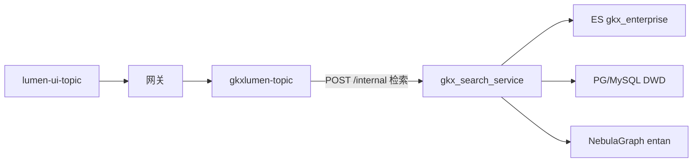

# ENT-ARCH-IMPL-DESIGN

> 2026-08-21 按规范补回：AV `findHandoffFile` 只认 `{taskId}.md` 或标题 `# {taskId}`。原关单在 `DATA-ENT-impl-path-signoff.md`（H1 为「Handoff：ENT-ARCH-IMPL-DESIGN」），机器扫不到。本文件从该关单 + registry 拆出，**不新写架构**。DoD 会签与 INT 关单门槛仍未满足。

## 任务认领（必填）

| 字段 | 值 |
|------|-----|
| claimed_by | `human:徐滕强` |
| supervised_by | `human:徐滕强` |
| claim_type | `pull` |
| 说明 | 2026-07-15 落地；2026-08-03 存量 done→integration（INT 未闭合） |

## Ponytail（coding 任务必填）

| 字段 | 值 |
|------|-----|
| ponytail | `N/A`（架构设计叶；实现由 data-agent 落 Python 代码） |
| 说明 | 不以缩文档为目标 |

## 图即契约

| 字段 | 值 |
|------|-----|
| diagram_id | `ENT-SEARCH-IMPL-FLOW` |
| 图 diff | 关单已画：前端 → Java `gkxlumen-topic` → Python 检索服务 → ES / PG DWD / Nebula `entan` |
| 会签态 | `draft`（DoD 辜少彬贴源签收、侯佳伟 API 分层会签仍待补） |

> 2026-07 关单仓名为 `demo-svc-topic-py`。D12 之后正式检索 Python 为 `lumen-topic-py`。本叶不把 demo 仓当 lumen 联调证据。

## 范围与实现

原始 DoD 要 `ARCH-ENT-impl-design.md`。实际以可运行代码 + API 文档替代设计长文（见关单）。

- 分层：前端 → Java 聚合/权限/Feign → Python `/internal` 检索详情统计图谱；Java 不写算法、不直连 nGQL
- URL：全 POST + JSON Body
- 关单口径 76 端点（搜索/对比/画像/风险/图谱/概况/重点/明星/深圳/分布/meta）
- 权限过滤在 Java；Python 不做权限裁剪
- Mock 默认可离线跑

对照：`DATA-ENT-impl-path-signoff.md`、`docs/API-接口文档.md`（demo-svc-topic-py）、`architecture-baseline.md` 方案 A。

## 产物清单

| 产物 | 路径 | 说明 |
|------|------|------|
| 原关单 | `agent-handoffs/企业战略分析-ENT/DATA-ENT-impl-path-signoff.md` | 2026-07-15 全文 |
| 预设计 | `agent-delivery/data/data-design/企业维度-Python微服务架构预设计.md` | 设计输入 |
| ES 设计 | `agent-handoffs/企业战略分析-ENT/DATA-ENT-ES-design.md` | 索引 |
| DWD | `agent-handoffs/企业战略分析-ENT/DATA-ENT-db-design.md` | 表结构 |
| Python 检索 | `repos/demo-svc-topic-py/gkx_search_service/` | 关单落地仓 |
| API 文档 | `repos/demo-svc-topic-py/docs/API-接口文档.md` | Feign 示例 |
| 测试 | `repos/demo-svc-topic-py/tests/test_enterprise_search.py` | 关单写 231 pytest |
| 关单 commit | `demo-svc-topic-py@0657816` origin/dev | 2026-07-15 已推 |

## 偏离说明

| 项 | 说明 |
|----|------|
| 无独立 `ARCH-ENT-impl-design.md` | DoD 允许「代码+API 文档替代」 |
| 辜少彬贴源/调度签收 | DoD 仍「待补充」，本文件不代签 |
| 侯佳伟 API 分层会签 | 原定 `ENT-ARCH-API-CONTRACT` 补签，本文件不代签 |
| CI Pipeline | 关单 waive；D5 标 ⚠️ |
| 调用链仓名 | 关单指向 demo-svc-topic-py；正式检索已迁 lumen-topic-py（D12） |
| 股东数据 | 关单：DWD 无表，仅 Mock |

## 验收证据

- 关单：231 pytest；`uvicorn gkx_search_service.main:app --port 8090` Mock 可起；Swagger `/docs`
- GitLab：`https://gitlab.htmisoft.net/gkx-lumen/demo-svc-topic-py` commit `0657816`
- **本叶未做 2026-08 正式环境联调**，AV-1 的 note 关键词不得填写

## 架构合规自检

| # | 铁律 | 合规 | 说明 |
|---|------|------|------|
| 1 | 算法只在 Python | ✅ | Java 无 NLP/图谱算法 |
| 2 | 调用链前端→Java→Python `/internal/*` | ✅ | 设计如此；落地仓见偏离 |
| 3 | 图谱 NebulaGraph | ✅ | Space `entan`；禁 Neo4j |
| 4 | 可观测性 | ✅ | `gkx_common/observability.py` |
| 5 | CI/CD | ✅ | 关单登记 pipeline_waiver，不伪绿 |
| 6 | demo 不 merge 进 lumen | ✅ | 本叶在 demo Python 仓实现 |
| 7 | 共享聚合核心 | ✅ | Java 编排，Python 读 ES/PG |
| 8 | 数据策略 ADS/Mock | ✅ | Mock 先行 |
| 9 | D8 前端 | ✅ | 本叶无 UI |
| 10 | D9 血缘 | ✅ | 接口标注数据源；Mock 标注 |
| 11 | D10 交互 | ✅ | 本叶无 UI |
| 12 | D12 lumen 不调 demo | ✅ | 不把 demo URL 当 lumen 联调证据 |

## Cost 回填

| 字段 | 值 |
|------|-----|
| actual_tokens | 850000 |
| model_used | claude-sonnet-4.5 |
| actual_cost | 5.2 |
| cost_warn | green |

与 registry 已填四字段一致（2026-07 关单会话，非本次补文件新耗）。

## 遗留风险

- 人签两道未闭合 → 不能 AV-1 到 ready_to_sign
- 正式检索真源已是 `lumen-topic-py`，本叶证据停在 demo 仓关单日

## 2026-08-21 检索门面抽样（不关单）

在 `http://111.198.38.90:50199` 抽了检索主路径：无关键词 `search/query` total=10000（trace `a38a59a647a761ec4e309651cadc9852`）；`query-tree-schema` 51 字段；`filters` / `region-scopes` / `meta/chains` HTTP 200。关键词「华为」total=0。

这只证明搜索门面还活着，**不能**替代辜少彬贴源签收、侯佳伟 API 分层会签。状态保持 `integration`。

证据：`agent-delivery/qa/evidence/KJZTFWXT/R0/ENT-ARCH-SAMPLE-20260821.json`
