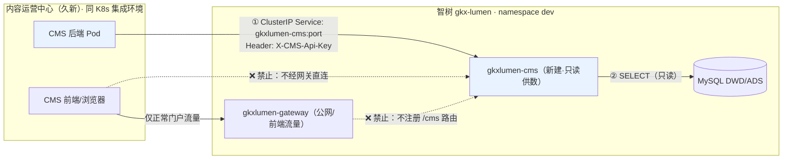

# CMS-JX-INT-DESIGN-L01 · 内容运营中心对接设计：15+1 个只读接口的集群内访问约束

> **任务**：`CMS-JX-INT-DESIGN-L01`（definition / P0 / fan-out 闸门单）
> **依据**：《内容运营中心_智树接口需求20261008-评估》《CMS接口需求评估与智树实现方案》（郭万迎 2026-10-09，状态：待久新确认）+ [CMS-read-contract-E31.md](../产品整体定义/E-31-企业发展/CMS-read-contract-E31.md) + [DATA-ENT-CMS-VS-APP-PARTITION-L01.md](../产品整体定义/E-31-企业发展/DATA-ENT-CMS-VS-APP-PARTITION-L01.md)
> **性质**：只冻结智树侧访问约束与接口契约骨架，不改代码；后续 16 个开发单（`CMS-JX-*`）以本 handoff 为唯一访问约束真源。

## 任务认领（必填）

| 字段 | 值 |
|------|-----|
| claimed_by | `human:徐滕强` |
| supervised_by | `human:徐滕强` |
| claim_type | `pull`（2026-10-14 16:17 认领，4h 锁窗） |
| 说明 | 名词与流程见 [`task-claiming-guide.md`](../../task-claiming-guide.md) |

## Ponytail

| 字段 | 值 |
|------|-----|
| ponytail | `N/A`（definition 定义类，无编码） |

## Headroom

| 字段 | 值 |
|------|-----|
| headroom | `skip`（本机未挂载 headroom 会话） |

## 图即契约（必填）

| 字段 | 值 |
|------|-----|
| diagram_id | `CMS-JX-ACCESS`（本 handoff §1 内嵌 Mermaid；属 L3 模块实现层切片，对齐 `ARCH-TOPO-LUMEN` 不另画全局图） |
| 图 diff | 新增 CMS 接入边：CMS Pod →(ClusterIP, 实线授权)→ gkxlumen-cms；虚线标注「网关/Ingress/CMS 前端」三条禁行边；无既有图改动 |
| 会签态 | `draft`（待 architect + api 会签后转 approved） |

---

## 0. 冻结决策（architect 拍板，2026-10-14 徐滕强确认）

| # | 决策 | 内容 | 理由 |
|---|------|------|------|
| A1 | **D3 例外条款** | `gkxlumen-cms` 允许**只读直连 DWD**（`dwd_org_base_info` / `dwd_policy_base` / `dwd_industry_chain_info` / `enterprise_industry_product`），仅限 SELECT | 评估文档数据源即 DWD；CMS 供数是纯取数无算法，为只读列表查询在 ADS 建视图层属过度工程。例外范围**仅限本模块**，其他 Java 模块 D3 铁律不变。责任签认：`human:徐滕强` |
| A2 | **新建 `gkxlumen-cms` 统一供数模块** | 16 个接口全部落位 lumen-svc-platform 新模块 `gkxlumen-cms`（单出口、单 Service、单鉴权面）；不分散到 topic-enterprise/chain/svc/policy 现有模块 | CMS 只对接一个 Service：NetworkPolicy、限流、BULK 归属、凭证吊销都单点管理；不污染既有业务模块 |
| A3 | **鉴权 = 静态 API Key + NetworkPolicy** | `/cms/v1/*` 统一鉴权 Filter 校验 `X-CMS-Api-Key`（久新独立凭证，可吊销可轮换）；叠加 NetworkPolicy 限定源 Pod | 裸 `@Inner` 头不可吊销，不适配长期三方消费者；mTLS 对同集群只读接口过度。Key 存 nacos 加密配置，禁入 git |
| A4 | **路径前缀 `/cms/v1/*`** | 独立命名空间路径，网关路由表天然不含 `/cms`；对外契约写明与评估文档 `/api/v1/*` 的映射关系 | 与仓内惯例（`/topic/v1`、`/innov/v1`、`/metrics/v1`）一致；不占用网关路由空间 |

> 以上 4 项决策已由 `human:徐滕强`（架构师 Lead）于 2026-10-14 拍板，记录于本 handoff。变更须重开会签。

## 1. 调用路径（冻结）

**图下四列表**：

| 生产者 | 消费者 | 触发 | 失败语义 | 禁止事项 |
|--------|--------|------|----------|----------|
| 智树数据中台（ETL/算子） | DWD/ADS 表 | 批处理 | 源失败→表数据保持上一版；接口返回旧数或空，禁造假 | Java 不写表 |
| `gkxlumen-cms` | CMS 后端 Pod | 在线（CMS 主动拉） | 查询失败→HTTP 5xx + 错误码；限流触发→429 | 不半成品冒充成功；不缓存污染 |
| `gkxlumen-cms`（webhook 单） | CMS 回调地址 | 批/事件（智树主动推） | 3 次退避失败→次日 02:00 全量校对兜底 | 回调地址仅限集群内 CMS Service |

**冻结规则**：

1. 唯一入口 = K8s ClusterIP Service `gkxlumen-cms`（namespace `dev`，与智树同集群集成环境）；CMS 后端 Pod 经服务 DNS 直连，**不经过** `gkxlumen-gateway`
2. `gkxlumen-gateway` 路由表**不注册**任何 `/cms/**` 路由；helm/ingress 不创建对外暴露
3. CMS 前端、浏览器、公网 Ingress 一律不得访问 `/cms/v1/*`；本批接口无任何用户态流量
4. 端口与 Service 名以部署单为准（TBD-1）；K8s manifest 归 devops，不归本设计单

## 2. 禁止项（冻结）

| # | 禁止 | 理由 |
|---|------|------|
| P1 | CMS 反写 DWD/ADS（任何写操作） | 真源分治；CMS 是消费者不是生产者 |
| P2 | 智树接口提供对 CMS 数据的 CRUD | 评估结论：只读 16 接口，零 CRUD |
| P3 | 网关注册 `/cms/**` 路由 / 新建对 CMS 开放的 Ingress | 隔离面唯一：ClusterIP + API Key |
| P4 | CMS 前端/浏览器直连 `/cms/v1/*` | 后台对后台；用户态流量全部走正常门户链路 |
| P5 | 明星名单用算法 TopN 冒充（或反向） | E-31 §0.5；TopN 接口只返回算法榜单，名单走 CMS 自管 |
| P6 | webhook 暴露为 CMS 可直连入口 | webhook 方向 = 智树 Pod → CMS Pod 单向通知 |
| P7 | `X-CMS-Api-Key` 明文入 git / 日志 / handoff | nacos 加密配置；日志脱敏 |
| P8 | 运营内容（资讯/专项/介绍/图谱运营 26 类）走智树接口 | 评估文档 §四：CMS 自建 |

## 3. 鉴权与网络（冻结）

### 3.1 调用方身份

- **凭证**：`X-CMS-Api-Key` HTTP 头；每环境一套（dev/test），久新专人保管；泄露可吊销重发（nacos 改配置 + 滚动重启，无需改代码）
- **校验**：`gkxlumen-cms` 统一 Filter，校验失败返回 `401 {"code":"CMS_AUTH_FAILED"}`；**不接入**智树用户 OAuth/SSO 体系（D6 网关统一鉴权适用于用户态，本模块是服务态）
- **适用范围**：`/cms/v1/*` 全部 16 接口，无白名单豁免

### 3.2 网络隔离

- **NetworkPolicy**（devops 落地，本设计只冻结语义）：`gkxlumen-cms` Pod 仅接受带 API Key 请求中**源为 CMS 后端 Pod**（按 namespaceSelector/podSelector 圈定，CMS 部署时回填标签，TBD-2）；egress 仅放行 MySQL
- **服务 DNS**：`gkxlumen-cms.{namespace}.svc.cluster.local`；同集群集成环境内可解析，跨集群不可达（ClusterIP 天然属性）
- **限流**（对齐评估文档）：BULK `每分钟 ≤ 10 次`，超限 429；其余接口按部署压测定默认值（TBD-3）

### 3.3 失败隔离

- CMS 侧慢/挂 → 不影响智树任何用户态服务（本模块无入站依赖）
- 智树 DWD/ADS 慢/挂 → `gkxlumen-cms` 返回 5xx + 错误码，CMS 自行降级（评估文档已约定 CMS 侧降级文案）；**不做**智树侧兜底缓存（CMS 缓存上一版是评估文档给 CMS 的约定，非智树义务）
- OTel：接入全栈链路（trace 头透传，`OTEL_SERVICE_NAME=gkxlumen-cms`）；对 CMS 侧传递的 trace 头原样回传

## 4. 只读边界（冻结）

| 边界 | 规则 | 对应开发单 |
|------|------|-----------|
| 明星名单 ≠ TopN | TopN 接口只返回算法榜单（排名/得分/ID）；入选理由/排序/发布态由 CMS 自管（E-34/E-35 契约） | ENT-TOPN / ENT-ROSTER |
| 图谱边不供写 | BULK 只返实体基础信息（id/name/type/region/industry/update_time），**不返关系/属性/生命周期** | BULK |
| 政策无 CRUD | 失效由智树数据治理产生；对 CMS 暴露：已失效列表（拉）+ webhook 通知（推） | POL-EXPIRED / POL-WEBHOOK |
| 全接口零写 | 16 接口全部 GET（BULK 为 POST 但语义为批量查询，无副作用幂等） | 全部 |

## 5. 模块与接口契约骨架

### 5.1 模块落位（A2）

- 新 Maven 模块 `gkxlumen-cms`（lumen-svc-platform 单模块，无 api/biz 拆分——不需要 Feign 暴露给其他 Java 服务）
- 落位对照：企业组 6 接口 + 产业组 2 + 服务机构组 2 + 政策组 5 + BULK + webhook 定时器，全部在此模块

### 5.2 路径映射（评估文档 → 本设计）

| 评估文档 | 本设计（冻结） | 开发单 |
|----------|---------------|--------|
| GET /api/v1/enterprise(+/{id}+/suggest) | GET /cms/v1/enterprise · /cms/v1/enterprise/{id} · /cms/v1/enterprise/suggest | ENT-LIST |
| GET /api/v1/enterprise/{id}/profile | GET /cms/v1/enterprise/{id}/profile | ENT-PROFILE |
| GET /api/v1/enterprise/{id}/products | GET /cms/v1/enterprise/{id}/products | ENT-PRODUCT |
| GET /api/v1/enterprise/topn | GET /cms/v1/enterprise/topn | ENT-TOPN |
| GET /api/v1/enterprise/panorama | GET /cms/v1/enterprise/{id}/panorama | ENT-PANO |
| GET /api/v1/enterprise/star-roster + /sz-focus | GET /cms/v1/enterprise/star-roster · /cms/v1/enterprise/sz-focus | ENT-ROSTER |
| GET /api/v1/industry-class/tree | GET /cms/v1/industry/tree | IND-TREE |
| GET /api/v1/chain-link | GET /cms/v1/industry/chain-links | IND-LINK |
| GET /api/v1/service-org(+/{id}+/suggest) | GET /cms/v1/service-org · /{id} · /suggest | SVC-LIST |
| GET /api/v1/service-org/topn | GET /cms/v1/service-org/topn | SVC-TOPN |
| GET /api/v1/policy(+/{id}+/suggest) | GET /cms/v1/policy · /{id} · /suggest | POL-LIST |
| GET /api/v1/policy/topn | GET /cms/v1/policy/topn | POL-TOPN |
| GET /api/v1/policy/stats | GET /cms/v1/policy/stats | POL-STATS |
| GET /api/v1/policy/expired | GET /cms/v1/policy/expired | POL-EXPIRED |
| POST /api/v1/bulk/entities | POST /cms/v1/bulk/entities | BULK |
| POST {CMS回调地址}（webhook） | 智树主动推：POST http://{cms-callback}.{ns}.svc.cluster.local/{path} | POL-WEBHOOK |

> 统一响应信封：`R<T>`（PigX 惯例）；错误码段 `CMS_*`（401 CMS_AUTH_FAILED / 429 CMS_RATE_LIMITED / 5xx CMS_QUERY_FAILED）。字段级 OpenAPI 由各开发单 handoff 冻结，本设计只锁路径/方法/信封。

### 5.3 数据源对照（A1 例外条款适用范围）

| 数据域 | 表 | 层 | 说明 |
|--------|----|----|------|
| 企业主数据 | `dwd_org_base_info` | DWD | A1 例外：只读 SELECT |
| 政策主数据 | `dwd_policy_base` | DWD | 同上 |
| 产业目录 | `dwd_industry_chain_info` | DWD | 同上 |
| 产品名称 | `enterprise_industry_product` | DWD | 同上 |
| 服务机构卡片 | `svc_org_card` | ADS | D3 铁律正常适用 |
| TopN/统计 | ADS 算子表 | ADS | D3 铁律正常适用（表名随算子任务冻结） |

## 4'(§6). TBD 清单（联调期回填，不阻塞开发单开工）

| # | 项 | Owner | 回填时机 |
|---|----|-------|----------|
| TBD-1 | Service 端口号、helm values 落位 | devops | 部署单 |
| TBD-2 | CMS Pod 标签/namespace（NetworkPolicy selector 用） | 久新部署时 | CMS 部署后 |
| TBD-3 | 非 BULK 接口默认限流阈值 | api-agent | 压测后 |
| TBD-4 | CMS webhook 回调地址具体值 | 久新 | 联调前 |
| TBD-5 | TopN 的 ADS 算子表名（依赖算子任务产出） | data/algorithm | 第二批开工前 |

## 问题清单

- 评估文档状态"待久新确认"只读方案：若久新不接受，按预案上报总集，以 E-31 契约为依据（不阻塞本设计冻结，约束是智树单方面访问边界）
- 久新回调地址、CMS Pod 标签在 CMS 部署前不可知，走 TBD 清单

## 修改内容

- 新增本设计 handoff（本文件）；无代码改动（definition 单）

## 测试结果

- N/A（definition 单，无代码；验收 = 会签通过）

## 遗留风险

| 风险 | 缓解 |
|------|------|
| 久新拒收只读方案 | 上报总集；E-31 铁律为据 |
| D3 例外被滥用（其他模块效仿直读 DWD） | 例外条款明文限定"仅 gkxlumen-cms"；AV 审查时对照 |
| API Key 泄露 | 可吊销轮换（nacos）；日志脱敏；P7 禁令 |

## CI/CD（必填）

- 分支：gkx-orchestration `dev`（文档仓，`cicd: skip` 类）
- commit：本文件提交时回填
- pipeline：N/A（设计文档）
- 部署：N/A

## 会签（DoD 要求：architect + api）

| 角色 | 人 | 结论 | 日期 |
|------|----|------|------|
| architect | human:徐滕强 | ✅ 冻结决策 A1–A4 已拍板；全文通过 | 2026-10-14 |
| api | human:徐滕强（兼） | ✅ api 侧工程可行性确认（路径/信封符合 PigX 惯例；API Key Filter 与 @Inner 体系共存方案；nacos 加密配置；gkxlumen-cms 模块构建与 CI 接入成本可接受） | 2026-10-14 |

> **人员变更记录**：原 Q050 指定 api 签字人 human:侯佳伟已于 2026-10-14 前离职，api 职责由 human:徐滕强兼任（本会话确认）。Q050 签字配置与 `team-roster.yaml` 花名册待 PM/lead 同步更新（本 handoff 先行如实记录）。

## 涉及文件

- 本文件：`agent-delivery/agent-handoffs/平台基建-PLATFORM/CMS-JX-INT-DESIGN-L01.md`
- 依据：`工程过程/02-策划与监控/01-总集大项目整体计划/07-内容运营中心接口需求评估/`（两篇评估文档）
- 契约：`agent-handoffs/产品整体定义/E-31-企业发展/CMS-read-contract-E31.md`、`DATA-ENT-CMS-VS-APP-PARTITION-L01.md`
