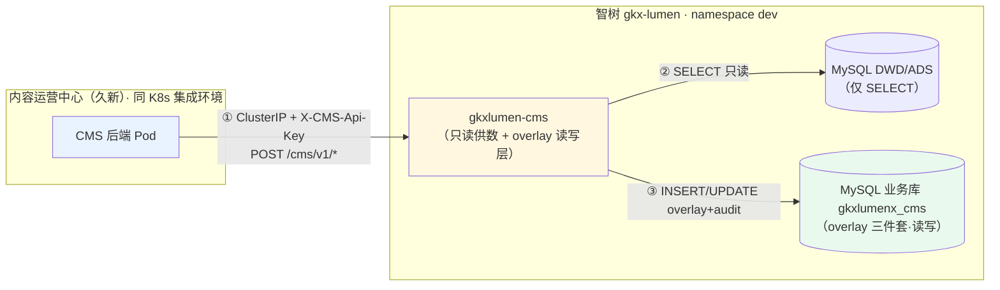

# CMS-JX-OVERLAY-A5-L01 · CMS overlay 读写边界增补（A5）：映射层设计 + 老设计单只读边界改写

> **任务**：`CMS-JX-OVERLAY-A5-L01`（definition / P0 / overlay 闸门单）
> **依据**：《CMS-JX接口规格书.md》v1.3（2026-10-15，字段+枚举+端点语法+真源表名定稿）+ 老设计单 [CMS-JX-INT-DESIGN-L01.md](CMS-JX-INT-DESIGN-L01.md)（A1–A4 继承）+ 久新 2026-10-15 确认的新口径（三模块全做、原型为准、标智树页面全由智树接口支撑）
> **性质**：只冻结 overlay 数据模型 / join 契约 / 物理表名裁决，不改代码。本 handoff 与规格书 v1.3 共同构成 19 张 CRUD 单的唯一实现依据。

## 任务认领（必填）

| 字段 | 值 |
|------|-----|
| claimed_by | `agent:architect-agent` |
| supervised_by | `human:徐滕强` |
| claim_type | `pull`（2026-10-15 16:12 认领，8h 锁窗） |

## Ponytail

| 字段 | 值 |
|------|-----|
| ponytail | `N/A`（definition 定义类，无编码） |

## Headroom

| 字段 | 值 |
|------|-----|
| headroom | `skip`（本机未挂载 headroom 会话） |

## 图即契约（必填）

| 字段 | 值 |
|------|-----|
| diagram_id | `CMS-JX-OVERLAY`（本 handoff §1 内嵌 Mermaid；在老设计单 `CMS-JX-ACCESS` 图上增补读写分层） |
| 图 diff | `gkxlumen-cms` 节点从"只读供数"改注"只读供数 + overlay 读写层"；新增 MySQL **业务库 `gkxlumenx_cms`** 存储边（读写）；真源 DWD/ADS 仍只读（虚线标"仅 SELECT"）；无其他图改动 |
| 会签态 | `draft`（待 architect 拍板冻结后转 approved） |

---

## 0. A5 冻结决策（architect 拍板项，2026-10-15 徐滕强委托起草）

| # | 决策 | 内容 | 理由 |
|---|------|------|------|
| A5-1 | **overlay 三件套落业务库 `gkxlumenx_cms`**（human:徐滕强 2026-10-15 拍板） | 三件套 = `cms_entity_overlay`（实体覆盖）+ 运营内容宽表族 + `cms_op_audit`（操作审计），建在 **Java 业务库**（PigX 业务数据源同实例、独立 database `gkxlumenx_cms`），与 DWD/ADS 完全隔离；数据工厂/ETL 不触碰 | 覆盖表是 Java 运营态数据，属业务库职责；**禁入 DWD/ADS**（铁律）；独立 database 便于备份/清空/审计 |
| A5-2 | **真源物理表名冻结 = 项目 DWD 正式表**（human:徐滕强 2026-10-15 纠偏） | CMS 读侧统一用**正式库 `gkxlumenx_dwd`** 的项目 DWD 契约表：`enterprise_base`（企业）、`policy_base_info`（政策）、`industry_chain` / `industry_chain_node`（产业链）、`enterprise_industry_product`（产品）；服务机构圈定池 `svc_org_circle`（demo 期 `demo_gkxlumenx_dwd`，正式落位随 DDL 单）。**禁止**用供应方 ODS 名 `dwd_org_base_info` / `dwd_policy_base` / `dwd_industry_chain_*`——那是入站 ODS 层命名，**实际上线读正式表，千万别搞错** | 老设计单 A1 写的 5 表名是 ODS 命名（当时 demo 快照），项目 DWD 目录（ENT/POLICY/CHAIN storage 文档）才是正式契约；两套列名一致（org_id/name_cn/external_id/...），映射按列名书写不变，物理名以本条为准收口 |
| A5-3 | **`cms_entity_overlay` 行级覆盖模型** | 每实体一行：`UNIQUE KEY (entity_type, source_id)`（**唯一键必须有**——join 视图按它关联，缺失或重复会导致视角行重复/错配）；`field_overrides` JSON 只存"被运营改过的字段"（一层平面 KV）；`is_deleted` 软删（删=1，行保留可追溯）；虚拟实体 `source_id = 'cms:{TYPE}-{uuid8}'` 且真源侧无对应行 | 规格书 §0.4 语义直接落库；未覆盖字段真源更新自动透传，覆盖字段运营态优先 |
| A5-4 | **运营内容宽表族**（每类业务一张自己的表，**已确认**，human:徐滕强："不能做万能大表，不利于维护"） | `cms_content_news`（三域资讯：ENT/SVC/IND 各一行型，`domain` 列区分）/ `cms_content_sz`（ENT/SVC/IND 专项）/ `cms_content_region_roster` / `cms_industry_custom`（分类+环节合一表，`kind` 区分）/ `cms_kg_stage_def` / `cms_kg_entity_status` / `cms_kg_relation` / `cms_kg_attr` / `cms_expert_knowledge` | 规格书 §1–§6 的 19 张单字段差异大（多选数组/JSON content/树 parent），宽表族每张表列即规格字段，DDL 直译、无 JSON 反序列化层；比"单一 JSON 大表"可索引可迁移 |
| A5-5 | **join 视角契约**（读侧统一；**可以 join 已确认**——同 MySQL 实例跨库直连） | 列表/详情 = `gkxlumenx_dwd`.`enterprise_base` LEFT JOIN `gkxlumenx_cms`.`cms_entity_overlay` ON 真源主键=source_id AND entity_type=X AND is_deleted=0；输出列逐字段 COALESCE(overlay 覆盖值, 真源列)；虚拟实体 UNION ALL（source_id 以 `cms:` 前缀）；软删行剔除 | 规格书 §0.4 的 SQL 化；读侧 4 张老单升级即按此改 SQL，不动接口形态 |
| A5-6 | **全 POST + JSON body 铁律**（v1.2 已定稿，此处登记继承；human:徐滕强 复核"全部post"✓） | 全 epic 统一 POST、禁止路径参数、动作式后缀 list/detail/create/update/delete/break 等；`{entityType}`/`{domain}` 为有限枚举段放行 | human:徐滕强 2026-10-15 拍板；老设计单 §5.2 十六只读接口登记表同步改写（见 §6） |
| A5-7 | **操作留痕表 `cms_op_audit`**（"全部写操作落 cms_op_audit" = 每次新增/编辑/删除/标记断裂成功后，**顺手在这张表插一行"谁、何时、对哪条数据、做了什么、为什么"的记录**） | 写操作主流程成功后 INSERT 一行：`op_type`（CREATE/UPDATE/DELETE/BREAK...）、`entity_type`+`business_id`（操作对象）、`reason`（删除/断裂必填）、`operator`（取请求头 X-CMS-Operator，即 CMS 传来的操作人姓名）、`snapshot_before`（改前的旧值 JSON 镜像，用于追溯"改了什么"）、`op_time`。与业务写入同库同事务（A5-8）。**用途**：①政策条目页"删除操作审计"面板直接查这张表；②任何误操作可凭快照还原 | 公约审计要求 + 原型 pol-audit 面板数据源；运营后台必须可追溯 |
| A5-8 | **数据源与事务边界**（human:徐滕强 ✓ 同意） | `gkxlumen-cms` 两个连接：①业务库 `gkxlumenx_cms`（overlay 三件套，读写）——与 PigX 主业务库同实例，可复用业务数据源体系；②真源库 `gkxlumenx_dwd`（只读账号，仅 SELECT）。**不做分布式事务**：overlay 写入与审计写入同库同事务；真源零写入无跨库一致性需求 | 避免 XA/seata 复杂化；P1 真源零写的自然收益 |

---

## 1. 调用路径增补（在老设计单 CMS-JX-ACCESS 图上）



**图下四列表**：

| 生产者 | 消费者 | 触发 | 失败语义 | 禁止事项 |
|--------|--------|------|----------|----------|
| `gkxlumen-cms` overlay 层 | 业务库 `gkxlumenx_cms` | 在线（运营写操作） | 写失败→5xx 回滚，**不产生半覆盖态**（overlay+audit 同事务） | 不写真源 DWD/ADS 任何表 |
| `gkxlumen-cms` 读侧 | DWD/ADS + overlay join | 在线 | 真源查询失败→5xx；join 缺 overlay 行=纯真源数据照常返回 | 不缓存污染；不改真源数据形态 |
| 运营人员（经 CMS 前端） | CMS 后端 → 智树接口 | 在线 | 前端报错文案由 CMS 侧维护 | 智树侧不直接面向运营人员 |

**冻结规则增补**（编号续老设计单）：

5. overlay 读写层与只读供数同 Service 同鉴权面（`X-CMS-Api-Key` + `X-CMS-Operator` 双头：前者鉴权、后者审计归属）
6. 业务库 `gkxlumenx_cms` 的 DDL 变更走 `CMS-JX-OVERLAY-DDL-L01` 单独评审，禁止开发单私改表结构

---

## 2. 数据模型冻结（DDL 单照此直译）

### 2.1 `cms_entity_overlay`（实体覆盖表，A5-3）

```sql
CREATE TABLE gkxlumenx_cms.cms_entity_overlay (
  id            BIGINT PRIMARY KEY AUTO_INCREMENT,
  entity_type   VARCHAR(32)  NOT NULL COMMENT 'ENT|SVC|POL|IND|PROD（实体覆盖五类）',
  source_id     VARCHAR(64)  NOT NULL COMMENT '真源主键（org_id/policy_id/...）；虚拟实体=cms:{TYPE}-{uuid8}',
  field_overrides JSON      NOT NULL COMMENT '字段级覆盖 {name:.., is_key:..}；未列字段=不覆盖',
  is_deleted    TINYINT     NOT NULL DEFAULT 0 COMMENT '软删：1=视角剔除',
  created_by    VARCHAR(64) NOT NULL DEFAULT 'unknown',
  created_at    DATETIME    NOT NULL DEFAULT CURRENT_TIMESTAMP,
  updated_by    VARCHAR(64) NOT NULL DEFAULT 'unknown',
  updated_at    DATETIME    NOT NULL DEFAULT CURRENT_TIMESTAMP ON UPDATE CURRENT_TIMESTAMP,
  UNIQUE KEY uk_type_source (entity_type, source_id),
  KEY idx_deleted (entity_type, is_deleted)
) COMMENT 'CMS 实体覆盖层：行级覆盖+软删；真源永不写入。uk_type_source 唯一键为 join 生命线，禁删禁改';
-- 落库：业务库 gkxlumenx_cms（非 DWD/ADS）；软删=is_deleted 置 1 保留行；
-- field_overrides 仅存"被运营改过的字段"（一层平面 KV），未列字段=用真源值
```

### 2.2 运营内容宽表族（A5-4 已确认；全部落业务库 `gkxlumenx_cms`；列 = 规格书各节字段直译，此处冻结表名与关键列，全列以规格书为准）

| 表 | 服务工单 | 关键列（规格字段直译） |
|----|---------|----------------------|
| `cms_content_news` | ENT-NEWS / SVC-NEWS / PROD-NEWS | `domain`(ENT/SVC/IND) + title/company_ids(JSON数组)/kind/content/risk/status/date/source_url |
| `cms_content_sz` | ENT-SZ / SVC-SZ | `domain`(ENT/SVC) + org_id/district/industry/park/…(docx 扩展列 cases/evaluation/sz_note 注释标明) |
| `cms_content_region_roster` | PROD-SZ | org_id(可空)/name(冗余)/industry/district/scale |
| `cms_industry_custom` | IND-CUSTOM | `kind`(CLASS/LINK) + code/name/level/parent_code/definition/order_no（CLASS 树用 parent_code 自关联） |
| `cms_kg_stage_def` | KG-STAGE | entity_type + stage_name/feature/metric/order_no（阶段为类型级通用配置，不挂实体） |
| `cms_kg_entity_status` | KG-STAGE | entity_type + entity_id/stage/since/event + 类型专属 JSON（financing/operation/stageInfo/linkedMetric/scope/effect/scale/customers） |
| `cms_kg_relation` | KG-REL | entity_type + from_entity_id/rel_type/to_entity_id/status/since/break_time（break 动作置 status=已断裂+break_time） |
| `cms_kg_attr` | KG-ATTR | entity_type + name/group(base/dyn)/dtype/constraint/value/order_no（v1.1 收敛后无独立分类表） |
| `cms_expert_knowledge` | EK-×5 | domain + section_id/title/entity(JSON:{entityType,entityId,name})/expert/content(JSON 按 section 字段序)/view/conclusion/evidence/source_type/source/advice |

> 通用列每表齐备：`id BIGINT PK / is_deleted / created_by/at / updated_by/at`（同 2.1 惯例），下略。

### 2.3 `cms_op_audit`（审计表，A5-7）

```sql
CREATE TABLE gkxlumenx_cms.cms_op_audit (
  id             BIGINT PRIMARY KEY AUTO_INCREMENT,
  op_type        VARCHAR(32)  NOT NULL COMMENT 'CREATE|UPDATE|DELETE|BREAK|MARK|...规格端点动作大写',
  entity_type    VARCHAR(32)  NOT NULL,
  business_id    VARCHAR(64)  NOT NULL COMMENT '被操作行业务ID（overlay source_id 或内容表 id）',
  reason         VARCHAR(512) NULL COMMENT 'delete/break 必填，其余可空',
  operator       VARCHAR(64)  NOT NULL DEFAULT 'unknown' COMMENT '取 X-CMS-Operator 头',
  snapshot_before JSON        NULL COMMENT '变更前整行 JSON 镜像',
  op_time        DATETIME     NOT NULL DEFAULT CURRENT_TIMESTAMP,
  KEY idx_et_biz (entity_type, business_id, op_time),
  KEY idx_op_time (op_time)
) COMMENT 'CMS 全部写操作审计；政策删除操作审计接口数据源';
```

### 2.4 join 视图（A5-5；DDL 单落库为视图 `v_cms_ent` 等，读侧单直接查）

```sql
CREATE VIEW v_cms_ent AS
SELECT  t.org_id                    AS id,
        COALESCE(o.field_overrides->>'$.name',  t.name_cn)              AS name,
        t.incorporation_date        AS founded,
        COALESCE(o.field_overrides->>'$.capital', CONCAT(t.registered_capital_value, t.capital_currency)) AS capital,
        o.field_overrides->>'$.ent_type'    AS type,          -- 运营标签，真源无此列
        o.field_overrides->>'$.industry_tag' AS industry,     -- 运营标签
        COALESCE(o.field_overrides->>'$.scale', t.org_size)   AS scale,
        o.field_overrides->>'$.is_key'       AS is_key,
        o.field_overrides->>'$.key_flag'     AS flag,
        o.field_overrides->>'$.priority'     AS priority,
        t.external_id, t.province, t.city, t.area, t.org_type,
        t.industry_l1_name, t.industry_l2_name, t.industry_l3_name, t.industry_l4_name, t.reg_status
FROM    gkxlumenx_dwd.enterprise_base t                       -- 正式表（A5-2 纠偏后）
LEFT JOIN gkxlumenx_cms.cms_entity_overlay o
       ON o.source_id = t.org_id AND o.entity_type='ENT' AND o.is_deleted=0
UNION ALL
SELECT  o.source_id AS id, o.field_overrides->>'$.name' AS name, /* 虚拟实体，全列取 overlay */ ... ,
        NULL, NULL, NULL, NULL, NULL, NULL, NULL, NULL, NULL, NULL, NULL, NULL, NULL, NULL, NULL, NULL, NULL
FROM    gkxlumenx_cms.cms_entity_overlay o
WHERE   o.entity_type='ENT' AND o.is_deleted=0 AND o.source_id LIKE 'cms:ENT-%';
```

> SVC/POL/IND/PROD 视图同构（列清单 = 规格书各节"列表列 + 只读回显字段"）。**视图列名 = 规格书字段名**，读侧接口层零映射。

---

## 3. 读写边界改写（老设计单三处条款，A5 后以此为准）

| 老设计单位置 | 原文（冻结态） | A5 改写后 | 理由 |
|-------------|---------------|-----------|------|
| §2 P2 | 智树接口提供对 CMS 数据的 CRUD —— **禁止** | 仍禁止对**真源** CRUD；**新增**：对业务库 `gkxlumenx_cms` 内运营数据提供全 CRUD（19 张工单，规格书 v1.3 为契约真源） | 久新 2026-10-15 新口径：标智树页面全由智树接口支撑；overlay 隔离层保住"真源零写" |
| §2 P8 | 运营内容（资讯/专项/介绍/图谱运营 26 类）走智树接口 —— **禁止** | 运营内容**存储**仍在 CMS 侧不经智树；但**读写接口**由智树 `gkxlumen-cms` overlay 层提供（§3.1 范围对照表） | 同上；"内容不经智树"旧口径被久新新口径取代，存储位置与接口提供方分离 |
| §4 只读边界表末行 | 全接口零写：16 接口全部 GET | 改为：**真源零写不变**；epic 扩至 35 接口 = 16 只读（已改 POST 风格）+ 19 写侧（全落 overlay）+ 引用检查 40901 | 规格书 v1.2 §0.4/§0.6 |

### 3.1 范围对照表（冻结；与原型菜单（智树）标记一致）

| 原型菜单组 | 面板数 | 工单 | 写侧 |
|-----------|--------|------|------|
| 基础数据管理（产品链/企业/政策/服务机构 4 组） | 12 面板 | ENT-CRUD/NEWS/SZ、POL-CRUD、SVC-CRUD/NEWS/SZ、PROD-CRUD、IND-CUSTOM、PROD-NEWS/SZ | overlay CRUD |
| 全要素图谱管理（4 类实体；**graph-editor 不做**） | 3 子模块 | KG-STAGE/REL/ATTR | overlay CRUD，不写 Nebula |
| 专家知识管理（产业链/企业/政策/服务机构/综合 5 域） | 12 section | EK-INDUSTRY/ENT/POLICY/SVC/REGION | 纯 overlay |
| 可视化管理 / 门户内容管理 / 图谱绘制工具 / tech·research·talent 实体 | — | — | **不在本期**（菜单未标智树或已顺延） |

---

## 4. 删除引用检查与软删（冻结）

- **真源实体软删**：仅置 overlay `is_deleted=1`（视图即剔除）；**不物理删真源行**（P1）
- **引用检查 40901**：删除被以下引用时拒绝，`data.reasons=[{"type":"...","count":n}]`：
  - 企业/服务机构：`cms_content_news.company_ids/org`、`cms_content_sz.org_id`、`cms_kg_relation.from/to`、`cms_expert_knowledge.entity`
  - 政策：`cms_expert_knowledge.entity`
  - 自定义环节：产品 `cms_entity_overlay.field_overrides->chain_code`
  - 自定义分类：`cms_industry_custom.parent_code`（子分类引用）
- **内容表删除**（资讯/专项/知识等）：纯 overlay 行，直接软删+审计，无级联检查

---

## 5. 事务与写入（冻结；"并发合并"原表述已按用户要求白话化并简化）

> **"并发合并"原本是什么意思**：担心两个运营员同时编辑同一家企业的不同字段（A 改重点标识、B 改企业简介），如果接口实现是"先读整行旧值 → 内存里改 → 整包写回"，后提交的人会把先提交的人的改动**无声覆盖**掉。
> **简化裁决（human:徐滕强 2026-10-15）**：update 接口 body 只带"本次要改的字段"，SQL 用 MySQL 原生 `JSON_MERGE_PATCH(field_overrides, JSON_OBJECT('k1', v1, ...))` 只叠加这些键——别人已改的其他键原样保留，天然不互相覆盖；**不做**乐观锁/版本号（内网低并发运营后台，不值得引入）。

- 同库同事务：overlay 行写 + `cms_op_audit` 行写一起提交，失败一起回滚（不留"改了数据没留痕"或反之的半态）
- 虚拟 ID 生成：服务端 `cms:{TYPE}-{uuid8}`，撞 uk 唯一键重试一次

## 6. 老设计单 §5.2 十六只读接口登记表改写（A5-6 连带）

| 评估文档 | 老登记（GET 风格） | **A5 改写后（冻结）** | 开发单 |
|----------|-------------------|----------------------|--------|
| GET /api/v1/enterprise(+/{id}+/suggest) | GET /enterprise · /{id} · /suggest | `POST /cms/v1/enterprise/list` · `/detail` · `/suggest` | ENT-LIST |
| GET /api/v1/enterprise/{id}/profile | GET /{id}/profile | `POST /cms/v1/enterprise/profile`（body: id） | ENT-PROFILE |
| GET /api/v1/enterprise/{id}/products | GET /{id}/products | `POST /cms/v1/enterprise/products`（body: id） | ENT-PRODUCT |
| GET /api/v1/enterprise/topn | GET /topn | `POST /cms/v1/enterprise/topn` | ENT-TOPN |
| GET /api/v1/enterprise/panorama | GET /{id}/panorama | `POST /cms/v1/enterprise/panorama`（body: id） | ENT-PANO |
| GET /api/v1/enterprise/star-roster + /sz-focus | GET /star-roster · /sz-focus | `POST /cms/v1/enterprise/star-roster` · `/sz-focus` | ENT-ROSTER |
| GET /api/v1/industry-class/tree | GET /industry/tree | `POST /cms/v1/industry/tree` | IND-TREE |
| GET /api/v1/chain-link | GET /industry/chain-links | `POST /cms/v1/industry/chain-links` | IND-LINK |
| GET /api/v1/service-org(+/{id}+/suggest) | GET · /{id} · /suggest | `POST /cms/v1/service-org/list` · `/detail` · `/suggest` | SVC-LIST |
| GET /api/v1/service-org/topn | GET /topn | `POST /cms/v1/service-org/topn` | SVC-TOPN |
| GET /api/v1/policy(+/{id}+/suggest) | GET · /{id} · /suggest | `POST /cms/v1/policy/list` · `/detail` · `/suggest` | POL-LIST |
| GET /api/v1/policy/topn | GET /topn | `POST /cms/v1/policy/topn` | POL-TOPN |
| GET /api/v1/policy/stats | GET /stats | `POST /cms/v1/policy/stats` | POL-STATS |
| GET /api/v1/policy/expired | GET /expired | `POST /cms/v1/policy/expired` | POL-EXPIRED |
| POST /api/v1/bulk/entities | POST /bulk/entities | `POST /cms/v1/bulk/entities`（不变） | BULK |
| POST {CMS回调} | webhook（智树→CMS 推） | 不变（方向与语义原样） | POL-WEBHOOK |

> 全部 body 参数细则以各读侧工单 DoD + 规格书 §0.3 为准（keyword/page/size/id 等）。**本表回填老设计单 §5.2 时整体替换。**

---

## 7. 实施排期（冻结的开工链）

```
本单(A5) 签字冻结
  → CMS-JX-OVERLAY-DDL-L01（api-agent；三件套 DDL + join 视图落业务库 gkxlumenx_cms + 种子导入：阶段定义/属性模板）
  → 19 张 CRUD 单 + 16 读侧单（其中 4 张读侧升级 join 视角）逐张认领开工
  → 接口文档 v1.0（OpenAPI 3.0，A5 冻结后机械转换规格书 v1.3）
```

种子导入随 DDL 单：KG-STAGE 阶段定义（规格 §5.1 四类×4 阶段含 metric）、KG-ATTR 属性模板（规格 §5.3 四类 seed 建议）、无其他隐式种子。

---

## 修改内容

- 新增本 A5 增补 handoff
- 回写老设计单 `CMS-JX-INT-DESIGN-L01.md`：§2 P2/P8 改写、§4 末行改写、§5.2 登记表整体替换（§6 表）、标题及 §0 注记 A5 增补生效
- task-registry：A5 状态流转 + cost 回填

## 测试结果

- N/A（definition 单，无代码；验收 = architect 拍板冻结 + 会签）

## 遗留风险

| 风险 | 缓解 |
|------|------|
| overlay 与真源列名漂移（DWD 改列） | join 视图集中映射（A5-5），列变更只改视图 DDL；§0.5 两套表名已收口 |
| JSON_MERGE_PATCH 遇嵌套覆盖语义分歧 | field_overrides 约定**仅一层平面 KV**（值可为标量/数组），禁嵌套对象；DDL 单在表注释写明 |
| 久新对 POST 风格读接口接受度 | 久新原评估即全 POST 风格；接口文档 v1.0 随 A5 交付时同步说明 |

## 范围与实现（对照 DoD 六条）

| DoD | 落位 |
|-----|------|
| ① A5 决策写入 + A1–A4 继承 + P2/P8/§4 改写 | §0 A5-1~A5-8 + §3 边界改写表 + 老设计单回写 |
| ② 三件套数据模型冻结 | §2（cms_entity_overlay / 宽表族 / cms_op_audit） |
| ③ join 视图契约冻结 | §2.4 + A5-5 |
| ④ 通用 CRUD/OpenAPI 约定冻结 | 规格 v1.3 §0.3/§0.4/§0.6（引用继承）+ A5-6 |
| ⑤ 范围对照表冻结 | §3.1 |
| ⑥ 会签：architect 拍板 + 老设计单暂缓签收 | 会签栏（待 human:徐滕强 拍板） |

## 偏离说明

| 偏离 | 基准 | as-built | 理由 |
|------|------|----------|------|
| 老设计单"零 CRUD"边界 | P2/P8 冻结态 | overlay 层 CRUD 开放（真源仍零写） | 久新 2026-10-15 新口径 + 范围裁决（人已确认） |
| 读接口 GET 风格 | 老设计单 §5.2 | 全 POST（16 接口登记表替换） | human:徐滕强 2026-10-15 拍板（v1.2 §0.6） |
| 真源表名 | 老设计单 A1 用 ODS 名 `dwd_org_base_info` 等 | **改项目 DWD 正式表** `enterprise_base` / `policy_base_info` / `industry_chain(_node)` | human:徐滕强 2026-10-15 纠偏："dwd_org_base_info 是 ods 表名，上线读正式表" |
| overlay 库位 | 起草稿曾提独立 `cms_overlay` schema | **业务库 `gkxlumenx_cms`**（Java 业务数据源体系内） | human:徐滕强 2026-10-15："放业务库，不能入 dwd/ads" |
| 并发合并表述 | 起草稿 JSON_MERGE_PATCH 防丢更新 | 保留 JSON_MERGE_PATCH，删乐观锁讨论，语义白话化 | human:徐滕强 2026-10-15 要求解释后认可 |

## 产物清单

- 本 handoff（A5 冻结稿 draft，待签）
- 老设计单回写（同 commit）
- registry：CMS-JX-OVERLAY-A5-L01 状态/cost

## 架构合规自检（团队公约 §2 逐条）

| # | 铁律 | 结论 | 说明 |
|---|------|------|------|
| 1 | 算法只在 Python | ✅ | overlay CRUD 为纯数据操作，无算法 |
| 2 | 调用链不越层 | ✅ | CMS 后端 → gkxlumen-cms → MySQL（真源 SELECT + overlay 读写）；无 Python、无前端直连 |
| 3 | 图谱 NebulaGraph | ✅ | KG 三单只落 overlay 表；Nebula 正式图谱零写入（P 语义继承） |
| 4 | 可观测性 | ✅ | OTel 继承老设计单 §3.3（OTEL_SERVICE_NAME=gkxlumen-cms），写操作 span 额外打 operator 标签 |
| 5 | CI/CD | ✅ | 设计类 cicd: skip；DDL/CRUD 单后续走正常 pipeline |
| 6 | demo2 只读 merge | ✅ | 全部产物在 gkx-orchestration + lumen-svc-platform，零 demo 依赖 |
| 7 | 共享聚合核心方案 A | ✅ | gkxlumen-cms 独立模块，不侵入 /topic/v1 聚合核心 |
| 8 | 数据策略（ADS 先行） | ⚠️ 例外继承 | A1 例外（只读 DWD 5 表）范围不变；overlay 独立 schema 不属 DWD/ADS 体系 |
| 9 | 前端规范 D8 | ✅ | 不涉前端 |
| 10 | 数据血缘 D9 | ✅ | 运营内容非统计指标，不产 metric_id 义务；CMS 指标血缘仍归读侧算子 |
| 11 | 交互规范 D10 | ✅ | 不涉前端交互 |
| 12 | demo/lumen 隔离 D12 | ✅ | gkxlumen-cms 在 lumen-svc-platform 正式仓，零 demo 调用 |

## CI/CD（必填）

- 分支：gkx-orchestration `dev`（`cicd: skip` 类）
- commit：本文件提交时回填
- pipeline / 部署：N/A（设计文档）

## 会签（DoD 要求）

| 角色 | 人 | 结论 | 日期 |
|------|----|------|------|
| architect | human:徐滕强 | ✅ 逐条拍板（2026-10-15 17:17 八条回复：①业务库✓ ②正式表纠偏✓ ③行级+软删+唯一键✓、并发合并按 §5 简化 ④宽表族✓ ⑤同实例可 join✓ ⑥全部 POST✓ ⑦审计含义已澄清认可 ⑧同意） | 2026-10-15 |

> 拍板生效后：老设计单 CMS-JX-INT-DESIGN-L01 恢复签收流程（原"暂缓签收"注记解除），A5 单转 ready_to_sign。

## 涉及文件

- 本文件：`agent-delivery/agent-handoffs/平台基建-PLATFORM/CMS-JX-OVERLAY-A5-L01.md`
- 规格：`agent-delivery/工程过程/02-策划与监控/01-总集大项目整体计划/07-内容运营中心接口需求评估/CMS-JX规格书.md`（v1.2）
- 老设计单：`agent-delivery/agent-handoffs/平台基建-PLATFORM/CMS-JX-INT-DESIGN-L01.md`（本次回写）

## Cost 回填

| 字段 | 值 |
|------|-----|
| actual_tokens | 本轮会话累计 ~450000（含 v1.1/v1.2 审计修订与本起草） |
| model_used | glm-5.3 |
| actual_cost | ~$4.5 |
| cost_warn | green |
