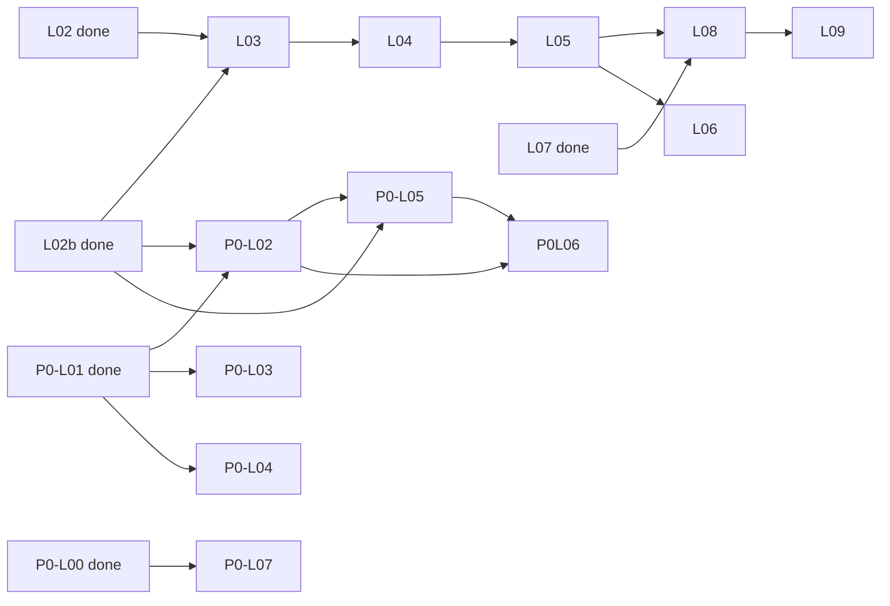

# 派单预队列 · 依赖满足自动开火（2026-06-20）

> 机器可读索引：`agent-delivery/dispatch-queue.yaml`  
> coordinator：当 `awaiting` 全部 `done` → 读对应 `/goal` → 开 Background Agent → `task-registry status=in_progress`

---

## Tier 1 · 等 L02 + L02b / P0-L01

### L03 {#l03}

```markdown
/goal api-agent

身份：资深 Java 后端工程师；只做查询聚合、只读 ADS、Feign 调 Python；**绝不在 Java 写算法、不直连 nGQL**。

## 任务 E-INNOV-M1-L03
- 仓：F:/gkx-lumen/repos/lumen-svc-platform（依赖 L02b CI 已就绪）
- 参考模块：F:/gkx-lumen/repos/demo-svc-platform/gkx-innov（老 gkx_service_demo）
- 分支：feat/E-INNOV-M1-L03

## 目标
从 gkx-innov 移植为 **gkxlumen-innov**；InnovDao 只读 ads_innovation_event（L02 Python 已写入）

## DoD
- mvn/package 成功；无 NLP/模型/图谱代码
- push → backend:build 绿 → Harbor package
- OTEL_SERVICE_NAME=gkxlumen-innov；traceparent 回传

## 铁律
算法仅 Python；Java 只读 ADS；全栈 OTel；NebulaGraph；禁止 merge demo2。

## 交付
handoff：agent-handoffs/平台基建-PLATFORM/E-INNOV-M1-L03-java-build.md
commit：[agent:api-agent] E-INNOV-M1-L03
```

---

### P0-L02 {#p0-l02}

```markdown
/goal api-agent

身份：资深 Java 后端工程师；指标注册/API 层，只读 ADS，不写算法。

## 任务 E-PLATFORM-P0-L02
- 仓：F:/gkx-lumen/repos/lumen-svc-platform
- 分支：feat/E-PLATFORM-P0-L02
- **Convoy**：排在 L03 merge 之后（同仓 BACKEND-API 组）

## 目标
新建 **gkxlumen-metrics** 模块；GET /metrics/v1/catalog 返回指标元数据

## DoD
- 指标字典表 + 口径/version；OpenAPI 片段
- push → backend:build 绿（L02b CI）

## 交付
handoff：agent-handoffs/平台基建-PLATFORM/E-PLATFORM-P0-L02-metrics-registry.md
```

---

### P0-L03 {#p0-l03}

```markdown
/goal algorithm-agent

身份：资深 Python 算法工程师；图谱/NebulaGraph；仅 /internal/*。

## 任务 E-PLATFORM-P0-L03
- 仓：F:/gkx-lumen/repos/demo-algo-ent-analysis（空仓 bootstrap 自 SZCGKX/ent-analysis-demo）
- 参考：ent-analysis-demo 的 nebula_loader / nebula_query / nebula.py
- 分支：feat/E-PLATFORM-P0-L03

## DoD
- dev graphd 192.168.88.43:9669 可连；schema 文档化
- POST /internal/graph/subgraph → nodes/edges + source:nebula
- PG 兜底 source:pg；opentelemetry-instrument + OTLP :4318
- push → py:smoke 绿

## 必读
graph-engine.md、observability.md

## 交付
handoff：agent-handoffs/平台基建-PLATFORM/E-PLATFORM-P0-L03-graph-engine.md
```

---

### P0-L04 {#p0-l04}

```markdown
/goal algorithm-agent

## 任务 E-PLATFORM-P0-L04
- 仓：F:/gkx-lumen/repos/demo-algo-ent-analysis
- 分支：feat/E-PLATFORM-P0-L04
- **Convoy**：P0-L03 完成后同仓串行

## DoD
- cfg_model_registry + GET /internal/models/registry
- 至少 1 条 E7 政策占位模型
- 文档说明 L3 深度模型对接

## 交付
handoff：agent-handoffs/平台基建-PLATFORM/E-PLATFORM-P0-L04-model-registry.md
```

---

## Tier 2 · 等 L03 / P0-L02 / P0-L00

### L04 {#l04}

```markdown
/goal integration-agent

## 任务 E-INNOV-M1-L04
- 仓：F:/gkx-lumen/repos/lumen-svc-platform
- 分支：feat/E-INNOV-M1-L04

## DoD
- gkxlumen-gateway 路由 /innov/**
- dev rollout 成功
- curl dev 网关 /innov/v1/meta/data-status → code=0

## 交付
handoff：agent-handoffs/平台基建-PLATFORM/E-INNOV-M1-L04-gateway.md
```

---

### P0-L05 {#p0-l05}

```markdown
/goal api-agent

## 任务 E-PLATFORM-P0-L05
- 仓：F:/gkx-lumen/repos/lumen-svc-platform
- 分支：feat/E-PLATFORM-P0-L05
- **Convoy**：P0-L02 merge 后

## DoD
- gkxlumen-topic 模块；网关 /topic/v1/**
- Feign 调 Python /internal/* health
- Redis 缓存占位；OpenAPI 发布
- OTEL_SERVICE_NAME=gkxlumen-topic

## 交付
handoff：agent-handoffs/平台基建-PLATFORM/E-PLATFORM-P0-L05-topic-java.md
```

---

### P0-L07 {#p0-l07}

```markdown
/goal frontend-agent

## 任务 E-PLATFORM-P0-L07
- 仓：F:/gkx-lumen/repos/lumen-ui-science-topic（P0-L00 已创建）
- 分支：feat/E-PLATFORM-P0-L07

## DoD
- src/views/topic/** + /topic 路由
- TopicLayout + MetricCard + GraphPanel 占位
- 只调 Java topic/metrics（经网关）；observability.ts
- push → build 绿 → :30892/topic

## 必读
Design.md §14、architecture-baseline.md 方案 A

## 交付
handoff：agent-handoffs/平台基建-PLATFORM/E-PLATFORM-P0-L07-topic-ui-shell.md
```

---

## Tier 3 · QA / 平台 deploy

### L05 {#l05}

```markdown
/goal qa-agent

## 任务 E-INNOV-M1-L05
- 环境：**dev K8s 网关**（非 localhost）
- 契约：创新监测 03-API接口契约.md §1

## DoD
- GET /events list|geo、heatmap、{id}、relations、stats 全套有数据
- geo P95 ≤ 500ms（dev）

## 交付
验收文档/创新监测-M1-接口测试报告.md
```

---

### P0-L06 {#p0-l06}

```markdown
/goal devops-agent

## 任务 E-PLATFORM-P0-L06
- 仓：F:/gkx-lumen/repos/lumen-svc-platform

## DoD
- metrics + topic 镜像推 Harbor；dev rollout
- GET /metrics/v1/catalog、/topic/v1/health 可达
- Tempo 可见 gkxlumen-metrics、gkxlumen-topic trace

## 交付
handoff：agent-handoffs/平台基建-PLATFORM/E-PLATFORM-P0-L06-platform-deploy.md
```

---

## Tier 4–5 · 联调收尾

### L08 {#l08}

```markdown
/goal frontend-agent

## 任务 E-INNOV-M1-L08
- 仓：F:/gkx-lumen/repos/lumen-ui-science-pc
- 依赖：L05 API 有数据 + L07 UI 壳就绪

## DoD
- EventMap 真实 API：点位、热力、列表、详情、关联分析
- http://192.168.88.50:30891/innov 无 console 报错

## 交付
handoff：agent-handoffs/平台基建-PLATFORM/E-INNOV-M1-L08-eventmap-e2e.md
```

---

### L06 {#l06}

```markdown
/goal api-agent

## 任务 E-INNOV-M1-L06
- GET /dict/event-types → nameZh + color 与 EventMap legend 一致

## 交付
handoff：agent-handoffs/平台基建-PLATFORM/E-INNOV-M1-L06-dict.md
```

---

### L09 {#l09}

```markdown
/goal frontend-agent

## 任务 E-INNOV-M1-L09
- demo2「全球创新实时数据」vs lumen EventMap 对照表
- demo2 只读参考，不 merge

## 交付
handoff：agent-handoffs/平台基建-PLATFORM/E-INNOV-M1-L09-demo2-diff.md
```

---

## 依赖触发一览



---

*coordinator-agent · 预队列 · 2026-06-20*
