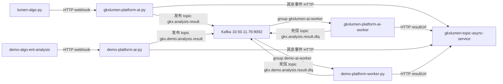

# E-PLATFORM-P0-KAFKA-RMQ-L01 · 消息总线改为 Kafka 10.50.11.76:9092，替代 RabbitMQ

## 任务认领（必填）

| 字段 | 值 |
|------|-----|
| claimed_by | `agent:architect-agent` |
| supervised_by | `human:淮政玮` |
| claim_type | `pull` |
| 说明 | 任务备注里写过监管人徐滕强。本次派单写明 `human:淮政玮`，认领按派单填写。架构师只改基线与本 handoff，不改业务仓。 |

## Ponytail（coding 任务必填）

| 字段 | 值 |
|------|-----|
| ponytail | `N/A`（定义·文档类） |
| 说明 | 本叶不写业务代码。D13、图和编码叶范围没有用 YAGNI 删掉。 |

## 图即契约（架构 / 存储流图 / ARCH-IMPL / 联调 / IA 首页必填）

| 字段 | 值 |
|------|-----|
| diagram_id | `ARCH-MSG-KAFKA` |
| 图 diff | 新增消息总线图。L0 `ARCH-TOPO-LUMEN` 未加边。禁止事项：运行时 RabbitMQ、正式与原型共用 topic 或消费组、口令进 git。 |
| 会签态 | `draft`（只抄基线 §1.1 frontmatter） |
| 说明 | 真源是 `architecture-baseline.md` §1.1。下面是同一张图，编码叶禁止另画一套。 |

| 生产者 | 消费者 | 触发 | 失败语义 | 禁止事项 |
|---|---|---|---|---|
| `gkxlumen-platform-ai-py` | `gkxlumen-platform-ai-worker` | `task_completed` 且 result 非空 | 发布失败 HTTP 503，不向 Java 转发无指针结果；消费失败重试 3 次后发布死信 topic | 禁止 RabbitMQ；禁止算法仓和 Java 连接总线 |
| `demo-platform-ai-py` | `demo-platform-worker-py` | 同上 | 同上 | 禁止与正式共用 topic 或消费组；客户端未就绪前不部署 Worker |

发布代码有两处，都在 AI 进程内：`gkx_ai_service/views/callback.py`（算法 webhook）和 `gkx_ai_service/result_delivery.py`（状态轮询补投）。消费者入口是 `gkx_ai_worker/main.py`，处理在 `gkx_ai_worker/consumer.py`（camelCase、对象存储、HTTP 转发 Java）。

`step_started` / `step_completed` / `task_failed` / `task_cancelled` 仍由 AI 进程同步 HTTP 到 `gkxlumen-topic-async-service`，不进 Kafka。

## 问题清单

- `E-PLATFORM-P0-ENV-CUTOVER-L02` 写明当时不接 Kafka，demo AI / Worker 和部分 values 仍指向旧 AMQP（主机 `10.50.11.76`，端口 `5672`）。本叶改这条口径。
- 运行配置把口令嵌在 AMQP URL 里。本文件不抄录口令。
- `OTEL_INFRA_OPS_HANDOFF.md` 另写了一台 `192.168.88.48:5672`，和运行配置不是同一台。该手记还带有口令，编码叶删除这些行，不要把口令写进新提交或 commit message。
- `task_completed` 正文在 `callback.py` 里按几十 MB 设计。Kafka 默认 1MB 不够。topic 与客户端上限锁定为 64MiB。
- demo 的 `values-demo.yaml` 里 `workerPy.enabled=false`。正式 Worker `gkxlumen-platform-ai-worker` 的 k8s 清单仍在。两边若共用一个 topic，会抢消息或重复处理。

## 范围与实现

盘点范围是基线 §3.1 的 `lumen-*` 与仍在使用的 `demo-*`。检索词覆盖 RabbitMQ、AMQP URL、`aio-pika`、`5672`。前端仓里 geojson / iconfont 的数字命中已剔除。

基线 v2.2.18 写入 D13：消息总线是 Kafka，bootstrap `10.50.11.76:9092`，运行时不再使用 RabbitMQ。业务仓代码本叶不动，旧客户端记为 `D13-DEBT-RMQ`。

消息正文保持现有 JSON：`task_id`、`analysis_type`、`result`、`callback_base`、`java_callback_url`、`created_at`。重试头保持 `x-retry-count`，最多 3 次；耗尽后由 Worker 发布到本平面的死信 topic，然后提交位点。坏 JSON 同样进死信并提交位点，避免无限重投。

客户端库用 `aiokafka`，替换 `aio-pika`。环境变量：

| 变量 | 值 |
|------|-----|
| `KAFKA_BOOTSTRAP_SERVERS` | `10.50.11.76:9092` |
| `KAFKA_TOPIC` | 正式 `gkx.analysis.result`；原型 `gkx.demo.analysis.result` |
| `KAFKA_DLQ_TOPIC` | 正式 `gkx.analysis.result.dlq`；原型 `gkx.demo.analysis.result.dlq` |
| `KAFKA_GROUP_ID` | 正式 `gkxlumen-ai-worker`；原型 `demo-ai-worker` |
| `KAFKA_MAX_IN_FLIGHT` | `2`（对应原 prefetch） |
| `KAFKA_MAX_RETRIES` | `3` |

无认证时 `security.protocol=PLAINTEXT`。集群若要求 SASL，口令只进 Secret（环境变量名 `KAFKA_SASL_PASSWORD`），不进 git。删掉 `GKX_RABBITMQ_*`。

topic 各 1 分区。`max.message.bytes=67108864`。生产者 `max_request_size` 与消费者 `max_partition_fetch_bytes` 同为 67108864。成功路径 `acks=all`，手动提交位点。

MySQL root 口令不改。helm 里已有的 MySQL 业务账号行本叶和后续叶都不要改写、不要抄进文档。

### 按仓文件表

| 仓 | 文件 | 角色 |
|----|------|------|
| `lumen-topic-py` | `conf/settings.yaml` | `rabbitmq` 段：队列 `gkx.analysis.result`，死信交换机名 `gkx.analysis.result.dlx`，URL 指向 `10.50.11.76:5672` |
| `lumen-topic-py` | `gkx_ai_service/deps.py` | 读 `GKX_RABBITMQ_*`，缺省回落到本机 `5672` |
| `lumen-topic-py` | `gkx_ai_service/mq_producer.py` | `aio-pika` 发布，声明死信交换机和队列 |
| `lumen-topic-py` | `gkx_ai_service/views/callback.py` | `task_completed` 调用 `publish_analysis_result` |
| `lumen-topic-py` | `gkx_ai_service/result_delivery.py` | 轮询补投，同一发布函数 |
| `lumen-topic-py` | `gkx_ai_worker/deps.py` | 消费者侧同一组环境变量 |
| `lumen-topic-py` | `gkx_ai_worker/main.py` | 消费、`x-retry-count`、reject 进死信 |
| `lumen-topic-py` | `gkx_ai_worker/consumer.py` | 消费后的 camelCase / 对象存储 / HTTP |
| `lumen-topic-py` | `gkx_ai_worker/__init__.py` | 模块说明写死队列名 |
| `lumen-topic-py` | `k8s/dev-ai-py.yaml` | Deployment `gkxlumen-platform-ai-py` 的 `GKX_RABBITMQ_URL` |
| `lumen-topic-py` | `k8s/dev-ai-worker.yaml` | Deployment `gkxlumen-platform-ai-worker` 的 `GKX_RABBITMQ_URL` |
| `lumen-topic-py` | `requirements.txt` | `aio-pika>=9.4.0` |
| `lumen-topic-py` | `docker/Dockerfile.worker` | 注释写明 RabbitMQ 消费者 |
| `lumen-topic-py` | `tests/test_analysis_callback.py` | mock `publish_analysis_result`，断言文案仍写 RabbitMQ |
| `lumen-topic-py` | `.env.example` | 当前没有 MQ 变量 |
| `demo-svc-topic-py` | 与上表相同的相对路径 | 原型副本。k8s 服务名是 `demo-platform-ai-py`、`demo-platform-worker-py`。禁止从 lumen merge |
| `demo-svc-platform` | `helm/gkx-platform/values.yaml` | `aiPy.env` 与 `workerPy.env` 的 `GKX_RABBITMQ_URL`，主机 `10.50.11.76:5672` |
| `demo-svc-platform` | `helm/gkx-platform/values-demo.yaml` | `workerPy.enabled: false`，注释写 Kafka 尚未接线 |
| `demo-svc-platform` | `helm/gkx-platform/templates/ai-service-py.yaml` | 注释写连接 RabbitMQ |
| `demo-svc-platform` | `helm/gkx-platform/templates/ai-worker-py.yaml` | 注释写 RabbitMQ 消费者 |
| `demo-svc-platform` | `OTEL_INFRA_OPS_HANDOFF.md` | 旧运维表，主机 `192.168.88.48`，含口令 |
| `lumen-svc-platform` | `OTEL_INFRA_OPS_HANDOFF.md` | 同上，一份副本 |
| `lumen-svc-platform` | helm / Java / Nacos yml | 无 AMQP 客户端。`GKXLUMEN_TOPIC_ASYNC_PYTHON_AI_BASE_URL` 指向 `gkxlumen-platform-ai-py:8081`，保持 HTTP |

以下仓没有 RabbitMQ 客户端，不派改代码：`lumen-algo-py`（只 HTTP webhook，`lumen_common/tasks/webhook.py` 与 `vendor/entan-py`）、`lumen-etl-es-py`、`lumen-ui-science-pc`、`lumen-ui-topic`、`lumen-ui-science-mobile`、`lumen-ui-topic-mobile`、`lumen-ui-admin`、`lumen-ui-algo-apiview`、`demo-algo-science`、`demo-ui-science`、`demo-ui-topic`、`demo-ui-system-test`、`demo-admin-ui`。

`demo-algo-ent-analysis` 的 `entan/common/async_task_manager.py` 只发 HTTP webhook，不连总线。`demo-ui-gdzk` 只有设计文档里的旧地址，不在基线 §3.1 的仍用清单里，不派编码叶。

### 每个仓的替换要点

`lumen-topic-py`：`settings.yaml` 的 `rabbitmq` 段改为 `kafka`，bootstrap 只写主机端口。`mq_producer.py` 改为向 `gkx.analysis.result` 生产。`main.py` 用消费组 `gkxlumen-ai-worker` 拉取；重试仍写 `x-retry-count` 后发回同一 topic；耗尽后发到 `gkx.analysis.result.dlq` 并提交位点。两份 k8s 的 `GKX_RABBITMQ_URL` 换成 `KAFKA_BOOTSTRAP_SERVERS` 等上表变量。`requirements.txt` 去掉 `aio-pika`，加上 `aiokafka`。`.env.example` 补 bootstrap，不写口令。测试继续 mock `publish_analysis_result`，断言改为 Kafka 发布成功 / 失败 503 / 无 result 则 422。

`demo-svc-topic-py`：同一套改动，topic 与消费组用原型名。k8s 仍叫 `demo-platform-ai-py` 和 `demo-platform-worker-py`。与 lumen 各改各的，禁止 merge。

`demo-svc-platform`：`values.yaml` 两处 `GKX_RABBITMQ_URL` 改为 Kafka 环境变量，原型 topic 用 `gkx.demo.analysis.result`。不要改 MySQL 相关行。模板注释改为 Kafka。`values-demo.yaml` 在新镜像还没读 Kafka 变量之前，保持 `workerPy.enabled: false`。

`lumen-svc-platform`：不新增 Java Kafka 客户端。异步服务继续只收 HTTP。回调路径保持 `/topic/v1/analysis/callback/{eval|risk|recommend}`。

### 后续编码叶

coordinator 建单。本叶不调用 `task-create`。

| 建议 ID | 角色 | 仓 | 文件 | 依赖 |
|---------|------|----|------|------|
| `E-PLATFORM-P0-KAFKA-ALGO-L01` | algorithm-agent | `lumen-topic-py`、`demo-svc-topic-py` | 上表这两个仓的全部 MQ 文件 | 无。先出镜像 |
| `E-PLATFORM-P0-KAFKA-DEVOPS-L01` | devops-agent | `demo-svc-platform`；两份 `OTEL_INFRA_OPS_HANDOFF.md` | `values.yaml`、`values-demo.yaml`、两个 ai/worker 模板、两份运维手记 | 镜像已不再读取 `GKX_RABBITMQ_*` 之后再删该变量并允许打开 `workerPy`。同叶在 Kafka 上创建 4 个 topic（正式 / 原型各主 topic + 死信），1 分区，`max.message.bytes=67108864`。创建命令不带口令 |
| `E-PLATFORM-P0-KAFKA-API-L01` | api-agent | `lumen-svc-platform`、`demo-svc-platform` | 扫描 Java、`pom`、Nacos yml | 可与算法叶并行。期望零代码。确认没有 AMQP，也不要加 `spring-kafka`。回调契约不变 |

发布顺序：算法镜像先能连 `10.50.11.76:9092`，devops 再改掉旧环境变量。旧镜像遇到只有 Kafka 变量的 Pod 会退回 `settings.yaml` 里的 AMQP 地址。

## 修改内容

- `agent-delivery/architecture-baseline.md`：§1.1 图 `ARCH-MSG-KAFKA`、D13、§4 `message_bus`、§5.1 检查项、§6 索引、变更记录 v2.2.18、`D13-DEBT-RMQ`。
- 本 handoff。
- 业务仓零改动。

## 偏离

- 公约 §2 仍列到 D12。本叶以基线 D13 为准，没有改公约正文。
- 图会签态是 `draft`。人签之前，编码叶按这张图施工，不把会签态改成 approved。
- 业务仓运行时此刻仍是 RabbitMQ。基线写的是目标规则；闭合债要等上面三叶。
- `demo-platform-worker-py` 今天在 `values-demo.yaml` 关闭。图上的边是本决策授权的目标路径。
- demo Worker 现有 HTTP 回调主机是 `gkxlumen-topic-async-service`。本叶不改这台主机。

## 测试结果

- 只读检索业务仓，未跑业务测试，未改运行中的 Pod。
- 基线与本文件已落盘。图中的服务名与 k8s `metadata.name` 对照过：`gkxlumen-platform-ai-py`、`gkxlumen-platform-ai-worker`、`demo-platform-ai-py`、`demo-platform-worker-py`、`gkxlumen-topic-async-service`。

## 遗留风险

- 64MiB 是已知上限。更大的 result 会发布失败并返回 503。
- 集群认证方式未在本叶探测。PLAINTEXT 被拒绝时，由 devops 叶把 SASL 放进 Secret，不改 bootstrap。
- 正式 Worker 清单若已在集群运行，它仍在连旧 AMQP，直到算法叶镜像发布。
- 两份 OTEL 手记里的口令已经在 git 历史中。本叶不重写历史。后续叶只从现行文件删掉这些行。

## 产物清单

- `agent-delivery/architecture-baseline.md`（v2.2.18，D13，`ARCH-MSG-KAFKA`）
- `agent-delivery/agent-handoffs/平台基建-PLATFORM/E-PLATFORM-P0-KAFKA-RMQ-L01.md`
- 后续叶清单：`E-PLATFORM-P0-KAFKA-ALGO-L01`（ready）、`E-PLATFORM-P0-KAFKA-API-L01`（ready）、`E-PLATFORM-P0-KAFKA-DEVOPS-L01`（backlog，依赖算法叶）。2026-10-17 coordinator 已建单。

## 验收证据

- 文件表覆盖基线 §3.1 的 lumen 与仍用 demo；无客户端的仓单独列出。
- 基线写明 bootstrap `10.50.11.76:9092`，并写明运行时不再使用 RabbitMQ。
- 本文件含 `ARCH-MSG-KAFKA`（谁发布、谁消费）和每仓替换要点。
- 未把中间件口令写入本文件或基线。未改 MySQL root，也未改任何业务仓配置。

## CI/CD（必填）

- 分支：`dev`（编排仓工作区，本叶未提交）
- commit：无。定义叶，等明确要求再提交
- pipeline URL / ID：无业务仓 pipeline
- 部署 namespace / 镜像 tag：未部署
- K8s rollout：未执行
- dev 测试 URL / 命令与结果：未对 Kafka `10.50.11.76:9092` 发起连接

## 可观测性（建议）

- OTEL_SERVICE_NAME：未改。AI 进程与 Worker 现有 instrument 保留
- traceId（dev 抽样）：无新 trace
- Tempo / Loki：无新跨度

## 涉及文件

- `agent-delivery/architecture-baseline.md`
- `agent-delivery/agent-handoffs/平台基建-PLATFORM/E-PLATFORM-P0-KAFKA-RMQ-L01.md`

## 架构合规自检

| 铁律 | 结果 |
|------|------|
| 算法只在 Python | ✅ 未在 Java 增加客户端或算法 |
| 调用链 前端 → Java → Python `/internal/*` | ✅ Webhook 与回调路径不变；总线只在 AI 进程和 Worker 之间 |
| 图谱 Nebula，不改 graphd | ✅ 未改图库地址 |
| 可观测 | ✅ 未去掉现有 instrument |
| CI/CD | ✅ 定义叶不发布业务镜像；`cicd: skip` |
| demo 不污染 lumen | ✅ 未 merge；正式与原型 topic、消费组分开 |
| 方案 A，前端不直连 Python | ✅ 未改网关与 BFF |
| 数据走 ADS，Java 只读 | ✅ 未改库，未改 MySQL root |
| D8 / D9 / D10 | ✅ 本叶无页面、无指标、无交互改动 |
| D12 | ✅ lumen 发布者仍是 `gkxlumen-platform-ai-py`，demo 发布者仍是 `demo-platform-ai-py` |
| D13 | ✅ 基线已锁定 Kafka `10.50.11.76:9092`，并禁止运行时 RabbitMQ |

## Cost 回填

| 字段 | 值 |
|------|-----|
| actual_tokens | 150000 |
| model_used | grok-4.7 |
| actual_cost | 0.81 |
| cost_warn | green |

口径：无 Console 精确 in/out。按会话估算 150000，用预算表 B 档（输入 $3/M、输出 $15/M）和 80/20 比例：`150000×0.8×3/1e6 + 150000×0.2×15/1e6 = 0.81`。`source: session_estimate`。
