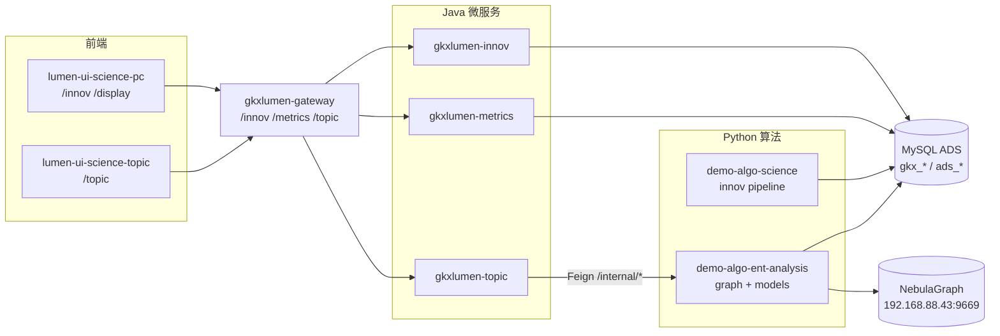

# E-PLATFORM-P0-L08 · P0 里程碑签收

| 字段 | 值 |
|------|-----|
| task-id | E-PLATFORM-P0-L08 |
| epic | E-PLATFORM-P0 |
| agent | coordinator-agent |
| 日期 | 2026-06-20 |
| waiver | `PIPELINE-WAIVER-2026-06-20.md` v2 |
| 签收类型 | **条件签收：代码交付完成，工程化补验 open** |

## 1. 签收结论

在 PM pipeline waiver v2 生效前提下：

- **通过（条件）**：P-01~P-07 对应 leaf（L01–L07）及支撑任务 L00、L06 全部 `done`；四仓功能代码已 push；handoff 齐全。
- **不阻塞项**：GitLab Pipeline 绿、K8s dev rollout、`:30892/topic` 浏览器实测、dev 网关 curl、Tempo/Grafana 三联查、本地 `mvn package` / `npm run build` / `py:smoke`。
- **开放项**：下文 §3 补验矩阵 **22 条主项 OPEN**（与 E-INNOV-M1-L10 §3 部分重叠，P0 侧独立编号 P0-D-xx）。

**Epic E-PLATFORM-P0** → `done`（L00–L08 全 done）。

**下游解锁**：**E-E7-POLICY-M1 可启动（代码态）** — `depends_epics: [E-PLATFORM-P0]` 已满足；L01/L03/L05/L07/L08 依赖链无 blocked_by。

---

## 2. P-01~P-07 工作包状态表

> 映射真源：`system-wbs.yaml#platform_packages`；L00 为 L07 前置仓创建，非 P 包编号但纳入 Epic 交付。

| 包 ID | task-id | Agent | 标题 | 状态 | commit / 分支 | handoff / evidence | pipeline |
|-------|---------|-------|------|------|---------------|-------------------|----------|
| **P-01** | L01 | data | 数据底座 L1 — ADS 冻结 + Mock + 映射登记 | ✅ done | `feat/E-PLATFORM-P0-L01` | `E-PLATFORM-P0-L01-data-foundation.md` | skip（设计类 cicd） |
| **P-02** | L02 | api | 指标注册中心 gkxlumen-metrics | ✅ done | `066643b` `feat/E-PLATFORM-P0-L02` | `E-PLATFORM-P0-L02-metrics-registry.md` | deferred mvn/CI |
| **P-03** | L03 | algorithm | 图谱引擎 NebulaGraph + /internal/graph/* | ✅ done | `6b4428e` `feat/E-PLATFORM-P0-L03` | `E-PLATFORM-P0-L03-graph-engine.md` | deferred py:smoke |
| **P-04** | L04 | algorithm | 模型注册中心 cfg_model_registry | ✅ done | `3a08864` `feat/E-PLATFORM-P0-L04` | `E-PLATFORM-P0-L04-model-registry.md` | deferred py:smoke |
| **P-05** | L05 | api | 专题 Java 层 gkxlumen-topic + Feign | ✅ done | `337672e` `feat/E-PLATFORM-P0-L05` | `E-PLATFORM-P0-L05-topic-java.md` | deferred mvn/CI |
| **P-06** | L06 | devops | 工程化 — metrics/topic K8s + 共享 L02b CI | ✅ done | `eda47b8` `feat/E-PLATFORM-P0-L06` | `E-PLATFORM-P0-L06-platform-deploy.md` | deferred rollout/curl |
| **P-07** | L07 | frontend | 专题分析前端壳 /topic | ✅ done | `0378bcf` `feat/E-PLATFORM-P0-L07` | `E-PLATFORM-P0-L07-topic-ui-shell.md` | deferred deploy |
| — | L00 | devops | 专题前端仓 lumen-ui-science-topic + CI | ✅ done | `4b9e6604` `feat/E-PLATFORM-P0-L00` | `E-PLATFORM-P0-L00-topic-frontend-repo.md` | deferred [#4117](https://gitlab.htmisoft.net/gkx-lumen/lumen-ui-science-topic/-/pipelines/4117) |

---

## 3. 支持层架构说明（Wave 0 脚手架）

七要素支持层采用 **方案 A**（architecture-baseline §2 D7）：展示系统与专题系统共享 `gkxlumen-topic` + `gkxlumen-metrics` 聚合核心；前端仅经网关调 Java；Java 不写算法、不直连 nGQL、只读 ADS。



| 包 | 职责 | 关键产物 |
|----|------|----------|
| P-01 | L1 标准表契约 + Mock 写 ADS | `scripts/sql/gkx_platform_*.sql`、`data-source-mapping-registry.yaml` |
| P-02 | 指标元数据 catalog（D9 8 件套） | `GET /metrics/v1/catalog`、`cfg_metric` |
| P-03 | 图谱子图查询（Nebula 主 + PG 兜底） | `POST /internal/graph/subgraph` |
| P-04 | 深度模型注册与版本元数据 | `GET /internal/models/registry` |
| P-05 | 专题 REST 编排 + Feign 调 Python | `GET /topic/v1/**`、OpenAPI |
| P-06 | Helm/CI 启用 innov+metrics+topic | `values-lumen.yaml`、`DEPLOY-LUMEN.md` |
| P-07 | 专题 UI 壳（Arco + observability） | `/topic` TopicLayout、MetricCard、GraphPanel |

**Wave 1 复用**：E-E7-POLICY-M1 在 P-02/P-03/P-05/P-07 脚手架之上叠加政策指标 ETL、政策子图、3 核心模型与 `/topic/v1/policy` 页面。

---

## 4. Deferred 补验清单（工程化 OPEN）

> Owner：**qa-agent**（curl / 浏览器 / OTel / Nebula 连通）+ **devops-agent**（CI / K8s / Harbor）。  
> 触发：`INCIDENT-2026-06-18-k8s-dev-nfs-storage.md` 恢复，或 devops 手动触发 `helm:deploy` + `deploy:{metrics,topic}`。  
> 与 M1 重叠项（innov 链路）见 `E-INNOV-M1-L10-signoff.md` §3；本表仅列 **P0 平台增量**。

| ID | 类别 | 补验项 | 状态 | 来源 |
|----|------|--------|------|------|
| P0-D-01 | CI | `lumen-svc-platform` `backend:build` 含 metrics+topic+innov 绿 | **OPEN** | L02/L05/L06 |
| P0-D-02 | CI | Harbor 推送 `gkxlumen-metrics` / `gkxlumen-topic` 镜像 | **OPEN** | L06 |
| P0-D-03 | K8s | dev rollout metrics + topic Deployment | **OPEN** | L06 |
| P0-D-04 | curl | `GET /metrics/v1/catalog` → `code=0` + list 非空 | **OPEN** | L02/L06 |
| P0-D-05 | curl | `GET /topic/v1/health` → 200 | **OPEN** | L05/L06 |
| P0-D-06 | curl | topic Feign → Python `/internal/status` 探活 | **OPEN** | L05 |
| P0-D-07 | OTel | Tempo 可见 `gkxlumen-metrics`、`gkxlumen-topic` trace | **OPEN** | L06 |
| P0-D-08 | CI | `demo-algo-ent-analysis` `py:smoke` 绿（graph 模块） | **OPEN** | L03 |
| P0-D-09 | CI | `demo-algo-ent-analysis` `py:smoke` 绿（models 模块） | **OPEN** | L04 |
| P0-D-10 | Nebula | dev `192.168.88.43:9669` 连通 + space schema 已建 | **OPEN** | L03 |
| P0-D-11 | curl | `POST /internal/graph/subgraph` → `source: nebula` | **OPEN** | L03 |
| P0-D-12 | curl | `GET /internal/models/registry` → E7 占位模型 ≥1 | **OPEN** | L04 |
| P0-D-13 | CI | `lumen-ui-science-topic` `frontend:build`+`image` 绿 | **OPEN** | L00/L07 |
| P0-D-14 | K8s | `deploy:k8s` topic 前端 dev rollout | **OPEN** | L00 |
| P0-D-15 | 浏览器 | `:30892/topic` 占位壳可打开 | **OPEN** | L07 |
| P0-D-16 | 浏览器 | TopicLayout 调 `/metrics/v1/catalog` 无 console 未捕获错误 | **OPEN** | L07 |
| P0-D-17 | 数据 | P0-L01 Mock ADS 表行数 > 0（集群内 generator） | **OPEN** | L01 |
| P0-D-18 | mvn | 本地/CI `mvn -pl gkxlumen-metrics,gkxlumen-topic -am package` | **OPEN** | L02/L05 |
| P0-D-19 | helm | `helm lint` + `helm:deploy` manual 成功 | **OPEN** | L06 |
| P0-D-20 | 网关 | `/metrics/**`、`/topic/**` StripPrefix + traceparent 回传 | **OPEN** | L05/L06 |
| P0-D-21 | OTel | Grafana **三联查**抽样 traceId（topic→Python 链路） | **OPEN** | L08 DoD |
| P0-D-22 | 联调 | metrics catalog 与 P0-L01 cfg_metric 种子一致 | **OPEN** | L01/L02 |

**统计**：主项 **22 OPEN**（不含 M1 L10 已登记的 innov 18 项）。

### 4.1 curl 补验入口（示例）

```bash
export GW="http://192.168.88.50:9999"
export TOKEN="<Bearer>"

curl -s -H "Authorization: Bearer $TOKEN" "$GW/metrics/v1/catalog?element=ENT"
curl -s -H "Authorization: Bearer $TOKEN" "$GW/topic/v1/health"
```

Python internal（集群内或 port-forward）：

```bash
curl -s -X POST "http://<ent-py>/internal/graph/subgraph" \
  -H "Content-Type: application/json" \
  -d '{"element":"policy","nodeIds":["sample"],"depth":2}'
curl -s "http://<ent-py>/internal/models/registry"
```

---

## 5. 架构合规自检（引用 architecture-baseline §5）

> 评审方式：coordinator 汇编各 leaf handoff 静态结论；**运行时项**随 §4 补验。  
> 完整清单真源：`architecture-baseline.md` §5.1（D1–D7）+ §5.2（D8）。

### 5.1 后端 / 数据 / 横切（§5.1）

| 检查项 | 结论 | 依据 |
|--------|------|------|
| 前端无直连 Python/DB/Nebula | ✅ 代码态 | L07：request 经网关 `/metrics` `/topic` |
| Java 无 NLP/图谱/模型、无写 ADS、无 nGQL | ✅ | L02/L05 handoff 静态审查 |
| 展示聚合复用 `/topic`+`/metrics` | ✅ 设计态 | 方案 A；M2 展示页绑定见 E7-L06 |
| 新算法注册 cfg_metric / cfg_model_registry | ✅ 脚手架 | L02 catalog + L04 registry API |
| 网关路由 `/metrics` `/topic` + trace 头回传 | ✅ 配置态 / 🟡 运行时 | L06 gateway yml；curl P0-D-04/05 OPEN |
| OTel / Nebula / 缓存 / 鉴权横切 | 🟡 部分 deferred | L06 OTel env ✅；Tempo P0-D-07 OPEN |
| 数据契约：Java 只读 ADS；Mock 由 Python 写 | ✅ 设计态 | L01→L02 链路；generator 在 Python |

### 5.2 前端规范（§5.2 D8）

| 检查项 | 结论 | 依据 |
|--------|------|------|
| Arco Design（非 AntD 新页） | ✅ | L07 §14 |
| 无 Arco/AntD 混搭 | ✅ | L07 grep 证据 |
| Design.md token / 主色 `#165DFF` / 底色 `#D8E7FC` | ✅ | L07 §14 |
| 页面骨架六容器 + 三段工作区 | 🟡 占位壳 | TopicLayout 骨架就绪；全要素页 Wave 1+ |
| handoff 附 Design.md §14 对照 | ✅ | L07 14 条表 |
| 数据血缘 ⓘ / MockBadge | 🟡 | Wave 0 Mock；MetricCard ⓘ 占位 E7 验收 |

**architect 正式评审**：建议 infra 恢复后 architect-agent 对 §4 补验结果做增量合规签收（`agent-handoffs/E-PLATFORM-P0-arch-review.md`，可选）。

---

## 6. 产物清单

| 路径 | 说明 |
|------|------|
| `agent-handoffs/平台基建-PLATFORM/E-PLATFORM-P0-L0*-*.md` | L00–L07 各 leaf handoff |
| `agent-handoffs/平台基建-PLATFORM/PIPELINE-WAIVER-2026-06-20.md` | waiver v2 决策真源 |
| `agent-handoffs/平台基建-PLATFORM/E-INNOV-M1-L10-signoff.md` | M1 条件签收 + 重叠补验 |
| `agent-delivery/system-wbs.yaml#platform_packages` | P-01~P-07 WBS 映射 |
| `agent-delivery/data-source-mapping-registry.yaml` | P-01 映射登记骨架 |
| `task-registry.yaml` | E-PLATFORM-P0-L08 + Epic → done |

---

## 7. cost 回填

| estimated_tokens | actual_tokens | model_used | actual_cost | cost_warn |
|------------------|---------------|------------|-------------|-----------|
| 80_000 | TBD | coordinator | TBD | green |

---

## 8. 建议下一 Epic

| Epic | 状态 | 首派 leaf | 说明 |
|------|------|-----------|------|
| **E-E7-POLICY-M1** | **可启动** | L01（指标 ETL）+ L02（图谱）可并行 | P-02/P-03/P-05/P-07 脚手架就绪 |
| E-INNOV-M2 | 待 PM 立项 | — | GraphInfluence + L09 backlog P1 |
| qa 补验闭环 | open | P0-D-01~22 + M1 L10 §3 | infra 恢复后统一补跑 |

**E-E7-POLICY-M1 启动条件（代码态）**：

- ✅ `E-PLATFORM-P0` Epic done
- ✅ P-01 ADS/Mock、P-02 metrics catalog、P-03 graph API、P-05 topic Java、P-07 topic UI 壳 handoff 齐全
- 🟡 工程化补验仍 OPEN — **不阻塞** E7 算法/API/前端 leaf 开发（同 waiver v2）

---

*handoff · coordinator-agent · E-PLATFORM-P0-L08 · 2026-06-20*
