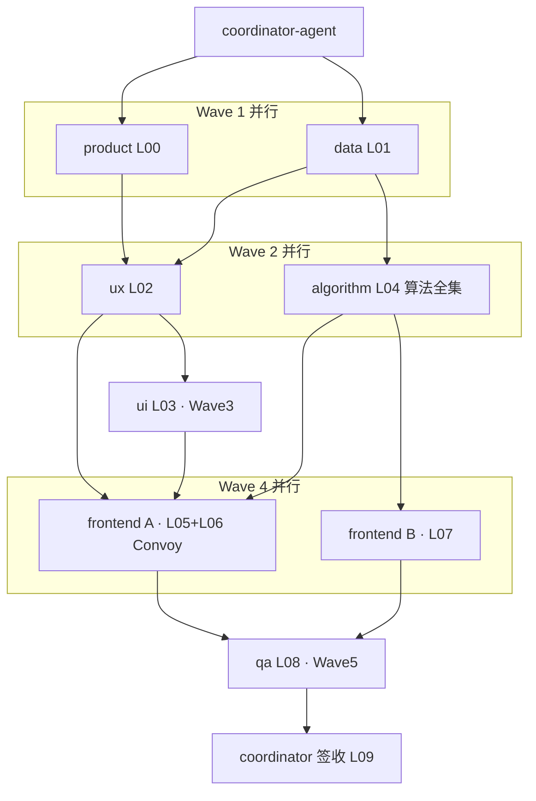

# POLICY 交付总册（E-POLICY-PROTOTYPE · Wave 0 原型）

> 角色：coordinator-agent ｜ 类型：里程碑签收 ｜ 日期：2026-06-23
> 范围：科技专题服务系统（政策分析 E7）+ 智慧服务门户（政策扶持）；**排除**科技信息展示系统 DS-10/11/12 前端
> 编排模式：1 coordinator + 7 类专项子智能体，分 5 波派单（参照企业维度 `E-ENT-PROTOTYPE` 复刻）
> 例外约定：本次完整跑**跳过一切人工签收/评审/需求确认会 gate**，自动推进；QA/总册仍作为产物产出

---

## 1. 交付概览

政策维度从"产品定义 → UX → UI → 数据 → 算法全集实跑 → 前端原型（专题+门户+算法效果沙箱）→ QA"完整链路一次跑通。算法**全集逐个真实执行并产出 ADS**（非占位），前端 9 页原型 + system-test 算法效果模块两套构建均绿。

| 维度 | 结果 |
|------|------|
| 算法 | polan/ 全集 15 步 run_all **真实跑通**，幂等可重跑（SQLite 本地零依赖） |
| 数据 | 19 条 M_POLICY_* 指标 8 件套；DWD + 9 ADS + Nebula gkx_policy 设计 |
| 前端原型 | demo-ui-topic 政策 9 页（专题3 + 门户6），vite build 绿 |
| 算法效果展示 | demo-ui-system-test /policy 8-Tab 模块，pnpm build 绿，直连 /v1/policy |
| 验收 | PASS WITH CONDITIONS（QA 本地实跑复核，无 🔴 阻断） |

---

## 2. 多智能体编排闭环（实战记录）

| Wave | Task | Agent | 产出 | 状态 |
|------|------|-------|------|------|
| 1 | POLICY-PROTO-L00 | product | PROD-POLICY-definition.md（9 页清单 + 范围映射 + 7 项🟡口径） | ✅ done |
| 1 | POLICY-PROTO-L01 | data | cfg_metric-POLICY-seed.yaml（19 条）+ 政策域数据库设计(v1).md + 源表登记 | ✅ done |
| 2 | POLICY-PROTO-L02 | ux | docs/ia/policy/ 6 文档（字段表 metric_id） | ✅ done |
| 2 | POLICY-PROTO-L04 | algorithm | polan/ 全集 + run_all_policy + /v1/policy API + 设计文档 | ✅ done |
| 3 | POLICY-PROTO-L03 | ui | POL-ui-spec.md + §14 对照 | ✅ done |
| 4 | POLICY-PROTO-L05 | frontend A | demo-ui-topic pages/policy/ 三页（recharts→ECharts） | ✅ done |
| 4 | POLICY-PROTO-L06 | frontend A | demo-ui-topic pages/policy-portal/ 六页（Arco+Leaflet+G6） | ✅ done |
| 4 | POLICY-PROTO-L07 | frontend B | demo-ui-system-test /policy 8-Tab 模块 | ✅ done |
| 5 | POLICY-PROTO-L08 | qa | QA-POLICY-acceptance-report.md（PASS WITH CONDITIONS） | ✅ done |
| 5 | POLICY-PROTO-L09 | coordinator | 本总册 + 全 done 签收 | ✅ done |

**编排观察**：
- Convoy 分组生效——L05/L06 同在 demo-ui-topic（共享 routes/nav），合并给一个 frontend-agent 串行，避免合并冲突；L07 独立仓并行。
- 一次中断容错——ux-agent 首派因 API 限额中断、零产出，coordinator 检测后无缝重派成功（[首派](70f102a5-edee-440a-8db0-86756c783fa1) → [重派](b3435f59-357c-4247-8f5e-0659a6d9f11b)）。
- 关键路径识别——algorithm（L04）为最长任务，UI（L03）不依赖算法，提前并行下发，缩短总时长。

---

## 3. as-built 路由表

### 3.1 专题分析层（demo-ui-topic，分支 feat/policy-elements-build）

| 路由 | 页面 | bid / P-XX | 关键可视化 |
|------|------|-----------|-----------|
| /policy/overview | 政策时序分析 | 政策分析 §1.1.1.2.4.2.6 / P-70 | 密度趋势 + 支持强度堆叠 + 关键节点时间轴 |
| /policy/analysis | 区域政策对比 | / P-72 | 对比矩阵 + 雷达/热力 + 差异结论 |
| /policy/recommendation | 深圳现状-三维框架 | / P-73 | 权重滑杆(=100%校验) + gauge + 支持力度/产业适配性/落地实效性雷达 |

### 3.2 门户政策扶持层（demo-ui-topic，新建 pages/policy-portal/）

| 路由 | 页面 | P-XX | 关键可视化 |
|------|------|------|-----------|
| /policy-portal/overview | 政策概况统计 | P-17 | 概况卡 + 分布 |
| /policy-portal/map | 政策地图 | P-18 | Leaflet 比例圆点 + 下钻 |
| /policy-portal/industry-coverage | 产业覆盖 | P-19 | AntV G6 产业链覆盖图 |
| /policy-portal/intensity-rank | 力度排名 | P-20 | 力度榜 |
| /policy-portal/latest | 最新动态 | P-21 | Arco 时间线 |
| /policy-portal/shenzhen | 深圳对比 | P-22 | 深圳综合对比 |

### 3.3 算法效果实验沙箱（demo-ui-system-test，分支 feat/policy-demo，commit b6616f1）

`/policy` 模块 8 Tab → `/v1/policy` 端点：基础指标(indicators+metrics)、政策图谱(graph)、焦点识别(analysis/focus)、力度评估(analysis/intensity)、效果评估(analysis/effect)、短板·机遇(analysis/gap+opportunity)、布局推荐(analysis/layout)、文本解析·匹配·推演(text/parse+match+simulate)。

---

## 4. 算法全集运行结果（demo-algo-ent-analysis/polan/，QA 本地复核一致）

- **run_all_policy.py**：15 步全绿，~1s，幂等可重跑（连续两次行数一致），日志 `data/run_all_policy.log`。
- **ADS 产出**：政策 600 ｜级别6/类型5/时序9/全国31/深圳9 ｜焦点+机遇631 ｜力度631 ｜效果+短板+布局93 ｜三维93 ｜NER 实体7517 ｜图谱 806 节点/3726 边（support1894/apply_to834/regulate600/cite398）｜文本解析600 ｜匹配144 ｜推演36。
- **模型注册**：cfg_model_registry 13 条（含 11 个真实 POLICY 模型，替换原 3 占位）。
- **API**：/v1/policy indicators/metrics/graph/analysis/{modelId}/text/parse/match/simulate + /internal/policy/models/registry，TestClient 全通。
- **算法覆盖**：5 基础指标 ✅ + 政策实体识别/关系抽取 ✅ + 6 深度模型(焦点/力度/效果/短板/机遇/布局) ✅ + 文本解析/摘要/标注 ✅ + 匹配推送 ✅ + 效果推演仿真 ✅ —— **全集每个都已实跑**。

---

## 5. 架构合规自检（团队公约 §2 十条）

| # | 铁律 | 结论 |
|---|------|------|
| 1 | 算法只在 Python | ✅ polan/ 纯 Python；前端无算法 |
| 2 | 调用链 前端→Java→Python | ⏸ 原型期 system-test 直连 Python /v1（与企业 /entan 一致，沙箱例外）；正式 lumen 仍走 Java（E-E7-POLICY-M1 已登记） |
| 3 | 图谱 NebulaGraph | ✅ space gkx_policy 设计 + loader；本地无 Nebula 时 PG/SQLite 镜像兜底 |
| 4 | 可观测性 | ✅ system-test 沿用 observability.ts/traceId；算法 OTel 待正式期 |
| 5 | CI/CD | ⏸ 设计/原型类；前端构建本地绿，未推 main（待人工指令） |
| 6 | demo 只读不 merge lumen | ✅ 仅动 demo 仓 + 编排主仓，未触碰 lumen |
| 7 | 共享聚合核心方案 A | ✅ 指标 M_POLICY_* 注册 cfg_metric；模型注册 cfg_model_registry；未绕过 |
| 8 | 数据策略 ADS 先行 + Mock | ✅ 标准表先行 + Mock 填充，真实源待数据工厂 |
| 9 | 前端规范 D8 | ✅ demo-ui-topic 新页 Arco+ECharts+G6+Leaflet，禁 antd，token 引用 |
| 10 | 数据血缘 D9 | ✅ 8 件套 + ⓘ/🧪/⚠️ 角标落实，抽检通过 |

无 ❌；②④⑤ 为原型期合理 ⏸，正式期由 `E-E7-POLICY-M1` 链路落地。

---

## 6. 放行条件（PASS WITH CONDITIONS，无 🔴 阻断）

1. **业务口径待甲方升 🟢**：QPOL-01（政策类型分类）/ QPOL-02（推演与力度参数）/ QPOL-03（匹配规则）+ 产品侧 7 项🟡（5 指标定义权重、国内/国际合并策略等）—— 现按团队临时默认值 + ⚠️ 角标推进，由 PM 推动甲方确认。
2. **数据缺口待采购**：政策效果评分、落地实效性所需执行监测/宏观/社会数据无 ODS 来源，Wave 0 以 Mock 填充。
3. **网关路由待 ops**：system-test `/policy/**` 需执行 `add_gateway_route_policy.py`（前端无网关权限）；备选可复用 entan 路由（polan 已 include 同一 FastAPI）。
4. **地图/图谱升级**：政策地图待 GeoJSON 行政边界 + 人工评审；G6 下钻待点测。
5. **上线前人工 gate**：UX/UI/PM 评审 + 甲方确认 + NebulaGraph 生产联调（本次按例外跳过，正式上线必走）。

---

## 7. 产物清单（10 份 handoff + 代码）

- 编排主仓 `agent-delivery/`：PROD-POLICY-definition / DATA-POLICY-metric-seed / DATA-POLICY-db-design / UX-POLICY-ia-wireframe / UI-POLICY-tokens-spec / ALGO-POLICY-fullset / FE-POLICY-topic-pages / FE-POLICY-portal-pages / FE-POLICY-system-test-demo / QA-POLICY-acceptance-report / 本总册 / **[POLICY-灌数流程说明.md](./POLICY-灌数流程说明.md)（灌数全流程 + 接口 + 排障，2026-06-23 补）**；metrics/cfg_metric-POLICY-seed.yaml；data/政策域数据库设计(v1).md；acceptance-catalog/catalog-topic-policy.yaml（route/task_id 回填）；task-registry E-POLICY-PROTOTYPE。
- `demo-algo-ent-analysis`：polan/ 包 + scripts/run_all_policy.py + api /v1/policy + conf/cfg_model_registry + docs ×2（未 commit，POC 仓可直推 main 待指令）。
- `demo-ui-topic`：docs/ia/policy/ ×6 + pages/policy/(扩写) + pages/policy-portal/(新建) + mock/policy/（分支 feat/policy-elements-build，未推）。
- `demo-ui-system-test`：src/api/policy + src/views/policy（分支 feat/policy-demo，commit b6616f1，未推）。

---

## 8. 签收结论

`E-POLICY-PROTOTYPE` 全部 leaf（L00~L09）**done**。政策维度 Wave 0 原型链路 + 算法全集实跑 + 算法效果展示（system-test）+ 专题/门户前端原型**交付完成**，多智能体编排闭环验证成功。后续正式落地承接 `E-E7-POLICY-M1`（Wave 1 lumen 三仓）。

> 注：各仓代码均**未推远端 / 未合 main**（依公约需显式指令）。如需提交/推送，请明确告知。

---

## 9. 附录 · 部署联调补遗（2026-06-23）

原型在 `demo-platform-entan-py`（dev 命名空间）实际联调出数过程中的修复，详见 [POLICY-灌数流程说明.md](./POLICY-灌数流程说明.md)：

1. **网关路由**：`add_gateway_route_policy.py` 修正为指向实时平台（MySQL `192.168.88.43:3306` / Redis `192.168.88.43:6379`），`/api/policy/**` 打通。
2. **镜像缺包**：`docker/Dockerfile` 补 `COPY polan ./polan`（原镜像未含政策包导致 FastAPI 404）。
3. **PG 同库**：`polan/common/db.py` 自动检测 `ENTAN_PG_HOST` → 与企业共用同一 PostgreSQL（schema 仍各自独立，互不冲突）。
4. **一键灌数**：新增 `POST /internal/policy/run-pipeline` + `GET /internal/policy/status`；前端政策页加「灌数据」按钮。
5. **异步化**：远程 PG 全量灌数 ≈412s（pg8000 逐行 executemany），run-pipeline 改**后台线程异步触发 + 前端轮询 status**，规避 120s 超时误报。
6. **图表修复**：效果推演曲线在隐藏 tab 初始化致 0 尺寸 → 改切 tab 时懒初始化 + resize + 重绘。

> 已推 `dev`：`demo-algo-ent-analysis`（后端异步 + PG 自举）、`demo-ui-system-test`（政策模块 + 灌数按钮 + 曲线修复）。PG 数据持久化，pod 重启/重部署不丢。
