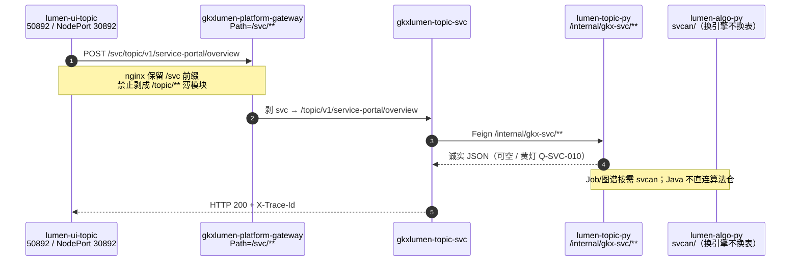

# LUMEN-SVC-P-E-DEVOPS-L01 · E0 点名五服务发布门（阶段 P）

> 日期：2026-08-23  
> Task：`LUMEN-SVC-P-E-DEVOPS-L01`  
> 总控：[`LUMEN-SVC-P-长任务总控.md`](./LUMEN-SVC-P-长任务总控.md) §4 / §1.20  
> 段派单：[`LUMEN-SVC-P-E-总派单.md`](./LUMEN-SVC-P-E-总派单.md)  
> 监管：`human:侯佳伟` · `claim_type=coordinator_dispatch` · lock 24h  
> **本叶不标 `done`。不派 E1。**

## 任务认领（必填）

| 字段 | 值 |
|------|-----|
| claimed_by | `agent:devops-agent` |
| supervised_by | `human:侯佳伟` |
| claim_type | `coordinator_dispatch` |
| 说明 | 长任务 §7 已生效；coordinator 已 MCP 置 `in_progress`。本会话未改 `task-registry.yaml`。 |

## Ponytail（coding 任务必填）

| 字段 | 值 |
|------|-----|
| ponytail | `full` |
| 说明 | 只动 nginx ConfigMap / Helm 点名 job / 一处挡住 `frontend:build` 的 SFC 开标签。未改页面交互、未改 Java/Python 算法。 |

## Headroom（可选）

| 字段 | 值 |
|------|-----|
| headroom | `skip` |
| 说明 | 本机未挂载 Headroom；外网 50892 + GitLab CI kubectl 为验收真源。 |

## 图即契约

| 字段 | 值 |
|------|-----|
| diagram_id | `LUMEN-SVC-P-E-DEVOPS-L01-SEQ` |
| 图 diff | 实线补上 FE nginx `/svc/**` → 网关 `Path=/svc/**` → `gkxlumen-topic-svc` → `lumen-topic-py` `/internal/gkx-svc/**`。虚线：工厂存储边（本叶不改）。禁止 `/api/svc` 当网关前缀、禁止 Feign `demo-*`。 |
| 会签态 | `draft`（本叶 L4 联调时序，非存储流图改边） |



| 生产者 | 消费者 | 触发 | 失败语义 | 禁止事项 |
|--------|--------|------|----------|----------|
| FE nginx `/svc/` | gateway | 浏览器 POST | 无 `/svc` location → SPA **405**（已修） | `proxy_pass .../` 剥掉 `/svc` |
| gateway `Path=/svc/**` | `gkxlumen-topic-svc` | GlobalFilter 剥第一段 | Deployment 缺失 → **503**（已用 helm:chart 装出） | `/api/svc` 当网关前缀；Feign `demo-*` |
| topic-svc | search-py `/internal/gkx-svc` | Java REST | 下游失败诚实降级，不 5xx | 直连 lumen-algo-py / 写正式库 |
| 本叶 | — | — | — | 改工厂存储边；force push；标 done；派 E1 |

## 结论

**E0 门通过。联调通过。** 点名五服务 CI deploy 绿；50892 已滚过 `1f62f8a` 之后的 D（bundle 含 `rec-list` / `ServiceOrgCompareBasket` / `service-portal`）；`POST /svc/topic/v1/service-portal/overview` **不再 405**（HTTP 200 + `code=0` + `X-Trace-Id`，Demo ADS 实包，黄灯 `Q-SVC-010` 未改绿）。

## 途中 C1（已解）

| # | 分类 | 现象 | 处理 |
|---|------|------|------|
| 1 | C1 nginx | `POST /svc/...` → **405**（`location /` try_files 打 SPA） | `k8s/lumen-topic.yaml` 增加 `location ^~/svc/`，`proxy_pass` **不带尾斜杠**，保留 `/svc` |
| 2 | C1 Helm | `deploy:topic-svc` 红：`deployment/gkxlumen-platform-topic-svc not found` | play `helm:chart` **24055** `FORCE_NACOS_REPUBLISH=true` 装出 Deployment；retry set-image **d54ec0be** |
| 3 | C1 CI | `frontend:build` 红：`ServiceOrgSearchPage.vue` 缺 `<script setup lang="ts">`（`ref<T>` 被当成 HTML 标签） | 只补开标签，不改页面行为；否则 D 包永远上不去 |
| 4 | C1 点名 | `deploy:search-py` 在 origin/dev 为 **manual**，5488 未点 | play **24006** → `gkxlumen-search-service:47289f90` |

`helm:chart` 的 `rollme` 曾把 chain/async 镜像打回 release 旧 tag `57c9a1d9`；已 retry `deploy:topic-chain` / `deploy:topic-async-service` 钉回 `d54ec0be`。

## 五服务 pipeline / 镜像 / rollout

| 点名 | 结论 | pipeline / job | 镜像 tag（禁 latest 部署） | rollout |
|------|------|----------------|---------------------------|---------|
| `lumen-ui-topic` | 绿 | [5530](https://gitlab.htmisoft.net/gkx-lumen/lumen-ui-topic/-/pipelines/5530) `frontend:build` **24230** · `deploy:k8s` **24233** | `harbor.htmisoft.net/gkx/gkx-lumen-topic:7f72f3d1` | success；NodePort `80:30892` |
| `gkxlumen-topic-svc` | 绿 | [5492](https://gitlab.htmisoft.net/gkx-lumen/lumen-svc-platform/-/pipelines/5492) `backend:image:topic-svc` 绿；`helm:chart` [24055](https://gitlab.htmisoft.net/gkx-lumen/lumen-svc-platform/-/jobs/24055)；`deploy:topic-svc` [24235](https://gitlab.htmisoft.net/gkx-lumen/lumen-svc-platform/-/jobs/24235) | `gkxlumen-topic-svc:d54ec0be` | success |
| `gkxlumen-topic-async-service` | 绿 | 同 5492 · [24237](https://gitlab.htmisoft.net/gkx-lumen/lumen-svc-platform/-/jobs/24237) | `gkxlumen-topic-async-service:d54ec0be` | success |
| `lumen-topic-py` | 绿 | [5488](https://gitlab.htmisoft.net/gkx-lumen/lumen-topic-py/-/pipelines/5488) `deploy:search-py` [24006](https://gitlab.htmisoft.net/gkx-lumen/lumen-topic-py/-/jobs/24006) | `gkxlumen-search-service:47289f90` | success；in-pod `/healthz` `status=ok` `mock_enabled=false` |
| `lumen-algo-py` | 绿 | [5515](https://gitlab.htmisoft.net/gkx-lumen/lumen-algo-py/-/pipelines/5515) `deploy:api` **24181** · `deploy:worker` **24183** | `gkx-lumen-algo-py-api:683c921f` / `-worker:683c921f`（含 `2050ed1` svcan） | success + healthz |

仓 SHA：`lumen-ui-topic` `7f72f3d`（含 D `1f62f8a` + nginx/`<script setup>`）；`lumen-svc-platform` `d54ec0be`；`lumen-topic-py` `47289f90`；`lumen-algo-py` `683c921f`。

网关仓内路由：`helm/gkxlumen-platform/configs/gkxlumen-gateway-dev.yml` `Path=/svc/**` → `lb://gkxlumen-topic-svc-biz`（GlobalFilter 剥 `svc`）。本次 `FORCE_NACOS_REPUBLISH=true` 已重灌。Java topic-svc **无** Feign `demo-*`。

## 50892 与 30892 对照

| | 外网产品 | 集群 NodePort |
|--|----------|----------------|
| URL | **http://111.198.38.90:50892/**（总控真源 / 本叶验收） | `http://192.168.88.50:30892`（CI `E2E_BASE_URL`；本机超时不可达） |
| 映射 | NAT → 同 Deployment `gkx-lumen-topic` | `svc gkx-lumen-topic` `80:30892/TCP` |
| 滚前 | `index-BcwVodOr.js`，无 `rec-list` / `ServiceOrgCompareBasket` | — |
| 滚后 | `index-1yWyr-FK.js`：**HIT** `rec-list` · `ServiceOrgCompareBasket` · `service-portal` | CI rollout 日志 |

## `/svc` 探测（2026-08-23 · 外网 · 截断 body）

基址 `http://111.198.38.90:50892`

```text
POST /svc/topic/v1/service-portal/overview  body={}
  → HTTP 200  X-Trace-Id=80a5378fa110070eb0ccdfa77ff779c3
  → {"code":0,...,"gap":["Q-SVC-010"],"kpi":{"org_in_pool":3525,"metric_id":"M_SVC_ORG_CNT",...}}
  （不再 405；非 Demo fixture）

GET /svc/topic/v1/service/health
  → HTTP 200  X-Trace-Id=99079e87e60ebf3f67dca870ad8364a4
  → java=gkxlumen-topic-svc-biz up；python=gkx-svc-service ok；degraded=false

POST /svc/topic/v1/service/rec-list  {"kind":"attract","limit":3}
  → HTTP 200  X-Trace-Id=e8eab95f91f7935f28dd8340ab63d9b6  code=0 list_type=ATTRACT

POST /svc/topic/v1/service/search/orgs  {"page":1,"size":2}
  → HTTP 200  total=3525

POST /api/svc/topic/v1/service-portal/overview
  → HTTP 200（nginx 剥 /api 后仍走网关 /svc；产品路径仍以 /svc 为准，禁止把 /api/svc 当网关前缀）
```

## 回滚命令

```text
# 前端（上一镜像可由 CI 前一成功 deploy:k8s 查，现网 5c2ee7d2 曾在 50892）
kubectl -n dev rollout undo deployment/gkx-lumen-topic
# 或钉 SHA：kubectl -n dev set image deployment/gkx-lumen-topic nginx=harbor.htmisoft.net/gkx/gkx-lumen-topic:<prevSha>

kubectl -n dev rollout undo deployment/gkxlumen-platform-topic-svc
kubectl -n dev rollout undo deployment/gkxlumen-platform-topic-async-service
kubectl -n dev rollout undo deployment/gkxlumen-platform-search-py
kubectl -n dev rollout undo deployment/lumen-platform-algo-py
kubectl -n dev rollout undo deployment/lumen-platform-algo-py-worker

# chart / Nacos 种子
helm rollback gkxlumen-platform -n dev
```

## 本叶改动的仓

- `lumen-ui-topic` `7f72f3d` `[agent:devops-agent]` → `origin/dev`：nginx `/svc` + 恢复 SFC 开标签。  
- `lumen-svc-platform` / `lumen-topic-py` / `lumen-algo-py`：**无新 commit**，只点名已有 pipeline / play / retry。

## 可观测性

- OTEL / `X-Trace-Id`：overview `80a5378fa110070eb0ccdfa77ff779c3`；health `99079e87e60ebf3f67dca870ad8364a4`  
- Tempo / Loki：本机无 kubeconfig，未截 Grafana；响应头已带 trace。

## Cost

| 字段 | 值 |
|------|-----|
| actual_tokens | 估 110000 |
| model_used | Cursor Grok 4.6（派单模板写 claude-sonnet-4.5，按本会话实模回填） |
| actual_cost | 估 $4.5 |
| cost_warn | false |

## 架构合规自检

| 铁律 | 结果 |
|------|------|
| 调用链 FE → Java → Python `/internal/*` | ✅ `/svc` → topic-svc → search-py `/internal/gkx-svc` |
| 算法只在 Python / Java 不直连算法仓 | ✅ Feign 只 `gkxlumen-platform-search-py` |
| Nebula 非 Neo4j | ✅ 本叶未改图存储 |
| 可观测 | ✅ `X-Trace-Id` |
| D12 禁 demo-* | ✅ topic-svc 无 demo Feign；search-py 为 `gkxlumen-search-service` |
| 禁 `/api/svc` 网关前缀 | ✅ 网关 `Path=/svc/**`；nginx 产品路径 `/svc/` |
| 镜像 tag=SHA | ✅ 无 `latest` 部署 |
| 禁 force / 禁改 registry / 禁标 done | ✅ |
| 本叶不改工厂存储边 | ✅ |

## 遗留

- 同 Pipeline `e2e:chain-gold` **24234** 已绿（CHAIN 金路径，**不是** SVC E1）。本叶 **不派** `LUMEN-SVC-P-E-QA-SMOKE-L01`。  
- `deploy:search-py` 仍默认 manual；下次 P 点名须再 play 或改 rules（未在本叶改 CI 规则，以免扩大 blast radius）。  
- 本机打不开 30892；验收以外网 50892 为准。
